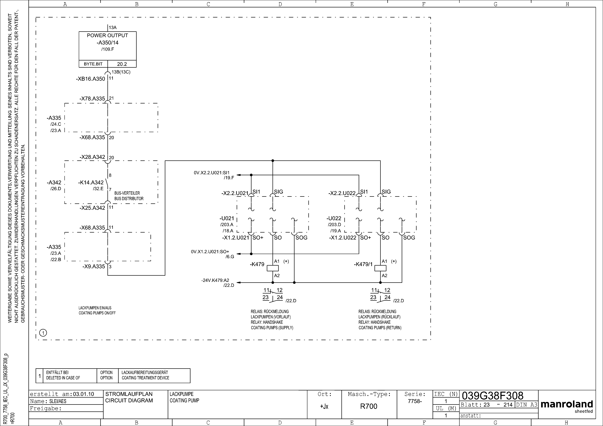

# +Jx — Sheet 23 of 214 — LACKPUMPE

**COATING PUMP**

> Part of the manroland **R700** printing press IEC/UL circuit diagrams.
> Drawing class: **Stromlaufplan / Circuit diagram** (DIN A3).
> Document `+Jx` covers the **1st printing module + feed register** machine section.

## At a glance

| Field | Value |
|---|---|
| Document | `+Jx`  (039G38F308) |
| Sheet | **23** of 214 |
| Section (DE) | LACKPUMPE |
| Section (EN) | COATING PUMP |
| Section type | CIRCUIT — Circuit diagram |
| Machine type | `R700` |
| Series | `7758` |
| Created | 03.01.10 |
| Replaces | — |
| Columns used | A, B, C, D, E, F |
| Path numbers | — |
| Labels on sheet | 97 |
| Cross-refs out | 16 |
| Cross-refs in | 23 |

**Previous:** [+Jx sheet 22](SHEET_0022.md) · **Next:** [+Jx sheet 24](SHEET_0024.md) · **Document TOC:** [_TOC.md](_TOC.md)  (+Jx) · **Master TOC:** [all sheets](../_MASTER_TOC.md)

## Sheet image (300 DPI, exact vector render)



_Rendered directly from the PDF vector layer at 300 DPI (1-bit), no OCR and no resampling. Use it to confirm anything ambiguous in the text below._

## Cross-references on this sheet

Each entry is a wire leaving this sheet. The printed token is `/sheet.column`; the link resolves to that sheet inside the same document.

| Ref | Target sheet | Col | Path | Destination on target | Target section | From col |
|---|---|---|---|---|---|---|
| `/109.F` | [+Jx sheet 109](SHEET_0109.md) | F | — | — | REFERENZMODUL | B |
| `/24.C` | [+Jx sheet 24](SHEET_0024.md) | C | — | — | HILFSANTRIEB, LACKDOSIER /AUFTRAGSWALZEN | A |
| `/23.A` | [+Jx sheet 23](SHEET_0023.md) | A | — | — | LACKPUMPE | A |
| `/19.F` | [+Jx sheet 19](SHEET_0019.md) | F | — | 0V.X2.2.U021:SI1 | LACKPUMPE | C |
| `/32.E` | [+Jx sheet 32](SHEET_0032.md) | E | — | — | NOT AUS | A |
| `/26.D` | [+Jx sheet 26](SHEET_0026.md) | D | — | — | HILFSANTRIEB, LACKDOSIER /AUFTRAGSWALZEN | A |
| `/203.A` | [+Jx sheet 203](SHEET_0203.md) | A | — | — | OPTION: TELEPRESENCE | C |
| `/203.D` | [+Jx sheet 203](SHEET_0203.md) | D | — | — | OPTION: TELEPRESENCE | E |
| `/18.A` | [+Jx sheet 18](SHEET_0018.md) | A | — | — | LACKPUMPE | C |
| `/19.A` | [+Jx sheet 19](SHEET_0019.md) | A | — | — | LACKPUMPE | E |
| `/6.G` | [+Jx sheet 6](SHEET_0006.md) | G | — | 0V.X1.2.U021:SO+ | SPANNUNGSVERSORGUNG, SCHALTSCHRANKBELÜFTUNG | C |
| `/23.A` | [+Jx sheet 23](SHEET_0023.md) | A | — | — | LACKPUMPE | A |
| `/22.B` | [+Jx sheet 22](SHEET_0022.md) | B | — | — | LACKPUMPE | A |
| `/22.D` | [+Jx sheet 22](SHEET_0022.md) | D | — | 24V.K479:A2 | LACKPUMPE | C |
| `/22.D` | [+Jx sheet 22](SHEET_0022.md) | D | — | — | LACKPUMPE | D |
| `/22.D` | [+Jx sheet 22](SHEET_0022.md) | D | — | — | LACKPUMPE | F |

### Incoming references (sheets that point here)

Every other sheet that sends a wire to this one. `Back-ref` is the token printed on *that* sheet; `Path` is its line number.

| From sheet | Cols | Back-ref | Path | Refs | What continues there |
|---|---|---|---|---|---|
| [+Jx#6](SHEET_0006.md) | H | `/6.H` | — | 1 | 0V.X1.2.U021:SO+ |
| [+Jx#18](SHEET_0018.md) | A | `/18.A` | — | 1 | — |
| [+Jx#19](SHEET_0019.md) | A, F | `/19.A`, `/19.F` | — | 2 | 0V.X31.U022:4 |
| [+Jx#22](SHEET_0022.md) | A, D, E | `/22.A`, `/22.D`, `/22.E` | — | 4 | — |
| [+Jx#23](SHEET_0023.md) | A | `/23.A` | — | 2 | — |
| [+Jx#24](SHEET_0024.md) | C | `/24.C` | — | 1 | — |
| [+Jx#26](SHEET_0026.md) | D | `/26.D` | — | 1 | — |
| [+Jx#32](SHEET_0032.md) | E | `/32.E` | — | 1 | — |
| [+Jx#109](SHEET_0109.md) | F | `/109.F` | — | 1 | — |
| [+Jx#134](SHEET_0134.md) | E | `/134.E` | — | 1 | — |
| [+Jx#139](SHEET_0139.md) | G | `/139.G` | — | 1 | — |
| [+Jx#142](SHEET_0142.md) | H | `/142.H` | — | 1 | — |
| [+Jx#145](SHEET_0145.md) | G | `/145.G` | — | 1 | — |
| [+Jx#152](SHEET_0152.md) | E | `/152.E` | — | 2 | — |
| [+Jx#156](SHEET_0156.md) | C | `/156.C` | — | 1 | — |
| [+Jx#203](SHEET_0203.md) | A, D | `/203.A`, `/203.D` | — | 2 | — |


## Devices on this sheet

| Tag | Class | Class meaning (IEC) | Col | Sub | Terminal | Sign |
|---|---|---|---|---|---|---|
| `A350/14` | A | Baugruppe / assembly, module, PC board | B | 14 | — | — |
| `A342` | A | Baugruppe / assembly, module, PC board | A | — | — | — |
| `U021` | U | Umrichter / frequency converter | C | — | — | — |
| `SI1` | SI |  | D | — | — | — |
| `A1` | A | Baugruppe / assembly, module, PC board | D | — | — | — |
| `A2` | A | Baugruppe / assembly, module, PC board | D | — | — | — |
| `K479` | K | Relais / relay, contactor | D | — | — | — |
| `U022` | U | Umrichter / frequency converter | E | — | — | — |
| `SI1` | SI |  | E | — | — | — |
| `A1` | A | Baugruppe / assembly, module, PC board | E | — | — | — |
| `A2` | A | Baugruppe / assembly, module, PC board | E | — | — | — |
| `K479/1` | K | Relais / relay, contactor | E | 1 | — | — |
| `A335` | A | Baugruppe / assembly, module, PC board | A | — | — | — |
| `A335` | A | Baugruppe / assembly, module, PC board | A | — | — | — |
| `X28.A342` | — | cross-device reference | A | — | — | — |
| `K14.A342` | — | cross-device reference | A | — | — | — |
| `X25.A342` | — | cross-device reference | A | — | — | — |
| `X68.A335` | — | cross-device reference | A | — | — | — |
| `20.2` | — | cross-device reference | B | — | — | — |
| `XB16.A350` | — | cross-device reference | A | — | — | — |
| `X78.A335` | — | cross-device reference | A | — | — | — |
| `X9.A335` | — | cross-device reference | A | — | — | — |
| `X68.A335` | — | cross-device reference | A | — | — | — |
| `X1.2.U021` | — | cross-device reference | C | — | — | — |
| `X2.2.U021` | — | cross-device reference | C | — | — | — |
| `X1.2.U022` | — | cross-device reference | E | — | — | — |
| `X2.2.U022` | — | cross-device reference | E | — | — | — |

## Potentials / nets

| Potential | Count | Columns | Attached devices | Terminals |
|---|---|---|---|---|
| `0V` | 1 | C | `2`, `U021`, `X2` | `SI1` |
| `24V` | 1 | C | `K479` | `A2` |


A potential such as `L24+/4` or `M24+` is a named supply/return rail; every place it appears on this sheet is electrically common.

## Wire-end annotations (grouped as printed)

A wire that continues elsewhere is annotated with a small cluster: the destination description, the path/line number `#NN`, and the `/sheet.column` cross reference. Each row below is one such cluster exactly as it is grouped on the drawing.

| Col | Y | Path | Cross-ref | Text on the wire |
|---|---|---|---|---|
| B | 50.5 | — | — | `13A` |
| B | 65.7 | — | — | `POWER OUTPUT` |
| B | 79.6 | — | — | `A350/14` |
| B | 93.4 | — | `/109.F` | — |
| B | 122.5 | — | — | `BYTE.BIT 20.2` |
| B | 138.4 | — | — | `13B(13C)` |
| A | 150.5 | — | — | `XB16.A350 11` |
| A | 190.2 | — | — | `X78.A335 21` |
| A | 228.4 | — | — | `A335` |
| A | 241.5 | — | `/24.C`, `/23.A` | — |
| A | 266.7 | — | — | `X68.A335 20` |
| A | 305.7 | — | — | `X28.A342 20` |
| C | 337.5 | — | `/19.F` | `0V.X2.2.U021:SI1` |
| B | 342.6 | — | — | `8` |
| A | 356.0 | — | — | `A342` |
| A | 356.0 | — | — | `K14.A342 7` |
| A | 369.1 | — | `/26.D` | — |
| A | 369.1 | — | `/32.E` | — |
| D | 374.5 | — | — | `X2.2.U021 SI1 SIG` |
| E | 374.5 | — | — | `X2.2.U022 SI1 SIG` |
| B | 379.0 | — | — | `BUS VERTEILER BUS DISTRIBUTOR` |
| A | 405.6 | — | — | `X25.A342 11` |
| C | 426.9 | — | — | `U021` |
| E | 426.9 | — | — | `U022` |
| C | 439.9 | — | `/203.A` | — |
| E | 440.0 | — | `/203.D` | — |
| A | 445.3 | — | — | `X68.A335 11` |
| C | 452.3 | — | `/18.A` | — |
| E | 452.3 | — | `/19.A` | — |
| C | 465.1 | — | — | `X1.2.U021 SO+` |
| D | 465.1 | — | — | `SO` |
| E | 465.1 | — | — | `SOG X1.2.U022 SO+` |
| E | 465.1 | — | — | `SO` |
| F | 465.1 | — | — | `SOG` |
| A | 483.5 | — | — | `A335` |
| C | 493.4 | — | `/6.G` | `0V.X1.2.U021:SO+` |
| A | 496.6 | — | `/23.A`, `/22.B` | — |
| D | 512.6 | — | — | `A1` |
| E | 512.6 | — | — | `(+) (+)` |
| E | 512.6 | — | — | `A1` |
| D | 517.6 | — | — | `K479` |
| E | 517.6 | — | — | `K479/1` |
| A | 521.8 | — | — | `X9.A335 3` |
| D | 540.9 | — | — | `A2` |
| E | 540.9 | — | — | `A2` |
| C | 550.1 | — | `/22.D` | `24V.K479:A2` |
| D | 568.5 | — | — | `23 11 12 24` |
| E | 568.5 | — | — | `23 11 12 24` |
| D | 590.5 | — | `/22.D` | — |
| F | 590.5 | — | `/22.D` | — |
| A | 606.0 | — | — | `LACKPUMPEN EIN/AUS COATING PUMPS ON/OFF` |
| D | 612.9 | — | — | `RELAIS: RÜCKMELDUNG LACKPUMPEN (VORLAUF) RELAY: HANDSHAKE COATING PUMPS (SUPPLY)` |
| E | 612.9 | — | — | `RELAIS: RÜCKMELDUNG LACKPUMPEN (RÜCKLAUF) RELAY: HANDSHAKE COATING PUMPS (RETURN)` |
| A | 654.6 | — | — | `1` |
| A | 733.3 | — | — | `1 ENTFÄLLT BEI DELETED IN CASE OF OPTION OPTION` |
| B | 733.3 | — | — | `LACKAUFBEREITUNGSGERÄT COATING TREATMENT DEVICE` |


## Reconstructed tables

This sheet carries tabular content (pin map / terminal assignment / index). The grid below was rebuilt from the drawing's own rule lines, so each row is exactly one physical row of the table.

### Table 1 — 3 data rows × 2 columns (at x=155.9, y=62.4)

| POWER A350/14 | OUTPUT /109.F |
|---|---|
| `BYTE.BIT` | `20.2` |
| `XB16.A350 X78.A335 X68.A335 X28.A342` | `13B(13C) 11 21 20 20` |
| `K14.A342 /32.E X25.A342 X68.A335 X9.A335` | `8 7 BUS VERTEILER BUS DISTRIBUTOR 11 11 3` |


### Table 2 — 1 data rows × 2 columns (at x=496.1, y=317.5)

| SI1 SO+ | SIG SO |
|---|---|
| `K479` | `A1 (+) A2` |


### Table 3 — 1 data rows × 2 columns (at x=708.7, y=317.5)

| SI1 SO+ | SIG SO |
|---|---|
| `K479/1` | `A1 (+) A2` |


## Notes and free text on this sheet

| Text | Col | Y (pt) |
|---|---|---|
| `13A` | B | 50.54 |
| `13B(13C)` | B | 138.45 |
| `POWER OUTPUT` | B | 65.69 |
| `BYTE.BIT` | A | 123.03 |
| `LACKPUMPEN EIN/AUS` | A | 605.96 |
| `COATING PUMPS ON/OFF` | A | 615.87 |
| `BUS VERTEILER` | B | 379 |
| `BUS DISTRIBUTOR` | B | 389.64 |
| `SO+` | D | 465.12 |
| `SIG` | D | 374.51 |
| `SO` | D | 465.13 |
| `RELAIS: RÜCKMELDUNG` | D | 612.88 |
| `LACKPUMPEN (VORLAUF)` | D | 623.51 |
| `RELAY: HANDSHAKE` | D | 634.12 |
| `COATING PUMPS (SUPPLY)` | D | 644.77 |
| `SOG` | D | 465.13 |
| `SO+` | E | 465.12 |
| `SIG` | E | 374.51 |
| `SO` | E | 465.13 |
| `RELAIS: RÜCKMELDUNG` | E | 612.88 |
| `LACKPUMPEN (RÜCKLAUF)` | E | 623.51 |
| `RELAY: HANDSHAKE` | E | 634.12 |
| `COATING PUMPS (RETURN)` | E | 644.78 |
| `SOG` | F | 465.13 |
| `0V.X1.2.U021:SO+` | C | 493.44 |
| `ENTFÄLLT BEI` | A | 733.3 |
| `DELETED IN CASE OF` | A | 743.96 |
| `OPTION` | B | 733.32 |
| `LACKAUFBEREITUNGSGERÄT` | B | 733.34 |
| `COATING TREATMENT DEVICE` | B | 743.97 |

## Complete label inventory (exact text from the drawing)

Every text object inside the drawing area of this sheet, in DIN reading order (column A→H, then top→bottom). This is the authoritative list: if a string is not here it is not printed on this sheet.

| Col | Y | X | Dir | Type | Text |
|---|---|---|---|---|---|
| A | 123.0 | 165.8 | → | text | `BYTE.BIT` |
| A | 151.2 | 150.2 | → | device ref | `XB16.A350` |
| A | 190.2 | 157.0 | → | device ref | `X78.A335` |
| A | 228.4 | 92.4 | → | device tag | `A335` |
| A | 241.5 | 99.8 | → | cross-reference | `/24.C` |
| A | 253.9 | 99.8 | → | cross-reference | `/23.A` |
| A | 266.7 | 157.0 | → | device ref | `X68.A335` |
| A | 305.7 | 157.3 | → | device ref | `X28.A342` |
| A | 356.0 | 92.7 | → | device tag | `A342` |
| A | 356.0 | 154.5 | → | device ref | `K14.A342` |
| A | 369.1 | 99.8 | → | cross-reference | `/26.D` |
| A | 369.1 | 183.7 | → | cross-reference | `/32.E` |
| A | 406.3 | 157.3 | → | device ref | `X25.A342` |
| A | 445.3 | 157.0 | → | device ref | `X68.A335` |
| A | 483.5 | 92.4 | → | device tag | `A335` |
| A | 496.6 | 99.8 | → | cross-reference | `/23.A` |
| A | 509.0 | 100.1 | → | cross-reference | `/22.B` |
| A | 521.8 | 163.0 | → | device ref | `X9.A335` |
| A | 606.0 | 155.3 | → | text | `LACKPUMPEN EIN/AUS` |
| A | 615.9 | 155.6 | → | text | `COATING PUMPS ON/OFF` |
| A | 654.6 | 83.2 | → | number | `1` |
| A | 733.3 | 91.6 | → | text | `ENTFÄLLT BEI` |
| A | 738.6 | 75.4 | → | number | `1` |
| A | 744.0 | 91.6 | → | text | `DELETED IN CASE OF` |
| B | 50.5 | 214.6 | → | text | `13A` |
| B | 65.7 | 171.8 | → | text | `POWER OUTPUT` |
| B | 79.6 | 191.1 | → | device tag | `A350/14` |
| B | 93.4 | 200.3 | → | cross-reference | `/109.F` |
| B | 122.5 | 231.4 | → | device ref | `20.2` |
| B | 138.5 | 220.3 | → | text | `13B(13C)` |
| B | 150.5 | 214.6 | → | number | `11` |
| B | 190.2 | 215.4 | → | number | `21` |
| B | 268.1 | 215.4 | → | number | `20` |
| B | 307.8 | 215.4 | → | number | `20` |
| B | 342.6 | 215.1 | → | number | `8` |
| B | 370.9 | 215.1 | → | number | `7` |
| B | 379.0 | 226.2 | → | text | `BUS VERTEILER` |
| B | 389.6 | 226.2 | → | text | `BUS DISTRIBUTOR` |
| B | 405.6 | 214.6 | → | number | `11` |
| B | 445.3 | 214.6 | → | number | `11` |
| B | 523.3 | 215.1 | → | number | `3` |
| B | 733.3 | 198.1 | → | text | `OPTION` |
| B | 733.3 | 240.4 | → | text | `LACKAUFBEREITUNGSGERÄT` |
| B | 743.9 | 198.1 | → | text | `OPTION` |
| B | 744.0 | 240.7 | → | text | `COATING TREATMENT DEVICE` |
| C | 337.5 | 383.0 | → | potential | `0V.X2.2.U021:SI1` |
| C | 347.4 | 442.2 | → | cross-reference | `/19.F` |
| C | 377.3 | 437.4 | → | device ref | `X2.2.U021` |
| C | 426.9 | 433.7 | → | device tag | `U021` |
| C | 439.9 | 435.1 | → | cross-reference | `/203.A` |
| C | 452.3 | 439.9 | → | cross-reference | `/18.A` |
| C | 465.1 | 438.8 | → | device ref | `X1.2.U021` |
| C | 493.4 | 377.3 | → | text | `0V.X1.2.U021:SO+` |
| C | 503.3 | 445.6 | → | cross-reference | `/6.G` |
| C | 550.1 | 397.7 | → | potential | `24V.K479:A2` |
| C | 560.1 | 441.4 | → | cross-reference | `/22.D` |
| D | 374.5 | 498.6 | → | device tag | `SI1` |
| D | 374.5 | 541.1 | → | text | `SIG` |
| D | 465.1 | 498.6 | → | text | `SO+` |
| D | 465.1 | 541.1 | → | text | `SO` |
| D | 465.1 | 583.7 | → | text | `SOG` |
| D | 512.6 | 541.4 | → | device tag | `A1` |
| D | 512.7 | 559.6 | → | other | `(+)` |
| D | 517.6 | 493.5 | → | device tag | `K479` |
| D | 540.9 | 541.4 | → | device tag | `A2` |
| D | 568.5 | 520.2 | → | number | `11` |
| D | 568.5 | 546.0 | → | number | `12` |
| D | 582.7 | 518.5 | → | number | `23` |
| D | 582.7 | 546.8 | → | number | `24` |
| D | 590.5 | 564.1 | → | cross-reference | `/22.D` |
| D | 612.9 | 495.5 | → | text | `RELAIS: RÜCKMELDUNG` |
| D | 623.5 | 495.5 | → | text | `LACKPUMPEN (VORLAUF)` |
| D | 634.1 | 495.5 | → | text | `RELAY: HANDSHAKE` |
| D | 644.8 | 495.8 | → | text | `COATING PUMPS (SUPPLY)` |
| E | 374.5 | 711.2 | → | device tag | `SI1` |
| E | 374.5 | 753.7 | → | text | `SIG` |
| E | 377.3 | 648.6 | → | device ref | `X2.2.U022` |
| E | 426.9 | 644.9 | → | device tag | `U022` |
| E | 440.0 | 647.7 | → | cross-reference | `/203.D` |
| E | 452.3 | 652.5 | → | cross-reference | `/19.A` |
| E | 465.1 | 650.0 | → | device ref | `X1.2.U022` |
| E | 465.1 | 711.2 | → | text | `SO+` |
| E | 465.1 | 753.7 | → | text | `SO` |
| E | 512.6 | 754.0 | → | device tag | `A1` |
| E | 517.6 | 699.0 | → | device tag | `K479/1` |
| E | 540.9 | 754.0 | → | device tag | `A2` |
| E | 568.5 | 732.8 | → | number | `11` |
| E | 568.5 | 758.6 | → | number | `12` |
| E | 582.7 | 731.1 | → | number | `23` |
| E | 612.9 | 708.1 | → | text | `RELAIS: RÜCKMELDUNG` |
| E | 623.5 | 708.1 | → | text | `LACKPUMPEN (RÜCKLAUF)` |
| E | 634.1 | 708.1 | → | text | `RELAY: HANDSHAKE` |
| E | 644.8 | 708.4 | → | text | `COATING PUMPS (RETURN)` |
| F | 465.1 | 796.3 | → | text | `SOG` |
| F | 512.7 | 772.2 | → | other | `(+)` |
| F | 582.7 | 759.4 | → | number | `24` |
| F | 590.5 | 776.7 | → | cross-reference | `/22.D` |

## Reading-order text block

The same content as a plain block, grouped by DIN column — convenient to paste or to match against a visual description.

```text
=== Column A ===
 123.0  165.8  text         BYTE.BIT
 151.2  150.2  devref       XB16.A350
 190.2  157.0  devref       X78.A335
 228.4   92.4  devtag       A335
 241.5   99.8  xref         /24.C
 253.9   99.8  xref         /23.A
 266.7  157.0  devref       X68.A335
 305.7  157.3  devref       X28.A342
 356.0   92.7  devtag       A342
 356.0  154.5  devref       K14.A342
 369.1   99.8  xref         /26.D
 369.1  183.7  xref         /32.E
 406.3  157.3  devref       X25.A342
 445.3  157.0  devref       X68.A335
 483.5   92.4  devtag       A335
 496.6   99.8  xref         /23.A
 509.0  100.1  xref         /22.B
 521.8  163.0  devref       X9.A335
 606.0  155.3  text         LACKPUMPEN EIN/AUS
 615.9  155.6  text         COATING PUMPS ON/OFF
 654.6   83.2  numeric      1
 733.3   91.6  text         ENTFÄLLT BEI
 738.6   75.4  numeric      1
 744.0   91.6  text         DELETED IN CASE OF
=== Column B ===
  50.5  214.6  text         13A
  65.7  171.8  text         POWER OUTPUT
  79.6  191.1  devtag       A350/14
  93.4  200.3  xref         /109.F
 122.5  231.4  devref       20.2
 138.5  220.3  text         13B(13C)
 150.5  214.6  numeric      11
 190.2  215.4  numeric      21
 268.1  215.4  numeric      20
 307.8  215.4  numeric      20
 342.6  215.1  numeric      8
 370.9  215.1  numeric      7
 379.0  226.2  text         BUS VERTEILER
 389.6  226.2  text         BUS DISTRIBUTOR
 405.6  214.6  numeric      11
 445.3  214.6  numeric      11
 523.3  215.1  numeric      3
 733.3  198.1  text         OPTION
 733.3  240.4  text         LACKAUFBEREITUNGSGERÄT
 743.9  198.1  text         OPTION
 744.0  240.7  text         COATING TREATMENT DEVICE
=== Column C ===
 337.5  383.0  net          0V.X2.2.U021:SI1
 347.4  442.2  xref         /19.F
 377.3  437.4  devref       X2.2.U021
 426.9  433.7  devtag       U021
 439.9  435.1  xref         /203.A
 452.3  439.9  xref         /18.A
 465.1  438.8  devref       X1.2.U021
 493.4  377.3  text         0V.X1.2.U021:SO+
 503.3  445.6  xref         /6.G
 550.1  397.7  net          24V.K479:A2
 560.1  441.4  xref         /22.D
=== Column D ===
 374.5  498.6  devtag       SI1
 374.5  541.1  text         SIG
 465.1  498.6  text         SO+
 465.1  541.1  text         SO
 465.1  583.7  text         SOG
 512.6  541.4  devtag       A1
 512.7  559.6  other        (+)
 517.6  493.5  devtag       K479
 540.9  541.4  devtag       A2
 568.5  520.2  numeric      11
 568.5  546.0  numeric      12
 582.7  518.5  numeric      23
 582.7  546.8  numeric      24
 590.5  564.1  xref         /22.D
 612.9  495.5  text         RELAIS: RÜCKMELDUNG
 623.5  495.5  text         LACKPUMPEN (VORLAUF)
 634.1  495.5  text         RELAY: HANDSHAKE
 644.8  495.8  text         COATING PUMPS (SUPPLY)
=== Column E ===
 374.5  711.2  devtag       SI1
 374.5  753.7  text         SIG
 377.3  648.6  devref       X2.2.U022
 426.9  644.9  devtag       U022
 440.0  647.7  xref         /203.D
 452.3  652.5  xref         /19.A
 465.1  650.0  devref       X1.2.U022
 465.1  711.2  text         SO+
 465.1  753.7  text         SO
 512.6  754.0  devtag       A1
 517.6  699.0  devtag       K479/1
 540.9  754.0  devtag       A2
 568.5  732.8  numeric      11
 568.5  758.6  numeric      12
 582.7  731.1  numeric      23
 612.9  708.1  text         RELAIS: RÜCKMELDUNG
 623.5  708.1  text         LACKPUMPEN (RÜCKLAUF)
 634.1  708.1  text         RELAY: HANDSHAKE
 644.8  708.4  text         COATING PUMPS (RETURN)
=== Column F ===
 465.1  796.3  text         SOG
 512.7  772.2  other        (+)
 582.7  759.4  numeric      24
 590.5  776.7  xref         /22.D
```

---
_Generated from the PDF vector text layer; no OCR. Source: `R700_7758_IEC_UL_JX_039G38F308_p`, sheet 23._
