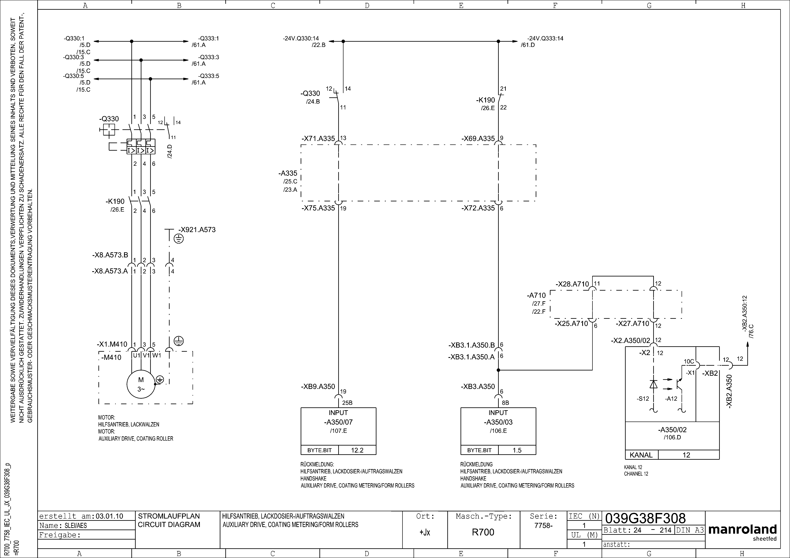

# +Jx — Sheet 24 of 214 — HILFSANTRIEB, LACKDOSIER /AUFTRAGSWALZEN

**AUXILIARY DRIVE, COATING METERING/FORM ROLLERS**

> Part of the manroland **R700** printing press IEC/UL circuit diagrams.
> Drawing class: **Stromlaufplan / Circuit diagram** (DIN A3).
> Document `+Jx` covers the **1st printing module + feed register** machine section.

## At a glance

| Field | Value |
|---|---|
| Document | `+Jx`  (039G38F308) |
| Sheet | **24** of 214 |
| Section (DE) | HILFSANTRIEB, LACKDOSIER /AUFTRAGSWALZEN |
| Section (EN) | AUXILIARY DRIVE, COATING METERING/FORM ROLLERS |
| Section type | CIRCUIT — Circuit diagram |
| Machine type | `R700` |
| Series | `7758` |
| Created | 03.01.10 |
| Replaces | — |
| Columns used | A, B, C, D, E, F, G, H |
| Path numbers | — |
| Labels on sheet | 139 |
| Cross-refs out | 23 |
| Cross-refs in | 49 |

**Previous:** [+Jx sheet 23](SHEET_0023.md) · **Next:** [+Jx sheet 25](SHEET_0025.md) · **Document TOC:** [_TOC.md](_TOC.md)  (+Jx) · **Master TOC:** [all sheets](../_MASTER_TOC.md)

## Sheet image (300 DPI, exact vector render)



_Rendered directly from the PDF vector layer at 300 DPI (1-bit), no OCR and no resampling. Use it to confirm anything ambiguous in the text below._

## Cross-references on this sheet

Each entry is a wire leaving this sheet. The printed token is `/sheet.column`; the link resolves to that sheet inside the same document.

| Ref | Target sheet | Col | Path | Destination on target | Target section | From col |
|---|---|---|---|---|---|---|
| `/22.B` | [+Jx sheet 22](SHEET_0022.md) | B | — | 24V.Q330:14 | LACKPUMPE | C |
| `/61.A` | [+Jx sheet 61](SHEET_0061.md) | A | — | — | GTW | B |
| `/5.D` | [+Jx sheet 5](SHEET_0005.md) | D | — | — | SPANNUNGSVERSORGUNG, SCHALTSCHRANKBELÜFTUNG | A |
| `/15.C` | [+Jx sheet 15](SHEET_0015.md) | C | — | — | ÖLUMLAUFSCHMIERUNG | A |
| `/61.D` | [+Jx sheet 61](SHEET_0061.md) | D | — | — | GTW | F |
| `/61.A` | [+Jx sheet 61](SHEET_0061.md) | A | — | — | GTW | B |
| `/5.D` | [+Jx sheet 5](SHEET_0005.md) | D | — | — | SPANNUNGSVERSORGUNG, SCHALTSCHRANKBELÜFTUNG | A |
| `/15.C` | [+Jx sheet 15](SHEET_0015.md) | C | — | — | ÖLUMLAUFSCHMIERUNG | A |
| `/61.A` | [+Jx sheet 61](SHEET_0061.md) | A | — | — | GTW | B |
| `/5.D` | [+Jx sheet 5](SHEET_0005.md) | D | — | — | SPANNUNGSVERSORGUNG, SCHALTSCHRANKBELÜFTUNG | A |
| `/15.C` | [+Jx sheet 15](SHEET_0015.md) | C | — | — | ÖLUMLAUFSCHMIERUNG | A |
| `/24.B` | [+Jx sheet 24](SHEET_0024.md) | B | — | — | HILFSANTRIEB, LACKDOSIER /AUFTRAGSWALZEN | C |
| `/26.E` | [+Jx sheet 26](SHEET_0026.md) | E | — | — | HILFSANTRIEB, LACKDOSIER /AUFTRAGSWALZEN | E |
| `/24.D` | [+Jx sheet 24](SHEET_0024.md) | D | — | — | HILFSANTRIEB, LACKDOSIER /AUFTRAGSWALZEN | B |
| `/25.C` | [+Jx sheet 25](SHEET_0025.md) | C | — | — | HILFSANTRIEB, LACKDOSIER /AUFTRAGSWALZEN | C |
| `/23.A` | [+Jx sheet 23](SHEET_0023.md) | A | — | — | LACKPUMPE | C |
| `/26.E` | [+Jx sheet 26](SHEET_0026.md) | E | — | — | HILFSANTRIEB, LACKDOSIER /AUFTRAGSWALZEN | A |
| `/76.C` | [+Jx sheet 76](SHEET_0076.md) | C | — | XB2.A350:12 | BUSVERBINDUNGEN: SICHERHEITSKREIS | H |
| `/27.F` | [+Jx sheet 27](SHEET_0027.md) | F | — | — | KAMMERRAKEL | F |
| `/22.F` | [+Jx sheet 22](SHEET_0022.md) | F | — | — | LACKPUMPE | F |
| `/107.E` | [+Jx sheet 107](SHEET_0107.md) | E | — | — | REFERENZMODUL | D |
| `/106.E` | [+Jx sheet 106](SHEET_0106.md) | E | — | — | REFERENZMODUL | E |
| `/106.D` | [+Jx sheet 106](SHEET_0106.md) | D | — | — | REFERENZMODUL | G |

### Incoming references (sheets that point here)

Every other sheet that sends a wire to this one. `Back-ref` is the token printed on *that* sheet; `Path` is its line number.

| From sheet | Cols | Back-ref | Path | Refs | What continues there |
|---|---|---|---|---|---|
| [+Jx#5](SHEET_0005.md) | E | `/5.E` | — | 3 | Q330:1; Q330:3; Q330:5 |
| [+Jx#15](SHEET_0015.md) | B, C | `/15.B`, `/15.C` | — | 3 | Q315:5 Q330:5; Q330:1; Q330:3 |
| [+Jx#22](SHEET_0022.md) | B, E | `/22.B`, `/22.E` | — | 2 | — |
| [+Jx#23](SHEET_0023.md) | A | `/23.A` | — | 1 | — |
| [+Jx#24](SHEET_0024.md) | B, C | `/24.B`, `/24.C` | — | 2 | — |
| [+Jx#25](SHEET_0025.md) | C | `/25.C` | — | 1 | — |
| [+Jx#26](SHEET_0026.md) | E | `/26.E` | — | 2 | — |
| [+Jx#27](SHEET_0027.md) | F | `/27.F` | — | 1 | — |
| [+Jx#61](SHEET_0061.md) | A, D | `/61.A`, `/61.D` | — | 4 | 24V.Q333:14; Q333:1; Q333:3; Q333:5 |
| [+Jx#76](SHEET_0076.md) | C | `/76.C` | — | 1 | XB2.A350:12 |
| [+Jx#106](SHEET_0106.md) | D, E | `/106.D`, `/106.E` | — | 2 | — |
| [+Jx#107](SHEET_0107.md) | E | `/107.E` | — | 1 | — |
| [+Jx#118](SHEET_0118.md) | H | `/118.H` | — | 4 | — |
| [+Jx#126](SHEET_0126.md) | E | `/126.E` | — | 2 | — |
| [+Jx#128](SHEET_0128.md) | C, D, F | `/128.C`, `/128.D`, `/128.F` | — | 3 | — |
| [+Jx#134](SHEET_0134.md) | A, G | `/134.A`, `/134.G` | — | 9 | — |
| [+Jx#143](SHEET_0143.md) | A | `/143.A` | — | 1 | — |
| [+Jx#144](SHEET_0144.md) | C | `/144.C` | — | 1 | — |
| [+Jx#146](SHEET_0146.md) | A | `/146.A` | — | 2 | — |
| [+Jx#152](SHEET_0152.md) | G | `/152.G` | — | 1 | — |
| [+Jx#153](SHEET_0153.md) | B, C | `/153.B`, `/153.C` | — | 2 | — |
| [+Jx#155](SHEET_0155.md) | A | `/155.A` | — | 1 | — |


## Devices on this sheet

| Tag | Class | Class meaning (IEC) | Col | Sub | Terminal | Sign |
|---|---|---|---|---|---|---|
| `K190` | K | Relais / relay, contactor | A | — | — | — |
| `Q330` | Q | Leistungsschalter / power switching device | A | — | — | — |
| `K190` | K | Relais / relay, contactor | E | — | — | — |
| `A350/03` | A | Baugruppe / assembly, module, PC board | E | 03 | — | — |
| `A335` | A | Baugruppe / assembly, module, PC board | C | — | — | — |
| `Q330` | Q | Leistungsschalter / power switching device | C | — | — | — |
| `A350/07` | A | Baugruppe / assembly, module, PC board | D | 07 | — | — |
| `A710` | A | Baugruppe / assembly, module, PC board | F | — | — | — |
| `S12` | S | Schalter / switch | G | — | — | — |
| `A12` | A | Baugruppe / assembly, module, PC board | G | — | — | — |
| `X1` | X | Klemme / terminal, plug connector | G | — | — | — |
| `X2` | X | Klemme / terminal, plug connector | G | — | — | — |
| `XB2` | XB |  | H | — | — | — |
| `A350/02` | A | Baugruppe / assembly, module, PC board | G | 02 | — | — |
| `Q333:3` | Q | Leistungsschalter / power switching device | B | — | 3 | — |
| `Q333:5` | Q | Leistungsschalter / power switching device | B | — | 5 | — |
| `Q333:1` | Q | Leistungsschalter / power switching device | B | — | 1 | — |
| `Q330:5` | Q | Leistungsschalter / power switching device | A | — | 5 | — |
| `Q330:3` | Q | Leistungsschalter / power switching device | A | — | 3 | — |
| `Q330:1` | Q | Leistungsschalter / power switching device | A | — | 1 | — |
| `X8.A573.B` | — | cross-device reference | A | — | — | — |
| `X8.A573.A` | — | cross-device reference | A | — | — | — |
| `X1.M410` | — | cross-device reference | A | — | — | — |
| `X72.A335` | — | cross-device reference | E | — | — | — |
| `X69.A335` | — | cross-device reference | E | — | — | — |
| `XB3.A350` | — | cross-device reference | E | — | — | — |
| `1.5` | — | cross-device reference | F | — | — | — |
| `X75.A335` | — | cross-device reference | C | — | — | — |
| `X71.A335` | — | cross-device reference | C | — | — | — |
| `XB9.A350` | — | cross-device reference | C | — | — | — |
| `12.2` | — | cross-device reference | D | — | — | — |
| `X27.A710` | — | cross-device reference | G | — | — | — |
| `X28.A710` | — | cross-device reference | F | — | — | — |
| `X25.A710` | — | cross-device reference | F | — | — | — |
| `XB2.A350` | — | cross-device reference | H | — | — | — |
| `XB3.1.A350.B` | — | cross-device reference | E | — | — | — |
| `XB3.1.A350.A` | — | cross-device reference | E | — | — | — |
| `XB2.A350:12` | — | cross-device reference | H | — | 12 | — |
| `X921.A573` | — | cross-device reference | B | — | — | — |

## Potentials / nets

| Potential | Count | Columns | Attached devices | Terminals |
|---|---|---|---|---|
| `24V` | 2 | C, F | `Q330`, `Q333` | `14` |
| `M410` | 1 | A | — | — |


A potential such as `L24+/4` or `M24+` is a named supply/return rail; every place it appears on this sheet is electrically common.

## Wire-end annotations (grouped as printed)

A wire that continues elsewhere is annotated with a small cluster: the destination description, the path/line number `#NN`, and the `/sheet.column` cross reference. Each row below is one such cluster exactly as it is grouped on the drawing.

| Col | Y | Path | Cross-ref | Text on the wire |
|---|---|---|---|---|
| A | 54.1 | — | — | `Q330:1` |
| B | 54.1 | — | — | `Q333:1` |
| C | 54.1 | — | `/22.B` | `24V.Q330:14` |
| F | 54.1 | — | — | `24V.Q333:14` |
| A | 64.0 | — | `/5.D`, `/15.C` | — |
| B | 64.0 | — | `/61.A` | — |
| F | 64.0 | — | `/61.D` | — |
| A | 82.5 | — | — | `Q330:3` |
| B | 82.5 | — | — | `Q333:3` |
| A | 92.3 | — | `/5.D`, `/15.C` | — |
| B | 92.3 | — | `/61.A` | — |
| A | 110.8 | — | — | `Q330:5` |
| B | 110.8 | — | — | `Q333:5` |
| A | 120.7 | — | `/5.D`, `/15.C` | — |
| B | 120.7 | — | `/61.A` | — |
| D | 129.9 | — | — | `Q330 14` |
| D | 129.9 | — | — | `12` |
| E | 129.9 | — | — | `21` |
| E | 146.2 | — | — | `K190 22` |
| C | 149.4 | — | `/24.B` | — |
| D | 158.3 | — | — | `11` |
| E | 159.3 | — | `/26.E` | — |
| B | 172.5 | — | — | `1` |
| B | 172.5 | — | — | `3` |
| B | 172.5 | — | — | `5` |
| A | 174.6 | — | — | `Q330` |
| B | 181.6 | — | — | `12 14` |
| B | 204.2 | — | — | `11` |
| D | 204.3 | — | — | `X71.A335 13` |
| E | 204.3 | — | — | `X69.A335 9` |
| B | 218.0 | — | `/24.D` | — |
| B | 243.3 | — | — | `2` |
| B | 243.3 | — | — | `4` |
| B | 243.3 | — | — | `6` |
| C | 256.8 | — | — | `A335` |
| C | 269.9 | — | `/25.C`, `/23.A` | — |
| B | 285.9 | — | — | `1` |
| B | 285.9 | — | — | `3` |
| B | 285.9 | — | — | `5` |
| A | 299.3 | — | — | `K190 6` |
| D | 309.2 | — | — | `X75.A335 19` |
| E | 309.2 | — | — | `X72.A335 6` |
| A | 312.4 | — | `/26.E` | — |
| B | 314.2 | — | — | `2` |
| B | 314.2 | — | — | `4` |
| B | 341.8 | — | — | `X921.A573` |
| A | 380.1 | — | — | `X8.A573.B 1` |
| B | 388.6 | — | — | `2 3` |
| B | 388.6 | — | — | `4` |
| A | 404.2 | — | — | `X8.A573.A 1 2 3` |
| B | 405.6 | — | — | `4` |
| F | 424.0 | — | — | `X28.A710 11` |
| G | 424.1 | — | — | `12` |
| F | 441.0 | — | — | `A710` |
| H | 445.9 | — | `/76.C` | `XB2.A350:12` |
| F | 454.1 | — | `/27.F`, `/22.F` | — |
| F | 483.5 | — | — | `X25.A710 6` |
| G | 483.5 | — | — | `X27.A710 12` |
| G | 509.1 | — | — | `X2.A350/02 12` |
| A | 514.7 | — | — | `X1.M410 1 3 5` |
| E | 516.1 | — | — | `XB3.1.A350.B 6` |
| G | 527.5 | — | — | `X2` |
| G | 528.9 | — | — | `12 12` |
| B | 532.2 | — | — | `U1 V1 W1` |
| E | 533.2 | — | — | `XB3.1.A350.A 6` |
| A | 534.6 | — | — | `M410` |
| H | 537.4 | — | — | `12` |
| G | 541.7 | — | — | `10C` |
| G | 558.7 | — | — | `X1` |
| H | 558.7 | — | — | `XB2` |
| H | 565.0 | — | — | `XB2.A350` |
| B | 568.9 | — | — | `3~ M` |
| D | 578.5 | — | — | `XB9.A350 19` |
| E | 578.5 | — | — | `XB3.A350 6` |
| G | 597.6 | — | — | `S12 A12` |
| D | 604.0 | — | — | `25B` |
| E | 604.0 | — | — | `8B` |
| D | 618.5 | — | — | `INPUT` |
| E | 618.5 | — | — | `INPUT` |
| A | 627.0 | — | — | `MOTOR: HILFSANTRIEB, LACKWALZEN MOTOR:` |
| D | 632.4 | — | — | `A350/07` |
| E | 632.4 | — | — | `A350/03` |
| G | 643.7 | — | — | `A350/02` |
| D | 646.1 | — | `/107.E` | — |
| E | 646.1 | — | `/106.E` | — |
| G | 656.1 | — | `/106.D` | — |
| B | 658.9 | — | — | `AUXILIARY DRIVE, COATING ROLLER` |
| D | 675.2 | — | — | `BYTE.BIT 12.2` |
| E | 675.2 | — | — | `BYTE.BIT 1.5` |
| G | 681.9 | — | — | `KANAL 12` |
| D | 697.9 | — | — | `RÜCKMELDUNG: HILFSANTRIEB, LACKDOSIER /AUFTRAGSWALZEN HANDSHAKE` |
| F | 697.9 | — | — | `RÜCKMELDUNG HILFSANTRIEB, LACKDOSIER /AUFTRAGSWALZEN HANDSHAKE` |
| G | 702.3 | — | — | `KANAL 12 CHANNEL 12` |
| D | 729.8 | — | — | `AUXILIARY DRIVE, COATING METERING/FORM ROLLERS` |
| F | 729.8 | — | — | `AUXILIARY DRIVE, COATING METERING/FORM ROLLERS` |


## Reconstructed tables

This sheet carries tabular content (pin map / terminal assignment / index). The grid below was rebuilt from the drawing's own rule lines, so each row is exactly one physical row of the table.

### Table 1 — 1 data rows × 2 columns (at x=164.4, y=62.4) — **Q330**

| X8.A573.B X8.A573.A X1.M410 | K190 /26.E |
|---|---|
| `M410` |  |


### Table 2 — 4 data rows × 7 columns (at x=198.4, y=62.4)

| 1 |  | 3 |  | 5 | 12 | 14 |
|---|---|---|---|---|---|---|
|  |  |  |  |  |  | `11` |
|  |  |  |  |  |  | `/24.D` |
| `2 1 2 1 1 1` |  | `4 3 4 2 2 3` |  | `6 5 6 3 3 5` |  | `4 4` |
|  | `U1 M 3~` |  | `V1` |  | `W1` |  |


### Table 3 — 2 data rows × 3 columns (at x=453.5, y=62.4)

| /22.B 12 Q330 /24.B X71.A335 X75.A335 XB9.A350 | 11 13 19 19 | 14 25B |
|---|---|---|
| `INPUT` | `A350/07 /107.E` |  |
| `BYTE.BIT` |  | `12.2` |


### Table 4 — 7 data rows × 9 columns (at x=694.5, y=62.4)

| K190 /26.E X69.A335 X72.A335 | /61.D 21 22 9 6 |  |  |  |  |  |  |  |
|---|---|---|---|---|---|---|---|---|
| `XB3.1.A350.B` | `6` | `X28.A710 A710 /27.F /22.F X25.A710` | `11 6` | `X27.A710 X2.A350/02` | `12 12 12` |  |  | `XB2.A350:12` |
| `XB3.1.A350.A` | `6` |  |  | `X2` | `12` | `10C` |  | `12 12` |
| `XB3.A350` | `6 8B` |  |  | `S12` | `A12` | `X1` | `XB2` | `XB2.A350` |
| `INPUT` |  |  |  |  |  |  |  |  |
| `A350/03` | `/106.E` |  |  |  | `A350/02 /106.D` |  |  |  |
| `BYTE.BIT` | `1.5` |  |  |  |  |  |  |  |
|  |  |  |  | `KANAL` |  | `12` |  |  |


## Notes and free text on this sheet

| Text | Col | Y (pt) |
|---|---|---|
| `U1 V1 W1` | B | 532.24 |
| `M` | B | 568.87 |
| `MOTOR:` | A | 627.02 |
| `HILFSANTRIEB, LACKWALZEN` | A | 637.64 |
| `AUXILIARY DRIVE, COATING ROLLER` | B | 658.94 |
| `8B` | E | 603.99 |
| `INPUT` | E | 618.53 |
| `BYTE.BIT` | E | 675.79 |
| `RÜCKMELDUNG` | E | 697.93 |
| `HILFSANTRIEB, LACKDOSIER /AUFTRAGSWALZEN` | F | 708.52 |
| `HANDSHAKE` | E | 719.16 |
| `AUXILIARY DRIVE, COATING METERING/FORM ROLLERS` | F | 729.81 |
| `25B` | D | 604.01 |
| `INPUT` | D | 618.53 |
| `BYTE.BIT` | C | 675.79 |
| `RÜCKMELDUNG:` | C | 697.92 |
| `HILFSANTRIEB, LACKDOSIER /AUFTRAGSWALZEN` | D | 708.52 |
| `HANDSHAKE` | C | 719.16 |
| `AUXILIARY DRIVE, COATING METERING/FORM ROLLERS` | D | 729.81 |
| `KANAL 12` | G | 702.31 |
| `CHANNEL 12` | G | 712.26 |
| `10C` | G | 541.69 |
| `KANAL` | G | 681.96 |
| `X2.A350/02` | G | 509.06 |

## Complete label inventory (exact text from the drawing)

Every text object inside the drawing area of this sheet, in DIN reading order (column A→H, then top→bottom). This is the authoritative list: if a string is not here it is not printed on this sheet.

| Col | Y | X | Dir | Type | Text |
|---|---|---|---|---|---|
| A | 54.1 | 96.1 | → | device tag | `Q330:1` |
| A | 64.0 | 120.2 | → | cross-reference | `/5.D` |
| A | 74.6 | 115.4 | → | cross-reference | `/15.C` |
| A | 82.5 | 95.0 | → | device tag | `Q330:3` |
| A | 92.3 | 120.2 | → | cross-reference | `/5.D` |
| A | 103.0 | 115.4 | → | cross-reference | `/15.C` |
| A | 110.8 | 95.0 | → | device tag | `Q330:5` |
| A | 120.7 | 120.2 | → | cross-reference | `/5.D` |
| A | 131.3 | 115.4 | → | cross-reference | `/15.C` |
| A | 174.6 | 149.7 | → | device tag | `Q330` |
| A | 299.3 | 159.3 | → | device tag | `K190` |
| A | 312.4 | 166.7 | → | cross-reference | `/26.E` |
| A | 380.1 | 139.2 | → | device ref | `X8.A573.B` |
| A | 404.2 | 138.6 | → | device ref | `X8.A573.A` |
| A | 514.7 | 146.0 | → | device ref | `X1.M410` |
| A | 534.6 | 152.8 | → | potential | `M410` |
| A | 627.0 | 148.3 | → | text | `MOTOR:` |
| A | 637.6 | 148.3 | → | text | `HILFSANTRIEB, LACKWALZEN` |
| A | 648.3 | 148.3 | → | text | `MOTOR:` |
| B | 54.1 | 298.8 | → | device tag | `Q333:1` |
| B | 64.0 | 289.1 | → | cross-reference | `/61.A` |
| B | 82.5 | 298.8 | → | device tag | `Q333:3` |
| B | 92.3 | 289.1 | → | cross-reference | `/61.A` |
| B | 110.8 | 298.8 | → | device tag | `Q333:5` |
| B | 120.7 | 289.1 | → | cross-reference | `/61.A` |
| B | 172.5 | 200.4 | → | number | `1` |
| B | 172.5 | 215.1 | → | number | `3` |
| B | 172.5 | 229.3 | → | number | `5` |
| B | 181.6 | 237.5 | → | number | `12` |
| B | 181.6 | 264.5 | → | number | `14` |
| B | 204.2 | 257.4 | → | number | `11` |
| B | 218.0 | 251.8 | ↕ | cross-reference | `/24.D` |
| B | 243.3 | 201.3 | → | number | `2` |
| B | 243.3 | 215.4 | → | number | `4` |
| B | 243.3 | 229.3 | → | number | `6` |
| B | 285.9 | 200.4 | → | number | `1` |
| B | 285.9 | 215.1 | → | number | `3` |
| B | 285.9 | 229.3 | → | number | `5` |
| B | 314.2 | 201.3 | → | number | `2` |
| B | 314.2 | 215.4 | → | number | `4` |
| B | 314.2 | 229.3 | → | number | `6` |
| B | 341.8 | 269.0 | → | device ref | `X921.A573` |
| B | 388.6 | 200.4 | → | number | `1` |
| B | 388.6 | 215.4 | → | number | `2` |
| B | 388.6 | 229.3 | → | number | `3` |
| B | 388.6 | 258.0 | → | number | `4` |
| B | 405.6 | 200.4 | → | number | `1` |
| B | 405.6 | 215.4 | → | number | `2` |
| B | 405.6 | 229.3 | → | number | `3` |
| B | 405.6 | 258.0 | → | number | `4` |
| B | 516.2 | 200.4 | → | number | `1` |
| B | 516.2 | 215.1 | → | number | `3` |
| B | 516.2 | 229.3 | → | number | `5` |
| B | 532.2 | 200.7 | → | text | `U1 V1 W1` |
| B | 568.9 | 208.5 | → | text | `M` |
| B | 583.1 | 207.1 | → | other | `3~` |
| B | 658.9 | 148.8 | → | text | `AUXILIARY DRIVE, COATING ROLLER` |
| C | 54.1 | 426.3 | → | potential | `24V.Q330:14` |
| C | 64.0 | 470.0 | → | cross-reference | `/22.B` |
| C | 136.3 | 453.0 | → | device tag | `Q330` |
| C | 149.4 | 461.5 | → | cross-reference | `/24.B` |
| C | 204.3 | 454.7 | → | device ref | `X71.A335` |
| C | 256.8 | 419.8 | → | device tag | `A335` |
| C | 269.9 | 427.2 | → | cross-reference | `/25.C` |
| C | 282.2 | 427.2 | → | cross-reference | `/23.A` |
| C | 309.2 | 454.7 | → | device ref | `X75.A335` |
| C | 578.5 | 453.8 | → | device ref | `XB9.A350` |
| C | 675.8 | 463.5 | → | text | `BYTE.BIT` |
| C | 697.9 | 453.0 | → | text | `RÜCKMELDUNG:` |
| C | 719.2 | 453.0 | → | text | `HANDSHAKE` |
| D | 130.0 | 491.0 | → | number | `12` |
| D | 130.0 | 519.3 | → | number | `14` |
| D | 158.3 | 512.2 | → | number | `11` |
| D | 204.4 | 512.2 | → | number | `13` |
| D | 310.7 | 512.2 | → | number | `19` |
| D | 587.0 | 512.2 | → | number | `19` |
| D | 604.0 | 515.9 | → | text | `25B` |
| D | 618.5 | 495.4 | → | text | `INPUT` |
| D | 632.4 | 488.7 | → | device tag | `A350/07` |
| D | 646.2 | 497.6 | → | cross-reference | `/107.E` |
| D | 675.2 | 528.8 | → | device ref | `12.2` |
| D | 708.5 | 453.0 | → | text | `HILFSANTRIEB, LACKDOSIER /AUFTRAGSWALZEN` |
| D | 729.8 | 453.5 | → | text | `AUXILIARY DRIVE, COATING METERING/FORM ROLLERS` |
| E | 130.0 | 754.0 | → | number | `21` |
| E | 146.2 | 717.7 | → | device tag | `K190` |
| E | 158.3 | 754.0 | → | number | `22` |
| E | 159.3 | 725.1 | → | cross-reference | `/26.E` |
| E | 204.3 | 695.6 | → | device ref | `X69.A335` |
| E | 204.4 | 753.7 | → | number | `9` |
| E | 309.2 | 695.6 | → | device ref | `X72.A335` |
| E | 310.7 | 753.7 | → | number | `6` |
| E | 516.2 | 676.1 | → | device ref | `XB3.1.A350.B` |
| E | 516.2 | 753.7 | → | number | `6` |
| E | 533.2 | 753.7 | → | number | `6` |
| E | 533.9 | 675.5 | → | device ref | `XB3.1.A350.A` |
| E | 578.5 | 694.8 | → | device ref | `XB3.A350` |
| E | 587.0 | 753.7 | → | number | `6` |
| E | 604.0 | 756.6 | → | text | `8B` |
| E | 618.5 | 736.3 | → | text | `INPUT` |
| E | 632.4 | 729.6 | → | device tag | `A350/03` |
| E | 646.2 | 738.6 | → | cross-reference | `/106.E` |
| E | 675.8 | 704.4 | → | text | `BYTE.BIT` |
| E | 697.9 | 693.9 | → | text | `RÜCKMELDUNG` |
| E | 719.2 | 693.9 | → | text | `HANDSHAKE` |
| F | 54.1 | 794.8 | → | potential | `24V.Q333:14` |
| F | 64.0 | 785.2 | → | cross-reference | `/61.D` |
| F | 424.0 | 837.6 | → | device ref | `X28.A710` |
| F | 424.0 | 894.9 | → | number | `11` |
| F | 441.0 | 794.3 | → | device tag | `A710` |
| F | 454.1 | 802.2 | → | cross-reference | `/27.F` |
| F | 466.5 | 802.2 | → | cross-reference | `/22.F` |
| F | 483.5 | 836.2 | → | device ref | `X25.A710` |
| F | 487.8 | 895.5 | → | number | `6` |
| F | 675.2 | 772.4 | → | device ref | `1.5` |
| F | 708.5 | 693.9 | → | text | `HILFSANTRIEB, LACKDOSIER /AUFTRAGSWALZEN` |
| F | 729.8 | 694.5 | → | text | `AUXILIARY DRIVE, COATING METERING/FORM ROLLERS` |
| G | 424.0 | 987.0 | → | number | `12` |
| G | 483.5 | 928.3 | → | device ref | `X27.A710` |
| G | 487.8 | 987.0 | → | number | `12` |
| G | 509.1 | 921.0 | → | text | `X2.A350/02` |
| G | 509.1 | 987.0 | → | number | `12` |
| G | 527.5 | 963.5 | → | device tag | `X2` |
| G | 528.9 | 989.9 | → | number | `12` |
| G | 541.7 | 1030.4 | → | text | `10C` |
| G | 558.7 | 1033.8 | → | device tag | `X1` |
| G | 597.6 | 959.8 | → | device tag | `S12` |
| G | 597.6 | 1002.3 | → | device tag | `A12` |
| G | 643.7 | 992.0 | → | device tag | `A350/02` |
| G | 656.1 | 1000.6 | → | cross-reference | `/106.D` |
| G | 681.9 | 1028.4 | → | number | `12` |
| G | 682.0 | 949.0 | → | text | `KANAL` |
| G | 702.3 | 940.5 | → | text | `KANAL 12` |
| G | 712.3 | 940.8 | → | text | `CHANNEL 12` |
| H | 445.9 | 1118.5 | ↕ | device ref | `XB2.A350:12` |
| H | 489.3 | 1128.4 | ↕ | cross-reference | `/76.C` |
| H | 537.4 | 1110.3 | → | number | `12` |
| H | 538.9 | 1089.1 | → | number | `12` |
| H | 558.7 | 1058.5 | → | device tag | `XB2` |
| H | 564.9 | 1094.4 | ↕ | device ref | `XB2.A350` |

## Reading-order text block

The same content as a plain block, grouped by DIN column — convenient to paste or to match against a visual description.

```text
=== Column A ===
  54.1   96.1  devtag       Q330:1
  64.0  120.2  xref         /5.D
  74.6  115.4  xref         /15.C
  82.5   95.0  devtag       Q330:3
  92.3  120.2  xref         /5.D
 103.0  115.4  xref         /15.C
 110.8   95.0  devtag       Q330:5
 120.7  120.2  xref         /5.D
 131.3  115.4  xref         /15.C
 174.6  149.7  devtag       Q330
 299.3  159.3  devtag       K190
 312.4  166.7  xref         /26.E
 380.1  139.2  devref       X8.A573.B
 404.2  138.6  devref       X8.A573.A
 514.7  146.0  devref       X1.M410
 534.6  152.8  net          M410
 627.0  148.3  text         MOTOR:
 637.6  148.3  text         HILFSANTRIEB, LACKWALZEN
 648.3  148.3  text         MOTOR:
=== Column B ===
  54.1  298.8  devtag       Q333:1
  64.0  289.1  xref         /61.A
  82.5  298.8  devtag       Q333:3
  92.3  289.1  xref         /61.A
 110.8  298.8  devtag       Q333:5
 120.7  289.1  xref         /61.A
 172.5  200.4  numeric      1
 172.5  215.1  numeric      3
 172.5  229.3  numeric      5
 181.6  237.5  numeric      12
 181.6  264.5  numeric      14
 204.2  257.4  numeric      11
 218.0  251.8  xref         /24.D
 243.3  201.3  numeric      2
 243.3  215.4  numeric      4
 243.3  229.3  numeric      6
 285.9  200.4  numeric      1
 285.9  215.1  numeric      3
 285.9  229.3  numeric      5
 314.2  201.3  numeric      2
 314.2  215.4  numeric      4
 314.2  229.3  numeric      6
 341.8  269.0  devref       X921.A573
 388.6  200.4  numeric      1
 388.6  215.4  numeric      2
 388.6  229.3  numeric      3
 388.6  258.0  numeric      4
 405.6  200.4  numeric      1
 405.6  215.4  numeric      2
 405.6  229.3  numeric      3
 405.6  258.0  numeric      4
 516.2  200.4  numeric      1
 516.2  215.1  numeric      3
 516.2  229.3  numeric      5
 532.2  200.7  text         U1 V1 W1
 568.9  208.5  text         M
 583.1  207.1  other        3~
 658.9  148.8  text         AUXILIARY DRIVE, COATING ROLLER
=== Column C ===
  54.1  426.3  net          24V.Q330:14
  64.0  470.0  xref         /22.B
 136.3  453.0  devtag       Q330
 149.4  461.5  xref         /24.B
 204.3  454.7  devref       X71.A335
 256.8  419.8  devtag       A335
 269.9  427.2  xref         /25.C
 282.2  427.2  xref         /23.A
 309.2  454.7  devref       X75.A335
 578.5  453.8  devref       XB9.A350
 675.8  463.5  text         BYTE.BIT
 697.9  453.0  text         RÜCKMELDUNG:
 719.2  453.0  text         HANDSHAKE
=== Column D ===
 130.0  491.0  numeric      12
 130.0  519.3  numeric      14
 158.3  512.2  numeric      11
 204.4  512.2  numeric      13
 310.7  512.2  numeric      19
 587.0  512.2  numeric      19
 604.0  515.9  text         25B
 618.5  495.4  text         INPUT
 632.4  488.7  devtag       A350/07
 646.2  497.6  xref         /107.E
 675.2  528.8  devref       12.2
 708.5  453.0  text         HILFSANTRIEB, LACKDOSIER /AUFTRAGSWALZEN
 729.8  453.5  text         AUXILIARY DRIVE, COATING METERING/FORM ROLLERS
=== Column E ===
 130.0  754.0  numeric      21
 146.2  717.7  devtag       K190
 158.3  754.0  numeric      22
 159.3  725.1  xref         /26.E
 204.3  695.6  devref       X69.A335
 204.4  753.7  numeric      9
 309.2  695.6  devref       X72.A335
 310.7  753.7  numeric      6
 516.2  676.1  devref       XB3.1.A350.B
 516.2  753.7  numeric      6
 533.2  753.7  numeric      6
 533.9  675.5  devref       XB3.1.A350.A
 578.5  694.8  devref       XB3.A350
 587.0  753.7  numeric      6
 604.0  756.6  text         8B
 618.5  736.3  text         INPUT
 632.4  729.6  devtag       A350/03
 646.2  738.6  xref         /106.E
 675.8  704.4  text         BYTE.BIT
 697.9  693.9  text         RÜCKMELDUNG
 719.2  693.9  text         HANDSHAKE
=== Column F ===
  54.1  794.8  net          24V.Q333:14
  64.0  785.2  xref         /61.D
 424.0  837.6  devref       X28.A710
 424.0  894.9  numeric      11
 441.0  794.3  devtag       A710
 454.1  802.2  xref         /27.F
 466.5  802.2  xref         /22.F
 483.5  836.2  devref       X25.A710
 487.8  895.5  numeric      6
 675.2  772.4  devref       1.5
 708.5  693.9  text         HILFSANTRIEB, LACKDOSIER /AUFTRAGSWALZEN
 729.8  694.5  text         AUXILIARY DRIVE, COATING METERING/FORM ROLLERS
=== Column G ===
 424.0  987.0  numeric      12
 483.5  928.3  devref       X27.A710
 487.8  987.0  numeric      12
 509.1  921.0  text         X2.A350/02
 509.1  987.0  numeric      12
 527.5  963.5  devtag       X2
 528.9  989.9  numeric      12
 541.7 1030.4  text         10C
 558.7 1033.8  devtag       X1
 597.6  959.8  devtag       S12
 597.6 1002.3  devtag       A12
 643.7  992.0  devtag       A350/02
 656.1 1000.6  xref         /106.D
 681.9 1028.4  numeric      12
 682.0  949.0  text         KANAL
 702.3  940.5  text         KANAL 12
 712.3  940.8  text         CHANNEL 12
=== Column H ===
 445.9 1118.5  devref       XB2.A350:12
 489.3 1128.4  xref         /76.C
 537.4 1110.3  numeric      12
 538.9 1089.1  numeric      12
 558.7 1058.5  devtag       XB2
 564.9 1094.4  devref       XB2.A350
```

---
_Generated from the PDF vector text layer; no OCR. Source: `R700_7758_IEC_UL_JX_039G38F308_p`, sheet 24._
