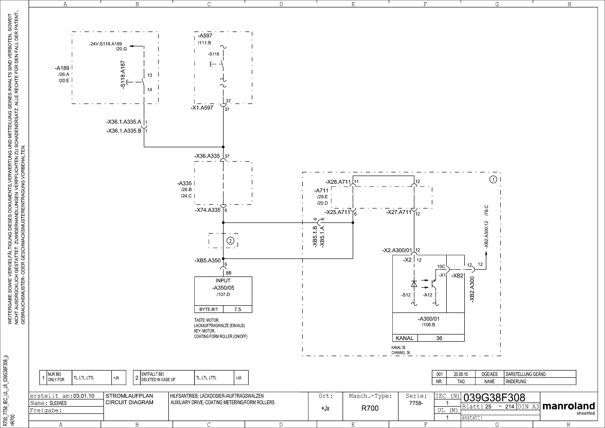

# +Jx — Sheet 25 of 214 — HILFSANTRIEB, LACKDOSIER /AUFTRAGSWALZEN

**AUXILIARY DRIVE, COATING METERING/FORM ROLLERS**

> Part of the manroland **R700** printing press IEC/UL circuit diagrams.
> Drawing class: **Stromlaufplan / Circuit diagram** (DIN A3).
> Document `+Jx` covers the **1st printing module + feed register** machine section.

## At a glance

| Field | Value |
|---|---|
| Document | `+Jx`  (039G38F308) |
| Sheet | **25** of 214 |
| Section (DE) | HILFSANTRIEB, LACKDOSIER /AUFTRAGSWALZEN |
| Section (EN) | AUXILIARY DRIVE, COATING METERING/FORM ROLLERS |
| Section type | CIRCUIT — Circuit diagram |
| Machine type | `R700` |
| Series | `7758` |
| Created | 03.01.10 |
| Replaces | — |
| Columns used | A, B, C, D, E, F, G |
| Path numbers | — |
| Labels on sheet | 91 |
| Cross-refs out | 11 |
| Cross-refs in | 25 |

**Previous:** [+Jx sheet 24](SHEET_0024.md) · **Next:** [+Jx sheet 26](SHEET_0026.md) · **Document TOC:** [_TOC.md](_TOC.md)  (+Jx) · **Master TOC:** [all sheets](../_MASTER_TOC.md)

## Sheet image (300 DPI, exact vector render)



_Rendered directly from the PDF vector layer at 300 DPI (1-bit), no OCR and no resampling. Use it to confirm anything ambiguous in the text below._

## Cross-references on this sheet

Each entry is a wire leaving this sheet. The printed token is `/sheet.column`; the link resolves to that sheet inside the same document.

| Ref | Target sheet | Col | Path | Destination on target | Target section | From col |
|---|---|---|---|---|---|---|
| `/111.B` | [+Jx sheet 111](SHEET_0111.md) | B | — | — | REFERENZMODUL | C |
| `/20.G` | [+Jx sheet 20](SHEET_0020.md) | G | — | 24V.S118.A189 | LACKPUMPE | B |
| `/26.A` | [+Jx sheet 26](SHEET_0026.md) | A | — | — | HILFSANTRIEB, LACKDOSIER /AUFTRAGSWALZEN | A |
| `/20.E` | [+Jx sheet 20](SHEET_0020.md) | E | — | — | LACKPUMPE | A |
| `/26.B` | [+Jx sheet 26](SHEET_0026.md) | B | — | — | HILFSANTRIEB, LACKDOSIER /AUFTRAGSWALZEN | C |
| `/24.C` | [+Jx sheet 24](SHEET_0024.md) | C | — | — | HILFSANTRIEB, LACKDOSIER /AUFTRAGSWALZEN | C |
| `/29.E` | [+Jx sheet 29](SHEET_0029.md) | E | — | — | KAMMERRAKEL | E |
| `/20.D` | [+Jx sheet 20](SHEET_0020.md) | D | — | — | LACKPUMPE | E |
| `/78.C` | [+Jx sheet 78](SHEET_0078.md) | C | — | XB2.A300:12 | BUSVERBINDUNGEN: SICHERHEITSKREIS | G |
| `/107.D` | [+Jx sheet 107](SHEET_0107.md) | D | — | — | REFERENZMODUL | C |
| `/106.B` | [+Jx sheet 106](SHEET_0106.md) | B | — | — | REFERENZMODUL | F |

### Incoming references (sheets that point here)

Every other sheet that sends a wire to this one. `Back-ref` is the token printed on *that* sheet; `Path` is its line number.

| From sheet | Cols | Back-ref | Path | Refs | What continues there |
|---|---|---|---|---|---|
| [+Jx#20](SHEET_0020.md) | C, E, G | `/20.C`, `/20.E`, `/20.G` | — | 3 | 24V.S118.A189 |
| [+Jx#24](SHEET_0024.md) | C | `/24.C` | — | 1 | — |
| [+Jx#26](SHEET_0026.md) | A, B | `/26.A`, `/26.B` | — | 2 | — |
| [+Jx#29](SHEET_0029.md) | E | `/29.E` | — | 1 | — |
| [+Jx#78](SHEET_0078.md) | C | `/78.C` | — | 1 | XB2.A300:12 |
| [+Jx#106](SHEET_0106.md) | B | `/106.B` | — | 1 | — |
| [+Jx#107](SHEET_0107.md) | D | `/107.D` | — | 1 | — |
| [+Jx#111](SHEET_0111.md) | B | `/111.B` | — | 1 | — |
| [+Jx#115](SHEET_0115.md) | F | `/115.F` | — | 1 | — |
| [+Jx#124](SHEET_0124.md) | E, G | `/124.E`, `/124.G` | — | 2 | — |
| [+Jx#131](SHEET_0131.md) | A, B | `/131.A`, `/131.B` | — | 2 | — |
| [+Jx#132](SHEET_0132.md) | C | `/132.C` | — | 1 | — |
| [+Jx#143](SHEET_0143.md) | B | `/143.B` | — | 1 | — |
| [+Jx#144](SHEET_0144.md) | F | `/144.F` | — | 1 | — |
| [+Jx#146](SHEET_0146.md) | C | `/146.C` | — | 2 | — |
| [+Jx#149](SHEET_0149.md) | G, H | `/149.G`, `/149.H` | — | 3 | — |
| [+Jx#154](SHEET_0154.md) | A | `/154.A` | — | 1 | — |


## Devices on this sheet

| Tag | Class | Class meaning (IEC) | Col | Sub | Terminal | Sign |
|---|---|---|---|---|---|---|
| `S118` | S | Schalter / switch | C | — | — | — |
| `A597` | A | Baugruppe / assembly, module, PC board | C | — | — | — |
| `A350/05` | A | Baugruppe / assembly, module, PC board | C | 05 | — | — |
| `S12` | S | Schalter / switch | F | — | — | — |
| `A12` | A | Baugruppe / assembly, module, PC board | F | — | — | — |
| `X1` | X | Klemme / terminal, plug connector | F | — | — | — |
| `X2` | X | Klemme / terminal, plug connector | F | — | — | — |
| `XB2` | XB |  | F | — | — | — |
| `A300/01` | A | Baugruppe / assembly, module, PC board | F | 01 | — | — |
| `A711` | A | Baugruppe / assembly, module, PC board | E | — | — | — |
| `A189` | A | Baugruppe / assembly, module, PC board | A | — | — | — |
| `A335` | A | Baugruppe / assembly, module, PC board | C | — | — | — |
| `X1.A597` | — | cross-device reference | C | — | — | — |
| `XB5.A350` | — | cross-device reference | C | — | — | — |
| `7.5` | — | cross-device reference | C | — | — | — |
| `XB2.A300` | — | cross-device reference | G | — | — | — |
| `X28.A711` | — | cross-device reference | E | — | — | — |
| `X25.A711` | — | cross-device reference | E | — | — | — |
| `X27.A711` | — | cross-device reference | F | — | — | — |
| `XB5.1.A` | — | cross-device reference | E | — | — | — |
| `XB5.1.B` | — | cross-device reference | D | — | — | — |
| `S118.A187` | — | cross-device reference | B | — | — | — |
| `X36.A335` | — | cross-device reference | C | — | — | — |
| `X74.A335` | — | cross-device reference | C | — | — | — |
| `X36.1.A335.B` | — | cross-device reference | B | — | — | — |
| `X36.1.A335.A` | — | cross-device reference | B | — | — | — |
| `NR.` | — | cross-device reference | F | — | — | — |
| `20.08.10` | — | cross-device reference | F | — | — | — |
| `XB2.A300:12` | — | cross-device reference | G | — | 12 | — |

## Potentials / nets

| Potential | Count | Columns | Attached devices | Terminals |
|---|---|---|---|---|
| `24V` | 1 | B | `A189`, `S118` | — |


A potential such as `L24+/4` or `M24+` is a named supply/return rail; every place it appears on this sheet is electrically common.

## Wire-end annotations (grouped as printed)

A wire that continues elsewhere is annotated with a small cluster: the destination description, the path/line number `#NN`, and the `/sheet.column` cross reference. Each row below is one such cluster exactly as it is grouped on the drawing.

| Col | Y | Path | Cross-ref | Text on the wire |
|---|---|---|---|---|
| C | 65.4 | — | — | `A597` |
| C | 80.3 | — | `/111.B` | — |
| B | 82.4 | — | `/20.G` | `24V.S118.A189` |
| C | 102.7 | — | — | `S118` |
| B | 118.8 | — | — | `S118.A187` |
| A | 129.2 | — | — | `A189` |
| A | 142.3 | — | `/26.A`, `/20.E` | — |
| B | 144.1 | — | — | `13` |
| B | 172.5 | — | — | `14` |
| C | 194.4 | — | — | `37` |
| C | 207.2 | — | — | `X1.A597 37` |
| B | 234.8 | — | — | `X36.1.A335.A 1` |
| B | 252.5 | — | — | `X36.1.A335.B 1` |
| C | 302.1 | — | — | `X36.A335 37` |
| G | 349.9 | — | — | `1` |
| E | 353.1 | — | — | `X28.A711 11` |
| F | 353.2 | — | — | `12` |
| C | 356.0 | — | — | `A335` |
| C | 369.1 | — | `/26.B`, `/24.C` | — |
| E | 370.1 | — | — | `A711` |
| E | 383.2 | — | `/29.E`, `/20.D` | — |
| G | 403.5 | — | `/78.C` | `XB2.A300:12` |
| C | 408.4 | — | — | `X74.A335 6` |
| E | 412.7 | — | — | `X25.A711 6` |
| F | 412.7 | — | — | `X27.A711 12` |
| D | 428.5 | — | — | `XB5.1.B 6` |
| E | 428.5 | — | — | `XB5.1.A 6` |
| C | 470.8 | — | — | `2` |
| F | 487.8 | — | — | `X2.A300/01 12` |
| F | 506.2 | — | — | `X2` |
| C | 507.6 | — | — | `XB5.A350 6` |
| F | 507.7 | — | — | `12 12` |
| G | 516.2 | — | — | `12` |
| F | 520.4 | — | — | `10C` |
| C | 533.1 | — | — | `8B` |
| F | 537.4 | — | — | `X1` |
| F | 537.4 | — | — | `XB2` |
| G | 543.7 | — | — | `XB2.A300` |
| C | 547.7 | — | — | `INPUT` |
| C | 561.5 | — | — | `A350/05` |
| C | 575.3 | — | `/107.D` | — |
| F | 576.4 | — | — | `S12 A12` |
| C | 604.3 | — | — | `BYTE.BIT 7.5` |
| F | 622.4 | — | — | `A300/01` |
| C | 627.0 | — | — | `LACKAUFTRAGWALZE (EIN/AUS) KEY: MOTOR, COATING FORM ROLLER (ON/OFF) TASTE: MOTOR,` |
| F | 634.8 | — | `/106.B` | — |
| F | 660.7 | — | — | `KANAL 36` |
| F | 681.0 | — | — | `KANAL 36 CHANNEL 36` |
| G | 733.0 | — | — | `001 20.08.10 DGE/AES DARSTELLUNG GEÄND.` |
| A | 733.3 | — | — | `1 NUR BEI ONLY FOR TL, LTL, LTTL` |
| C | 733.3 | — | — | `2 ENTFÄLLT BEI DELETED IN CASE OF TL, LTL, LTTL +JA` |
| B | 740.4 | — | — | `+JA` |
| G | 747.1 | — | — | `NR. TAG NAME ÄNDERUNG` |


## Reconstructed tables

This sheet carries tabular content (pin map / terminal assignment / index). The grid below was rebuilt from the drawing's own rule lines, so each row is exactly one physical row of the table.

### Table 1 — 6 data rows × 3 columns (at x=283.5, y=62.4)

| 13 14 | A597 /111.B S118 | 37 |
|---|---|---|
| `1 1` | `X1.A597` | `37` |
| `A335 /26.B /24.C` | `X36.A335 X74.A335` | `37 6` |
|  |  | `2` |
|  | `XB5.A350` | `6 8B` |
|  | `INPUT A350/05` | `/107.D` |
|  | `BYTE.BIT` | `7.5` |


### Table 2 — 4 data rows × 6 columns (at x=694.5, y=345.8)

| 11 6 | X27.A711 | 12 12 |  |  |  |
|---|---|---|---|---|---|
|  | `X2.A300/01` | `12` |  |  |  |
|  | `X2 S12` | `12 A12` | `10C X1` | `XB2` | `12 12 XB2.A300` |
|  |  | `A300/01 /106.B` |  |  |  |
|  | `KANAL` |  | `36` |  |  |


## Notes and free text on this sheet

| Text | Col | Y (pt) |
|---|---|---|
| `8B` | C | 533.13 |
| `INPUT` | C | 547.66 |
| `BYTE.BIT` | C | 604.92 |
| `TASTE: MOTOR,` | C | 627.02 |
| `LACKAUFTRAGWALZE (EIN/AUS)` | C | 637.65 |
| `KEY: MOTOR,` | C | 648.28 |
| `COATING FORM ROLLER (ON/OFF)` | C | 658.95 |
| `KANAL 36` | F | 681.05 |
| `CHANNEL 36` | F | 691 |
| `10C` | F | 520.43 |
| `KANAL` | F | 660.7 |
| `X2.A300/01` | F | 487.8 |
| `TAG` | G | 747.23 |
| `NAME` | G | 747.22 |
| `ÄNDERUNG` | G | 747.25 |
| `DGE/AES` | G | 733.06 |
| `DARSTELLUNG GEÄND.` | G | 733.07 |
| `NUR BEI` | A | 733.3 |
| `ONLY FOR` | A | 743.98 |
| `TL, LTL, LTTL` | A | 740.42 |
| `+JA` | B | 740.38 |
| `ENTFÄLLT BEI` | B | 733.3 |
| `DELETED IN CASE OF` | B | 743.96 |
| `TL, LTL, LTTL` | C | 740.42 |
| `+JA` | C | 740.38 |

## Complete label inventory (exact text from the drawing)

Every text object inside the drawing area of this sheet, in DIN reading order (column A→H, then top→bottom). This is the authoritative list: if a string is not here it is not printed on this sheet.

| Col | Y | X | Dir | Type | Text |
|---|---|---|---|---|---|
| A | 129.2 | 108.0 | → | device tag | `A189` |
| A | 142.3 | 115.4 | → | cross-reference | `/26.A` |
| A | 154.7 | 115.7 | → | cross-reference | `/20.E` |
| A | 733.3 | 94.4 | → | text | `NUR BEI` |
| A | 738.6 | 82.5 | → | number | `1` |
| A | 740.4 | 145.3 | → | text | `TL, LTL, LTTL` |
| A | 744.0 | 94.7 | → | text | `ONLY FOR` |
| B | 82.4 | 175.5 | → | potential | `24V.S118.A189` |
| B | 92.3 | 228.2 | → | cross-reference | `/20.G` |
| B | 118.8 | 236.9 | ↕ | device ref | `S118.A187` |
| B | 144.1 | 289.7 | → | number | `13` |
| B | 172.5 | 289.7 | → | number | `14` |
| B | 234.8 | 208.9 | → | device ref | `X36.1.A335.A` |
| B | 237.0 | 285.4 | → | number | `1` |
| B | 252.5 | 209.5 | → | device ref | `X36.1.A335.B` |
| B | 254.0 | 285.4 | → | number | `1` |
| B | 733.3 | 278.6 | → | text | `ENTFÄLLT BEI` |
| B | 738.6 | 266.5 | → | number | `2` |
| B | 740.4 | 222.9 | → | text | `+JA` |
| B | 744.0 | 278.6 | → | text | `DELETED IN CASE OF` |
| C | 65.4 | 389.5 | → | device tag | `A597` |
| C | 80.3 | 389.8 | → | cross-reference | `/111.B` |
| C | 102.7 | 409.3 | → | device tag | `S118` |
| C | 194.4 | 444.8 | → | number | `37` |
| C | 207.2 | 375.3 | → | device ref | `X1.A597` |
| C | 211.4 | 441.9 | → | number | `37` |
| C | 302.1 | 382.4 | → | device ref | `X36.A335` |
| C | 303.6 | 441.9 | → | number | `37` |
| C | 356.0 | 348.9 | → | device tag | `A335` |
| C | 369.1 | 356.6 | → | cross-reference | `/26.B` |
| C | 381.5 | 356.3 | → | cross-reference | `/24.C` |
| C | 408.4 | 383.8 | → | device ref | `X74.A335` |
| C | 409.9 | 441.9 | → | number | `6` |
| C | 470.8 | 451.5 | → | number | `2` |
| C | 507.6 | 383.0 | → | device ref | `XB5.A350` |
| C | 516.2 | 441.9 | → | number | `6` |
| C | 533.1 | 444.8 | → | text | `8B` |
| C | 547.7 | 424.5 | → | text | `INPUT` |
| C | 561.5 | 417.8 | → | device tag | `A350/05` |
| C | 575.3 | 426.6 | → | cross-reference | `/107.D` |
| C | 604.3 | 460.9 | → | device ref | `7.5` |
| C | 604.9 | 392.6 | → | text | `BYTE.BIT` |
| C | 627.0 | 382.7 | → | text | `TASTE: MOTOR,` |
| C | 637.7 | 382.1 | → | text | `LACKAUFTRAGWALZE (EIN/AUS)` |
| C | 648.3 | 382.1 | → | text | `KEY: MOTOR,` |
| C | 659.0 | 382.4 | → | text | `COATING FORM ROLLER (ON/OFF)` |
| C | 740.4 | 386.2 | → | text | `TL, LTL, LTTL` |
| C | 740.4 | 463.9 | → | text | `+JA` |
| D | 428.5 | 616.8 | ↕ | number | `6` |
| D | 444.5 | 615.4 | ↕ | device ref | `XB5.1.B` |
| E | 353.1 | 640.6 | → | device ref | `X28.A711` |
| E | 353.2 | 696.5 | → | number | `11` |
| E | 370.2 | 618.5 | → | device tag | `A711` |
| E | 383.2 | 624.5 | → | cross-reference | `/29.E` |
| E | 395.7 | 624.2 | → | cross-reference | `/20.D` |
| E | 412.7 | 639.2 | → | device ref | `X25.A711` |
| E | 417.0 | 697.0 | → | number | `6` |
| E | 428.5 | 631.0 | ↕ | number | `6` |
| E | 445.0 | 629.6 | ↕ | device ref | `XB5.1.A` |
| F | 353.2 | 816.9 | → | number | `12` |
| F | 412.7 | 759.7 | → | device ref | `X27.A711` |
| F | 417.0 | 816.9 | → | number | `12` |
| F | 487.8 | 752.3 | → | text | `X2.A300/01` |
| F | 487.8 | 816.9 | → | number | `12` |
| F | 506.2 | 793.4 | → | device tag | `X2` |
| F | 507.7 | 819.8 | → | number | `12` |
| F | 520.4 | 860.3 | → | text | `10C` |
| F | 537.4 | 863.7 | → | device tag | `X1` |
| F | 537.4 | 888.4 | → | device tag | `XB2` |
| F | 576.4 | 789.7 | → | device tag | `S12` |
| F | 576.4 | 832.3 | → | device tag | `A12` |
| F | 622.4 | 822.6 | → | device tag | `A300/01` |
| F | 634.8 | 830.7 | → | cross-reference | `/106.B` |
| F | 660.7 | 779.0 | → | text | `KANAL` |
| F | 660.7 | 858.6 | → | number | `36` |
| F | 681.1 | 770.5 | → | text | `KANAL 36` |
| F | 691.0 | 770.7 | → | text | `CHANNEL 36` |
| F | 733.0 | 859.3 | → | number | `001` |
| F | 733.1 | 893.5 | → | device ref | `20.08.10` |
| F | 747.1 | 858.5 | → | device ref | `NR.` |
| G | 349.9 | 969.0 | → | number | `1` |
| G | 403.5 | 953.4 | ↕ | cross-reference | `/78.C` |
| G | 434.6 | 953.4 | ↕ | device ref | `XB2.A300:12` |
| G | 516.2 | 940.3 | → | number | `12` |
| G | 517.6 | 919.0 | → | number | `12` |
| G | 543.7 | 924.3 | ↕ | device ref | `XB2.A300` |
| G | 733.1 | 948.0 | → | text | `DGE/AES` |
| G | 733.1 | 995.1 | → | text | `DARSTELLUNG GEÄND.` |
| G | 747.2 | 900.1 | → | text | `TAG` |
| G | 747.2 | 953.5 | → | text | `NAME` |
| G | 747.3 | 995.7 | → | text | `ÄNDERUNG` |

## Reading-order text block

The same content as a plain block, grouped by DIN column — convenient to paste or to match against a visual description.

```text
=== Column A ===
 129.2  108.0  devtag       A189
 142.3  115.4  xref         /26.A
 154.7  115.7  xref         /20.E
 733.3   94.4  text         NUR BEI
 738.6   82.5  numeric      1
 740.4  145.3  text         TL, LTL, LTTL
 744.0   94.7  text         ONLY FOR
=== Column B ===
  82.4  175.5  net          24V.S118.A189
  92.3  228.2  xref         /20.G
 118.8  236.9  devref       S118.A187
 144.1  289.7  numeric      13
 172.5  289.7  numeric      14
 234.8  208.9  devref       X36.1.A335.A
 237.0  285.4  numeric      1
 252.5  209.5  devref       X36.1.A335.B
 254.0  285.4  numeric      1
 733.3  278.6  text         ENTFÄLLT BEI
 738.6  266.5  numeric      2
 740.4  222.9  text         +JA
 744.0  278.6  text         DELETED IN CASE OF
=== Column C ===
  65.4  389.5  devtag       A597
  80.3  389.8  xref         /111.B
 102.7  409.3  devtag       S118
 194.4  444.8  numeric      37
 207.2  375.3  devref       X1.A597
 211.4  441.9  numeric      37
 302.1  382.4  devref       X36.A335
 303.6  441.9  numeric      37
 356.0  348.9  devtag       A335
 369.1  356.6  xref         /26.B
 381.5  356.3  xref         /24.C
 408.4  383.8  devref       X74.A335
 409.9  441.9  numeric      6
 470.8  451.5  numeric      2
 507.6  383.0  devref       XB5.A350
 516.2  441.9  numeric      6
 533.1  444.8  text         8B
 547.7  424.5  text         INPUT
 561.5  417.8  devtag       A350/05
 575.3  426.6  xref         /107.D
 604.3  460.9  devref       7.5
 604.9  392.6  text         BYTE.BIT
 627.0  382.7  text         TASTE: MOTOR,
 637.7  382.1  text         LACKAUFTRAGWALZE (EIN/AUS)
 648.3  382.1  text         KEY: MOTOR,
 659.0  382.4  text         COATING FORM ROLLER (ON/OFF)
 740.4  386.2  text         TL, LTL, LTTL
 740.4  463.9  text         +JA
=== Column D ===
 428.5  616.8  numeric      6
 444.5  615.4  devref       XB5.1.B
=== Column E ===
 353.1  640.6  devref       X28.A711
 353.2  696.5  numeric      11
 370.2  618.5  devtag       A711
 383.2  624.5  xref         /29.E
 395.7  624.2  xref         /20.D
 412.7  639.2  devref       X25.A711
 417.0  697.0  numeric      6
 428.5  631.0  numeric      6
 445.0  629.6  devref       XB5.1.A
=== Column F ===
 353.2  816.9  numeric      12
 412.7  759.7  devref       X27.A711
 417.0  816.9  numeric      12
 487.8  752.3  text         X2.A300/01
 487.8  816.9  numeric      12
 506.2  793.4  devtag       X2
 507.7  819.8  numeric      12
 520.4  860.3  text         10C
 537.4  863.7  devtag       X1
 537.4  888.4  devtag       XB2
 576.4  789.7  devtag       S12
 576.4  832.3  devtag       A12
 622.4  822.6  devtag       A300/01
 634.8  830.7  xref         /106.B
 660.7  779.0  text         KANAL
 660.7  858.6  numeric      36
 681.1  770.5  text         KANAL 36
 691.0  770.7  text         CHANNEL 36
 733.0  859.3  numeric      001
 733.1  893.5  devref       20.08.10
 747.1  858.5  devref       NR.
=== Column G ===
 349.9  969.0  numeric      1
 403.5  953.4  xref         /78.C
 434.6  953.4  devref       XB2.A300:12
 516.2  940.3  numeric      12
 517.6  919.0  numeric      12
 543.7  924.3  devref       XB2.A300
 733.1  948.0  text         DGE/AES
 733.1  995.1  text         DARSTELLUNG GEÄND.
 747.2  900.1  text         TAG
 747.2  953.5  text         NAME
 747.3  995.7  text         ÄNDERUNG
```

---
_Generated from the PDF vector text layer; no OCR. Source: `R700_7758_IEC_UL_JX_039G38F308_p`, sheet 25._
