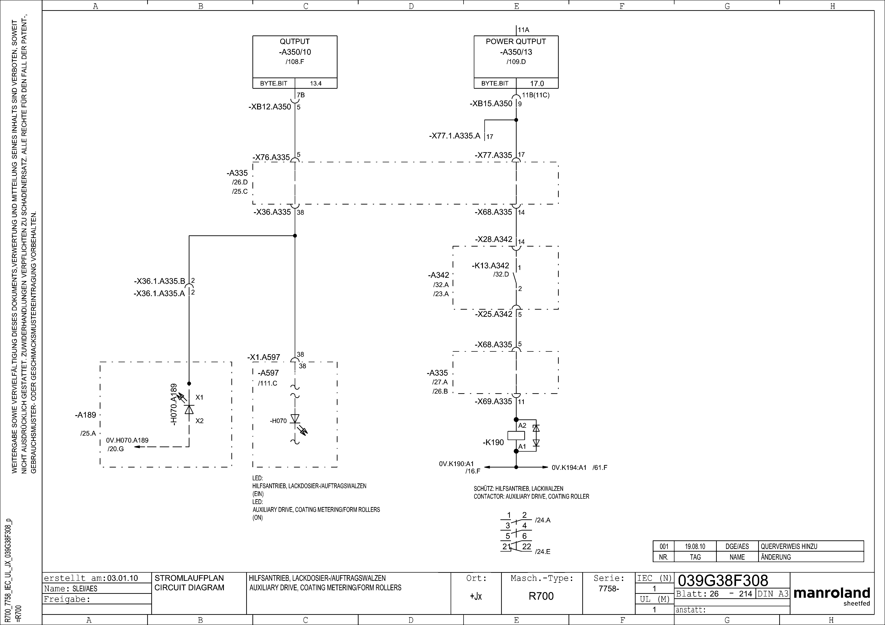

# +Jx — Sheet 26 of 214 — HILFSANTRIEB, LACKDOSIER /AUFTRAGSWALZEN

**AUXILIARY DRIVE, COATING METERING/FORM ROLLERS**

> Part of the manroland **R700** printing press IEC/UL circuit diagrams.
> Drawing class: **Stromlaufplan / Circuit diagram** (DIN A3).
> Document `+Jx` covers the **1st printing module + feed register** machine section.

## At a glance

| Field | Value |
|---|---|
| Document | `+Jx`  (039G38F308) |
| Sheet | **26** of 214 |
| Section (DE) | HILFSANTRIEB, LACKDOSIER /AUFTRAGSWALZEN |
| Section (EN) | AUXILIARY DRIVE, COATING METERING/FORM ROLLERS |
| Section type | CIRCUIT — Circuit diagram |
| Machine type | `R700` |
| Series | `7758` |
| Created | 03.01.10 |
| Replaces | — |
| Columns used | A, B, C, D, E, F, G, H |
| Path numbers | — |
| Labels on sheet | 98 |
| Cross-refs out | 16 |
| Cross-refs in | 30 |

**Previous:** [+Jx sheet 25](SHEET_0025.md) · **Next:** [+Jx sheet 27](SHEET_0027.md) · **Document TOC:** [_TOC.md](_TOC.md)  (+Jx) · **Master TOC:** [all sheets](../_MASTER_TOC.md)

## Sheet image (300 DPI, exact vector render)



_Rendered directly from the PDF vector layer at 300 DPI (1-bit), no OCR and no resampling. Use it to confirm anything ambiguous in the text below._

## Cross-references on this sheet

Each entry is a wire leaving this sheet. The printed token is `/sheet.column`; the link resolves to that sheet inside the same document.

| Ref | Target sheet | Col | Path | Destination on target | Target section | From col |
|---|---|---|---|---|---|---|
| `/108.F` | [+Jx sheet 108](SHEET_0108.md) | F | — | — | REFERENZMODUL | C |
| `/109.D` | [+Jx sheet 109](SHEET_0109.md) | D | — | — | REFERENZMODUL | E |
| `/26.D` | [+Jx sheet 26](SHEET_0026.md) | D | — | — | HILFSANTRIEB, LACKDOSIER /AUFTRAGSWALZEN | B |
| `/25.C` | [+Jx sheet 25](SHEET_0025.md) | C | — | — | HILFSANTRIEB, LACKDOSIER /AUFTRAGSWALZEN | B |
| `/32.D` | [+Jx sheet 32](SHEET_0032.md) | D | — | — | NOT AUS | E |
| `/32.A` | [+Jx sheet 32](SHEET_0032.md) | A | — | — | NOT AUS | D |
| `/23.A` | [+Jx sheet 23](SHEET_0023.md) | A | — | — | LACKPUMPE | D |
| `/27.A` | [+Jx sheet 27](SHEET_0027.md) | A | — | — | KAMMERRAKEL | D |
| `/26.B` | [+Jx sheet 26](SHEET_0026.md) | B | — | — | HILFSANTRIEB, LACKDOSIER /AUFTRAGSWALZEN | D |
| `/111.C` | [+Jx sheet 111](SHEET_0111.md) | C | — | — | REFERENZMODUL | C |
| `/25.A` | [+Jx sheet 25](SHEET_0025.md) | A | — | — | HILFSANTRIEB, LACKDOSIER /AUFTRAGSWALZEN | A |
| `/20.G` | [+Jx sheet 20](SHEET_0020.md) | G | — | 0V.H070.A189 | LACKPUMPE | A |
| `/61.F` | [+Jx sheet 61](SHEET_0061.md) | F | — | 0V.K190:A1 0V.K194:A1 | GTW | E |
| `/16.F` | [+Jx sheet 16](SHEET_0016.md) | F | — | 0V.K190:A1 0V.K194:A1 | ÖLUMLAUFSCHMIERUNG | E |
| `/24.A` | [+Jx sheet 24](SHEET_0024.md) | A | — | — | HILFSANTRIEB, LACKDOSIER /AUFTRAGSWALZEN | E |
| `/24.E` | [+Jx sheet 24](SHEET_0024.md) | E | — | — | HILFSANTRIEB, LACKDOSIER /AUFTRAGSWALZEN | E |

### Incoming references (sheets that point here)

Every other sheet that sends a wire to this one. `Back-ref` is the token printed on *that* sheet; `Path` is its line number.

| From sheet | Cols | Back-ref | Path | Refs | What continues there |
|---|---|---|---|---|---|
| [+Jx#16](SHEET_0016.md) | G | `/16.G` | — | 1 | — |
| [+Jx#20](SHEET_0020.md) | G | `/20.G` | — | 1 | 0V.H070.A189 |
| [+Jx#23](SHEET_0023.md) | A | `/23.A` | — | 1 | — |
| [+Jx#24](SHEET_0024.md) | A, E | `/24.A`, `/24.E` | — | 2 | — |
| [+Jx#25](SHEET_0025.md) | A, C | `/25.A`, `/25.C` | — | 2 | — |
| [+Jx#26](SHEET_0026.md) | B, D | `/26.B`, `/26.D` | — | 2 | — |
| [+Jx#27](SHEET_0027.md) | A | `/27.A` | — | 1 | — |
| [+Jx#32](SHEET_0032.md) | A, D | `/32.A`, `/32.D` | — | 2 | — |
| [+Jx#61](SHEET_0061.md) | E | `/61.E` | — | 1 | 0V.K194:A1 |
| [+Jx#108](SHEET_0108.md) | F | `/108.F` | — | 1 | — |
| [+Jx#109](SHEET_0109.md) | D | `/109.D` | — | 1 | — |
| [+Jx#111](SHEET_0111.md) | C | `/111.C` | — | 1 | — |
| [+Jx#115](SHEET_0115.md) | F | `/115.F` | — | 1 | — |
| [+Jx#137](SHEET_0137.md) | H | `/137.H` | — | 1 | — |
| [+Jx#139](SHEET_0139.md) | B | `/139.B` | — | 1 | — |
| [+Jx#142](SHEET_0142.md) | H | `/142.H` | — | 1 | — |
| [+Jx#145](SHEET_0145.md) | G | `/145.G` | — | 1 | — |
| [+Jx#149](SHEET_0149.md) | G, H | `/149.G`, `/149.H` | — | 3 | — |
| [+Jx#152](SHEET_0152.md) | E, G | `/152.E`, `/152.G` | — | 3 | — |
| [+Jx#155](SHEET_0155.md) | B, D | `/155.B`, `/155.D` | — | 2 | — |
| [+Jx#156](SHEET_0156.md) | A | `/156.A` | — | 1 | — |


## Devices on this sheet

| Tag | Class | Class meaning (IEC) | Col | Sub | Terminal | Sign |
|---|---|---|---|---|---|---|
| `A350/10` | A | Baugruppe / assembly, module, PC board | C | 10 | — | — |
| `A350/13` | A | Baugruppe / assembly, module, PC board | E | 13 | — | — |
| `A597` | A | Baugruppe / assembly, module, PC board | C | — | — | — |
| `A335` | A | Baugruppe / assembly, module, PC board | B | — | — | — |
| `A342` | A | Baugruppe / assembly, module, PC board | D | — | — | — |
| `A1` | A | Baugruppe / assembly, module, PC board | E | — | — | — |
| `A2` | A | Baugruppe / assembly, module, PC board | E | — | — | — |
| `K190` | K | Relais / relay, contactor | E | — | — | — |
| `A335` | A | Baugruppe / assembly, module, PC board | D | — | — | — |
| `A189` | A | Baugruppe / assembly, module, PC board | A | — | — | — |
| `X1` | X | Klemme / terminal, plug connector | B | — | — | — |
| `X2` | X | Klemme / terminal, plug connector | B | — | — | — |
| `XB12.A350` | — | cross-device reference | C | — | — | — |
| `13.4` | — | cross-device reference | C | — | — | — |
| `17.0` | — | cross-device reference | E | — | — | — |
| `XB15.A350` | — | cross-device reference | E | — | — | — |
| `X1.A597` | — | cross-device reference | C | — | — | — |
| `X68.A335` | — | cross-device reference | E | — | — | — |
| `X69.A335` | — | cross-device reference | E | — | — | — |
| `X76.A335` | — | cross-device reference | C | — | — | — |
| `X36.A335` | — | cross-device reference | C | — | — | — |
| `X77.A335` | — | cross-device reference | E | — | — | — |
| `X68.A335` | — | cross-device reference | E | — | — | — |
| `K13.A342` | — | cross-device reference | E | — | — | — |
| `X28.A342` | — | cross-device reference | E | — | — | — |
| `X25.A342` | — | cross-device reference | E | — | — | — |
| `X77.1.A335.A` | — | cross-device reference | D | — | — | — |
| `X36.1.A335.B` | — | cross-device reference | B | — | — | — |
| `X36.1.A335.A` | — | cross-device reference | B | — | — | — |
| `NR.` | — | cross-device reference | F | — | — | — |
| `19.08.10` | — | cross-device reference | G | — | — | — |

## Potentials / nets

| Potential | Count | Columns | Attached devices | Terminals |
|---|---|---|---|---|
| `0V` | 3 | A, D, F | `A189`, `H070`, `K190`, `K194` | `A1` |
| `H070` | 2 | B, C | `A189` | — |


A potential such as `L24+/4` or `M24+` is a named supply/return rail; every place it appears on this sheet is electrically common.

## Wire-end annotations (grouped as printed)

A wire that continues elsewhere is annotated with a small cluster: the destination description, the path/line number `#NN`, and the `/sheet.column` cross reference. Each row below is one such cluster exactly as it is grouped on the drawing.

| Col | Y | Path | Cross-ref | Text on the wire |
|---|---|---|---|---|
| E | 36.4 | — | — | `11A` |
| E | 51.5 | — | — | `POWER QUTPUT` |
| C | 51.6 | — | — | `QUTPUT` |
| C | 65.4 | — | — | `A350/10` |
| E | 65.4 | — | — | `A350/13` |
| C | 79.2 | — | `/108.F` | — |
| E | 79.2 | — | `/109.D` | — |
| E | 108.3 | — | — | `BYTE.BIT 17.0` |
| C | 108.9 | — | — | `BYTE.BIT 13.4` |
| C | 124.2 | — | — | `7B` |
| E | 124.3 | — | — | `11B(11C)` |
| E | 134.9 | — | — | `XB15.A350 9` |
| C | 139.1 | — | — | `XB12.A350 5` |
| D | 178.1 | — | — | `X77.1.A335.A 17` |
| E | 204.3 | — | — | `X77.A335 17` |
| C | 204.4 | — | — | `X76.A335 5` |
| B | 228.4 | — | — | `A335` |
| B | 241.5 | — | `/26.D`, `/25.C` | — |
| C | 280.9 | — | — | `X36.A335 38` |
| E | 280.9 | — | — | `X68.A335 14` |
| E | 317.7 | — | — | `X28.A342 14` |
| E | 353.1 | — | — | `K13.A342` |
| E | 356.7 | — | — | `1` |
| E | 365.5 | — | `/32.D` | — |
| D | 365.9 | — | — | `A342` |
| B | 374.0 | — | — | `X36.1.A335.B 2` |
| D | 379.7 | — | `/32.A`, `/23.A` | — |
| E | 385.1 | — | — | `2` |
| B | 389.9 | — | — | `X36.1.A335.A 2` |
| E | 418.4 | — | — | `X25.A342 5` |
| E | 459.4 | — | — | `X68.A335 5` |
| C | 473.6 | — | — | `X1.A597 38` |
| C | 489.2 | — | — | `38` |
| C | 497.7 | — | — | `A597` |
| D | 497.7 | — | — | `A335` |
| D | 510.8 | — | `/27.A`, `/26.B` | — |
| C | 512.6 | — | `/111.C` | — |
| B | 516.5 | — | — | `H070.A189` |
| B | 531.4 | — | — | `X1` |
| E | 536.0 | — | — | `X69.A335 11` |
| A | 554.4 | — | — | `A189` |
| B | 563.2 | — | — | `X2` |
| C | 563.4 | — | — | `H070` |
| E | 569.3 | — | — | `A2` |
| A | 579.9 | — | `/25.A` | — |
| A | 589.3 | — | `/20.G` | `0V.H070.A189` |
| E | 591.3 | — | — | `K190` |
| E | 597.6 | — | — | `A1` |
| E | 621.0 | — | `/61.F`, `/16.F` | `0V.K190:A1 0V.K194:A1` |
| C | 641.1 | — | — | `LED: HILFSANTRIEB, LACKDOSIER /AUFTRAGSWALZEN LED: (EIN)` |
| E | 655.4 | — | — | `SCHÜTZ: HILFSANTRIEB, LACKWALZEN CONTACTOR: AUXILIARY DRIVE, COATING ROLLER` |
| C | 683.8 | — | — | `(ON) AUXILIARY DRIVE, COATING METERING/FORM ROLLERS` |
| E | 689.0 | — | — | `21 3 5 1` |
| E | 689.0 | — | — | `2 6 22 4` |
| E | 696.8 | — | `/24.A` | — |
| G | 733.0 | — | — | `001 19.08.10 DGE/AES QUERVERWEIS HINZU` |
| E | 739.3 | — | `/24.E` | — |
| G | 747.1 | — | — | `NR. TAG NAME ÄNDERUNG` |


## Reconstructed tables

This sheet carries tabular content (pin map / terminal assignment / index). The grid below was rebuilt from the drawing's own rule lines, so each row is exactly one physical row of the table.

### Table 1 — 4 data rows × 3 columns (at x=254.4, y=48.2)

|  | QUTPUT | A350/10 /108.F |
|---|---|---|
|  | `BYTE.BIT` | `13.4` |
| `A335 /26.D /25.C` | `XB12.A350 X76.A335 X36.A335` | `7B 5 5 38` |
| `2 2` | `X1.A597` | `38` |
| `X1 X2` | `A597 /111.C H070` | `38` |


### Table 2 — 2 data rows × 3 columns (at x=637.8, y=48.2)

| POWER A350/13 | QUTPUT /109.D |  |
|---|---|---|
| `BYTE.BIT` |  | `17.0` |
| `XB15.A350` | `11B(11C) 9` |  |


## Notes and free text on this sheet

| Text | Col | Y (pt) |
|---|---|---|
| `7B` | C | 124.23 |
| `QUTPUT` | C | 51.57 |
| `BYTE.BIT` | C | 108.86 |
| `11A` | E | 36.37 |
| `11B(11C)` | E | 124.28 |
| `POWER QUTPUT` | E | 51.52 |
| `BYTE.BIT` | E | 108.86 |
| `LED:` | C | 641.13 |
| `HILFSANTRIEB, LACKDOSIER /AUFTRAGSWALZEN` | C | 651.83 |
| `(EIN)` | C | 662.47 |
| `AUXILIARY DRIVE, COATING METERING/FORM ROLLERS` | C | 683.75 |
| `(ON)` | C | 694.4 |
| `SCHÜTZ: HILFSANTRIEB, LACKWALZEN` | E | 655.37 |
| `CONTACTOR: AUXILIARY DRIVE, COATING ROLLER` | E | 666.02 |
| `TAG` | G | 747.23 |
| `NAME` | G | 747.22 |
| `ÄNDERUNG` | G | 747.25 |
| `DGE/AES` | G | 733.06 |
| `QUERVERWEIS HINZU` | H | 733.06 |

## Complete label inventory (exact text from the drawing)

Every text object inside the drawing area of this sheet, in DIN reading order (column A→H, then top→bottom). This is the authoritative list: if a string is not here it is not printed on this sheet.

| Col | Y | X | Dir | Type | Text |
|---|---|---|---|---|---|
| A | 554.4 | 100.9 | → | device tag | `A189` |
| A | 579.9 | 108.3 | → | cross-reference | `/25.A` |
| A | 589.3 | 142.8 | → | potential | `0V.H070.A189` |
| A | 600.8 | 145.0 | → | cross-reference | `/20.G` |
| B | 228.4 | 305.0 | → | device tag | `A335` |
| B | 241.5 | 312.4 | → | cross-reference | `/26.D` |
| B | 253.9 | 312.4 | → | cross-reference | `/25.C` |
| B | 374.0 | 180.5 | → | device ref | `X36.1.A335.B` |
| B | 374.0 | 257.3 | → | number | `2` |
| B | 389.9 | 257.3 | → | number | `2` |
| B | 390.6 | 179.9 | → | device ref | `X36.1.A335.A` |
| B | 516.4 | 229.2 | ↕ | potential | `H070.A189` |
| B | 531.4 | 263.1 | → | device tag | `X1` |
| B | 563.2 | 263.1 | → | device tag | `X2` |
| C | 51.6 | 376.6 | → | text | `QUTPUT` |
| C | 65.4 | 375.4 | → | device tag | `A350/10` |
| C | 79.2 | 384.5 | → | cross-reference | `/108.F` |
| C | 108.9 | 350.1 | → | text | `BYTE.BIT` |
| C | 108.9 | 417.0 | → | device ref | `13.4` |
| C | 124.2 | 399.4 | → | text | `7B` |
| C | 139.1 | 334.5 | → | device ref | `XB12.A350` |
| C | 140.6 | 399.4 | → | number | `5` |
| C | 204.4 | 399.4 | → | number | `5` |
| C | 207.2 | 339.9 | → | device ref | `X76.A335` |
| C | 280.9 | 341.3 | → | device ref | `X36.A335` |
| C | 282.3 | 399.4 | → | number | `38` |
| C | 473.7 | 399.4 | → | number | `38` |
| C | 476.5 | 332.8 | → | device ref | `X1.A597` |
| C | 489.2 | 402.2 | → | number | `38` |
| C | 497.7 | 347.0 | → | device tag | `A597` |
| C | 512.6 | 347.2 | → | cross-reference | `/111.C` |
| C | 563.3 | 363.4 | → | potential | `H070` |
| C | 641.1 | 339.6 | → | text | `LED:` |
| C | 651.8 | 339.6 | → | text | `HILFSANTRIEB, LACKDOSIER /AUFTRAGSWALZEN` |
| C | 662.5 | 339.9 | → | text | `(EIN)` |
| C | 673.0 | 339.6 | → | text | `LED:` |
| C | 683.7 | 340.2 | → | text | `AUXILIARY DRIVE, COATING METERING/FORM ROLLERS` |
| C | 694.4 | 339.9 | → | text | `(ON)` |
| D | 178.1 | 577.4 | → | device ref | `X77.1.A335.A` |
| D | 365.9 | 576.0 | → | device tag | `A342` |
| D | 379.7 | 583.1 | → | cross-reference | `/32.A` |
| D | 392.1 | 583.1 | → | cross-reference | `/23.A` |
| D | 497.7 | 574.3 | → | device tag | `A335` |
| D | 510.8 | 581.7 | → | cross-reference | `/27.A` |
| D | 523.2 | 582.0 | → | cross-reference | `/26.B` |
| D | 621.0 | 590.7 | → | potential | `0V.K190:A1` |
| E | 36.4 | 696.5 | → | text | `11A` |
| E | 51.5 | 653.7 | → | text | `POWER QUTPUT` |
| E | 65.4 | 672.9 | → | device tag | `A350/13` |
| E | 79.2 | 681.7 | → | cross-reference | `/109.D` |
| E | 108.3 | 713.1 | → | device ref | `17.0` |
| E | 108.9 | 647.7 | → | text | `BYTE.BIT` |
| E | 124.3 | 702.1 | → | text | `11B(11C)` |
| E | 134.9 | 632.1 | → | device ref | `XB15.A350` |
| E | 136.3 | 697.0 | → | number | `9` |
| E | 180.3 | 654.0 | → | number | `17` |
| E | 204.3 | 638.9 | → | device ref | `X77.A335` |
| E | 204.4 | 696.5 | → | number | `17` |
| E | 280.9 | 638.9 | → | device ref | `X68.A335` |
| E | 282.3 | 696.5 | → | number | `14` |
| E | 317.7 | 639.2 | → | device ref | `X28.A342` |
| E | 322.0 | 696.5 | → | number | `14` |
| E | 353.1 | 635.0 | → | device ref | `K13.A342` |
| E | 356.7 | 696.5 | → | number | `1` |
| E | 365.5 | 663.9 | → | cross-reference | `/32.D` |
| E | 385.1 | 697.3 | → | number | `2` |
| E | 418.3 | 639.2 | → | device ref | `X25.A342` |
| E | 419.8 | 697.0 | → | number | `5` |
| E | 459.4 | 638.9 | → | device ref | `X68.A335` |
| E | 459.5 | 697.0 | → | number | `5` |
| E | 536.0 | 638.9 | → | device ref | `X69.A335` |
| E | 537.4 | 696.5 | → | number | `11` |
| E | 569.3 | 697.3 | → | device tag | `A2` |
| E | 591.3 | 649.7 | → | device tag | `K190` |
| E | 597.6 | 697.3 | → | device tag | `A1` |
| E | 630.9 | 626.5 | → | cross-reference | `/16.F` |
| E | 655.4 | 637.5 | → | text | `SCHÜTZ: HILFSANTRIEB, LACKWALZEN` |
| E | 666.0 | 637.5 | → | text | `CONTACTOR: AUXILIARY DRIVE, COATING ROLLER` |
| E | 689.0 | 682.0 | → | number | `1` |
| E | 689.0 | 702.7 | → | number | `2` |
| E | 696.8 | 720.0 | → | cross-reference | `/24.A` |
| E | 703.2 | 680.3 | → | number | `3` |
| E | 703.2 | 703.0 | → | number | `4` |
| E | 717.4 | 680.3 | → | number | `5` |
| E | 717.4 | 702.7 | → | number | `6` |
| E | 731.5 | 676.1 | → | number | `21` |
| E | 731.5 | 702.7 | → | number | `22` |
| E | 739.3 | 720.0 | → | cross-reference | `/24.E` |
| F | 626.0 | 742.4 | → | potential | `0V.K194:A1` |
| F | 626.0 | 797.2 | → | cross-reference | `/61.F` |
| F | 733.0 | 887.6 | → | number | `001` |
| F | 747.1 | 886.8 | → | device ref | `NR.` |
| G | 733.1 | 921.5 | → | device ref | `19.08.10` |
| G | 733.1 | 976.4 | → | text | `DGE/AES` |
| G | 747.2 | 928.5 | → | text | `TAG` |
| G | 747.2 | 981.8 | → | text | `NAME` |
| G | 747.3 | 1024.0 | → | text | `ÄNDERUNG` |
| H | 733.1 | 1023.7 | → | text | `QUERVERWEIS HINZU` |

## Reading-order text block

The same content as a plain block, grouped by DIN column — convenient to paste or to match against a visual description.

```text
=== Column A ===
 554.4  100.9  devtag       A189
 579.9  108.3  xref         /25.A
 589.3  142.8  net          0V.H070.A189
 600.8  145.0  xref         /20.G
=== Column B ===
 228.4  305.0  devtag       A335
 241.5  312.4  xref         /26.D
 253.9  312.4  xref         /25.C
 374.0  180.5  devref       X36.1.A335.B
 374.0  257.3  numeric      2
 389.9  257.3  numeric      2
 390.6  179.9  devref       X36.1.A335.A
 516.4  229.2  net          H070.A189
 531.4  263.1  devtag       X1
 563.2  263.1  devtag       X2
=== Column C ===
  51.6  376.6  text         QUTPUT
  65.4  375.4  devtag       A350/10
  79.2  384.5  xref         /108.F
 108.9  350.1  text         BYTE.BIT
 108.9  417.0  devref       13.4
 124.2  399.4  text         7B
 139.1  334.5  devref       XB12.A350
 140.6  399.4  numeric      5
 204.4  399.4  numeric      5
 207.2  339.9  devref       X76.A335
 280.9  341.3  devref       X36.A335
 282.3  399.4  numeric      38
 473.7  399.4  numeric      38
 476.5  332.8  devref       X1.A597
 489.2  402.2  numeric      38
 497.7  347.0  devtag       A597
 512.6  347.2  xref         /111.C
 563.3  363.4  net          H070
 641.1  339.6  text         LED:
 651.8  339.6  text         HILFSANTRIEB, LACKDOSIER /AUFTRAGSWALZEN
 662.5  339.9  text         (EIN)
 673.0  339.6  text         LED:
 683.7  340.2  text         AUXILIARY DRIVE, COATING METERING/FORM ROLLERS
 694.4  339.9  text         (ON)
=== Column D ===
 178.1  577.4  devref       X77.1.A335.A
 365.9  576.0  devtag       A342
 379.7  583.1  xref         /32.A
 392.1  583.1  xref         /23.A
 497.7  574.3  devtag       A335
 510.8  581.7  xref         /27.A
 523.2  582.0  xref         /26.B
 621.0  590.7  net          0V.K190:A1
=== Column E ===
  36.4  696.5  text         11A
  51.5  653.7  text         POWER QUTPUT
  65.4  672.9  devtag       A350/13
  79.2  681.7  xref         /109.D
 108.3  713.1  devref       17.0
 108.9  647.7  text         BYTE.BIT
 124.3  702.1  text         11B(11C)
 134.9  632.1  devref       XB15.A350
 136.3  697.0  numeric      9
 180.3  654.0  numeric      17
 204.3  638.9  devref       X77.A335
 204.4  696.5  numeric      17
 280.9  638.9  devref       X68.A335
 282.3  696.5  numeric      14
 317.7  639.2  devref       X28.A342
 322.0  696.5  numeric      14
 353.1  635.0  devref       K13.A342
 356.7  696.5  numeric      1
 365.5  663.9  xref         /32.D
 385.1  697.3  numeric      2
 418.3  639.2  devref       X25.A342
 419.8  697.0  numeric      5
 459.4  638.9  devref       X68.A335
 459.5  697.0  numeric      5
 536.0  638.9  devref       X69.A335
 537.4  696.5  numeric      11
 569.3  697.3  devtag       A2
 591.3  649.7  devtag       K190
 597.6  697.3  devtag       A1
 630.9  626.5  xref         /16.F
 655.4  637.5  text         SCHÜTZ: HILFSANTRIEB, LACKWALZEN
 666.0  637.5  text         CONTACTOR: AUXILIARY DRIVE, COATING ROLLER
 689.0  682.0  numeric      1
 689.0  702.7  numeric      2
 696.8  720.0  xref         /24.A
 703.2  680.3  numeric      3
 703.2  703.0  numeric      4
 717.4  680.3  numeric      5
 717.4  702.7  numeric      6
 731.5  676.1  numeric      21
 731.5  702.7  numeric      22
 739.3  720.0  xref         /24.E
=== Column F ===
 626.0  742.4  net          0V.K194:A1
 626.0  797.2  xref         /61.F
 733.0  887.6  numeric      001
 747.1  886.8  devref       NR.
=== Column G ===
 733.1  921.5  devref       19.08.10
 733.1  976.4  text         DGE/AES
 747.2  928.5  text         TAG
 747.2  981.8  text         NAME
 747.3 1024.0  text         ÄNDERUNG
=== Column H ===
 733.1 1023.7  text         QUERVERWEIS HINZU
```

---
_Generated from the PDF vector text layer; no OCR. Source: `R700_7758_IEC_UL_JX_039G38F308_p`, sheet 26._
