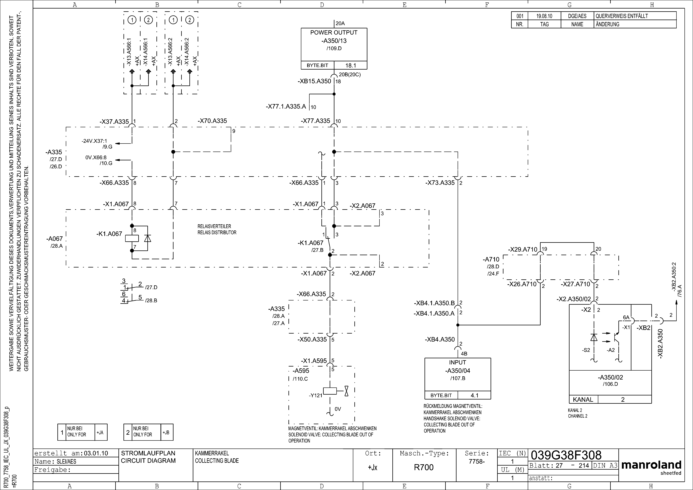

# +Jx — Sheet 27 of 214 — KAMMERRAKEL

**COLLECTING BLADE**

> Part of the manroland **R700** printing press IEC/UL circuit diagrams.
> Drawing class: **Stromlaufplan / Circuit diagram** (DIN A3).
> Document `+Jx` covers the **1st printing module + feed register** machine section.

## At a glance

| Field | Value |
|---|---|
| Document | `+Jx`  (039G38F308) |
| Sheet | **27** of 214 |
| Section (DE) | KAMMERRAKEL |
| Section (EN) | COLLECTING BLADE |
| Section type | CIRCUIT — Circuit diagram |
| Machine type | `R700` |
| Series | `7758` |
| Created | 03.01.10 |
| Replaces | — |
| Columns used | A, B, C, D, E, F, G, H |
| Path numbers | — |
| Labels on sheet | 157 |
| Cross-refs out | 17 |
| Cross-refs in | 47 |

**Previous:** [+Jx sheet 26](SHEET_0026.md) · **Next:** [+Jx sheet 28](SHEET_0028.md) · **Document TOC:** [_TOC.md](_TOC.md)  (+Jx) · **Master TOC:** [all sheets](../_MASTER_TOC.md)

## Sheet image (300 DPI, exact vector render)



_Rendered directly from the PDF vector layer at 300 DPI (1-bit), no OCR and no resampling. Use it to confirm anything ambiguous in the text below._

## Cross-references on this sheet

Each entry is a wire leaving this sheet. The printed token is `/sheet.column`; the link resolves to that sheet inside the same document.

| Ref | Target sheet | Col | Path | Destination on target | Target section | From col |
|---|---|---|---|---|---|---|
| `/109.D` | [+Jx sheet 109](SHEET_0109.md) | D | — | — | REFERENZMODUL | D |
| `/9.G` | [+Jx sheet 9](SHEET_0009.md) | G | — | 24V.X37:1 | SPANNUNGSVERSORGUNG, SCHALTSCHRANKBELÜFTUNG | A |
| `/10.G` | [+Jx sheet 10](SHEET_0010.md) | G | — | 0V.X66:8 | SPANNUNGSVERSORGUNG, SCHALTSCHRANKBELÜFTUNG | A |
| `/27.D` | [+Jx sheet 27](SHEET_0027.md) | D | — | — | KAMMERRAKEL | A |
| `/26.D` | [+Jx sheet 26](SHEET_0026.md) | D | — | — | HILFSANTRIEB, LACKDOSIER /AUFTRAGSWALZEN | A |
| `/28.A` | [+Jx sheet 28](SHEET_0028.md) | A | — | — | KAMMERRAKEL | A |
| `/27.B` | [+Jx sheet 27](SHEET_0027.md) | B | — | — | KAMMERRAKEL | D |
| `/76.A` | [+Jx sheet 76](SHEET_0076.md) | A | — | XB2.A350:2 | BUSVERBINDUNGEN: SICHERHEITSKREIS | H |
| `/28.D` | [+Jx sheet 28](SHEET_0028.md) | D | — | — | KAMMERRAKEL | F |
| `/24.F` | [+Jx sheet 24](SHEET_0024.md) | F | — | — | HILFSANTRIEB, LACKDOSIER /AUFTRAGSWALZEN | F |
| `/27.D` | [+Jx sheet 27](SHEET_0027.md) | D | — | — | KAMMERRAKEL | B |
| `/28.B` | [+Jx sheet 28](SHEET_0028.md) | B | — | — | KAMMERRAKEL | B |
| `/28.A` | [+Jx sheet 28](SHEET_0028.md) | A | — | — | KAMMERRAKEL | C |
| `/27.A` | [+Jx sheet 27](SHEET_0027.md) | A | — | — | KAMMERRAKEL | C |
| `/107.B` | [+Jx sheet 107](SHEET_0107.md) | B | — | — | REFERENZMODUL | F |
| `/110.C` | [+Jx sheet 110](SHEET_0110.md) | C | — | — | REFERENZMODUL | D |
| `/106.D` | [+Jx sheet 106](SHEET_0106.md) | D | — | — | REFERENZMODUL | G |

### Incoming references (sheets that point here)

Every other sheet that sends a wire to this one. `Back-ref` is the token printed on *that* sheet; `Path` is its line number.

| From sheet | Cols | Back-ref | Path | Refs | What continues there |
|---|---|---|---|---|---|
| [+Jx#9](SHEET_0009.md) | G | `/9.G` | — | 1 | — |
| [+Jx#10](SHEET_0010.md) | H | `/10.H` | — | 1 | — |
| [+Jx#24](SHEET_0024.md) | F | `/24.F` | — | 1 | — |
| [+Jx#26](SHEET_0026.md) | D | `/26.D` | — | 1 | — |
| [+Jx#27](SHEET_0027.md) | A, B, C, D | `/27.A`, `/27.B`, `/27.C`, `/27.D` | — | 4 | — |
| [+Jx#28](SHEET_0028.md) | A, B, D | `/28.A`, `/28.B`, `/28.D` | — | 4 | — |
| [+Jx#76](SHEET_0076.md) | A | `/76.A` | — | 1 | XB2.A350:2 |
| [+Jx#106](SHEET_0106.md) | D | `/106.D` | — | 1 | — |
| [+Jx#107](SHEET_0107.md) | B | `/107.B` | — | 1 | — |
| [+Jx#109](SHEET_0109.md) | D | `/109.D` | — | 1 | — |
| [+Jx#110](SHEET_0110.md) | C | `/110.C` | — | 1 | — |
| [+Jx#112](SHEET_0112.md) | C | `/112.C` | — | 5 | — |
| [+Jx#115](SHEET_0115.md) | C | `/115.C` | — | 1 | — |
| [+Jx#123](SHEET_0123.md) | A | `/123.A` | — | 2 | — |
| [+Jx#126](SHEET_0126.md) | E | `/126.E` | — | 2 | — |
| [+Jx#130](SHEET_0130.md) | A, B, D | `/130.A`, `/130.B`, `/130.D` | — | 3 | — |
| [+Jx#139](SHEET_0139.md) | B | `/139.B` | — | 1 | — |
| [+Jx#143](SHEET_0143.md) | F | `/143.F` | — | 1 | — |
| [+Jx#144](SHEET_0144.md) | C | `/144.C` | — | 1 | — |
| [+Jx#147](SHEET_0147.md) | B | `/147.B` | — | 2 | — |
| [+Jx#150](SHEET_0150.md) | A, H | `/150.A`, `/150.H` | — | 3 | — |
| [+Jx#152](SHEET_0152.md) | A | `/152.A` | — | 5 | — |
| [+Jx#153](SHEET_0153.md) | A, E | `/153.A`, `/153.E` | — | 2 | — |
| [+Jx#155](SHEET_0155.md) | D | `/155.D` | — | 1 | — |
| [+Jx#156](SHEET_0156.md) | A | `/156.A` | — | 1 | — |


## Devices on this sheet

| Tag | Class | Class meaning (IEC) | Col | Sub | Terminal | Sign |
|---|---|---|---|---|---|---|
| `A350/13` | A | Baugruppe / assembly, module, PC board | D | 13 | — | — |
| `Y121` | Y | Magnetventil / solenoid valve, actuator | D | — | — | — |
| `A595` | A | Baugruppe / assembly, module, PC board | D | — | — | — |
| `A335` | A | Baugruppe / assembly, module, PC board | C | — | — | — |
| `A335` | A | Baugruppe / assembly, module, PC board | A | — | — | — |
| `A067` | A | Baugruppe / assembly, module, PC board | A | — | — | — |
| `A350/04` | A | Baugruppe / assembly, module, PC board | F | 04 | — | — |
| `A710` | A | Baugruppe / assembly, module, PC board | F | — | — | — |
| `S2` | S | Schalter / switch | G | — | — | — |
| `A2` | A | Baugruppe / assembly, module, PC board | H | — | — | — |
| `X1` | X | Klemme / terminal, plug connector | H | — | — | — |
| `X2` | X | Klemme / terminal, plug connector | G | — | — | — |
| `XB2` | XB |  | H | — | — | — |
| `A350/02` | A | Baugruppe / assembly, module, PC board | G | 02 | — | — |
| `XB15.A350` | — | cross-device reference | D | — | — | — |
| `18.1` | — | cross-device reference | D | — | — | — |
| `X77.A335` | — | cross-device reference | D | — | — | — |
| `X66.A335` | — | cross-device reference | D | — | — | — |
| `X50.A335` | — | cross-device reference | D | — | — | — |
| `X66.A335` | — | cross-device reference | D | — | — | — |
| `X1.A067` | — | cross-device reference | D | — | — | — |
| `K1.A067` | — | cross-device reference | D | — | — | — |
| `X1.A067` | — | cross-device reference | D | — | — | — |
| `X1.A595` | — | cross-device reference | D | — | — | — |
| `X77.1.A335.A` | — | cross-device reference | D | — | — | — |
| `X13.A566:1` | — | cross-device reference | B | — | 1 | — |
| `X14.A566:1` | — | cross-device reference | B | — | 1 | — |
| `X13.A566:2` | — | cross-device reference | B | — | 2 | — |
| `X14.A566:2` | — | cross-device reference | B | — | 2 | — |
| `X37.A335` | — | cross-device reference | A | — | — | — |
| `X66.A335` | — | cross-device reference | A | — | — | — |
| `X1.A067` | — | cross-device reference | B | — | — | — |
| `K1.A067` | — | cross-device reference | A | — | — | — |
| `X73.A335` | — | cross-device reference | E | — | — | — |
| `4.1` | — | cross-device reference | F | — | — | — |
| `XB4.A350` | — | cross-device reference | E | — | — | — |
| `X27.A710` | — | cross-device reference | G | — | — | — |
| `X29.A710` | — | cross-device reference | F | — | — | — |
| `X26.A710` | — | cross-device reference | F | — | — | — |
| `XB2.A350` | — | cross-device reference | H | — | — | — |
| `XB4.1.A350.B` | — | cross-device reference | E | — | — | — |
| `XB4.1.A350.A` | — | cross-device reference | E | — | — | — |
| `NR.` | — | cross-device reference | F | — | — | — |
| `19.08.10` | — | cross-device reference | G | — | — | — |
| `XB2.A350:2` | — | cross-device reference | H | — | 2 | — |
| `X2.A067` | — | cross-device reference | D | — | — | — |
| `X2.A067` | — | cross-device reference | D | — | — | — |
| `X70.A335` | — | cross-device reference | C | — | — | — |

## Potentials / nets

| Potential | Count | Columns | Attached devices | Terminals |
|---|---|---|---|---|
| `0V` | 2 | A, D | `X66` | `8` |
| `24V` | 1 | A | `X37` | `1` |


A potential such as `L24+/4` or `M24+` is a named supply/return rail; every place it appears on this sheet is electrically common.

## Wire-end annotations (grouped as printed)

A wire that continues elsewhere is annotated with a small cluster: the destination description, the path/line number `#NN`, and the `/sheet.column` cross reference. Each row below is one such cluster exactly as it is grouped on the drawing.

| Col | Y | Path | Cross-ref | Text on the wire |
|---|---|---|---|---|
| G | 24.3 | — | — | `001 19.08.10 DGE/AES QUERVERWEIS ENTFÄLLT` |
| B | 31.0 | — | — | `1 2 1 2` |
| D | 36.4 | — | — | `20A` |
| G | 38.5 | — | — | `NR. TAG NAME ÄNDERUNG` |
| D | 51.5 | — | — | `POWER OUTPUT` |
| B | 64.9 | — | — | `X13.A566:1` |
| B | 64.9 | — | — | `X14.A566:1` |
| B | 64.9 | — | — | `X13.A566:2` |
| B | 64.9 | — | — | `X14.A566:2` |
| D | 65.4 | — | — | `A350/13` |
| D | 79.2 | — | `/109.D` | — |
| B | 96.7 | — | — | `+AX` |
| B | 96.7 | — | — | `+AX` |
| B | 96.7 | — | — | `+AX` |
| B | 96.7 | — | — | `+AX` |
| D | 108.3 | — | — | `BYTE.BIT 18.1` |
| D | 124.3 | — | — | `20B(20C)` |
| D | 134.9 | — | — | `XB15.A350 18` |
| D | 178.1 | — | — | `X77.1.A335.A 10` |
| C | 202.9 | — | — | `X70.A335` |
| D | 202.9 | — | — | `X77.A335 10` |
| B | 204.3 | — | — | `X37.A335 1` |
| B | 204.4 | — | — | `2` |
| C | 221.4 | — | — | `9` |
| A | 238.3 | — | `/9.G` | `24V.X37:1` |
| A | 256.8 | — | — | `A335` |
| A | 266.7 | — | `/10.G` | `0V.X66:8` |
| A | 269.9 | — | `/27.D`, `/26.D` | — |
| B | 309.2 | — | — | `X66.A335 8 7` |
| D | 309.2 | — | — | `X66.A335 1` |
| E | 309.2 | — | — | `X73.A335 2` |
| D | 310.7 | — | — | `3` |
| B | 346.1 | — | — | `X1.A067 8 7` |
| D | 346.1 | — | — | `X1.A067 1` |
| D | 346.1 | — | — | `3` |
| D | 348.9 | — | — | `X2.A067` |
| E | 363.1 | — | — | `3` |
| C | 386.1 | — | — | `RELAISVERTEILER RELAIS DISTRIBUTOR` |
| B | 392.2 | — | — | `8` |
| A | 397.1 | — | — | `K1.A067` |
| D | 399.2 | — | — | `K1.A067 3` |
| D | 399.2 | — | — | `1` |
| A | 405.6 | — | — | `A067` |
| A | 418.7 | — | `/28.A` | — |
| B | 420.5 | — | — | `7` |
| F | 424.0 | — | — | `X29.A710 19` |
| G | 424.1 | — | — | `20` |
| D | 425.7 | — | `/27.B` | — |
| D | 427.6 | — | — | `2` |
| F | 441.0 | — | — | `A710` |
| E | 449.6 | — | — | `2` |
| H | 450.7 | — | `/76.A` | `XB2.A350:2` |
| F | 454.1 | — | `/28.D` | — |
| D | 465.1 | — | — | `X1.A067 2` |
| D | 465.1 | — | — | `X2.A067` |
| F | 466.5 | — | `/24.F` | — |
| B | 477.8 | — | — | `3 6 4 1` |
| B | 483.5 | — | — | `2` |
| F | 483.5 | — | — | `X26.A710 2` |
| G | 483.5 | — | — | `X27.A710 2` |
| B | 489.9 | — | `/27.D` | — |
| D | 500.6 | — | — | `X66.A335 2` |
| B | 506.2 | — | — | `5` |
| G | 509.1 | — | — | `X2.A350/02 2` |
| B | 512.5 | — | `/28.B` | — |
| E | 516.1 | — | — | `XB4.1.A350.B 2` |
| C | 526.1 | — | — | `A335` |
| G | 527.5 | — | — | `X2` |
| H | 528.9 | — | — | `2 2` |
| E | 533.2 | — | — | `XB4.1.A350.A 2` |
| H | 537.4 | — | — | `2` |
| C | 539.1 | — | `/28.A`, `/27.A` | — |
| H | 541.6 | — | — | `6A` |
| H | 558.7 | — | — | `X1` |
| H | 558.7 | — | — | `XB2` |
| H | 565.0 | — | — | `XB2.A350` |
| D | 578.5 | — | — | `X50.A335 5` |
| E | 578.5 | — | — | `XB4.A350 2` |
| G | 597.6 | — | — | `S2 A2` |
| F | 604.0 | — | — | `4B` |
| D | 615.4 | — | — | `X1.A595 5` |
| F | 618.5 | — | — | `INPUT` |
| D | 631.0 | — | — | `5` |
| D | 632.4 | — | — | `A595` |
| F | 632.4 | — | — | `A350/04` |
| G | 643.7 | — | — | `A350/02` |
| F | 646.1 | — | `/107.B` | — |
| D | 647.2 | — | `/110.C` | — |
| G | 656.1 | — | `/106.D` | — |
| F | 675.2 | — | — | `BYTE.BIT 4.1` |
| D | 675.6 | — | — | `Y121` |
| G | 681.9 | — | — | `KANAL 2` |
| F | 695.1 | — | — | `RÜCKMELDUNG MAGNETVENTIL: KAMMERRAKEL ABSCHWENKEN HANDSHAKE SOLENOID VALVE: COLLECTING BLADE OUT OF OPERATION` |
| D | 699.0 | — | — | `0V` |
| G | 702.3 | — | — | `KANAL 2 CHANNEL 2` |
| A | 733.3 | — | — | `1 NUR BEI ONLY FOR +JA 2 NUR BEI ONLY FOR +JB` |
| D | 733.3 | — | — | `MAGNETVENTIL: KAMMERRAKEL ABSCHWENKEN SOLENOID VALVE: COLLECTING BLADE OUT OF OPERATION` |


## Reconstructed tables

This sheet carries tabular content (pin map / terminal assignment / index). The grid below was rebuilt from the drawing's own rule lines, so each row is exactly one physical row of the table.

### Table 1 — 13 data rows × 14 columns (at x=517.3, y=48.2)

| POWER |  |  | OUTPUT A350/13 /109.D |  |  |  |  |  |  |  |  |  |  |
|---|---|---|---|---|---|---|---|---|---|---|---|---|---|
| `BYTE.BIT` |  |  | `18.1` |  |  |  |  |  |  |  |  |  |  |
| `XB15.A350` |  |  | `20B(20C) 18` |  |  |  |  |  |  |  |  |  |  |
| `10 X77.A335` |  |  | `10` |  |  |  |  |  |  |  |  |  |  |
| `X66.A335 X1.A067` | `1 1` |  | `3 3 X2.A067` | `3` | `X73.A335` | `2` |  |  |  |  |  |  |  |
|  | `1` |  | `3` |  |  |  |  |  |  |  |  |  |  |
| `K1.A067 /27.B` |  | `2` |  |  |  |  | `X29.A710` | `19` |  | `20` |  |  |  |
| `X1.A067 X66.A335` |  | `2 2` | `X2.A067` | `2` | `XB4.1.A350.B` | `2` | `A710 /28.D /24.F X26.A710` | `2` | `X27.A710 X2.A350/02` | `2 2` |  |  | `XB2.A350:2` |
|  |  |  |  |  | `XB4.1.A350.A` | `2` |  |  | `X2` | `2` | `6A` |  | `2 2` |
| `X50.A335` |  | `5` |  |  | `XB4.A350` | `2 4B` |  |  | `S2` | `A2` | `X1` | `XB2` | `XB2.A350` |
| `X1.A595` |  | `5 5` |  |  | `INPUT` |  |  |  |  |  |  |  |  |
|  |  |  |  |  |  | `A350/04 /107.B` |  |  |  | `A350/02 /106.D` |  |  |  |
| `Y121` |  |  |  |  | `BYTE.BIT` | `4.1` |  |  |  |  |  |  |  |
|  |  |  |  |  |  |  |  |  | `KANAL` |  | `2` |  |  |


## Notes and free text on this sheet

| Text | Col | Y (pt) |
|---|---|---|
| `20A` | D | 36.37 |
| `20B(20C)` | D | 124.28 |
| `POWER OUTPUT` | D | 51.52 |
| `BYTE.BIT` | D | 108.86 |
| `MAGNETVENTIL: KAMMERRAKEL ABSCHWENKEN` | D | 733.33 |
| `SOLENOID VALVE: COLLECTING BLADE OUT OF` | D | 743.97 |
| `OPERATION` | D | 754.59 |
| `+AX` | B | 96.66 |
| `RELAISVERTEILER` | C | 386.08 |
| `RELAIS DISTRIBUTOR` | C | 396.72 |
| `4B` | F | 603.99 |
| `INPUT` | F | 618.53 |
| `BYTE.BIT` | E | 675.79 |
| `RÜCKMELDUNG MAGNETVENTIL:` | F | 695.08 |
| `KAMMERRAKEL ABSCHWENKEN` | F | 705.69 |
| `HANDSHAKE SOLENOID VALVE:` | F | 716.32 |
| `COLLECTING BLADE OUT OF` | F | 726.97 |
| `OPERATION` | E | 737.59 |
| `KANAL 2` | G | 702.31 |
| `CHANNEL 2` | G | 712.26 |
| `6A` | H | 541.63 |
| `KANAL` | G | 681.96 |
| `X2.A350/02` | G | 509.06 |
| `TAG` | G | 38.57 |
| `NAME` | G | 38.56 |
| `ÄNDERUNG` | G | 38.59 |
| `DGE/AES` | G | 24.4 |
| `QUERVERWEIS ENTFÄLLT` | H | 24.41 |
| `NUR BEI` | A | 733.3 |
| `ONLY FOR` | A | 743.98 |
| `+JA` | A | 740.38 |
| `NUR BEI` | B | 733.3 |
| `ONLY FOR` | B | 743.98 |
| `+JB` | B | 740.35 |

## Complete label inventory (exact text from the drawing)

Every text object inside the drawing area of this sheet, in DIN reading order (column A→H, then top→bottom). This is the authoritative list: if a string is not here it is not printed on this sheet.

| Col | Y | X | Dir | Type | Text |
|---|---|---|---|---|---|
| A | 204.3 | 171.2 | → | device ref | `X37.A335` |
| A | 238.3 | 140.3 | → | potential | `24V.X37:1` |
| A | 248.2 | 176.3 | → | cross-reference | `/9.G` |
| A | 256.8 | 78.2 | → | device tag | `A335` |
| A | 266.7 | 146.8 | → | potential | `0V.X66:8` |
| A | 269.9 | 85.6 | → | cross-reference | `/27.D` |
| A | 276.6 | 171.5 | → | cross-reference | `/10.G` |
| A | 282.3 | 85.6 | → | cross-reference | `/26.D` |
| A | 309.2 | 171.2 | → | device ref | `X66.A335` |
| A | 397.1 | 165.8 | → | device ref | `K1.A067` |
| A | 405.6 | 79.7 | → | device tag | `A067` |
| A | 418.7 | 87.0 | → | cross-reference | `/28.A` |
| A | 733.3 | 115.7 | → | text | `NUR BEI` |
| A | 738.6 | 103.7 | → | number | `1` |
| A | 740.4 | 166.3 | → | text | `+JA` |
| A | 744.0 | 115.9 | → | text | `ONLY FOR` |
| B | 31.0 | 224.9 | → | number | `1` |
| B | 31.0 | 295.8 | → | number | `1` |
| B | 31.4 | 253.1 | → | number | `2` |
| B | 31.4 | 324.0 | → | number | `2` |
| B | 64.9 | 217.8 | ↕ | device ref | `X13.A566:1` |
| B | 64.9 | 246.1 | ↕ | device ref | `X14.A566:1` |
| B | 64.9 | 288.7 | ↕ | device ref | `X13.A566:2` |
| B | 64.9 | 317.0 | ↕ | device ref | `X14.A566:2` |
| B | 96.7 | 231.9 | ↕ | text | `+AX` |
| B | 96.7 | 260.3 | ↕ | text | `+AX` |
| B | 96.7 | 302.8 | ↕ | text | `+AX` |
| B | 96.7 | 331.1 | ↕ | text | `+AX` |
| B | 204.4 | 228.8 | → | number | `1` |
| B | 204.4 | 300.5 | → | number | `2` |
| B | 310.7 | 229.3 | → | number | `8` |
| B | 310.7 | 300.2 | → | number | `7` |
| B | 346.1 | 177.2 | → | device ref | `X1.A067` |
| B | 346.1 | 229.3 | → | number | `8` |
| B | 346.1 | 300.2 | → | number | `7` |
| B | 392.2 | 229.3 | → | number | `8` |
| B | 420.5 | 229.3 | → | number | `7` |
| B | 477.8 | 209.8 | → | number | `3` |
| B | 483.5 | 237.8 | → | number | `2` |
| B | 489.2 | 211.5 | → | number | `1` |
| B | 489.9 | 249.4 | → | cross-reference | `/27.D` |
| B | 500.5 | 209.8 | → | number | `6` |
| B | 506.2 | 237.8 | → | number | `5` |
| B | 511.9 | 209.8 | → | number | `4` |
| B | 512.6 | 249.4 | → | cross-reference | `/28.B` |
| B | 733.3 | 229.0 | → | text | `NUR BEI` |
| B | 738.6 | 216.9 | → | number | `2` |
| B | 740.4 | 279.6 | → | text | `+JB` |
| B | 744.0 | 229.3 | → | text | `ONLY FOR` |
| C | 202.9 | 339.9 | → | device ref | `X70.A335` |
| C | 221.4 | 399.4 | → | number | `9` |
| C | 386.1 | 339.6 | → | text | `RELAISVERTEILER` |
| C | 396.7 | 339.6 | → | text | `RELAIS DISTRIBUTOR` |
| C | 526.1 | 460.9 | → | device tag | `A335` |
| C | 539.1 | 468.3 | → | cross-reference | `/28.A` |
| C | 551.5 | 468.3 | → | cross-reference | `/27.A` |
| D | 36.4 | 576.9 | → | text | `20A` |
| D | 51.5 | 533.2 | → | text | `POWER OUTPUT` |
| D | 65.4 | 552.5 | → | device tag | `A350/13` |
| D | 79.2 | 561.3 | → | cross-reference | `/109.D` |
| D | 108.3 | 593.3 | → | device ref | `18.1` |
| D | 108.9 | 527.2 | → | text | `BYTE.BIT` |
| D | 124.3 | 582.5 | → | text | `20B(20C)` |
| D | 134.9 | 511.7 | → | device ref | `XB15.A350` |
| D | 136.3 | 576.0 | → | number | `18` |
| D | 178.1 | 456.9 | → | device ref | `X77.1.A335.A` |
| D | 180.3 | 533.5 | → | number | `10` |
| D | 202.9 | 517.0 | → | device ref | `X77.A335` |
| D | 204.4 | 576.0 | → | number | `10` |
| D | 309.2 | 497.2 | → | device ref | `X66.A335` |
| D | 310.7 | 554.7 | → | number | `1` |
| D | 310.7 | 576.6 | → | number | `3` |
| D | 346.1 | 503.1 | → | device ref | `X1.A067` |
| D | 346.1 | 554.7 | → | number | `1` |
| D | 346.1 | 576.6 | → | number | `3` |
| D | 348.9 | 600.9 | → | device ref | `X2.A067` |
| D | 399.2 | 553.6 | → | number | `1` |
| D | 399.2 | 576.6 | → | number | `3` |
| D | 412.7 | 511.7 | → | device ref | `K1.A067` |
| D | 425.7 | 535.2 | → | cross-reference | `/27.B` |
| D | 427.6 | 569.8 | → | number | `2` |
| D | 465.1 | 517.3 | → | device ref | `X1.A067` |
| D | 465.1 | 600.9 | → | device ref | `X2.A067` |
| D | 466.6 | 569.8 | → | number | `2` |
| D | 500.6 | 510.0 | → | device ref | `X66.A335` |
| D | 502.0 | 569.8 | → | number | `2` |
| D | 578.5 | 511.4 | → | device ref | `X50.A335` |
| D | 580.0 | 569.5 | → | number | `5` |
| D | 615.4 | 517.3 | → | device ref | `X1.A595` |
| D | 615.4 | 569.5 | → | number | `5` |
| D | 631.0 | 569.5 | → | number | `5` |
| D | 632.4 | 502.9 | → | device tag | `A595` |
| D | 647.2 | 503.1 | → | cross-reference | `/110.C` |
| D | 675.6 | 530.9 | → | device tag | `Y121` |
| D | 699.0 | 575.1 | → | potential | `0V` |
| D | 733.3 | 495.5 | → | text | `MAGNETVENTIL: KAMMERRAKEL ABSCHWENKEN` |
| D | 744.0 | 495.8 | → | text | `SOLENOID VALVE: COLLECTING BLADE OUT OF` |
| D | 754.6 | 495.8 | → | text | `OPERATION` |
| E | 309.2 | 731.1 | → | device ref | `X73.A335` |
| E | 363.1 | 654.5 | → | number | `3` |
| E | 449.6 | 654.8 | → | number | `2` |
| E | 516.2 | 711.5 | → | device ref | `XB4.1.A350.B` |
| E | 533.9 | 710.9 | → | device ref | `XB4.1.A350.A` |
| E | 578.5 | 730.2 | → | device ref | `XB4.A350` |
| E | 675.8 | 739.8 | → | text | `BYTE.BIT` |
| E | 737.6 | 728.2 | → | text | `OPERATION` |
| F | 24.3 | 887.6 | → | number | `001` |
| F | 38.5 | 886.8 | → | device ref | `NR.` |
| F | 310.7 | 789.4 | → | number | `2` |
| F | 424.0 | 873.1 | → | device ref | `X29.A710` |
| F | 441.0 | 829.7 | → | device tag | `A710` |
| F | 454.1 | 836.8 | → | cross-reference | `/28.D` |
| F | 466.5 | 837.6 | → | cross-reference | `/24.F` |
| F | 483.5 | 871.7 | → | device ref | `X26.A710` |
| F | 516.2 | 789.4 | → | number | `2` |
| F | 533.2 | 789.4 | → | number | `2` |
| F | 587.0 | 789.4 | → | number | `2` |
| F | 604.0 | 792.3 | → | text | `4B` |
| F | 618.5 | 771.7 | → | text | `INPUT` |
| F | 632.4 | 765.1 | → | device tag | `A350/04` |
| F | 646.2 | 774.0 | → | cross-reference | `/107.B` |
| F | 675.2 | 809.0 | → | device ref | `4.1` |
| F | 695.1 | 727.9 | → | text | `RÜCKMELDUNG MAGNETVENTIL:` |
| F | 705.7 | 727.9 | → | text | `KAMMERRAKEL ABSCHWENKEN` |
| F | 716.3 | 727.9 | → | text | `HANDSHAKE SOLENOID VALVE:` |
| F | 727.0 | 728.2 | → | text | `COLLECTING BLADE OUT OF` |
| G | 24.4 | 921.5 | → | device ref | `19.08.10` |
| G | 24.4 | 976.4 | → | text | `DGE/AES` |
| G | 38.6 | 928.5 | → | text | `TAG` |
| G | 38.6 | 981.8 | → | text | `NAME` |
| G | 38.6 | 1024.0 | → | text | `ÄNDERUNG` |
| G | 424.0 | 930.3 | → | number | `19` |
| G | 424.0 | 1023.3 | → | number | `20` |
| G | 483.5 | 963.8 | → | device ref | `X27.A710` |
| G | 487.8 | 931.2 | → | number | `2` |
| G | 487.8 | 1023.3 | → | number | `2` |
| G | 509.1 | 956.4 | → | text | `X2.A350/02` |
| G | 509.1 | 1023.3 | → | number | `2` |
| G | 527.5 | 998.9 | → | device tag | `X2` |
| G | 528.9 | 1026.1 | → | number | `2` |
| G | 597.6 | 1000.1 | → | device tag | `S2` |
| G | 643.7 | 1027.4 | → | device tag | `A350/02` |
| G | 656.1 | 1036.1 | → | cross-reference | `/106.D` |
| G | 682.0 | 984.5 | → | text | `KANAL` |
| G | 702.3 | 976.0 | → | text | `KANAL 2` |
| G | 712.3 | 976.3 | → | text | `CHANNEL 2` |
| H | 24.4 | 1023.7 | → | text | `QUERVERWEIS ENTFÄLLT` |
| H | 450.7 | 1153.9 | ↕ | device ref | `XB2.A350:2` |
| H | 489.5 | 1163.8 | ↕ | cross-reference | `/76.A` |
| H | 537.4 | 1150.6 | → | number | `2` |
| H | 538.9 | 1125.4 | → | number | `2` |
| H | 541.6 | 1070.6 | → | text | `6A` |
| H | 558.7 | 1069.2 | → | device tag | `X1` |
| H | 558.7 | 1093.9 | → | device tag | `XB2` |
| H | 564.9 | 1129.8 | ↕ | device ref | `XB2.A350` |
| H | 597.6 | 1042.6 | → | device tag | `A2` |
| H | 681.9 | 1067.2 | → | number | `2` |

## Reading-order text block

The same content as a plain block, grouped by DIN column — convenient to paste or to match against a visual description.

```text
=== Column A ===
 204.3  171.2  devref       X37.A335
 238.3  140.3  net          24V.X37:1
 248.2  176.3  xref         /9.G
 256.8   78.2  devtag       A335
 266.7  146.8  net          0V.X66:8
 269.9   85.6  xref         /27.D
 276.6  171.5  xref         /10.G
 282.3   85.6  xref         /26.D
 309.2  171.2  devref       X66.A335
 397.1  165.8  devref       K1.A067
 405.6   79.7  devtag       A067
 418.7   87.0  xref         /28.A
 733.3  115.7  text         NUR BEI
 738.6  103.7  numeric      1
 740.4  166.3  text         +JA
 744.0  115.9  text         ONLY FOR
=== Column B ===
  31.0  224.9  numeric      1
  31.0  295.8  numeric      1
  31.4  253.1  numeric      2
  31.4  324.0  numeric      2
  64.9  217.8  devref       X13.A566:1
  64.9  246.1  devref       X14.A566:1
  64.9  288.7  devref       X13.A566:2
  64.9  317.0  devref       X14.A566:2
  96.7  231.9  text         +AX
  96.7  260.3  text         +AX
  96.7  302.8  text         +AX
  96.7  331.1  text         +AX
 204.4  228.8  numeric      1
 204.4  300.5  numeric      2
 310.7  229.3  numeric      8
 310.7  300.2  numeric      7
 346.1  177.2  devref       X1.A067
 346.1  229.3  numeric      8
 346.1  300.2  numeric      7
 392.2  229.3  numeric      8
 420.5  229.3  numeric      7
 477.8  209.8  numeric      3
 483.5  237.8  numeric      2
 489.2  211.5  numeric      1
 489.9  249.4  xref         /27.D
 500.5  209.8  numeric      6
 506.2  237.8  numeric      5
 511.9  209.8  numeric      4
 512.6  249.4  xref         /28.B
 733.3  229.0  text         NUR BEI
 738.6  216.9  numeric      2
 740.4  279.6  text         +JB
 744.0  229.3  text         ONLY FOR
=== Column C ===
 202.9  339.9  devref       X70.A335
 221.4  399.4  numeric      9
 386.1  339.6  text         RELAISVERTEILER
 396.7  339.6  text         RELAIS DISTRIBUTOR
 526.1  460.9  devtag       A335
 539.1  468.3  xref         /28.A
 551.5  468.3  xref         /27.A
=== Column D ===
  36.4  576.9  text         20A
  51.5  533.2  text         POWER OUTPUT
  65.4  552.5  devtag       A350/13
  79.2  561.3  xref         /109.D
 108.3  593.3  devref       18.1
 108.9  527.2  text         BYTE.BIT
 124.3  582.5  text         20B(20C)
 134.9  511.7  devref       XB15.A350
 136.3  576.0  numeric      18
 178.1  456.9  devref       X77.1.A335.A
 180.3  533.5  numeric      10
 202.9  517.0  devref       X77.A335
 204.4  576.0  numeric      10
 309.2  497.2  devref       X66.A335
 310.7  554.7  numeric      1
 310.7  576.6  numeric      3
 346.1  503.1  devref       X1.A067
 346.1  554.7  numeric      1
 346.1  576.6  numeric      3
 348.9  600.9  devref       X2.A067
 399.2  553.6  numeric      1
 399.2  576.6  numeric      3
 412.7  511.7  devref       K1.A067
 425.7  535.2  xref         /27.B
 427.6  569.8  numeric      2
 465.1  517.3  devref       X1.A067
 465.1  600.9  devref       X2.A067
 466.6  569.8  numeric      2
 500.6  510.0  devref       X66.A335
 502.0  569.8  numeric      2
 578.5  511.4  devref       X50.A335
 580.0  569.5  numeric      5
 615.4  517.3  devref       X1.A595
 615.4  569.5  numeric      5
 631.0  569.5  numeric      5
 632.4  502.9  devtag       A595
 647.2  503.1  xref         /110.C
 675.6  530.9  devtag       Y121
 699.0  575.1  net          0V
 733.3  495.5  text         MAGNETVENTIL: KAMMERRAKEL ABSCHWENKEN
 744.0  495.8  text         SOLENOID VALVE: COLLECTING BLADE OUT OF
 754.6  495.8  text         OPERATION
=== Column E ===
 309.2  731.1  devref       X73.A335
 363.1  654.5  numeric      3
 449.6  654.8  numeric      2
 516.2  711.5  devref       XB4.1.A350.B
 533.9  710.9  devref       XB4.1.A350.A
 578.5  730.2  devref       XB4.A350
 675.8  739.8  text         BYTE.BIT
 737.6  728.2  text         OPERATION
=== Column F ===
  24.3  887.6  numeric      001
  38.5  886.8  devref       NR.
 310.7  789.4  numeric      2
 424.0  873.1  devref       X29.A710
 441.0  829.7  devtag       A710
 454.1  836.8  xref         /28.D
 466.5  837.6  xref         /24.F
 483.5  871.7  devref       X26.A710
 516.2  789.4  numeric      2
 533.2  789.4  numeric      2
 587.0  789.4  numeric      2
 604.0  792.3  text         4B
 618.5  771.7  text         INPUT
 632.4  765.1  devtag       A350/04
 646.2  774.0  xref         /107.B
 675.2  809.0  devref       4.1
 695.1  727.9  text         RÜCKMELDUNG MAGNETVENTIL:
 705.7  727.9  text         KAMMERRAKEL ABSCHWENKEN
 716.3  727.9  text         HANDSHAKE SOLENOID VALVE:
 727.0  728.2  text         COLLECTING BLADE OUT OF
=== Column G ===
  24.4  921.5  devref       19.08.10
  24.4  976.4  text         DGE/AES
  38.6  928.5  text         TAG
  38.6  981.8  text         NAME
  38.6 1024.0  text         ÄNDERUNG
 424.0  930.3  numeric      19
 424.0 1023.3  numeric      20
 483.5  963.8  devref       X27.A710
 487.8  931.2  numeric      2
 487.8 1023.3  numeric      2
 509.1  956.4  text         X2.A350/02
 509.1 1023.3  numeric      2
 527.5  998.9  devtag       X2
 528.9 1026.1  numeric      2
 597.6 1000.1  devtag       S2
 643.7 1027.4  devtag       A350/02
 656.1 1036.1  xref         /106.D
 682.0  984.5  text         KANAL
 702.3  976.0  text         KANAL 2
 712.3  976.3  text         CHANNEL 2
=== Column H ===
  24.4 1023.7  text         QUERVERWEIS ENTFÄLLT
 450.7 1153.9  devref       XB2.A350:2
 489.5 1163.8  xref         /76.A
 537.4 1150.6  numeric      2
 538.9 1125.4  numeric      2
 541.6 1070.6  text         6A
 558.7 1069.2  devtag       X1
 558.7 1093.9  devtag       XB2
 564.9 1129.8  devref       XB2.A350
 597.6 1042.6  devtag       A2
 681.9 1067.2  numeric      2
```

---
_Generated from the PDF vector text layer; no OCR. Source: `R700_7758_IEC_UL_JX_039G38F308_p`, sheet 27._
