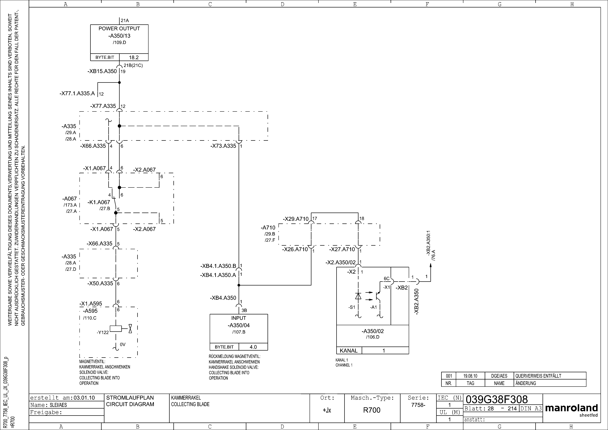

# +Jx — Sheet 28 of 214 — KAMMERRAKEL

**COLLECTING BLADE**

> Part of the manroland **R700** printing press IEC/UL circuit diagrams.
> Drawing class: **Stromlaufplan / Circuit diagram** (DIN A3).
> Document `+Jx` covers the **1st printing module + feed register** machine section.

## At a glance

| Field | Value |
|---|---|
| Document | `+Jx`  (039G38F308) |
| Sheet | **28** of 214 |
| Section (DE) | KAMMERRAKEL |
| Section (EN) | COLLECTING BLADE |
| Section type | CIRCUIT — Circuit diagram |
| Machine type | `R700` |
| Series | `7758` |
| Created | 03.01.10 |
| Replaces | — |
| Columns used | A, B, C, D, E, F, G, H |
| Path numbers | — |
| Labels on sheet | 112 |
| Cross-refs out | 14 |
| Cross-refs in | 37 |

**Previous:** [+Jx sheet 27](SHEET_0027.md) · **Next:** [+Jx sheet 29](SHEET_0029.md) · **Document TOC:** [_TOC.md](_TOC.md)  (+Jx) · **Master TOC:** [all sheets](../_MASTER_TOC.md)

## Sheet image (300 DPI, exact vector render)



_Rendered directly from the PDF vector layer at 300 DPI (1-bit), no OCR and no resampling. Use it to confirm anything ambiguous in the text below._

## Cross-references on this sheet

Each entry is a wire leaving this sheet. The printed token is `/sheet.column`; the link resolves to that sheet inside the same document.

| Ref | Target sheet | Col | Path | Destination on target | Target section | From col |
|---|---|---|---|---|---|---|
| `/109.D` | [+Jx sheet 109](SHEET_0109.md) | D | — | — | REFERENZMODUL | B |
| `/29.A` | [+Jx sheet 29](SHEET_0029.md) | A | — | — | KAMMERRAKEL | A |
| `/28.A` | [+Jx sheet 28](SHEET_0028.md) | A | — | — | KAMMERRAKEL | A |
| `/173.A` | [+Jx sheet 173](SHEET_0173.md) | A | — | — | OPTION: | A |
| `/27.B` | [+Jx sheet 27](SHEET_0027.md) | B | — | — | KAMMERRAKEL | B |
| `/27.A` | [+Jx sheet 27](SHEET_0027.md) | A | — | — | KAMMERRAKEL | A |
| `/76.A` | [+Jx sheet 76](SHEET_0076.md) | A | — | XB2.A350:1 | BUSVERBINDUNGEN: SICHERHEITSKREIS | F |
| `/29.B` | [+Jx sheet 29](SHEET_0029.md) | B | — | — | KAMMERRAKEL | D |
| `/27.F` | [+Jx sheet 27](SHEET_0027.md) | F | — | — | KAMMERRAKEL | D |
| `/28.A` | [+Jx sheet 28](SHEET_0028.md) | A | — | — | KAMMERRAKEL | A |
| `/27.D` | [+Jx sheet 27](SHEET_0027.md) | D | — | — | KAMMERRAKEL | A |
| `/110.C` | [+Jx sheet 110](SHEET_0110.md) | C | — | — | REFERENZMODUL | A |
| `/107.B` | [+Jx sheet 107](SHEET_0107.md) | B | — | — | REFERENZMODUL | C |
| `/106.D` | [+Jx sheet 106](SHEET_0106.md) | D | — | — | REFERENZMODUL | E |

### Incoming references (sheets that point here)

Every other sheet that sends a wire to this one. `Back-ref` is the token printed on *that* sheet; `Path` is its line number.

| From sheet | Cols | Back-ref | Path | Refs | What continues there |
|---|---|---|---|---|---|
| [+Jx#27](SHEET_0027.md) | A, B, C, F | `/27.A`, `/27.B`, `/27.C`, `/27.F` | — | 4 | — |
| [+Jx#28](SHEET_0028.md) | A | `/28.A` | — | 2 | — |
| [+Jx#29](SHEET_0029.md) | A, B | `/29.A`, `/29.B` | — | 2 | — |
| [+Jx#76](SHEET_0076.md) | A | `/76.A` | — | 1 | XB2.A350:1 |
| [+Jx#106](SHEET_0106.md) | D | `/106.D` | — | 1 | — |
| [+Jx#107](SHEET_0107.md) | B | `/107.B` | — | 1 | — |
| [+Jx#109](SHEET_0109.md) | D | `/109.D` | — | 1 | — |
| [+Jx#110](SHEET_0110.md) | C | `/110.C` | — | 1 | — |
| [+Jx#112](SHEET_0112.md) | C | `/112.C` | — | 3 | — |
| [+Jx#115](SHEET_0115.md) | C | `/115.C` | — | 1 | — |
| [+Jx#123](SHEET_0123.md) | A | `/123.A` | — | 2 | — |
| [+Jx#126](SHEET_0126.md) | E | `/126.E` | — | 2 | — |
| [+Jx#130](SHEET_0130.md) | A, B, D | `/130.A`, `/130.B`, `/130.D` | — | 3 | — |
| [+Jx#139](SHEET_0139.md) | B | `/139.B` | — | 1 | — |
| [+Jx#143](SHEET_0143.md) | F | `/143.F` | — | 1 | — |
| [+Jx#144](SHEET_0144.md) | C | `/144.C` | — | 1 | — |
| [+Jx#147](SHEET_0147.md) | B | `/147.B` | — | 2 | — |
| [+Jx#150](SHEET_0150.md) | H | `/150.H` | — | 1 | — |
| [+Jx#152](SHEET_0152.md) | A | `/152.A` | — | 3 | — |
| [+Jx#153](SHEET_0153.md) | E | `/153.E` | — | 1 | — |
| [+Jx#155](SHEET_0155.md) | D | `/155.D` | — | 1 | — |
| [+Jx#156](SHEET_0156.md) | A | `/156.A` | — | 1 | — |
| [+Jx#173](SHEET_0173.md) | A | `/173.A` | — | 1 | — |


## Devices on this sheet

| Tag | Class | Class meaning (IEC) | Col | Sub | Terminal | Sign |
|---|---|---|---|---|---|---|
| `A350/13` | A | Baugruppe / assembly, module, PC board | B | 13 | — | — |
| `Y122` | Y | Magnetventil / solenoid valve, actuator | B | — | — | — |
| `A595` | A | Baugruppe / assembly, module, PC board | A | — | — | — |
| `A335` | A | Baugruppe / assembly, module, PC board | A | — | — | — |
| `A067` | A | Baugruppe / assembly, module, PC board | A | — | — | — |
| `A350/04` | A | Baugruppe / assembly, module, PC board | C | 04 | — | — |
| `A335` | A | Baugruppe / assembly, module, PC board | A | — | — | — |
| `A710` | A | Baugruppe / assembly, module, PC board | D | — | — | — |
| `S1` | S | Schalter / switch | E | — | — | — |
| `A1` | A | Baugruppe / assembly, module, PC board | E | — | — | — |
| `X1` | X | Klemme / terminal, plug connector | E | — | — | — |
| `X2` | X | Klemme / terminal, plug connector | E | — | — | — |
| `XB2` | XB |  | F | — | — | — |
| `A350/02` | A | Baugruppe / assembly, module, PC board | E | 02 | — | — |
| `XB15.A350` | — | cross-device reference | B | — | — | — |
| `18.2` | — | cross-device reference | B | — | — | — |
| `X1.A595` | — | cross-device reference | A | — | — | — |
| `X66.A335` | — | cross-device reference | A | — | — | — |
| `X50.A335` | — | cross-device reference | A | — | — | — |
| `X1.A067` | — | cross-device reference | B | — | — | — |
| `K1.A067` | — | cross-device reference | A | — | — | — |
| `X1.A067` | — | cross-device reference | A | — | — | — |
| `4.0` | — | cross-device reference | D | — | — | — |
| `XB4.A350` | — | cross-device reference | C | — | — | — |
| `X66.A335` | — | cross-device reference | A | — | — | — |
| `X73.A335` | — | cross-device reference | C | — | — | — |
| `X77.1.A335.A` | — | cross-device reference | A | — | — | — |
| `X77.A335` | — | cross-device reference | B | — | — | — |
| `X27.A710` | — | cross-device reference | E | — | — | — |
| `X29.A710` | — | cross-device reference | D | — | — | — |
| `X26.A710` | — | cross-device reference | D | — | — | — |
| `XB2.A350` | — | cross-device reference | F | — | — | — |
| `XB4.1.A350.B` | — | cross-device reference | C | — | — | — |
| `XB4.1.A350.A` | — | cross-device reference | C | — | — | — |
| `NR.` | — | cross-device reference | F | — | — | — |
| `19.08.10` | — | cross-device reference | G | — | — | — |
| `XB2.A350:1` | — | cross-device reference | F | — | 1 | — |
| `X2.A067` | — | cross-device reference | B | — | — | — |
| `X2.A067` | — | cross-device reference | B | — | — | — |

## Potentials / nets

| Potential | Count | Columns | Attached devices | Terminals |
|---|---|---|---|---|
| `0V` | 1 | B | — | — |


A potential such as `L24+/4` or `M24+` is a named supply/return rail; every place it appears on this sheet is electrically common.

## Wire-end annotations (grouped as printed)

A wire that continues elsewhere is annotated with a small cluster: the destination description, the path/line number `#NN`, and the `/sheet.column` cross reference. Each row below is one such cluster exactly as it is grouped on the drawing.

| Col | Y | Path | Cross-ref | Text on the wire |
|---|---|---|---|---|
| B | 36.4 | — | — | `21A` |
| B | 51.5 | — | — | `POWER OUTPUT` |
| B | 65.4 | — | — | `A350/13` |
| B | 79.2 | — | `/109.D` | — |
| B | 108.3 | — | — | `BYTE.BIT 18.2` |
| B | 124.3 | — | — | `21B(21C)` |
| B | 134.9 | — | — | `XB15.A350 19` |
| A | 178.1 | — | — | `X77.1.A335.A 12` |
| B | 202.9 | — | — | `X77.A335 12` |
| A | 242.6 | — | — | `A335` |
| A | 255.7 | — | `/29.A`, `/28.A` | — |
| B | 280.9 | — | — | `X66.A335 4 6 X73.A335 1` |
| A | 324.8 | — | — | `X1.A067 4` |
| B | 324.8 | — | — | `6` |
| B | 327.6 | — | — | `X2.A067` |
| B | 341.8 | — | — | `6` |
| B | 378.0 | — | — | `K1.A067 6` |
| B | 378.0 | — | — | `4` |
| A | 384.3 | — | — | `A067` |
| A | 397.4 | — | `/173.A` | — |
| B | 404.5 | — | `/27.B` | — |
| B | 406.3 | — | — | `5` |
| A | 409.8 | — | `/27.A` | — |
| D | 424.0 | — | — | `X29.A710 17` |
| E | 424.1 | — | — | `18` |
| B | 428.3 | — | — | `5` |
| D | 441.0 | — | — | `A710` |
| B | 443.9 | — | — | `X1.A067 5` |
| B | 443.9 | — | — | `X2.A067` |
| F | 450.7 | — | `/76.A` | `XB2.A350:1` |
| D | 454.1 | — | `/29.B` | — |
| D | 466.5 | — | `/27.F` | — |
| B | 472.2 | — | — | `X66.A335 5` |
| D | 483.5 | — | — | `X26.A710 1` |
| E | 483.5 | — | — | `X27.A710 1` |
| A | 497.7 | — | — | `A335` |
| E | 509.1 | — | — | `X2.A350/02 1` |
| A | 510.8 | — | `/28.A`, `/27.D` | — |
| C | 516.1 | — | — | `XB4.1.A350.B 1` |
| E | 527.5 | — | — | `X2` |
| E | 528.9 | — | — | `1 1` |
| C | 533.2 | — | — | `XB4.1.A350.A 1` |
| F | 537.4 | — | — | `1` |
| E | 541.7 | — | — | `6C` |
| B | 550.2 | — | — | `X50.A335 6` |
| E | 558.7 | — | — | `X1` |
| F | 558.7 | — | — | `XB2` |
| F | 565.0 | — | — | `XB2.A350` |
| C | 578.5 | — | — | `XB4.A350 1` |
| A | 587.0 | — | — | `X1.A595 6` |
| E | 597.6 | — | — | `S1 A1` |
| B | 602.6 | — | — | `6` |
| A | 604.0 | — | — | `A595` |
| C | 604.0 | — | — | `3B` |
| C | 618.5 | — | — | `INPUT` |
| A | 618.9 | — | `/110.C` | — |
| C | 632.4 | — | — | `A350/04` |
| E | 643.7 | — | — | `A350/02` |
| C | 646.1 | — | `/107.B` | — |
| B | 647.3 | — | — | `Y122` |
| E | 656.1 | — | `/106.D` | — |
| B | 670.6 | — | — | `0V` |
| C | 675.2 | — | — | `BYTE.BIT 4.0` |
| E | 681.9 | — | — | `KANAL 1` |
| C | 695.1 | — | — | `RÜCKMELDUNG MAGNETVENTIL: KAMMERRAKEL ANSCHWENKEN HANDSHAKE SOLENOID VALVE: COLLECTING BLADE INTO OPERATION` |
| E | 702.3 | — | — | `KANAL 1 CHANNEL 1` |
| B | 705.0 | — | — | `MAGNETVENTIL: KAMMERRAKEL ANSCHWENKEN SOLENOID VALVE: COLLECTING BLADE INTO OPERATION` |
| G | 733.0 | — | — | `001 19.08.10 DGE/AES QUERVERWEIS ENTFÄLLT` |
| G | 747.1 | — | — | `NR. TAG NAME ÄNDERUNG` |


## Reconstructed tables

This sheet carries tabular content (pin map / terminal assignment / index). The grid below was rebuilt from the drawing's own rule lines, so each row is exactly one physical row of the table.

### Table 1 — 5 data rows × 4 columns (at x=177.2, y=48.2)

| POWER |  | A350/13 | OUTPUT /109.D |
|---|---|---|---|
| `BYTE.BIT` |  |  | `18.2` |
| `XB15.A350` |  |  | `21B(21C) 19` |
| `12 X77.A335` |  |  | `12` |
| `X66.A335 X1.A067` | `4 4` |  | `6 6 X2.A067` |
| `K1.A067 /27.B` | `4` | `5` | `6` |


### Table 2 — 7 data rows × 9 columns (at x=411.0, y=246.6)

| X73.A335 | 1 |  |  |  |  |  |  |  |
|---|---|---|---|---|---|---|---|---|
| `XB4.1.A350.B` | `1` | `X29.A710 A710 /29.B /27.F X26.A710` | `17 1` | `X27.A710 X2.A350/02` | `18 1 1` |  |  | `XB2.A350:1` |
| `XB4.1.A350.A` | `1` |  |  | `X2` | `1` | `6C` |  | `1 1` |
| `XB4.A350` | `1 3B` |  |  | `S1` | `A1` | `X1` | `XB2` | `XB2.A350` |
| `INPUT` |  |  |  |  |  |  |  |  |
|  | `A350/04 /107.B` |  |  |  | `A350/02 /106.D` |  |  |  |
| `BYTE.BIT` | `4.0` |  |  |  |  |  |  |  |
|  |  |  |  | `KANAL` |  | `1` |  |  |


## Notes and free text on this sheet

| Text | Col | Y (pt) |
|---|---|---|
| `21A` | B | 36.37 |
| `21B(21C)` | B | 124.28 |
| `POWER OUTPUT` | B | 51.52 |
| `BYTE.BIT` | B | 108.86 |
| `MAGNETVENTIL:` | A | 704.98 |
| `KAMMERRAKEL ANSCHWENKEN` | B | 715.61 |
| `SOLENOID VALVE:` | A | 726.23 |
| `COLLECTING BLADE INTO` | A | 736.89 |
| `OPERATION` | A | 747.51 |
| `3B` | C | 603.99 |
| `INPUT` | C | 618.53 |
| `BYTE.BIT` | C | 675.79 |
| `RÜCKMELDUNG MAGNETVENTIL:` | C | 695.08 |
| `KAMMERRAKEL ANSCHWENKEN` | C | 705.69 |
| `HANDSHAKE SOLENOID VALVE:` | C | 716.32 |
| `COLLECTING BLADE INTO` | C | 726.97 |
| `OPERATION` | C | 737.59 |
| `KANAL 1` | E | 702.28 |
| `CHANNEL 1` | E | 712.23 |
| `6C` | E | 541.69 |
| `KANAL` | E | 681.96 |
| `X2.A350/02` | E | 509.06 |
| `TAG` | G | 747.23 |
| `NAME` | G | 747.22 |
| `ÄNDERUNG` | G | 747.25 |
| `DGE/AES` | G | 733.06 |
| `QUERVERWEIS ENTFÄLLT` | H | 733.07 |

## Complete label inventory (exact text from the drawing)

Every text object inside the drawing area of this sheet, in DIN reading order (column A→H, then top→bottom). This is the authoritative list: if a string is not here it is not printed on this sheet.

| Col | Y | X | Dir | Type | Text |
|---|---|---|---|---|---|
| A | 178.1 | 116.8 | → | device ref | `X77.1.A335.A` |
| A | 180.3 | 193.3 | → | number | `12` |
| A | 242.6 | 120.8 | → | device tag | `A335` |
| A | 255.7 | 128.1 | → | cross-reference | `/29.A` |
| A | 268.1 | 128.1 | → | cross-reference | `/28.A` |
| A | 280.9 | 157.0 | → | device ref | `X66.A335` |
| A | 324.8 | 163.0 | → | device ref | `X1.A067` |
| A | 384.3 | 122.2 | → | device tag | `A067` |
| A | 391.4 | 171.5 | → | device ref | `K1.A067` |
| A | 397.4 | 124.7 | → | cross-reference | `/173.A` |
| A | 409.8 | 129.5 | → | cross-reference | `/27.A` |
| A | 472.2 | 169.8 | → | device ref | `X66.A335` |
| A | 497.7 | 120.8 | → | device tag | `A335` |
| A | 510.8 | 128.1 | → | cross-reference | `/28.A` |
| A | 523.2 | 128.1 | → | cross-reference | `/27.D` |
| A | 550.2 | 171.2 | → | device ref | `X50.A335` |
| A | 589.8 | 155.6 | → | device ref | `X1.A595` |
| A | 604.0 | 162.7 | → | device tag | `A595` |
| A | 618.9 | 163.0 | → | cross-reference | `/110.C` |
| A | 705.0 | 155.3 | → | text | `MAGNETVENTIL:` |
| A | 726.2 | 155.6 | → | text | `SOLENOID VALVE:` |
| A | 736.9 | 155.6 | → | text | `COLLECTING BLADE INTO` |
| A | 747.5 | 155.6 | → | text | `OPERATION` |
| B | 36.4 | 236.7 | → | text | `21A` |
| B | 51.5 | 193.0 | → | text | `POWER OUTPUT` |
| B | 65.4 | 212.3 | → | device tag | `A350/13` |
| B | 79.2 | 221.1 | → | cross-reference | `/109.D` |
| B | 108.3 | 252.4 | → | device ref | `18.2` |
| B | 108.9 | 187.1 | → | text | `BYTE.BIT` |
| B | 124.3 | 242.4 | → | text | `21B(21C)` |
| B | 134.9 | 171.5 | → | device ref | `XB15.A350` |
| B | 136.3 | 235.8 | → | number | `19` |
| B | 202.9 | 176.9 | → | device ref | `X77.A335` |
| B | 204.4 | 235.8 | → | number | `12` |
| B | 282.3 | 215.4 | → | number | `4` |
| B | 282.3 | 236.4 | → | number | `6` |
| B | 324.8 | 215.4 | → | number | `4` |
| B | 324.8 | 236.4 | → | number | `6` |
| B | 327.6 | 260.8 | → | device ref | `X2.A067` |
| B | 341.8 | 314.4 | → | number | `6` |
| B | 378.0 | 212.3 | → | number | `4` |
| B | 378.0 | 236.4 | → | number | `6` |
| B | 404.5 | 195.0 | → | cross-reference | `/27.B` |
| B | 406.3 | 229.3 | → | number | `5` |
| B | 428.3 | 314.4 | → | number | `5` |
| B | 443.9 | 177.2 | → | device ref | `X1.A067` |
| B | 443.9 | 260.8 | → | device ref | `X2.A067` |
| B | 445.3 | 229.3 | → | number | `5` |
| B | 473.7 | 229.3 | → | number | `5` |
| B | 551.6 | 229.3 | → | number | `6` |
| B | 587.0 | 229.3 | → | number | `6` |
| B | 602.6 | 229.3 | → | number | `6` |
| B | 647.3 | 189.6 | → | device tag | `Y122` |
| B | 670.6 | 235.0 | → | potential | `0V` |
| B | 715.6 | 155.3 | → | text | `KAMMERRAKEL ANSCHWENKEN` |
| C | 280.9 | 412.2 | → | device ref | `X73.A335` |
| C | 282.3 | 469.7 | → | number | `1` |
| C | 516.2 | 392.6 | → | device ref | `XB4.1.A350.B` |
| C | 516.2 | 469.7 | → | number | `1` |
| C | 533.2 | 469.7 | → | number | `1` |
| C | 533.9 | 392.0 | → | device ref | `XB4.1.A350.A` |
| C | 578.5 | 411.3 | → | device ref | `XB4.A350` |
| C | 587.0 | 469.7 | → | number | `1` |
| C | 604.0 | 473.1 | → | text | `3B` |
| C | 618.5 | 452.8 | → | text | `INPUT` |
| C | 632.4 | 446.2 | → | device tag | `A350/04` |
| C | 646.2 | 455.1 | → | cross-reference | `/107.B` |
| C | 675.8 | 420.9 | → | text | `BYTE.BIT` |
| C | 695.1 | 409.0 | → | text | `RÜCKMELDUNG MAGNETVENTIL:` |
| C | 705.7 | 409.0 | → | text | `KAMMERRAKEL ANSCHWENKEN` |
| C | 716.3 | 409.0 | → | text | `HANDSHAKE SOLENOID VALVE:` |
| C | 727.0 | 409.3 | → | text | `COLLECTING BLADE INTO` |
| C | 737.6 | 409.3 | → | text | `OPERATION` |
| D | 424.0 | 554.2 | → | device ref | `X29.A710` |
| D | 424.0 | 611.4 | → | number | `17` |
| D | 441.0 | 510.8 | → | device tag | `A710` |
| D | 454.1 | 518.2 | → | cross-reference | `/29.B` |
| D | 466.5 | 518.7 | → | cross-reference | `/27.F` |
| D | 483.5 | 552.8 | → | device ref | `X26.A710` |
| D | 487.8 | 611.4 | → | number | `1` |
| D | 675.2 | 489.4 | → | device ref | `4.0` |
| E | 424.0 | 703.6 | → | number | `18` |
| E | 483.5 | 644.9 | → | device ref | `X27.A710` |
| E | 487.8 | 703.6 | → | number | `1` |
| E | 509.1 | 637.5 | → | text | `X2.A350/02` |
| E | 509.1 | 703.6 | → | number | `1` |
| E | 527.5 | 680.0 | → | device tag | `X2` |
| E | 528.9 | 706.4 | → | number | `1` |
| E | 541.7 | 751.7 | → | text | `6C` |
| E | 558.7 | 750.3 | → | device tag | `X1` |
| E | 597.6 | 682.3 | → | device tag | `S1` |
| E | 597.6 | 724.8 | → | device tag | `A1` |
| E | 643.7 | 708.5 | → | device tag | `A350/02` |
| E | 656.1 | 717.2 | → | cross-reference | `/106.D` |
| E | 681.9 | 748.6 | → | number | `1` |
| E | 682.0 | 665.6 | → | text | `KANAL` |
| E | 702.3 | 657.1 | → | text | `KANAL 1` |
| E | 712.2 | 657.4 | → | text | `CHANNEL 1` |
| F | 450.7 | 835.0 | ↕ | device ref | `XB2.A350:1` |
| F | 489.5 | 844.9 | ↕ | cross-reference | `/76.A` |
| F | 537.4 | 832.8 | → | number | `1` |
| F | 538.9 | 805.6 | → | number | `1` |
| F | 558.7 | 775.0 | → | device tag | `XB2` |
| F | 564.9 | 810.9 | ↕ | device ref | `XB2.A350` |
| F | 733.0 | 873.4 | → | number | `001` |
| F | 747.1 | 872.6 | → | device ref | `NR.` |
| G | 733.1 | 907.3 | → | device ref | `19.08.10` |
| G | 733.1 | 962.2 | → | text | `DGE/AES` |
| G | 747.2 | 914.3 | → | text | `TAG` |
| G | 747.2 | 967.6 | → | text | `NAME` |
| G | 747.3 | 1009.8 | → | text | `ÄNDERUNG` |
| H | 733.1 | 1009.6 | → | text | `QUERVERWEIS ENTFÄLLT` |

## Reading-order text block

The same content as a plain block, grouped by DIN column — convenient to paste or to match against a visual description.

```text
=== Column A ===
 178.1  116.8  devref       X77.1.A335.A
 180.3  193.3  numeric      12
 242.6  120.8  devtag       A335
 255.7  128.1  xref         /29.A
 268.1  128.1  xref         /28.A
 280.9  157.0  devref       X66.A335
 324.8  163.0  devref       X1.A067
 384.3  122.2  devtag       A067
 391.4  171.5  devref       K1.A067
 397.4  124.7  xref         /173.A
 409.8  129.5  xref         /27.A
 472.2  169.8  devref       X66.A335
 497.7  120.8  devtag       A335
 510.8  128.1  xref         /28.A
 523.2  128.1  xref         /27.D
 550.2  171.2  devref       X50.A335
 589.8  155.6  devref       X1.A595
 604.0  162.7  devtag       A595
 618.9  163.0  xref         /110.C
 705.0  155.3  text         MAGNETVENTIL:
 726.2  155.6  text         SOLENOID VALVE:
 736.9  155.6  text         COLLECTING BLADE INTO
 747.5  155.6  text         OPERATION
=== Column B ===
  36.4  236.7  text         21A
  51.5  193.0  text         POWER OUTPUT
  65.4  212.3  devtag       A350/13
  79.2  221.1  xref         /109.D
 108.3  252.4  devref       18.2
 108.9  187.1  text         BYTE.BIT
 124.3  242.4  text         21B(21C)
 134.9  171.5  devref       XB15.A350
 136.3  235.8  numeric      19
 202.9  176.9  devref       X77.A335
 204.4  235.8  numeric      12
 282.3  215.4  numeric      4
 282.3  236.4  numeric      6
 324.8  215.4  numeric      4
 324.8  236.4  numeric      6
 327.6  260.8  devref       X2.A067
 341.8  314.4  numeric      6
 378.0  212.3  numeric      4
 378.0  236.4  numeric      6
 404.5  195.0  xref         /27.B
 406.3  229.3  numeric      5
 428.3  314.4  numeric      5
 443.9  177.2  devref       X1.A067
 443.9  260.8  devref       X2.A067
 445.3  229.3  numeric      5
 473.7  229.3  numeric      5
 551.6  229.3  numeric      6
 587.0  229.3  numeric      6
 602.6  229.3  numeric      6
 647.3  189.6  devtag       Y122
 670.6  235.0  net          0V
 715.6  155.3  text         KAMMERRAKEL ANSCHWENKEN
=== Column C ===
 280.9  412.2  devref       X73.A335
 282.3  469.7  numeric      1
 516.2  392.6  devref       XB4.1.A350.B
 516.2  469.7  numeric      1
 533.2  469.7  numeric      1
 533.9  392.0  devref       XB4.1.A350.A
 578.5  411.3  devref       XB4.A350
 587.0  469.7  numeric      1
 604.0  473.1  text         3B
 618.5  452.8  text         INPUT
 632.4  446.2  devtag       A350/04
 646.2  455.1  xref         /107.B
 675.8  420.9  text         BYTE.BIT
 695.1  409.0  text         RÜCKMELDUNG MAGNETVENTIL:
 705.7  409.0  text         KAMMERRAKEL ANSCHWENKEN
 716.3  409.0  text         HANDSHAKE SOLENOID VALVE:
 727.0  409.3  text         COLLECTING BLADE INTO
 737.6  409.3  text         OPERATION
=== Column D ===
 424.0  554.2  devref       X29.A710
 424.0  611.4  numeric      17
 441.0  510.8  devtag       A710
 454.1  518.2  xref         /29.B
 466.5  518.7  xref         /27.F
 483.5  552.8  devref       X26.A710
 487.8  611.4  numeric      1
 675.2  489.4  devref       4.0
=== Column E ===
 424.0  703.6  numeric      18
 483.5  644.9  devref       X27.A710
 487.8  703.6  numeric      1
 509.1  637.5  text         X2.A350/02
 509.1  703.6  numeric      1
 527.5  680.0  devtag       X2
 528.9  706.4  numeric      1
 541.7  751.7  text         6C
 558.7  750.3  devtag       X1
 597.6  682.3  devtag       S1
 597.6  724.8  devtag       A1
 643.7  708.5  devtag       A350/02
 656.1  717.2  xref         /106.D
 681.9  748.6  numeric      1
 682.0  665.6  text         KANAL
 702.3  657.1  text         KANAL 1
 712.2  657.4  text         CHANNEL 1
=== Column F ===
 450.7  835.0  devref       XB2.A350:1
 489.5  844.9  xref         /76.A
 537.4  832.8  numeric      1
 538.9  805.6  numeric      1
 558.7  775.0  devtag       XB2
 564.9  810.9  devref       XB2.A350
 733.0  873.4  numeric      001
 747.1  872.6  devref       NR.
=== Column G ===
 733.1  907.3  devref       19.08.10
 733.1  962.2  text         DGE/AES
 747.2  914.3  text         TAG
 747.2  967.6  text         NAME
 747.3 1009.8  text         ÄNDERUNG
=== Column H ===
 733.1 1009.6  text         QUERVERWEIS ENTFÄLLT
```

---
_Generated from the PDF vector text layer; no OCR. Source: `R700_7758_IEC_UL_JX_039G38F308_p`, sheet 28._
