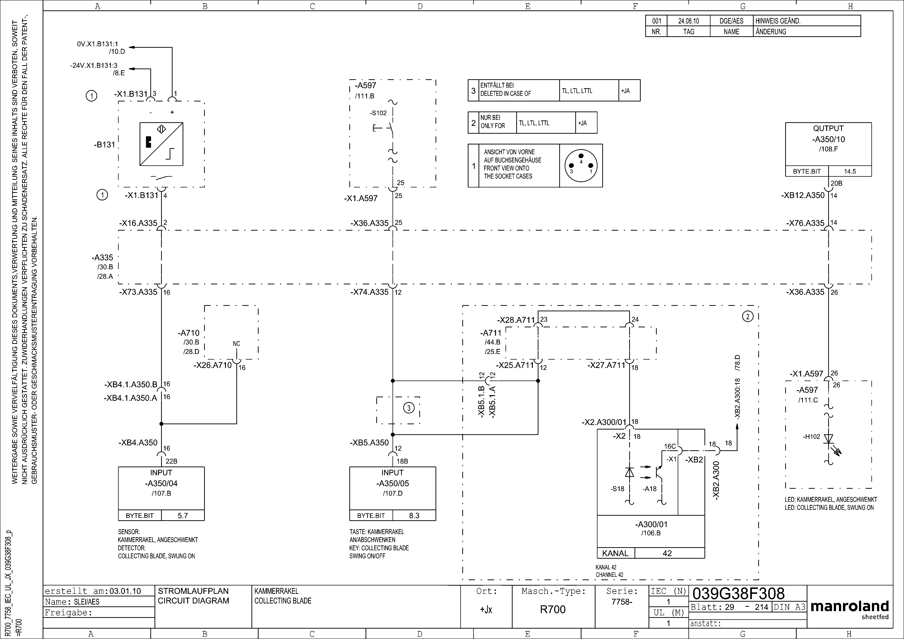

# +Jx — Sheet 29 of 214 — KAMMERRAKEL

**COLLECTING BLADE**

> Part of the manroland **R700** printing press IEC/UL circuit diagrams.
> Drawing class: **Stromlaufplan / Circuit diagram** (DIN A3).
> Document `+Jx` covers the **1st printing module + feed register** machine section.

## At a glance

| Field | Value |
|---|---|
| Document | `+Jx`  (039G38F308) |
| Sheet | **29** of 214 |
| Section (DE) | KAMMERRAKEL |
| Section (EN) | COLLECTING BLADE |
| Section type | CIRCUIT — Circuit diagram |
| Machine type | `R700` |
| Series | `7758` |
| Created | 03.01.10 |
| Replaces | — |
| Columns used | A, B, C, D, E, F, G, H |
| Path numbers | — |
| Labels on sheet | 146 |
| Cross-refs out | 15 |
| Cross-refs in | 40 |

**Previous:** [+Jx sheet 28](SHEET_0028.md) · **Next:** [+Jx sheet 30](SHEET_0030.md) · **Document TOC:** [_TOC.md](_TOC.md)  (+Jx) · **Master TOC:** [all sheets](../_MASTER_TOC.md)

## Sheet image (300 DPI, exact vector render)



_Rendered directly from the PDF vector layer at 300 DPI (1-bit), no OCR and no resampling. Use it to confirm anything ambiguous in the text below._

## Cross-references on this sheet

Each entry is a wire leaving this sheet. The printed token is `/sheet.column`; the link resolves to that sheet inside the same document.

| Ref | Target sheet | Col | Path | Destination on target | Target section | From col |
|---|---|---|---|---|---|---|
| `/10.D` | [+Jx sheet 10](SHEET_0010.md) | D | — | 0V.X1.B131:1 | SPANNUNGSVERSORGUNG, SCHALTSCHRANKBELÜFTUNG | A |
| `/8.E` | [+Jx sheet 8](SHEET_0008.md) | E | — | 24V.X1.B131:3 | SPANNUNGSVERSORGUNG, SCHALTSCHRANKBELÜFTUNG | A |
| `/111.B` | [+Jx sheet 111](SHEET_0111.md) | B | — | — | REFERENZMODUL | C |
| `/108.F` | [+Jx sheet 108](SHEET_0108.md) | F | — | — | REFERENZMODUL | H |
| `/30.B` | [+Jx sheet 30](SHEET_0030.md) | B | — | — | LACKNIVEAUÜBERWACHUNG | A |
| `/28.A` | [+Jx sheet 28](SHEET_0028.md) | A | — | — | KAMMERRAKEL | A |
| `/30.B` | [+Jx sheet 30](SHEET_0030.md) | B | — | — | LACKNIVEAUÜBERWACHUNG | B |
| `/28.D` | [+Jx sheet 28](SHEET_0028.md) | D | — | — | KAMMERRAKEL | B |
| `/44.B` | [+Jx sheet 44](SHEET_0044.md) | B | — | — | MASCHINENBEDIENUNG | E |
| `/25.E` | [+Jx sheet 25](SHEET_0025.md) | E | — | — | HILFSANTRIEB, LACKDOSIER /AUFTRAGSWALZEN | E |
| `/78.D` | [+Jx sheet 78](SHEET_0078.md) | D | — | XB2.A300:18 | BUSVERBINDUNGEN: SICHERHEITSKREIS | G |
| `/111.C` | [+Jx sheet 111](SHEET_0111.md) | C | — | — | REFERENZMODUL | H |
| `/107.B` | [+Jx sheet 107](SHEET_0107.md) | B | — | — | REFERENZMODUL | B |
| `/107.D` | [+Jx sheet 107](SHEET_0107.md) | D | — | — | REFERENZMODUL | D |
| `/106.B` | [+Jx sheet 106](SHEET_0106.md) | B | — | — | REFERENZMODUL | F |

### Incoming references (sheets that point here)

Every other sheet that sends a wire to this one. `Back-ref` is the token printed on *that* sheet; `Path` is its line number.

| From sheet | Cols | Back-ref | Path | Refs | What continues there |
|---|---|---|---|---|---|
| [+Jx#8](SHEET_0008.md) | E | `/8.E` | — | 1 | 24V.X1.B131:3 |
| [+Jx#10](SHEET_0010.md) | D | `/10.D` | — | 1 | 0V.X1.B131:1 |
| [+Jx#25](SHEET_0025.md) | E | `/25.E` | — | 1 | — |
| [+Jx#28](SHEET_0028.md) | A, D | `/28.A`, `/28.D` | — | 2 | — |
| [+Jx#30](SHEET_0030.md) | A, B | `/30.A`, `/30.B` | — | 2 | — |
| [+Jx#44](SHEET_0044.md) | B | `/44.B` | — | 1 | — |
| [+Jx#78](SHEET_0078.md) | D | `/78.D` | — | 1 | XB2.A300:18 |
| [+Jx#106](SHEET_0106.md) | B | `/106.B` | — | 1 | — |
| [+Jx#107](SHEET_0107.md) | B, D | `/107.B`, `/107.D` | — | 2 | — |
| [+Jx#108](SHEET_0108.md) | F | `/108.F` | — | 1 | — |
| [+Jx#111](SHEET_0111.md) | B, C | `/111.B`, `/111.C` | — | 2 | — |
| [+Jx#115](SHEET_0115.md) | E, F | `/115.E`, `/115.F` | — | 2 | — |
| [+Jx#116](SHEET_0116.md) | G | `/116.G` | — | 3 | — |
| [+Jx#124](SHEET_0124.md) | F, H | `/124.F`, `/124.H` | — | 2 | — |
| [+Jx#130](SHEET_0130.md) | A, B, D | `/130.A`, `/130.B`, `/130.D` | — | 3 | — |
| [+Jx#131](SHEET_0131.md) | A, B | `/131.A`, `/131.B` | — | 2 | — |
| [+Jx#132](SHEET_0132.md) | C | `/132.C` | — | 1 | — |
| [+Jx#137](SHEET_0137.md) | H | `/137.H` | — | 1 | — |
| [+Jx#139](SHEET_0139.md) | C | `/139.C` | — | 1 | — |
| [+Jx#143](SHEET_0143.md) | B, F | `/143.B`, `/143.F` | — | 2 | — |
| [+Jx#144](SHEET_0144.md) | G | `/144.G` | — | 1 | — |
| [+Jx#146](SHEET_0146.md) | C | `/146.C` | — | 2 | — |
| [+Jx#149](SHEET_0149.md) | F, G | `/149.F`, `/149.G` | — | 2 | — |
| [+Jx#153](SHEET_0153.md) | E | `/153.E` | — | 1 | — |
| [+Jx#154](SHEET_0154.md) | A | `/154.A` | — | 1 | — |
| [+Jx#155](SHEET_0155.md) | B | `/155.B` | — | 1 | — |


## Devices on this sheet

| Tag | Class | Class meaning (IEC) | Col | Sub | Terminal | Sign |
|---|---|---|---|---|---|---|
| `B131` | B | Umformer / transducer, sensor | A | — | — | — |
| `A597` | A | Baugruppe / assembly, module, PC board | H | — | — | — |
| `A350/10` | A | Baugruppe / assembly, module, PC board | H | 10 | — | — |
| `S102` | S | Schalter / switch | D | — | — | — |
| `A597` | A | Baugruppe / assembly, module, PC board | C | — | — | — |
| `A350/05` | A | Baugruppe / assembly, module, PC board | D | 05 | — | — |
| `S18` | S | Schalter / switch | F | — | — | — |
| `A18` | A | Baugruppe / assembly, module, PC board | F | — | — | — |
| `X1` | X | Klemme / terminal, plug connector | F | — | — | — |
| `X2` | X | Klemme / terminal, plug connector | F | — | — | — |
| `XB2` | XB |  | G | — | — | — |
| `A300/01` | A | Baugruppe / assembly, module, PC board | F | 01 | — | — |
| `A711` | A | Baugruppe / assembly, module, PC board | E | — | — | — |
| `A335` | A | Baugruppe / assembly, module, PC board | A | — | — | — |
| `A350/04` | A | Baugruppe / assembly, module, PC board | B | 04 | — | — |
| `A710` | A | Baugruppe / assembly, module, PC board | B | — | — | — |
| `X1.B131` | — | cross-device reference | A | — | — | — |
| `X1.B131` | — | cross-device reference | A | — | — | — |
| `X1.A597` | — | cross-device reference | H | — | — | — |
| `14.5` | — | cross-device reference | H | — | — | — |
| `XB12.A350` | — | cross-device reference | H | — | — | — |
| `X1.A597` | — | cross-device reference | C | — | — | — |
| `8.3` | — | cross-device reference | D | — | — | — |
| `XB5.A350` | — | cross-device reference | D | — | — | — |
| `XB2.A300` | — | cross-device reference | G | — | — | — |
| `X28.A711` | — | cross-device reference | E | — | — | — |
| `X25.A711` | — | cross-device reference | E | — | — | — |
| `X27.A711` | — | cross-device reference | F | — | — | — |
| `XB5.1.A` | — | cross-device reference | E | — | — | — |
| `XB5.1.B` | — | cross-device reference | E | — | — | — |
| `X73.A335` | — | cross-device reference | A | — | — | — |
| `X16.A335` | — | cross-device reference | A | — | — | — |
| `X74.A335` | — | cross-device reference | D | — | — | — |
| `X36.A335` | — | cross-device reference | D | — | — | — |
| `X36.A335` | — | cross-device reference | H | — | — | — |
| `X76.A335` | — | cross-device reference | H | — | — | — |
| `5.7` | — | cross-device reference | B | — | — | — |
| `XB4.A350` | — | cross-device reference | A | — | — | — |
| `XB4.1.A350.B` | — | cross-device reference | A | — | — | — |
| `XB4.1.A350.A` | — | cross-device reference | A | — | — | — |
| `X26.A710` | — | cross-device reference | B | — | — | — |
| `NR.` | — | cross-device reference | F | — | — | — |
| `24.08.10` | — | cross-device reference | F | — | — | — |
| `XB2.A300:18` | — | cross-device reference | G | — | 18 | — |

## Potentials / nets

| Potential | Count | Columns | Attached devices | Terminals |
|---|---|---|---|---|
| `0V` | 1 | A | `B131`, `X1` | `1` |
| `24V` | 1 | A | `B131`, `X1` | `3` |
| `H102` | 1 | H | — | — |


A potential such as `L24+/4` or `M24+` is a named supply/return rail; every place it appears on this sheet is electrically common.

## Wire-end annotations (grouped as printed)

A wire that continues elsewhere is annotated with a small cluster: the destination description, the path/line number `#NN`, and the `/sheet.column` cross reference. Each row below is one such cluster exactly as it is grouped on the drawing.

| Col | Y | Path | Cross-ref | Text on the wire |
|---|---|---|---|---|
| G | 24.3 | — | — | `001 24.08.10 DGE/AES HINWEIS GEÄND.` |
| G | 38.5 | — | — | `NR. TAG NAME ÄNDERUNG` |
| A | 54.1 | — | `/10.D` | `0V.X1.B131:1` |
| A | 82.4 | — | `/8.E` | `24V.X1.B131:3` |
| C | 108.0 | — | — | `A597` |
| E | 109.7 | — | — | `3 ENTFÄLLT BEI DELETED IN CASE OF TL, LTL, LTTL +JA` |
| A | 119.3 | — | — | `X1.B131 3 1` |
| C | 122.8 | — | `/111.B` | — |
| A | 123.1 | — | — | `1` |
| B | 144.1 | — | — | `+` |
| D | 145.2 | — | — | `S102` |
| E | 152.2 | — | — | `2 NUR BEI ONLY FOR TL, LTL, LTTL` |
| F | 159.3 | — | — | `+JA` |
| H | 165.0 | — | — | `QUTPUT` |
| H | 178.8 | — | — | `A350/10` |
| A | 185.9 | — | — | `B131` |
| H | 192.6 | — | `/108.F` | — |
| E | 197.6 | — | — | `FRONT VIEW ONTO ANSICHT VON VORNE AUF BUCHSENGEHÄUSE` |
| F | 209.9 | — | — | `4` |
| E | 214.2 | — | — | `1 3 1` |
| H | 222.2 | — | — | `BYTE.BIT 14.5` |
| E | 229.5 | — | — | `THE SOCKET CASES` |
| D | 237.0 | — | — | `25` |
| H | 237.6 | — | — | `20B` |
| A | 252.5 | — | — | `X1.B131 4` |
| H | 252.5 | — | — | `XB12.A350 14` |
| A | 253.5 | — | — | `1` |
| D | 254.0 | — | — | `X1.A597 25` |
| A | 289.4 | — | — | `X16.A335 2` |
| D | 289.4 | — | — | `X36.A335 25` |
| H | 289.4 | — | — | `X76.A335 14` |
| A | 334.7 | — | — | `A335` |
| A | 347.8 | — | `/30.B`, `/28.A` | — |
| A | 380.1 | — | — | `X73.A335 16` |
| D | 380.1 | — | — | `X74.A335 12` |
| H | 380.1 | — | — | `X36.A335 26` |
| G | 414.1 | — | — | `2` |
| E | 416.9 | — | — | `X28.A711 23` |
| F | 417.0 | — | — | `24` |
| B | 433.9 | — | — | `A710` |
| E | 433.9 | — | — | `A711` |
| B | 447.0 | — | `/30.B`, `/28.D` | — |
| E | 447.0 | — | `/44.B`, `/25.E` | — |
| B | 449.9 | — | — | `NC` |
| G | 467.3 | — | `/78.D` | `XB2.A300:18` |
| B | 476.5 | — | — | `X26.A710 16` |
| E | 476.5 | — | — | `X25.A711 12` |
| F | 476.5 | — | — | `X27.A711 18` |
| H | 487.8 | — | — | `X1.A597 26` |
| E | 490.1 | — | — | `XB5.1.B 12` |
| E | 490.1 | — | — | `XB5.1.A 12` |
| A | 502.0 | — | — | `XB4.1.A350.B 16` |
| H | 503.4 | — | — | `26` |
| H | 509.1 | — | — | `A597` |
| A | 519.0 | — | — | `XB4.1.A350.A 16` |
| H | 523.2 | — | `/111.C` | — |
| D | 534.6 | — | — | `3` |
| F | 551.6 | — | — | `X2.A300/01 18` |
| F | 570.0 | — | — | `X2` |
| F | 571.5 | — | — | `18 18` |
| H | 571.9 | — | — | `H102` |
| A | 578.5 | — | — | `XB4.A350 16` |
| D | 578.5 | — | — | `XB5.A350 12` |
| G | 580.0 | — | — | `18` |
| F | 584.2 | — | — | `16C` |
| F | 601.2 | — | — | `X1` |
| G | 601.2 | — | — | `XB2` |
| B | 604.0 | — | — | `22B` |
| D | 604.0 | — | — | `18B` |
| G | 607.5 | — | — | `XB2.A300` |
| B | 618.5 | — | — | `INPUT` |
| D | 618.5 | — | — | `INPUT` |
| B | 632.4 | — | — | `A350/04` |
| D | 632.4 | — | — | `A350/05` |
| F | 640.2 | — | — | `S18 A18` |
| B | 646.1 | — | `/107.B` | — |
| D | 646.2 | — | `/107.D` | — |
| H | 655.4 | — | — | `LED: KAMMERRAKEL, ANGESCHWENKT LED: COLLECTING BLADE, SWUNG ON` |
| B | 675.2 | — | — | `BYTE.BIT 5.7` |
| D | 675.2 | — | — | `BYTE.BIT 8.3` |
| F | 686.2 | — | — | `A300/01` |
| B | 697.9 | — | — | `KAMMERRAKEL, ANGESCHWENKT DETECTOR: SENSOR: COLLECTING BLADE, SWUNG ON` |
| D | 697.9 | — | — | `KEY: COLLECTING BLADE SWING ON/OFF TASTE: KAMMERRAKEL AN/ABSCHWENKEN` |
| F | 698.6 | — | `/106.B` | — |
| F | 724.5 | — | — | `KANAL 42` |
| F | 744.8 | — | — | `KANAL 42 CHANNEL 42` |


## Reconstructed tables

This sheet carries tabular content (pin map / terminal assignment / index). The grid below was rebuilt from the drawing's own rule lines, so each row is exactly one physical row of the table.

### Table 1 — 4 data rows × 7 columns (at x=155.9, y=62.4)

| /8.E X1.B131 |  | 3 | + | 1 |  |  |
|---|---|---|---|---|---|---|
| `X16.A335 X73.A335 XB4.1.A350.B XB4.1.A350.A` | `X1.B131` |  | `4 2 16 16 16` |  | `A710 /30.B /28.D` | `NC X26.A710` |
| `XB4.A350` |  |  | `16 22B` |  |  |  |
|  |  | `INPUT A350/04` | `/107.B` |  |  |  |
| `BYTE.BIT` |  |  |  |  | `5.7` |  |


### Table 2 — 5 data rows × 2 columns (at x=460.6, y=104.9)

| A597 /111.B S102 | 25 |
|---|---|
| `X1.A597 X36.A335 X74.A335` | `25 25 12` |
|  | `3` |
| `XB5.A350` | `12 18B` |
| `INPUT` | `A350/05 /107.D` |
| `BYTE.BIT` | `8.3` |


### Table 3 — 8 data rows × 9 columns (at x=708.7, y=161.6)

| +JA LTTL 4 |  |  |  |  |  |  | QUTPUT | A350/10 /108.F |
|---|---|---|---|---|---|---|---|---|
| `3 1` |  |  |  |  |  |  | `BYTE.BIT` | `14.5` |
|  |  |  |  |  |  |  | `XB12.A350 X76.A335 X36.A335` | `20B 14 14 26` |
| `23 12` | `X27.A711` | `24 18` |  |  |  | `2 /78.D` | `X1.A597` | `26` |
|  | `X2.A300/01` | `18` |  |  |  | `XB2.A300:18` | `A597 /111.C` | `26` |
|  | `X2` | `18` | `16C X1` | `XB2` | `18 18 XB2.A300` |  | `H102` |  |
|  | `S18` | `A18` |  |  |  |  | `LED: KAMMERRAKEL, LED: COLLECTING` | `ANGESCHWENKT BLADE, SWUNG ON` |
|  |  | `A300/01 /106.B` |  |  |  |  |  |  |
|  | `KANAL` |  | `42` |  |  |  |  |  |


## Notes and free text on this sheet

| Text | Col | Y (pt) |
|---|---|---|
| `LED: KAMMERRAKEL, ANGESCHWENKT` | H | 655.38 |
| `LED: COLLECTING BLADE, SWUNG ON` | H | 666.01 |
| `20B` | H | 237.63 |
| `QUTPUT` | H | 164.96 |
| `BYTE.BIT` | H | 222.24 |
| `18B` | D | 604.01 |
| `INPUT` | D | 618.53 |
| `BYTE.BIT` | D | 675.79 |
| `TASTE: KAMMERRAKEL` | D | 697.9 |
| `AN/ABSCHWENKEN` | D | 708.51 |
| `KEY: COLLECTING BLADE` | D | 719.16 |
| `SWING ON/OFF` | D | 729.76 |
| `KANAL 42` | F | 744.83 |
| `CHANNEL 42` | F | 754.78 |
| `16C` | F | 584.21 |
| `KANAL` | F | 724.48 |
| `X2.A300/01` | F | 551.58 |
| `22B` | B | 604.01 |
| `INPUT` | B | 618.53 |
| `BYTE.BIT` | A | 675.79 |
| `SENSOR:` | A | 697.87 |
| `KAMMERRAKEL, ANGESCHWENKT` | B | 708.53 |
| `DETECTOR:` | A | 719.15 |
| `COLLECTING BLADE, SWUNG ON` | B | 729.79 |
| `TAG` | G | 38.57 |
| `NAME` | G | 38.56 |
| `ÄNDERUNG` | G | 38.59 |
| `DGE/AES` | G | 24.4 |
| `HINWEIS GEÄND.` | G | 24.38 |
| `ANSICHT VON VORNE` | E | 197.59 |
| `AUF BUCHSENGEHÄUSE` | E | 208.23 |
| `FRONT VIEW ONTO` | E | 218.82 |
| `THE SOCKET CASES` | E | 229.47 |
| `NUR BEI` | E | 152.19 |
| `ONLY FOR` | E | 162.88 |
| `TL, LTL, LTTL` | E | 159.32 |
| `NC` | B | 449.85 |
| `+JA` | F | 159.27 |
| `ENTFÄLLT BEI` | E | 109.68 |
| `DELETED IN CASE OF` | E | 120.33 |

## Complete label inventory (exact text from the drawing)

Every text object inside the drawing area of this sheet, in DIN reading order (column A→H, then top→bottom). This is the authoritative list: if a string is not here it is not printed on this sheet.

| Col | Y | X | Dir | Type | Text |
|---|---|---|---|---|---|
| A | 54.1 | 101.5 | → | potential | `0V.X1.B131:1` |
| A | 64.0 | 143.7 | → | cross-reference | `/10.D` |
| A | 82.4 | 92.7 | → | potential | `24V.X1.B131:3` |
| A | 92.3 | 148.8 | → | cross-reference | `/8.E` |
| A | 119.3 | 150.5 | → | device ref | `X1.B131` |
| A | 123.1 | 118.6 | → | number | `1` |
| A | 185.9 | 123.9 | → | device tag | `B131` |
| A | 252.5 | 164.7 | → | device ref | `X1.B131` |
| A | 253.5 | 132.8 | → | number | `1` |
| A | 289.4 | 157.0 | → | device ref | `X16.A335` |
| A | 334.7 | 120.8 | → | device tag | `A335` |
| A | 347.8 | 128.4 | → | cross-reference | `/30.B` |
| A | 360.2 | 128.1 | → | cross-reference | `/28.A` |
| A | 380.1 | 157.0 | → | device ref | `X73.A335` |
| A | 502.0 | 137.5 | → | device ref | `XB4.1.A350.B` |
| A | 519.7 | 136.9 | → | device ref | `XB4.1.A350.A` |
| A | 578.5 | 156.2 | → | device ref | `XB4.A350` |
| A | 675.8 | 165.8 | → | text | `BYTE.BIT` |
| A | 697.9 | 155.6 | → | text | `SENSOR:` |
| A | 719.1 | 155.3 | → | text | `DETECTOR:` |
| B | 119.3 | 201.0 | → | number | `3` |
| B | 119.3 | 228.8 | → | number | `1` |
| B | 144.1 | 224.2 | → | number | `+` |
| B | 254.0 | 215.4 | → | number | `4` |
| B | 289.4 | 215.4 | → | number | `2` |
| B | 381.5 | 214.6 | → | number | `16` |
| B | 433.9 | 234.4 | → | device tag | `A710` |
| B | 447.0 | 241.8 | → | cross-reference | `/30.B` |
| B | 449.9 | 307.1 | → | text | `NC` |
| B | 459.4 | 241.5 | → | cross-reference | `/28.D` |
| B | 476.5 | 255.1 | → | device ref | `X26.A710` |
| B | 480.7 | 313.8 | → | number | `16` |
| B | 502.0 | 214.6 | → | number | `16` |
| B | 519.0 | 214.6 | → | number | `16` |
| B | 587.0 | 214.6 | → | number | `16` |
| B | 604.0 | 218.3 | → | text | `22B` |
| B | 618.5 | 197.7 | → | text | `INPUT` |
| B | 632.4 | 191.1 | → | device tag | `A350/04` |
| B | 646.2 | 200.0 | → | cross-reference | `/107.B` |
| B | 675.2 | 234.1 | → | device ref | `5.7` |
| B | 708.5 | 155.3 | → | text | `KAMMERRAKEL, ANGESCHWENKT` |
| B | 729.8 | 155.6 | → | text | `COLLECTING BLADE, SWUNG ON` |
| C | 108.0 | 467.4 | → | device tag | `A597` |
| C | 122.8 | 467.7 | → | cross-reference | `/111.B` |
| C | 256.8 | 453.3 | → | device ref | `X1.A597` |
| D | 115.0 | 620.6 | → | number | `3` |
| D | 145.3 | 487.3 | → | device tag | `S102` |
| D | 237.0 | 523.0 | → | number | `25` |
| D | 254.0 | 520.2 | → | number | `25` |
| D | 289.4 | 461.8 | → | device ref | `X36.A335` |
| D | 289.4 | 520.2 | → | number | `25` |
| D | 380.1 | 461.8 | → | device ref | `X74.A335` |
| D | 381.5 | 519.3 | → | number | `12` |
| D | 534.6 | 536.6 | → | number | `3` |
| D | 578.5 | 460.9 | → | device ref | `XB5.A350` |
| D | 587.0 | 519.3 | → | number | `12` |
| D | 604.0 | 522.1 | → | text | `18B` |
| D | 618.5 | 502.4 | → | text | `INPUT` |
| D | 632.4 | 495.8 | → | device tag | `A350/05` |
| D | 646.2 | 504.6 | → | cross-reference | `/107.D` |
| D | 675.2 | 538.9 | → | device ref | `8.3` |
| D | 675.8 | 470.6 | → | text | `BYTE.BIT` |
| D | 697.9 | 460.6 | → | text | `TASTE: KAMMERRAKEL` |
| D | 708.5 | 460.6 | → | text | `AN/ABSCHWENKEN` |
| D | 719.2 | 460.1 | → | text | `KEY: COLLECTING BLADE` |
| D | 729.8 | 460.3 | → | text | `SWING ON/OFF` |
| E | 109.7 | 633.0 | → | text | `ENTFÄLLT BEI` |
| E | 116.8 | 740.6 | → | text | `TL, LTL, LTTL` |
| E | 120.3 | 633.0 | → | text | `DELETED IN CASE OF` |
| E | 152.2 | 633.0 | → | text | `NUR BEI` |
| E | 157.5 | 620.8 | → | number | `2` |
| E | 159.3 | 683.9 | → | text | `TL, LTL, LTTL` |
| E | 162.9 | 633.3 | → | text | `ONLY FOR` |
| E | 197.6 | 637.8 | → | text | `ANSICHT VON VORNE` |
| E | 208.2 | 637.8 | → | text | `AUF BUCHSENGEHÄUSE` |
| E | 214.2 | 621.1 | → | number | `1` |
| E | 218.8 | 637.2 | → | text | `FRONT VIEW ONTO` |
| E | 222.7 | 750.6 | → | number | `3` |
| E | 229.5 | 637.8 | → | text | `THE SOCKET CASES` |
| E | 416.9 | 654.8 | → | device ref | `X28.A711` |
| E | 417.0 | 711.5 | → | number | `23` |
| E | 433.9 | 632.7 | → | device tag | `A711` |
| E | 447.0 | 638.6 | → | cross-reference | `/44.B` |
| E | 459.4 | 638.6 | → | cross-reference | `/25.E` |
| E | 476.5 | 653.4 | → | device ref | `X25.A711` |
| E | 480.7 | 710.6 | → | number | `12` |
| E | 490.1 | 631.0 | ↕ | number | `12` |
| E | 490.1 | 645.1 | ↕ | number | `12` |
| E | 508.3 | 629.6 | ↕ | device ref | `XB5.1.B` |
| E | 508.8 | 643.7 | ↕ | device ref | `XB5.1.A` |
| F | 24.3 | 859.3 | → | number | `001` |
| F | 24.4 | 893.5 | → | device ref | `24.08.10` |
| F | 38.5 | 858.5 | → | device ref | `NR.` |
| F | 116.8 | 818.2 | → | text | `+JA` |
| F | 159.3 | 761.5 | → | text | `+JA` |
| F | 209.9 | 763.5 | → | number | `4` |
| F | 222.7 | 776.4 | → | number | `1` |
| F | 417.0 | 832.0 | → | number | `24` |
| F | 476.5 | 773.9 | → | device ref | `X27.A711` |
| F | 480.7 | 831.1 | → | number | `18` |
| F | 551.6 | 766.5 | → | text | `X2.A300/01` |
| F | 551.6 | 831.1 | → | number | `18` |
| F | 570.0 | 807.6 | → | device tag | `X2` |
| F | 571.4 | 834.0 | → | number | `18` |
| F | 584.2 | 874.5 | → | text | `16C` |
| F | 601.2 | 877.9 | → | device tag | `X1` |
| F | 640.2 | 803.9 | → | device tag | `S18` |
| F | 640.2 | 846.4 | → | device tag | `A18` |
| F | 686.2 | 836.8 | → | device tag | `A300/01` |
| F | 698.6 | 844.9 | → | cross-reference | `/106.B` |
| F | 724.5 | 793.1 | → | text | `KANAL` |
| F | 724.5 | 873.1 | → | number | `42` |
| F | 744.8 | 784.6 | → | text | `KANAL 42` |
| F | 754.8 | 784.9 | → | text | `CHANNEL 42` |
| G | 24.4 | 948.0 | → | text | `DGE/AES` |
| G | 24.4 | 995.1 | → | text | `HINWEIS GEÄND.` |
| G | 38.6 | 900.1 | → | text | `TAG` |
| G | 38.6 | 953.5 | → | text | `NAME` |
| G | 38.6 | 995.7 | → | text | `ÄNDERUNG` |
| G | 414.1 | 983.0 | → | number | `2` |
| G | 467.3 | 967.5 | ↕ | cross-reference | `/78.D` |
| G | 498.3 | 967.5 | ↕ | device ref | `XB2.A300:18` |
| G | 580.0 | 954.4 | → | number | `18` |
| G | 581.4 | 933.2 | → | number | `18` |
| G | 601.2 | 902.6 | → | device tag | `XB2` |
| G | 607.5 | 938.5 | ↕ | device ref | `XB2.A300` |
| H | 165.0 | 1071.1 | → | text | `QUTPUT` |
| H | 178.8 | 1069.9 | → | device tag | `A350/10` |
| H | 192.6 | 1079.0 | → | cross-reference | `/108.F` |
| H | 222.2 | 1044.6 | → | text | `BYTE.BIT` |
| H | 222.3 | 1111.5 | → | device ref | `14.5` |
| H | 237.6 | 1094.2 | → | text | `20B` |
| H | 252.5 | 1029.0 | → | device ref | `XB12.A350` |
| H | 254.0 | 1093.3 | → | number | `14` |
| H | 289.4 | 1035.8 | → | device ref | `X76.A335` |
| H | 289.4 | 1093.3 | → | number | `14` |
| H | 380.1 | 1035.8 | → | device ref | `X36.A335` |
| H | 381.5 | 1094.2 | → | number | `26` |
| H | 487.8 | 1040.3 | → | device ref | `X1.A597` |
| H | 487.8 | 1094.2 | → | number | `26` |
| H | 503.4 | 1097.0 | → | number | `26` |
| H | 509.1 | 1049.1 | → | device tag | `A597` |
| H | 523.2 | 1051.7 | → | cross-reference | `/111.C` |
| H | 571.9 | 1057.9 | → | potential | `H102` |
| H | 655.4 | 1034.1 | → | text | `LED: KAMMERRAKEL, ANGESCHWENKT` |
| H | 666.0 | 1034.1 | → | text | `LED: COLLECTING BLADE, SWUNG ON` |

## Reading-order text block

The same content as a plain block, grouped by DIN column — convenient to paste or to match against a visual description.

```text
=== Column A ===
  54.1  101.5  net          0V.X1.B131:1
  64.0  143.7  xref         /10.D
  82.4   92.7  net          24V.X1.B131:3
  92.3  148.8  xref         /8.E
 119.3  150.5  devref       X1.B131
 123.1  118.6  numeric      1
 185.9  123.9  devtag       B131
 252.5  164.7  devref       X1.B131
 253.5  132.8  numeric      1
 289.4  157.0  devref       X16.A335
 334.7  120.8  devtag       A335
 347.8  128.4  xref         /30.B
 360.2  128.1  xref         /28.A
 380.1  157.0  devref       X73.A335
 502.0  137.5  devref       XB4.1.A350.B
 519.7  136.9  devref       XB4.1.A350.A
 578.5  156.2  devref       XB4.A350
 675.8  165.8  text         BYTE.BIT
 697.9  155.6  text         SENSOR:
 719.1  155.3  text         DETECTOR:
=== Column B ===
 119.3  201.0  numeric      3
 119.3  228.8  numeric      1
 144.1  224.2  numeric      +
 254.0  215.4  numeric      4
 289.4  215.4  numeric      2
 381.5  214.6  numeric      16
 433.9  234.4  devtag       A710
 447.0  241.8  xref         /30.B
 449.9  307.1  text         NC
 459.4  241.5  xref         /28.D
 476.5  255.1  devref       X26.A710
 480.7  313.8  numeric      16
 502.0  214.6  numeric      16
 519.0  214.6  numeric      16
 587.0  214.6  numeric      16
 604.0  218.3  text         22B
 618.5  197.7  text         INPUT
 632.4  191.1  devtag       A350/04
 646.2  200.0  xref         /107.B
 675.2  234.1  devref       5.7
 708.5  155.3  text         KAMMERRAKEL, ANGESCHWENKT
 729.8  155.6  text         COLLECTING BLADE, SWUNG ON
=== Column C ===
 108.0  467.4  devtag       A597
 122.8  467.7  xref         /111.B
 256.8  453.3  devref       X1.A597
=== Column D ===
 115.0  620.6  numeric      3
 145.3  487.3  devtag       S102
 237.0  523.0  numeric      25
 254.0  520.2  numeric      25
 289.4  461.8  devref       X36.A335
 289.4  520.2  numeric      25
 380.1  461.8  devref       X74.A335
 381.5  519.3  numeric      12
 534.6  536.6  numeric      3
 578.5  460.9  devref       XB5.A350
 587.0  519.3  numeric      12
 604.0  522.1  text         18B
 618.5  502.4  text         INPUT
 632.4  495.8  devtag       A350/05
 646.2  504.6  xref         /107.D
 675.2  538.9  devref       8.3
 675.8  470.6  text         BYTE.BIT
 697.9  460.6  text         TASTE: KAMMERRAKEL
 708.5  460.6  text         AN/ABSCHWENKEN
 719.2  460.1  text         KEY: COLLECTING BLADE
 729.8  460.3  text         SWING ON/OFF
=== Column E ===
 109.7  633.0  text         ENTFÄLLT BEI
 116.8  740.6  text         TL, LTL, LTTL
 120.3  633.0  text         DELETED IN CASE OF
 152.2  633.0  text         NUR BEI
 157.5  620.8  numeric      2
 159.3  683.9  text         TL, LTL, LTTL
 162.9  633.3  text         ONLY FOR
 197.6  637.8  text         ANSICHT VON VORNE
 208.2  637.8  text         AUF BUCHSENGEHÄUSE
 214.2  621.1  numeric      1
 218.8  637.2  text         FRONT VIEW ONTO
 222.7  750.6  numeric      3
 229.5  637.8  text         THE SOCKET CASES
 416.9  654.8  devref       X28.A711
 417.0  711.5  numeric      23
 433.9  632.7  devtag       A711
 447.0  638.6  xref         /44.B
 459.4  638.6  xref         /25.E
 476.5  653.4  devref       X25.A711
 480.7  710.6  numeric      12
 490.1  631.0  numeric      12
 490.1  645.1  numeric      12
 508.3  629.6  devref       XB5.1.B
 508.8  643.7  devref       XB5.1.A
=== Column F ===
  24.3  859.3  numeric      001
  24.4  893.5  devref       24.08.10
  38.5  858.5  devref       NR.
 116.8  818.2  text         +JA
 159.3  761.5  text         +JA
 209.9  763.5  numeric      4
 222.7  776.4  numeric      1
 417.0  832.0  numeric      24
 476.5  773.9  devref       X27.A711
 480.7  831.1  numeric      18
 551.6  766.5  text         X2.A300/01
 551.6  831.1  numeric      18
 570.0  807.6  devtag       X2
 571.4  834.0  numeric      18
 584.2  874.5  text         16C
 601.2  877.9  devtag       X1
 640.2  803.9  devtag       S18
 640.2  846.4  devtag       A18
 686.2  836.8  devtag       A300/01
 698.6  844.9  xref         /106.B
 724.5  793.1  text         KANAL
 724.5  873.1  numeric      42
 744.8  784.6  text         KANAL 42
 754.8  784.9  text         CHANNEL 42
=== Column G ===
  24.4  948.0  text         DGE/AES
  24.4  995.1  text         HINWEIS GEÄND.
  38.6  900.1  text         TAG
  38.6  953.5  text         NAME
  38.6  995.7  text         ÄNDERUNG
 414.1  983.0  numeric      2
 467.3  967.5  xref         /78.D
 498.3  967.5  devref       XB2.A300:18
 580.0  954.4  numeric      18
 581.4  933.2  numeric      18
 601.2  902.6  devtag       XB2
 607.5  938.5  devref       XB2.A300
=== Column H ===
 165.0 1071.1  text         QUTPUT
 178.8 1069.9  devtag       A350/10
 192.6 1079.0  xref         /108.F
 222.2 1044.6  text         BYTE.BIT
 222.3 1111.5  devref       14.5
 237.6 1094.2  text         20B
 252.5 1029.0  devref       XB12.A350
 254.0 1093.3  numeric      14
 289.4 1035.8  devref       X76.A335
 289.4 1093.3  numeric      14
 380.1 1035.8  devref       X36.A335
 381.5 1094.2  numeric      26
 487.8 1040.3  devref       X1.A597
 487.8 1094.2  numeric      26
 503.4 1097.0  numeric      26
 509.1 1049.1  devtag       A597
 523.2 1051.7  xref         /111.C
 571.9 1057.9  net          H102
 655.4 1034.1  text         LED: KAMMERRAKEL, ANGESCHWENKT
 666.0 1034.1  text         LED: COLLECTING BLADE, SWUNG ON
```

---
_Generated from the PDF vector text layer; no OCR. Source: `R700_7758_IEC_UL_JX_039G38F308_p`, sheet 29._
