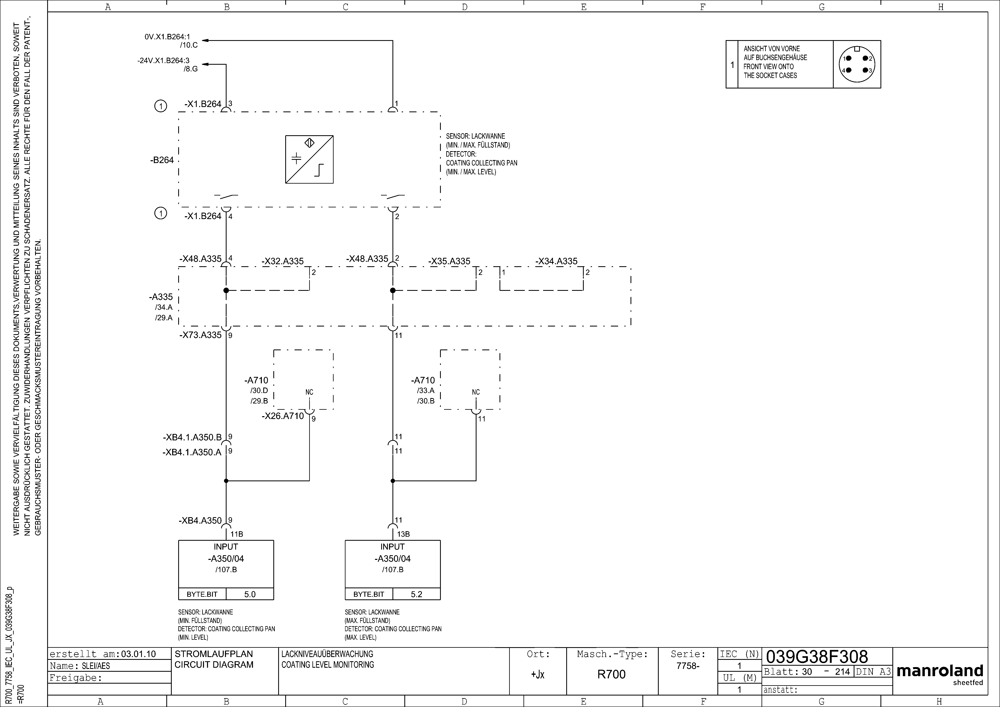

# +Jx — Sheet 30 of 214 — LACKNIVEAUÜBERWACHUNG

**COATING LEVEL MONITORING**

> Part of the manroland **R700** printing press IEC/UL circuit diagrams.
> Drawing class: **Stromlaufplan / Circuit diagram** (DIN A3).
> Document `+Jx` covers the **1st printing module + feed register** machine section.

## At a glance

| Field | Value |
|---|---|
| Document | `+Jx`  (039G38F308) |
| Sheet | **30** of 214 |
| Section (DE) | LACKNIVEAUÜBERWACHUNG |
| Section (EN) | COATING LEVEL MONITORING |
| Section type | CIRCUIT — Circuit diagram |
| Machine type | `R700` |
| Series | `7758` |
| Created | 03.01.10 |
| Replaces | — |
| Columns used | A, B, C, D, E, F, G |
| Path numbers | — |
| Labels on sheet | 84 |
| Cross-refs out | 10 |
| Cross-refs in | 30 |

**Previous:** [+Jx sheet 29](SHEET_0029.md) · **Next:** [+Jx sheet 31](SHEET_0031.md) · **Document TOC:** [_TOC.md](_TOC.md)  (+Jx) · **Master TOC:** [all sheets](../_MASTER_TOC.md)

## Sheet image (300 DPI, exact vector render)



_Rendered directly from the PDF vector layer at 300 DPI (1-bit), no OCR and no resampling. Use it to confirm anything ambiguous in the text below._

## Cross-references on this sheet

Each entry is a wire leaving this sheet. The printed token is `/sheet.column`; the link resolves to that sheet inside the same document.

| Ref | Target sheet | Col | Path | Destination on target | Target section | From col |
|---|---|---|---|---|---|---|
| `/10.C` | [+Jx sheet 10](SHEET_0010.md) | C | — | 0V.X1.B264:1 | SPANNUNGSVERSORGUNG, SCHALTSCHRANKBELÜFTUNG | B |
| `/8.G` | [+Jx sheet 8](SHEET_0008.md) | G | — | 24V.X1.B264:3 | SPANNUNGSVERSORGUNG, SCHALTSCHRANKBELÜFTUNG | B |
| `/34.A` | [+Jx sheet 34](SHEET_0034.md) | A | — | — | NOT AUS | A |
| `/29.A` | [+Jx sheet 29](SHEET_0029.md) | A | — | — | KAMMERRAKEL | A |
| `/33.A` | [+Jx sheet 33](SHEET_0033.md) | A | — | — | NOT AUS | D |
| `/30.B` | [+Jx sheet 30](SHEET_0030.md) | B | — | — | LACKNIVEAUÜBERWACHUNG | D |
| `/30.D` | [+Jx sheet 30](SHEET_0030.md) | D | — | — | LACKNIVEAUÜBERWACHUNG | B |
| `/29.B` | [+Jx sheet 29](SHEET_0029.md) | B | — | — | KAMMERRAKEL | B |
| `/107.B` | [+Jx sheet 107](SHEET_0107.md) | B | — | — | REFERENZMODUL | B |
| `/107.B` | [+Jx sheet 107](SHEET_0107.md) | B | — | — | REFERENZMODUL | C |

### Incoming references (sheets that point here)

Every other sheet that sends a wire to this one. `Back-ref` is the token printed on *that* sheet; `Path` is its line number.

| From sheet | Cols | Back-ref | Path | Refs | What continues there |
|---|---|---|---|---|---|
| [+Jx#8](SHEET_0008.md) | G | `/8.G` | — | 1 | — |
| [+Jx#10](SHEET_0010.md) | C | `/10.C` | — | 1 | — |
| [+Jx#29](SHEET_0029.md) | A, B | `/29.A`, `/29.B` | — | 2 | — |
| [+Jx#30](SHEET_0030.md) | B, D | `/30.B`, `/30.D` | — | 2 | — |
| [+Jx#33](SHEET_0033.md) | A | `/33.A` | — | 1 | — |
| [+Jx#34](SHEET_0034.md) | A | `/34.A` | — | 1 | — |
| [+Jx#107](SHEET_0107.md) | B | `/107.B` | — | 2 | — |
| [+Jx#117](SHEET_0117.md) | B | `/117.B` | — | 4 | — |
| [+Jx#130](SHEET_0130.md) | A, B, D | `/130.A`, `/130.B`, `/130.D` | — | 6 | — |
| [+Jx#143](SHEET_0143.md) | F | `/143.F` | — | 2 | — |
| [+Jx#149](SHEET_0149.md) | A, C, E | `/149.A`, `/149.C`, `/149.E` | — | 4 | — |
| [+Jx#150](SHEET_0150.md) | G | `/150.G` | — | 2 | — |
| [+Jx#153](SHEET_0153.md) | E | `/153.E` | — | 2 | — |


## Devices on this sheet

| Tag | Class | Class meaning (IEC) | Col | Sub | Terminal | Sign |
|---|---|---|---|---|---|---|
| `A350/04` | A | Baugruppe / assembly, module, PC board | B | 04 | — | — |
| `A350/04` | A | Baugruppe / assembly, module, PC board | C | 04 | — | — |
| `B264` | B | Umformer / transducer, sensor | A | — | — | — |
| `A335` | A | Baugruppe / assembly, module, PC board | A | — | — | — |
| `A710` | A | Baugruppe / assembly, module, PC board | B | — | — | — |
| `A710` | A | Baugruppe / assembly, module, PC board | D | — | — | — |
| `5.0` | — | cross-device reference | B | — | — | — |
| `XB4.A350` | — | cross-device reference | B | — | — | — |
| `5.2` | — | cross-device reference | D | — | — | — |
| `X1.B264` | — | cross-device reference | B | — | — | — |
| `X1.B264` | — | cross-device reference | B | — | — | — |
| `X73.A335` | — | cross-device reference | B | — | — | — |
| `X48.A335` | — | cross-device reference | B | — | — | — |
| `X48.A335` | — | cross-device reference | C | — | — | — |
| `XB4.1.A350.B` | — | cross-device reference | B | — | — | — |
| `XB4.1.A350.A` | — | cross-device reference | B | — | — | — |
| `X26.A710` | — | cross-device reference | B | — | — | — |
| `X32.A335` | — | cross-device reference | B | — | — | — |
| `X35.A335` | — | cross-device reference | D | — | — | — |
| `X34.A335` | — | cross-device reference | E | — | — | — |

## Potentials / nets

| Potential | Count | Columns | Attached devices | Terminals |
|---|---|---|---|---|
| `0V` | 1 | B | `B264`, `X1` | `1` |
| `24V` | 1 | A | `B264`, `X1` | `3` |


A potential such as `L24+/4` or `M24+` is a named supply/return rail; every place it appears on this sheet is electrically common.

## Wire-end annotations (grouped as printed)

A wire that continues elsewhere is annotated with a small cluster: the destination description, the path/line number `#NN`, and the `/sheet.column` cross reference. Each row below is one such cluster exactly as it is grouped on the drawing.

| Col | Y | Path | Cross-ref | Text on the wire |
|---|---|---|---|---|
| B | 39.9 | — | `/10.C` | `0V.X1.B264:1` |
| G | 55.1 | — | — | `FRONT VIEW ONTO ANSICHT VON VORNE AUF BUCHSENGEHÄUSE` |
| G | 66.8 | — | — | `1 1 2` |
| B | 68.2 | — | `/8.G` | `24V.X1.B264:3` |
| G | 80.9 | — | — | `4 3` |
| G | 87.0 | — | — | `THE SOCKET CASES` |
| B | 119.3 | — | — | `X1.B264 3` |
| C | 119.3 | — | — | `1` |
| A | 123.1 | — | — | `1` |
| D | 159.3 | — | — | `DETECTOR: SENSOR: LACKWANNE (MIN. / MAX. FÜLLSTAND) COATING COLLECTING PAN (MIN. / MAX. LEVEL)` |
| A | 185.9 | — | — | `B264` |
| A | 250.7 | — | — | `1` |
| C | 252.5 | — | — | `X1.B264 4 2` |
| B | 303.5 | — | — | `X48.A335 4` |
| C | 303.5 | — | — | `X48.A335 2` |
| D | 306.4 | — | — | `X32.A335 X35.A335 X34.A335` |
| C | 320.6 | — | — | `2` |
| E | 320.6 | — | — | `2 1 2` |
| A | 348.9 | — | — | `A335` |
| A | 362.0 | — | `/34.A`, `/29.A` | — |
| B | 394.2 | — | — | `X73.A335 9` |
| C | 395.7 | — | — | `11` |
| B | 448.1 | — | — | `A710` |
| D | 448.1 | — | — | `A710` |
| B | 461.2 | — | `/30.D`, `/29.B` | — |
| D | 461.2 | — | `/33.A`, `/30.B` | — |
| C | 464.0 | — | — | `NC NC` |
| C | 490.6 | — | — | `X26.A710 9` |
| D | 494.9 | — | — | `11` |
| B | 516.1 | — | — | `XB4.1.A350.B 9` |
| C | 516.2 | — | — | `11` |
| B | 533.2 | — | — | `XB4.1.A350.A 9` |
| C | 533.2 | — | — | `11` |
| B | 615.4 | — | — | `XB4.A350 9` |
| C | 615.4 | — | — | `11` |
| B | 632.4 | — | — | `11B` |
| C | 632.4 | — | — | `13B` |
| B | 646.9 | — | — | `INPUT` |
| C | 646.9 | — | — | `INPUT` |
| B | 660.7 | — | — | `A350/04` |
| C | 660.7 | — | — | `A350/04` |
| B | 674.5 | — | `/107.B` | — |
| C | 674.5 | — | `/107.B` | — |
| B | 703.5 | — | — | `BYTE.BIT 5.0` |
| C | 703.5 | — | — | `BYTE.BIT 5.2` |
| B | 726.4 | — | — | `(MIN. FÜLLSTAND) DETECTOR: COATING COLLECTING PAN (MIN. LEVEL) SENSOR: LACKWANNE` |
| C | 726.4 | — | — | `(MAX. FÜLLSTAND) DETECTOR: COATING COLLECTING PAN (MAX. LEVEL) SENSOR: LACKWANNE` |


## Reconstructed tables

This sheet carries tabular content (pin map / terminal assignment / index). The grid below was rebuilt from the drawing's own rule lines, so each row is exactly one physical row of the table.

### Table 1 — 5 data rows × 5 columns (at x=212.6, y=48.2)

| /10.C /8.G X1.B264 | 3 |  |  |  |
|---|---|---|---|---|
| `X1.B264 X48.A335` | `4 4` | `X32.A335` |  | `2` |
| `X73.A335 XB4.1.A350.B XB4.1.A350.A` | `9 A710 /30.D /29.B 9 9` | `X26.A710` | `NC` | `9` |
| `XB4.A350` | `9 11B` |  |  |  |
| `INPUT A350/04` | `/107.B` |  |  |  |
| `BYTE.BIT` | `5.0` |  |  |  |


### Table 2 — 4 data rows × 3 columns (at x=411.0, y=48.2) — **1 SENSOR: (MIN. / MAX. DETECTOR: COATING (MIN. / MAX.**

| X48.A335 | 2 2 | X35.A335 |
|---|---|---|
|  | `11 A710 /33.A /30.B 11 11` | `NC` |
|  | `11 13B` |  |
| `INPUT` | `A350/04 /107.B` |  |
| `BYTE.BIT` | `5.2` |  |


## Notes and free text on this sheet

| Text | Col | Y (pt) |
|---|---|---|
| `11B` | B | 632.36 |
| `INPUT` | B | 646.87 |
| `BYTE.BIT` | B | 704.13 |
| `SENSOR: LACKWANNE` | B | 726.39 |
| `(MIN. FÜLLSTAND)` | B | 736.35 |
| `DETECTOR: COATING COLLECTING PAN` | B | 746.28 |
| `(MIN. LEVEL)` | B | 756.27 |
| `13B` | C | 632.36 |
| `INPUT` | C | 646.87 |
| `BYTE.BIT` | C | 704.13 |
| `SENSOR: LACKWANNE` | C | 726.39 |
| `(MAX. FÜLLSTAND)` | C | 736.34 |
| `DETECTOR: COATING COLLECTING PAN` | C | 746.28 |
| `(MAX. LEVEL)` | C | 756.26 |
| `SENSOR: LACKWANNE` | D | 159.3 |
| `(MIN. / MAX. FÜLLSTAND)` | D | 169.96 |
| `DETECTOR:` | D | 180.57 |
| `COATING COLLECTING PAN` | D | 191.22 |
| `(MIN. / MAX. LEVEL)` | D | 201.84 |
| `NC` | C | 464.03 |
| `NC` | D | 464.03 |
| `ANSICHT VON VORNE` | G | 55.15 |
| `AUF BUCHSENGEHÄUSE` | G | 65.79 |
| `FRONT VIEW ONTO` | G | 76.38 |
| `THE SOCKET CASES` | G | 87.03 |

## Complete label inventory (exact text from the drawing)

Every text object inside the drawing area of this sheet, in DIN reading order (column A→H, then top→bottom). This is the authoritative list: if a string is not here it is not printed on this sheet.

| Col | Y | X | Dir | Type | Text |
|---|---|---|---|---|---|
| A | 68.3 | 163.6 | → | potential | `24V.X1.B264:3` |
| A | 123.1 | 189.5 | → | number | `1` |
| A | 185.9 | 178.9 | → | device tag | `B264` |
| A | 250.6 | 189.5 | → | number | `1` |
| A | 348.9 | 177.4 | → | device tag | `A335` |
| A | 362.0 | 184.8 | → | cross-reference | `/34.A` |
| A | 374.4 | 184.8 | → | cross-reference | `/29.A` |
| B | 39.9 | 172.3 | → | potential | `0V.X1.B264:1` |
| B | 49.8 | 214.6 | → | cross-reference | `/10.C` |
| B | 78.1 | 218.8 | → | cross-reference | `/8.G` |
| B | 119.3 | 219.7 | → | device ref | `X1.B264` |
| B | 119.3 | 271.8 | → | number | `3` |
| B | 252.5 | 219.7 | → | device ref | `X1.B264` |
| B | 254.0 | 272.1 | → | number | `4` |
| B | 303.5 | 213.7 | → | device ref | `X48.A335` |
| B | 303.6 | 272.1 | → | number | `4` |
| B | 306.4 | 311.5 | → | device ref | `X32.A335` |
| B | 394.3 | 213.7 | → | device ref | `X73.A335` |
| B | 395.7 | 271.8 | → | number | `9` |
| B | 448.1 | 291.1 | → | device tag | `A710` |
| B | 461.2 | 298.2 | → | cross-reference | `/30.D` |
| B | 473.6 | 298.5 | → | cross-reference | `/29.B` |
| B | 490.6 | 311.8 | → | device ref | `X26.A710` |
| B | 516.2 | 194.2 | → | device ref | `XB4.1.A350.B` |
| B | 516.2 | 271.8 | → | number | `9` |
| B | 533.2 | 271.8 | → | number | `9` |
| B | 533.9 | 193.6 | → | device ref | `XB4.1.A350.A` |
| B | 615.4 | 212.9 | → | device ref | `XB4.A350` |
| B | 615.4 | 271.8 | → | number | `9` |
| B | 632.4 | 274.1 | → | text | `11B` |
| B | 646.9 | 254.4 | → | text | `INPUT` |
| B | 660.7 | 247.7 | → | device tag | `A350/04` |
| B | 674.5 | 256.7 | → | cross-reference | `/107.B` |
| B | 703.5 | 290.8 | → | device ref | `5.0` |
| B | 704.1 | 222.5 | → | text | `BYTE.BIT` |
| B | 726.4 | 212.3 | → | text | `SENSOR: LACKWANNE` |
| B | 736.3 | 212.0 | → | text | `(MIN. FÜLLSTAND)` |
| B | 746.3 | 212.0 | → | text | `DETECTOR: COATING COLLECTING PAN` |
| B | 756.3 | 212.0 | → | text | `(MIN. LEVEL)` |
| C | 119.3 | 469.7 | → | number | `1` |
| C | 254.0 | 470.6 | → | number | `2` |
| C | 303.5 | 412.2 | → | device ref | `X48.A335` |
| C | 303.6 | 470.6 | → | number | `2` |
| C | 320.6 | 371.3 | → | number | `2` |
| C | 395.7 | 469.7 | → | number | `11` |
| C | 464.0 | 363.8 | → | text | `NC` |
| C | 494.9 | 371.1 | → | number | `9` |
| C | 516.2 | 469.7 | → | number | `11` |
| C | 533.2 | 469.7 | → | number | `11` |
| C | 615.4 | 469.7 | → | number | `11` |
| C | 632.4 | 472.5 | → | text | `13B` |
| C | 646.9 | 452.8 | → | text | `INPUT` |
| C | 660.7 | 446.2 | → | device tag | `A350/04` |
| C | 674.5 | 455.1 | → | cross-reference | `/107.B` |
| C | 704.1 | 420.9 | → | text | `BYTE.BIT` |
| C | 726.4 | 410.7 | → | text | `SENSOR: LACKWANNE` |
| C | 736.3 | 410.5 | → | text | `(MAX. FÜLLSTAND)` |
| C | 746.3 | 410.5 | → | text | `DETECTOR: COATING COLLECTING PAN` |
| C | 756.3 | 410.5 | → | text | `(MAX. LEVEL)` |
| D | 159.3 | 531.2 | → | text | `SENSOR: LACKWANNE` |
| D | 170.0 | 531.2 | → | text | `(MIN. / MAX. FÜLLSTAND)` |
| D | 180.6 | 530.9 | → | text | `DETECTOR:` |
| D | 191.2 | 531.2 | → | text | `COATING COLLECTING PAN` |
| D | 201.8 | 531.2 | → | text | `(MIN. / MAX. LEVEL)` |
| D | 306.4 | 510.0 | → | device ref | `X35.A335` |
| D | 320.6 | 569.8 | → | number | `2` |
| D | 320.6 | 597.3 | → | number | `1` |
| D | 448.1 | 489.5 | → | device tag | `A710` |
| D | 461.2 | 496.6 | → | cross-reference | `/33.A` |
| D | 464.0 | 562.2 | → | text | `NC` |
| D | 473.6 | 496.9 | → | cross-reference | `/30.B` |
| D | 494.9 | 568.9 | → | number | `11` |
| D | 703.5 | 489.3 | → | device ref | `5.2` |
| E | 306.4 | 637.5 | → | device ref | `X34.A335` |
| E | 320.6 | 697.3 | → | number | `2` |
| F | 72.5 | 869.1 | → | number | `1` |
| G | 55.2 | 885.8 | → | text | `ANSICHT VON VORNE` |
| G | 65.8 | 885.8 | → | text | `AUF BUCHSENGEHÄUSE` |
| G | 66.7 | 1003.5 | → | number | `1` |
| G | 66.7 | 1034.6 | → | number | `2` |
| G | 76.4 | 885.3 | → | text | `FRONT VIEW ONTO` |
| G | 80.9 | 1002.6 | → | number | `4` |
| G | 80.9 | 1034.4 | → | number | `3` |
| G | 87.0 | 885.8 | → | text | `THE SOCKET CASES` |

## Reading-order text block

The same content as a plain block, grouped by DIN column — convenient to paste or to match against a visual description.

```text
=== Column A ===
  68.3  163.6  net          24V.X1.B264:3
 123.1  189.5  numeric      1
 185.9  178.9  devtag       B264
 250.6  189.5  numeric      1
 348.9  177.4  devtag       A335
 362.0  184.8  xref         /34.A
 374.4  184.8  xref         /29.A
=== Column B ===
  39.9  172.3  net          0V.X1.B264:1
  49.8  214.6  xref         /10.C
  78.1  218.8  xref         /8.G
 119.3  219.7  devref       X1.B264
 119.3  271.8  numeric      3
 252.5  219.7  devref       X1.B264
 254.0  272.1  numeric      4
 303.5  213.7  devref       X48.A335
 303.6  272.1  numeric      4
 306.4  311.5  devref       X32.A335
 394.3  213.7  devref       X73.A335
 395.7  271.8  numeric      9
 448.1  291.1  devtag       A710
 461.2  298.2  xref         /30.D
 473.6  298.5  xref         /29.B
 490.6  311.8  devref       X26.A710
 516.2  194.2  devref       XB4.1.A350.B
 516.2  271.8  numeric      9
 533.2  271.8  numeric      9
 533.9  193.6  devref       XB4.1.A350.A
 615.4  212.9  devref       XB4.A350
 615.4  271.8  numeric      9
 632.4  274.1  text         11B
 646.9  254.4  text         INPUT
 660.7  247.7  devtag       A350/04
 674.5  256.7  xref         /107.B
 703.5  290.8  devref       5.0
 704.1  222.5  text         BYTE.BIT
 726.4  212.3  text         SENSOR: LACKWANNE
 736.3  212.0  text         (MIN. FÜLLSTAND)
 746.3  212.0  text         DETECTOR: COATING COLLECTING PAN
 756.3  212.0  text         (MIN. LEVEL)
=== Column C ===
 119.3  469.7  numeric      1
 254.0  470.6  numeric      2
 303.5  412.2  devref       X48.A335
 303.6  470.6  numeric      2
 320.6  371.3  numeric      2
 395.7  469.7  numeric      11
 464.0  363.8  text         NC
 494.9  371.1  numeric      9
 516.2  469.7  numeric      11
 533.2  469.7  numeric      11
 615.4  469.7  numeric      11
 632.4  472.5  text         13B
 646.9  452.8  text         INPUT
 660.7  446.2  devtag       A350/04
 674.5  455.1  xref         /107.B
 704.1  420.9  text         BYTE.BIT
 726.4  410.7  text         SENSOR: LACKWANNE
 736.3  410.5  text         (MAX. FÜLLSTAND)
 746.3  410.5  text         DETECTOR: COATING COLLECTING PAN
 756.3  410.5  text         (MAX. LEVEL)
=== Column D ===
 159.3  531.2  text         SENSOR: LACKWANNE
 170.0  531.2  text         (MIN. / MAX. FÜLLSTAND)
 180.6  530.9  text         DETECTOR:
 191.2  531.2  text         COATING COLLECTING PAN
 201.8  531.2  text         (MIN. / MAX. LEVEL)
 306.4  510.0  devref       X35.A335
 320.6  569.8  numeric      2
 320.6  597.3  numeric      1
 448.1  489.5  devtag       A710
 461.2  496.6  xref         /33.A
 464.0  562.2  text         NC
 473.6  496.9  xref         /30.B
 494.9  568.9  numeric      11
 703.5  489.3  devref       5.2
=== Column E ===
 306.4  637.5  devref       X34.A335
 320.6  697.3  numeric      2
=== Column F ===
  72.5  869.1  numeric      1
=== Column G ===
  55.2  885.8  text         ANSICHT VON VORNE
  65.8  885.8  text         AUF BUCHSENGEHÄUSE
  66.7 1003.5  numeric      1
  66.7 1034.6  numeric      2
  76.4  885.3  text         FRONT VIEW ONTO
  80.9 1002.6  numeric      4
  80.9 1034.4  numeric      3
  87.0  885.8  text         THE SOCKET CASES
```

---
_Generated from the PDF vector text layer; no OCR. Source: `R700_7758_IEC_UL_JX_039G38F308_p`, sheet 30._
