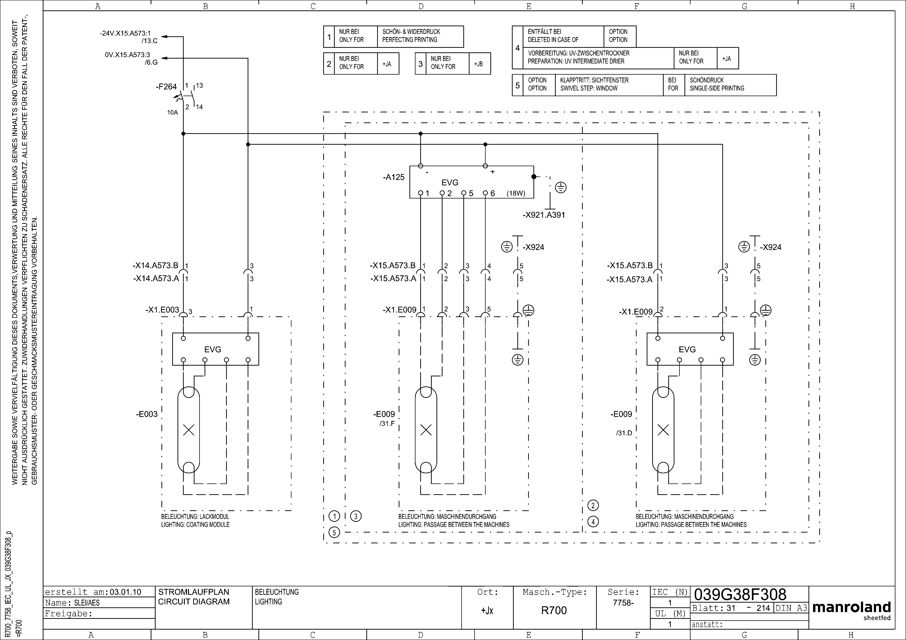

# +Jx — Sheet 31 of 214 — BELEUCHTUNG

**LIGHTING**

> Part of the manroland **R700** printing press IEC/UL circuit diagrams.
> Drawing class: **Stromlaufplan / Circuit diagram** (DIN A3).
> Document `+Jx` covers the **1st printing module + feed register** machine section.

## At a glance

| Field | Value |
|---|---|
| Document | `+Jx`  (039G38F308) |
| Sheet | **31** of 214 |
| Section (DE) | BELEUCHTUNG |
| Section (EN) | LIGHTING |
| Section type | CIRCUIT — Circuit diagram |
| Machine type | `R700` |
| Series | `7758` |
| Created | 03.01.10 |
| Replaces | — |
| Columns used | A, B, C, D, E, F, G |
| Path numbers | — |
| Labels on sheet | 108 |
| Cross-refs out | 4 |
| Cross-refs in | 25 |

**Previous:** [+Jx sheet 30](SHEET_0030.md) · **Next:** [+Jx sheet 32](SHEET_0032.md) · **Document TOC:** [_TOC.md](_TOC.md)  (+Jx) · **Master TOC:** [all sheets](../_MASTER_TOC.md)

## Sheet image (300 DPI, exact vector render)



_Rendered directly from the PDF vector layer at 300 DPI (1-bit), no OCR and no resampling. Use it to confirm anything ambiguous in the text below._

## Cross-references on this sheet

Each entry is a wire leaving this sheet. The printed token is `/sheet.column`; the link resolves to that sheet inside the same document.

| Ref | Target sheet | Col | Path | Destination on target | Target section | From col |
|---|---|---|---|---|---|---|
| `/13.C` | [+Jx sheet 13](SHEET_0013.md) | C | — | 24V.X15.A573:1 | SPANNUNGSVERSORGUNG, SCHALTSCHRANKBELÜFTUNG | A |
| `/6.G` | [+Jx sheet 6](SHEET_0006.md) | G | — | 0V.X15.A573:3 | SPANNUNGSVERSORGUNG, SCHALTSCHRANKBELÜFTUNG | A |
| `/31.F` | [+Jx sheet 31](SHEET_0031.md) | F | — | — | BELEUCHTUNG | D |
| `/31.D` | [+Jx sheet 31](SHEET_0031.md) | D | — | — | BELEUCHTUNG | F |

### Incoming references (sheets that point here)

Every other sheet that sends a wire to this one. `Back-ref` is the token printed on *that* sheet; `Path` is its line number.

| From sheet | Cols | Back-ref | Path | Refs | What continues there |
|---|---|---|---|---|---|
| [+Jx#6](SHEET_0006.md) | H | `/6.H` | — | 1 | 0V.X15.A573:3 |
| [+Jx#13](SHEET_0013.md) | C | `/13.C` | — | 1 | — |
| [+Jx#31](SHEET_0031.md) | D, F | `/31.D`, `/31.F` | — | 2 | — |
| [+Jx#117](SHEET_0117.md) | H | `/117.H` | — | 7 | — |
| [+Jx#138](SHEET_0138.md) | F | `/138.F` | — | 4 | — |
| [+Jx#139](SHEET_0139.md) | A | `/139.A` | — | 10 | — |


## Devices on this sheet

| Tag | Class | Class meaning (IEC) | Col | Sub | Terminal | Sign |
|---|---|---|---|---|---|---|
| `F264` | F | Schutz / protection device (fuse, circuit breaker) | B | — | — | — |
| `E003` | E | Sonstiges / miscellaneous, lamp | A | — | — | — |
| `E009` | E | Sonstiges / miscellaneous, lamp | D | — | — | — |
| `E009` | E | Sonstiges / miscellaneous, lamp | F | — | — | — |
| `X924` | X | Klemme / terminal, plug connector | E | — | — | — |
| `A125` | A | Baugruppe / assembly, module, PC board | D | — | — | — |
| `X924` | X | Klemme / terminal, plug connector | G | — | — | — |
| `X1.E003` | — | cross-device reference | B | — | — | — |
| `X14.A573.B` | — | cross-device reference | B | — | — | — |
| `X14.A573.A` | — | cross-device reference | B | — | — | — |
| `X1.E009` | — | cross-device reference | D | — | — | — |
| `X15.A573.B` | — | cross-device reference | D | — | — | — |
| `X15.A573.A` | — | cross-device reference | D | — | — | — |
| `X921.A391` | — | cross-device reference | E | — | — | — |
| `X15.A573.A` | — | cross-device reference | F | — | — | — |
| `X1.E009` | — | cross-device reference | F | — | — | — |
| `X15.A573.B` | — | cross-device reference | F | — | — | — |

## Potentials / nets

| Potential | Count | Columns | Attached devices | Terminals |
|---|---|---|---|---|
| `0V` | 1 | A | `A573`, `X15` | `3` |
| `24V` | 1 | A | `A573`, `X15` | `1` |


A potential such as `L24+/4` or `M24+` is a named supply/return rail; every place it appears on this sheet is electrically common.

## Wire-end annotations (grouped as printed)

A wire that continues elsewhere is annotated with a small cluster: the destination description, the path/line number `#NN`, and the `/sheet.column` cross reference. Each row below is one such cluster exactly as it is grouped on the drawing.

| Col | Y | Path | Cross-ref | Text on the wire |
|---|---|---|---|---|
| C | 38.8 | — | — | `NUR BEI ONLY FOR` |
| E | 38.8 | — | — | `ENTFÄLLT BEI DELETED IN CASE OF` |
| F | 38.8 | — | — | `OPTION OPTION` |
| D | 38.9 | — | — | `PERFECTING PRINTING SCHÖN & WIDERDRUCK` |
| A | 39.9 | — | `/13.C` | `24V.X15.A573:1` |
| C | 44.1 | — | — | `1` |
| E | 58.3 | — | — | `4` |
| E | 67.2 | — | — | `PREPARATION: UV INTERMEDIATE DRIER VORBEREITUNG: UV ZWISCHENTROCKNER` |
| G | 67.2 | — | — | `NUR BEI ONLY FOR +JA` |
| A | 68.2 | — | `/6.G` | `0V.X15.A573:3` |
| C | 74.2 | — | — | `NUR BEI ONLY FOR` |
| D | 74.2 | — | — | `3 NUR BEI ONLY FOR +JB` |
| C | 79.6 | — | — | `2` |
| D | 81.3 | — | — | `+JA` |
| F | 102.5 | — | — | `BEI FOR` |
| E | 102.6 | — | — | `OPTION OPTION` |
| F | 102.6 | — | — | `KLAPPTRITT: SICHTFENSTER SWIVEL STEP: WINDOW` |
| G | 102.7 | — | — | `SCHÖNDRUCK SINGLE SIDE PRINTING` |
| E | 107.9 | — | — | `5` |
| B | 108.7 | — | — | `1` |
| B | 108.7 | — | — | `13` |
| B | 109.4 | — | — | `F264` |
| B | 137.0 | — | — | `10A 2` |
| B | 137.0 | — | — | `14` |
| E | 221.3 | — | — | `+` |
| D | 228.4 | — | — | `A125 EVG` |
| D | 249.7 | — | — | `1 2 5 6` |
| E | 250.3 | — | — | `(18W)` |
| E | 278.0 | — | — | `X921.A391` |
| E | 320.6 | — | — | `X924` |
| G | 320.6 | — | — | `X924` |
| B | 344.6 | — | — | `X14.A573.B 1` |
| D | 344.6 | — | — | `X15.A573.B 1 4` |
| F | 344.6 | — | — | `X15.A573.B` |
| B | 346.1 | — | — | `3` |
| D | 346.1 | — | — | `2 3` |
| E | 346.1 | — | — | `5` |
| G | 346.1 | — | — | `1 3` |
| G | 346.1 | — | — | `5` |
| B | 361.7 | — | — | `X14.A573.A 1` |
| D | 361.7 | — | — | `X15.A573.A 1 4` |
| B | 363.1 | — | — | `3` |
| D | 363.1 | — | — | `2 3` |
| E | 363.1 | — | — | `5` |
| F | 363.1 | — | — | `X15.A573.A` |
| G | 363.1 | — | — | `1 3` |
| G | 363.1 | — | — | `5` |
| B | 402.8 | — | — | `X1.E003 3` |
| D | 402.8 | — | — | `1 X1.E009 1 5` |
| D | 402.8 | — | — | `2 3` |
| G | 402.8 | — | — | `2 1` |
| F | 405.6 | — | — | `X1.E009` |
| B | 455.2 | — | — | `EVG` |
| F | 455.2 | — | — | `EVG` |
| A | 540.2 | — | — | `E003` |
| D | 540.2 | — | — | `E009` |
| F | 540.2 | — | — | `E009` |
| D | 553.3 | — | `/31.F` | — |
| F | 565.7 | — | `/31.D` | — |
| F | 662.1 | — | — | `2` |
| D | 675.8 | — | — | `1 4` |
| C | 676.3 | — | — | `3` |
| B | 676.7 | — | — | `BELEUCHTUNG: LACKMODUL LIGHTING: COATING MODULE` |
| D | 676.7 | — | — | `BELEUCHTUNG: MASCHINENDURCHGANG LIGHTING: PASSAGE BETWEEN THE MACHINES` |
| G | 676.7 | — | — | `BELEUCHTUNG: MASCHINENDURCHGANG LIGHTING: PASSAGE BETWEEN THE MACHINES` |
| C | 697.6 | — | — | `5` |


## Reconstructed tables

This sheet carries tabular content (pin map / terminal assignment / index). The grid below was rebuilt from the drawing's own rule lines, so each row is exactly one physical row of the table.

### Table 1 — 0 data rows × 2 columns (at x=240.9, y=76.5) — **1 13 2 14**

_none_


## Notes and free text on this sheet

| Text | Col | Y (pt) |
|---|---|---|
| `10A` | B | 144.33 |
| `BELEUCHTUNG: LACKMODUL` | B | 676.66 |
| `LIGHTING: COATING MODULE` | B | 687.29 |
| `BELEUCHTUNG: MASCHINENDURCHGANG` | D | 676.67 |
| `LIGHTING: PASSAGE BETWEEN THE MACHINES` | D | 687.26 |
| `BELEUCHTUNG: MASCHINENDURCHGANG` | F | 676.67 |
| `LIGHTING: PASSAGE BETWEEN THE MACHINES` | G | 687.26 |
| `EVG` | B | 455.2 |
| `EVG` | D | 235.52 |
| `(18W)` | E | 250.31 |
| `EVG` | F | 455.2 |
| `NUR BEI` | C | 38.81 |
| `ONLY FOR` | C | 49.49 |
| `ENTFÄLLT BEI` | E | 38.81 |
| `DELETED IN CASE OF` | E | 49.47 |
| `VORBEREITUNG: UV ZWISCHENTROCKNER` | E | 67.2 |
| `PREPARATION: UV INTERMEDIATE DRIER` | E | 77.83 |
| `OPTION` | E | 102.61 |
| `SCHÖN & WIDERDRUCK` | D | 38.85 |
| `PERFECTING PRINTING` | D | 49.48 |
| `+JA` | D | 81.32 |
| `NUR BEI` | D | 74.24 |
| `ONLY FOR` | D | 84.93 |
| `+JB` | E | 81.3 |
| `OPTION` | F | 38.83 |
| `NUR BEI` | F | 67.15 |
| `ONLY FOR` | G | 77.84 |
| `+JA` | G | 74.23 |
| `KLAPPTRITT: SICHTFENSTER` | F | 102.62 |
| `SWIVEL STEP: WINDOW` | F | 113.18 |
| `BEI` | F | 102.46 |
| `FOR` | F | 113.26 |
| `SCHÖNDRUCK` | G | 102.67 |
| `SINGLE SIDE PRINTING` | G | 113.26 |

## Complete label inventory (exact text from the drawing)

Every text object inside the drawing area of this sheet, in DIN reading order (column A→H, then top→bottom). This is the authoritative list: if a string is not here it is not printed on this sheet.

| Col | Y | X | Dir | Type | Text |
|---|---|---|---|---|---|
| A | 39.9 | 131.5 | → | potential | `24V.X15.A573:1` |
| A | 49.8 | 186.2 | → | cross-reference | `/13.C` |
| A | 68.2 | 138.0 | → | potential | `0V.X15.A573:3` |
| A | 78.1 | 190.5 | → | cross-reference | `/6.G` |
| A | 540.2 | 178.9 | → | device tag | `E003` |
| B | 108.7 | 242.9 | → | number | `1` |
| B | 108.7 | 257.1 | → | number | `13` |
| B | 109.4 | 204.9 | → | device tag | `F264` |
| B | 137.0 | 243.8 | → | number | `2` |
| B | 137.0 | 257.1 | → | number | `14` |
| B | 144.3 | 219.4 | → | text | `10A` |
| B | 344.7 | 174.3 | → | device ref | `X14.A573.B` |
| B | 346.1 | 242.9 | → | number | `1` |
| B | 346.1 | 328.5 | → | number | `3` |
| B | 361.7 | 175.2 | → | device ref | `X14.A573.A` |
| B | 363.1 | 242.9 | → | number | `1` |
| B | 363.1 | 328.5 | → | number | `3` |
| B | 402.8 | 191.3 | → | device ref | `X1.E003` |
| B | 402.8 | 328.0 | → | number | `1` |
| B | 406.3 | 247.7 | → | number | `3` |
| B | 455.2 | 268.4 | → | text | `EVG` |
| B | 676.7 | 212.0 | → | text | `BELEUCHTUNG: LACKMODUL` |
| B | 687.3 | 212.0 | → | text | `LIGHTING: COATING MODULE` |
| C | 38.8 | 445.9 | → | text | `NUR BEI` |
| C | 44.1 | 429.7 | → | number | `1` |
| C | 49.5 | 446.2 | → | text | `ONLY FOR` |
| C | 74.2 | 445.9 | → | text | `NUR BEI` |
| C | 79.6 | 429.4 | → | number | `2` |
| C | 84.9 | 446.2 | → | text | `ONLY FOR` |
| C | 675.8 | 437.5 | → | number | `1` |
| C | 676.3 | 465.7 | → | number | `3` |
| C | 697.6 | 437.4 | → | number | `5` |
| D | 38.9 | 502.9 | → | text | `SCHÖN & WIDERDRUCK` |
| D | 49.5 | 502.6 | → | text | `PERFECTING PRINTING` |
| D | 74.2 | 566.4 | → | text | `NUR BEI` |
| D | 79.6 | 549.8 | → | number | `3` |
| D | 81.3 | 502.9 | → | text | `+JA` |
| D | 84.9 | 566.6 | → | text | `ONLY FOR` |
| D | 228.4 | 503.4 | → | device tag | `A125` |
| D | 235.5 | 580.3 | → | text | `EVG` |
| D | 249.7 | 558.7 | → | number | `1` |
| D | 249.7 | 587.9 | → | number | `2` |
| D | 249.7 | 616.3 | → | number | `5` |
| D | 344.7 | 486.1 | → | device ref | `X15.A573.B` |
| D | 346.1 | 554.7 | → | number | `1` |
| D | 346.1 | 583.9 | → | number | `2` |
| D | 346.1 | 612.0 | → | number | `3` |
| D | 361.7 | 487.0 | → | device ref | `X15.A573.A` |
| D | 363.1 | 554.7 | → | number | `1` |
| D | 363.1 | 583.9 | → | number | `2` |
| D | 363.1 | 612.0 | → | number | `3` |
| D | 402.8 | 503.1 | → | device ref | `X1.E009` |
| D | 402.8 | 554.7 | → | number | `1` |
| D | 402.8 | 583.9 | → | number | `2` |
| D | 402.8 | 612.0 | → | number | `3` |
| D | 540.2 | 490.7 | → | device tag | `E009` |
| D | 553.3 | 498.9 | → | cross-reference | `/31.F` |
| D | 676.7 | 523.8 | → | text | `BELEUCHTUNG: MASCHINENDURCHGANG` |
| D | 687.3 | 523.8 | → | text | `LIGHTING: PASSAGE BETWEEN THE MACHINES` |
| E | 38.8 | 693.9 | → | text | `ENTFÄLLT BEI` |
| E | 49.5 | 693.9 | → | text | `DELETED IN CASE OF` |
| E | 58.3 | 677.5 | → | number | `4` |
| E | 67.2 | 694.5 | → | text | `VORBEREITUNG: UV ZWISCHENTROCKNER` |
| E | 77.8 | 693.9 | → | text | `PREPARATION: UV INTERMEDIATE DRIER` |
| E | 81.3 | 623.3 | → | text | `+JB` |
| E | 102.6 | 694.2 | → | text | `OPTION` |
| E | 107.9 | 677.3 | → | number | `5` |
| E | 113.2 | 694.2 | → | text | `OPTION` |
| E | 221.3 | 644.3 | → | number | `+` |
| E | 249.7 | 644.6 | → | number | `6` |
| E | 250.3 | 665.9 | → | text | `(18W)` |
| E | 278.0 | 687.1 | → | device ref | `X921.A391` |
| E | 320.5 | 687.1 | → | device tag | `X924` |
| E | 346.1 | 640.6 | → | number | `4` |
| E | 346.1 | 682.9 | → | number | `5` |
| E | 363.1 | 640.6 | → | number | `4` |
| E | 363.1 | 682.9 | → | number | `5` |
| E | 402.8 | 640.3 | → | number | `5` |
| F | 38.8 | 800.5 | → | text | `OPTION` |
| F | 49.5 | 800.5 | → | text | `OPTION` |
| F | 67.2 | 892.3 | → | text | `NUR BEI` |
| F | 102.5 | 878.2 | → | text | `BEI` |
| F | 102.6 | 736.4 | → | text | `KLAPPTRITT: SICHTFENSTER` |
| F | 113.2 | 736.7 | → | text | `SWIVEL STEP: WINDOW` |
| F | 113.3 | 878.2 | → | text | `FOR` |
| F | 344.7 | 798.0 | → | device ref | `X15.A573.B` |
| F | 346.1 | 866.6 | → | number | `1` |
| F | 363.1 | 797.4 | → | device ref | `X15.A573.A` |
| F | 363.1 | 866.6 | → | number | `1` |
| F | 402.8 | 867.4 | → | number | `2` |
| F | 405.6 | 813.5 | → | device ref | `X1.E009` |
| F | 455.2 | 892.1 | → | text | `EVG` |
| F | 540.2 | 802.5 | → | device tag | `E009` |
| F | 565.7 | 809.9 | → | cross-reference | `/31.D` |
| F | 662.1 | 777.5 | → | number | `2` |
| F | 676.7 | 835.7 | → | text | `BELEUCHTUNG: MASCHINENDURCHGANG` |
| F | 683.5 | 777.7 | → | number | `4` |
| G | 74.2 | 949.3 | → | text | `+JA` |
| G | 77.8 | 892.6 | → | text | `ONLY FOR` |
| G | 102.7 | 906.8 | → | text | `SCHÖNDRUCK` |
| G | 113.3 | 906.8 | → | text | `SINGLE SIDE PRINTING` |
| G | 320.5 | 998.9 | → | device tag | `X924` |
| G | 346.1 | 952.2 | → | number | `3` |
| G | 346.1 | 994.7 | → | number | `5` |
| G | 363.1 | 952.2 | → | number | `3` |
| G | 363.1 | 994.7 | → | number | `5` |
| G | 402.8 | 951.6 | → | number | `1` |
| G | 687.3 | 835.7 | → | text | `LIGHTING: PASSAGE BETWEEN THE MACHINES` |

## Reading-order text block

The same content as a plain block, grouped by DIN column — convenient to paste or to match against a visual description.

```text
=== Column A ===
  39.9  131.5  net          24V.X15.A573:1
  49.8  186.2  xref         /13.C
  68.2  138.0  net          0V.X15.A573:3
  78.1  190.5  xref         /6.G
 540.2  178.9  devtag       E003
=== Column B ===
 108.7  242.9  numeric      1
 108.7  257.1  numeric      13
 109.4  204.9  devtag       F264
 137.0  243.8  numeric      2
 137.0  257.1  numeric      14
 144.3  219.4  text         10A
 344.7  174.3  devref       X14.A573.B
 346.1  242.9  numeric      1
 346.1  328.5  numeric      3
 361.7  175.2  devref       X14.A573.A
 363.1  242.9  numeric      1
 363.1  328.5  numeric      3
 402.8  191.3  devref       X1.E003
 402.8  328.0  numeric      1
 406.3  247.7  numeric      3
 455.2  268.4  text         EVG
 676.7  212.0  text         BELEUCHTUNG: LACKMODUL
 687.3  212.0  text         LIGHTING: COATING MODULE
=== Column C ===
  38.8  445.9  text         NUR BEI
  44.1  429.7  numeric      1
  49.5  446.2  text         ONLY FOR
  74.2  445.9  text         NUR BEI
  79.6  429.4  numeric      2
  84.9  446.2  text         ONLY FOR
 675.8  437.5  numeric      1
 676.3  465.7  numeric      3
 697.6  437.4  numeric      5
=== Column D ===
  38.9  502.9  text         SCHÖN & WIDERDRUCK
  49.5  502.6  text         PERFECTING PRINTING
  74.2  566.4  text         NUR BEI
  79.6  549.8  numeric      3
  81.3  502.9  text         +JA
  84.9  566.6  text         ONLY FOR
 228.4  503.4  devtag       A125
 235.5  580.3  text         EVG
 249.7  558.7  numeric      1
 249.7  587.9  numeric      2
 249.7  616.3  numeric      5
 344.7  486.1  devref       X15.A573.B
 346.1  554.7  numeric      1
 346.1  583.9  numeric      2
 346.1  612.0  numeric      3
 361.7  487.0  devref       X15.A573.A
 363.1  554.7  numeric      1
 363.1  583.9  numeric      2
 363.1  612.0  numeric      3
 402.8  503.1  devref       X1.E009
 402.8  554.7  numeric      1
 402.8  583.9  numeric      2
 402.8  612.0  numeric      3
 540.2  490.7  devtag       E009
 553.3  498.9  xref         /31.F
 676.7  523.8  text         BELEUCHTUNG: MASCHINENDURCHGANG
 687.3  523.8  text         LIGHTING: PASSAGE BETWEEN THE MACHINES
=== Column E ===
  38.8  693.9  text         ENTFÄLLT BEI
  49.5  693.9  text         DELETED IN CASE OF
  58.3  677.5  numeric      4
  67.2  694.5  text         VORBEREITUNG: UV ZWISCHENTROCKNER
  77.8  693.9  text         PREPARATION: UV INTERMEDIATE DRIER
  81.3  623.3  text         +JB
 102.6  694.2  text         OPTION
 107.9  677.3  numeric      5
 113.2  694.2  text         OPTION
 221.3  644.3  numeric      +
 249.7  644.6  numeric      6
 250.3  665.9  text         (18W)
 278.0  687.1  devref       X921.A391
 320.5  687.1  devtag       X924
 346.1  640.6  numeric      4
 346.1  682.9  numeric      5
 363.1  640.6  numeric      4
 363.1  682.9  numeric      5
 402.8  640.3  numeric      5
=== Column F ===
  38.8  800.5  text         OPTION
  49.5  800.5  text         OPTION
  67.2  892.3  text         NUR BEI
 102.5  878.2  text         BEI
 102.6  736.4  text         KLAPPTRITT: SICHTFENSTER
 113.2  736.7  text         SWIVEL STEP: WINDOW
 113.3  878.2  text         FOR
 344.7  798.0  devref       X15.A573.B
 346.1  866.6  numeric      1
 363.1  797.4  devref       X15.A573.A
 363.1  866.6  numeric      1
 402.8  867.4  numeric      2
 405.6  813.5  devref       X1.E009
 455.2  892.1  text         EVG
 540.2  802.5  devtag       E009
 565.7  809.9  xref         /31.D
 662.1  777.5  numeric      2
 676.7  835.7  text         BELEUCHTUNG: MASCHINENDURCHGANG
 683.5  777.7  numeric      4
=== Column G ===
  74.2  949.3  text         +JA
  77.8  892.6  text         ONLY FOR
 102.7  906.8  text         SCHÖNDRUCK
 113.3  906.8  text         SINGLE SIDE PRINTING
 320.5  998.9  devtag       X924
 346.1  952.2  numeric      3
 346.1  994.7  numeric      5
 363.1  952.2  numeric      3
 363.1  994.7  numeric      5
 402.8  951.6  numeric      1
 687.3  835.7  text         LIGHTING: PASSAGE BETWEEN THE MACHINES
```

---
_Generated from the PDF vector text layer; no OCR. Source: `R700_7758_IEC_UL_JX_039G38F308_p`, sheet 31._
