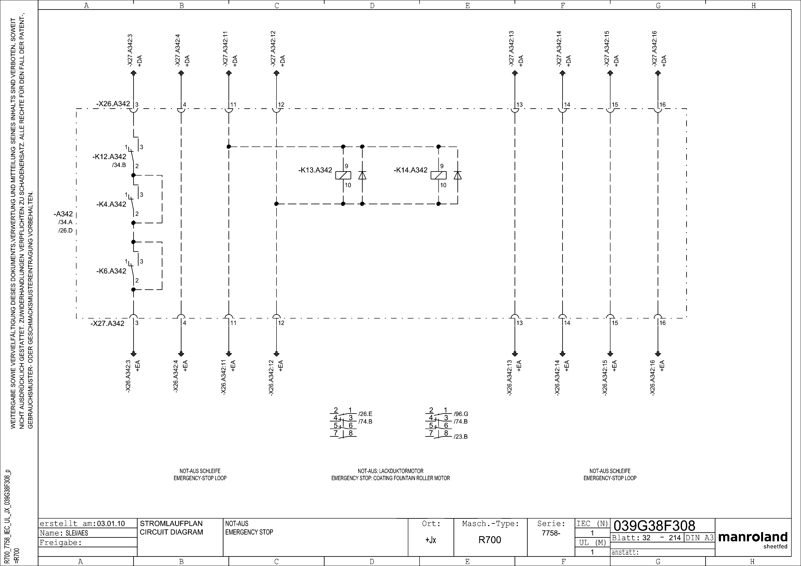

# +Jx — Sheet 32 of 214 — NOT AUS

**EMERGENCY STOP**

> Part of the manroland **R700** printing press IEC/UL circuit diagrams.
> Drawing class: **Stromlaufplan / Circuit diagram** (DIN A3).
> Document `+Jx` covers the **1st printing module + feed register** machine section.

## At a glance

| Field | Value |
|---|---|
| Document | `+Jx`  (039G38F308) |
| Sheet | **32** of 214 |
| Section (DE) | NOT AUS |
| Section (EN) | EMERGENCY STOP |
| Section type | CIRCUIT — Circuit diagram |
| Machine type | `R700` |
| Series | `7758` |
| Created | 03.01.10 |
| Replaces | — |
| Columns used | A, B, C, D, E, F, G |
| Path numbers | — |
| Labels on sheet | 99 |
| Cross-refs out | 8 |
| Cross-refs in | 24 |

**Previous:** [+Jx sheet 31](SHEET_0031.md) · **Next:** [+Jx sheet 33](SHEET_0033.md) · **Document TOC:** [_TOC.md](_TOC.md)  (+Jx) · **Master TOC:** [all sheets](../_MASTER_TOC.md)

## Sheet image (300 DPI, exact vector render)



_Rendered directly from the PDF vector layer at 300 DPI (1-bit), no OCR and no resampling. Use it to confirm anything ambiguous in the text below._

## Cross-references on this sheet

Each entry is a wire leaving this sheet. The printed token is `/sheet.column`; the link resolves to that sheet inside the same document.

| Ref | Target sheet | Col | Path | Destination on target | Target section | From col |
|---|---|---|---|---|---|---|
| `/34.B` | [+Jx sheet 34](SHEET_0034.md) | B | — | — | NOT AUS | A |
| `/34.A` | [+Jx sheet 34](SHEET_0034.md) | A | — | — | NOT AUS | A |
| `/26.D` | [+Jx sheet 26](SHEET_0026.md) | D | — | — | HILFSANTRIEB, LACKDOSIER /AUFTRAGSWALZEN | A |
| `/26.E` | [+Jx sheet 26](SHEET_0026.md) | E | — | — | HILFSANTRIEB, LACKDOSIER /AUFTRAGSWALZEN | D |
| `/74.B` | [+Jx sheet 74](SHEET_0074.md) | B | — | — | REDUNDANZ: ANTRIEBE | D |
| `/96.G` | [+Jx sheet 96](SHEET_0096.md) | G | — | — | RESERVE | E |
| `/74.B` | [+Jx sheet 74](SHEET_0074.md) | B | — | — | REDUNDANZ: ANTRIEBE | E |
| `/23.B` | [+Jx sheet 23](SHEET_0023.md) | B | — | — | LACKPUMPE | E |

### Incoming references (sheets that point here)

Every other sheet that sends a wire to this one. `Back-ref` is the token printed on *that* sheet; `Path` is its line number.

| From sheet | Cols | Back-ref | Path | Refs | What continues there |
|---|---|---|---|---|---|
| [+Jx#23](SHEET_0023.md) | A | `/23.A` | — | 1 | — |
| [+Jx#26](SHEET_0026.md) | D, E | `/26.D`, `/26.E` | — | 2 | — |
| [+Jx#34](SHEET_0034.md) | A, B | `/34.A`, `/34.B` | — | 2 | — |
| [+Jx#74](SHEET_0074.md) | B | `/74.B` | — | 2 | — |
| [+Jx#96](SHEET_0096.md) | G | `/96.G` | — | 1 | — |
| [+Jx#143](SHEET_0143.md) | E | `/143.E` | — | 8 | — |
| [+Jx#144](SHEET_0144.md) | B | `/144.B` | — | 8 | — |


## Devices on this sheet

| Tag | Class | Class meaning (IEC) | Col | Sub | Terminal | Sign |
|---|---|---|---|---|---|---|
| `A342` | A | Baugruppe / assembly, module, PC board | A | — | — | — |
| `K12.A342` | — | cross-device reference | A | — | — | — |
| `K4.A342` | — | cross-device reference | A | — | — | — |
| `X27.A342:3` | — | cross-device reference | A | — | 3 | — |
| `X27.A342:4` | — | cross-device reference | B | — | 4 | — |
| `X27.A342:11` | — | cross-device reference | B | — | 11 | — |
| `X27.A342:12` | — | cross-device reference | C | — | 12 | — |
| `X26.A342` | — | cross-device reference | A | — | — | — |
| `X27.A342:13` | — | cross-device reference | E | — | 13 | — |
| `X27.A342:14` | — | cross-device reference | F | — | 14 | — |
| `X27.A342:15` | — | cross-device reference | F | — | 15 | — |
| `X27.A342:16` | — | cross-device reference | G | — | 16 | — |
| `K13.A342` | — | cross-device reference | C | — | — | — |
| `K14.A342` | — | cross-device reference | D | — | — | — |
| `K6.A342` | — | cross-device reference | A | — | — | — |
| `X27.A342` | — | cross-device reference | A | — | — | — |
| `X26.A342:3` | — | cross-device reference | A | — | 3 | — |
| `X26.A342:4` | — | cross-device reference | B | — | 4 | — |
| `X26.A342:11` | — | cross-device reference | B | — | 11 | — |
| `X26.A342:12` | — | cross-device reference | C | — | 12 | — |
| `X26.A342:13` | — | cross-device reference | E | — | 13 | — |
| `X26.A342:14` | — | cross-device reference | F | — | 14 | — |
| `X26.A342:15` | — | cross-device reference | F | — | 15 | — |
| `X26.A342:16` | — | cross-device reference | G | — | 16 | — |

## Potentials / nets

_No named potentials on this sheet._

## Wire-end annotations (grouped as printed)

A wire that continues elsewhere is annotated with a small cluster: the destination description, the path/line number `#NN`, and the `/sheet.column` cross reference. Each row below is one such cluster exactly as it is grouped on the drawing.

| Col | Y | Path | Cross-ref | Text on the wire |
|---|---|---|---|---|
| B | 45.9 | — | — | `X27.A342:11` |
| C | 45.9 | — | — | `X27.A342:12` |
| E | 45.9 | — | — | `X27.A342:13` |
| F | 45.9 | — | — | `X27.A342:14` |
| F | 45.9 | — | — | `X27.A342:15` |
| G | 45.9 | — | — | `X27.A342:16` |
| A | 50.7 | — | — | `X27.A342:3` |
| B | 50.7 | — | — | `X27.A342:4` |
| B | 82.2 | — | — | `+DA` |
| B | 82.2 | — | — | `+DA` |
| C | 82.2 | — | — | `+DA` |
| C | 82.2 | — | — | `+DA` |
| F | 82.2 | — | — | `+DA` |
| F | 82.2 | — | — | `+DA` |
| G | 82.2 | — | — | `+DA` |
| G | 82.2 | — | — | `+DA` |
| D | 149.8 | — | — | `X26.A342 3 13 14 15 16` |
| C | 151.9 | — | — | `4 11 12` |
| A | 215.0 | — | — | `K12.A342 3` |
| A | 215.0 | — | — | `1` |
| A | 241.5 | — | `/34.B` | — |
| B | 243.3 | — | — | `2` |
| D | 243.3 | — | — | `9` |
| E | 243.3 | — | — | `9` |
| C | 248.3 | — | — | `K13.A342` |
| D | 248.3 | — | — | `K14.A342` |
| D | 271.7 | — | — | `10` |
| E | 271.7 | — | — | `10` |
| A | 285.9 | — | — | `K4.A342 3` |
| A | 285.9 | — | — | `1` |
| A | 313.5 | — | — | `A342` |
| B | 314.2 | — | — | `2` |
| A | 326.5 | — | `/34.A`, `/26.D` | — |
| A | 385.1 | — | — | `K6.A342 3` |
| A | 385.1 | — | — | `1` |
| B | 413.4 | — | — | `2` |
| B | 476.5 | — | — | `X27.A342 3 4 11 12` |
| F | 476.5 | — | — | `13 14 15 16` |
| B | 534.3 | — | — | `X26.A342:11` |
| A | 535.5 | — | — | `X26.A342:3` |
| B | 535.5 | — | — | `X26.A342:4` |
| C | 535.5 | — | — | `X26.A342:12` |
| E | 535.5 | — | — | `X26.A342:13` |
| F | 535.5 | — | — | `X26.A342:14` |
| F | 535.5 | — | — | `X26.A342:15` |
| G | 535.5 | — | — | `X26.A342:16` |
| B | 535.8 | — | — | `+EA` |
| B | 535.8 | — | — | `+EA` |
| C | 535.8 | — | — | `+EA` |
| C | 535.8 | — | — | `+EA` |
| F | 535.8 | — | — | `+EA` |
| F | 535.8 | — | — | `+EA` |
| G | 535.8 | — | — | `+EA` |
| G | 535.8 | — | — | `+EA` |
| D | 605.4 | — | — | `4 5 7 2 1 3 6 8` |
| E | 605.4 | — | — | `4 5 7 2 1 3 6 8` |
| D | 611.8 | — | `/26.E`, `/74.B` | — |
| E | 611.8 | — | `/96.G`, `/74.B` | — |
| E | 645.8 | — | `/23.B` | — |
| D | 697.9 | — | — | `EMERGENCY STOP LOOP NOT AUS SCHLEIFE EMERGENCY STOP LOOP NOT AUS SCHLEIFE` |
| D | 697.9 | — | — | `EMERGENCY STOP: COATING FOUNTAIN ROLLER MOTOR NOT AUS: LACKDUKTORMOTOR` |


## Reconstructed tables

This sheet carries tabular content (pin map / terminal assignment / index). The grid below was rebuilt from the drawing's own rule lines, so each row is exactly one physical row of the table.

### Table 1 — 4 data rows × 1 columns (at x=198.4, y=218.3)

| C1 |
|---|
| `3 2` |
| `3` |
| `2` |
| `3 2` |


### Table 2 — 1 data rows × 2 columns (at x=411.0, y=218.3)

| K13.A342 | 9 |
|---|---|
|  | `10` |


## Notes and free text on this sheet

| Text | Col | Y (pt) |
|---|---|---|
| `+DA` | B | 82.21 |
| `+DA` | C | 82.21 |
| `+DA` | F | 82.21 |
| `+DA` | G | 82.21 |
| `+EA` | B | 535.75 |
| `+EA` | C | 535.75 |
| `+EA` | F | 535.75 |
| `+EA` | G | 535.75 |
| `NOT AUS SCHLEIFE` | F | 697.9 |
| `EMERGENCY STOP LOOP` | F | 708.54 |
| `NOT AUS SCHLEIFE` | B | 697.9 |
| `EMERGENCY STOP LOOP` | B | 708.54 |
| `NOT AUS: LACKDUKTORMOTOR` | D | 697.92 |
| `EMERGENCY STOP: COATING FOUNTAIN ROLLER MOTOR` | D | 708.55 |

## Complete label inventory (exact text from the drawing)

Every text object inside the drawing area of this sheet, in DIN reading order (column A→H, then top→bottom). This is the authoritative list: if a string is not here it is not printed on this sheet.

| Col | Y | X | Dir | Type | Text |
|---|---|---|---|---|---|
| A | 50.7 | 189.4 | ↕ | device ref | `X27.A342:3` |
| A | 149.8 | 143.1 | → | device ref | `X26.A342` |
| A | 215.0 | 185.1 | → | number | `1` |
| A | 228.4 | 137.5 | → | device ref | `K12.A342` |
| A | 241.5 | 166.7 | → | cross-reference | `/34.B` |
| A | 285.9 | 185.1 | → | number | `1` |
| A | 299.3 | 143.4 | → | device ref | `K4.A342` |
| A | 313.5 | 79.9 | → | device tag | `A342` |
| A | 326.5 | 87.0 | → | cross-reference | `/34.A` |
| A | 339.0 | 87.0 | → | cross-reference | `/26.D` |
| A | 385.1 | 185.1 | → | number | `1` |
| A | 398.5 | 143.4 | → | device ref | `K6.A342` |
| A | 476.5 | 134.6 | → | device ref | `X27.A342` |
| A | 535.5 | 186.6 | ↕ | device ref | `X26.A342:3` |
| B | 45.9 | 331.2 | ↕ | device ref | `X27.A342:11` |
| B | 50.7 | 260.3 | ↕ | device ref | `X27.A342:4` |
| B | 82.2 | 203.6 | ↕ | text | `+DA` |
| B | 82.2 | 274.5 | ↕ | text | `+DA` |
| B | 151.9 | 201.0 | → | number | `3` |
| B | 151.9 | 272.1 | → | number | `4` |
| B | 215.0 | 208.1 | → | number | `3` |
| B | 243.3 | 201.3 | → | number | `2` |
| B | 285.9 | 208.1 | → | number | `3` |
| B | 314.2 | 201.3 | → | number | `2` |
| B | 385.1 | 208.1 | → | number | `3` |
| B | 413.4 | 201.3 | → | number | `2` |
| B | 476.5 | 201.0 | → | number | `3` |
| B | 476.5 | 272.1 | → | number | `4` |
| B | 534.3 | 328.3 | ↕ | device ref | `X26.A342:11` |
| B | 535.5 | 257.5 | ↕ | device ref | `X26.A342:4` |
| B | 535.7 | 200.7 | ↕ | text | `+EA` |
| B | 535.7 | 271.6 | ↕ | text | `+EA` |
| B | 697.9 | 267.2 | → | text | `NOT AUS SCHLEIFE` |
| B | 708.5 | 258.2 | → | text | `EMERGENCY STOP LOOP` |
| C | 45.9 | 402.0 | ↕ | device ref | `X27.A342:12` |
| C | 82.2 | 345.3 | ↕ | text | `+DA` |
| C | 82.2 | 416.2 | ↕ | text | `+DA` |
| C | 151.9 | 342.1 | → | number | `11` |
| C | 151.9 | 413.0 | → | number | `12` |
| C | 248.3 | 443.6 | → | device ref | `K13.A342` |
| C | 476.5 | 342.1 | → | number | `11` |
| C | 476.5 | 413.0 | → | number | `12` |
| C | 535.5 | 399.2 | ↕ | device ref | `X26.A342:12` |
| C | 535.7 | 342.5 | ↕ | text | `+EA` |
| C | 535.7 | 413.3 | ↕ | text | `+EA` |
| D | 243.3 | 512.8 | → | number | `9` |
| D | 248.3 | 585.4 | → | device ref | `K14.A342` |
| D | 271.7 | 512.2 | → | number | `10` |
| D | 605.4 | 496.3 | → | number | `2` |
| D | 605.4 | 517.6 | → | number | `1` |
| D | 611.8 | 532.9 | → | cross-reference | `/26.E` |
| D | 616.7 | 496.1 | → | number | `4` |
| D | 616.7 | 518.5 | → | number | `3` |
| D | 623.1 | 532.9 | → | cross-reference | `/74.B` |
| D | 628.1 | 496.1 | → | number | `5` |
| D | 628.1 | 518.5 | → | number | `6` |
| D | 639.4 | 496.1 | → | number | `7` |
| D | 639.4 | 518.5 | → | number | `8` |
| D | 697.9 | 532.2 | → | text | `NOT AUS: LACKDUKTORMOTOR` |
| D | 708.5 | 492.8 | → | text | `EMERGENCY STOP: COATING FOUNTAIN ROLLER MOTOR` |
| E | 45.9 | 756.4 | ↕ | device ref | `X27.A342:13` |
| E | 243.3 | 654.5 | → | number | `9` |
| E | 271.7 | 654.0 | → | number | `10` |
| E | 535.5 | 753.5 | ↕ | device ref | `X26.A342:13` |
| E | 605.4 | 638.1 | → | number | `2` |
| E | 605.4 | 659.3 | → | number | `1` |
| E | 611.8 | 674.6 | → | cross-reference | `/96.G` |
| E | 616.7 | 637.8 | → | number | `4` |
| E | 616.7 | 660.2 | → | number | `3` |
| E | 623.1 | 674.6 | → | cross-reference | `/74.B` |
| E | 628.1 | 637.8 | → | number | `5` |
| E | 628.1 | 660.2 | → | number | `6` |
| E | 639.4 | 637.8 | → | number | `7` |
| E | 639.4 | 660.2 | → | number | `8` |
| E | 645.8 | 674.6 | → | cross-reference | `/23.B` |
| F | 45.9 | 827.2 | ↕ | device ref | `X27.A342:14` |
| F | 45.9 | 898.1 | ↕ | device ref | `X27.A342:15` |
| F | 82.2 | 770.5 | ↕ | text | `+DA` |
| F | 82.2 | 841.4 | ↕ | text | `+DA` |
| F | 151.9 | 767.3 | → | number | `13` |
| F | 151.9 | 838.2 | → | number | `14` |
| F | 476.5 | 767.3 | → | number | `13` |
| F | 476.5 | 838.2 | → | number | `14` |
| F | 535.5 | 824.4 | ↕ | device ref | `X26.A342:14` |
| F | 535.5 | 895.3 | ↕ | device ref | `X26.A342:15` |
| F | 535.7 | 767.7 | ↕ | text | `+EA` |
| F | 535.7 | 838.5 | ↕ | text | `+EA` |
| F | 697.9 | 876.6 | → | text | `NOT AUS SCHLEIFE` |
| F | 708.5 | 867.7 | → | text | `EMERGENCY STOP LOOP` |
| G | 45.9 | 969.0 | ↕ | device ref | `X27.A342:16` |
| G | 82.2 | 912.3 | ↕ | text | `+DA` |
| G | 82.2 | 983.1 | ↕ | text | `+DA` |
| G | 151.9 | 909.1 | → | number | `15` |
| G | 151.9 | 979.9 | → | number | `16` |
| G | 476.5 | 909.1 | → | number | `15` |
| G | 476.5 | 979.9 | → | number | `16` |
| G | 535.5 | 966.1 | ↕ | device ref | `X26.A342:16` |
| G | 535.7 | 909.4 | ↕ | text | `+EA` |
| G | 535.7 | 980.3 | ↕ | text | `+EA` |

## Reading-order text block

The same content as a plain block, grouped by DIN column — convenient to paste or to match against a visual description.

```text
=== Column A ===
  50.7  189.4  devref       X27.A342:3
 149.8  143.1  devref       X26.A342
 215.0  185.1  numeric      1
 228.4  137.5  devref       K12.A342
 241.5  166.7  xref         /34.B
 285.9  185.1  numeric      1
 299.3  143.4  devref       K4.A342
 313.5   79.9  devtag       A342
 326.5   87.0  xref         /34.A
 339.0   87.0  xref         /26.D
 385.1  185.1  numeric      1
 398.5  143.4  devref       K6.A342
 476.5  134.6  devref       X27.A342
 535.5  186.6  devref       X26.A342:3
=== Column B ===
  45.9  331.2  devref       X27.A342:11
  50.7  260.3  devref       X27.A342:4
  82.2  203.6  text         +DA
  82.2  274.5  text         +DA
 151.9  201.0  numeric      3
 151.9  272.1  numeric      4
 215.0  208.1  numeric      3
 243.3  201.3  numeric      2
 285.9  208.1  numeric      3
 314.2  201.3  numeric      2
 385.1  208.1  numeric      3
 413.4  201.3  numeric      2
 476.5  201.0  numeric      3
 476.5  272.1  numeric      4
 534.3  328.3  devref       X26.A342:11
 535.5  257.5  devref       X26.A342:4
 535.7  200.7  text         +EA
 535.7  271.6  text         +EA
 697.9  267.2  text         NOT AUS SCHLEIFE
 708.5  258.2  text         EMERGENCY STOP LOOP
=== Column C ===
  45.9  402.0  devref       X27.A342:12
  82.2  345.3  text         +DA
  82.2  416.2  text         +DA
 151.9  342.1  numeric      11
 151.9  413.0  numeric      12
 248.3  443.6  devref       K13.A342
 476.5  342.1  numeric      11
 476.5  413.0  numeric      12
 535.5  399.2  devref       X26.A342:12
 535.7  342.5  text         +EA
 535.7  413.3  text         +EA
=== Column D ===
 243.3  512.8  numeric      9
 248.3  585.4  devref       K14.A342
 271.7  512.2  numeric      10
 605.4  496.3  numeric      2
 605.4  517.6  numeric      1
 611.8  532.9  xref         /26.E
 616.7  496.1  numeric      4
 616.7  518.5  numeric      3
 623.1  532.9  xref         /74.B
 628.1  496.1  numeric      5
 628.1  518.5  numeric      6
 639.4  496.1  numeric      7
 639.4  518.5  numeric      8
 697.9  532.2  text         NOT AUS: LACKDUKTORMOTOR
 708.5  492.8  text         EMERGENCY STOP: COATING FOUNTAIN ROLLER MOTOR
=== Column E ===
  45.9  756.4  devref       X27.A342:13
 243.3  654.5  numeric      9
 271.7  654.0  numeric      10
 535.5  753.5  devref       X26.A342:13
 605.4  638.1  numeric      2
 605.4  659.3  numeric      1
 611.8  674.6  xref         /96.G
 616.7  637.8  numeric      4
 616.7  660.2  numeric      3
 623.1  674.6  xref         /74.B
 628.1  637.8  numeric      5
 628.1  660.2  numeric      6
 639.4  637.8  numeric      7
 639.4  660.2  numeric      8
 645.8  674.6  xref         /23.B
=== Column F ===
  45.9  827.2  devref       X27.A342:14
  45.9  898.1  devref       X27.A342:15
  82.2  770.5  text         +DA
  82.2  841.4  text         +DA
 151.9  767.3  numeric      13
 151.9  838.2  numeric      14
 476.5  767.3  numeric      13
 476.5  838.2  numeric      14
 535.5  824.4  devref       X26.A342:14
 535.5  895.3  devref       X26.A342:15
 535.7  767.7  text         +EA
 535.7  838.5  text         +EA
 697.9  876.6  text         NOT AUS SCHLEIFE
 708.5  867.7  text         EMERGENCY STOP LOOP
=== Column G ===
  45.9  969.0  devref       X27.A342:16
  82.2  912.3  text         +DA
  82.2  983.1  text         +DA
 151.9  909.1  numeric      15
 151.9  979.9  numeric      16
 476.5  909.1  numeric      15
 476.5  979.9  numeric      16
 535.5  966.1  devref       X26.A342:16
 535.7  909.4  text         +EA
 535.7  980.3  text         +EA
```

---
_Generated from the PDF vector text layer; no OCR. Source: `R700_7758_IEC_UL_JX_039G38F308_p`, sheet 32._
