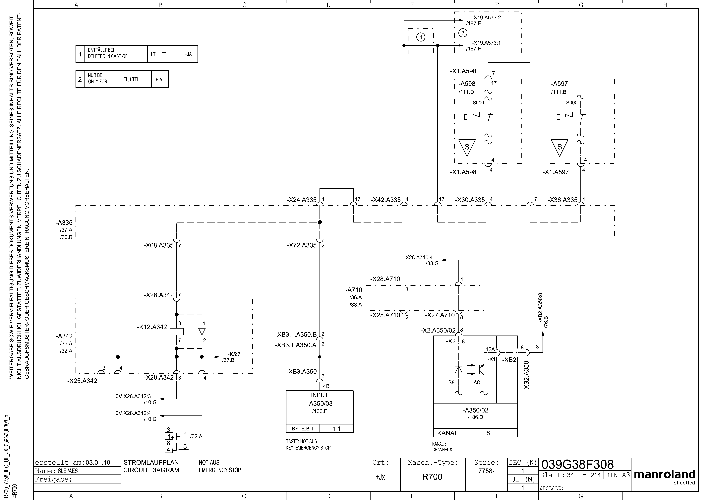

# +Jx — Sheet 34 of 214 — NOT AUS

**EMERGENCY STOP**

> Part of the manroland **R700** printing press IEC/UL circuit diagrams.
> Drawing class: **Stromlaufplan / Circuit diagram** (DIN A3).
> Document `+Jx` covers the **1st printing module + feed register** machine section.

## At a glance

| Field | Value |
|---|---|
| Document | `+Jx`  (039G38F308) |
| Sheet | **34** of 214 |
| Section (DE) | NOT AUS |
| Section (EN) | EMERGENCY STOP |
| Section type | CIRCUIT — Circuit diagram |
| Machine type | `R700` |
| Series | `7758` |
| Created | 03.01.10 |
| Replaces | — |
| Columns used | A, B, C, D, E, F, G |
| Path numbers | — |
| Labels on sheet | 126 |
| Cross-refs out | 18 |
| Cross-refs in | 44 |

**Previous:** [+Jx sheet 33](SHEET_0033.md) · **Next:** [+Jx sheet 35](SHEET_0035.md) · **Document TOC:** [_TOC.md](_TOC.md)  (+Jx) · **Master TOC:** [all sheets](../_MASTER_TOC.md)

## Sheet image (300 DPI, exact vector render)



_Rendered directly from the PDF vector layer at 300 DPI (1-bit), no OCR and no resampling. Use it to confirm anything ambiguous in the text below._

## Cross-references on this sheet

Each entry is a wire leaving this sheet. The printed token is `/sheet.column`; the link resolves to that sheet inside the same document.

| Ref | Target sheet | Col | Path | Destination on target | Target section | From col |
|---|---|---|---|---|---|---|
| `/187.F` | [+Jx sheet 187](SHEET_0187.md) | F | — | — | OPTION: TRANSFERMODUL 1 + 2 | F |
| `/187.F` | [+Jx sheet 187](SHEET_0187.md) | F | — | — | OPTION: TRANSFERMODUL 1 + 2 | F |
| `/111.B` | [+Jx sheet 111](SHEET_0111.md) | B | — | — | REFERENZMODUL | G |
| `/111.D` | [+Jx sheet 111](SHEET_0111.md) | D | — | — | REFERENZMODUL | F |
| `/37.A` | [+Jx sheet 37](SHEET_0037.md) | A | — | — | STOP SICHERN | A |
| `/30.B` | [+Jx sheet 30](SHEET_0030.md) | B | — | — | LACKNIVEAUÜBERWACHUNG | A |
| `/33.G` | [+Jx sheet 33](SHEET_0033.md) | G | — | X28.A710:4 | NOT AUS | E |
| `/76.B` | [+Jx sheet 76](SHEET_0076.md) | B | — | XB2.A350:8 | BUSVERBINDUNGEN: SICHERHEITSKREIS | G |
| `/36.A` | [+Jx sheet 36](SHEET_0036.md) | A | — | — | STOP SICHERN | D |
| `/33.A` | [+Jx sheet 33](SHEET_0033.md) | A | — | — | NOT AUS | D |
| `/35.A` | [+Jx sheet 35](SHEET_0035.md) | A | — | — | STOP SICHERN | A |
| `/32.A` | [+Jx sheet 32](SHEET_0032.md) | A | — | — | NOT AUS | A |
| `/37.B` | [+Jx sheet 37](SHEET_0037.md) | B | — | — | STOP SICHERN | C |
| `/10.G` | [+Jx sheet 10](SHEET_0010.md) | G | — | 0V.X28.A342:3 | SPANNUNGSVERSORGUNG, SCHALTSCHRANKBELÜFTUNG | B |
| `/106.E` | [+Jx sheet 106](SHEET_0106.md) | E | — | — | REFERENZMODUL | D |
| `/10.G` | [+Jx sheet 10](SHEET_0010.md) | G | — | 0V.X28.A342:4 | SPANNUNGSVERSORGUNG, SCHALTSCHRANKBELÜFTUNG | B |
| `/106.D` | [+Jx sheet 106](SHEET_0106.md) | D | — | — | REFERENZMODUL | F |
| `/32.A` | [+Jx sheet 32](SHEET_0032.md) | A | — | — | NOT AUS | B |

### Incoming references (sheets that point here)

Every other sheet that sends a wire to this one. `Back-ref` is the token printed on *that* sheet; `Path` is its line number.

| From sheet | Cols | Back-ref | Path | Refs | What continues there |
|---|---|---|---|---|---|
| [+Jx#10](SHEET_0010.md) | F, G | `/10.F`, `/10.G` | — | 2 | — |
| [+Jx#30](SHEET_0030.md) | A | `/30.A` | — | 1 | — |
| [+Jx#32](SHEET_0032.md) | A | `/32.A` | — | 2 | — |
| [+Jx#33](SHEET_0033.md) | A, H | `/33.A`, `/33.H` | — | 2 | — |
| [+Jx#35](SHEET_0035.md) | A | `/35.A` | — | 1 | — |
| [+Jx#36](SHEET_0036.md) | A | `/36.A` | — | 1 | — |
| [+Jx#37](SHEET_0037.md) | A | `/37.A` | — | 2 | K5:7 |
| [+Jx#76](SHEET_0076.md) | B | `/76.B` | — | 1 | XB2.A350:8 |
| [+Jx#106](SHEET_0106.md) | D, E | `/106.D`, `/106.E` | — | 2 | — |
| [+Jx#111](SHEET_0111.md) | B, D | `/111.B`, `/111.D` | — | 2 | — |
| [+Jx#115](SHEET_0115.md) | E, G | `/115.E`, `/115.G` | — | 3 | — |
| [+Jx#126](SHEET_0126.md) | E | `/126.E` | — | 2 | — |
| [+Jx#128](SHEET_0128.md) | C, D, F | `/128.C`, `/128.D`, `/128.F` | — | 3 | — |
| [+Jx#142](SHEET_0142.md) | F, H | `/142.F`, `/142.H` | — | 4 | — |
| [+Jx#143](SHEET_0143.md) | A | `/143.A` | — | 1 | — |
| [+Jx#144](SHEET_0144.md) | C | `/144.C` | — | 1 | — |
| [+Jx#145](SHEET_0145.md) | G | `/145.G` | — | 3 | — |
| [+Jx#146](SHEET_0146.md) | A | `/146.A` | — | 2 | — |
| [+Jx#148](SHEET_0148.md) | A | `/148.A` | — | 2 | — |
| [+Jx#149](SHEET_0149.md) | F | `/149.F` | — | 1 | — |
| [+Jx#150](SHEET_0150.md) | C | `/150.C` | — | 2 | — |
| [+Jx#152](SHEET_0152.md) | E | `/152.E` | — | 1 | — |
| [+Jx#153](SHEET_0153.md) | C | `/153.C` | — | 1 | — |
| [+Jx#187](SHEET_0187.md) | F | `/187.F` | — | 2 | X19.A573:1 X19.A573:3; X19.A573:2 |


## Devices on this sheet

| Tag | Class | Class meaning (IEC) | Col | Sub | Terminal | Sign |
|---|---|---|---|---|---|---|
| `A342` | A | Baugruppe / assembly, module, PC board | A | — | — | — |
| `A335` | A | Baugruppe / assembly, module, PC board | A | — | — | — |
| `S000` | S | Schalter / switch | F | — | — | — |
| `A598` | A | Baugruppe / assembly, module, PC board | F | — | — | — |
| `S000` | S | Schalter / switch | G | — | — | — |
| `A597` | A | Baugruppe / assembly, module, PC board | G | — | — | — |
| `A350/03` | A | Baugruppe / assembly, module, PC board | D | 03 | — | — |
| `A710` | A | Baugruppe / assembly, module, PC board | D | — | — | — |
| `S8` | S | Schalter / switch | E | — | — | — |
| `A8` | A | Baugruppe / assembly, module, PC board | F | — | — | — |
| `X1` | X | Klemme / terminal, plug connector | F | — | — | — |
| `X2` | X | Klemme / terminal, plug connector | E | — | — | — |
| `XB2` | XB |  | F | — | — | — |
| `A350/02` | A | Baugruppe / assembly, module, PC board | F | 02 | — | — |
| `K5:7` | K | Relais / relay, contactor | C | — | 7 | — |
| `K12.A342` | — | cross-device reference | B | — | — | — |
| `X28.A342` | — | cross-device reference | B | — | — | — |
| `X28.A342` | — | cross-device reference | B | — | — | — |
| `X68.A335` | — | cross-device reference | B | — | — | — |
| `X24.A335` | — | cross-device reference | D | — | — | — |
| `X30.A335` | — | cross-device reference | F | — | — | — |
| `X1.A598` | — | cross-device reference | F | — | — | — |
| `X1.A598` | — | cross-device reference | F | — | — | — |
| `X36.A335` | — | cross-device reference | G | — | — | — |
| `X1.A597` | — | cross-device reference | G | — | — | — |
| `X42.A335` | — | cross-device reference | E | — | — | — |
| `1.1` | — | cross-device reference | D | — | — | — |
| `XB3.A350` | — | cross-device reference | D | — | — | — |
| `X72.A335` | — | cross-device reference | D | — | — | — |
| `X27.A710` | — | cross-device reference | E | — | — | — |
| `X25.A710` | — | cross-device reference | E | — | — | — |
| `XB2.A350` | — | cross-device reference | F | — | — | — |
| `XB3.1.A350.B` | — | cross-device reference | D | — | — | — |
| `XB3.1.A350.A` | — | cross-device reference | D | — | — | — |
| `X28.A710:4` | — | cross-device reference | E | — | 4 | — |
| `X19.A573:1` | — | cross-device reference | F | — | 1 | — |
| `X19.A573:2` | — | cross-device reference | F | — | 2 | — |
| `XB2.A350:8` | — | cross-device reference | G | — | 8 | — |
| `X25.A342` | — | cross-device reference | A | — | — | — |
| `X28.A710` | — | cross-device reference | E | — | — | — |

## Potentials / nets

| Potential | Count | Columns | Attached devices | Terminals |
|---|---|---|---|---|
| `0V` | 2 | B | `A342`, `X28` | `3`, `4` |


A potential such as `L24+/4` or `M24+` is a named supply/return rail; every place it appears on this sheet is electrically common.

## Wire-end annotations (grouped as printed)

A wire that continues elsewhere is annotated with a small cluster: the destination description, the path/line number `#NN`, and the `/sheet.column` cross reference. Each row below is one such cluster exactly as it is grouped on the drawing.

| Col | Y | Path | Cross-ref | Text on the wire |
|---|---|---|---|---|
| F | 25.7 | — | — | `X19.A573:2` |
| F | 35.6 | — | `/187.F` | — |
| E | 52.7 | — | — | `1 2` |
| F | 68.3 | — | — | `X19.A573:1` |
| F | 78.2 | — | `/187.F` | — |
| B | 81.3 | — | — | `1 ENTFÄLLT BEI DELETED IN CASE OF LTL, LTTL +JA` |
| F | 115.0 | — | — | `X1.A598 17` |
| B | 123.8 | — | — | `2 NUR BEI ONLY FOR LTL, LTTL +JA` |
| F | 136.3 | — | — | `A598` |
| F | 136.3 | — | — | `17` |
| G | 136.3 | — | — | `A597` |
| F | 151.2 | — | `/111.D` | — |
| G | 151.2 | — | `/111.B` | — |
| F | 169.3 | — | — | `S000` |
| G | 169.3 | — | — | `S000` |
| F | 241.9 | — | — | `S S` |
| F | 265.3 | — | — | `4` |
| G | 265.3 | — | — | `4` |
| F | 282.3 | — | — | `X1.A598 4` |
| G | 282.3 | — | — | `X1.A597 4` |
| E | 331.9 | — | — | `X24.A335 4 X30.A335 4` |
| E | 331.9 | — | — | `17 X42.A335 4 17` |
| G | 331.9 | — | — | `17 X36.A335 4` |
| A | 370.1 | — | — | `A335` |
| A | 383.2 | — | `/37.A`, `/30.B` | — |
| B | 408.4 | — | — | `X68.A335 7` |
| D | 408.4 | — | — | `X72.A335 2` |
| E | 429.7 | — | `/33.G` | `X28.A710:4` |
| E | 465.1 | — | — | `X28.A710` |
| F | 466.6 | — | — | `4` |
| D | 483.5 | — | — | `A710` |
| E | 483.6 | — | — | `3` |
| B | 492.1 | — | — | `X28.A342 7` |
| G | 493.2 | — | `/76.B` | `XB2.A350:8` |
| D | 496.6 | — | `/36.A`, `/33.A` | — |
| E | 526.1 | — | — | `X25.A710 2` |
| E | 526.1 | — | — | `X27.A710 8` |
| B | 541.0 | — | — | `8` |
| C | 541.0 | — | — | `1` |
| B | 545.9 | — | — | `K12.A342` |
| E | 551.6 | — | — | `X2.A350/02 8` |
| D | 558.7 | — | — | `XB3.1.A350.B 2` |
| A | 561.5 | — | — | `A342` |
| B | 569.3 | — | — | `7` |
| C | 569.3 | — | — | `2` |
| E | 570.0 | — | — | `X2` |
| F | 571.5 | — | — | `8 8` |
| A | 574.6 | — | `/35.A`, `/32.A` | — |
| D | 575.7 | — | — | `XB3.1.A350.A 2` |
| F | 580.0 | — | — | `8` |
| F | 584.2 | — | — | `12A` |
| C | 592.7 | — | — | `K5:7` |
| F | 601.2 | — | — | `X1` |
| F | 601.2 | — | — | `XB2` |
| C | 602.5 | — | `/37.B` | — |
| F | 607.5 | — | — | `XB2.A350` |
| A | 615.4 | — | — | `3 4` |
| D | 621.0 | — | — | `XB3.A350 2` |
| B | 630.9 | — | — | `X28.A342 3 4` |
| A | 636.6 | — | — | `X25.A342` |
| F | 640.2 | — | — | `S8 A8` |
| D | 646.5 | — | — | `4B` |
| D | 661.0 | — | — | `INPUT` |
| B | 663.5 | — | `/10.G` | `0V.X28.A342:3` |
| D | 674.9 | — | — | `A350/03` |
| F | 686.2 | — | — | `A350/02` |
| D | 688.7 | — | `/106.E` | — |
| B | 691.9 | — | `/10.G` | `0V.X28.A342:4` |
| F | 698.6 | — | `/106.D` | — |
| D | 717.7 | — | — | `BYTE.BIT 1.1` |
| B | 718.8 | — | — | `3 6 4 1` |
| B | 724.5 | — | — | `2` |
| F | 724.5 | — | — | `KANAL 8` |
| B | 730.8 | — | `/32.A` | — |
| D | 740.4 | — | — | `KEY: EMERGENCY STOP TASTE: NOT AUS` |
| E | 744.8 | — | — | `KANAL 8 CHANNEL 8` |
| B | 747.1 | — | — | `5` |


## Reconstructed tables

This sheet carries tabular content (pin map / terminal assignment / index). The grid below was rebuilt from the drawing's own rule lines, so each row is exactly one physical row of the table.

### Table 1 — 6 data rows × 4 columns (at x=481.9, y=34.0) — **1**

| X24.A335 | 4 | X42.A335 17 | 4 |
|---|---|---|---|
| `X72.A335 XB3.1.A350.B` | `2 2` | `X28.A710 A710 /36.A /33.A X25.A710` | `X28.A710:4 /33.G 3 2` |
| `XB3.1.A350.A` | `2` |  |  |
| `XB3.A350` | `2 4B` |  |  |
| `INPUT` |  |  |  |
| `A350/03` | `/106.E` |  |  |
| `BYTE.BIT` | `1.1` |  |  |


### Table 2 — 5 data rows × 1 columns (at x=737.0, y=34.0)

| C1 |
|---|
| `17` |
| `X27.A710 X2.A350/02` |
| `X2` |
| `S8` |
| `KANAL` |


### Table 3 — 10 data rows × 4 columns (at x=772.4, y=34.0)

| /187.F 2 | X19.A573:1 |  |  |
|---|---|---|---|
| `/187.F` |  |  |  |
| `X1.A598` |  | `17` |  |
| `A598 /111.D S000 S` |  | `17 4` |  |
| `X1.A598` |  | `4` |  |
| `X30.A335` |  | `4` |  |
| `4 8 8` |  |  |  |
| `8` |  | `12A` |  |
| `A8` |  | `X1` | `XB2` |
| `A350/02 /106.D` |  |  |  |
|  |  | `8` |  |


### Table 4 — 5 data rows × 5 columns (at x=878.7, y=34.0)

|  |  |  | A597 /111.B S000 S | 4 |
|---|---|---|---|---|
|  |  |  | `X1.A597` | `4` |
|  | `17` |  | `X36.A335` | `4` |
|  | `XB2.A350:8` | `/76.B` |  |  |
| `8` | `8` |  |  |  |
| `XB2.A350` |  |  |  |  |


## Notes and free text on this sheet

| Text | Col | Y (pt) |
|---|---|---|
| `4B` | D | 646.51 |
| `INPUT` | D | 661.05 |
| `BYTE.BIT` | D | 718.31 |
| `TASTE: NOT AUS` | D | 740.42 |
| `KEY: EMERGENCY STOP` | D | 751.04 |
| `KANAL 8` | E | 744.83 |
| `CHANNEL 8` | E | 754.78 |
| `12A` | F | 584.17 |
| `KANAL` | E | 724.48 |
| `X2.A350/02` | E | 551.58 |
| `ENTFÄLLT BEI` | A | 81.33 |
| `DELETED IN CASE OF` | A | 91.99 |
| `LTL, LTTL` | B | 88.44 |
| `+JA` | B | 88.41 |
| `NUR BEI` | A | 123.85 |
| `ONLY FOR` | A | 134.53 |
| `S` | F | 241.95 |
| `S` | G | 241.95 |

## Complete label inventory (exact text from the drawing)

Every text object inside the drawing area of this sheet, in DIN reading order (column A→H, then top→bottom). This is the authoritative list: if a string is not here it is not printed on this sheet.

| Col | Y | X | Dir | Type | Text |
|---|---|---|---|---|---|
| A | 81.3 | 148.3 | → | text | `ENTFÄLLT BEI` |
| A | 86.7 | 132.1 | → | number | `1` |
| A | 92.0 | 148.3 | → | text | `DELETED IN CASE OF` |
| A | 123.8 | 148.3 | → | text | `NUR BEI` |
| A | 129.2 | 131.8 | → | number | `2` |
| A | 134.5 | 148.5 | → | text | `ONLY FOR` |
| A | 370.2 | 93.8 | → | device tag | `A335` |
| A | 383.2 | 101.2 | → | cross-reference | `/37.A` |
| A | 395.6 | 101.5 | → | cross-reference | `/30.B` |
| A | 561.5 | 94.1 | → | device tag | `A342` |
| A | 574.6 | 101.2 | → | cross-reference | `/35.A` |
| A | 587.0 | 101.2 | → | cross-reference | `/32.A` |
| A | 615.4 | 172.6 | → | number | `3` |
| A | 636.6 | 113.4 | → | device ref | `X25.A342` |
| B | 88.4 | 254.6 | → | text | `LTL, LTTL` |
| B | 88.4 | 311.5 | → | text | `+JA` |
| B | 130.9 | 261.9 | → | text | `+JA` |
| B | 131.0 | 204.9 | → | text | `LTL, LTTL` |
| B | 408.4 | 242.1 | → | device ref | `X68.A335` |
| B | 409.9 | 300.2 | → | number | `7` |
| B | 492.0 | 242.4 | → | device ref | `X28.A342` |
| B | 492.1 | 300.2 | → | number | `7` |
| B | 541.0 | 300.2 | → | number | `8` |
| B | 545.9 | 231.0 | → | device ref | `K12.A342` |
| B | 569.3 | 300.2 | → | number | `7` |
| B | 615.4 | 201.3 | → | number | `4` |
| B | 630.9 | 242.4 | → | device ref | `X28.A342` |
| B | 632.4 | 300.2 | → | number | `3` |
| B | 663.5 | 194.7 | → | potential | `0V.X28.A342:3` |
| B | 673.4 | 242.4 | → | cross-reference | `/10.G` |
| B | 691.9 | 194.7 | → | potential | `0V.X28.A342:4` |
| B | 701.8 | 242.4 | → | cross-reference | `/10.G` |
| B | 718.8 | 280.6 | → | number | `3` |
| B | 724.5 | 308.7 | → | number | `2` |
| B | 730.1 | 282.3 | → | number | `1` |
| B | 730.8 | 320.3 | → | cross-reference | `/32.A` |
| B | 741.5 | 280.6 | → | number | `6` |
| B | 747.1 | 308.7 | → | number | `5` |
| B | 752.8 | 280.6 | → | number | `4` |
| C | 541.0 | 341.0 | → | number | `1` |
| C | 569.3 | 342.1 | → | number | `2` |
| C | 592.7 | 383.8 | → | device tag | `K5:7` |
| C | 602.6 | 374.2 | → | cross-reference | `/37.B` |
| C | 632.4 | 343.0 | → | number | `4` |
| D | 331.9 | 483.0 | → | device ref | `X24.A335` |
| D | 331.9 | 541.4 | → | number | `4` |
| D | 331.9 | 597.3 | → | number | `17` |
| D | 408.4 | 483.0 | → | device ref | `X72.A335` |
| D | 409.9 | 541.4 | → | number | `2` |
| D | 483.5 | 581.7 | → | device tag | `A710` |
| D | 496.6 | 588.8 | → | cross-reference | `/36.A` |
| D | 509.0 | 588.8 | → | cross-reference | `/33.A` |
| D | 558.7 | 463.5 | → | device ref | `XB3.1.A350.B` |
| D | 558.7 | 541.4 | → | number | `2` |
| D | 575.7 | 541.4 | → | number | `2` |
| D | 576.4 | 462.9 | → | device ref | `XB3.1.A350.A` |
| D | 621.0 | 482.2 | → | device ref | `XB3.A350` |
| D | 629.6 | 541.4 | → | number | `2` |
| D | 646.5 | 544.3 | → | text | `4B` |
| D | 661.0 | 523.7 | → | text | `INPUT` |
| D | 674.9 | 517.0 | → | device tag | `A350/03` |
| D | 688.7 | 526.0 | → | cross-reference | `/106.E` |
| D | 717.7 | 560.6 | → | device ref | `1.1` |
| D | 718.3 | 491.8 | → | text | `BYTE.BIT` |
| D | 740.4 | 481.9 | → | text | `TASTE: NOT AUS` |
| D | 751.0 | 481.3 | → | text | `KEY: EMERGENCY STOP` |
| E | 59.3 | 706.8 | → | number | `1` |
| E | 331.9 | 624.8 | → | device ref | `X42.A335` |
| E | 331.9 | 683.1 | → | number | `4` |
| E | 331.9 | 739.0 | → | number | `17` |
| E | 429.7 | 680.0 | → | device ref | `X28.A710:4` |
| E | 439.6 | 717.2 | → | cross-reference | `/33.G` |
| E | 465.1 | 623.6 | → | device ref | `X28.A710` |
| E | 483.6 | 682.9 | → | number | `3` |
| E | 526.1 | 623.6 | → | device ref | `X25.A710` |
| E | 526.1 | 715.7 | → | device ref | `X27.A710` |
| E | 530.3 | 683.1 | → | number | `2` |
| E | 551.6 | 708.4 | → | text | `X2.A350/02` |
| E | 570.0 | 750.9 | → | device tag | `X2` |
| E | 640.2 | 752.0 | → | device tag | `S8` |
| E | 724.5 | 736.4 | → | text | `KANAL` |
| E | 744.8 | 727.9 | → | text | `KANAL 8` |
| E | 754.8 | 728.2 | → | text | `CHANNEL 8` |
| F | 25.7 | 794.8 | → | device ref | `X19.A573:2` |
| F | 35.6 | 785.2 | → | cross-reference | `/187.F` |
| F | 52.7 | 777.5 | → | number | `2` |
| F | 68.3 | 794.8 | → | device ref | `X19.A573:1` |
| F | 78.2 | 785.2 | → | cross-reference | `/187.F` |
| F | 115.0 | 758.0 | → | device ref | `X1.A598` |
| F | 119.3 | 824.0 | → | number | `17` |
| F | 136.3 | 772.2 | → | device tag | `A598` |
| F | 136.3 | 826.9 | → | number | `17` |
| F | 151.2 | 772.4 | → | cross-reference | `/111.D` |
| F | 169.3 | 793.4 | → | device tag | `S000` |
| F | 242.0 | 782.5 | → | text | `S` |
| F | 265.3 | 827.7 | → | number | `4` |
| F | 282.3 | 824.9 | → | number | `4` |
| F | 285.1 | 758.0 | → | device ref | `X1.A598` |
| F | 331.9 | 766.5 | → | device ref | `X30.A335` |
| F | 331.9 | 824.9 | → | number | `4` |
| F | 331.9 | 894.9 | → | number | `17` |
| F | 466.6 | 775.3 | → | number | `4` |
| F | 530.3 | 775.0 | → | number | `8` |
| F | 551.6 | 775.0 | → | number | `8` |
| F | 571.4 | 777.8 | → | number | `8` |
| F | 580.0 | 902.6 | → | number | `8` |
| F | 581.4 | 877.0 | → | number | `8` |
| F | 584.2 | 817.8 | → | text | `12A` |
| F | 601.2 | 821.2 | → | device tag | `X1` |
| F | 601.2 | 845.9 | → | device tag | `XB2` |
| F | 607.5 | 881.8 | ↕ | device ref | `XB2.A350` |
| F | 640.2 | 794.6 | → | device tag | `A8` |
| F | 686.2 | 779.4 | → | device tag | `A350/02` |
| F | 698.6 | 788.0 | → | cross-reference | `/106.D` |
| F | 724.5 | 819.2 | → | number | `8` |
| G | 136.3 | 928.1 | → | device tag | `A597` |
| G | 151.2 | 928.3 | → | cross-reference | `/111.B` |
| G | 169.3 | 950.7 | → | device tag | `S000` |
| G | 242.0 | 938.4 | → | text | `S` |
| G | 265.3 | 983.6 | → | number | `4` |
| G | 282.3 | 980.8 | → | number | `4` |
| G | 285.1 | 913.9 | → | device ref | `X1.A597` |
| G | 331.9 | 922.4 | → | device ref | `X36.A335` |
| G | 331.9 | 980.8 | → | number | `4` |
| G | 493.2 | 905.9 | ↕ | device ref | `XB2.A350:8` |
| G | 532.1 | 915.8 | ↕ | cross-reference | `/76.B` |

## Reading-order text block

The same content as a plain block, grouped by DIN column — convenient to paste or to match against a visual description.

```text
=== Column A ===
  81.3  148.3  text         ENTFÄLLT BEI
  86.7  132.1  numeric      1
  92.0  148.3  text         DELETED IN CASE OF
 123.8  148.3  text         NUR BEI
 129.2  131.8  numeric      2
 134.5  148.5  text         ONLY FOR
 370.2   93.8  devtag       A335
 383.2  101.2  xref         /37.A
 395.6  101.5  xref         /30.B
 561.5   94.1  devtag       A342
 574.6  101.2  xref         /35.A
 587.0  101.2  xref         /32.A
 615.4  172.6  numeric      3
 636.6  113.4  devref       X25.A342
=== Column B ===
  88.4  254.6  text         LTL, LTTL
  88.4  311.5  text         +JA
 130.9  261.9  text         +JA
 131.0  204.9  text         LTL, LTTL
 408.4  242.1  devref       X68.A335
 409.9  300.2  numeric      7
 492.0  242.4  devref       X28.A342
 492.1  300.2  numeric      7
 541.0  300.2  numeric      8
 545.9  231.0  devref       K12.A342
 569.3  300.2  numeric      7
 615.4  201.3  numeric      4
 630.9  242.4  devref       X28.A342
 632.4  300.2  numeric      3
 663.5  194.7  net          0V.X28.A342:3
 673.4  242.4  xref         /10.G
 691.9  194.7  net          0V.X28.A342:4
 701.8  242.4  xref         /10.G
 718.8  280.6  numeric      3
 724.5  308.7  numeric      2
 730.1  282.3  numeric      1
 730.8  320.3  xref         /32.A
 741.5  280.6  numeric      6
 747.1  308.7  numeric      5
 752.8  280.6  numeric      4
=== Column C ===
 541.0  341.0  numeric      1
 569.3  342.1  numeric      2
 592.7  383.8  devtag       K5:7
 602.6  374.2  xref         /37.B
 632.4  343.0  numeric      4
=== Column D ===
 331.9  483.0  devref       X24.A335
 331.9  541.4  numeric      4
 331.9  597.3  numeric      17
 408.4  483.0  devref       X72.A335
 409.9  541.4  numeric      2
 483.5  581.7  devtag       A710
 496.6  588.8  xref         /36.A
 509.0  588.8  xref         /33.A
 558.7  463.5  devref       XB3.1.A350.B
 558.7  541.4  numeric      2
 575.7  541.4  numeric      2
 576.4  462.9  devref       XB3.1.A350.A
 621.0  482.2  devref       XB3.A350
 629.6  541.4  numeric      2
 646.5  544.3  text         4B
 661.0  523.7  text         INPUT
 674.9  517.0  devtag       A350/03
 688.7  526.0  xref         /106.E
 717.7  560.6  devref       1.1
 718.3  491.8  text         BYTE.BIT
 740.4  481.9  text         TASTE: NOT AUS
 751.0  481.3  text         KEY: EMERGENCY STOP
=== Column E ===
  59.3  706.8  numeric      1
 331.9  624.8  devref       X42.A335
 331.9  683.1  numeric      4
 331.9  739.0  numeric      17
 429.7  680.0  devref       X28.A710:4
 439.6  717.2  xref         /33.G
 465.1  623.6  devref       X28.A710
 483.6  682.9  numeric      3
 526.1  623.6  devref       X25.A710
 526.1  715.7  devref       X27.A710
 530.3  683.1  numeric      2
 551.6  708.4  text         X2.A350/02
 570.0  750.9  devtag       X2
 640.2  752.0  devtag       S8
 724.5  736.4  text         KANAL
 744.8  727.9  text         KANAL 8
 754.8  728.2  text         CHANNEL 8
=== Column F ===
  25.7  794.8  devref       X19.A573:2
  35.6  785.2  xref         /187.F
  52.7  777.5  numeric      2
  68.3  794.8  devref       X19.A573:1
  78.2  785.2  xref         /187.F
 115.0  758.0  devref       X1.A598
 119.3  824.0  numeric      17
 136.3  772.2  devtag       A598
 136.3  826.9  numeric      17
 151.2  772.4  xref         /111.D
 169.3  793.4  devtag       S000
 242.0  782.5  text         S
 265.3  827.7  numeric      4
 282.3  824.9  numeric      4
 285.1  758.0  devref       X1.A598
 331.9  766.5  devref       X30.A335
 331.9  824.9  numeric      4
 331.9  894.9  numeric      17
 466.6  775.3  numeric      4
 530.3  775.0  numeric      8
 551.6  775.0  numeric      8
 571.4  777.8  numeric      8
 580.0  902.6  numeric      8
 581.4  877.0  numeric      8
 584.2  817.8  text         12A
 601.2  821.2  devtag       X1
 601.2  845.9  devtag       XB2
 607.5  881.8  devref       XB2.A350
 640.2  794.6  devtag       A8
 686.2  779.4  devtag       A350/02
 698.6  788.0  xref         /106.D
 724.5  819.2  numeric      8
=== Column G ===
 136.3  928.1  devtag       A597
 151.2  928.3  xref         /111.B
 169.3  950.7  devtag       S000
 242.0  938.4  text         S
 265.3  983.6  numeric      4
 282.3  980.8  numeric      4
 285.1  913.9  devref       X1.A597
 331.9  922.4  devref       X36.A335
 331.9  980.8  numeric      4
 493.2  905.9  devref       XB2.A350:8
 532.1  915.8  xref         /76.B
```

---
_Generated from the PDF vector text layer; no OCR. Source: `R700_7758_IEC_UL_JX_039G38F308_p`, sheet 34._
