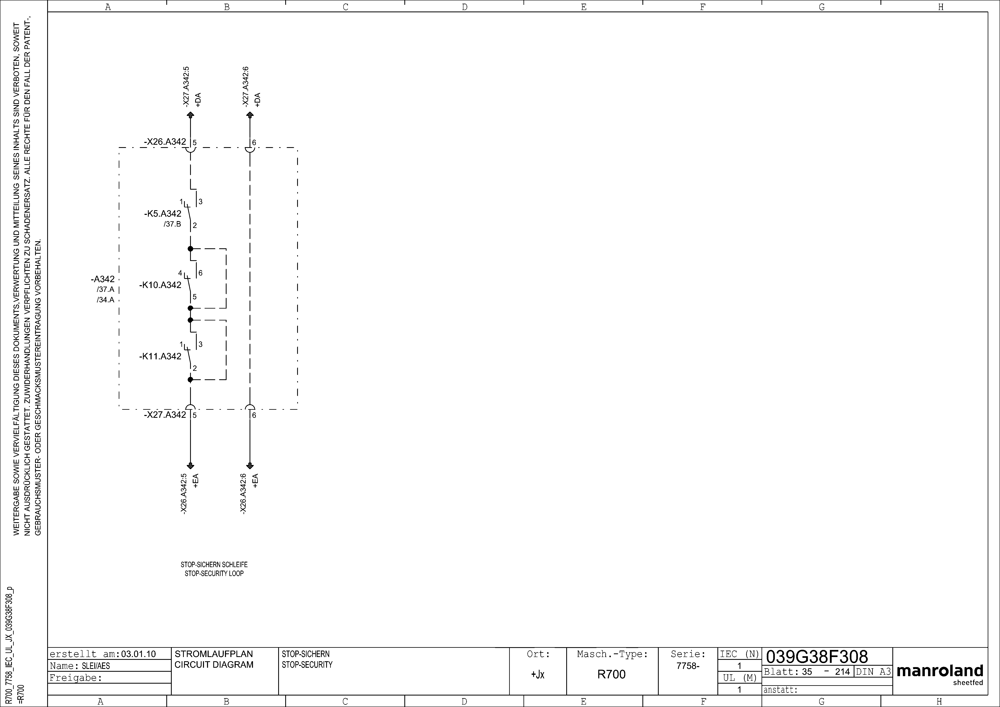

# +Jx — Sheet 35 of 214 — STOP SICHERN

**STOP SECURITY**

> Part of the manroland **R700** printing press IEC/UL circuit diagrams.
> Drawing class: **Stromlaufplan / Circuit diagram** (DIN A3).
> Document `+Jx` covers the **1st printing module + feed register** machine section.

## At a glance

| Field | Value |
|---|---|
| Document | `+Jx`  (039G38F308) |
| Sheet | **35** of 214 |
| Section (DE) | STOP SICHERN |
| Section (EN) | STOP SECURITY |
| Section type | CIRCUIT — Circuit diagram |
| Machine type | `R700` |
| Series | `7758` |
| Created | 03.01.10 |
| Replaces | — |
| Columns used | A, B |
| Path numbers | — |
| Labels on sheet | 32 |
| Cross-refs out | 3 |
| Cross-refs in | 7 |

**Previous:** [+Jx sheet 34](SHEET_0034.md) · **Next:** [+Jx sheet 36](SHEET_0036.md) · **Document TOC:** [_TOC.md](_TOC.md)  (+Jx) · **Master TOC:** [all sheets](../_MASTER_TOC.md)

## Sheet image (300 DPI, exact vector render)



_Rendered directly from the PDF vector layer at 300 DPI (1-bit), no OCR and no resampling. Use it to confirm anything ambiguous in the text below._

## Cross-references on this sheet

Each entry is a wire leaving this sheet. The printed token is `/sheet.column`; the link resolves to that sheet inside the same document.

| Ref | Target sheet | Col | Path | Destination on target | Target section | From col |
|---|---|---|---|---|---|---|
| `/37.B` | [+Jx sheet 37](SHEET_0037.md) | B | — | — | STOP SICHERN | B |
| `/37.A` | [+Jx sheet 37](SHEET_0037.md) | A | — | — | STOP SICHERN | A |
| `/34.A` | [+Jx sheet 34](SHEET_0034.md) | A | — | — | NOT AUS | A |

### Incoming references (sheets that point here)

Every other sheet that sends a wire to this one. `Back-ref` is the token printed on *that* sheet; `Path` is its line number.

| From sheet | Cols | Back-ref | Path | Refs | What continues there |
|---|---|---|---|---|---|
| [+Jx#34](SHEET_0034.md) | A | `/34.A` | — | 1 | — |
| [+Jx#37](SHEET_0037.md) | A, B | `/37.A`, `/37.B` | — | 2 | — |
| [+Jx#143](SHEET_0143.md) | E | `/143.E` | — | 2 | — |
| [+Jx#144](SHEET_0144.md) | B | `/144.B` | — | 2 | — |


## Devices on this sheet

| Tag | Class | Class meaning (IEC) | Col | Sub | Terminal | Sign |
|---|---|---|---|---|---|---|
| `A342` | A | Baugruppe / assembly, module, PC board | A | — | — | — |
| `X27.A342:6` | — | cross-device reference | B | — | 6 | — |
| `X27.A342:5` | — | cross-device reference | B | — | 5 | — |
| `X26.A342` | — | cross-device reference | A | — | — | — |
| `X27.A342` | — | cross-device reference | A | — | — | — |
| `X26.A342:5` | — | cross-device reference | B | — | 5 | — |
| `X26.A342:6` | — | cross-device reference | B | — | 6 | — |
| `K11.A342` | — | cross-device reference | A | — | — | — |
| `K10.A342` | — | cross-device reference | A | — | — | — |
| `K5.A342` | — | cross-device reference | A | — | — | — |

## Potentials / nets

_No named potentials on this sheet._

## Wire-end annotations (grouped as printed)

A wire that continues elsewhere is annotated with a small cluster: the destination description, the path/line number `#NN`, and the `/sheet.column` cross reference. Each row below is one such cluster exactly as it is grouped on the drawing.

| Col | Y | Path | Cross-ref | Text on the wire |
|---|---|---|---|---|
| B | 79.1 | — | — | `X27.A342:5` |
| B | 79.1 | — | — | `X27.A342:6` |
| B | 110.5 | — | — | `+DA` |
| B | 110.5 | — | — | `+DA` |
| B | 163.9 | — | — | `X26.A342 5` |
| B | 166.1 | — | — | `6` |
| B | 236.2 | — | — | `K5.A342 3` |
| B | 236.2 | — | — | `1` |
| B | 262.8 | — | `/37.B` | — |
| B | 264.6 | — | — | `2` |
| B | 321.3 | — | — | `K10.A342 6` |
| B | 321.3 | — | — | `4` |
| A | 327.6 | — | — | `A342` |
| A | 340.7 | — | `/37.A`, `/34.A` | — |
| B | 349.6 | — | — | `5` |
| B | 406.3 | — | — | `K11.A342 3` |
| B | 406.3 | — | — | `1` |
| B | 434.7 | — | — | `2` |
| B | 489.2 | — | — | `X27.A342 5 6` |
| B | 563.8 | — | — | `X26.A342:5` |
| B | 563.8 | — | — | `X26.A342:6` |
| B | 564.1 | — | — | `+EA` |
| B | 564.1 | — | — | `+EA` |
| B | 669.6 | — | — | `STOP SICHERN SCHLEIFE` |
| B | 680.2 | — | — | `STOP SECURITY LOOP` |


## Reconstructed tables

This sheet carries tabular content (pin map / terminal assignment / index). The grid below was rebuilt from the drawing's own rule lines, so each row is exactly one physical row of the table.

### Table 1 — 2 data rows × 1 columns (at x=226.8, y=296.2)

| C1 |
|---|
| `6 5` |
| `3 2` |


## Notes and free text on this sheet

| Text | Col | Y (pt) |
|---|---|---|
| `+DA` | B | 110.55 |
| `+EA` | B | 564.1 |
| `STOP SICHERN SCHLEIFE` | B | 669.56 |
| `STOP SECURITY LOOP` | B | 680.19 |

## Complete label inventory (exact text from the drawing)

Every text object inside the drawing area of this sheet, in DIN reading order (column A→H, then top→bottom). This is the authoritative list: if a string is not here it is not printed on this sheet.

| Col | Y | X | Dir | Type | Text |
|---|---|---|---|---|---|
| A | 163.9 | 171.5 | → | device ref | `X26.A342` |
| A | 249.7 | 171.8 | → | device ref | `K5.A342` |
| A | 327.6 | 108.3 | → | device tag | `A342` |
| A | 334.7 | 165.8 | → | device ref | `K10.A342` |
| A | 340.7 | 115.4 | → | cross-reference | `/37.A` |
| A | 353.1 | 115.4 | → | cross-reference | `/34.A` |
| A | 419.8 | 165.8 | → | device ref | `K11.A342` |
| A | 489.2 | 171.5 | → | device ref | `X27.A342` |
| B | 79.1 | 217.8 | ↕ | device ref | `X27.A342:5` |
| B | 79.1 | 288.7 | ↕ | device ref | `X27.A342:6` |
| B | 110.6 | 232.0 | ↕ | text | `+DA` |
| B | 110.6 | 302.8 | ↕ | text | `+DA` |
| B | 166.1 | 229.3 | → | number | `5` |
| B | 166.1 | 300.2 | → | number | `6` |
| B | 236.3 | 213.4 | → | number | `1` |
| B | 236.3 | 236.4 | → | number | `3` |
| B | 262.8 | 195.0 | → | cross-reference | `/37.B` |
| B | 264.6 | 229.6 | → | number | `2` |
| B | 321.3 | 212.3 | → | number | `4` |
| B | 321.3 | 236.4 | → | number | `6` |
| B | 349.6 | 229.3 | → | number | `5` |
| B | 406.3 | 213.4 | → | number | `1` |
| B | 406.3 | 236.4 | → | number | `3` |
| B | 434.7 | 229.6 | → | number | `2` |
| B | 490.7 | 229.3 | → | number | `5` |
| B | 490.7 | 300.2 | → | number | `6` |
| B | 563.8 | 215.0 | ↕ | device ref | `X26.A342:5` |
| B | 563.8 | 285.8 | ↕ | device ref | `X26.A342:6` |
| B | 564.1 | 229.1 | ↕ | text | `+EA` |
| B | 564.1 | 300.0 | ↕ | text | `+EA` |
| B | 669.6 | 215.3 | → | text | `STOP SICHERN SCHLEIFE` |
| B | 680.2 | 220.1 | → | text | `STOP SECURITY LOOP` |

## Reading-order text block

The same content as a plain block, grouped by DIN column — convenient to paste or to match against a visual description.

```text
=== Column A ===
 163.9  171.5  devref       X26.A342
 249.7  171.8  devref       K5.A342
 327.6  108.3  devtag       A342
 334.7  165.8  devref       K10.A342
 340.7  115.4  xref         /37.A
 353.1  115.4  xref         /34.A
 419.8  165.8  devref       K11.A342
 489.2  171.5  devref       X27.A342
=== Column B ===
  79.1  217.8  devref       X27.A342:5
  79.1  288.7  devref       X27.A342:6
 110.6  232.0  text         +DA
 110.6  302.8  text         +DA
 166.1  229.3  numeric      5
 166.1  300.2  numeric      6
 236.3  213.4  numeric      1
 236.3  236.4  numeric      3
 262.8  195.0  xref         /37.B
 264.6  229.6  numeric      2
 321.3  212.3  numeric      4
 321.3  236.4  numeric      6
 349.6  229.3  numeric      5
 406.3  213.4  numeric      1
 406.3  236.4  numeric      3
 434.7  229.6  numeric      2
 490.7  229.3  numeric      5
 490.7  300.2  numeric      6
 563.8  215.0  devref       X26.A342:5
 563.8  285.8  devref       X26.A342:6
 564.1  229.1  text         +EA
 564.1  300.0  text         +EA
 669.6  215.3  text         STOP SICHERN SCHLEIFE
 680.2  220.1  text         STOP SECURITY LOOP
```

---
_Generated from the PDF vector text layer; no OCR. Source: `R700_7758_IEC_UL_JX_039G38F308_p`, sheet 35._
