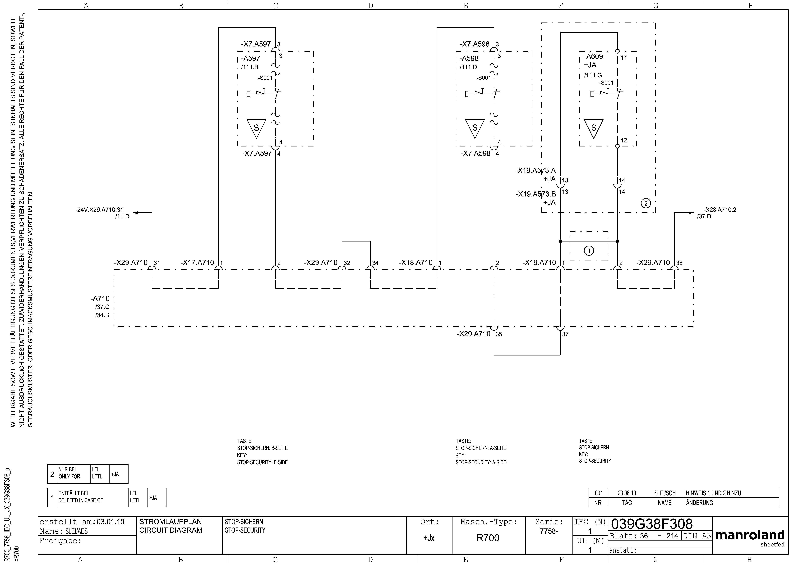

# +Jx — Sheet 36 of 214 — STOP SICHERN

**STOP SECURITY**

> Part of the manroland **R700** printing press IEC/UL circuit diagrams.
> Drawing class: **Stromlaufplan / Circuit diagram** (DIN A3).
> Document `+Jx` covers the **1st printing module + feed register** machine section.

## At a glance

| Field | Value |
|---|---|
| Document | `+Jx`  (039G38F308) |
| Sheet | **36** of 214 |
| Section (DE) | STOP SICHERN |
| Section (EN) | STOP SECURITY |
| Section type | CIRCUIT — Circuit diagram |
| Machine type | `R700` |
| Series | `7758` |
| Created | 03.01.10 |
| Replaces | — |
| Columns used | A, B, C, D, E, F, G, H |
| Path numbers | — |
| Labels on sheet | 95 |
| Cross-refs out | 7 |
| Cross-refs in | 27 |

**Previous:** [+Jx sheet 35](SHEET_0035.md) · **Next:** [+Jx sheet 37](SHEET_0037.md) · **Document TOC:** [_TOC.md](_TOC.md)  (+Jx) · **Master TOC:** [all sheets](../_MASTER_TOC.md)

## Sheet image (300 DPI, exact vector render)



_Rendered directly from the PDF vector layer at 300 DPI (1-bit), no OCR and no resampling. Use it to confirm anything ambiguous in the text below._

## Cross-references on this sheet

Each entry is a wire leaving this sheet. The printed token is `/sheet.column`; the link resolves to that sheet inside the same document.

| Ref | Target sheet | Col | Path | Destination on target | Target section | From col |
|---|---|---|---|---|---|---|
| `/111.B` | [+Jx sheet 111](SHEET_0111.md) | B | — | A597 | REFERENZMODUL | C |
| `/111.D` | [+Jx sheet 111](SHEET_0111.md) | D | — | A598 | REFERENZMODUL | E |
| `/111.G` | [+Jx sheet 111](SHEET_0111.md) | G | — | — | REFERENZMODUL | F |
| `/11.D` | [+Jx sheet 11](SHEET_0011.md) | D | — | 24V.X29.A710:31 X28.A710:2 | SPANNUNGSVERSORGUNG, SCHALTSCHRANKBELÜFTUNG | D |
| `/37.D` | [+Jx sheet 37](SHEET_0037.md) | D | — | — | STOP SICHERN | H |
| `/37.C` | [+Jx sheet 37](SHEET_0037.md) | C | — | — | STOP SICHERN | A |
| `/34.D` | [+Jx sheet 34](SHEET_0034.md) | D | — | — | NOT AUS | A |

### Incoming references (sheets that point here)

Every other sheet that sends a wire to this one. `Back-ref` is the token printed on *that* sheet; `Path` is its line number.

| From sheet | Cols | Back-ref | Path | Refs | What continues there |
|---|---|---|---|---|---|
| [+Jx#11](SHEET_0011.md) | D | `/11.D` | — | 1 | — |
| [+Jx#34](SHEET_0034.md) | D | `/34.D` | — | 1 | — |
| [+Jx#37](SHEET_0037.md) | C, D | `/37.C`, `/37.D` | — | 2 | X28.A710:2 |
| [+Jx#111](SHEET_0111.md) | B, D, F | `/111.B`, `/111.D`, `/111.F` | — | 3 | — |
| [+Jx#133](SHEET_0133.md) | C | `/133.C` | — | 4 | — |
| [+Jx#140](SHEET_0140.md) | C, G | `/140.C`, `/140.G` | — | 4 | — |
| [+Jx#141](SHEET_0141.md) | B, C | `/141.B`, `/141.C` | — | 6 | — |
| [+Jx#147](SHEET_0147.md) | C | `/147.C` | — | 6 | — |


## Devices on this sheet

| Tag | Class | Class meaning (IEC) | Col | Sub | Terminal | Sign |
|---|---|---|---|---|---|---|
| `S001` | S | Schalter / switch | C | — | — | — |
| `A597` | A | Baugruppe / assembly, module, PC board | C | — | — | — |
| `S001` | S | Schalter / switch | E | — | — | — |
| `A598` | A | Baugruppe / assembly, module, PC board | E | — | — | — |
| `S001` | S | Schalter / switch | F | — | — | — |
| `A609` | A | Baugruppe / assembly, module, PC board | F | — | — | — |
| `A710` | A | Baugruppe / assembly, module, PC board | A | — | — | — |
| `X7.A597` | — | cross-device reference | C | — | — | — |
| `X7.A597` | — | cross-device reference | C | — | — | — |
| `X7.A598` | — | cross-device reference | E | — | — | — |
| `X7.A598` | — | cross-device reference | E | — | — | — |
| `X19.A573.B` | — | cross-device reference | F | — | — | — |
| `X19.A573.A` | — | cross-device reference | F | — | — | — |
| `X29.A710` | — | cross-device reference | A | — | — | — |
| `X17.A710` | — | cross-device reference | B | — | — | — |
| `X29.A710` | — | cross-device reference | C | — | — | — |
| `X18.A710` | — | cross-device reference | D | — | — | — |
| `X29.A710` | — | cross-device reference | E | — | — | — |
| `X19.A710` | — | cross-device reference | F | — | — | — |
| `X29.A710` | — | cross-device reference | G | — | — | — |
| `NR.` | — | cross-device reference | F | — | — | — |
| `23.08.10` | — | cross-device reference | G | — | — | — |
| `X28.A710:2` | — | cross-device reference | H | — | 2 | — |

## Potentials / nets

| Potential | Count | Columns | Attached devices | Terminals |
|---|---|---|---|---|
| `24V` | 1 | A | `A710`, `X29` | `31` |


A potential such as `L24+/4` or `M24+` is a named supply/return rail; every place it appears on this sheet is electrically common.

## Wire-end annotations (grouped as printed)

A wire that continues elsewhere is annotated with a small cluster: the destination description, the path/line number `#NN`, and the `/sheet.column` cross reference. Each row below is one such cluster exactly as it is grouped on the drawing.

| Col | Y | Path | Cross-ref | Text on the wire |
|---|---|---|---|---|
| C | 61.2 | — | — | `X7.A597 3` |
| E | 61.2 | — | — | `X7.A598 3` |
| C | 79.6 | — | — | `3` |
| E | 79.6 | — | — | `3` |
| F | 79.6 | — | — | `+JA A609` |
| C | 82.4 | — | `/111.B` | `A597` |
| E | 82.4 | — | `/111.D` | `A598` |
| G | 82.5 | — | — | `11` |
| F | 108.7 | — | `/111.G` | — |
| C | 112.7 | — | — | `S001` |
| E | 112.7 | — | — | `S001` |
| F | 119.7 | — | — | `S001` |
| D | 185.3 | — | — | `S S` |
| F | 185.3 | — | — | `S` |
| G | 205.8 | — | — | `12` |
| C | 208.6 | — | — | `4` |
| E | 208.6 | — | — | `4` |
| C | 224.2 | — | — | `X7.A597 4` |
| E | 224.2 | — | — | `X7.A598 4` |
| F | 249.7 | — | — | `X19.A573.A 13` |
| F | 262.4 | — | — | `+JA` |
| G | 265.3 | — | — | `14` |
| F | 282.3 | — | — | `X19.A573.B 13` |
| G | 282.3 | — | — | `14` |
| F | 297.8 | — | — | `+JA` |
| G | 300.7 | — | — | `2` |
| D | 309.2 | — | `/11.D` | `24V.X29.A710:31 X28.A710:2` |
| H | 319.1 | — | `/37.D` | — |
| F | 371.1 | — | — | `1` |
| B | 387.2 | — | — | `X29.A710 31` |
| C | 387.2 | — | — | `X17.A710 1 2 X29.A710 32 34 X18.A710 1` |
| F | 387.2 | — | — | `X19.A710 1 2 X29.A710 38` |
| E | 388.6 | — | — | `2` |
| A | 441.0 | — | — | `A710` |
| A | 454.1 | — | `/37.C`, `/34.D` | — |
| E | 493.5 | — | — | `X29.A710 35` |
| F | 494.9 | — | — | `37` |
| C | 655.3 | — | — | `KEY: STOP SICHERN: B SEITE STOP SECURITY: B SIDE TASTE:` |
| E | 655.3 | — | — | `KEY: STOP SICHERN: A SEITE STOP SECURITY: A SIDE TASTE:` |
| F | 655.5 | — | — | `KEY: TASTE: STOP SICHERN STOP SECURITY` |
| A | 697.9 | — | — | `2 NUR BEI ONLY FOR` |
| A | 697.9 | — | — | `LTL LTTL +JA` |
| G | 733.0 | — | — | `001 23.08.10 SLEI/SCH HINWEIS 1 UND 2 HINZU` |
| A | 733.3 | — | — | `1 ENTFÄLLT BEI DELETED IN CASE OF` |
| B | 733.3 | — | — | `LTL LTTL +JA` |
| G | 747.1 | — | — | `NR. TAG NAME ÄNDERUNG` |


## Reconstructed tables

This sheet carries tabular content (pin map / terminal assignment / index). The grid below was rebuilt from the drawing's own rule lines, so each row is exactly one physical row of the table.

### Table 1 — 4 data rows × 16 columns (at x=226.8, y=34.0)

|  |  | X7.A597 | 3 |  |  |  |  | X7.A598 | 3 |  |  |  |  |  |  |
|---|---|---|---|---|---|---|---|---|---|---|---|---|---|---|---|
|  |  | `A597 /111.B S001 S` | `3 4` |  |  |  |  | `A598 /111.D S001 S` | `3 4` |  |  |  | `A609 +JA /111.G S001 S` | `11 12` |  |
|  |  | `X7.A597` | `4` |  |  |  |  | `X7.A598` | `4` | `X19.A573.A X19.A573.B` | `+JA +JA` | `13 13` |  | `14 14` | `2` |
| `X17.A710 31` | `1` |  | `2` | `X29.A710` | `32` | `X18.A710 34` | `1` |  | `2` | `X19.A710` |  | `1` | `1` | `2` | `X29.A710` |
|  |  |  |  |  |  |  |  | `X29.A710` | `35` |  |  | `37` |  |  |  |


## Notes and free text on this sheet

| Text | Col | Y (pt) |
|---|---|---|
| `TASTE:` | F | 655.47 |
| `STOP SICHERN` | F | 665.47 |
| `KEY:` | F | 675.41 |
| `STOP SECURITY` | F | 685.37 |
| `+JA` | F | 92.27 |
| `TAG` | G | 747.23 |
| `NAME` | G | 747.22 |
| `ÄNDERUNG` | G | 747.25 |
| `SLEI/SCH` | G | 733.08 |
| `HINWEIS 1 UND 2 HINZU` | H | 733.06 |
| `S` | C | 185.26 |
| `S` | E | 185.26 |
| `TASTE:` | E | 655.32 |
| `STOP SICHERN: A SEITE` | E | 666.01 |
| `KEY:` | E | 676.52 |
| `STOP SECURITY: A SIDE` | E | 687.27 |
| `TASTE:` | C | 655.32 |
| `STOP SICHERN: B SEITE` | C | 666.01 |
| `KEY:` | C | 676.52 |
| `STOP SECURITY: B SIDE` | C | 687.27 |
| `S` | F | 185.26 |
| `ENTFÄLLT BEI` | A | 733.3 |
| `DELETED IN CASE OF` | A | 743.96 |
| `LTL` | B | 733.3 |
| `LTTL` | B | 743.95 |
| `+JA` | B | 740.38 |
| `NUR BEI` | A | 697.86 |
| `ONLY FOR` | A | 708.55 |
| `LTL` | A | 697.87 |
| `LTTL` | A | 708.51 |
| `+JA` | A | 704.94 |

## Complete label inventory (exact text from the drawing)

Every text object inside the drawing area of this sheet, in DIN reading order (column A→H, then top→bottom). This is the authoritative list: if a string is not here it is not printed on this sheet.

| Col | Y | X | Dir | Type | Text |
|---|---|---|---|---|---|
| A | 309.2 | 112.5 | → | potential | `24V.X29.A710:31` |
| A | 319.1 | 172.1 | → | cross-reference | `/11.D` |
| A | 387.2 | 170.1 | → | device ref | `X29.A710` |
| A | 441.0 | 135.2 | → | device tag | `A710` |
| A | 454.1 | 142.3 | → | cross-reference | `/37.C` |
| A | 466.5 | 142.3 | → | cross-reference | `/34.D` |
| A | 697.9 | 87.3 | → | text | `NUR BEI` |
| A | 697.9 | 137.6 | → | text | `LTL` |
| A | 703.2 | 75.1 | → | number | `2` |
| A | 704.9 | 166.3 | → | text | `+JA` |
| A | 708.5 | 87.6 | → | text | `ONLY FOR` |
| A | 708.5 | 137.6 | → | text | `LTTL` |
| A | 733.3 | 87.3 | → | text | `ENTFÄLLT BEI` |
| A | 738.6 | 75.4 | → | number | `1` |
| A | 744.0 | 87.3 | → | text | `DELETED IN CASE OF` |
| B | 387.2 | 269.3 | → | device ref | `X17.A710` |
| B | 388.6 | 229.3 | → | number | `31` |
| B | 388.6 | 328.0 | → | number | `1` |
| B | 733.3 | 194.3 | → | text | `LTL` |
| B | 740.4 | 222.9 | → | text | `+JA` |
| B | 743.9 | 194.3 | → | text | `LTTL` |
| C | 61.2 | 360.0 | → | device ref | `X7.A597` |
| C | 62.6 | 413.6 | → | number | `3` |
| C | 79.6 | 416.4 | → | number | `3` |
| C | 82.4 | 359.7 | → | device tag | `A597` |
| C | 96.2 | 360.0 | → | cross-reference | `/111.B` |
| C | 112.7 | 384.9 | → | device tag | `S001` |
| C | 185.3 | 378.6 | → | text | `S` |
| C | 208.6 | 416.7 | → | number | `4` |
| C | 224.2 | 361.4 | → | device ref | `X7.A597` |
| C | 225.6 | 413.9 | → | number | `4` |
| C | 387.2 | 453.5 | → | device ref | `X29.A710` |
| C | 388.6 | 413.9 | → | number | `2` |
| C | 655.3 | 354.3 | → | text | `TASTE:` |
| C | 666.0 | 354.0 | → | text | `STOP SICHERN: B SEITE` |
| C | 676.5 | 353.8 | → | text | `KEY:` |
| C | 687.3 | 354.0 | → | text | `STOP SECURITY: B SIDE` |
| D | 387.2 | 595.3 | → | device ref | `X18.A710` |
| D | 388.6 | 512.8 | → | number | `32` |
| D | 388.6 | 555.3 | → | number | `34` |
| E | 61.2 | 686.3 | → | device ref | `X7.A598` |
| E | 62.6 | 739.6 | → | number | `3` |
| E | 79.6 | 742.4 | → | number | `3` |
| E | 82.4 | 685.7 | → | device tag | `A598` |
| E | 96.3 | 686.0 | → | cross-reference | `/111.D` |
| E | 112.7 | 710.9 | → | device tag | `S001` |
| E | 185.3 | 704.6 | → | text | `S` |
| E | 208.6 | 742.7 | → | number | `4` |
| E | 224.2 | 687.7 | → | device ref | `X7.A598` |
| E | 225.6 | 739.8 | → | number | `4` |
| E | 388.6 | 654.0 | → | number | `1` |
| E | 388.6 | 739.8 | → | number | `2` |
| E | 493.5 | 681.7 | → | device ref | `X29.A710` |
| E | 494.9 | 739.6 | → | number | `35` |
| E | 655.3 | 680.3 | → | text | `TASTE:` |
| E | 666.0 | 680.0 | → | text | `STOP SICHERN: A SEITE` |
| E | 676.5 | 679.7 | → | text | `KEY:` |
| E | 687.3 | 680.0 | → | text | `STOP SECURITY: A SIDE` |
| F | 79.6 | 871.4 | → | device tag | `A609` |
| F | 92.3 | 871.1 | → | text | `+JA` |
| F | 108.6 | 871.7 | → | cross-reference | `/111.G` |
| F | 119.7 | 893.8 | → | device tag | `S001` |
| F | 185.3 | 881.7 | → | text | `S` |
| F | 249.7 | 769.0 | → | device ref | `X19.A573.A` |
| F | 262.3 | 810.4 | → | text | `+JA` |
| F | 265.3 | 838.2 | → | number | `13` |
| F | 282.3 | 838.2 | → | number | `13` |
| F | 285.1 | 769.6 | → | device ref | `X19.A573.B` |
| F | 297.8 | 810.4 | → | text | `+JA` |
| F | 371.1 | 876.9 | → | number | `1` |
| F | 387.2 | 779.5 | → | device ref | `X19.A710` |
| F | 388.6 | 838.2 | → | number | `1` |
| F | 494.9 | 838.8 | → | number | `37` |
| F | 655.5 | 864.3 | → | text | `TASTE:` |
| F | 665.5 | 864.3 | → | text | `STOP SICHERN` |
| F | 675.4 | 864.0 | → | text | `KEY:` |
| F | 685.4 | 864.3 | → | text | `STOP SECURITY` |
| F | 733.0 | 887.6 | → | number | `001` |
| F | 747.1 | 886.8 | → | device ref | `NR.` |
| G | 82.5 | 926.1 | → | number | `11` |
| G | 205.8 | 926.1 | → | number | `12` |
| G | 265.3 | 923.2 | → | number | `14` |
| G | 282.3 | 923.2 | → | number | `14` |
| G | 300.7 | 961.8 | → | number | `2` |
| G | 387.2 | 949.6 | → | device ref | `X29.A710` |
| G | 388.6 | 924.1 | → | number | `2` |
| G | 388.6 | 1008.9 | → | number | `38` |
| G | 733.1 | 921.9 | → | device ref | `23.08.10` |
| G | 733.1 | 976.3 | → | text | `SLEI/SCH` |
| G | 747.2 | 928.5 | → | text | `TAG` |
| G | 747.2 | 981.8 | → | text | `NAME` |
| G | 747.3 | 1024.0 | → | text | `ÄNDERUNG` |
| H | 309.2 | 1050.0 | → | device ref | `X28.A710:2` |
| H | 319.1 | 1040.3 | → | cross-reference | `/37.D` |
| H | 733.1 | 1023.4 | → | text | `HINWEIS 1 UND 2 HINZU` |

## Reading-order text block

The same content as a plain block, grouped by DIN column — convenient to paste or to match against a visual description.

```text
=== Column A ===
 309.2  112.5  net          24V.X29.A710:31
 319.1  172.1  xref         /11.D
 387.2  170.1  devref       X29.A710
 441.0  135.2  devtag       A710
 454.1  142.3  xref         /37.C
 466.5  142.3  xref         /34.D
 697.9   87.3  text         NUR BEI
 697.9  137.6  text         LTL
 703.2   75.1  numeric      2
 704.9  166.3  text         +JA
 708.5   87.6  text         ONLY FOR
 708.5  137.6  text         LTTL
 733.3   87.3  text         ENTFÄLLT BEI
 738.6   75.4  numeric      1
 744.0   87.3  text         DELETED IN CASE OF
=== Column B ===
 387.2  269.3  devref       X17.A710
 388.6  229.3  numeric      31
 388.6  328.0  numeric      1
 733.3  194.3  text         LTL
 740.4  222.9  text         +JA
 743.9  194.3  text         LTTL
=== Column C ===
  61.2  360.0  devref       X7.A597
  62.6  413.6  numeric      3
  79.6  416.4  numeric      3
  82.4  359.7  devtag       A597
  96.2  360.0  xref         /111.B
 112.7  384.9  devtag       S001
 185.3  378.6  text         S
 208.6  416.7  numeric      4
 224.2  361.4  devref       X7.A597
 225.6  413.9  numeric      4
 387.2  453.5  devref       X29.A710
 388.6  413.9  numeric      2
 655.3  354.3  text         TASTE:
 666.0  354.0  text         STOP SICHERN: B SEITE
 676.5  353.8  text         KEY:
 687.3  354.0  text         STOP SECURITY: B SIDE
=== Column D ===
 387.2  595.3  devref       X18.A710
 388.6  512.8  numeric      32
 388.6  555.3  numeric      34
=== Column E ===
  61.2  686.3  devref       X7.A598
  62.6  739.6  numeric      3
  79.6  742.4  numeric      3
  82.4  685.7  devtag       A598
  96.3  686.0  xref         /111.D
 112.7  710.9  devtag       S001
 185.3  704.6  text         S
 208.6  742.7  numeric      4
 224.2  687.7  devref       X7.A598
 225.6  739.8  numeric      4
 388.6  654.0  numeric      1
 388.6  739.8  numeric      2
 493.5  681.7  devref       X29.A710
 494.9  739.6  numeric      35
 655.3  680.3  text         TASTE:
 666.0  680.0  text         STOP SICHERN: A SEITE
 676.5  679.7  text         KEY:
 687.3  680.0  text         STOP SECURITY: A SIDE
=== Column F ===
  79.6  871.4  devtag       A609
  92.3  871.1  text         +JA
 108.6  871.7  xref         /111.G
 119.7  893.8  devtag       S001
 185.3  881.7  text         S
 249.7  769.0  devref       X19.A573.A
 262.3  810.4  text         +JA
 265.3  838.2  numeric      13
 282.3  838.2  numeric      13
 285.1  769.6  devref       X19.A573.B
 297.8  810.4  text         +JA
 371.1  876.9  numeric      1
 387.2  779.5  devref       X19.A710
 388.6  838.2  numeric      1
 494.9  838.8  numeric      37
 655.5  864.3  text         TASTE:
 665.5  864.3  text         STOP SICHERN
 675.4  864.0  text         KEY:
 685.4  864.3  text         STOP SECURITY
 733.0  887.6  numeric      001
 747.1  886.8  devref       NR.
=== Column G ===
  82.5  926.1  numeric      11
 205.8  926.1  numeric      12
 265.3  923.2  numeric      14
 282.3  923.2  numeric      14
 300.7  961.8  numeric      2
 387.2  949.6  devref       X29.A710
 388.6  924.1  numeric      2
 388.6 1008.9  numeric      38
 733.1  921.9  devref       23.08.10
 733.1  976.3  text         SLEI/SCH
 747.2  928.5  text         TAG
 747.2  981.8  text         NAME
 747.3 1024.0  text         ÄNDERUNG
=== Column H ===
 309.2 1050.0  devref       X28.A710:2
 319.1 1040.3  xref         /37.D
 733.1 1023.4  text         HINWEIS 1 UND 2 HINZU
```

---
_Generated from the PDF vector text layer; no OCR. Source: `R700_7758_IEC_UL_JX_039G38F308_p`, sheet 36._
