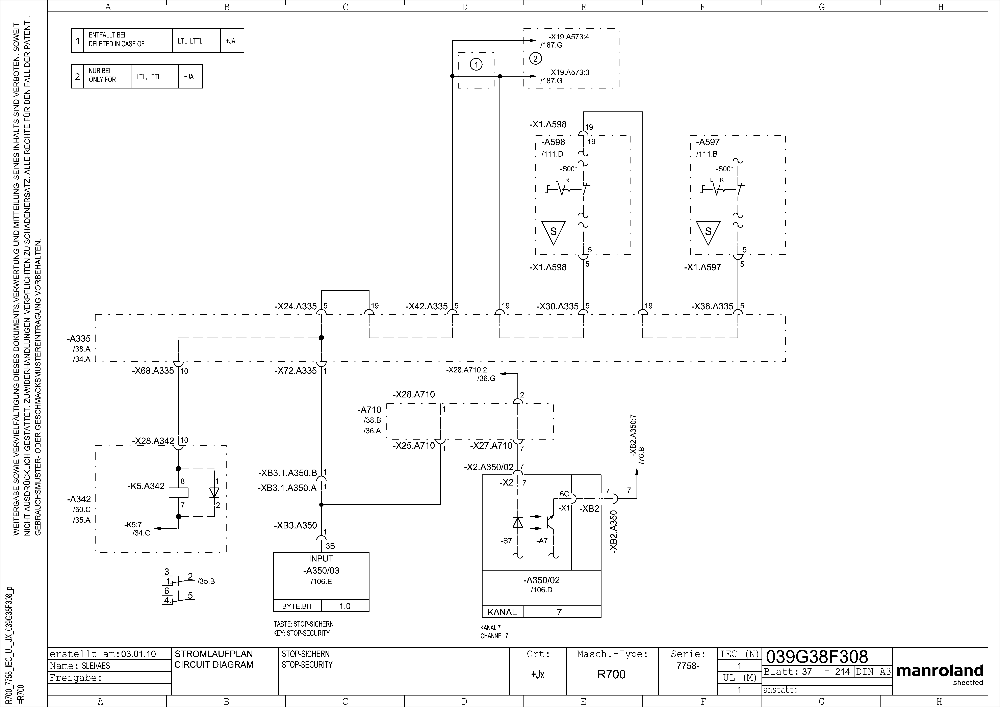

# +Jx — Sheet 37 of 214 — STOP SICHERN

**STOP SECURITY**

> Part of the manroland **R700** printing press IEC/UL circuit diagrams.
> Drawing class: **Stromlaufplan / Circuit diagram** (DIN A3).
> Document `+Jx` covers the **1st printing module + feed register** machine section.

## At a glance

| Field | Value |
|---|---|
| Document | `+Jx`  (039G38F308) |
| Sheet | **37** of 214 |
| Section (DE) | STOP SICHERN |
| Section (EN) | STOP SECURITY |
| Section type | CIRCUIT — Circuit diagram |
| Machine type | `R700` |
| Series | `7758` |
| Created | 03.01.10 |
| Replaces | — |
| Columns used | A, B, C, D, E, F |
| Path numbers | — |
| Labels on sheet | 120 |
| Cross-refs out | 16 |
| Cross-refs in | 38 |

**Previous:** [+Jx sheet 36](SHEET_0036.md) · **Next:** [+Jx sheet 38](SHEET_0038.md) · **Document TOC:** [_TOC.md](_TOC.md)  (+Jx) · **Master TOC:** [all sheets](../_MASTER_TOC.md)

## Sheet image (300 DPI, exact vector render)



_Rendered directly from the PDF vector layer at 300 DPI (1-bit), no OCR and no resampling. Use it to confirm anything ambiguous in the text below._

## Cross-references on this sheet

Each entry is a wire leaving this sheet. The printed token is `/sheet.column`; the link resolves to that sheet inside the same document.

| Ref | Target sheet | Col | Path | Destination on target | Target section | From col |
|---|---|---|---|---|---|---|
| `/187.G` | [+Jx sheet 187](SHEET_0187.md) | G | — | — | OPTION: TRANSFERMODUL 1 + 2 | E |
| `/187.G` | [+Jx sheet 187](SHEET_0187.md) | G | — | — | OPTION: TRANSFERMODUL 1 + 2 | E |
| `/111.B` | [+Jx sheet 111](SHEET_0111.md) | B | — | — | REFERENZMODUL | F |
| `/111.D` | [+Jx sheet 111](SHEET_0111.md) | D | — | — | REFERENZMODUL | E |
| `/38.A` | [+Jx sheet 38](SHEET_0038.md) | A | — | — | LAUFKOMMANDOS | A |
| `/34.A` | [+Jx sheet 34](SHEET_0034.md) | A | — | — | NOT AUS | A |
| `/36.G` | [+Jx sheet 36](SHEET_0036.md) | G | — | X28.A710:2 | STOP SICHERN | D |
| `/76.B` | [+Jx sheet 76](SHEET_0076.md) | B | — | XB2.A350:7 | BUSVERBINDUNGEN: SICHERHEITSKREIS | E |
| `/38.B` | [+Jx sheet 38](SHEET_0038.md) | B | — | — | LAUFKOMMANDOS | C |
| `/36.A` | [+Jx sheet 36](SHEET_0036.md) | A | — | — | STOP SICHERN | C |
| `/50.C` | [+Jx sheet 50](SHEET_0050.md) | C | — | — | SIGNALGEBER: AKUSTISCHE WARNSIGNALE | A |
| `/35.A` | [+Jx sheet 35](SHEET_0035.md) | A | — | — | STOP SICHERN | A |
| `/34.C` | [+Jx sheet 34](SHEET_0034.md) | C | — | K5:7 | NOT AUS | A |
| `/35.B` | [+Jx sheet 35](SHEET_0035.md) | B | — | — | STOP SICHERN | B |
| `/106.E` | [+Jx sheet 106](SHEET_0106.md) | E | — | — | REFERENZMODUL | C |
| `/106.D` | [+Jx sheet 106](SHEET_0106.md) | D | — | — | REFERENZMODUL | E |

### Incoming references (sheets that point here)

Every other sheet that sends a wire to this one. `Back-ref` is the token printed on *that* sheet; `Path` is its line number.

| From sheet | Cols | Back-ref | Path | Refs | What continues there |
|---|---|---|---|---|---|
| [+Jx#34](SHEET_0034.md) | A, C | `/34.A`, `/34.C` | — | 2 | — |
| [+Jx#35](SHEET_0035.md) | A, B | `/35.A`, `/35.B` | — | 2 | — |
| [+Jx#36](SHEET_0036.md) | A, H | `/36.A`, `/36.H` | — | 2 | — |
| [+Jx#38](SHEET_0038.md) | A, B | `/38.A`, `/38.B` | — | 2 | — |
| [+Jx#50](SHEET_0050.md) | C | `/50.C` | — | 1 | — |
| [+Jx#76](SHEET_0076.md) | B | `/76.B` | — | 1 | XB2.A350:7 |
| [+Jx#106](SHEET_0106.md) | D, E | `/106.D`, `/106.E` | — | 2 | — |
| [+Jx#111](SHEET_0111.md) | B, D | `/111.B`, `/111.D` | — | 2 | — |
| [+Jx#115](SHEET_0115.md) | E, G | `/115.E`, `/115.G` | — | 3 | — |
| [+Jx#126](SHEET_0126.md) | E | `/126.E` | — | 2 | — |
| [+Jx#128](SHEET_0128.md) | C, D, F | `/128.C`, `/128.D`, `/128.F` | — | 3 | — |
| [+Jx#142](SHEET_0142.md) | F | `/142.F` | — | 2 | — |
| [+Jx#143](SHEET_0143.md) | A | `/143.A` | — | 1 | — |
| [+Jx#144](SHEET_0144.md) | C | `/144.C` | — | 1 | — |
| [+Jx#145](SHEET_0145.md) | G | `/145.G` | — | 1 | — |
| [+Jx#146](SHEET_0146.md) | A | `/146.A` | — | 2 | — |
| [+Jx#148](SHEET_0148.md) | A | `/148.A` | — | 2 | — |
| [+Jx#149](SHEET_0149.md) | F | `/149.F` | — | 1 | — |
| [+Jx#150](SHEET_0150.md) | C | `/150.C` | — | 2 | — |
| [+Jx#152](SHEET_0152.md) | E | `/152.E` | — | 1 | — |
| [+Jx#153](SHEET_0153.md) | C | `/153.C` | — | 1 | — |
| [+Jx#187](SHEET_0187.md) | F, G | `/187.F`, `/187.G` | — | 2 | X19.A573:1 X19.A573:3; X19.A573:4 |


## Devices on this sheet

| Tag | Class | Class meaning (IEC) | Col | Sub | Terminal | Sign |
|---|---|---|---|---|---|---|
| `A335` | A | Baugruppe / assembly, module, PC board | A | — | — | — |
| `A342` | A | Baugruppe / assembly, module, PC board | A | — | — | — |
| `S001` | S | Schalter / switch | E | — | — | — |
| `A598` | A | Baugruppe / assembly, module, PC board | E | — | — | — |
| `S001` | S | Schalter / switch | F | — | — | — |
| `A597` | A | Baugruppe / assembly, module, PC board | F | — | — | — |
| `A350/03` | A | Baugruppe / assembly, module, PC board | C | 03 | — | — |
| `A710` | A | Baugruppe / assembly, module, PC board | C | — | — | — |
| `S7` | S | Schalter / switch | D | — | — | — |
| `A7` | A | Baugruppe / assembly, module, PC board | E | — | — | — |
| `X1` | X | Klemme / terminal, plug connector | E | — | — | — |
| `X2` | X | Klemme / terminal, plug connector | D | — | — | — |
| `XB2` | XB |  | E | — | — | — |
| `A350/02` | A | Baugruppe / assembly, module, PC board | E | 02 | — | — |
| `K5:7` | K | Relais / relay, contactor | A | — | 7 | — |
| `X24.A335` | — | cross-device reference | C | — | — | — |
| `K5.A342` | — | cross-device reference | A | — | — | — |
| `X28.A342` | — | cross-device reference | A | — | — | — |
| `X42.A335` | — | cross-device reference | D | — | — | — |
| `X30.A335` | — | cross-device reference | E | — | — | — |
| `X1.A598` | — | cross-device reference | E | — | — | — |
| `X1.A598` | — | cross-device reference | E | — | — | — |
| `X36.A335` | — | cross-device reference | F | — | — | — |
| `X1.A597` | — | cross-device reference | F | — | — | — |
| `1.0` | — | cross-device reference | C | — | — | — |
| `XB3.A350` | — | cross-device reference | C | — | — | — |
| `X72.A335` | — | cross-device reference | C | — | — | — |
| `X68.A335` | — | cross-device reference | A | — | — | — |
| `X27.A710` | — | cross-device reference | D | — | — | — |
| `X25.A710` | — | cross-device reference | D | — | — | — |
| `XB2.A350` | — | cross-device reference | E | — | — | — |
| `XB3.1.A350.B` | — | cross-device reference | C | — | — | — |
| `XB3.1.A350.A` | — | cross-device reference | C | — | — | — |
| `X28.A710:2` | — | cross-device reference | D | — | 2 | — |
| `X19.A573:4` | — | cross-device reference | E | — | 4 | — |
| `X19.A573:3` | — | cross-device reference | E | — | 3 | — |
| `XB2.A350:7` | — | cross-device reference | E | — | 7 | — |
| `X28.A710` | — | cross-device reference | D | — | — | — |

## Potentials / nets

_No named potentials on this sheet._

## Wire-end annotations (grouped as printed)

A wire that continues elsewhere is annotated with a small cluster: the destination description, the path/line number `#NN`, and the `/sheet.column` cross reference. Each row below is one such cluster exactly as it is grouped on the drawing.

| Col | Y | Path | Cross-ref | Text on the wire |
|---|---|---|---|---|
| A | 38.8 | — | — | `1 ENTFÄLLT BEI DELETED IN CASE OF LTL, LTTL +JA` |
| E | 39.9 | — | — | `X19.A573:4` |
| E | 49.8 | — | `/187.G` | — |
| D | 66.8 | — | — | `1 2` |
| A | 81.3 | — | — | `2 NUR BEI ONLY FOR LTL, LTTL +JA` |
| E | 82.4 | — | — | `X19.A573:3` |
| E | 92.3 | — | `/187.G` | — |
| E | 143.4 | — | — | `X1.A598 19` |
| E | 164.6 | — | — | `A598` |
| F | 164.6 | — | — | `A597` |
| E | 164.7 | — | — | `19` |
| E | 179.5 | — | `/111.D` | — |
| F | 179.5 | — | `/111.B` | — |
| E | 197.7 | — | — | `S001` |
| F | 197.7 | — | — | `S001` |
| E | 211.6 | — | — | `L R` |
| F | 211.6 | — | — | `L R` |
| E | 270.3 | — | — | `S` |
| F | 270.3 | — | — | `S` |
| E | 293.6 | — | — | `5` |
| F | 293.6 | — | — | `5` |
| E | 310.7 | — | — | `X1.A598 5` |
| F | 310.7 | — | — | `X1.A597 5` |
| C | 360.2 | — | — | `X24.A335 5 19` |
| D | 360.2 | — | — | `X42.A335 5 19 X30.A335 5` |
| F | 360.2 | — | — | `19 X36.A335 5` |
| A | 398.5 | — | — | `A335` |
| A | 411.6 | — | `/38.A`, `/34.A` | — |
| B | 436.8 | — | — | `X68.A335 10 X72.A335 1` |
| D | 436.8 | — | `/36.G` | `X28.A710:2` |
| D | 465.1 | — | — | `X28.A710` |
| D | 466.6 | — | — | `2` |
| C | 483.5 | — | — | `A710` |
| D | 483.6 | — | — | `1` |
| E | 493.2 | — | `/76.B` | `XB2.A350:7` |
| C | 496.6 | — | `/38.B`, `/36.A` | — |
| A | 520.4 | — | — | `X28.A342 10` |
| D | 526.1 | — | — | `X25.A710 1` |
| D | 526.1 | — | — | `X27.A710 7` |
| D | 551.6 | — | — | `X2.A350/02 7` |
| C | 558.7 | — | — | `XB3.1.A350.B 1` |
| B | 569.3 | — | — | `8` |
| B | 569.3 | — | — | `1` |
| D | 570.0 | — | — | `X2` |
| E | 571.5 | — | — | `7 7` |
| A | 574.3 | — | — | `K5.A342` |
| C | 575.7 | — | — | `XB3.1.A350.A 1` |
| E | 580.0 | — | — | `7` |
| E | 584.2 | — | — | `6C` |
| A | 589.8 | — | — | `A342` |
| B | 597.7 | — | — | `7` |
| B | 597.7 | — | — | `2` |
| E | 601.2 | — | — | `X1` |
| E | 601.2 | — | — | `XB2` |
| A | 602.9 | — | `/50.C`, `/35.A` | — |
| E | 607.5 | — | — | `XB2.A350` |
| A | 621.0 | — | `/34.C` | `K5:7` |
| C | 621.0 | — | — | `XB3.A350 1` |
| E | 640.2 | — | — | `S7 A7` |
| C | 646.5 | — | — | `3B` |
| C | 661.0 | — | — | `INPUT` |
| C | 674.9 | — | — | `A350/03` |
| B | 676.3 | — | — | `3 6 4 1` |
| B | 681.9 | — | — | `2` |
| E | 686.2 | — | — | `A350/02` |
| B | 688.3 | — | `/35.B` | — |
| C | 688.7 | — | `/106.E` | — |
| E | 698.6 | — | `/106.D` | — |
| B | 704.6 | — | — | `5` |
| C | 717.7 | — | — | `BYTE.BIT 1.0` |
| E | 724.5 | — | — | `KANAL 7` |
| C | 740.4 | — | — | `KEY: STOP SECURITY TASTE: STOP SICHERN` |
| D | 744.8 | — | — | `KANAL 7 CHANNEL 7` |


## Reconstructed tables

This sheet carries tabular content (pin map / terminal assignment / index). The grid below was rebuilt from the drawing's own rule lines, so each row is exactly one physical row of the table.

### Table 1 — 14 data rows × 12 columns (at x=212.6, y=48.2)

| LTL, LTTL | +JA |  |  |  |  | 1 |  |  | 2 | /187.G | X19.A573:3 |
|---|---|---|---|---|---|---|---|---|---|---|---|
| `+JA` |  |  |  |  |  |  |  |  |  | `/187.G` |  |
|  |  |  |  |  |  |  |  |  |  | `X1.A598` |  |
|  |  |  |  |  |  |  |  |  |  | `A598 /111.D S` | `S001 R L` |
|  |  |  |  |  |  |  |  |  |  | `X1.A598` |  |
|  |  | `X24.A335` | `5` | `X42.A335 19` |  | `5` |  | `19` |  |  | `X30.A335` |
| `10 10` |  | `X72.A335` | `1` | `X28.A710 A710 /38.B /36.A X25.A710` | `1 1` | `X28.A710:2` | `/36.G X27.A710 X2.A350/02` |  | `2 7 7` |  |  |
|  |  | `XB3.1.A350.B` | `1` |  |  |  |  |  |  |  |  |
| `8` | `1` | `XB3.1.A350.A` | `1` |  |  |  |  | `X2` | `7` |  | `6C` |
| `7` | `2` |  |  |  |  |  |  |  |  |  | `X1` |
|  |  | `XB3.A350` | `1 3B` |  |  |  |  | `S7` |  | `A7` |  |
|  |  | `INPUT` |  |  |  |  |  |  |  |  |  |
| `2 /35.B 5` |  | `A350/03` | `/106.E` |  |  |  |  |  |  | `A350/02 /106.D` |  |
|  |  | `BYTE.BIT` | `1.0` |  |  |  |  |  |  |  |  |
|  |  |  |  |  |  |  |  | `KANAL` |  |  | `7` |


### Table 2 — 6 data rows × 7 columns (at x=694.5, y=48.2) — **19**

| 19 5 |  |  |  |  | A597 /111.B S001 R L S | 5 |
|---|---|---|---|---|---|---|
| `5` |  |  |  |  | `X1.A597` | `5` |
| `5` |  |  |  | `19` | `X36.A335` | `5` |
|  |  | `XB2.A350:7` | `/76.B` |  |  |  |
|  | `7 7` |  |  |  |  |  |
| `XB2` |  |  |  |  |  |  |
|  | `XB2.A350` |  |  |  |  |  |


## Notes and free text on this sheet

| Text | Col | Y (pt) |
|---|---|---|
| `3B` | C | 646.51 |
| `INPUT` | C | 661.05 |
| `BYTE.BIT` | C | 718.31 |
| `TASTE: STOP SICHERN` | C | 740.42 |
| `KEY: STOP SECURITY` | C | 751.04 |
| `KANAL 7` | D | 744.83 |
| `CHANNEL 7` | D | 754.78 |
| `6C` | E | 584.21 |
| `KANAL` | D | 724.48 |
| `X2.A350/02` | D | 551.58 |
| `S` | E | 270.3 |
| `L` | E | 211.71 |
| `R` | E | 211.64 |
| `S` | F | 270.3 |
| `L` | F | 211.71 |
| `R` | F | 211.64 |
| `ENTFÄLLT BEI` | A | 38.81 |
| `DELETED IN CASE OF` | A | 49.47 |
| `LTL, LTTL` | B | 45.92 |
| `+JA` | B | 45.89 |
| `NUR BEI` | A | 81.33 |
| `ONLY FOR` | A | 92.01 |
| `LTL, LTTL` | A | 88.44 |

## Complete label inventory (exact text from the drawing)

Every text object inside the drawing area of this sheet, in DIN reading order (column A→H, then top→bottom). This is the authoritative list: if a string is not here it is not printed on this sheet.

| Col | Y | X | Dir | Type | Text |
|---|---|---|---|---|---|
| A | 38.8 | 105.7 | → | text | `ENTFÄLLT BEI` |
| A | 44.1 | 89.6 | → | number | `1` |
| A | 49.5 | 105.7 | → | text | `DELETED IN CASE OF` |
| A | 81.3 | 105.7 | → | text | `NUR BEI` |
| A | 86.7 | 89.3 | → | number | `2` |
| A | 88.4 | 162.4 | → | text | `LTL, LTTL` |
| A | 92.0 | 106.0 | → | text | `ONLY FOR` |
| A | 398.5 | 79.7 | → | device tag | `A335` |
| A | 411.6 | 87.0 | → | cross-reference | `/38.A` |
| A | 424.0 | 87.0 | → | cross-reference | `/34.A` |
| A | 436.8 | 157.0 | → | device ref | `X68.A335` |
| A | 520.4 | 157.3 | → | device ref | `X28.A342` |
| A | 574.3 | 151.9 | → | device ref | `K5.A342` |
| A | 589.8 | 79.9 | → | device tag | `A342` |
| A | 602.9 | 87.0 | → | cross-reference | `/50.C` |
| A | 615.3 | 87.0 | → | cross-reference | `/35.A` |
| A | 621.0 | 148.0 | → | device tag | `K5:7` |
| A | 630.9 | 157.9 | → | cross-reference | `/34.C` |
| A | 676.3 | 195.6 | → | number | `3` |
| A | 698.9 | 195.6 | → | number | `6` |
| A | 710.3 | 195.6 | → | number | `4` |
| B | 45.9 | 212.0 | → | text | `LTL, LTTL` |
| B | 45.9 | 269.0 | → | text | `+JA` |
| B | 88.4 | 219.4 | → | text | `+JA` |
| B | 438.2 | 214.6 | → | number | `10` |
| B | 520.4 | 214.6 | → | number | `10` |
| B | 569.3 | 215.1 | → | number | `8` |
| B | 569.3 | 256.0 | → | number | `1` |
| B | 597.7 | 215.1 | → | number | `7` |
| B | 597.7 | 257.1 | → | number | `2` |
| B | 681.9 | 223.7 | → | number | `2` |
| B | 687.6 | 197.3 | → | number | `1` |
| B | 688.3 | 235.3 | → | cross-reference | `/35.B` |
| B | 704.6 | 223.7 | → | number | `5` |
| C | 360.2 | 327.1 | → | device ref | `X24.A335` |
| C | 360.3 | 385.2 | → | number | `5` |
| C | 360.3 | 441.4 | → | number | `19` |
| C | 436.8 | 327.1 | → | device ref | `X72.A335` |
| C | 438.2 | 384.7 | → | number | `1` |
| C | 483.5 | 425.8 | → | device tag | `A710` |
| C | 496.6 | 433.1 | → | cross-reference | `/38.B` |
| C | 509.0 | 432.9 | → | cross-reference | `/36.A` |
| C | 558.7 | 307.6 | → | device ref | `XB3.1.A350.B` |
| C | 558.7 | 384.7 | → | number | `1` |
| C | 575.7 | 384.7 | → | number | `1` |
| C | 576.4 | 307.0 | → | device ref | `XB3.1.A350.A` |
| C | 621.0 | 326.3 | → | device ref | `XB3.A350` |
| C | 629.6 | 384.7 | → | number | `1` |
| C | 646.5 | 388.1 | → | text | `3B` |
| C | 661.0 | 367.8 | → | text | `INPUT` |
| C | 674.9 | 361.1 | → | device tag | `A350/03` |
| C | 688.7 | 370.1 | → | cross-reference | `/106.E` |
| C | 717.7 | 403.9 | → | device ref | `1.0` |
| C | 718.3 | 335.9 | → | text | `BYTE.BIT` |
| C | 740.4 | 326.0 | → | text | `TASTE: STOP SICHERN` |
| C | 751.0 | 325.4 | → | text | `KEY: STOP SECURITY` |
| D | 73.5 | 565.1 | → | number | `1` |
| D | 360.2 | 483.0 | → | device ref | `X42.A335` |
| D | 360.3 | 541.1 | → | number | `5` |
| D | 360.3 | 597.3 | → | number | `19` |
| D | 436.8 | 531.2 | → | device ref | `X28.A710:2` |
| D | 446.7 | 568.3 | → | cross-reference | `/36.G` |
| D | 465.1 | 467.7 | → | device ref | `X28.A710` |
| D | 466.6 | 619.4 | → | number | `2` |
| D | 483.6 | 526.4 | → | number | `1` |
| D | 526.1 | 467.7 | → | device ref | `X25.A710` |
| D | 526.1 | 559.8 | → | device ref | `X27.A710` |
| D | 530.3 | 526.4 | → | number | `1` |
| D | 530.3 | 619.1 | → | number | `7` |
| D | 551.6 | 552.5 | → | text | `X2.A350/02` |
| D | 551.6 | 619.1 | → | number | `7` |
| D | 570.0 | 595.0 | → | device tag | `X2` |
| D | 640.2 | 596.1 | → | device tag | `S7` |
| D | 724.5 | 580.5 | → | text | `KANAL` |
| D | 744.8 | 572.0 | → | text | `KANAL 7` |
| D | 754.8 | 572.3 | → | text | `CHANNEL 7` |
| E | 39.9 | 653.1 | → | device ref | `X19.A573:4` |
| E | 49.8 | 643.5 | → | cross-reference | `/187.G` |
| E | 66.9 | 635.8 | → | number | `2` |
| E | 82.4 | 653.1 | → | device ref | `X19.A573:3` |
| E | 92.3 | 643.5 | → | cross-reference | `/187.G` |
| E | 143.4 | 630.4 | → | device ref | `X1.A598` |
| E | 147.7 | 696.5 | → | number | `19` |
| E | 164.6 | 644.6 | → | device tag | `A598` |
| E | 164.7 | 699.3 | → | number | `19` |
| E | 179.5 | 644.9 | → | cross-reference | `/111.D` |
| E | 197.7 | 667.0 | → | device tag | `S001` |
| E | 211.6 | 672.9 | → | text | `R` |
| E | 211.7 | 661.3 | → | text | `L` |
| E | 270.3 | 654.9 | → | text | `S` |
| E | 293.7 | 699.9 | → | number | `5` |
| E | 310.7 | 697.0 | → | number | `5` |
| E | 313.5 | 630.4 | → | device ref | `X1.A598` |
| E | 360.2 | 638.9 | → | device ref | `X30.A335` |
| E | 360.3 | 697.0 | → | number | `5` |
| E | 493.2 | 750.0 | ↕ | device ref | `XB2.A350:7` |
| E | 532.1 | 759.9 | ↕ | cross-reference | `/76.B` |
| E | 571.4 | 621.9 | → | number | `7` |
| E | 580.0 | 746.6 | → | number | `7` |
| E | 581.4 | 721.1 | → | number | `7` |
| E | 584.2 | 666.7 | → | text | `6C` |
| E | 601.2 | 665.3 | → | device tag | `X1` |
| E | 601.2 | 690.0 | → | device tag | `XB2` |
| E | 607.5 | 725.9 | ↕ | device ref | `XB2.A350` |
| E | 640.2 | 638.6 | → | device tag | `A7` |
| E | 686.2 | 623.5 | → | device tag | `A350/02` |
| E | 698.6 | 632.1 | → | cross-reference | `/106.D` |
| E | 724.5 | 663.2 | → | number | `7` |
| F | 164.6 | 828.9 | → | device tag | `A597` |
| F | 179.5 | 829.1 | → | cross-reference | `/111.B` |
| F | 197.7 | 852.7 | → | device tag | `S001` |
| F | 211.6 | 857.2 | → | text | `R` |
| F | 211.7 | 845.6 | → | text | `L` |
| F | 270.3 | 839.2 | → | text | `S` |
| F | 293.7 | 884.1 | → | number | `5` |
| F | 310.7 | 881.3 | → | number | `5` |
| F | 313.5 | 814.7 | → | device ref | `X1.A597` |
| F | 360.2 | 823.2 | → | device ref | `X36.A335` |
| F | 360.3 | 767.3 | → | number | `19` |
| F | 360.3 | 881.3 | → | number | `5` |

## Reading-order text block

The same content as a plain block, grouped by DIN column — convenient to paste or to match against a visual description.

```text
=== Column A ===
  38.8  105.7  text         ENTFÄLLT BEI
  44.1   89.6  numeric      1
  49.5  105.7  text         DELETED IN CASE OF
  81.3  105.7  text         NUR BEI
  86.7   89.3  numeric      2
  88.4  162.4  text         LTL, LTTL
  92.0  106.0  text         ONLY FOR
 398.5   79.7  devtag       A335
 411.6   87.0  xref         /38.A
 424.0   87.0  xref         /34.A
 436.8  157.0  devref       X68.A335
 520.4  157.3  devref       X28.A342
 574.3  151.9  devref       K5.A342
 589.8   79.9  devtag       A342
 602.9   87.0  xref         /50.C
 615.3   87.0  xref         /35.A
 621.0  148.0  devtag       K5:7
 630.9  157.9  xref         /34.C
 676.3  195.6  numeric      3
 698.9  195.6  numeric      6
 710.3  195.6  numeric      4
=== Column B ===
  45.9  212.0  text         LTL, LTTL
  45.9  269.0  text         +JA
  88.4  219.4  text         +JA
 438.2  214.6  numeric      10
 520.4  214.6  numeric      10
 569.3  215.1  numeric      8
 569.3  256.0  numeric      1
 597.7  215.1  numeric      7
 597.7  257.1  numeric      2
 681.9  223.7  numeric      2
 687.6  197.3  numeric      1
 688.3  235.3  xref         /35.B
 704.6  223.7  numeric      5
=== Column C ===
 360.2  327.1  devref       X24.A335
 360.3  385.2  numeric      5
 360.3  441.4  numeric      19
 436.8  327.1  devref       X72.A335
 438.2  384.7  numeric      1
 483.5  425.8  devtag       A710
 496.6  433.1  xref         /38.B
 509.0  432.9  xref         /36.A
 558.7  307.6  devref       XB3.1.A350.B
 558.7  384.7  numeric      1
 575.7  384.7  numeric      1
 576.4  307.0  devref       XB3.1.A350.A
 621.0  326.3  devref       XB3.A350
 629.6  384.7  numeric      1
 646.5  388.1  text         3B
 661.0  367.8  text         INPUT
 674.9  361.1  devtag       A350/03
 688.7  370.1  xref         /106.E
 717.7  403.9  devref       1.0
 718.3  335.9  text         BYTE.BIT
 740.4  326.0  text         TASTE: STOP SICHERN
 751.0  325.4  text         KEY: STOP SECURITY
=== Column D ===
  73.5  565.1  numeric      1
 360.2  483.0  devref       X42.A335
 360.3  541.1  numeric      5
 360.3  597.3  numeric      19
 436.8  531.2  devref       X28.A710:2
 446.7  568.3  xref         /36.G
 465.1  467.7  devref       X28.A710
 466.6  619.4  numeric      2
 483.6  526.4  numeric      1
 526.1  467.7  devref       X25.A710
 526.1  559.8  devref       X27.A710
 530.3  526.4  numeric      1
 530.3  619.1  numeric      7
 551.6  552.5  text         X2.A350/02
 551.6  619.1  numeric      7
 570.0  595.0  devtag       X2
 640.2  596.1  devtag       S7
 724.5  580.5  text         KANAL
 744.8  572.0  text         KANAL 7
 754.8  572.3  text         CHANNEL 7
=== Column E ===
  39.9  653.1  devref       X19.A573:4
  49.8  643.5  xref         /187.G
  66.9  635.8  numeric      2
  82.4  653.1  devref       X19.A573:3
  92.3  643.5  xref         /187.G
 143.4  630.4  devref       X1.A598
 147.7  696.5  numeric      19
 164.6  644.6  devtag       A598
 164.7  699.3  numeric      19
 179.5  644.9  xref         /111.D
 197.7  667.0  devtag       S001
 211.6  672.9  text         R
 211.7  661.3  text         L
 270.3  654.9  text         S
 293.7  699.9  numeric      5
 310.7  697.0  numeric      5
 313.5  630.4  devref       X1.A598
 360.2  638.9  devref       X30.A335
 360.3  697.0  numeric      5
 493.2  750.0  devref       XB2.A350:7
 532.1  759.9  xref         /76.B
 571.4  621.9  numeric      7
 580.0  746.6  numeric      7
 581.4  721.1  numeric      7
 584.2  666.7  text         6C
 601.2  665.3  devtag       X1
 601.2  690.0  devtag       XB2
 607.5  725.9  devref       XB2.A350
 640.2  638.6  devtag       A7
 686.2  623.5  devtag       A350/02
 698.6  632.1  xref         /106.D
 724.5  663.2  numeric      7
=== Column F ===
 164.6  828.9  devtag       A597
 179.5  829.1  xref         /111.B
 197.7  852.7  devtag       S001
 211.6  857.2  text         R
 211.7  845.6  text         L
 270.3  839.2  text         S
 293.7  884.1  numeric      5
 310.7  881.3  numeric      5
 313.5  814.7  devref       X1.A597
 360.2  823.2  devref       X36.A335
 360.3  767.3  numeric      19
 360.3  881.3  numeric      5
```

---
_Generated from the PDF vector text layer; no OCR. Source: `R700_7758_IEC_UL_JX_039G38F308_p`, sheet 37._
