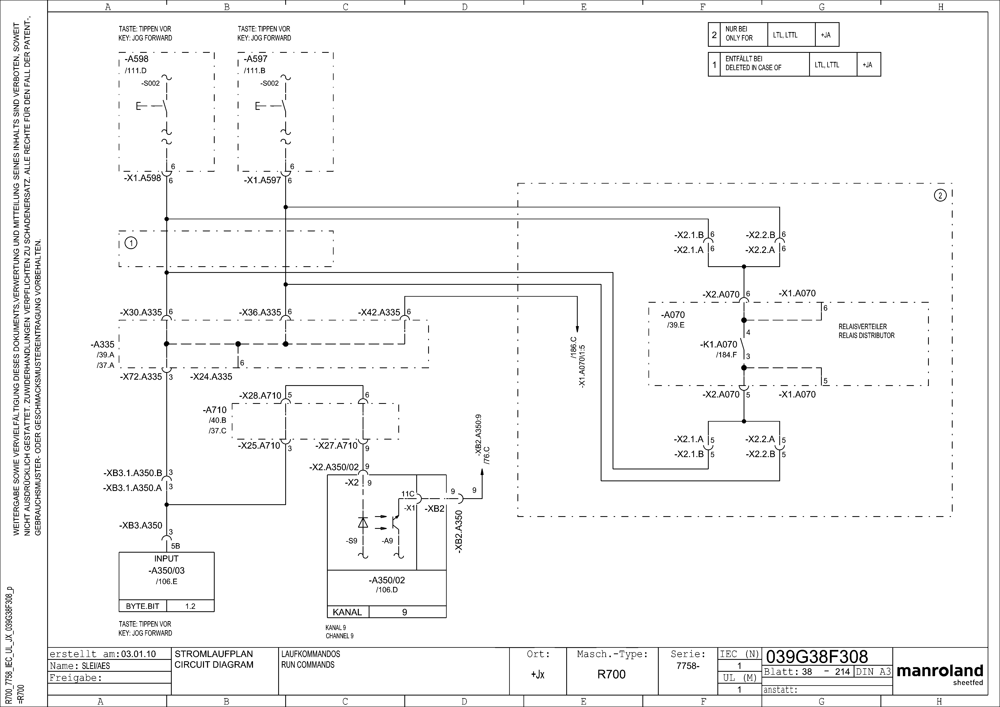

# +Jx — Sheet 38 of 214 — LAUFKOMMANDOS

**RUN COMMANDS**

> Part of the manroland **R700** printing press IEC/UL circuit diagrams.
> Drawing class: **Stromlaufplan / Circuit diagram** (DIN A3).
> Document `+Jx` covers the **1st printing module + feed register** machine section.

## At a glance

| Field | Value |
|---|---|
| Document | `+Jx`  (039G38F308) |
| Sheet | **38** of 214 |
| Section (DE) | LAUFKOMMANDOS |
| Section (EN) | RUN COMMANDS |
| Section type | CIRCUIT — Circuit diagram |
| Machine type | `R700` |
| Series | `7758` |
| Created | 03.01.10 |
| Replaces | — |
| Columns used | A, B, C, D, E, F, G, H |
| Path numbers | — |
| Labels on sheet | 119 |
| Cross-refs out | 12 |
| Cross-refs in | 40 |

**Previous:** [+Jx sheet 37](SHEET_0037.md) · **Next:** [+Jx sheet 39](SHEET_0039.md) · **Document TOC:** [_TOC.md](_TOC.md)  (+Jx) · **Master TOC:** [all sheets](../_MASTER_TOC.md)

## Sheet image (300 DPI, exact vector render)



_Rendered directly from the PDF vector layer at 300 DPI (1-bit), no OCR and no resampling. Use it to confirm anything ambiguous in the text below._

## Cross-references on this sheet

Each entry is a wire leaving this sheet. The printed token is `/sheet.column`; the link resolves to that sheet inside the same document.

| Ref | Target sheet | Col | Path | Destination on target | Target section | From col |
|---|---|---|---|---|---|---|
| `/111.B` | [+Jx sheet 111](SHEET_0111.md) | B | — | — | REFERENZMODUL | B |
| `/111.D` | [+Jx sheet 111](SHEET_0111.md) | D | — | — | REFERENZMODUL | A |
| `/39.E` | [+Jx sheet 39](SHEET_0039.md) | E | — | RELAISVERTEILER RELAIS DISTRIBUTOR | LAUFKOMMANDOS | G |
| `/186.C` | [+Jx sheet 186](SHEET_0186.md) | C | — | — | OPTION: TRANSFERMODUL 1 + 2 | E |
| `/39.A` | [+Jx sheet 39](SHEET_0039.md) | A | — | — | LAUFKOMMANDOS | A |
| `/37.A` | [+Jx sheet 37](SHEET_0037.md) | A | — | — | STOP SICHERN | A |
| `/184.F` | [+Jx sheet 184](SHEET_0184.md) | F | — | — | OPTION: TRANSFERMODUL 1 + 2 | F |
| `/76.C` | [+Jx sheet 76](SHEET_0076.md) | C | — | XB2.A350:9 | BUSVERBINDUNGEN: SICHERHEITSKREIS | D |
| `/40.B` | [+Jx sheet 40](SHEET_0040.md) | B | — | — | LAUFKOMMANDOS | B |
| `/37.C` | [+Jx sheet 37](SHEET_0037.md) | C | — | — | STOP SICHERN | B |
| `/106.E` | [+Jx sheet 106](SHEET_0106.md) | E | — | — | REFERENZMODUL | A |
| `/106.D` | [+Jx sheet 106](SHEET_0106.md) | D | — | — | REFERENZMODUL | C |

### Incoming references (sheets that point here)

Every other sheet that sends a wire to this one. `Back-ref` is the token printed on *that* sheet; `Path` is its line number.

| From sheet | Cols | Back-ref | Path | Refs | What continues there |
|---|---|---|---|---|---|
| [+Jx#37](SHEET_0037.md) | A, C | `/37.A`, `/37.C` | — | 2 | — |
| [+Jx#39](SHEET_0039.md) | A, E | `/39.A`, `/39.E` | — | 2 | — |
| [+Jx#40](SHEET_0040.md) | B | `/40.B` | — | 1 | — |
| [+Jx#76](SHEET_0076.md) | C | `/76.C` | — | 1 | XB2.A350:9 |
| [+Jx#106](SHEET_0106.md) | D, E | `/106.D`, `/106.E` | — | 2 | — |
| [+Jx#111](SHEET_0111.md) | B, D | `/111.B`, `/111.D` | — | 2 | — |
| [+Jx#113](SHEET_0113.md) | A | `/113.A` | — | 2 | — |
| [+Jx#115](SHEET_0115.md) | E, G | `/115.E`, `/115.G` | — | 2 | — |
| [+Jx#122](SHEET_0122.md) | A, C | `/122.A`, `/122.C` | — | 8 | — |
| [+Jx#123](SHEET_0123.md) | C | `/123.C` | — | 2 | — |
| [+Jx#126](SHEET_0126.md) | E | `/126.E` | — | 2 | — |
| [+Jx#128](SHEET_0128.md) | C, D, F | `/128.C`, `/128.D`, `/128.F` | — | 3 | — |
| [+Jx#142](SHEET_0142.md) | F | `/142.F` | — | 1 | — |
| [+Jx#143](SHEET_0143.md) | A | `/143.A` | — | 1 | — |
| [+Jx#144](SHEET_0144.md) | C | `/144.C` | — | 1 | — |
| [+Jx#146](SHEET_0146.md) | A | `/146.A` | — | 2 | — |
| [+Jx#148](SHEET_0148.md) | A | `/148.A` | — | 1 | — |
| [+Jx#149](SHEET_0149.md) | F | `/149.F` | — | 1 | — |
| [+Jx#150](SHEET_0150.md) | C | `/150.C` | — | 1 | — |
| [+Jx#153](SHEET_0153.md) | C | `/153.C` | — | 1 | — |
| [+Jx#184](SHEET_0184.md) | F | `/184.F` | — | 1 | — |
| [+Jx#186](SHEET_0186.md) | C | `/186.C` | — | 1 | X1.A070\1:5 |


## Devices on this sheet

| Tag | Class | Class meaning (IEC) | Col | Sub | Terminal | Sign |
|---|---|---|---|---|---|---|
| `S002` | S | Schalter / switch | A | — | — | — |
| `A598` | A | Baugruppe / assembly, module, PC board | A | — | — | — |
| `S002` | S | Schalter / switch | B | — | — | — |
| `A597` | A | Baugruppe / assembly, module, PC board | B | — | — | — |
| `A350/03` | A | Baugruppe / assembly, module, PC board | A | 03 | — | — |
| `A070` | A | Baugruppe / assembly, module, PC board | F | — | — | — |
| `A335` | A | Baugruppe / assembly, module, PC board | A | — | — | — |
| `A710` | A | Baugruppe / assembly, module, PC board | B | — | — | — |
| `S9` | S | Schalter / switch | C | — | — | — |
| `A9` | A | Baugruppe / assembly, module, PC board | C | — | — | — |
| `X1` | X | Klemme / terminal, plug connector | D | — | — | — |
| `X2` | X | Klemme / terminal, plug connector | C | — | — | — |
| `XB2` | XB |  | D | — | — | — |
| `A350/02` | A | Baugruppe / assembly, module, PC board | C | 02 | — | — |
| `X1.A598` | — | cross-device reference | A | — | — | — |
| `X1.A597` | — | cross-device reference | B | — | — | — |
| `1.2` | — | cross-device reference | B | — | — | — |
| `XB3.A350` | — | cross-device reference | A | — | — | — |
| `X2.1.B` | — | cross-device reference | F | — | — | — |
| `X2.1.A` | — | cross-device reference | F | — | — | — |
| `X2.2.B` | — | cross-device reference | F | — | — | — |
| `X2.2.A` | — | cross-device reference | F | — | — | — |
| `X2.A070` | — | cross-device reference | F | — | — | — |
| `K1.A070` | — | cross-device reference | F | — | — | — |
| `X2.A070` | — | cross-device reference | F | — | — | — |
| `X2.1.A` | — | cross-device reference | F | — | — | — |
| `X2.2.A` | — | cross-device reference | F | — | — | — |
| `X2.1.B` | — | cross-device reference | F | — | — | — |
| `X2.2.B` | — | cross-device reference | F | — | — | — |
| `X30.A335` | — | cross-device reference | A | — | — | — |
| `X36.A335` | — | cross-device reference | B | — | — | — |
| `X42.A335` | — | cross-device reference | C | — | — | — |
| `X72.A335` | — | cross-device reference | A | — | — | — |
| `X27.A710` | — | cross-device reference | C | — | — | — |
| `X28.A710` | — | cross-device reference | B | — | — | — |
| `X25.A710` | — | cross-device reference | B | — | — | — |
| `XB2.A350` | — | cross-device reference | D | — | — | — |
| `XB3.1.A350.B` | — | cross-device reference | A | — | — | — |
| `XB3.1.A350.A` | — | cross-device reference | A | — | — | — |
| `XB2.A350:9` | — | cross-device reference | D | — | 9 | — |
| `X1.A070\1:5` | — | cross-device reference | E | — | 5 | — |
| `X1.A070` | — | cross-device reference | G | — | — | — |
| `X1.A070` | — | cross-device reference | G | — | — | — |
| `X24.A335` | — | cross-device reference | B | — | — | — |

## Potentials / nets

_No named potentials on this sheet._

## Wire-end annotations (grouped as printed)

A wire that continues elsewhere is annotated with a small cluster: the destination description, the path/line number `#NN`, and the `/sheet.column` cross reference. Each row below is one such cluster exactly as it is grouped on the drawing.

| Col | Y | Path | Cross-ref | Text on the wire |
|---|---|---|---|---|
| A | 31.7 | — | — | `KEY: JOG FORWARD TASTE: TIPPEN VOR` |
| B | 31.7 | — | — | `KEY: JOG FORWARD TASTE: TIPPEN VOR` |
| G | 31.7 | — | — | `2 NUR BEI ONLY FOR LTL, LTTL +JA` |
| A | 65.4 | — | — | `A598` |
| B | 65.4 | — | — | `A597` |
| G | 67.2 | — | — | `1 ENTFÄLLT BEI DELETED IN CASE OF LTL, LTTL +JA` |
| A | 80.3 | — | `/111.D` | — |
| B | 80.3 | — | `/111.B` | — |
| A | 95.7 | — | — | `S002` |
| B | 95.7 | — | — | `S002` |
| B | 194.4 | — | — | `6` |
| C | 194.4 | — | — | `6` |
| A | 207.2 | — | — | `X1.A598 6` |
| B | 210.0 | — | — | `X1.A597 6` |
| H | 229.8 | — | — | `2` |
| F | 275.2 | — | — | `X2.1.B 6` |
| G | 275.2 | — | — | `X2.2.B 6` |
| A | 286.1 | — | — | `1` |
| F | 292.2 | — | — | `X2.1.A 6` |
| G | 292.2 | — | — | `X2.2.A 6` |
| G | 344.6 | — | — | `X1.A070` |
| F | 346.1 | — | — | `X2.A070 6` |
| G | 363.1 | — | — | `6` |
| B | 367.3 | — | — | `X30.A335 6 X36.A335 6` |
| C | 367.3 | — | — | `X42.A335 6` |
| F | 370.1 | — | — | `A070` |
| G | 383.2 | — | `/39.E` | `RELAISVERTEILER RELAIS DISTRIBUTOR` |
| F | 392.2 | — | — | `4` |
| E | 400.8 | — | `/186.C` | — |
| A | 405.6 | — | — | `A335` |
| F | 405.6 | — | — | `K1.A070 3` |
| E | 410.7 | — | — | `X1.A070\1:5` |
| A | 418.7 | — | `/39.A`, `/37.A` | — |
| F | 418.7 | — | `/184.F` | — |
| B | 428.3 | — | — | `6` |
| A | 443.9 | — | — | `X72.A335 3` |
| B | 443.9 | — | — | `X24.A335` |
| G | 449.6 | — | — | `5` |
| F | 465.1 | — | — | `X2.A070 5` |
| G | 465.1 | — | — | `X1.A070` |
| B | 466.5 | — | — | `X28.A710 5` |
| C | 466.6 | — | — | `6` |
| B | 483.5 | — | — | `A710` |
| D | 493.2 | — | `/76.C` | `XB2.A350:9` |
| B | 496.6 | — | `/40.B`, `/37.C` | — |
| F | 518.3 | — | — | `X2.1.A 5 X2.2.A 5` |
| B | 526.1 | — | — | `X25.A710 3` |
| C | 526.1 | — | — | `X27.A710 9` |
| F | 536.0 | — | — | `X2.1.B 5 X2.2.B 5` |
| C | 551.6 | — | — | `X2.A350/02 9` |
| A | 558.7 | — | — | `XB3.1.A350.B 3` |
| C | 570.0 | — | — | `X2` |
| D | 571.5 | — | — | `9 9` |
| A | 575.7 | — | — | `XB3.1.A350.A 3` |
| D | 580.0 | — | — | `9` |
| D | 584.2 | — | — | `11C` |
| D | 601.2 | — | — | `X1` |
| D | 601.2 | — | — | `XB2` |
| D | 607.5 | — | — | `XB2.A350` |
| A | 621.0 | — | — | `XB3.A350 3` |
| C | 640.2 | — | — | `S9 A9` |
| B | 646.5 | — | — | `5B` |
| A | 661.0 | — | — | `INPUT` |
| A | 674.9 | — | — | `A350/03` |
| C | 686.2 | — | — | `A350/02` |
| A | 688.7 | — | `/106.E` | — |
| C | 698.6 | — | `/106.D` | — |
| A | 718.0 | — | — | `BYTE.BIT 1.2` |
| C | 724.5 | — | — | `KANAL 9` |
| A | 740.4 | — | — | `KEY: JOG FORWARD TASTE: TIPPEN VOR` |
| C | 744.8 | — | — | `KANAL 9 CHANNEL 9` |


## Reconstructed tables

This sheet carries tabular content (pin map / terminal assignment / index). The grid below was rebuilt from the drawing's own rule lines, so each row is exactly one physical row of the table.

### Table 1 — 10 data rows × 5 columns (at x=141.7, y=62.4)

| A598 /111.D S002 | 6 |  | A597 /111.B S002 | 6 |
|---|---|---|---|---|
| `X1.A598` | `6` |  | `X1.A597` | `6` |
| `1` |  |  |  |  |
| `X30.A335` | `6` |  | `X36.A335` | `6` |
| `X72.A335` | `X24.A335 3` |  | `6` |  |
| `XB3.1.A350.B` | `3` | `A710 /40.B /37.C` | `X28.A710 X25.A710` | `5 3` |
| `XB3.1.A350.A` | `3` |  |  |  |
| `XB3.A350` | `3 5B` |  |  |  |
| `INPUT` |  |  |  |  |
|  | `A350/03 /106.E` |  |  |  |
| `BYTE.BIT` | `1.2` |  |  |  |


### Table 2 — 5 data rows × 5 columns (at x=396.9, y=62.4)

|  | X42.A335 | 6 |  |  |
|---|---|---|---|---|
| `X27.A710 X2.A350/02` | `6 9 9` |  |  | `XB2.A350:9` |
| `X2` | `9` | `11C` |  | `9 9` |
| `S9` | `A9` | `X1` | `XB2` | `XB2.A350` |
|  | `A350/02 /106.D` |  |  |  |
| `KANAL` |  | `9` |  |  |


## Notes and free text on this sheet

| Text | Col | Y (pt) |
|---|---|---|
| `TASTE: TIPPEN VOR` | A | 31.74 |
| `KEY: JOG FORWARD` | A | 42.36 |
| `TASTE: TIPPEN VOR` | B | 31.74 |
| `KEY: JOG FORWARD` | B | 42.36 |
| `5B` | B | 646.51 |
| `INPUT` | A | 661.05 |
| `BYTE.BIT` | A | 718.04 |
| `RELAISVERTEILER` | G | 386.08 |
| `RELAIS DISTRIBUTOR` | G | 396.72 |
| `KANAL 9` | C | 744.83 |
| `CHANNEL 9` | C | 754.78 |
| `11C` | D | 584.21 |
| `KANAL` | C | 724.48 |
| `X2.A350/02` | C | 551.58 |
| `ENTFÄLLT BEI` | F | 67.16 |
| `DELETED IN CASE OF` | F | 77.81 |
| `LTL, LTTL` | G | 74.27 |
| `+JA` | G | 74.23 |
| `NUR BEI` | F | 31.72 |
| `ONLY FOR` | F | 42.41 |

## Complete label inventory (exact text from the drawing)

Every text object inside the drawing area of this sheet, in DIN reading order (column A→H, then top→bottom). This is the authoritative list: if a string is not here it is not printed on this sheet.

| Col | Y | X | Dir | Type | Text |
|---|---|---|---|---|---|
| A | 31.7 | 141.7 | → | text | `TASTE: TIPPEN VOR` |
| A | 42.4 | 141.2 | → | text | `KEY: JOG FORWARD` |
| A | 65.4 | 148.5 | → | device tag | `A598` |
| A | 80.3 | 148.8 | → | cross-reference | `/111.D` |
| A | 95.6 | 168.4 | → | device tag | `S002` |
| A | 207.2 | 147.7 | → | device ref | `X1.A598` |
| A | 286.1 | 154.0 | → | number | `1` |
| A | 367.3 | 142.9 | → | device ref | `X30.A335` |
| A | 405.6 | 108.0 | → | device tag | `A335` |
| A | 418.7 | 115.4 | → | cross-reference | `/39.A` |
| A | 431.1 | 115.4 | → | cross-reference | `/37.A` |
| A | 443.9 | 142.9 | → | device ref | `X72.A335` |
| A | 558.7 | 123.3 | → | device ref | `XB3.1.A350.B` |
| A | 576.4 | 122.7 | → | device ref | `XB3.1.A350.A` |
| A | 621.0 | 142.0 | → | device ref | `XB3.A350` |
| A | 661.0 | 183.5 | → | text | `INPUT` |
| A | 674.9 | 176.9 | → | device tag | `A350/03` |
| A | 688.7 | 185.8 | → | cross-reference | `/106.E` |
| A | 718.0 | 150.0 | → | text | `BYTE.BIT` |
| A | 740.4 | 141.7 | → | text | `TASTE: TIPPEN VOR` |
| A | 751.0 | 141.2 | → | text | `KEY: JOG FORWARD` |
| B | 31.7 | 283.5 | → | text | `TASTE: TIPPEN VOR` |
| B | 42.4 | 282.9 | → | text | `KEY: JOG FORWARD` |
| B | 65.4 | 290.3 | → | device tag | `A597` |
| B | 80.3 | 290.6 | → | cross-reference | `/111.B` |
| B | 95.6 | 310.1 | → | device tag | `S002` |
| B | 194.4 | 203.8 | → | number | `6` |
| B | 210.0 | 290.6 | → | device ref | `X1.A597` |
| B | 211.4 | 201.0 | → | number | `6` |
| B | 367.3 | 284.6 | → | device ref | `X36.A335` |
| B | 367.4 | 201.0 | → | number | `6` |
| B | 428.3 | 286.0 | → | number | `6` |
| B | 443.9 | 226.5 | → | device ref | `X24.A335` |
| B | 445.3 | 201.0 | → | number | `3` |
| B | 466.5 | 284.9 | → | device ref | `X28.A710` |
| B | 483.5 | 241.5 | → | device tag | `A710` |
| B | 496.6 | 248.9 | → | cross-reference | `/40.B` |
| B | 509.0 | 248.6 | → | cross-reference | `/37.C` |
| B | 526.1 | 283.5 | → | device ref | `X25.A710` |
| B | 558.7 | 201.0 | → | number | `3` |
| B | 575.7 | 201.0 | → | number | `3` |
| B | 629.6 | 201.0 | → | number | `3` |
| B | 646.5 | 203.8 | → | text | `5B` |
| B | 718.1 | 220.4 | → | device ref | `1.2` |
| C | 194.4 | 345.5 | → | number | `6` |
| C | 211.4 | 342.7 | → | number | `6` |
| C | 367.3 | 426.3 | → | device ref | `X42.A335` |
| C | 367.4 | 342.7 | → | number | `6` |
| C | 466.6 | 342.7 | → | number | `5` |
| C | 466.6 | 434.8 | → | number | `6` |
| C | 526.1 | 375.6 | → | device ref | `X27.A710` |
| C | 530.3 | 342.7 | → | number | `3` |
| C | 530.3 | 434.8 | → | number | `9` |
| C | 551.6 | 368.2 | → | text | `X2.A350/02` |
| C | 551.6 | 434.8 | → | number | `9` |
| C | 570.0 | 410.7 | → | device tag | `X2` |
| C | 571.4 | 437.7 | → | number | `9` |
| C | 640.2 | 411.9 | → | device tag | `S9` |
| C | 640.2 | 454.4 | → | device tag | `A9` |
| C | 686.2 | 439.2 | → | device tag | `A350/02` |
| C | 698.6 | 447.9 | → | cross-reference | `/106.D` |
| C | 724.5 | 396.3 | → | text | `KANAL` |
| C | 724.5 | 478.9 | → | number | `9` |
| C | 744.8 | 387.8 | → | text | `KANAL 9` |
| C | 754.8 | 388.1 | → | text | `CHANNEL 9` |
| D | 367.4 | 484.4 | → | number | `6` |
| D | 493.2 | 565.7 | ↕ | device ref | `XB2.A350:9` |
| D | 531.8 | 575.7 | ↕ | cross-reference | `/76.C` |
| D | 580.0 | 562.4 | → | number | `9` |
| D | 581.4 | 536.9 | → | number | `9` |
| D | 584.2 | 477.6 | → | text | `11C` |
| D | 601.2 | 481.0 | → | device tag | `X1` |
| D | 601.2 | 505.7 | → | device tag | `XB2` |
| D | 607.5 | 541.7 | ↕ | device ref | `XB2.A350` |
| E | 400.8 | 679.1 | ↕ | cross-reference | `/186.C` |
| E | 410.7 | 689.0 | ↕ | device ref | `X1.A070\1:5` |
| F | 31.7 | 864.0 | → | text | `NUR BEI` |
| F | 37.1 | 847.6 | → | number | `2` |
| F | 42.4 | 864.3 | → | text | `ONLY FOR` |
| F | 67.2 | 864.0 | → | text | `ENTFÄLLT BEI` |
| F | 72.5 | 847.8 | → | number | `1` |
| F | 77.8 | 864.0 | → | text | `DELETED IN CASE OF` |
| F | 275.2 | 803.1 | → | device ref | `X2.1.B` |
| F | 275.2 | 845.9 | → | number | `6` |
| F | 275.2 | 888.1 | → | device ref | `X2.2.B` |
| F | 292.2 | 845.9 | → | number | `6` |
| F | 292.9 | 802.5 | → | device ref | `X2.1.A` |
| F | 292.9 | 887.5 | → | device ref | `X2.2.A` |
| F | 346.1 | 836.5 | → | device ref | `X2.A070` |
| F | 346.1 | 888.4 | → | number | `6` |
| F | 370.2 | 787.2 | → | device tag | `A070` |
| F | 383.2 | 794.6 | → | cross-reference | `/39.E` |
| F | 392.2 | 888.7 | → | number | `4` |
| F | 405.6 | 833.7 | → | device ref | `K1.A070` |
| F | 418.7 | 852.7 | → | cross-reference | `/184.F` |
| F | 420.5 | 888.4 | → | number | `3` |
| F | 465.1 | 836.5 | → | device ref | `X2.A070` |
| F | 466.6 | 888.4 | → | number | `5` |
| F | 518.3 | 802.5 | → | device ref | `X2.1.A` |
| F | 518.3 | 887.5 | → | device ref | `X2.2.A` |
| F | 520.4 | 845.9 | → | number | `5` |
| F | 536.0 | 803.1 | → | device ref | `X2.1.B` |
| F | 536.0 | 888.1 | → | device ref | `X2.2.B` |
| F | 537.4 | 845.9 | → | number | `5` |
| G | 38.8 | 920.7 | → | text | `LTL, LTTL` |
| G | 38.8 | 977.7 | → | text | `+JA` |
| G | 74.2 | 1027.3 | → | text | `+JA` |
| G | 74.3 | 970.3 | → | text | `LTL, LTTL` |
| G | 275.2 | 930.9 | → | number | `6` |
| G | 292.2 | 930.9 | → | number | `6` |
| G | 344.6 | 927.2 | → | device ref | `X1.A070` |
| G | 363.1 | 980.5 | → | number | `6` |
| G | 386.1 | 998.6 | → | text | `RELAISVERTEILER` |
| G | 396.7 | 998.6 | → | text | `RELAIS DISTRIBUTOR` |
| G | 449.6 | 980.5 | → | number | `5` |
| G | 465.1 | 927.2 | → | device ref | `X1.A070` |
| G | 520.4 | 930.9 | → | number | `5` |
| G | 537.4 | 930.9 | → | number | `5` |
| H | 229.8 | 1117.7 | → | number | `2` |

## Reading-order text block

The same content as a plain block, grouped by DIN column — convenient to paste or to match against a visual description.

```text
=== Column A ===
  31.7  141.7  text         TASTE: TIPPEN VOR
  42.4  141.2  text         KEY: JOG FORWARD
  65.4  148.5  devtag       A598
  80.3  148.8  xref         /111.D
  95.6  168.4  devtag       S002
 207.2  147.7  devref       X1.A598
 286.1  154.0  numeric      1
 367.3  142.9  devref       X30.A335
 405.6  108.0  devtag       A335
 418.7  115.4  xref         /39.A
 431.1  115.4  xref         /37.A
 443.9  142.9  devref       X72.A335
 558.7  123.3  devref       XB3.1.A350.B
 576.4  122.7  devref       XB3.1.A350.A
 621.0  142.0  devref       XB3.A350
 661.0  183.5  text         INPUT
 674.9  176.9  devtag       A350/03
 688.7  185.8  xref         /106.E
 718.0  150.0  text         BYTE.BIT
 740.4  141.7  text         TASTE: TIPPEN VOR
 751.0  141.2  text         KEY: JOG FORWARD
=== Column B ===
  31.7  283.5  text         TASTE: TIPPEN VOR
  42.4  282.9  text         KEY: JOG FORWARD
  65.4  290.3  devtag       A597
  80.3  290.6  xref         /111.B
  95.6  310.1  devtag       S002
 194.4  203.8  numeric      6
 210.0  290.6  devref       X1.A597
 211.4  201.0  numeric      6
 367.3  284.6  devref       X36.A335
 367.4  201.0  numeric      6
 428.3  286.0  numeric      6
 443.9  226.5  devref       X24.A335
 445.3  201.0  numeric      3
 466.5  284.9  devref       X28.A710
 483.5  241.5  devtag       A710
 496.6  248.9  xref         /40.B
 509.0  248.6  xref         /37.C
 526.1  283.5  devref       X25.A710
 558.7  201.0  numeric      3
 575.7  201.0  numeric      3
 629.6  201.0  numeric      3
 646.5  203.8  text         5B
 718.1  220.4  devref       1.2
=== Column C ===
 194.4  345.5  numeric      6
 211.4  342.7  numeric      6
 367.3  426.3  devref       X42.A335
 367.4  342.7  numeric      6
 466.6  342.7  numeric      5
 466.6  434.8  numeric      6
 526.1  375.6  devref       X27.A710
 530.3  342.7  numeric      3
 530.3  434.8  numeric      9
 551.6  368.2  text         X2.A350/02
 551.6  434.8  numeric      9
 570.0  410.7  devtag       X2
 571.4  437.7  numeric      9
 640.2  411.9  devtag       S9
 640.2  454.4  devtag       A9
 686.2  439.2  devtag       A350/02
 698.6  447.9  xref         /106.D
 724.5  396.3  text         KANAL
 724.5  478.9  numeric      9
 744.8  387.8  text         KANAL 9
 754.8  388.1  text         CHANNEL 9
=== Column D ===
 367.4  484.4  numeric      6
 493.2  565.7  devref       XB2.A350:9
 531.8  575.7  xref         /76.C
 580.0  562.4  numeric      9
 581.4  536.9  numeric      9
 584.2  477.6  text         11C
 601.2  481.0  devtag       X1
 601.2  505.7  devtag       XB2
 607.5  541.7  devref       XB2.A350
=== Column E ===
 400.8  679.1  xref         /186.C
 410.7  689.0  devref       X1.A070\1:5
=== Column F ===
  31.7  864.0  text         NUR BEI
  37.1  847.6  numeric      2
  42.4  864.3  text         ONLY FOR
  67.2  864.0  text         ENTFÄLLT BEI
  72.5  847.8  numeric      1
  77.8  864.0  text         DELETED IN CASE OF
 275.2  803.1  devref       X2.1.B
 275.2  845.9  numeric      6
 275.2  888.1  devref       X2.2.B
 292.2  845.9  numeric      6
 292.9  802.5  devref       X2.1.A
 292.9  887.5  devref       X2.2.A
 346.1  836.5  devref       X2.A070
 346.1  888.4  numeric      6
 370.2  787.2  devtag       A070
 383.2  794.6  xref         /39.E
 392.2  888.7  numeric      4
 405.6  833.7  devref       K1.A070
 418.7  852.7  xref         /184.F
 420.5  888.4  numeric      3
 465.1  836.5  devref       X2.A070
 466.6  888.4  numeric      5
 518.3  802.5  devref       X2.1.A
 518.3  887.5  devref       X2.2.A
 520.4  845.9  numeric      5
 536.0  803.1  devref       X2.1.B
 536.0  888.1  devref       X2.2.B
 537.4  845.9  numeric      5
=== Column G ===
  38.8  920.7  text         LTL, LTTL
  38.8  977.7  text         +JA
  74.2 1027.3  text         +JA
  74.3  970.3  text         LTL, LTTL
 275.2  930.9  numeric      6
 292.2  930.9  numeric      6
 344.6  927.2  devref       X1.A070
 363.1  980.5  numeric      6
 386.1  998.6  text         RELAISVERTEILER
 396.7  998.6  text         RELAIS DISTRIBUTOR
 449.6  980.5  numeric      5
 465.1  927.2  devref       X1.A070
 520.4  930.9  numeric      5
 537.4  930.9  numeric      5
=== Column H ===
 229.8 1117.7  numeric      2
```

---
_Generated from the PDF vector text layer; no OCR. Source: `R700_7758_IEC_UL_JX_039G38F308_p`, sheet 38._
