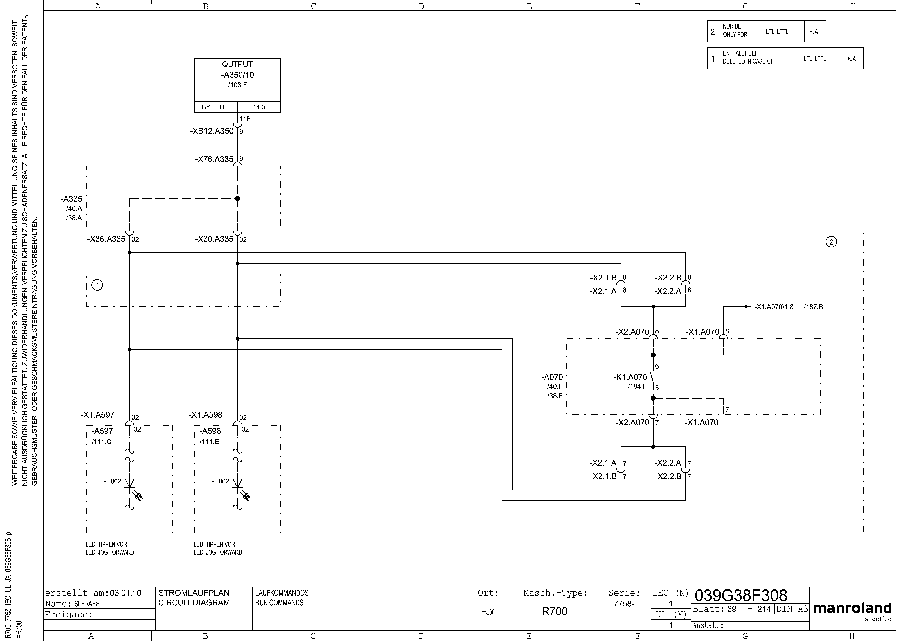

# +Jx — Sheet 39 of 214 — LAUFKOMMANDOS

**RUN COMMANDS**

> Part of the manroland **R700** printing press IEC/UL circuit diagrams.
> Drawing class: **Stromlaufplan / Circuit diagram** (DIN A3).
> Document `+Jx` covers the **1st printing module + feed register** machine section.

## At a glance

| Field | Value |
|---|---|
| Document | `+Jx`  (039G38F308) |
| Sheet | **39** of 214 |
| Section (DE) | LAUFKOMMANDOS |
| Section (EN) | RUN COMMANDS |
| Section type | CIRCUIT — Circuit diagram |
| Machine type | `R700` |
| Series | `7758` |
| Created | 03.01.10 |
| Replaces | — |
| Columns used | A, B, E, F, G, H |
| Path numbers | — |
| Labels on sheet | 78 |
| Cross-refs out | 9 |
| Cross-refs in | 27 |

**Previous:** [+Jx sheet 38](SHEET_0038.md) · **Next:** [+Jx sheet 40](SHEET_0040.md) · **Document TOC:** [_TOC.md](_TOC.md)  (+Jx) · **Master TOC:** [all sheets](../_MASTER_TOC.md)

## Sheet image (300 DPI, exact vector render)



_Rendered directly from the PDF vector layer at 300 DPI (1-bit), no OCR and no resampling. Use it to confirm anything ambiguous in the text below._

## Cross-references on this sheet

Each entry is a wire leaving this sheet. The printed token is `/sheet.column`; the link resolves to that sheet inside the same document.

| Ref | Target sheet | Col | Path | Destination on target | Target section | From col |
|---|---|---|---|---|---|---|
| `/108.F` | [+Jx sheet 108](SHEET_0108.md) | F | — | — | REFERENZMODUL | B |
| `/40.A` | [+Jx sheet 40](SHEET_0040.md) | A | — | — | LAUFKOMMANDOS | A |
| `/38.A` | [+Jx sheet 38](SHEET_0038.md) | A | — | — | LAUFKOMMANDOS | A |
| `/187.B` | [+Jx sheet 187](SHEET_0187.md) | B | — | X1.A070\1:8 | OPTION: TRANSFERMODUL 1 + 2 | G |
| `/40.F` | [+Jx sheet 40](SHEET_0040.md) | F | — | — | LAUFKOMMANDOS | E |
| `/38.F` | [+Jx sheet 38](SHEET_0038.md) | F | — | — | LAUFKOMMANDOS | E |
| `/184.F` | [+Jx sheet 184](SHEET_0184.md) | F | — | — | OPTION: TRANSFERMODUL 1 + 2 | F |
| `/111.E` | [+Jx sheet 111](SHEET_0111.md) | E | — | — | REFERENZMODUL | B |
| `/111.C` | [+Jx sheet 111](SHEET_0111.md) | C | — | — | REFERENZMODUL | A |

### Incoming references (sheets that point here)

Every other sheet that sends a wire to this one. `Back-ref` is the token printed on *that* sheet; `Path` is its line number.

| From sheet | Cols | Back-ref | Path | Refs | What continues there |
|---|---|---|---|---|---|
| [+Jx#38](SHEET_0038.md) | A, G | `/38.A`, `/38.G` | — | 2 | RELAISVERTEILER RELAIS DISTRIBUTOR |
| [+Jx#40](SHEET_0040.md) | A, E | `/40.A`, `/40.E` | — | 2 | — |
| [+Jx#108](SHEET_0108.md) | F | `/108.F` | — | 1 | — |
| [+Jx#111](SHEET_0111.md) | C, E | `/111.C`, `/111.E` | — | 2 | — |
| [+Jx#113](SHEET_0113.md) | A | `/113.A` | — | 2 | — |
| [+Jx#115](SHEET_0115.md) | F, H | `/115.F`, `/115.H` | — | 2 | — |
| [+Jx#122](SHEET_0122.md) | A, C | `/122.A`, `/122.C` | — | 8 | — |
| [+Jx#123](SHEET_0123.md) | C | `/123.C` | — | 2 | — |
| [+Jx#137](SHEET_0137.md) | H | `/137.H` | — | 1 | — |
| [+Jx#148](SHEET_0148.md) | B | `/148.B` | — | 1 | — |
| [+Jx#149](SHEET_0149.md) | G | `/149.G` | — | 1 | — |
| [+Jx#155](SHEET_0155.md) | B | `/155.B` | — | 1 | — |
| [+Jx#184](SHEET_0184.md) | F | `/184.F` | — | 1 | — |
| [+Jx#187](SHEET_0187.md) | C | `/187.C` | — | 1 | X1.A070\1:8 X1.A070\1:12 |


## Devices on this sheet

| Tag | Class | Class meaning (IEC) | Col | Sub | Terminal | Sign |
|---|---|---|---|---|---|---|
| `A350/10` | A | Baugruppe / assembly, module, PC board | B | 10 | — | — |
| `A335` | A | Baugruppe / assembly, module, PC board | A | — | — | — |
| `A598` | A | Baugruppe / assembly, module, PC board | B | — | — | — |
| `A597` | A | Baugruppe / assembly, module, PC board | A | — | — | — |
| `A070` | A | Baugruppe / assembly, module, PC board | E | — | — | — |
| `14.0` | — | cross-device reference | B | — | — | — |
| `XB12.A350` | — | cross-device reference | B | — | — | — |
| `X30.A335` | — | cross-device reference | B | — | — | — |
| `X36.A335` | — | cross-device reference | A | — | — | — |
| `X76.A335` | — | cross-device reference | B | — | — | — |
| `X1.A598` | — | cross-device reference | B | — | — | — |
| `X1.A597` | — | cross-device reference | A | — | — | — |
| `X2.1.B` | — | cross-device reference | F | — | — | — |
| `X2.1.A` | — | cross-device reference | F | — | — | — |
| `X2.2.B` | — | cross-device reference | F | — | — | — |
| `X2.2.A` | — | cross-device reference | F | — | — | — |
| `X2.A070` | — | cross-device reference | F | — | — | — |
| `K1.A070` | — | cross-device reference | F | — | — | — |
| `X2.A070` | — | cross-device reference | F | — | — | — |
| `X1.A070` | — | cross-device reference | G | — | — | — |
| `X2.1.A` | — | cross-device reference | F | — | — | — |
| `X2.2.A` | — | cross-device reference | F | — | — | — |
| `X2.1.B` | — | cross-device reference | F | — | — | — |
| `X2.2.B` | — | cross-device reference | F | — | — | — |
| `X1.A070\1:8` | — | cross-device reference | G | — | 8 | — |
| `X1.A070` | — | cross-device reference | G | — | — | — |

## Potentials / nets

| Potential | Count | Columns | Attached devices | Terminals |
|---|---|---|---|---|
| `H002` | 2 | A, B | — | — |


A potential such as `L24+/4` or `M24+` is a named supply/return rail; every place it appears on this sheet is electrically common.

## Wire-end annotations (grouped as printed)

A wire that continues elsewhere is annotated with a small cluster: the destination description, the path/line number `#NN`, and the `/sheet.column` cross reference. Each row below is one such cluster exactly as it is grouped on the drawing.

| Col | Y | Path | Cross-ref | Text on the wire |
|---|---|---|---|---|
| G | 31.7 | — | — | `2 NUR BEI ONLY FOR LTL, LTTL +JA` |
| G | 67.2 | — | — | `1 ENTFÄLLT BEI DELETED IN CASE OF LTL, LTTL +JA` |
| B | 79.9 | — | — | `QUTPUT` |
| B | 93.8 | — | — | `A350/10` |
| B | 107.6 | — | `/108.F` | — |
| B | 137.2 | — | — | `BYTE.BIT 14.0` |
| B | 152.6 | — | — | `11B` |
| B | 167.5 | — | — | `XB12.A350 9` |
| B | 204.3 | — | — | `X76.A335 9` |
| A | 256.8 | — | — | `A335` |
| A | 269.8 | — | `/40.A`, `/38.A` | — |
| B | 309.2 | — | — | `X36.A335 32 X30.A335 32` |
| H | 314.9 | — | — | `2` |
| F | 360.3 | — | — | `X2.1.B 8` |
| F | 360.3 | — | — | `X2.2.B 8` |
| A | 371.1 | — | — | `1` |
| F | 377.3 | — | — | `X2.1.A 8` |
| F | 377.3 | — | — | `X2.2.A 8` |
| G | 399.2 | — | `/187.B` | `X1.A070\1:8` |
| F | 431.1 | — | — | `X2.A070 8` |
| G | 431.1 | — | — | `X1.A070 8` |
| F | 477.2 | — | — | `6` |
| E | 490.6 | — | — | `A070` |
| F | 490.6 | — | — | `K1.A070 5` |
| E | 503.7 | — | `/40.F`, `/38.F` | — |
| F | 503.7 | — | `/184.F` | — |
| G | 534.6 | — | — | `7` |
| A | 540.2 | — | — | `X1.A597 32` |
| B | 540.2 | — | — | `X1.A598 32` |
| F | 550.2 | — | — | `X2.A070 7` |
| G | 550.2 | — | — | `X1.A070` |
| A | 560.1 | — | — | `32` |
| B | 560.1 | — | — | `32` |
| A | 561.5 | — | — | `A597` |
| B | 561.5 | — | — | `A598` |
| A | 576.4 | — | `/111.C` | — |
| B | 576.4 | — | `/111.E` | — |
| F | 603.3 | — | — | `X2.1.A 7 X2.2.A 7` |
| F | 621.0 | — | — | `X2.1.B 7 X2.2.B 7` |
| A | 628.5 | — | — | `H002` |
| B | 628.5 | — | — | `H002` |
| A | 712.1 | — | — | `LED: TIPPEN VOR LED: JOG FORWARD` |
| B | 712.1 | — | — | `LED: TIPPEN VOR LED: JOG FORWARD` |


## Reconstructed tables

This sheet carries tabular content (pin map / terminal assignment / index). The grid below was rebuilt from the drawing's own rule lines, so each row is exactly one physical row of the table.

### Table 1 — 3 data rows × 2 columns (at x=113.4, y=76.5)

| X36.A335 | 32 |
|---|---|
| `1` |  |
| `X1.A597` | `32` |
| `A597 /111.C H002` | `32` |


### Table 2 — 5 data rows × 2 columns (at x=255.1, y=76.5)

| QUTPUT | A350/10 /108.F |
|---|---|
| `BYTE.BIT` | `14.0` |
| `XB12.A350 X76.A335` | `11B 9 9` |
| `X30.A335` | `32` |
| `X1.A598` | `32` |
| `A598 /111.E H002` | `32` |


### Table 3 — 4 data rows × 2 columns (at x=857.5, y=331.7)

| X2.2.B X2.2.A | 8 8 |
|---|---|
| `8` | `X1.A070` |
| `6 5` |  |
| `7` | `X1.A070` |
| `X2.2.A X2.2.B` | `7 7` |


## Notes and free text on this sheet

| Text | Col | Y (pt) |
|---|---|---|
| `11B` | B | 152.59 |
| `QUTPUT` | B | 79.92 |
| `BYTE.BIT` | B | 137.21 |
| `LED: TIPPEN VOR` | B | 712.06 |
| `LED: JOG FORWARD` | B | 722.68 |
| `LED: TIPPEN VOR` | A | 712.06 |
| `LED: JOG FORWARD` | A | 722.68 |
| `ENTFÄLLT BEI` | G | 67.16 |
| `DELETED IN CASE OF` | G | 77.81 |
| `LTL, LTTL` | H | 74.27 |
| `+JA` | H | 74.23 |
| `NUR BEI` | G | 31.72 |
| `ONLY FOR` | G | 42.41 |
| `LTL, LTTL` | G | 38.84 |

## Complete label inventory (exact text from the drawing)

Every text object inside the drawing area of this sheet, in DIN reading order (column A→H, then top→bottom). This is the authoritative list: if a string is not here it is not printed on this sheet.

| Col | Y | X | Dir | Type | Text |
|---|---|---|---|---|---|
| A | 256.8 | 79.7 | → | device tag | `A335` |
| A | 269.8 | 87.0 | → | cross-reference | `/40.A` |
| A | 282.2 | 87.0 | → | cross-reference | `/38.A` |
| A | 309.2 | 114.5 | → | device ref | `X36.A335` |
| A | 310.7 | 172.6 | → | number | `32` |
| A | 371.1 | 125.7 | → | number | `1` |
| A | 540.2 | 106.0 | → | device ref | `X1.A597` |
| A | 544.5 | 172.6 | → | number | `32` |
| A | 560.1 | 175.5 | → | number | `32` |
| A | 561.5 | 120.2 | → | device tag | `A597` |
| A | 576.4 | 120.5 | → | cross-reference | `/111.C` |
| A | 628.5 | 136.6 | → | potential | `H002` |
| A | 712.1 | 112.8 | → | text | `LED: TIPPEN VOR` |
| A | 722.7 | 112.8 | → | text | `LED: JOG FORWARD` |
| B | 79.9 | 291.5 | → | text | `QUTPUT` |
| B | 93.8 | 290.4 | → | device tag | `A350/10` |
| B | 107.6 | 299.5 | → | cross-reference | `/108.F` |
| B | 137.2 | 265.0 | → | text | `BYTE.BIT` |
| B | 137.2 | 331.9 | → | device ref | `14.0` |
| B | 152.6 | 313.8 | → | text | `11B` |
| B | 167.5 | 249.4 | → | device ref | `XB12.A350` |
| B | 168.9 | 314.4 | → | number | `9` |
| B | 204.3 | 256.3 | → | device ref | `X76.A335` |
| B | 204.4 | 314.4 | → | number | `9` |
| B | 309.2 | 256.3 | → | device ref | `X30.A335` |
| B | 310.7 | 314.4 | → | number | `32` |
| B | 540.2 | 247.7 | → | device ref | `X1.A598` |
| B | 544.5 | 314.4 | → | number | `32` |
| B | 560.1 | 317.2 | → | number | `32` |
| B | 561.5 | 261.9 | → | device tag | `A598` |
| B | 576.3 | 262.2 | → | cross-reference | `/111.E` |
| B | 628.5 | 278.4 | → | potential | `H002` |
| B | 712.1 | 254.6 | → | text | `LED: TIPPEN VOR` |
| B | 722.7 | 254.6 | → | text | `LED: JOG FORWARD` |
| E | 490.6 | 710.6 | → | device tag | `A070` |
| E | 503.7 | 718.6 | → | cross-reference | `/40.F` |
| E | 516.1 | 718.6 | → | cross-reference | `/38.F` |
| F | 360.3 | 774.7 | → | device ref | `X2.1.B` |
| F | 360.3 | 817.5 | → | number | `8` |
| F | 360.3 | 859.7 | → | device ref | `X2.2.B` |
| F | 360.3 | 902.6 | → | number | `8` |
| F | 377.3 | 817.5 | → | number | `8` |
| F | 377.3 | 902.6 | → | number | `8` |
| F | 378.0 | 774.1 | → | device ref | `X2.1.A` |
| F | 378.0 | 859.2 | → | device ref | `X2.2.A` |
| F | 431.1 | 808.2 | → | device ref | `X2.A070` |
| F | 431.1 | 860.0 | → | number | `8` |
| F | 477.2 | 860.0 | → | number | `6` |
| F | 490.6 | 805.3 | → | device ref | `K1.A070` |
| F | 503.7 | 824.3 | → | cross-reference | `/184.F` |
| F | 505.5 | 860.0 | → | number | `5` |
| F | 550.2 | 808.2 | → | device ref | `X2.A070` |
| F | 551.6 | 860.0 | → | number | `7` |
| F | 603.3 | 774.1 | → | device ref | `X2.1.A` |
| F | 603.3 | 859.2 | → | device ref | `X2.2.A` |
| F | 605.5 | 817.5 | → | number | `7` |
| F | 605.5 | 902.6 | → | number | `7` |
| F | 621.1 | 774.7 | → | device ref | `X2.1.B` |
| F | 621.1 | 859.7 | → | device ref | `X2.2.B` |
| F | 622.5 | 817.5 | → | number | `7` |
| F | 622.5 | 902.6 | → | number | `7` |
| G | 31.7 | 949.0 | → | text | `NUR BEI` |
| G | 37.1 | 932.6 | → | number | `2` |
| G | 38.8 | 1005.7 | → | text | `LTL, LTTL` |
| G | 42.4 | 949.3 | → | text | `ONLY FOR` |
| G | 67.2 | 949.0 | → | text | `ENTFÄLLT BEI` |
| G | 72.5 | 932.9 | → | number | `1` |
| G | 77.8 | 949.0 | → | text | `DELETED IN CASE OF` |
| G | 399.2 | 990.4 | → | device ref | `X1.A070\1:8` |
| G | 431.1 | 900.3 | → | device ref | `X1.A070` |
| G | 431.1 | 952.2 | → | number | `8` |
| G | 534.6 | 952.2 | → | number | `7` |
| G | 550.2 | 898.9 | → | device ref | `X1.A070` |
| H | 38.8 | 1062.7 | → | text | `+JA` |
| H | 74.2 | 1112.3 | → | text | `+JA` |
| H | 74.3 | 1055.3 | → | text | `LTL, LTTL` |
| H | 314.9 | 1089.3 | → | number | `2` |
| H | 399.2 | 1055.2 | → | cross-reference | `/187.B` |

## Reading-order text block

The same content as a plain block, grouped by DIN column — convenient to paste or to match against a visual description.

```text
=== Column A ===
 256.8   79.7  devtag       A335
 269.8   87.0  xref         /40.A
 282.2   87.0  xref         /38.A
 309.2  114.5  devref       X36.A335
 310.7  172.6  numeric      32
 371.1  125.7  numeric      1
 540.2  106.0  devref       X1.A597
 544.5  172.6  numeric      32
 560.1  175.5  numeric      32
 561.5  120.2  devtag       A597
 576.4  120.5  xref         /111.C
 628.5  136.6  net          H002
 712.1  112.8  text         LED: TIPPEN VOR
 722.7  112.8  text         LED: JOG FORWARD
=== Column B ===
  79.9  291.5  text         QUTPUT
  93.8  290.4  devtag       A350/10
 107.6  299.5  xref         /108.F
 137.2  265.0  text         BYTE.BIT
 137.2  331.9  devref       14.0
 152.6  313.8  text         11B
 167.5  249.4  devref       XB12.A350
 168.9  314.4  numeric      9
 204.3  256.3  devref       X76.A335
 204.4  314.4  numeric      9
 309.2  256.3  devref       X30.A335
 310.7  314.4  numeric      32
 540.2  247.7  devref       X1.A598
 544.5  314.4  numeric      32
 560.1  317.2  numeric      32
 561.5  261.9  devtag       A598
 576.3  262.2  xref         /111.E
 628.5  278.4  net          H002
 712.1  254.6  text         LED: TIPPEN VOR
 722.7  254.6  text         LED: JOG FORWARD
=== Column E ===
 490.6  710.6  devtag       A070
 503.7  718.6  xref         /40.F
 516.1  718.6  xref         /38.F
=== Column F ===
 360.3  774.7  devref       X2.1.B
 360.3  817.5  numeric      8
 360.3  859.7  devref       X2.2.B
 360.3  902.6  numeric      8
 377.3  817.5  numeric      8
 377.3  902.6  numeric      8
 378.0  774.1  devref       X2.1.A
 378.0  859.2  devref       X2.2.A
 431.1  808.2  devref       X2.A070
 431.1  860.0  numeric      8
 477.2  860.0  numeric      6
 490.6  805.3  devref       K1.A070
 503.7  824.3  xref         /184.F
 505.5  860.0  numeric      5
 550.2  808.2  devref       X2.A070
 551.6  860.0  numeric      7
 603.3  774.1  devref       X2.1.A
 603.3  859.2  devref       X2.2.A
 605.5  817.5  numeric      7
 605.5  902.6  numeric      7
 621.1  774.7  devref       X2.1.B
 621.1  859.7  devref       X2.2.B
 622.5  817.5  numeric      7
 622.5  902.6  numeric      7
=== Column G ===
  31.7  949.0  text         NUR BEI
  37.1  932.6  numeric      2
  38.8 1005.7  text         LTL, LTTL
  42.4  949.3  text         ONLY FOR
  67.2  949.0  text         ENTFÄLLT BEI
  72.5  932.9  numeric      1
  77.8  949.0  text         DELETED IN CASE OF
 399.2  990.4  devref       X1.A070\1:8
 431.1  900.3  devref       X1.A070
 431.1  952.2  numeric      8
 534.6  952.2  numeric      7
 550.2  898.9  devref       X1.A070
=== Column H ===
  38.8 1062.7  text         +JA
  74.2 1112.3  text         +JA
  74.3 1055.3  text         LTL, LTTL
 314.9 1089.3  numeric      2
 399.2 1055.2  xref         /187.B
```

---
_Generated from the PDF vector text layer; no OCR. Source: `R700_7758_IEC_UL_JX_039G38F308_p`, sheet 39._
