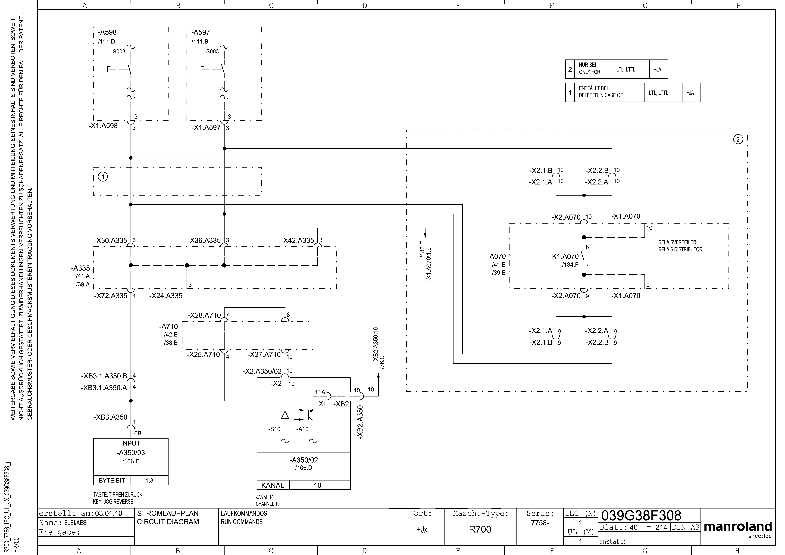

# +Jx — Sheet 40 of 214 — LAUFKOMMANDOS

**RUN COMMANDS**

> Part of the manroland **R700** printing press IEC/UL circuit diagrams.
> Drawing class: **Stromlaufplan / Circuit diagram** (DIN A3).
> Document `+Jx` covers the **1st printing module + feed register** machine section.

## At a glance

| Field | Value |
|---|---|
| Document | `+Jx`  (039G38F308) |
| Sheet | **40** of 214 |
| Section (DE) | LAUFKOMMANDOS |
| Section (EN) | RUN COMMANDS |
| Section type | CIRCUIT — Circuit diagram |
| Machine type | `R700` |
| Series | `7758` |
| Created | 03.01.10 |
| Replaces | — |
| Columns used | A, B, C, D, E, F, G, H |
| Path numbers | — |
| Labels on sheet | 116 |
| Cross-refs out | 13 |
| Cross-refs in | 41 |

**Previous:** [+Jx sheet 39](SHEET_0039.md) · **Next:** [+Jx sheet 41](SHEET_0041.md) · **Document TOC:** [_TOC.md](_TOC.md)  (+Jx) · **Master TOC:** [all sheets](../_MASTER_TOC.md)

## Sheet image (300 DPI, exact vector render)



_Rendered directly from the PDF vector layer at 300 DPI (1-bit), no OCR and no resampling. Use it to confirm anything ambiguous in the text below._

## Cross-references on this sheet

Each entry is a wire leaving this sheet. The printed token is `/sheet.column`; the link resolves to that sheet inside the same document.

| Ref | Target sheet | Col | Path | Destination on target | Target section | From col |
|---|---|---|---|---|---|---|
| `/111.B` | [+Jx sheet 111](SHEET_0111.md) | B | — | — | REFERENZMODUL | B |
| `/111.D` | [+Jx sheet 111](SHEET_0111.md) | D | — | — | REFERENZMODUL | A |
| `/186.E` | [+Jx sheet 186](SHEET_0186.md) | E | — | — | OPTION: TRANSFERMODUL 1 + 2 | E |
| `/41.E` | [+Jx sheet 41](SHEET_0041.md) | E | — | — | LAUFKOMMANDOS | E |
| `/39.E` | [+Jx sheet 39](SHEET_0039.md) | E | — | — | LAUFKOMMANDOS | E |
| `/184.F` | [+Jx sheet 184](SHEET_0184.md) | F | — | — | OPTION: TRANSFERMODUL 1 + 2 | F |
| `/41.A` | [+Jx sheet 41](SHEET_0041.md) | A | — | — | LAUFKOMMANDOS | A |
| `/39.A` | [+Jx sheet 39](SHEET_0039.md) | A | — | — | LAUFKOMMANDOS | A |
| `/76.C` | [+Jx sheet 76](SHEET_0076.md) | C | — | XB2.A350:10 | BUSVERBINDUNGEN: SICHERHEITSKREIS | D |
| `/42.B` | [+Jx sheet 42](SHEET_0042.md) | B | — | — | LAUFKOMMANDOS | B |
| `/38.B` | [+Jx sheet 38](SHEET_0038.md) | B | — | — | LAUFKOMMANDOS | B |
| `/106.E` | [+Jx sheet 106](SHEET_0106.md) | E | — | — | REFERENZMODUL | A |
| `/106.D` | [+Jx sheet 106](SHEET_0106.md) | D | — | — | REFERENZMODUL | C |

### Incoming references (sheets that point here)

Every other sheet that sends a wire to this one. `Back-ref` is the token printed on *that* sheet; `Path` is its line number.

| From sheet | Cols | Back-ref | Path | Refs | What continues there |
|---|---|---|---|---|---|
| [+Jx#38](SHEET_0038.md) | B | `/38.B` | — | 1 | — |
| [+Jx#39](SHEET_0039.md) | A, E | `/39.A`, `/39.E` | — | 2 | — |
| [+Jx#41](SHEET_0041.md) | A, E | `/41.A`, `/41.E` | — | 2 | — |
| [+Jx#42](SHEET_0042.md) | B | `/42.B` | — | 1 | — |
| [+Jx#76](SHEET_0076.md) | C | `/76.C` | — | 1 | XB2.A350:10 |
| [+Jx#106](SHEET_0106.md) | D, E | `/106.D`, `/106.E` | — | 2 | — |
| [+Jx#111](SHEET_0111.md) | B, D | `/111.B`, `/111.D` | — | 2 | — |
| [+Jx#113](SHEET_0113.md) | A | `/113.A` | — | 2 | — |
| [+Jx#115](SHEET_0115.md) | E, G | `/115.E`, `/115.G` | — | 2 | — |
| [+Jx#122](SHEET_0122.md) | A, C | `/122.A`, `/122.C` | — | 8 | — |
| [+Jx#123](SHEET_0123.md) | C | `/123.C` | — | 2 | — |
| [+Jx#126](SHEET_0126.md) | E | `/126.E` | — | 2 | — |
| [+Jx#128](SHEET_0128.md) | C, D, F | `/128.C`, `/128.D`, `/128.F` | — | 3 | — |
| [+Jx#142](SHEET_0142.md) | F | `/142.F` | — | 1 | — |
| [+Jx#143](SHEET_0143.md) | A | `/143.A` | — | 1 | — |
| [+Jx#144](SHEET_0144.md) | C | `/144.C` | — | 1 | — |
| [+Jx#146](SHEET_0146.md) | A | `/146.A` | — | 2 | — |
| [+Jx#148](SHEET_0148.md) | A | `/148.A` | — | 1 | — |
| [+Jx#149](SHEET_0149.md) | F | `/149.F` | — | 1 | — |
| [+Jx#150](SHEET_0150.md) | C | `/150.C` | — | 1 | — |
| [+Jx#153](SHEET_0153.md) | C | `/153.C` | — | 1 | — |
| [+Jx#184](SHEET_0184.md) | F | `/184.F` | — | 1 | — |
| [+Jx#186](SHEET_0186.md) | E | `/186.E` | — | 1 | X1.A070\1:9 |


## Devices on this sheet

| Tag | Class | Class meaning (IEC) | Col | Sub | Terminal | Sign |
|---|---|---|---|---|---|---|
| `A070` | A | Baugruppe / assembly, module, PC board | E | — | — | — |
| `S003` | S | Schalter / switch | A | — | — | — |
| `A598` | A | Baugruppe / assembly, module, PC board | A | — | — | — |
| `S003` | S | Schalter / switch | B | — | — | — |
| `A597` | A | Baugruppe / assembly, module, PC board | B | — | — | — |
| `A335` | A | Baugruppe / assembly, module, PC board | A | — | — | — |
| `A350/03` | A | Baugruppe / assembly, module, PC board | A | 03 | — | — |
| `A710` | A | Baugruppe / assembly, module, PC board | B | — | — | — |
| `S10` | S | Schalter / switch | C | — | — | — |
| `A10` | A | Baugruppe / assembly, module, PC board | C | — | — | — |
| `X1` | X | Klemme / terminal, plug connector | D | — | — | — |
| `X2` | X | Klemme / terminal, plug connector | C | — | — | — |
| `XB2` | XB |  | D | — | — | — |
| `A350/02` | A | Baugruppe / assembly, module, PC board | C | 02 | — | — |
| `X2.1.B` | — | cross-device reference | F | — | — | — |
| `X2.1.A` | — | cross-device reference | F | — | — | — |
| `X2.2.B` | — | cross-device reference | F | — | — | — |
| `X2.2.A` | — | cross-device reference | F | — | — | — |
| `X2.A070` | — | cross-device reference | F | — | — | — |
| `K1.A070` | — | cross-device reference | F | — | — | — |
| `X2.A070` | — | cross-device reference | F | — | — | — |
| `X2.1.A` | — | cross-device reference | F | — | — | — |
| `X2.2.A` | — | cross-device reference | F | — | — | — |
| `X2.1.B` | — | cross-device reference | F | — | — | — |
| `X2.2.B` | — | cross-device reference | F | — | — | — |
| `X1.A598` | — | cross-device reference | A | — | — | — |
| `X1.A597` | — | cross-device reference | B | — | — | — |
| `X30.A335` | — | cross-device reference | A | — | — | — |
| `X36.A335` | — | cross-device reference | B | — | — | — |
| `X42.A335` | — | cross-device reference | C | — | — | — |
| `X72.A335` | — | cross-device reference | A | — | — | — |
| `1.3` | — | cross-device reference | B | — | — | — |
| `XB3.A350` | — | cross-device reference | A | — | — | — |
| `X27.A710` | — | cross-device reference | C | — | — | — |
| `X28.A710` | — | cross-device reference | B | — | — | — |
| `X25.A710` | — | cross-device reference | B | — | — | — |
| `XB2.A350` | — | cross-device reference | D | — | — | — |
| `XB3.1.A350.B` | — | cross-device reference | A | — | — | — |
| `XB3.1.A350.A` | — | cross-device reference | A | — | — | — |
| `XB2.A350:10` | — | cross-device reference | D | — | 10 | — |
| `X1.A070\1:9` | — | cross-device reference | E | — | 9 | — |
| `X1.A070` | — | cross-device reference | G | — | — | — |
| `X1.A070` | — | cross-device reference | G | — | — | — |
| `X24.A335` | — | cross-device reference | B | — | — | — |

## Potentials / nets

_No named potentials on this sheet._

## Wire-end annotations (grouped as printed)

A wire that continues elsewhere is annotated with a small cluster: the destination description, the path/line number `#NN`, and the `/sheet.column` cross reference. Each row below is one such cluster exactly as it is grouped on the drawing.

| Col | Y | Path | Cross-ref | Text on the wire |
|---|---|---|---|---|
| A | 44.2 | — | — | `A598` |
| B | 44.2 | — | — | `A597` |
| A | 59.0 | — | `/111.D` | — |
| B | 59.0 | — | `/111.B` | — |
| A | 74.4 | — | — | `S003` |
| B | 74.4 | — | — | `S003` |
| G | 95.5 | — | — | `2 NUR BEI ONLY FOR LTL, LTTL +JA` |
| G | 130.9 | — | — | `1 ENTFÄLLT BEI DELETED IN CASE OF LTL, LTTL +JA` |
| B | 173.2 | — | — | `3` |
| C | 173.2 | — | — | `3` |
| A | 185.9 | — | — | `X1.A598 3` |
| B | 188.7 | — | — | `X1.A597 3` |
| H | 208.6 | — | — | `2` |
| F | 254.0 | — | — | `X2.1.B 10` |
| G | 254.0 | — | — | `X2.2.B 10` |
| A | 264.8 | — | — | `1` |
| F | 271.0 | — | — | `X2.1.A 10` |
| G | 271.0 | — | — | `X2.2.A 10` |
| G | 323.4 | — | — | `X1.A070` |
| F | 324.8 | — | — | `X2.A070 10` |
| G | 341.8 | — | — | `10` |
| B | 360.2 | — | — | `X30.A335 3 X36.A335 3` |
| C | 360.2 | — | — | `X42.A335 3` |
| G | 364.8 | — | — | `RELAISVERTEILER RELAIS DISTRIBUTOR` |
| E | 365.4 | — | `/186.E` | — |
| F | 370.9 | — | — | `8` |
| E | 375.3 | — | — | `X1.A070\1:9` |
| E | 384.3 | — | — | `A070` |
| F | 384.3 | — | — | `K1.A070 7` |
| E | 397.4 | — | `/41.E`, `/39.E` | — |
| F | 397.4 | — | `/184.F` | — |
| A | 402.0 | — | — | `A335` |
| A | 415.1 | — | `/41.A`, `/39.A` | — |
| B | 428.3 | — | — | `3` |
| G | 428.3 | — | — | `9` |
| A | 443.9 | — | — | `X72.A335 4` |
| B | 443.9 | — | — | `X24.A335` |
| F | 443.9 | — | — | `X2.A070 9` |
| G | 443.9 | — | — | `X1.A070` |
| B | 473.6 | — | — | `X28.A710 7` |
| C | 473.6 | — | — | `8` |
| B | 490.6 | — | — | `A710` |
| D | 495.5 | — | `/76.C` | `XB2.A350:10` |
| F | 497.0 | — | — | `X2.1.A 9 X2.2.A 9` |
| B | 503.7 | — | `/42.B`, `/38.B` | — |
| F | 514.8 | — | — | `X2.1.B 9 X2.2.B 9` |
| B | 533.1 | — | — | `X25.A710 4` |
| C | 533.1 | — | — | `X27.A710 10` |
| C | 558.7 | — | — | `X2.A350/02 10` |
| A | 565.8 | — | — | `XB3.1.A350.B 4` |
| C | 577.1 | — | — | `X2` |
| D | 578.5 | — | — | `10 10` |
| A | 582.8 | — | — | `XB3.1.A350.A 4` |
| D | 587.0 | — | — | `10` |
| D | 591.2 | — | — | `11A` |
| D | 608.3 | — | — | `X1` |
| D | 608.3 | — | — | `XB2` |
| D | 614.5 | — | — | `XB2.A350` |
| A | 628.1 | — | — | `XB3.A350 4` |
| C | 647.2 | — | — | `S10 A10` |
| B | 653.6 | — | — | `6B` |
| A | 668.1 | — | — | `INPUT` |
| A | 682.0 | — | — | `A350/03` |
| C | 693.3 | — | — | `A350/02` |
| A | 695.8 | — | `/106.E` | — |
| C | 705.7 | — | `/106.D` | — |
| A | 725.1 | — | — | `BYTE.BIT 1.3` |
| C | 731.5 | — | — | `KANAL 10` |
| A | 747.5 | — | — | `KEY: JOG REVERSE TASTE: TIPPEN ZURÜCK` |
| C | 751.9 | — | — | `KANAL 10 CHANNEL 10` |


## Reconstructed tables

This sheet carries tabular content (pin map / terminal assignment / index). The grid below was rebuilt from the drawing's own rule lines, so each row is exactly one physical row of the table.

### Table 1 — 10 data rows × 5 columns (at x=141.7, y=41.1)

| A598 /111.D S003 | 3 |  | A597 /111.B S003 | 3 |
|---|---|---|---|---|
| `X1.A598` | `3` |  | `X1.A597` | `3` |
| `1` |  |  |  |  |
| `X30.A335` | `3` |  | `X36.A335` | `3` |
| `X72.A335` | `X24.A335 4` |  | `3` |  |
| `XB3.1.A350.B` | `4` | `A710 /42.B /38.B` | `X28.A710 X25.A710` | `7 4` |
| `XB3.1.A350.A` | `4` |  |  |  |
| `XB3.A350` | `4 6B` |  |  |  |
| `INPUT` |  |  |  |  |
|  | `A350/03 /106.E` |  |  |  |
| `BYTE.BIT` | `1.3` |  |  |  |


### Table 2 — 5 data rows × 5 columns (at x=396.9, y=41.1)

|  | X42.A335 | 3 |  |  |
|---|---|---|---|---|
| `X27.A710 X2.A350/02` | `8 10 10` |  |  | `XB2.A350:10` |
| `X2` | `10` | `11A` |  | `10 10` |
| `S10` | `A10` | `X1` | `XB2` | `XB2.A350` |
|  | `A350/02 /106.D` |  |  |  |
| `KANAL` |  | `10` |  |  |


## Notes and free text on this sheet

| Text | Col | Y (pt) |
|---|---|---|
| `RELAISVERTEILER` | G | 364.82 |
| `RELAIS DISTRIBUTOR` | G | 375.46 |
| `6B` | B | 653.6 |
| `INPUT` | A | 668.13 |
| `BYTE.BIT` | A | 725.13 |
| `TASTE: TIPPEN ZURÜCK` | A | 747.51 |
| `KEY: JOG REVERSE` | A | 758.11 |
| `KANAL 10` | C | 751.92 |
| `CHANNEL 10` | C | 761.86 |
| `11A` | D | 591.25 |
| `KANAL` | C | 731.57 |
| `X2.A350/02` | C | 558.67 |
| `ENTFÄLLT BEI` | F | 130.94 |
| `DELETED IN CASE OF` | G | 141.59 |
| `LTL, LTTL` | G | 138.05 |
| `+JA` | G | 138.01 |
| `NUR BEI` | F | 95.5 |
| `ONLY FOR` | F | 106.19 |

## Complete label inventory (exact text from the drawing)

Every text object inside the drawing area of this sheet, in DIN reading order (column A→H, then top→bottom). This is the authoritative list: if a string is not here it is not printed on this sheet.

| Col | Y | X | Dir | Type | Text |
|---|---|---|---|---|---|
| A | 44.2 | 148.5 | → | device tag | `A598` |
| A | 59.1 | 148.8 | → | cross-reference | `/111.D` |
| A | 74.4 | 168.4 | → | device tag | `S003` |
| A | 185.9 | 134.4 | → | device ref | `X1.A598` |
| A | 264.8 | 154.0 | → | number | `1` |
| A | 360.2 | 142.9 | → | device ref | `X30.A335` |
| A | 402.0 | 108.0 | → | device tag | `A335` |
| A | 415.1 | 115.4 | → | cross-reference | `/41.A` |
| A | 427.5 | 115.4 | → | cross-reference | `/39.A` |
| A | 443.9 | 142.9 | → | device ref | `X72.A335` |
| A | 565.8 | 123.3 | → | device ref | `XB3.1.A350.B` |
| A | 583.5 | 122.7 | → | device ref | `XB3.1.A350.A` |
| A | 628.1 | 142.0 | → | device ref | `XB3.A350` |
| A | 668.1 | 183.5 | → | text | `INPUT` |
| A | 682.0 | 176.9 | → | device tag | `A350/03` |
| A | 695.8 | 185.8 | → | cross-reference | `/106.E` |
| A | 725.1 | 150.0 | → | text | `BYTE.BIT` |
| A | 747.5 | 141.7 | → | text | `TASTE: TIPPEN ZURÜCK` |
| A | 758.1 | 141.2 | → | text | `KEY: JOG REVERSE` |
| B | 44.2 | 290.3 | → | device tag | `A597` |
| B | 59.0 | 290.6 | → | cross-reference | `/111.B` |
| B | 74.4 | 310.1 | → | device tag | `S003` |
| B | 173.2 | 203.8 | → | number | `3` |
| B | 188.7 | 290.6 | → | device ref | `X1.A597` |
| B | 190.2 | 201.0 | → | number | `3` |
| B | 360.2 | 284.6 | → | device ref | `X36.A335` |
| B | 360.3 | 201.0 | → | number | `3` |
| B | 428.3 | 286.0 | → | number | `3` |
| B | 443.9 | 226.5 | → | device ref | `X24.A335` |
| B | 445.3 | 201.3 | → | number | `4` |
| B | 473.6 | 284.9 | → | device ref | `X28.A710` |
| B | 490.6 | 241.5 | → | device tag | `A710` |
| B | 503.7 | 248.9 | → | cross-reference | `/42.B` |
| B | 516.1 | 248.9 | → | cross-reference | `/38.B` |
| B | 533.1 | 283.5 | → | device ref | `X25.A710` |
| B | 565.8 | 201.3 | → | number | `4` |
| B | 582.8 | 201.3 | → | number | `4` |
| B | 636.6 | 201.3 | → | number | `4` |
| B | 653.6 | 203.8 | → | text | `6B` |
| B | 725.2 | 220.4 | → | device ref | `1.3` |
| C | 173.2 | 345.5 | → | number | `3` |
| C | 190.2 | 342.7 | → | number | `3` |
| C | 360.2 | 426.3 | → | device ref | `X42.A335` |
| C | 360.3 | 342.7 | → | number | `3` |
| C | 473.7 | 342.7 | → | number | `7` |
| C | 473.7 | 434.8 | → | number | `8` |
| C | 533.1 | 375.6 | → | device ref | `X27.A710` |
| C | 537.4 | 343.0 | → | number | `4` |
| C | 537.4 | 434.3 | → | number | `10` |
| C | 558.7 | 368.2 | → | text | `X2.A350/02` |
| C | 558.7 | 434.3 | → | number | `10` |
| C | 577.1 | 410.7 | → | device tag | `X2` |
| C | 578.5 | 437.1 | → | number | `10` |
| C | 647.3 | 407.1 | → | device tag | `S10` |
| C | 647.3 | 449.6 | → | device tag | `A10` |
| C | 693.3 | 439.2 | → | device tag | `A350/02` |
| C | 705.7 | 447.9 | → | cross-reference | `/106.D` |
| C | 731.5 | 475.7 | → | number | `10` |
| C | 731.6 | 396.3 | → | text | `KANAL` |
| C | 751.9 | 387.8 | → | text | `KANAL 10` |
| C | 761.9 | 388.1 | → | text | `CHANNEL 10` |
| D | 360.3 | 484.4 | → | number | `3` |
| D | 495.5 | 565.7 | ↕ | device ref | `XB2.A350:10` |
| D | 538.9 | 575.7 | ↕ | cross-reference | `/76.C` |
| D | 587.0 | 557.6 | → | number | `10` |
| D | 588.5 | 536.3 | → | number | `10` |
| D | 591.3 | 477.6 | → | text | `11A` |
| D | 608.3 | 481.0 | → | device tag | `X1` |
| D | 608.3 | 505.7 | → | device tag | `XB2` |
| D | 614.6 | 541.7 | ↕ | device ref | `XB2.A350` |
| E | 365.4 | 636.6 | ↕ | cross-reference | `/186.E` |
| E | 375.3 | 646.5 | ↕ | device ref | `X1.A070\1:9` |
| E | 384.3 | 739.0 | → | device tag | `A070` |
| E | 397.4 | 746.4 | → | cross-reference | `/41.E` |
| E | 409.8 | 746.4 | → | cross-reference | `/39.E` |
| F | 95.5 | 878.2 | → | text | `NUR BEI` |
| F | 100.8 | 861.7 | → | number | `2` |
| F | 106.2 | 878.5 | → | text | `ONLY FOR` |
| F | 130.9 | 878.2 | → | text | `ENTFÄLLT BEI` |
| F | 136.3 | 862.0 | → | number | `1` |
| F | 254.0 | 803.1 | → | device ref | `X2.1.B` |
| F | 254.0 | 845.3 | → | number | `10` |
| F | 254.0 | 888.1 | → | device ref | `X2.2.B` |
| F | 271.0 | 845.3 | → | number | `10` |
| F | 271.7 | 802.5 | → | device ref | `X2.1.A` |
| F | 271.7 | 887.5 | → | device ref | `X2.2.A` |
| F | 324.8 | 836.5 | → | device ref | `X2.A070` |
| F | 324.8 | 887.8 | → | number | `10` |
| F | 370.9 | 888.4 | → | number | `8` |
| F | 384.3 | 833.7 | → | device ref | `K1.A070` |
| F | 397.4 | 852.7 | → | cross-reference | `/184.F` |
| F | 399.2 | 888.4 | → | number | `7` |
| F | 443.9 | 836.5 | → | device ref | `X2.A070` |
| F | 445.3 | 888.4 | → | number | `9` |
| F | 497.0 | 802.5 | → | device ref | `X2.1.A` |
| F | 497.0 | 887.5 | → | device ref | `X2.2.A` |
| F | 499.2 | 845.9 | → | number | `9` |
| F | 514.8 | 803.1 | → | device ref | `X2.1.B` |
| F | 514.8 | 888.1 | → | device ref | `X2.2.B` |
| F | 516.2 | 845.9 | → | number | `9` |
| G | 102.6 | 934.9 | → | text | `LTL, LTTL` |
| G | 102.6 | 991.8 | → | text | `+JA` |
| G | 138.0 | 984.5 | → | text | `LTL, LTTL` |
| G | 138.0 | 1041.4 | → | text | `+JA` |
| G | 141.6 | 878.2 | → | text | `DELETED IN CASE OF` |
| G | 254.0 | 930.3 | → | number | `10` |
| G | 271.0 | 930.3 | → | number | `10` |
| G | 323.4 | 927.2 | → | device ref | `X1.A070` |
| G | 341.8 | 979.9 | → | number | `10` |
| G | 364.8 | 998.6 | → | text | `RELAISVERTEILER` |
| G | 375.5 | 998.6 | → | text | `RELAIS DISTRIBUTOR` |
| G | 428.3 | 980.5 | → | number | `9` |
| G | 443.9 | 927.2 | → | device ref | `X1.A070` |
| G | 499.2 | 930.9 | → | number | `9` |
| G | 516.2 | 930.9 | → | number | `9` |
| H | 208.6 | 1117.7 | → | number | `2` |

## Reading-order text block

The same content as a plain block, grouped by DIN column — convenient to paste or to match against a visual description.

```text
=== Column A ===
  44.2  148.5  devtag       A598
  59.1  148.8  xref         /111.D
  74.4  168.4  devtag       S003
 185.9  134.4  devref       X1.A598
 264.8  154.0  numeric      1
 360.2  142.9  devref       X30.A335
 402.0  108.0  devtag       A335
 415.1  115.4  xref         /41.A
 427.5  115.4  xref         /39.A
 443.9  142.9  devref       X72.A335
 565.8  123.3  devref       XB3.1.A350.B
 583.5  122.7  devref       XB3.1.A350.A
 628.1  142.0  devref       XB3.A350
 668.1  183.5  text         INPUT
 682.0  176.9  devtag       A350/03
 695.8  185.8  xref         /106.E
 725.1  150.0  text         BYTE.BIT
 747.5  141.7  text         TASTE: TIPPEN ZURÜCK
 758.1  141.2  text         KEY: JOG REVERSE
=== Column B ===
  44.2  290.3  devtag       A597
  59.0  290.6  xref         /111.B
  74.4  310.1  devtag       S003
 173.2  203.8  numeric      3
 188.7  290.6  devref       X1.A597
 190.2  201.0  numeric      3
 360.2  284.6  devref       X36.A335
 360.3  201.0  numeric      3
 428.3  286.0  numeric      3
 443.9  226.5  devref       X24.A335
 445.3  201.3  numeric      4
 473.6  284.9  devref       X28.A710
 490.6  241.5  devtag       A710
 503.7  248.9  xref         /42.B
 516.1  248.9  xref         /38.B
 533.1  283.5  devref       X25.A710
 565.8  201.3  numeric      4
 582.8  201.3  numeric      4
 636.6  201.3  numeric      4
 653.6  203.8  text         6B
 725.2  220.4  devref       1.3
=== Column C ===
 173.2  345.5  numeric      3
 190.2  342.7  numeric      3
 360.2  426.3  devref       X42.A335
 360.3  342.7  numeric      3
 473.7  342.7  numeric      7
 473.7  434.8  numeric      8
 533.1  375.6  devref       X27.A710
 537.4  343.0  numeric      4
 537.4  434.3  numeric      10
 558.7  368.2  text         X2.A350/02
 558.7  434.3  numeric      10
 577.1  410.7  devtag       X2
 578.5  437.1  numeric      10
 647.3  407.1  devtag       S10
 647.3  449.6  devtag       A10
 693.3  439.2  devtag       A350/02
 705.7  447.9  xref         /106.D
 731.5  475.7  numeric      10
 731.6  396.3  text         KANAL
 751.9  387.8  text         KANAL 10
 761.9  388.1  text         CHANNEL 10
=== Column D ===
 360.3  484.4  numeric      3
 495.5  565.7  devref       XB2.A350:10
 538.9  575.7  xref         /76.C
 587.0  557.6  numeric      10
 588.5  536.3  numeric      10
 591.3  477.6  text         11A
 608.3  481.0  devtag       X1
 608.3  505.7  devtag       XB2
 614.6  541.7  devref       XB2.A350
=== Column E ===
 365.4  636.6  xref         /186.E
 375.3  646.5  devref       X1.A070\1:9
 384.3  739.0  devtag       A070
 397.4  746.4  xref         /41.E
 409.8  746.4  xref         /39.E
=== Column F ===
  95.5  878.2  text         NUR BEI
 100.8  861.7  numeric      2
 106.2  878.5  text         ONLY FOR
 130.9  878.2  text         ENTFÄLLT BEI
 136.3  862.0  numeric      1
 254.0  803.1  devref       X2.1.B
 254.0  845.3  numeric      10
 254.0  888.1  devref       X2.2.B
 271.0  845.3  numeric      10
 271.7  802.5  devref       X2.1.A
 271.7  887.5  devref       X2.2.A
 324.8  836.5  devref       X2.A070
 324.8  887.8  numeric      10
 370.9  888.4  numeric      8
 384.3  833.7  devref       K1.A070
 397.4  852.7  xref         /184.F
 399.2  888.4  numeric      7
 443.9  836.5  devref       X2.A070
 445.3  888.4  numeric      9
 497.0  802.5  devref       X2.1.A
 497.0  887.5  devref       X2.2.A
 499.2  845.9  numeric      9
 514.8  803.1  devref       X2.1.B
 514.8  888.1  devref       X2.2.B
 516.2  845.9  numeric      9
=== Column G ===
 102.6  934.9  text         LTL, LTTL
 102.6  991.8  text         +JA
 138.0  984.5  text         LTL, LTTL
 138.0 1041.4  text         +JA
 141.6  878.2  text         DELETED IN CASE OF
 254.0  930.3  numeric      10
 271.0  930.3  numeric      10
 323.4  927.2  devref       X1.A070
 341.8  979.9  numeric      10
 364.8  998.6  text         RELAISVERTEILER
 375.5  998.6  text         RELAIS DISTRIBUTOR
 428.3  980.5  numeric      9
 443.9  927.2  devref       X1.A070
 499.2  930.9  numeric      9
 516.2  930.9  numeric      9
=== Column H ===
 208.6 1117.7  numeric      2
```

---
_Generated from the PDF vector text layer; no OCR. Source: `R700_7758_IEC_UL_JX_039G38F308_p`, sheet 40._
