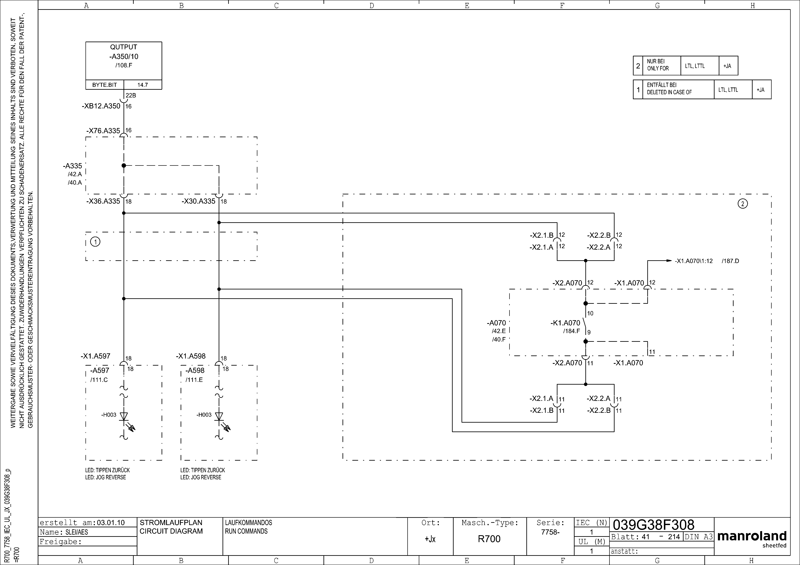

# +Jx — Sheet 41 of 214 — LAUFKOMMANDOS

**RUN COMMANDS**

> Part of the manroland **R700** printing press IEC/UL circuit diagrams.
> Drawing class: **Stromlaufplan / Circuit diagram** (DIN A3).
> Document `+Jx` covers the **1st printing module + feed register** machine section.

## At a glance

| Field | Value |
|---|---|
| Document | `+Jx`  (039G38F308) |
| Sheet | **41** of 214 |
| Section (DE) | LAUFKOMMANDOS |
| Section (EN) | RUN COMMANDS |
| Section type | CIRCUIT — Circuit diagram |
| Machine type | `R700` |
| Series | `7758` |
| Created | 03.01.10 |
| Replaces | — |
| Columns used | A, B, E, F, G, H |
| Path numbers | — |
| Labels on sheet | 78 |
| Cross-refs out | 9 |
| Cross-refs in | 27 |

**Previous:** [+Jx sheet 40](SHEET_0040.md) · **Next:** [+Jx sheet 42](SHEET_0042.md) · **Document TOC:** [_TOC.md](_TOC.md)  (+Jx) · **Master TOC:** [all sheets](../_MASTER_TOC.md)

## Sheet image (300 DPI, exact vector render)



_Rendered directly from the PDF vector layer at 300 DPI (1-bit), no OCR and no resampling. Use it to confirm anything ambiguous in the text below._

## Cross-references on this sheet

Each entry is a wire leaving this sheet. The printed token is `/sheet.column`; the link resolves to that sheet inside the same document.

| Ref | Target sheet | Col | Path | Destination on target | Target section | From col |
|---|---|---|---|---|---|---|
| `/108.F` | [+Jx sheet 108](SHEET_0108.md) | F | — | — | REFERENZMODUL | A |
| `/42.A` | [+Jx sheet 42](SHEET_0042.md) | A | — | — | LAUFKOMMANDOS | A |
| `/40.A` | [+Jx sheet 40](SHEET_0040.md) | A | — | — | LAUFKOMMANDOS | A |
| `/187.D` | [+Jx sheet 187](SHEET_0187.md) | D | — | X1.A070\1:12 | OPTION: TRANSFERMODUL 1 + 2 | H |
| `/42.E` | [+Jx sheet 42](SHEET_0042.md) | E | — | — | LAUFKOMMANDOS | E |
| `/184.F` | [+Jx sheet 184](SHEET_0184.md) | F | — | — | OPTION: TRANSFERMODUL 1 + 2 | F |
| `/40.F` | [+Jx sheet 40](SHEET_0040.md) | F | — | — | LAUFKOMMANDOS | E |
| `/111.E` | [+Jx sheet 111](SHEET_0111.md) | E | — | — | REFERENZMODUL | B |
| `/111.C` | [+Jx sheet 111](SHEET_0111.md) | C | — | — | REFERENZMODUL | A |

### Incoming references (sheets that point here)

Every other sheet that sends a wire to this one. `Back-ref` is the token printed on *that* sheet; `Path` is its line number.

| From sheet | Cols | Back-ref | Path | Refs | What continues there |
|---|---|---|---|---|---|
| [+Jx#40](SHEET_0040.md) | A, E | `/40.A`, `/40.E` | — | 2 | — |
| [+Jx#42](SHEET_0042.md) | A, E | `/42.A`, `/42.E` | — | 2 | — |
| [+Jx#108](SHEET_0108.md) | F | `/108.F` | — | 1 | — |
| [+Jx#111](SHEET_0111.md) | C, E | `/111.C`, `/111.E` | — | 2 | — |
| [+Jx#113](SHEET_0113.md) | A | `/113.A` | — | 2 | — |
| [+Jx#115](SHEET_0115.md) | E, G | `/115.E`, `/115.G` | — | 2 | — |
| [+Jx#122](SHEET_0122.md) | A, C | `/122.A`, `/122.C` | — | 8 | — |
| [+Jx#123](SHEET_0123.md) | C | `/123.C` | — | 2 | — |
| [+Jx#137](SHEET_0137.md) | H | `/137.H` | — | 1 | — |
| [+Jx#148](SHEET_0148.md) | A | `/148.A` | — | 1 | — |
| [+Jx#149](SHEET_0149.md) | F | `/149.F` | — | 1 | — |
| [+Jx#155](SHEET_0155.md) | B | `/155.B` | — | 1 | — |
| [+Jx#184](SHEET_0184.md) | F | `/184.F` | — | 1 | — |
| [+Jx#187](SHEET_0187.md) | C | `/187.C` | — | 1 | X1.A070\1:8 X1.A070\1:12 |


## Devices on this sheet

| Tag | Class | Class meaning (IEC) | Col | Sub | Terminal | Sign |
|---|---|---|---|---|---|---|
| `A350/10` | A | Baugruppe / assembly, module, PC board | A | 10 | — | — |
| `A597` | A | Baugruppe / assembly, module, PC board | A | — | — | — |
| `A598` | A | Baugruppe / assembly, module, PC board | B | — | — | — |
| `A335` | A | Baugruppe / assembly, module, PC board | A | — | — | — |
| `A070` | A | Baugruppe / assembly, module, PC board | E | — | — | — |
| `14.7` | — | cross-device reference | B | — | — | — |
| `XB12.A350` | — | cross-device reference | A | — | — | — |
| `X1.A597` | — | cross-device reference | A | — | — | — |
| `X1.A598` | — | cross-device reference | B | — | — | — |
| `X36.A335` | — | cross-device reference | A | — | — | — |
| `X30.A335` | — | cross-device reference | B | — | — | — |
| `X76.A335` | — | cross-device reference | A | — | — | — |
| `X2.1.B` | — | cross-device reference | F | — | — | — |
| `X2.1.A` | — | cross-device reference | F | — | — | — |
| `X2.2.B` | — | cross-device reference | F | — | — | — |
| `X2.2.A` | — | cross-device reference | F | — | — | — |
| `X2.A070` | — | cross-device reference | F | — | — | — |
| `K1.A070` | — | cross-device reference | F | — | — | — |
| `X2.A070` | — | cross-device reference | F | — | — | — |
| `X1.A070` | — | cross-device reference | G | — | — | — |
| `X2.1.A` | — | cross-device reference | F | — | — | — |
| `X2.2.A` | — | cross-device reference | F | — | — | — |
| `X2.1.B` | — | cross-device reference | F | — | — | — |
| `X2.2.B` | — | cross-device reference | F | — | — | — |
| `X1.A070\1:12` | — | cross-device reference | G | — | 12 | — |
| `X1.A070` | — | cross-device reference | G | — | — | — |

## Potentials / nets

| Potential | Count | Columns | Attached devices | Terminals |
|---|---|---|---|---|
| `H003` | 2 | A, B | — | — |


A potential such as `L24+/4` or `M24+` is a named supply/return rail; every place it appears on this sheet is electrically common.

## Wire-end annotations (grouped as printed)

A wire that continues elsewhere is annotated with a small cluster: the destination description, the path/line number `#NN`, and the `/sheet.column` cross reference. Each row below is one such cluster exactly as it is grouped on the drawing.

| Col | Y | Path | Cross-ref | Text on the wire |
|---|---|---|---|---|
| A | 65.8 | — | — | `QUTPUT` |
| A | 79.6 | — | — | `A350/10` |
| G | 88.4 | — | — | `2 NUR BEI ONLY FOR LTL, LTTL +JA` |
| A | 93.4 | — | `/108.F` | — |
| A | 123.0 | — | — | `BYTE.BIT 14.7` |
| G | 123.8 | — | — | `1 ENTFÄLLT BEI DELETED IN CASE OF LTL, LTTL +JA` |
| A | 138.4 | — | — | `22B` |
| A | 153.3 | — | — | `XB12.A350 16` |
| A | 190.2 | — | — | `X76.A335 16` |
| A | 242.6 | — | — | `A335` |
| A | 255.7 | — | `/42.A`, `/40.A` | — |
| B | 295.0 | — | — | `X36.A335 18 X30.A335 18` |
| H | 300.7 | — | — | `2` |
| F | 346.1 | — | — | `X2.1.B 12` |
| F | 346.1 | — | — | `X2.2.B 12` |
| A | 356.9 | — | — | `1` |
| F | 363.1 | — | — | `X2.1.A 12` |
| F | 363.1 | — | — | `X2.2.A 12` |
| H | 385.0 | — | `/187.D` | `X1.A070\1:12` |
| F | 416.9 | — | — | `X2.A070 12` |
| G | 416.9 | — | — | `X1.A070 12` |
| F | 463.0 | — | — | `10` |
| E | 476.4 | — | — | `A070` |
| F | 476.5 | — | — | `K1.A070 9` |
| E | 489.5 | — | `/42.E` | — |
| F | 489.6 | — | `/184.F` | — |
| E | 501.9 | — | `/40.F` | — |
| G | 520.4 | — | — | `11` |
| A | 526.1 | — | — | `X1.A597 18` |
| B | 526.1 | — | — | `X1.A598 18` |
| F | 536.0 | — | — | `X2.A070 11` |
| G | 536.0 | — | — | `X1.A070` |
| A | 545.9 | — | — | `18` |
| B | 545.9 | — | — | `18` |
| A | 547.3 | — | — | `A597` |
| B | 547.3 | — | — | `A598` |
| A | 562.2 | — | `/111.C` | — |
| B | 562.2 | — | `/111.E` | — |
| F | 589.2 | — | — | `X2.1.A 11 X2.2.A 11` |
| F | 606.9 | — | — | `X2.1.B 11 X2.2.B 11` |
| A | 614.4 | — | — | `H003` |
| B | 614.4 | — | — | `H003` |
| A | 697.9 | — | — | `LED: TIPPEN ZURÜCK LED: JOG REVERSE` |
| B | 697.9 | — | — | `LED: TIPPEN ZURÜCK LED: JOG REVERSE` |


## Reconstructed tables

This sheet carries tabular content (pin map / terminal assignment / index). The grid below was rebuilt from the drawing's own rule lines, so each row is exactly one physical row of the table.

### Table 1 — 6 data rows × 2 columns (at x=127.6, y=62.4)

| QUTPUT | A350/10 /108.F |
|---|---|
| `BYTE.BIT` | `14.7` |
| `XB12.A350 X76.A335` | `22B 16 16` |
| `X36.A335` | `18` |
| `1` |  |
| `X1.A597` | `18` |
| `A597 /111.C H003` | `18` |


### Table 2 — 2 data rows × 2 columns (at x=269.3, y=62.4)

| X30.A335 | 18 |
|---|---|
| `X1.A598` | `18` |
| `A598 /111.E H003` | `18` |


### Table 3 — 4 data rows × 2 columns (at x=871.7, y=317.5)

| X2.2.B X2.2.A | 12 12 |
|---|---|
| `12` | `X1.A070` |
| `10 9` |  |
| `11` | `X1.A070` |
| `X2.2.A X2.2.B` | `11 11` |


## Notes and free text on this sheet

| Text | Col | Y (pt) |
|---|---|---|
| `22B` | A | 138.42 |
| `QUTPUT` | A | 65.75 |
| `BYTE.BIT` | A | 123.03 |
| `LED: TIPPEN ZURÜCK` | A | 697.91 |
| `LED: JOG REVERSE` | A | 708.52 |
| `LED: TIPPEN ZURÜCK` | B | 697.91 |
| `LED: JOG REVERSE` | B | 708.52 |
| `ENTFÄLLT BEI` | G | 123.85 |
| `DELETED IN CASE OF` | G | 134.51 |
| `LTL, LTTL` | H | 130.96 |
| `+JA` | H | 130.93 |
| `NUR BEI` | G | 88.41 |
| `ONLY FOR` | G | 99.1 |
| `LTL, LTTL` | G | 95.53 |

## Complete label inventory (exact text from the drawing)

Every text object inside the drawing area of this sheet, in DIN reading order (column A→H, then top→bottom). This is the authoritative list: if a string is not here it is not printed on this sheet.

| Col | Y | X | Dir | Type | Text |
|---|---|---|---|---|---|
| A | 65.7 | 164.0 | → | text | `QUTPUT` |
| A | 79.6 | 162.9 | → | device tag | `A350/10` |
| A | 93.4 | 171.9 | → | cross-reference | `/108.F` |
| A | 123.0 | 137.5 | → | text | `BYTE.BIT` |
| A | 138.4 | 187.1 | → | text | `22B` |
| A | 153.3 | 121.9 | → | device ref | `XB12.A350` |
| A | 154.8 | 186.2 | → | number | `16` |
| A | 190.2 | 128.7 | → | device ref | `X76.A335` |
| A | 190.2 | 186.2 | → | number | `16` |
| A | 242.6 | 93.8 | → | device tag | `A335` |
| A | 255.7 | 101.2 | → | cross-reference | `/42.A` |
| A | 268.1 | 101.2 | → | cross-reference | `/40.A` |
| A | 295.0 | 128.7 | → | device ref | `X36.A335` |
| A | 296.5 | 186.2 | → | number | `18` |
| A | 356.9 | 139.9 | → | number | `1` |
| A | 526.1 | 120.2 | → | device ref | `X1.A597` |
| A | 530.3 | 186.2 | → | number | `18` |
| A | 545.9 | 189.1 | → | number | `18` |
| A | 547.3 | 134.4 | → | device tag | `A597` |
| A | 562.2 | 134.6 | → | cross-reference | `/111.C` |
| A | 614.4 | 150.8 | → | potential | `H003` |
| A | 697.9 | 127.0 | → | text | `LED: TIPPEN ZURÜCK` |
| A | 708.5 | 127.0 | → | text | `LED: JOG REVERSE` |
| B | 123.1 | 204.4 | → | device ref | `14.7` |
| B | 295.0 | 270.4 | → | device ref | `X30.A335` |
| B | 296.5 | 328.0 | → | number | `18` |
| B | 526.1 | 261.9 | → | device ref | `X1.A598` |
| B | 530.3 | 328.0 | → | number | `18` |
| B | 545.9 | 330.8 | → | number | `18` |
| B | 547.3 | 276.1 | → | device tag | `A598` |
| B | 562.2 | 276.4 | → | cross-reference | `/111.E` |
| B | 614.4 | 292.5 | → | potential | `H003` |
| B | 697.9 | 268.7 | → | text | `LED: TIPPEN ZURÜCK` |
| B | 708.5 | 268.7 | → | text | `LED: JOG REVERSE` |
| E | 476.5 | 724.8 | → | device tag | `A070` |
| E | 489.5 | 732.2 | → | cross-reference | `/42.E` |
| E | 501.9 | 732.8 | → | cross-reference | `/40.F` |
| F | 346.1 | 788.9 | → | device ref | `X2.1.B` |
| F | 346.1 | 831.1 | → | number | `12` |
| F | 346.1 | 873.9 | → | device ref | `X2.2.B` |
| F | 363.1 | 831.1 | → | number | `12` |
| F | 363.8 | 788.3 | → | device ref | `X2.1.A` |
| F | 363.8 | 873.4 | → | device ref | `X2.2.A` |
| F | 416.9 | 822.3 | → | device ref | `X2.A070` |
| F | 417.0 | 873.6 | → | number | `12` |
| F | 463.0 | 873.6 | → | number | `10` |
| F | 476.5 | 819.5 | → | device ref | `K1.A070` |
| F | 489.5 | 838.5 | → | cross-reference | `/184.F` |
| F | 491.4 | 874.2 | → | number | `9` |
| F | 536.0 | 822.3 | → | device ref | `X2.A070` |
| F | 537.4 | 873.6 | → | number | `11` |
| F | 589.2 | 788.3 | → | device ref | `X2.1.A` |
| F | 589.2 | 873.4 | → | device ref | `X2.2.A` |
| F | 591.3 | 831.1 | → | number | `11` |
| F | 606.9 | 788.9 | → | device ref | `X2.1.B` |
| F | 606.9 | 873.9 | → | device ref | `X2.2.B` |
| F | 608.3 | 831.1 | → | number | `11` |
| G | 88.4 | 963.2 | → | text | `NUR BEI` |
| G | 93.7 | 946.8 | → | number | `2` |
| G | 95.5 | 1019.9 | → | text | `LTL, LTTL` |
| G | 99.1 | 963.5 | → | text | `ONLY FOR` |
| G | 123.9 | 963.2 | → | text | `ENTFÄLLT BEI` |
| G | 129.2 | 947.1 | → | number | `1` |
| G | 134.5 | 963.2 | → | text | `DELETED IN CASE OF` |
| G | 346.1 | 916.2 | → | number | `12` |
| G | 363.1 | 916.2 | → | number | `12` |
| G | 385.0 | 1004.6 | → | device ref | `X1.A070\1:12` |
| G | 416.9 | 914.5 | → | device ref | `X1.A070` |
| G | 417.0 | 965.8 | → | number | `12` |
| G | 520.4 | 965.8 | → | number | `11` |
| G | 536.0 | 913.0 | → | device ref | `X1.A070` |
| G | 591.3 | 916.2 | → | number | `11` |
| G | 608.3 | 916.2 | → | number | `11` |
| H | 95.5 | 1076.9 | → | text | `+JA` |
| H | 130.9 | 1126.5 | → | text | `+JA` |
| H | 131.0 | 1069.5 | → | text | `LTL, LTTL` |
| H | 300.7 | 1103.5 | → | number | `2` |
| H | 385.0 | 1074.3 | → | cross-reference | `/187.D` |

## Reading-order text block

The same content as a plain block, grouped by DIN column — convenient to paste or to match against a visual description.

```text
=== Column A ===
  65.7  164.0  text         QUTPUT
  79.6  162.9  devtag       A350/10
  93.4  171.9  xref         /108.F
 123.0  137.5  text         BYTE.BIT
 138.4  187.1  text         22B
 153.3  121.9  devref       XB12.A350
 154.8  186.2  numeric      16
 190.2  128.7  devref       X76.A335
 190.2  186.2  numeric      16
 242.6   93.8  devtag       A335
 255.7  101.2  xref         /42.A
 268.1  101.2  xref         /40.A
 295.0  128.7  devref       X36.A335
 296.5  186.2  numeric      18
 356.9  139.9  numeric      1
 526.1  120.2  devref       X1.A597
 530.3  186.2  numeric      18
 545.9  189.1  numeric      18
 547.3  134.4  devtag       A597
 562.2  134.6  xref         /111.C
 614.4  150.8  net          H003
 697.9  127.0  text         LED: TIPPEN ZURÜCK
 708.5  127.0  text         LED: JOG REVERSE
=== Column B ===
 123.1  204.4  devref       14.7
 295.0  270.4  devref       X30.A335
 296.5  328.0  numeric      18
 526.1  261.9  devref       X1.A598
 530.3  328.0  numeric      18
 545.9  330.8  numeric      18
 547.3  276.1  devtag       A598
 562.2  276.4  xref         /111.E
 614.4  292.5  net          H003
 697.9  268.7  text         LED: TIPPEN ZURÜCK
 708.5  268.7  text         LED: JOG REVERSE
=== Column E ===
 476.5  724.8  devtag       A070
 489.5  732.2  xref         /42.E
 501.9  732.8  xref         /40.F
=== Column F ===
 346.1  788.9  devref       X2.1.B
 346.1  831.1  numeric      12
 346.1  873.9  devref       X2.2.B
 363.1  831.1  numeric      12
 363.8  788.3  devref       X2.1.A
 363.8  873.4  devref       X2.2.A
 416.9  822.3  devref       X2.A070
 417.0  873.6  numeric      12
 463.0  873.6  numeric      10
 476.5  819.5  devref       K1.A070
 489.5  838.5  xref         /184.F
 491.4  874.2  numeric      9
 536.0  822.3  devref       X2.A070
 537.4  873.6  numeric      11
 589.2  788.3  devref       X2.1.A
 589.2  873.4  devref       X2.2.A
 591.3  831.1  numeric      11
 606.9  788.9  devref       X2.1.B
 606.9  873.9  devref       X2.2.B
 608.3  831.1  numeric      11
=== Column G ===
  88.4  963.2  text         NUR BEI
  93.7  946.8  numeric      2
  95.5 1019.9  text         LTL, LTTL
  99.1  963.5  text         ONLY FOR
 123.9  963.2  text         ENTFÄLLT BEI
 129.2  947.1  numeric      1
 134.5  963.2  text         DELETED IN CASE OF
 346.1  916.2  numeric      12
 363.1  916.2  numeric      12
 385.0 1004.6  devref       X1.A070\1:12
 416.9  914.5  devref       X1.A070
 417.0  965.8  numeric      12
 520.4  965.8  numeric      11
 536.0  913.0  devref       X1.A070
 591.3  916.2  numeric      11
 608.3  916.2  numeric      11
=== Column H ===
  95.5 1076.9  text         +JA
 130.9 1126.5  text         +JA
 131.0 1069.5  text         LTL, LTTL
 300.7 1103.5  numeric      2
 385.0 1074.3  xref         /187.D
```

---
_Generated from the PDF vector text layer; no OCR. Source: `R700_7758_IEC_UL_JX_039G38F308_p`, sheet 41._
