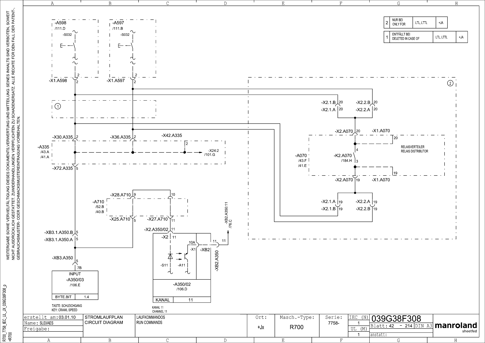

# +Jx — Sheet 42 of 214 — LAUFKOMMANDOS

**RUN COMMANDS**

> Part of the manroland **R700** printing press IEC/UL circuit diagrams.
> Drawing class: **Stromlaufplan / Circuit diagram** (DIN A3).
> Document `+Jx` covers the **1st printing module + feed register** machine section.

## At a glance

| Field | Value |
|---|---|
| Document | `+Jx`  (039G38F308) |
| Sheet | **42** of 214 |
| Section (DE) | LAUFKOMMANDOS |
| Section (EN) | RUN COMMANDS |
| Section type | CIRCUIT — Circuit diagram |
| Machine type | `R700` |
| Series | `7758` |
| Created | 03.01.10 |
| Replaces | — |
| Columns used | A, B, C, D, E, F, G, H |
| Path numbers | — |
| Labels on sheet | 114 |
| Cross-refs out | 13 |
| Cross-refs in | 40 |

**Previous:** [+Jx sheet 41](SHEET_0041.md) · **Next:** [+Jx sheet 43](SHEET_0043.md) · **Document TOC:** [_TOC.md](_TOC.md)  (+Jx) · **Master TOC:** [all sheets](../_MASTER_TOC.md)

## Sheet image (300 DPI, exact vector render)



_Rendered directly from the PDF vector layer at 300 DPI (1-bit), no OCR and no resampling. Use it to confirm anything ambiguous in the text below._

## Cross-references on this sheet

Each entry is a wire leaving this sheet. The printed token is `/sheet.column`; the link resolves to that sheet inside the same document.

| Ref | Target sheet | Col | Path | Destination on target | Target section | From col |
|---|---|---|---|---|---|---|
| `/111.B` | [+Jx sheet 111](SHEET_0111.md) | B | — | — | REFERENZMODUL | B |
| `/111.D` | [+Jx sheet 111](SHEET_0111.md) | D | — | — | REFERENZMODUL | A |
| `/43.A` | [+Jx sheet 43](SHEET_0043.md) | A | — | — | LAUFKOMMANDOS | A |
| `/41.A` | [+Jx sheet 41](SHEET_0041.md) | A | — | — | LAUFKOMMANDOS | A |
| `/101.G` | [+Jx sheet 101](SHEET_0101.md) | G | — | — | RESERVE | D |
| `/43.F` | [+Jx sheet 43](SHEET_0043.md) | F | — | — | LAUFKOMMANDOS | E |
| `/41.E` | [+Jx sheet 41](SHEET_0041.md) | E | — | — | LAUFKOMMANDOS | E |
| `/184.H` | [+Jx sheet 184](SHEET_0184.md) | H | — | — | OPTION: TRANSFERMODUL 1 + 2 | F |
| `/76.C` | [+Jx sheet 76](SHEET_0076.md) | C | — | XB2.A350:11 | BUSVERBINDUNGEN: SICHERHEITSKREIS | D |
| `/52.B` | [+Jx sheet 52](SHEET_0052.md) | B | — | — | SCHUTZEINRICHTUNGEN | B |
| `/40.B` | [+Jx sheet 40](SHEET_0040.md) | B | — | — | LAUFKOMMANDOS | B |
| `/106.E` | [+Jx sheet 106](SHEET_0106.md) | E | — | — | REFERENZMODUL | A |
| `/106.D` | [+Jx sheet 106](SHEET_0106.md) | D | — | — | REFERENZMODUL | C |

### Incoming references (sheets that point here)

Every other sheet that sends a wire to this one. `Back-ref` is the token printed on *that* sheet; `Path` is its line number.

| From sheet | Cols | Back-ref | Path | Refs | What continues there |
|---|---|---|---|---|---|
| [+Jx#40](SHEET_0040.md) | B | `/40.B` | — | 1 | — |
| [+Jx#41](SHEET_0041.md) | A, E | `/41.A`, `/41.E` | — | 2 | — |
| [+Jx#43](SHEET_0043.md) | A, E | `/43.A`, `/43.E` | — | 2 | — |
| [+Jx#52](SHEET_0052.md) | B | `/52.B` | — | 1 | — |
| [+Jx#76](SHEET_0076.md) | C | `/76.C` | — | 1 | XB2.A350:11 |
| [+Jx#101](SHEET_0101.md) | G | `/101.G` | — | 1 | X24:2 |
| [+Jx#106](SHEET_0106.md) | D, E | `/106.D`, `/106.E` | — | 2 | — |
| [+Jx#111](SHEET_0111.md) | B, D | `/111.B`, `/111.D` | — | 2 | — |
| [+Jx#113](SHEET_0113.md) | B | `/113.B` | — | 2 | — |
| [+Jx#115](SHEET_0115.md) | E, G | `/115.E`, `/115.G` | — | 2 | — |
| [+Jx#122](SHEET_0122.md) | B, D | `/122.B`, `/122.D` | — | 8 | — |
| [+Jx#123](SHEET_0123.md) | D | `/123.D` | — | 2 | — |
| [+Jx#126](SHEET_0126.md) | E | `/126.E` | — | 2 | — |
| [+Jx#128](SHEET_0128.md) | C, D, F | `/128.C`, `/128.D`, `/128.F` | — | 3 | — |
| [+Jx#143](SHEET_0143.md) | A | `/143.A` | — | 1 | — |
| [+Jx#144](SHEET_0144.md) | C | `/144.C` | — | 1 | — |
| [+Jx#146](SHEET_0146.md) | A | `/146.A` | — | 2 | — |
| [+Jx#148](SHEET_0148.md) | A | `/148.A` | — | 1 | — |
| [+Jx#149](SHEET_0149.md) | F | `/149.F` | — | 1 | — |
| [+Jx#150](SHEET_0150.md) | C | `/150.C` | — | 1 | — |
| [+Jx#153](SHEET_0153.md) | C | `/153.C` | — | 1 | — |
| [+Jx#184](SHEET_0184.md) | H | `/184.H` | — | 1 | — |


## Devices on this sheet

| Tag | Class | Class meaning (IEC) | Col | Sub | Terminal | Sign |
|---|---|---|---|---|---|---|
| `A070` | A | Baugruppe / assembly, module, PC board | E | — | — | — |
| `S032` | S | Schalter / switch | A | — | — | — |
| `A598` | A | Baugruppe / assembly, module, PC board | A | — | — | — |
| `S032` | S | Schalter / switch | B | — | — | — |
| `A597` | A | Baugruppe / assembly, module, PC board | B | — | — | — |
| `A335` | A | Baugruppe / assembly, module, PC board | A | — | — | — |
| `A350/03` | A | Baugruppe / assembly, module, PC board | A | 03 | — | — |
| `A710` | A | Baugruppe / assembly, module, PC board | B | — | — | — |
| `S11` | S | Schalter / switch | C | — | — | — |
| `A11` | A | Baugruppe / assembly, module, PC board | C | — | — | — |
| `X1` | X | Klemme / terminal, plug connector | C | — | — | — |
| `X2` | X | Klemme / terminal, plug connector | C | — | — | — |
| `XB2` | XB |  | D | — | — | — |
| `A350/02` | A | Baugruppe / assembly, module, PC board | C | 02 | — | — |
| `X24:2` | X | Klemme / terminal, plug connector | D | — | 2 | — |
| `X2.1.B` | — | cross-device reference | F | — | — | — |
| `X2.1.A` | — | cross-device reference | F | — | — | — |
| `X2.2.B` | — | cross-device reference | F | — | — | — |
| `X2.2.A` | — | cross-device reference | F | — | — | — |
| `X2.A070` | — | cross-device reference | F | — | — | — |
| `K2.A070` | — | cross-device reference | F | — | — | — |
| `X2.A070` | — | cross-device reference | F | — | — | — |
| `X2.1.A` | — | cross-device reference | F | — | — | — |
| `X2.2.A` | — | cross-device reference | F | — | — | — |
| `X2.1.B` | — | cross-device reference | F | — | — | — |
| `X2.2.B` | — | cross-device reference | F | — | — | — |
| `X1.A598` | — | cross-device reference | A | — | — | — |
| `X1.A597` | — | cross-device reference | B | — | — | — |
| `X30.A335` | — | cross-device reference | A | — | — | — |
| `X36.A335` | — | cross-device reference | B | — | — | — |
| `X72.A335` | — | cross-device reference | A | — | — | — |
| `1.4` | — | cross-device reference | B | — | — | — |
| `XB3.A350` | — | cross-device reference | A | — | — | — |
| `X27.A710` | — | cross-device reference | C | — | — | — |
| `X28.A710` | — | cross-device reference | B | — | — | — |
| `X25.A710` | — | cross-device reference | B | — | — | — |
| `XB2.A350` | — | cross-device reference | D | — | — | — |
| `XB3.1.A350.B` | — | cross-device reference | A | — | — | — |
| `XB3.1.A350.A` | — | cross-device reference | A | — | — | — |
| `XB2.A350:11` | — | cross-device reference | D | — | 11 | — |
| `X1.A070` | — | cross-device reference | G | — | — | — |
| `X1.A070` | — | cross-device reference | G | — | — | — |
| `X42.A335` | — | cross-device reference | C | — | — | — |

## Potentials / nets

_No named potentials on this sheet._

## Wire-end annotations (grouped as printed)

A wire that continues elsewhere is annotated with a small cluster: the destination description, the path/line number `#NN`, and the `/sheet.column` cross reference. Each row below is one such cluster exactly as it is grouped on the drawing.

| Col | Y | Path | Cross-ref | Text on the wire |
|---|---|---|---|---|
| G | 45.9 | — | — | `2 NUR BEI ONLY FOR LTL, LTTL +JA` |
| A | 51.3 | — | — | `A598` |
| B | 51.3 | — | — | `A597` |
| A | 66.1 | — | `/111.D` | — |
| B | 66.1 | — | `/111.B` | — |
| G | 81.3 | — | — | `1 ENTFÄLLT BEI DELETED IN CASE OF LTL, LTTL +JA` |
| A | 81.5 | — | — | `S032` |
| B | 81.5 | — | — | `S032` |
| A | 180.3 | — | — | `2` |
| B | 180.3 | — | — | `2` |
| A | 193.0 | — | — | `X1.A598 2` |
| B | 193.0 | — | — | `X1.A597 2` |
| H | 201.5 | — | — | `2` |
| F | 246.9 | — | — | `X2.1.B 20` |
| F | 246.9 | — | — | `X2.2.B 20` |
| A | 257.7 | — | — | `1` |
| F | 263.9 | — | — | `X2.1.A 20` |
| F | 263.9 | — | — | `X2.2.A 20` |
| G | 316.3 | — | — | `X1.A070` |
| F | 317.7 | — | — | `X2.A070 20` |
| C | 327.6 | — | — | `X42.A335` |
| B | 331.9 | — | — | `X30.A335 2 X36.A335 2` |
| G | 334.8 | — | — | `20` |
| C | 348.9 | — | — | `2` |
| A | 356.0 | — | — | `A335` |
| G | 357.7 | — | — | `RELAISVERTEILER RELAIS DISTRIBUTOR` |
| F | 363.8 | — | — | `4` |
| D | 365.9 | — | — | `X24:2` |
| A | 369.1 | — | `/43.A`, `/41.A` | — |
| D | 375.8 | — | `/101.G` | — |
| E | 377.2 | — | — | `A070` |
| F | 377.2 | — | — | `K2.A070 3` |
| E | 390.3 | — | `/43.F`, `/41.E` | — |
| F | 390.4 | — | `/184.H` | — |
| A | 408.4 | — | — | `X72.A335 5` |
| G | 421.2 | — | — | `19` |
| F | 436.8 | — | — | `X2.A070 19` |
| G | 436.8 | — | — | `X1.A070` |
| B | 473.6 | — | — | `X28.A710 9` |
| C | 473.6 | — | — | `10` |
| F | 489.9 | — | — | `X2.1.A 19 X2.2.A 19` |
| B | 490.6 | — | — | `A710` |
| D | 495.5 | — | `/76.C` | `XB2.A350:11` |
| B | 503.7 | — | `/52.B`, `/40.B` | — |
| F | 507.7 | — | — | `X2.1.B 19 X2.2.B 19` |
| B | 533.1 | — | — | `X25.A710 5` |
| C | 533.1 | — | — | `X27.A710 11` |
| C | 558.7 | — | — | `X2.A350/02 11` |
| A | 565.8 | — | — | `XB3.1.A350.B 5` |
| C | 577.1 | — | — | `X2` |
| C | 578.5 | — | — | `11 11` |
| A | 582.8 | — | — | `XB3.1.A350.A 5` |
| D | 587.0 | — | — | `11` |
| C | 591.2 | — | — | `10A` |
| C | 608.3 | — | — | `X1` |
| D | 608.3 | — | — | `XB2` |
| D | 614.5 | — | — | `XB2.A350` |
| A | 628.1 | — | — | `XB3.A350 5` |
| C | 647.2 | — | — | `S11 A11` |
| A | 653.6 | — | — | `7B` |
| A | 668.1 | — | — | `INPUT` |
| A | 682.0 | — | — | `A350/03` |
| C | 693.3 | — | — | `A350/02` |
| A | 695.8 | — | `/106.E` | — |
| C | 705.7 | — | `/106.D` | — |
| A | 725.1 | — | — | `BYTE.BIT 1.4` |
| C | 731.5 | — | — | `KANAL 11` |
| A | 747.5 | — | — | `KEY: CRAWL SPEED TASTE: SCHLEICHGANG` |
| C | 751.9 | — | — | `KANAL 11 CHANNEL 11` |


## Reconstructed tables

This sheet carries tabular content (pin map / terminal assignment / index). The grid below was rebuilt from the drawing's own rule lines, so each row is exactly one physical row of the table.

### Table 1 — 10 data rows × 5 columns (at x=127.6, y=48.2)

| A598 /111.D S032 | 2 |  | A597 /111.B S032 | 2 |
|---|---|---|---|---|
| `X1.A598` | `2` |  | `X1.A597` | `2` |
| `1` |  |  |  |  |
| `X30.A335` | `2` |  | `X36.A335` | `2` |
| `X72.A335` | `5` |  |  |  |
| `XB3.1.A350.B` | `5` | `A710 /52.B /40.B` | `X28.A710 X25.A710` | `9 5` |
| `XB3.1.A350.A` | `5` |  |  |  |
| `XB3.A350` | `5 7B` |  |  |  |
| `INPUT` |  |  |  |  |
| `A350/03` | `/106.E` |  |  |  |
| `BYTE.BIT` | `1.4` |  |  |  |


### Table 2 — 6 data rows × 5 columns (at x=382.7, y=48.2)

|  | X42.A335 2 |  |  | X24:2 |
|---|---|---|---|---|
|  |  |  | `/101.G` |  |
| `X27.A710 X2.A350/02` | `10 11 11` |  |  | `XB2.A350:11` |
| `X2` | `11` | `10A` |  | `11 11` |
| `S11` | `A11` | `X1` | `XB2` | `XB2.A350` |
|  | `A350/02 /106.D` |  |  |  |
| `KANAL` |  | `11` |  |  |


## Notes and free text on this sheet

| Text | Col | Y (pt) |
|---|---|---|
| `RELAISVERTEILER` | G | 357.73 |
| `RELAIS DISTRIBUTOR` | G | 368.37 |
| `7B` | A | 653.6 |
| `INPUT` | A | 668.13 |
| `BYTE.BIT` | A | 725.13 |
| `TASTE: SCHLEICHGANG` | A | 747.51 |
| `KEY: CRAWL SPEED` | A | 758.09 |
| `KANAL 11` | C | 751.89 |
| `CHANNEL 11` | C | 761.84 |
| `10A` | C | 591.25 |
| `KANAL` | C | 731.57 |
| `X2.A350/02` | C | 558.67 |
| `ENTFÄLLT BEI` | G | 81.33 |
| `DELETED IN CASE OF` | G | 91.99 |
| `LTL, LTTL` | H | 88.44 |
| `+JA` | H | 88.41 |
| `NUR BEI` | G | 45.89 |
| `ONLY FOR` | G | 56.58 |
| `LTL, LTTL` | G | 53.01 |

## Complete label inventory (exact text from the drawing)

Every text object inside the drawing area of this sheet, in DIN reading order (column A→H, then top→bottom). This is the authoritative list: if a string is not here it is not printed on this sheet.

| Col | Y | X | Dir | Type | Text |
|---|---|---|---|---|---|
| A | 51.3 | 134.4 | → | device tag | `A598` |
| A | 66.1 | 134.6 | → | cross-reference | `/111.D` |
| A | 81.5 | 154.2 | → | device tag | `S032` |
| A | 180.3 | 189.9 | → | number | `2` |
| A | 193.0 | 120.2 | → | device ref | `X1.A598` |
| A | 197.3 | 187.1 | → | number | `2` |
| A | 257.7 | 139.9 | → | number | `1` |
| A | 331.9 | 128.7 | → | device ref | `X30.A335` |
| A | 331.9 | 187.1 | → | number | `2` |
| A | 356.0 | 92.4 | → | device tag | `A335` |
| A | 369.1 | 99.8 | → | cross-reference | `/43.A` |
| A | 381.5 | 99.8 | → | cross-reference | `/41.A` |
| A | 408.4 | 128.7 | → | device ref | `X72.A335` |
| A | 409.9 | 186.8 | → | number | `5` |
| A | 565.8 | 109.1 | → | device ref | `XB3.1.A350.B` |
| A | 565.8 | 186.8 | → | number | `5` |
| A | 582.8 | 186.8 | → | number | `5` |
| A | 583.5 | 108.6 | → | device ref | `XB3.1.A350.A` |
| A | 628.1 | 127.8 | → | device ref | `XB3.A350` |
| A | 636.6 | 186.8 | → | number | `5` |
| A | 653.6 | 189.6 | → | text | `7B` |
| A | 668.1 | 169.4 | → | text | `INPUT` |
| A | 682.0 | 162.7 | → | device tag | `A350/03` |
| A | 695.8 | 171.6 | → | cross-reference | `/106.E` |
| A | 725.1 | 135.8 | → | text | `BYTE.BIT` |
| A | 747.5 | 127.6 | → | text | `TASTE: SCHLEICHGANG` |
| A | 758.1 | 127.0 | → | text | `KEY: CRAWL SPEED` |
| B | 51.3 | 276.1 | → | device tag | `A597` |
| B | 66.1 | 276.4 | → | cross-reference | `/111.B` |
| B | 81.5 | 295.9 | → | device tag | `S032` |
| B | 180.3 | 331.7 | → | number | `2` |
| B | 193.0 | 261.9 | → | device ref | `X1.A597` |
| B | 197.3 | 328.8 | → | number | `2` |
| B | 331.9 | 270.4 | → | device ref | `X36.A335` |
| B | 331.9 | 328.8 | → | number | `2` |
| B | 473.6 | 270.7 | → | device ref | `X28.A710` |
| B | 473.7 | 328.5 | → | number | `9` |
| B | 490.6 | 227.3 | → | device tag | `A710` |
| B | 503.7 | 234.7 | → | cross-reference | `/52.B` |
| B | 516.1 | 234.7 | → | cross-reference | `/40.B` |
| B | 533.1 | 269.3 | → | device ref | `X25.A710` |
| B | 537.4 | 328.5 | → | number | `5` |
| B | 725.2 | 206.2 | → | device ref | `1.4` |
| C | 327.6 | 396.6 | → | device ref | `X42.A335` |
| C | 348.9 | 456.4 | → | number | `2` |
| C | 473.7 | 420.1 | → | number | `10` |
| C | 533.1 | 361.4 | → | device ref | `X27.A710` |
| C | 537.4 | 420.1 | → | number | `11` |
| C | 558.7 | 354.0 | → | text | `X2.A350/02` |
| C | 558.7 | 420.1 | → | number | `11` |
| C | 577.1 | 396.6 | → | device tag | `X2` |
| C | 578.5 | 422.9 | → | number | `11` |
| C | 591.3 | 463.5 | → | text | `10A` |
| C | 608.3 | 466.9 | → | device tag | `X1` |
| C | 647.3 | 394.0 | → | device tag | `S11` |
| C | 647.3 | 436.5 | → | device tag | `A11` |
| C | 693.3 | 425.1 | → | device tag | `A350/02` |
| C | 705.7 | 433.7 | → | cross-reference | `/106.D` |
| C | 731.5 | 462.2 | → | number | `11` |
| C | 731.6 | 382.1 | → | text | `KANAL` |
| C | 751.9 | 373.6 | → | text | `KANAL 11` |
| C | 761.8 | 373.9 | → | text | `CHANNEL 11` |
| D | 365.9 | 511.4 | → | device tag | `X24:2` |
| D | 375.8 | 501.7 | → | cross-reference | `/101.G` |
| D | 495.5 | 551.6 | ↕ | device ref | `XB2.A350:11` |
| D | 538.9 | 561.5 | ↕ | cross-reference | `/76.C` |
| D | 587.0 | 544.5 | → | number | `11` |
| D | 588.5 | 522.1 | → | number | `11` |
| D | 608.3 | 491.5 | → | device tag | `XB2` |
| D | 614.6 | 527.5 | ↕ | device ref | `XB2.A350` |
| E | 377.2 | 724.8 | → | device tag | `A070` |
| E | 390.3 | 732.8 | → | cross-reference | `/43.F` |
| E | 402.7 | 732.2 | → | cross-reference | `/41.E` |
| F | 246.9 | 788.9 | → | device ref | `X2.1.B` |
| F | 246.9 | 832.0 | → | number | `20` |
| F | 246.9 | 873.9 | → | device ref | `X2.2.B` |
| F | 263.9 | 832.0 | → | number | `20` |
| F | 264.6 | 788.3 | → | device ref | `X2.1.A` |
| F | 264.6 | 873.4 | → | device ref | `X2.2.A` |
| F | 317.7 | 822.3 | → | device ref | `X2.A070` |
| F | 317.7 | 874.5 | → | number | `20` |
| F | 363.8 | 874.5 | → | number | `4` |
| F | 377.2 | 819.5 | → | device ref | `K2.A070` |
| F | 390.4 | 837.9 | → | cross-reference | `/184.H` |
| F | 392.2 | 874.2 | → | number | `3` |
| F | 436.8 | 822.3 | → | device ref | `X2.A070` |
| F | 438.2 | 873.6 | → | number | `19` |
| F | 490.0 | 788.3 | → | device ref | `X2.1.A` |
| F | 490.0 | 873.4 | → | device ref | `X2.2.A` |
| F | 492.1 | 831.1 | → | number | `19` |
| F | 507.7 | 788.9 | → | device ref | `X2.1.B` |
| F | 507.7 | 873.9 | → | device ref | `X2.2.B` |
| F | 509.1 | 831.1 | → | number | `19` |
| G | 45.9 | 963.2 | → | text | `NUR BEI` |
| G | 51.2 | 946.8 | → | number | `2` |
| G | 53.0 | 1019.9 | → | text | `LTL, LTTL` |
| G | 56.6 | 963.5 | → | text | `ONLY FOR` |
| G | 81.3 | 963.2 | → | text | `ENTFÄLLT BEI` |
| G | 86.7 | 947.1 | → | number | `1` |
| G | 92.0 | 963.2 | → | text | `DELETED IN CASE OF` |
| G | 246.9 | 917.0 | → | number | `20` |
| G | 263.9 | 917.0 | → | number | `20` |
| G | 316.3 | 913.0 | → | device ref | `X1.A070` |
| G | 334.8 | 966.6 | → | number | `20` |
| G | 357.7 | 984.5 | → | text | `RELAISVERTEILER` |
| G | 368.4 | 984.5 | → | text | `RELAIS DISTRIBUTOR` |
| G | 421.2 | 965.8 | → | number | `19` |
| G | 436.8 | 913.0 | → | device ref | `X1.A070` |
| G | 492.1 | 916.2 | → | number | `19` |
| G | 509.1 | 916.2 | → | number | `19` |
| H | 53.0 | 1076.9 | → | text | `+JA` |
| H | 88.4 | 1069.5 | → | text | `LTL, LTTL` |
| H | 88.4 | 1126.5 | → | text | `+JA` |
| H | 201.5 | 1103.5 | → | number | `2` |

## Reading-order text block

The same content as a plain block, grouped by DIN column — convenient to paste or to match against a visual description.

```text
=== Column A ===
  51.3  134.4  devtag       A598
  66.1  134.6  xref         /111.D
  81.5  154.2  devtag       S032
 180.3  189.9  numeric      2
 193.0  120.2  devref       X1.A598
 197.3  187.1  numeric      2
 257.7  139.9  numeric      1
 331.9  128.7  devref       X30.A335
 331.9  187.1  numeric      2
 356.0   92.4  devtag       A335
 369.1   99.8  xref         /43.A
 381.5   99.8  xref         /41.A
 408.4  128.7  devref       X72.A335
 409.9  186.8  numeric      5
 565.8  109.1  devref       XB3.1.A350.B
 565.8  186.8  numeric      5
 582.8  186.8  numeric      5
 583.5  108.6  devref       XB3.1.A350.A
 628.1  127.8  devref       XB3.A350
 636.6  186.8  numeric      5
 653.6  189.6  text         7B
 668.1  169.4  text         INPUT
 682.0  162.7  devtag       A350/03
 695.8  171.6  xref         /106.E
 725.1  135.8  text         BYTE.BIT
 747.5  127.6  text         TASTE: SCHLEICHGANG
 758.1  127.0  text         KEY: CRAWL SPEED
=== Column B ===
  51.3  276.1  devtag       A597
  66.1  276.4  xref         /111.B
  81.5  295.9  devtag       S032
 180.3  331.7  numeric      2
 193.0  261.9  devref       X1.A597
 197.3  328.8  numeric      2
 331.9  270.4  devref       X36.A335
 331.9  328.8  numeric      2
 473.6  270.7  devref       X28.A710
 473.7  328.5  numeric      9
 490.6  227.3  devtag       A710
 503.7  234.7  xref         /52.B
 516.1  234.7  xref         /40.B
 533.1  269.3  devref       X25.A710
 537.4  328.5  numeric      5
 725.2  206.2  devref       1.4
=== Column C ===
 327.6  396.6  devref       X42.A335
 348.9  456.4  numeric      2
 473.7  420.1  numeric      10
 533.1  361.4  devref       X27.A710
 537.4  420.1  numeric      11
 558.7  354.0  text         X2.A350/02
 558.7  420.1  numeric      11
 577.1  396.6  devtag       X2
 578.5  422.9  numeric      11
 591.3  463.5  text         10A
 608.3  466.9  devtag       X1
 647.3  394.0  devtag       S11
 647.3  436.5  devtag       A11
 693.3  425.1  devtag       A350/02
 705.7  433.7  xref         /106.D
 731.5  462.2  numeric      11
 731.6  382.1  text         KANAL
 751.9  373.6  text         KANAL 11
 761.8  373.9  text         CHANNEL 11
=== Column D ===
 365.9  511.4  devtag       X24:2
 375.8  501.7  xref         /101.G
 495.5  551.6  devref       XB2.A350:11
 538.9  561.5  xref         /76.C
 587.0  544.5  numeric      11
 588.5  522.1  numeric      11
 608.3  491.5  devtag       XB2
 614.6  527.5  devref       XB2.A350
=== Column E ===
 377.2  724.8  devtag       A070
 390.3  732.8  xref         /43.F
 402.7  732.2  xref         /41.E
=== Column F ===
 246.9  788.9  devref       X2.1.B
 246.9  832.0  numeric      20
 246.9  873.9  devref       X2.2.B
 263.9  832.0  numeric      20
 264.6  788.3  devref       X2.1.A
 264.6  873.4  devref       X2.2.A
 317.7  822.3  devref       X2.A070
 317.7  874.5  numeric      20
 363.8  874.5  numeric      4
 377.2  819.5  devref       K2.A070
 390.4  837.9  xref         /184.H
 392.2  874.2  numeric      3
 436.8  822.3  devref       X2.A070
 438.2  873.6  numeric      19
 490.0  788.3  devref       X2.1.A
 490.0  873.4  devref       X2.2.A
 492.1  831.1  numeric      19
 507.7  788.9  devref       X2.1.B
 507.7  873.9  devref       X2.2.B
 509.1  831.1  numeric      19
=== Column G ===
  45.9  963.2  text         NUR BEI
  51.2  946.8  numeric      2
  53.0 1019.9  text         LTL, LTTL
  56.6  963.5  text         ONLY FOR
  81.3  963.2  text         ENTFÄLLT BEI
  86.7  947.1  numeric      1
  92.0  963.2  text         DELETED IN CASE OF
 246.9  917.0  numeric      20
 263.9  917.0  numeric      20
 316.3  913.0  devref       X1.A070
 334.8  966.6  numeric      20
 357.7  984.5  text         RELAISVERTEILER
 368.4  984.5  text         RELAIS DISTRIBUTOR
 421.2  965.8  numeric      19
 436.8  913.0  devref       X1.A070
 492.1  916.2  numeric      19
 509.1  916.2  numeric      19
=== Column H ===
  53.0 1076.9  text         +JA
  88.4 1069.5  text         LTL, LTTL
  88.4 1126.5  text         +JA
 201.5 1103.5  numeric      2
```

---
_Generated from the PDF vector text layer; no OCR. Source: `R700_7758_IEC_UL_JX_039G38F308_p`, sheet 42._
