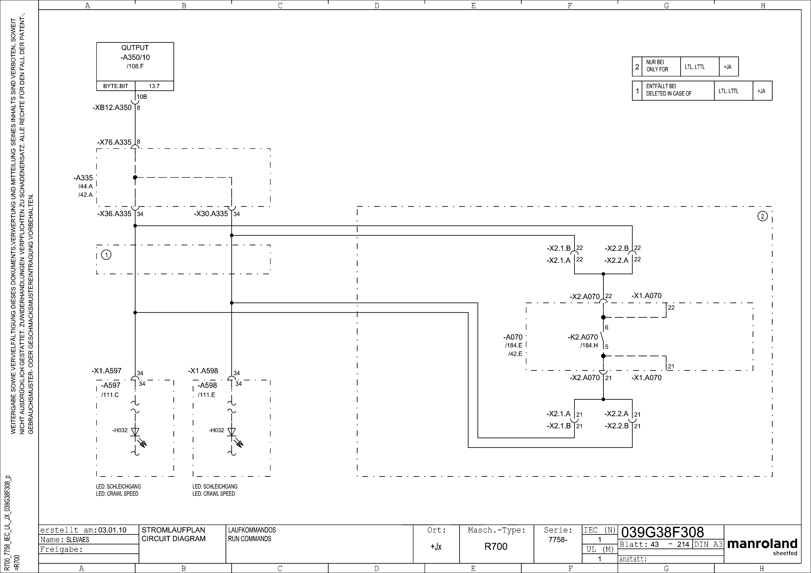

# +Jx — Sheet 43 of 214 — LAUFKOMMANDOS

**RUN COMMANDS**

> Part of the manroland **R700** printing press IEC/UL circuit diagrams.
> Drawing class: **Stromlaufplan / Circuit diagram** (DIN A3).
> Document `+Jx` covers the **1st printing module + feed register** machine section.

## At a glance

| Field | Value |
|---|---|
| Document | `+Jx`  (039G38F308) |
| Sheet | **43** of 214 |
| Section (DE) | LAUFKOMMANDOS |
| Section (EN) | RUN COMMANDS |
| Section type | CIRCUIT — Circuit diagram |
| Machine type | `R700` |
| Series | `7758` |
| Created | 03.01.10 |
| Replaces | — |
| Columns used | A, B, C, E, F, G, H |
| Path numbers | — |
| Labels on sheet | 76 |
| Cross-refs out | 8 |
| Cross-refs in | 26 |

**Previous:** [+Jx sheet 42](SHEET_0042.md) · **Next:** [+Jx sheet 44](SHEET_0044.md) · **Document TOC:** [_TOC.md](_TOC.md)  (+Jx) · **Master TOC:** [all sheets](../_MASTER_TOC.md)

## Sheet image (300 DPI, exact vector render)



_Rendered directly from the PDF vector layer at 300 DPI (1-bit), no OCR and no resampling. Use it to confirm anything ambiguous in the text below._

## Cross-references on this sheet

Each entry is a wire leaving this sheet. The printed token is `/sheet.column`; the link resolves to that sheet inside the same document.

| Ref | Target sheet | Col | Path | Destination on target | Target section | From col |
|---|---|---|---|---|---|---|
| `/108.F` | [+Jx sheet 108](SHEET_0108.md) | F | — | — | REFERENZMODUL | A |
| `/44.A` | [+Jx sheet 44](SHEET_0044.md) | A | — | — | MASCHINENBEDIENUNG | A |
| `/42.A` | [+Jx sheet 42](SHEET_0042.md) | A | — | — | LAUFKOMMANDOS | A |
| `/184.E` | [+Jx sheet 184](SHEET_0184.md) | E | — | — | OPTION: TRANSFERMODUL 1 + 2 | E |
| `/184.H` | [+Jx sheet 184](SHEET_0184.md) | H | — | — | OPTION: TRANSFERMODUL 1 + 2 | F |
| `/42.E` | [+Jx sheet 42](SHEET_0042.md) | E | — | — | LAUFKOMMANDOS | E |
| `/111.E` | [+Jx sheet 111](SHEET_0111.md) | E | — | — | REFERENZMODUL | B |
| `/111.C` | [+Jx sheet 111](SHEET_0111.md) | C | — | — | REFERENZMODUL | A |

### Incoming references (sheets that point here)

Every other sheet that sends a wire to this one. `Back-ref` is the token printed on *that* sheet; `Path` is its line number.

| From sheet | Cols | Back-ref | Path | Refs | What continues there |
|---|---|---|---|---|---|
| [+Jx#42](SHEET_0042.md) | A, E | `/42.A`, `/42.E` | — | 2 | — |
| [+Jx#44](SHEET_0044.md) | A | `/44.A` | — | 1 | — |
| [+Jx#108](SHEET_0108.md) | F | `/108.F` | — | 1 | — |
| [+Jx#111](SHEET_0111.md) | C, E | `/111.C`, `/111.E` | — | 2 | — |
| [+Jx#113](SHEET_0113.md) | B | `/113.B` | — | 2 | — |
| [+Jx#115](SHEET_0115.md) | F, H | `/115.F`, `/115.H` | — | 2 | — |
| [+Jx#122](SHEET_0122.md) | B, D | `/122.B`, `/122.D` | — | 8 | — |
| [+Jx#123](SHEET_0123.md) | D | `/123.D` | — | 2 | — |
| [+Jx#137](SHEET_0137.md) | H | `/137.H` | — | 1 | — |
| [+Jx#148](SHEET_0148.md) | B | `/148.B` | — | 1 | — |
| [+Jx#149](SHEET_0149.md) | G | `/149.G` | — | 1 | — |
| [+Jx#155](SHEET_0155.md) | B | `/155.B` | — | 1 | — |
| [+Jx#184](SHEET_0184.md) | E, H | `/184.E`, `/184.H` | — | 2 | — |


## Devices on this sheet

| Tag | Class | Class meaning (IEC) | Col | Sub | Terminal | Sign |
|---|---|---|---|---|---|---|
| `A350/10` | A | Baugruppe / assembly, module, PC board | A | 10 | — | — |
| `A335` | A | Baugruppe / assembly, module, PC board | A | — | — | — |
| `A597` | A | Baugruppe / assembly, module, PC board | A | — | — | — |
| `A598` | A | Baugruppe / assembly, module, PC board | B | — | — | — |
| `A070` | A | Baugruppe / assembly, module, PC board | E | — | — | — |
| `13.7` | — | cross-device reference | B | — | — | — |
| `XB12.A350` | — | cross-device reference | A | — | — | — |
| `X36.A335` | — | cross-device reference | A | — | — | — |
| `X30.A335` | — | cross-device reference | B | — | — | — |
| `X76.A335` | — | cross-device reference | A | — | — | — |
| `X1.A597` | — | cross-device reference | A | — | — | — |
| `X1.A598` | — | cross-device reference | B | — | — | — |
| `X2.1.B` | — | cross-device reference | F | — | — | — |
| `X2.1.A` | — | cross-device reference | F | — | — | — |
| `X2.2.B` | — | cross-device reference | F | — | — | — |
| `X2.2.A` | — | cross-device reference | F | — | — | — |
| `X2.A070` | — | cross-device reference | F | — | — | — |
| `K2.A070` | — | cross-device reference | F | — | — | — |
| `X2.A070` | — | cross-device reference | F | — | — | — |
| `X2.1.A` | — | cross-device reference | F | — | — | — |
| `X2.2.A` | — | cross-device reference | F | — | — | — |
| `X2.1.B` | — | cross-device reference | F | — | — | — |
| `X2.2.B` | — | cross-device reference | F | — | — | — |
| `X1.A070` | — | cross-device reference | G | — | — | — |
| `X1.A070` | — | cross-device reference | G | — | — | — |

## Potentials / nets

| Potential | Count | Columns | Attached devices | Terminals |
|---|---|---|---|---|
| `H032` | 2 | A, B | — | — |


A potential such as `L24+/4` or `M24+` is a named supply/return rail; every place it appears on this sheet is electrically common.

## Wire-end annotations (grouped as printed)

A wire that continues elsewhere is annotated with a small cluster: the destination description, the path/line number `#NN`, and the `/sheet.column` cross reference. Each row below is one such cluster exactly as it is grouped on the drawing.

| Col | Y | Path | Cross-ref | Text on the wire |
|---|---|---|---|---|
| A | 65.8 | — | — | `QUTPUT` |
| A | 79.6 | — | — | `A350/10` |
| G | 88.4 | — | — | `2 NUR BEI ONLY FOR LTL, LTTL +JA` |
| A | 93.4 | — | `/108.F` | — |
| A | 123.0 | — | — | `BYTE.BIT 13.7` |
| G | 123.8 | — | — | `1 ENTFÄLLT BEI DELETED IN CASE OF LTL, LTTL +JA` |
| B | 138.4 | — | — | `10B` |
| A | 153.3 | — | — | `XB12.A350 8` |
| A | 204.3 | — | — | `X76.A335 8` |
| A | 256.8 | — | — | `A335` |
| A | 269.8 | — | `/44.A`, `/42.A` | — |
| B | 309.2 | — | — | `X36.A335 34 X30.A335 34` |
| H | 314.9 | — | — | `2` |
| F | 360.3 | — | — | `X2.1.B 22` |
| G | 360.3 | — | — | `X2.2.B 22` |
| A | 371.1 | — | — | `1` |
| F | 377.3 | — | — | `X2.1.A 22` |
| G | 377.3 | — | — | `X2.2.A 22` |
| G | 429.7 | — | — | `X1.A070` |
| F | 431.1 | — | — | `X2.A070 22` |
| G | 448.1 | — | — | `22` |
| F | 477.2 | — | — | `6` |
| E | 490.6 | — | — | `A070` |
| F | 490.6 | — | — | `K2.A070 5` |
| E | 503.7 | — | `/184.E` | — |
| F | 503.7 | — | `/184.H` | — |
| E | 516.1 | — | `/42.E` | — |
| G | 534.6 | — | — | `21` |
| B | 540.2 | — | — | `X1.A597 34 X1.A598 34` |
| F | 550.2 | — | — | `X2.A070 21` |
| G | 550.2 | — | — | `X1.A070` |
| B | 560.1 | — | — | `34` |
| C | 560.1 | — | — | `34` |
| A | 561.5 | — | — | `A597` |
| B | 561.5 | — | — | `A598` |
| A | 576.4 | — | `/111.C` | — |
| B | 576.4 | — | `/111.E` | — |
| F | 603.3 | — | — | `X2.1.A 21 X2.2.A 21` |
| F | 621.0 | — | — | `X2.1.B 21 X2.2.B 21` |
| A | 628.5 | — | — | `H032` |
| B | 628.5 | — | — | `H032` |
| A | 712.1 | — | — | `LED: SCHLEICHGANG LED: CRAWL SPEED` |
| B | 712.1 | — | — | `LED: SCHLEICHGANG LED: CRAWL SPEED` |


## Reconstructed tables

This sheet carries tabular content (pin map / terminal assignment / index). The grid below was rebuilt from the drawing's own rule lines, so each row is exactly one physical row of the table.

### Table 1 — 6 data rows × 2 columns (at x=141.7, y=62.4)

| QUTPUT | A350/10 /108.F |
|---|---|
| `BYTE.BIT` | `13.7` |
| `XB12.A350 X76.A335` | `10B 8 8` |
| `X36.A335` | `34` |
| `1` |  |
| `X1.A597` | `34` |
| `A597 /111.C H032` | `34` |


### Table 2 — 2 data rows × 2 columns (at x=283.5, y=62.4)

| X30.A335 | 34 |
|---|---|
| `X1.A598` | `34` |
| `A598 /111.E H032` | `34` |


## Notes and free text on this sheet

| Text | Col | Y (pt) |
|---|---|---|
| `10B` | B | 138.42 |
| `QUTPUT` | A | 65.75 |
| `BYTE.BIT` | A | 123.03 |
| `LED: SCHLEICHGANG` | A | 712.08 |
| `LED: CRAWL SPEED` | A | 722.67 |
| `LED: SCHLEICHGANG` | B | 712.08 |
| `LED: CRAWL SPEED` | B | 722.67 |
| `ENTFÄLLT BEI` | G | 123.85 |
| `DELETED IN CASE OF` | G | 134.51 |
| `LTL, LTTL` | H | 130.96 |
| `+JA` | H | 130.93 |
| `NUR BEI` | G | 88.41 |
| `ONLY FOR` | G | 99.1 |
| `LTL, LTTL` | G | 95.53 |

## Complete label inventory (exact text from the drawing)

Every text object inside the drawing area of this sheet, in DIN reading order (column A→H, then top→bottom). This is the authoritative list: if a string is not here it is not printed on this sheet.

| Col | Y | X | Dir | Type | Text |
|---|---|---|---|---|---|
| A | 65.7 | 178.2 | → | text | `QUTPUT` |
| A | 79.6 | 177.0 | → | device tag | `A350/10` |
| A | 93.4 | 186.1 | → | cross-reference | `/108.F` |
| A | 123.0 | 151.7 | → | text | `BYTE.BIT` |
| A | 153.3 | 136.1 | → | device ref | `XB12.A350` |
| A | 204.3 | 142.9 | → | device ref | `X76.A335` |
| A | 256.8 | 108.0 | → | device tag | `A335` |
| A | 269.8 | 115.4 | → | cross-reference | `/44.A` |
| A | 282.2 | 115.4 | → | cross-reference | `/42.A` |
| A | 309.2 | 142.9 | → | device ref | `X36.A335` |
| A | 371.1 | 154.0 | → | number | `1` |
| A | 540.2 | 134.4 | → | device ref | `X1.A597` |
| A | 561.5 | 148.5 | → | device tag | `A597` |
| A | 576.4 | 148.8 | → | cross-reference | `/111.C` |
| A | 628.5 | 165.0 | → | potential | `H032` |
| A | 712.1 | 141.2 | → | text | `LED: SCHLEICHGANG` |
| A | 722.7 | 141.2 | → | text | `LED: CRAWL SPEED` |
| B | 123.1 | 218.6 | → | device ref | `13.7` |
| B | 138.4 | 200.4 | → | text | `10B` |
| B | 154.8 | 201.0 | → | number | `8` |
| B | 204.4 | 201.0 | → | number | `8` |
| B | 309.2 | 284.6 | → | device ref | `X30.A335` |
| B | 310.7 | 201.0 | → | number | `34` |
| B | 540.2 | 276.1 | → | device ref | `X1.A598` |
| B | 544.5 | 201.0 | → | number | `34` |
| B | 560.1 | 203.8 | → | number | `34` |
| B | 561.5 | 290.3 | → | device tag | `A598` |
| B | 576.3 | 290.6 | → | cross-reference | `/111.E` |
| B | 628.5 | 306.7 | → | potential | `H032` |
| B | 712.1 | 282.9 | → | text | `LED: SCHLEICHGANG` |
| B | 722.7 | 282.9 | → | text | `LED: CRAWL SPEED` |
| C | 310.7 | 342.7 | → | number | `34` |
| C | 544.5 | 342.7 | → | number | `34` |
| C | 560.1 | 345.5 | → | number | `34` |
| E | 490.6 | 739.0 | → | device tag | `A070` |
| E | 503.7 | 741.5 | → | cross-reference | `/184.E` |
| E | 516.1 | 746.4 | → | cross-reference | `/42.E` |
| F | 360.3 | 803.1 | → | device ref | `X2.1.B` |
| F | 360.3 | 846.1 | → | number | `22` |
| F | 360.3 | 888.1 | → | device ref | `X2.2.B` |
| F | 377.3 | 846.1 | → | number | `22` |
| F | 378.0 | 802.5 | → | device ref | `X2.1.A` |
| F | 378.0 | 887.5 | → | device ref | `X2.2.A` |
| F | 431.1 | 836.5 | → | device ref | `X2.A070` |
| F | 431.1 | 888.7 | → | number | `22` |
| F | 477.2 | 888.4 | → | number | `6` |
| F | 490.6 | 833.7 | → | device ref | `K2.A070` |
| F | 503.7 | 852.1 | → | cross-reference | `/184.H` |
| F | 505.5 | 888.4 | → | number | `5` |
| F | 550.2 | 836.5 | → | device ref | `X2.A070` |
| F | 551.6 | 888.7 | → | number | `21` |
| F | 603.3 | 802.5 | → | device ref | `X2.1.A` |
| F | 603.3 | 887.5 | → | device ref | `X2.2.A` |
| F | 605.5 | 846.1 | → | number | `21` |
| F | 621.1 | 803.1 | → | device ref | `X2.1.B` |
| F | 621.1 | 888.1 | → | device ref | `X2.2.B` |
| F | 622.5 | 846.1 | → | number | `21` |
| G | 88.4 | 949.0 | → | text | `NUR BEI` |
| G | 93.7 | 932.6 | → | number | `2` |
| G | 95.5 | 1005.7 | → | text | `LTL, LTTL` |
| G | 99.1 | 949.3 | → | text | `ONLY FOR` |
| G | 123.9 | 949.0 | → | text | `ENTFÄLLT BEI` |
| G | 129.2 | 932.9 | → | number | `1` |
| G | 134.5 | 949.0 | → | text | `DELETED IN CASE OF` |
| G | 360.3 | 931.2 | → | number | `22` |
| G | 377.3 | 931.2 | → | number | `22` |
| G | 429.7 | 927.2 | → | device ref | `X1.A070` |
| G | 448.1 | 980.8 | → | number | `22` |
| G | 534.6 | 980.8 | → | number | `21` |
| G | 550.2 | 927.2 | → | device ref | `X1.A070` |
| G | 605.5 | 931.2 | → | number | `21` |
| G | 622.5 | 931.2 | → | number | `21` |
| H | 95.5 | 1062.7 | → | text | `+JA` |
| H | 130.9 | 1112.3 | → | text | `+JA` |
| H | 131.0 | 1055.3 | → | text | `LTL, LTTL` |
| H | 314.9 | 1117.7 | → | number | `2` |

## Reading-order text block

The same content as a plain block, grouped by DIN column — convenient to paste or to match against a visual description.

```text
=== Column A ===
  65.7  178.2  text         QUTPUT
  79.6  177.0  devtag       A350/10
  93.4  186.1  xref         /108.F
 123.0  151.7  text         BYTE.BIT
 153.3  136.1  devref       XB12.A350
 204.3  142.9  devref       X76.A335
 256.8  108.0  devtag       A335
 269.8  115.4  xref         /44.A
 282.2  115.4  xref         /42.A
 309.2  142.9  devref       X36.A335
 371.1  154.0  numeric      1
 540.2  134.4  devref       X1.A597
 561.5  148.5  devtag       A597
 576.4  148.8  xref         /111.C
 628.5  165.0  net          H032
 712.1  141.2  text         LED: SCHLEICHGANG
 722.7  141.2  text         LED: CRAWL SPEED
=== Column B ===
 123.1  218.6  devref       13.7
 138.4  200.4  text         10B
 154.8  201.0  numeric      8
 204.4  201.0  numeric      8
 309.2  284.6  devref       X30.A335
 310.7  201.0  numeric      34
 540.2  276.1  devref       X1.A598
 544.5  201.0  numeric      34
 560.1  203.8  numeric      34
 561.5  290.3  devtag       A598
 576.3  290.6  xref         /111.E
 628.5  306.7  net          H032
 712.1  282.9  text         LED: SCHLEICHGANG
 722.7  282.9  text         LED: CRAWL SPEED
=== Column C ===
 310.7  342.7  numeric      34
 544.5  342.7  numeric      34
 560.1  345.5  numeric      34
=== Column E ===
 490.6  739.0  devtag       A070
 503.7  741.5  xref         /184.E
 516.1  746.4  xref         /42.E
=== Column F ===
 360.3  803.1  devref       X2.1.B
 360.3  846.1  numeric      22
 360.3  888.1  devref       X2.2.B
 377.3  846.1  numeric      22
 378.0  802.5  devref       X2.1.A
 378.0  887.5  devref       X2.2.A
 431.1  836.5  devref       X2.A070
 431.1  888.7  numeric      22
 477.2  888.4  numeric      6
 490.6  833.7  devref       K2.A070
 503.7  852.1  xref         /184.H
 505.5  888.4  numeric      5
 550.2  836.5  devref       X2.A070
 551.6  888.7  numeric      21
 603.3  802.5  devref       X2.1.A
 603.3  887.5  devref       X2.2.A
 605.5  846.1  numeric      21
 621.1  803.1  devref       X2.1.B
 621.1  888.1  devref       X2.2.B
 622.5  846.1  numeric      21
=== Column G ===
  88.4  949.0  text         NUR BEI
  93.7  932.6  numeric      2
  95.5 1005.7  text         LTL, LTTL
  99.1  949.3  text         ONLY FOR
 123.9  949.0  text         ENTFÄLLT BEI
 129.2  932.9  numeric      1
 134.5  949.0  text         DELETED IN CASE OF
 360.3  931.2  numeric      22
 377.3  931.2  numeric      22
 429.7  927.2  devref       X1.A070
 448.1  980.8  numeric      22
 534.6  980.8  numeric      21
 550.2  927.2  devref       X1.A070
 605.5  931.2  numeric      21
 622.5  931.2  numeric      21
=== Column H ===
  95.5 1062.7  text         +JA
 130.9 1112.3  text         +JA
 131.0 1055.3  text         LTL, LTTL
 314.9 1117.7  numeric      2
```

---
_Generated from the PDF vector text layer; no OCR. Source: `R700_7758_IEC_UL_JX_039G38F308_p`, sheet 43._
