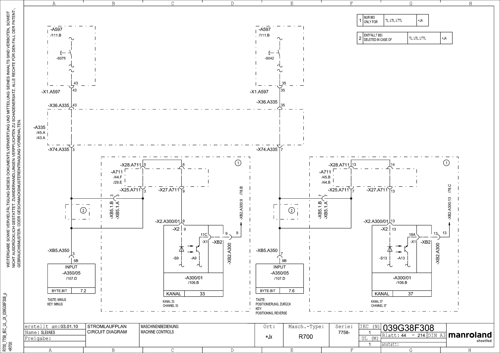

# +Jx — Sheet 44 of 214 — MASCHINENBEDIENUNG

**MACHINE CONTROLS**

> Part of the manroland **R700** printing press IEC/UL circuit diagrams.
> Drawing class: **Stromlaufplan / Circuit diagram** (DIN A3).
> Document `+Jx` covers the **1st printing module + feed register** machine section.

## At a glance

| Field | Value |
|---|---|
| Document | `+Jx`  (039G38F308) |
| Sheet | **44** of 214 |
| Section (DE) | MASCHINENBEDIENUNG |
| Section (EN) | MACHINE CONTROLS |
| Section type | CIRCUIT — Circuit diagram |
| Machine type | `R700` |
| Series | `7758` |
| Created | 03.01.10 |
| Replaces | — |
| Columns used | A, B, C, D, E, F, G, H |
| Path numbers | — |
| Labels on sheet | 127 |
| Cross-refs out | 14 |
| Cross-refs in | 38 |

**Previous:** [+Jx sheet 43](SHEET_0043.md) · **Next:** [+Jx sheet 45](SHEET_0045.md) · **Document TOC:** [_TOC.md](_TOC.md)  (+Jx) · **Master TOC:** [all sheets](../_MASTER_TOC.md)

## Sheet image (300 DPI, exact vector render)



_Rendered directly from the PDF vector layer at 300 DPI (1-bit), no OCR and no resampling. Use it to confirm anything ambiguous in the text below._

## Cross-references on this sheet

Each entry is a wire leaving this sheet. The printed token is `/sheet.column`; the link resolves to that sheet inside the same document.

| Ref | Target sheet | Col | Path | Destination on target | Target section | From col |
|---|---|---|---|---|---|---|
| `/111.B` | [+Jx sheet 111](SHEET_0111.md) | B | — | — | REFERENZMODUL | A |
| `/111.B` | [+Jx sheet 111](SHEET_0111.md) | B | — | — | REFERENZMODUL | E |
| `/45.A` | [+Jx sheet 45](SHEET_0045.md) | A | — | — | MASCHINENBEDIENUNG | A |
| `/43.A` | [+Jx sheet 43](SHEET_0043.md) | A | — | — | LAUFKOMMANDOS | A |
| `/45.B` | [+Jx sheet 45](SHEET_0045.md) | B | — | — | MASCHINENBEDIENUNG | F |
| `/44.B` | [+Jx sheet 44](SHEET_0044.md) | B | — | — | MASCHINENBEDIENUNG | F |
| `/44.F` | [+Jx sheet 44](SHEET_0044.md) | F | — | — | MASCHINENBEDIENUNG | B |
| `/29.E` | [+Jx sheet 29](SHEET_0029.md) | E | — | — | KAMMERRAKEL | B |
| `/78.C` | [+Jx sheet 78](SHEET_0078.md) | C | — | XB2.A300:13 | BUSVERBINDUNGEN: SICHERHEITSKREIS | H |
| `/78.B` | [+Jx sheet 78](SHEET_0078.md) | B | — | XB2.A300:9 | BUSVERBINDUNGEN: SICHERHEITSKREIS | D |
| `/107.D` | [+Jx sheet 107](SHEET_0107.md) | D | — | — | REFERENZMODUL | A |
| `/107.D` | [+Jx sheet 107](SHEET_0107.md) | D | — | — | REFERENZMODUL | E |
| `/106.B` | [+Jx sheet 106](SHEET_0106.md) | B | — | — | REFERENZMODUL | C |
| `/106.B` | [+Jx sheet 106](SHEET_0106.md) | B | — | — | REFERENZMODUL | G |

### Incoming references (sheets that point here)

Every other sheet that sends a wire to this one. `Back-ref` is the token printed on *that* sheet; `Path` is its line number.

| From sheet | Cols | Back-ref | Path | Refs | What continues there |
|---|---|---|---|---|---|
| [+Jx#29](SHEET_0029.md) | E | `/29.E` | — | 1 | — |
| [+Jx#43](SHEET_0043.md) | A | `/43.A` | — | 1 | — |
| [+Jx#44](SHEET_0044.md) | B, F | `/44.B`, `/44.F` | — | 2 | — |
| [+Jx#45](SHEET_0045.md) | A, B | `/45.A`, `/45.B` | — | 2 | — |
| [+Jx#78](SHEET_0078.md) | B, C | `/78.B`, `/78.C` | — | 2 | XB2.A300:13; XB2.A300:9 |
| [+Jx#106](SHEET_0106.md) | B | `/106.B` | — | 2 | — |
| [+Jx#107](SHEET_0107.md) | D | `/107.D` | — | 2 | — |
| [+Jx#111](SHEET_0111.md) | B | `/111.B` | — | 2 | — |
| [+Jx#115](SHEET_0115.md) | F | `/115.F` | — | 2 | — |
| [+Jx#124](SHEET_0124.md) | E, G | `/124.E`, `/124.G` | — | 4 | — |
| [+Jx#131](SHEET_0131.md) | A, B | `/131.A`, `/131.B` | — | 4 | — |
| [+Jx#132](SHEET_0132.md) | C | `/132.C` | — | 2 | — |
| [+Jx#143](SHEET_0143.md) | B | `/143.B` | — | 2 | — |
| [+Jx#144](SHEET_0144.md) | F | `/144.F` | — | 2 | — |
| [+Jx#146](SHEET_0146.md) | C | `/146.C` | — | 4 | — |
| [+Jx#149](SHEET_0149.md) | G | `/149.G` | — | 2 | — |
| [+Jx#154](SHEET_0154.md) | A | `/154.A` | — | 2 | — |


## Devices on this sheet

| Tag | Class | Class meaning (IEC) | Col | Sub | Terminal | Sign |
|---|---|---|---|---|---|---|
| `A335` | A | Baugruppe / assembly, module, PC board | A | — | — | — |
| `A711` | A | Baugruppe / assembly, module, PC board | B | — | — | — |
| `S9` | S | Schalter / switch | C | — | — | — |
| `A9` | A | Baugruppe / assembly, module, PC board | C | — | — | — |
| `X1` | X | Klemme / terminal, plug connector | D | — | — | — |
| `X2` | X | Klemme / terminal, plug connector | C | — | — | — |
| `XB2` | XB |  | D | — | — | — |
| `A300/01` | A | Baugruppe / assembly, module, PC board | C | 01 | — | — |
| `A350/05` | A | Baugruppe / assembly, module, PC board | E | 05 | — | — |
| `A711` | A | Baugruppe / assembly, module, PC board | F | — | — | — |
| `S13` | S | Schalter / switch | G | — | — | — |
| `A13` | A | Baugruppe / assembly, module, PC board | G | — | — | — |
| `X1` | X | Klemme / terminal, plug connector | G | — | — | — |
| `X2` | X | Klemme / terminal, plug connector | G | — | — | — |
| `XB2` | XB |  | G | — | — | — |
| `A300/01` | A | Baugruppe / assembly, module, PC board | G | 01 | — | — |
| `S075` | S | Schalter / switch | A | — | — | — |
| `A597` | A | Baugruppe / assembly, module, PC board | A | — | — | — |
| `S042` | S | Schalter / switch | E | — | — | — |
| `A597` | A | Baugruppe / assembly, module, PC board | E | — | — | — |
| `A350/05` | A | Baugruppe / assembly, module, PC board | A | 05 | — | — |
| `X74.A335` | — | cross-device reference | A | — | — | — |
| `X36.A335` | — | cross-device reference | A | — | — | — |
| `X28.A711` | — | cross-device reference | B | — | — | — |
| `X25.A711` | — | cross-device reference | B | — | — | — |
| `XB5.1.A` | — | cross-device reference | B | — | — | — |
| `XB5.1.B` | — | cross-device reference | B | — | — | — |
| `XB2.A300` | — | cross-device reference | D | — | — | — |
| `X27.A711` | — | cross-device reference | C | — | — | — |
| `7.6` | — | cross-device reference | E | — | — | — |
| `XB5.A350` | — | cross-device reference | E | — | — | — |
| `X74.A335` | — | cross-device reference | E | — | — | — |
| `X36.A335` | — | cross-device reference | E | — | — | — |
| `X28.A711` | — | cross-device reference | F | — | — | — |
| `X25.A711` | — | cross-device reference | F | — | — | — |
| `XB5.1.A` | — | cross-device reference | F | — | — | — |
| `XB5.1.B` | — | cross-device reference | E | — | — | — |
| `XB2.A300` | — | cross-device reference | G | — | — | — |
| `X27.A711` | — | cross-device reference | F | — | — | — |
| `X1.A597` | — | cross-device reference | A | — | — | — |
| `X1.A597` | — | cross-device reference | D | — | — | — |
| `7.2` | — | cross-device reference | A | — | — | — |
| `XB5.A350` | — | cross-device reference | A | — | — | — |
| `XB2.A300:13` | — | cross-device reference | H | — | 13 | — |
| `XB2.A300:9` | — | cross-device reference | D | — | 9 | — |

## Potentials / nets

_No named potentials on this sheet._

## Wire-end annotations (grouped as printed)

A wire that continues elsewhere is annotated with a small cluster: the destination description, the path/line number `#NN`, and the `/sheet.column` cross reference. Each row below is one such cluster exactly as it is grouped on the drawing.

| Col | Y | Path | Cross-ref | Text on the wire |
|---|---|---|---|---|
| F | 38.8 | — | — | `1 NUR BEI ONLY FOR TL, LTL, LTTL` |
| G | 45.9 | — | — | `+JA` |
| A | 65.4 | — | — | `A597` |
| E | 65.4 | — | — | `A597` |
| A | 80.3 | — | `/111.B` | — |
| E | 80.3 | — | `/111.B` | — |
| G | 81.3 | — | — | `2 ENTFÄLLT BEI DELETED IN CASE OF TL, LTL, LTTL` |
| H | 88.4 | — | — | `+JA` |
| A | 135.3 | — | — | `S075` |
| E | 135.3 | — | — | `S042` |
| A | 194.4 | — | — | `43` |
| E | 194.4 | — | — | `35` |
| A | 211.4 | — | — | `X1.A597 43` |
| E | 211.4 | — | — | `X1.A597 35` |
| E | 238.3 | — | — | `X36.A335 35` |
| A | 246.8 | — | — | `X36.A335 43` |
| A | 299.3 | — | — | `A335` |
| A | 312.4 | — | `/45.A`, `/43.A` | — |
| A | 351.7 | — | — | `X74.A335 3` |
| E | 351.7 | — | — | `X74.A335 7` |
| F | 385.3 | — | — | `1 1` |
| B | 388.6 | — | — | `X28.A711 5` |
| C | 388.6 | — | — | `6` |
| F | 388.6 | — | — | `X28.A711 13` |
| G | 388.6 | — | — | `14` |
| B | 405.6 | — | — | `A711` |
| F | 405.6 | — | — | `A711` |
| B | 418.7 | — | `/44.F`, `/29.E` | — |
| F | 418.7 | — | `/45.B`, `/44.B` | — |
| H | 438.9 | — | `/78.C` | `XB2.A300:13` |
| D | 444.2 | — | `/78.B` | `XB2.A300:9` |
| B | 448.1 | — | — | `X25.A711 3` |
| C | 448.1 | — | — | `X27.A711 9` |
| F | 448.1 | — | — | `X25.A711 7` |
| F | 448.1 | — | — | `X27.A711 13` |
| B | 463.9 | — | — | `XB5.1.B 3` |
| B | 463.9 | — | — | `XB5.1.A 3` |
| E | 463.9 | — | — | `XB5.1.B 7` |
| F | 463.9 | — | — | `XB5.1.A 7` |
| C | 499.1 | — | — | `2 2` |
| C | 523.2 | — | — | `X2.A300/01 9` |
| F | 523.2 | — | — | `X2.A300/01 13` |
| C | 541.7 | — | — | `X2` |
| G | 541.7 | — | — | `X2` |
| D | 543.1 | — | — | `9 9` |
| G | 543.1 | — | — | `13 13` |
| D | 551.6 | — | — | `9` |
| H | 551.6 | — | — | `13` |
| G | 555.8 | — | — | `18A` |
| D | 555.9 | — | — | `11C` |
| D | 572.8 | — | — | `X1` |
| G | 572.8 | — | — | `X1` |
| D | 572.9 | — | — | `XB2` |
| G | 572.9 | — | — | `XB2` |
| D | 579.1 | — | — | `XB2.A300` |
| G | 579.1 | — | — | `XB2.A300` |
| A | 592.7 | — | — | `XB5.A350 3` |
| E | 592.7 | — | — | `XB5.A350 7` |
| C | 611.8 | — | — | `S9 A9` |
| G | 611.8 | — | — | `S13 A13` |
| A | 618.2 | — | — | `5B` |
| E | 618.2 | — | — | `9B` |
| A | 632.7 | — | — | `INPUT` |
| E | 632.7 | — | — | `INPUT` |
| A | 646.5 | — | — | `A350/05` |
| E | 646.5 | — | — | `A350/05` |
| C | 657.9 | — | — | `A300/01` |
| G | 657.9 | — | — | `A300/01` |
| A | 660.4 | — | `/107.D` | — |
| E | 660.4 | — | `/107.D` | — |
| C | 670.2 | — | `/106.B` | — |
| G | 670.2 | — | `/106.B` | — |
| A | 689.4 | — | — | `BYTE.BIT 7.2` |
| E | 689.4 | — | — | `BYTE.BIT 7.6` |
| C | 696.1 | — | — | `KANAL 33` |
| G | 696.1 | — | — | `KANAL 37` |
| E | 712.0 | — | — | `POSITIONIERUNG, ZURÜCK KEY: POSITIONING, REVERSE TASTE:` |
| A | 712.1 | — | — | `KEY: MINUS TASTE: MINUS` |
| C | 716.5 | — | — | `KANAL 33 CHANNEL 33` |
| F | 716.5 | — | — | `KANAL 37 CHANNEL 37` |


## Reconstructed tables

This sheet carries tabular content (pin map / terminal assignment / index). The grid below was rebuilt from the drawing's own rule lines, so each row is exactly one physical row of the table.

### Table 1 — 5 data rows × 2 columns (at x=113.4, y=62.4)

| A597 /111.B S075 | 43 |
|---|---|
| `X1.A597 X36.A335 X74.A335` | `43 43 3` |
|  | `2` |
| `XB5.A350` | `3 5B` |
| `INPUT A350/05` | `/107.D` |
| `BYTE.BIT` | `7.2` |


### Table 2 — 8 data rows × 9 columns (at x=340.2, y=62.4)

|  |  |  |  |  |  |  | A597 /111.B S042 | 35 |
|---|---|---|---|---|---|---|---|---|
|  |  |  |  |  |  |  | `X1.A597 X36.A335 X74.A335` | `35 35 7` |
| `5 3` | `X27.A711` | `6 9` |  |  | `1` | `/78.B` |  |  |
|  | `X2.A300/01` | `9` |  |  |  | `XB2.A300:9` |  | `2` |
|  | `X2 S9` | `9 A9` | `11C X1` | `XB2` | `9 9 XB2.A300` |  | `XB5.A350` | `7 9B` |
|  |  |  |  |  |  |  | `INPUT` |  |
|  |  | `A300/01 /106.B` |  |  |  |  |  | `A350/05 /107.D` |
|  |  |  |  |  |  |  | `BYTE.BIT` | `7.6` |
|  | `KANAL` |  | `33` |  |  |  |  |  |


### Table 3 — 4 data rows × 6 columns (at x=836.2, y=381.3)

| 13 7 | X27.A711 | 14 13 |  |  | 1 |
|---|---|---|---|---|---|
|  | `X2.A300/01` | `13` |  |  |  |
|  | `X2 S13` | `13 A13` | `18A X1` | `XB2` | `13 13 XB2.A300` |
|  |  | `A300/01 /106.B` |  |  |  |
|  | `KANAL` |  | `37` |  |  |


## Notes and free text on this sheet

| Text | Col | Y (pt) |
|---|---|---|
| `KANAL 33` | C | 716.49 |
| `CHANNEL 33` | C | 726.43 |
| `11C` | D | 555.86 |
| `KANAL` | C | 696.14 |
| `X2.A300/01` | C | 523.23 |
| `9B` | E | 618.17 |
| `INPUT` | E | 632.7 |
| `BYTE.BIT` | E | 689.96 |
| `TASTE:` | D | 712.02 |
| `POSITIONIERUNG, ZURÜCK` | E | 722.72 |
| `KEY:` | D | 733.22 |
| `POSITIONING, REVERSE` | E | 743.96 |
| `KANAL 37` | F | 716.49 |
| `CHANNEL 37` | F | 726.43 |
| `18A` | G | 555.82 |
| `KANAL` | G | 696.14 |
| `X2.A300/01` | F | 523.23 |
| `5B` | A | 618.17 |
| `INPUT` | A | 632.7 |
| `BYTE.BIT` | A | 689.96 |
| `TASTE: MINUS` | A | 712.07 |
| `KEY: MINUS` | A | 722.69 |
| `NUR BEI` | F | 38.81 |
| `ONLY FOR` | F | 49.49 |
| `TL, LTL, LTTL` | G | 45.93 |
| `ENTFÄLLT BEI` | F | 81.33 |
| `DELETED IN CASE OF` | F | 91.99 |
| `+JA` | G | 45.89 |
| `+JA` | H | 88.41 |

## Complete label inventory (exact text from the drawing)

Every text object inside the drawing area of this sheet, in DIN reading order (column A→H, then top→bottom). This is the authoritative list: if a string is not here it is not printed on this sheet.

| Col | Y | X | Dir | Type | Text |
|---|---|---|---|---|---|
| A | 65.4 | 120.2 | → | device tag | `A597` |
| A | 80.3 | 120.5 | → | cross-reference | `/111.B` |
| A | 135.3 | 134.4 | → | device tag | `S075` |
| A | 194.4 | 175.7 | → | number | `43` |
| A | 211.4 | 172.9 | → | number | `43` |
| A | 214.3 | 98.9 | → | device ref | `X1.A597` |
| A | 246.8 | 114.5 | → | device ref | `X36.A335` |
| A | 246.9 | 172.9 | → | number | `43` |
| A | 299.3 | 79.7 | → | device tag | `A335` |
| A | 312.4 | 87.0 | → | cross-reference | `/45.A` |
| A | 324.8 | 87.0 | → | cross-reference | `/43.A` |
| A | 351.7 | 114.5 | → | device ref | `X74.A335` |
| A | 353.2 | 172.6 | → | number | `3` |
| A | 499.1 | 196.4 | → | number | `2` |
| A | 592.7 | 113.7 | → | device ref | `XB5.A350` |
| A | 601.2 | 172.6 | → | number | `3` |
| A | 618.2 | 175.5 | → | text | `5B` |
| A | 632.7 | 155.2 | → | text | `INPUT` |
| A | 646.5 | 148.5 | → | device tag | `A350/05` |
| A | 660.4 | 157.3 | → | cross-reference | `/107.D` |
| A | 689.4 | 191.6 | → | device ref | `7.2` |
| A | 690.0 | 123.3 | → | text | `BYTE.BIT` |
| A | 712.1 | 113.4 | → | text | `TASTE: MINUS` |
| A | 722.7 | 112.8 | → | text | `KEY: MINUS` |
| B | 388.6 | 286.3 | → | device ref | `X28.A711` |
| B | 405.6 | 264.2 | → | device tag | `A711` |
| B | 418.7 | 270.7 | → | cross-reference | `/44.F` |
| B | 431.1 | 270.1 | → | cross-reference | `/29.E` |
| B | 448.1 | 284.9 | → | device ref | `X25.A711` |
| B | 463.9 | 262.5 | ↕ | number | `3` |
| B | 463.9 | 276.6 | ↕ | number | `3` |
| B | 479.9 | 261.0 | ↕ | device ref | `XB5.1.B` |
| B | 480.5 | 275.2 | ↕ | device ref | `XB5.1.A` |
| C | 388.6 | 342.7 | → | number | `5` |
| C | 388.6 | 434.8 | → | number | `6` |
| C | 448.1 | 377.0 | → | device ref | `X27.A711` |
| C | 452.4 | 342.7 | → | number | `3` |
| C | 452.4 | 434.8 | → | number | `9` |
| C | 523.2 | 369.6 | → | text | `X2.A300/01` |
| C | 523.3 | 434.8 | → | number | `9` |
| C | 541.7 | 410.7 | → | device tag | `X2` |
| C | 543.1 | 437.7 | → | number | `9` |
| C | 611.8 | 411.9 | → | device tag | `S9` |
| C | 611.8 | 454.4 | → | device tag | `A9` |
| C | 657.9 | 439.9 | → | device tag | `A300/01` |
| C | 670.2 | 448.0 | → | cross-reference | `/106.B` |
| C | 696.1 | 396.3 | → | text | `KANAL` |
| C | 696.1 | 475.9 | → | number | `33` |
| C | 716.5 | 387.8 | → | text | `KANAL 33` |
| C | 726.4 | 388.1 | → | text | `CHANNEL 33` |
| D | 214.3 | 595.0 | → | device ref | `X1.A597` |
| D | 385.3 | 565.1 | → | number | `1` |
| D | 444.2 | 570.7 | ↕ | cross-reference | `/78.B` |
| D | 474.8 | 570.7 | ↕ | device ref | `XB2.A300:9` |
| D | 551.6 | 562.4 | → | number | `9` |
| D | 553.0 | 536.9 | → | number | `9` |
| D | 555.9 | 477.6 | → | text | `11C` |
| D | 572.8 | 481.0 | → | device tag | `X1` |
| D | 572.8 | 505.7 | → | device tag | `XB2` |
| D | 579.1 | 541.7 | ↕ | device ref | `XB2.A300` |
| D | 712.0 | 609.4 | → | text | `TASTE:` |
| D | 733.2 | 608.9 | → | text | `KEY:` |
| E | 65.4 | 616.3 | → | device tag | `A597` |
| E | 80.3 | 616.5 | → | cross-reference | `/111.B` |
| E | 135.3 | 630.4 | → | device tag | `S042` |
| E | 194.4 | 671.5 | → | number | `35` |
| E | 211.4 | 668.7 | → | number | `35` |
| E | 238.3 | 610.6 | → | device ref | `X36.A335` |
| E | 246.9 | 668.7 | → | number | `35` |
| E | 351.7 | 610.6 | → | device ref | `X74.A335` |
| E | 353.2 | 668.7 | → | number | `7` |
| E | 463.9 | 758.5 | ↕ | number | `7` |
| E | 479.9 | 757.1 | ↕ | device ref | `XB5.1.B` |
| E | 499.1 | 692.5 | → | number | `2` |
| E | 592.7 | 609.7 | → | device ref | `XB5.A350` |
| E | 601.2 | 668.7 | → | number | `7` |
| E | 618.2 | 671.5 | → | text | `9B` |
| E | 632.7 | 651.3 | → | text | `INPUT` |
| E | 646.5 | 644.6 | → | device tag | `A350/05` |
| E | 660.4 | 653.4 | → | cross-reference | `/107.D` |
| E | 689.4 | 687.7 | → | device ref | `7.6` |
| E | 690.0 | 619.4 | → | text | `BYTE.BIT` |
| E | 722.7 | 608.9 | → | text | `POSITIONIERUNG, ZURÜCK` |
| E | 744.0 | 608.9 | → | text | `POSITIONING, REVERSE` |
| F | 38.8 | 866.8 | → | text | `NUR BEI` |
| F | 44.1 | 854.9 | → | number | `1` |
| F | 49.5 | 867.1 | → | text | `ONLY FOR` |
| F | 81.3 | 866.8 | → | text | `ENTFÄLLT BEI` |
| F | 86.7 | 854.6 | → | number | `2` |
| F | 92.0 | 866.8 | → | text | `DELETED IN CASE OF` |
| F | 388.6 | 782.4 | → | device ref | `X28.A711` |
| F | 388.6 | 838.2 | → | number | `13` |
| F | 405.6 | 760.3 | → | device tag | `A711` |
| F | 418.7 | 766.2 | → | cross-reference | `/45.B` |
| F | 431.1 | 766.2 | → | cross-reference | `/44.B` |
| F | 448.1 | 780.9 | → | device ref | `X25.A711` |
| F | 448.1 | 873.1 | → | device ref | `X27.A711` |
| F | 452.4 | 838.8 | → | number | `7` |
| F | 463.9 | 772.7 | ↕ | number | `7` |
| F | 480.5 | 771.3 | ↕ | device ref | `XB5.1.A` |
| F | 523.2 | 865.7 | → | text | `X2.A300/01` |
| F | 716.5 | 883.8 | → | text | `KANAL 37` |
| F | 726.4 | 884.1 | → | text | `CHANNEL 37` |
| G | 45.9 | 917.7 | → | text | `TL, LTL, LTTL` |
| G | 45.9 | 995.4 | → | text | `+JA` |
| G | 88.5 | 974.4 | → | text | `TL, LTL, LTTL` |
| G | 388.6 | 930.3 | → | number | `14` |
| G | 452.4 | 930.3 | → | number | `13` |
| G | 523.3 | 930.3 | → | number | `13` |
| G | 541.7 | 906.8 | → | device tag | `X2` |
| G | 543.1 | 933.2 | → | number | `13` |
| G | 553.0 | 1032.4 | → | number | `13` |
| G | 555.8 | 973.7 | → | text | `18A` |
| G | 572.8 | 977.1 | → | device tag | `X1` |
| G | 572.8 | 1001.8 | → | device tag | `XB2` |
| G | 579.1 | 1037.7 | ↕ | device ref | `XB2.A300` |
| G | 611.8 | 903.1 | → | device tag | `S13` |
| G | 611.8 | 945.6 | → | device tag | `A13` |
| G | 657.9 | 936.0 | → | device tag | `A300/01` |
| G | 670.2 | 944.1 | → | cross-reference | `/106.B` |
| G | 696.1 | 892.3 | → | text | `KANAL` |
| G | 696.1 | 972.0 | → | number | `37` |
| H | 88.4 | 1052.1 | → | text | `+JA` |
| H | 385.3 | 1061.1 | → | number | `1` |
| H | 438.9 | 1066.8 | ↕ | cross-reference | `/78.C` |
| H | 470.0 | 1066.8 | ↕ | device ref | `XB2.A300:13` |
| H | 551.6 | 1053.6 | → | number | `13` |

## Reading-order text block

The same content as a plain block, grouped by DIN column — convenient to paste or to match against a visual description.

```text
=== Column A ===
  65.4  120.2  devtag       A597
  80.3  120.5  xref         /111.B
 135.3  134.4  devtag       S075
 194.4  175.7  numeric      43
 211.4  172.9  numeric      43
 214.3   98.9  devref       X1.A597
 246.8  114.5  devref       X36.A335
 246.9  172.9  numeric      43
 299.3   79.7  devtag       A335
 312.4   87.0  xref         /45.A
 324.8   87.0  xref         /43.A
 351.7  114.5  devref       X74.A335
 353.2  172.6  numeric      3
 499.1  196.4  numeric      2
 592.7  113.7  devref       XB5.A350
 601.2  172.6  numeric      3
 618.2  175.5  text         5B
 632.7  155.2  text         INPUT
 646.5  148.5  devtag       A350/05
 660.4  157.3  xref         /107.D
 689.4  191.6  devref       7.2
 690.0  123.3  text         BYTE.BIT
 712.1  113.4  text         TASTE: MINUS
 722.7  112.8  text         KEY: MINUS
=== Column B ===
 388.6  286.3  devref       X28.A711
 405.6  264.2  devtag       A711
 418.7  270.7  xref         /44.F
 431.1  270.1  xref         /29.E
 448.1  284.9  devref       X25.A711
 463.9  262.5  numeric      3
 463.9  276.6  numeric      3
 479.9  261.0  devref       XB5.1.B
 480.5  275.2  devref       XB5.1.A
=== Column C ===
 388.6  342.7  numeric      5
 388.6  434.8  numeric      6
 448.1  377.0  devref       X27.A711
 452.4  342.7  numeric      3
 452.4  434.8  numeric      9
 523.2  369.6  text         X2.A300/01
 523.3  434.8  numeric      9
 541.7  410.7  devtag       X2
 543.1  437.7  numeric      9
 611.8  411.9  devtag       S9
 611.8  454.4  devtag       A9
 657.9  439.9  devtag       A300/01
 670.2  448.0  xref         /106.B
 696.1  396.3  text         KANAL
 696.1  475.9  numeric      33
 716.5  387.8  text         KANAL 33
 726.4  388.1  text         CHANNEL 33
=== Column D ===
 214.3  595.0  devref       X1.A597
 385.3  565.1  numeric      1
 444.2  570.7  xref         /78.B
 474.8  570.7  devref       XB2.A300:9
 551.6  562.4  numeric      9
 553.0  536.9  numeric      9
 555.9  477.6  text         11C
 572.8  481.0  devtag       X1
 572.8  505.7  devtag       XB2
 579.1  541.7  devref       XB2.A300
 712.0  609.4  text         TASTE:
 733.2  608.9  text         KEY:
=== Column E ===
  65.4  616.3  devtag       A597
  80.3  616.5  xref         /111.B
 135.3  630.4  devtag       S042
 194.4  671.5  numeric      35
 211.4  668.7  numeric      35
 238.3  610.6  devref       X36.A335
 246.9  668.7  numeric      35
 351.7  610.6  devref       X74.A335
 353.2  668.7  numeric      7
 463.9  758.5  numeric      7
 479.9  757.1  devref       XB5.1.B
 499.1  692.5  numeric      2
 592.7  609.7  devref       XB5.A350
 601.2  668.7  numeric      7
 618.2  671.5  text         9B
 632.7  651.3  text         INPUT
 646.5  644.6  devtag       A350/05
 660.4  653.4  xref         /107.D
 689.4  687.7  devref       7.6
 690.0  619.4  text         BYTE.BIT
 722.7  608.9  text         POSITIONIERUNG, ZURÜCK
 744.0  608.9  text         POSITIONING, REVERSE
=== Column F ===
  38.8  866.8  text         NUR BEI
  44.1  854.9  numeric      1
  49.5  867.1  text         ONLY FOR
  81.3  866.8  text         ENTFÄLLT BEI
  86.7  854.6  numeric      2
  92.0  866.8  text         DELETED IN CASE OF
 388.6  782.4  devref       X28.A711
 388.6  838.2  numeric      13
 405.6  760.3  devtag       A711
 418.7  766.2  xref         /45.B
 431.1  766.2  xref         /44.B
 448.1  780.9  devref       X25.A711
 448.1  873.1  devref       X27.A711
 452.4  838.8  numeric      7
 463.9  772.7  numeric      7
 480.5  771.3  devref       XB5.1.A
 523.2  865.7  text         X2.A300/01
 716.5  883.8  text         KANAL 37
 726.4  884.1  text         CHANNEL 37
=== Column G ===
  45.9  917.7  text         TL, LTL, LTTL
  45.9  995.4  text         +JA
  88.5  974.4  text         TL, LTL, LTTL
 388.6  930.3  numeric      14
 452.4  930.3  numeric      13
 523.3  930.3  numeric      13
 541.7  906.8  devtag       X2
 543.1  933.2  numeric      13
 553.0 1032.4  numeric      13
 555.8  973.7  text         18A
 572.8  977.1  devtag       X1
 572.8 1001.8  devtag       XB2
 579.1 1037.7  devref       XB2.A300
 611.8  903.1  devtag       S13
 611.8  945.6  devtag       A13
 657.9  936.0  devtag       A300/01
 670.2  944.1  xref         /106.B
 696.1  892.3  text         KANAL
 696.1  972.0  numeric      37
=== Column H ===
  88.4 1052.1  text         +JA
 385.3 1061.1  numeric      1
 438.9 1066.8  xref         /78.C
 470.0 1066.8  devref       XB2.A300:13
 551.6 1053.6  numeric      13
```

---
_Generated from the PDF vector text layer; no OCR. Source: `R700_7758_IEC_UL_JX_039G38F308_p`, sheet 44._
