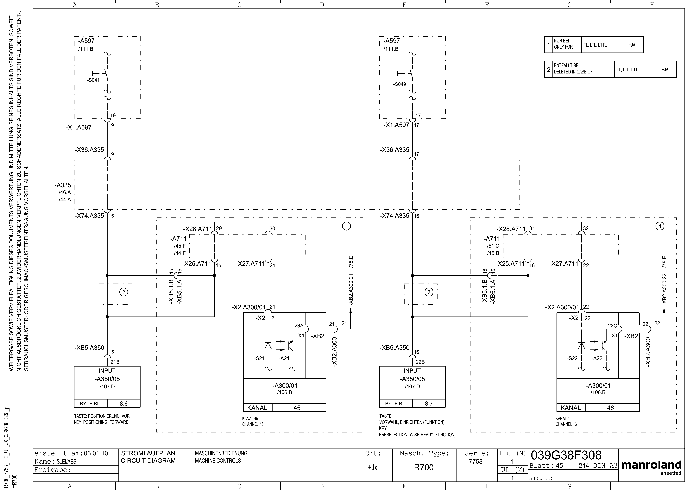

# +Jx — Sheet 45 of 214 — MASCHINENBEDIENUNG

**MACHINE CONTROLS**

> Part of the manroland **R700** printing press IEC/UL circuit diagrams.
> Drawing class: **Stromlaufplan / Circuit diagram** (DIN A3).
> Document `+Jx` covers the **1st printing module + feed register** machine section.

## At a glance

| Field | Value |
|---|---|
| Document | `+Jx`  (039G38F308) |
| Sheet | **45** of 214 |
| Section (DE) | MASCHINENBEDIENUNG |
| Section (EN) | MACHINE CONTROLS |
| Section type | CIRCUIT — Circuit diagram |
| Machine type | `R700` |
| Series | `7758` |
| Created | 03.01.10 |
| Replaces | — |
| Columns used | A, B, C, D, E, F, G, H |
| Path numbers | — |
| Labels on sheet | 127 |
| Cross-refs out | 14 |
| Cross-refs in | 38 |

**Previous:** [+Jx sheet 44](SHEET_0044.md) · **Next:** [+Jx sheet 46](SHEET_0046.md) · **Document TOC:** [_TOC.md](_TOC.md)  (+Jx) · **Master TOC:** [all sheets](../_MASTER_TOC.md)

## Sheet image (300 DPI, exact vector render)



_Rendered directly from the PDF vector layer at 300 DPI (1-bit), no OCR and no resampling. Use it to confirm anything ambiguous in the text below._

## Cross-references on this sheet

Each entry is a wire leaving this sheet. The printed token is `/sheet.column`; the link resolves to that sheet inside the same document.

| Ref | Target sheet | Col | Path | Destination on target | Target section | From col |
|---|---|---|---|---|---|---|
| `/111.B` | [+Jx sheet 111](SHEET_0111.md) | B | — | — | REFERENZMODUL | A |
| `/111.B` | [+Jx sheet 111](SHEET_0111.md) | B | — | — | REFERENZMODUL | E |
| `/46.A` | [+Jx sheet 46](SHEET_0046.md) | A | — | — | MASCHINENBEDIENUNG | A |
| `/44.A` | [+Jx sheet 44](SHEET_0044.md) | A | — | — | MASCHINENBEDIENUNG | A |
| `/45.F` | [+Jx sheet 45](SHEET_0045.md) | F | — | — | MASCHINENBEDIENUNG | B |
| `/44.F` | [+Jx sheet 44](SHEET_0044.md) | F | — | — | MASCHINENBEDIENUNG | B |
| `/51.C` | [+Jx sheet 51](SHEET_0051.md) | C | — | — | SIGNALGEBER: AKUSTISCHE WARNSIGNALE | F |
| `/45.B` | [+Jx sheet 45](SHEET_0045.md) | B | — | — | MASCHINENBEDIENUNG | F |
| `/78.E` | [+Jx sheet 78](SHEET_0078.md) | E | — | XB2.A300:21 | BUSVERBINDUNGEN: SICHERHEITSKREIS | D |
| `/78.E` | [+Jx sheet 78](SHEET_0078.md) | E | — | XB2.A300:22 | BUSVERBINDUNGEN: SICHERHEITSKREIS | H |
| `/107.D` | [+Jx sheet 107](SHEET_0107.md) | D | — | — | REFERENZMODUL | A |
| `/107.D` | [+Jx sheet 107](SHEET_0107.md) | D | — | — | REFERENZMODUL | E |
| `/106.B` | [+Jx sheet 106](SHEET_0106.md) | B | — | — | REFERENZMODUL | D |
| `/106.B` | [+Jx sheet 106](SHEET_0106.md) | B | — | — | REFERENZMODUL | G |

### Incoming references (sheets that point here)

Every other sheet that sends a wire to this one. `Back-ref` is the token printed on *that* sheet; `Path` is its line number.

| From sheet | Cols | Back-ref | Path | Refs | What continues there |
|---|---|---|---|---|---|
| [+Jx#44](SHEET_0044.md) | A, F | `/44.A`, `/44.F` | — | 2 | — |
| [+Jx#45](SHEET_0045.md) | B, F | `/45.B`, `/45.F` | — | 2 | — |
| [+Jx#46](SHEET_0046.md) | A | `/46.A` | — | 1 | — |
| [+Jx#51](SHEET_0051.md) | C | `/51.C` | — | 1 | — |
| [+Jx#78](SHEET_0078.md) | E | `/78.E` | — | 2 | XB2.A300:21; XB2.A300:22 |
| [+Jx#106](SHEET_0106.md) | B | `/106.B` | — | 2 | — |
| [+Jx#107](SHEET_0107.md) | D | `/107.D` | — | 2 | — |
| [+Jx#111](SHEET_0111.md) | B | `/111.B` | — | 2 | — |
| [+Jx#115](SHEET_0115.md) | E | `/115.E` | — | 2 | — |
| [+Jx#124](SHEET_0124.md) | F, H | `/124.F`, `/124.H` | — | 4 | — |
| [+Jx#131](SHEET_0131.md) | A, B | `/131.A`, `/131.B` | — | 4 | — |
| [+Jx#132](SHEET_0132.md) | C | `/132.C` | — | 2 | — |
| [+Jx#143](SHEET_0143.md) | B | `/143.B` | — | 2 | — |
| [+Jx#144](SHEET_0144.md) | G | `/144.G` | — | 2 | — |
| [+Jx#146](SHEET_0146.md) | D | `/146.D` | — | 4 | — |
| [+Jx#149](SHEET_0149.md) | F | `/149.F` | — | 2 | — |
| [+Jx#154](SHEET_0154.md) | A | `/154.A` | — | 2 | — |


## Devices on this sheet

| Tag | Class | Class meaning (IEC) | Col | Sub | Terminal | Sign |
|---|---|---|---|---|---|---|
| `A711` | A | Baugruppe / assembly, module, PC board | B | — | — | — |
| `S21` | S | Schalter / switch | C | — | — | — |
| `A21` | A | Baugruppe / assembly, module, PC board | D | — | — | — |
| `X1` | X | Klemme / terminal, plug connector | D | — | — | — |
| `X2` | X | Klemme / terminal, plug connector | C | — | — | — |
| `XB2` | XB |  | D | — | — | — |
| `A300/01` | A | Baugruppe / assembly, module, PC board | D | 01 | — | — |
| `A350/05` | A | Baugruppe / assembly, module, PC board | A | 05 | — | — |
| `A335` | A | Baugruppe / assembly, module, PC board | A | — | — | — |
| `S041` | S | Schalter / switch | A | — | — | — |
| `A597` | A | Baugruppe / assembly, module, PC board | A | — | — | — |
| `A350/05` | A | Baugruppe / assembly, module, PC board | E | 05 | — | — |
| `S049` | S | Schalter / switch | E | — | — | — |
| `A597` | A | Baugruppe / assembly, module, PC board | E | — | — | — |
| `A711` | A | Baugruppe / assembly, module, PC board | F | — | — | — |
| `S22` | S | Schalter / switch | G | — | — | — |
| `A22` | A | Baugruppe / assembly, module, PC board | G | — | — | — |
| `X1` | X | Klemme / terminal, plug connector | H | — | — | — |
| `X2` | X | Klemme / terminal, plug connector | G | — | — | — |
| `XB2` | XB |  | H | — | — | — |
| `A300/01` | A | Baugruppe / assembly, module, PC board | G | 01 | — | — |
| `X28.A711` | — | cross-device reference | B | — | — | — |
| `X25.A711` | — | cross-device reference | B | — | — | — |
| `XB5.1.A` | — | cross-device reference | B | — | — | — |
| `XB5.1.B` | — | cross-device reference | B | — | — | — |
| `XB2.A300` | — | cross-device reference | D | — | — | — |
| `X27.A711` | — | cross-device reference | C | — | — | — |
| `8.6` | — | cross-device reference | B | — | — | — |
| `XB5.A350` | — | cross-device reference | A | — | — | — |
| `X74.A335` | — | cross-device reference | A | — | — | — |
| `X36.A335` | — | cross-device reference | A | — | — | — |
| `X1.A597` | — | cross-device reference | A | — | — | — |
| `XB5.A350` | — | cross-device reference | E | — | — | — |
| `8.7` | — | cross-device reference | E | — | — | — |
| `X36.A335` | — | cross-device reference | E | — | — | — |
| `X74.A335` | — | cross-device reference | E | — | — | — |
| `X1.A597` | — | cross-device reference | E | — | — | — |
| `X28.A711` | — | cross-device reference | F | — | — | — |
| `X25.A711` | — | cross-device reference | F | — | — | — |
| `XB5.1.A` | — | cross-device reference | F | — | — | — |
| `XB5.1.B` | — | cross-device reference | F | — | — | — |
| `XB2.A300` | — | cross-device reference | H | — | — | — |
| `X27.A711` | — | cross-device reference | G | — | — | — |
| `XB2.A300:21` | — | cross-device reference | D | — | 21 | — |
| `XB2.A300:22` | — | cross-device reference | H | — | 22 | — |

## Potentials / nets

_No named potentials on this sheet._

## Wire-end annotations (grouped as printed)

A wire that continues elsewhere is annotated with a small cluster: the destination description, the path/line number `#NN`, and the `/sheet.column` cross reference. Each row below is one such cluster exactly as it is grouped on the drawing.

| Col | Y | Path | Cross-ref | Text on the wire |
|---|---|---|---|---|
| A | 65.4 | — | — | `A597` |
| E | 65.4 | — | — | `A597` |
| G | 67.2 | — | — | `1 NUR BEI ONLY FOR TL, LTL, LTTL` |
| H | 74.2 | — | — | `+JA` |
| A | 80.3 | — | `/111.B` | — |
| E | 80.3 | — | `/111.B` | — |
| G | 109.7 | — | — | `2 ENTFÄLLT BEI DELETED IN CASE OF TL, LTL, LTTL` |
| H | 116.8 | — | — | `+JA` |
| A | 133.9 | — | — | `S041` |
| E | 141.0 | — | — | `S049` |
| A | 194.4 | — | — | `19` |
| E | 194.4 | — | — | `17` |
| E | 210.0 | — | — | `X1.A597 17` |
| A | 211.4 | — | — | `X1.A597 19` |
| A | 252.5 | — | — | `X36.A335 19` |
| E | 252.5 | — | — | `X36.A335 17` |
| A | 313.5 | — | — | `A335` |
| A | 326.5 | — | `/46.A`, `/44.A` | — |
| A | 365.9 | — | — | `X74.A335 15` |
| E | 365.9 | — | — | `X74.A335 16` |
| F | 385.3 | — | — | `1 1` |
| C | 388.6 | — | — | `X28.A711 29` |
| C | 388.6 | — | — | `30` |
| F | 388.6 | — | — | `X28.A711 31` |
| G | 388.6 | — | — | `32` |
| B | 405.6 | — | — | `A711` |
| F | 405.6 | — | — | `A711` |
| B | 418.7 | — | `/45.F`, `/44.F` | — |
| F | 418.7 | — | `/51.C`, `/45.B` | — |
| D | 439.2 | — | `/78.E` | `XB2.A300:21` |
| H | 439.2 | — | `/78.E` | `XB2.A300:22` |
| C | 448.1 | — | — | `X25.A711 15` |
| C | 448.1 | — | — | `X27.A711 21` |
| F | 448.1 | — | — | `X25.A711 16` |
| G | 448.1 | — | — | `X27.A711 22` |
| B | 461.8 | — | — | `XB5.1.B 15` |
| B | 461.8 | — | — | `XB5.1.A 15` |
| F | 461.8 | — | — | `XB5.1.B 16` |
| F | 461.8 | — | — | `XB5.1.A 16` |
| C | 499.1 | — | — | `2 2` |
| C | 523.2 | — | — | `X2.A300/01 21` |
| G | 523.2 | — | — | `X2.A300/01 22` |
| C | 541.7 | — | — | `X2` |
| G | 541.7 | — | — | `X2` |
| D | 543.1 | — | — | `21 21` |
| H | 543.1 | — | — | `22 22` |
| D | 551.6 | — | — | `21` |
| H | 551.6 | — | — | `22` |
| D | 555.8 | — | — | `23A` |
| H | 555.9 | — | — | `23C` |
| D | 572.8 | — | — | `X1` |
| H | 572.8 | — | — | `X1` |
| D | 572.9 | — | — | `XB2` |
| H | 572.9 | — | — | `XB2` |
| D | 579.1 | — | — | `XB2.A300` |
| H | 579.1 | — | — | `XB2.A300` |
| A | 592.7 | — | — | `XB5.A350 15` |
| E | 592.7 | — | — | `XB5.A350 16` |
| C | 611.8 | — | — | `S21 A21` |
| G | 611.8 | — | — | `S22 A22` |
| A | 618.2 | — | — | `21B` |
| E | 618.2 | — | — | `22B` |
| A | 632.7 | — | — | `INPUT` |
| E | 632.7 | — | — | `INPUT` |
| A | 646.5 | — | — | `A350/05` |
| E | 646.5 | — | — | `A350/05` |
| D | 657.9 | — | — | `A300/01` |
| G | 657.9 | — | — | `A300/01` |
| A | 660.4 | — | `/107.D` | — |
| E | 660.4 | — | `/107.D` | — |
| D | 670.2 | — | `/106.B` | — |
| G | 670.2 | — | `/106.B` | — |
| A | 689.4 | — | — | `BYTE.BIT 8.6` |
| E | 689.4 | — | — | `BYTE.BIT 8.7` |
| C | 696.1 | — | — | `KANAL 45` |
| G | 696.1 | — | — | `KANAL 46` |
| E | 712.0 | — | — | `KEY: PRESELECTION, MAKE READY (FUNCTION) TASTE: VORWAHL, EINRICHTEN (FUNKTION)` |
| A | 712.1 | — | — | `KEY: POSITIONING, FORWARD TASTE: POSITIONIERUNG, VOR` |
| C | 716.5 | — | — | `KANAL 45 CHANNEL 45` |
| G | 716.5 | — | — | `KANAL 46 CHANNEL 46` |


## Reconstructed tables

This sheet carries tabular content (pin map / terminal assignment / index). The grid below was rebuilt from the drawing's own rule lines, so each row is exactly one physical row of the table.

### Table 1 — 5 data rows × 2 columns (at x=127.6, y=62.4)

| A597 /111.B S041 | 19 |
|---|---|
| `X1.A597 X36.A335 X74.A335` | `19 19 15` |
|  | `2` |
| `XB5.A350` | `15 21B` |
| `INPUT A350/05` | `/107.D` |
| `BYTE.BIT` | `8.6` |


### Table 2 — 8 data rows × 9 columns (at x=368.5, y=62.4)

|  |  |  |  |  |  |  | A597 /111.B S049 | 17 |
|---|---|---|---|---|---|---|---|---|
|  |  |  |  |  |  |  | `X1.A597 X36.A335 X74.A335` | `17 17 16` |
| `29 15` | `X27.A711` | `30 21` |  |  | `1` | `/78.E` |  |  |
|  | `X2.A300/01` | `21` |  |  |  | `XB2.A300:21` |  | `2` |
|  | `X2 S21` | `21 A21` | `23A X1` | `XB2` | `21 21 XB2.A300` |  | `XB5.A350` | `16 22B` |
|  |  |  |  |  |  |  | `INPUT` |  |
|  |  | `A300/01 /106.B` |  |  |  |  | `A350/05` | `/107.D` |
|  |  |  |  |  |  |  | `BYTE.BIT` | `8.7` |
|  | `KANAL` |  | `45` |  |  |  |  |  |


### Table 3 — 4 data rows × 6 columns (at x=907.1, y=381.3)

| 31 16 | X27.A711 | 32 22 |  |  | 1 |
|---|---|---|---|---|---|
|  | `X2.A300/01` | `22` |  |  |  |
|  | `X2 S22` | `22 A22` | `23C X1` | `XB2` | `22 22 XB2.A300` |
|  |  | `A300/01 /106.B` |  |  |  |
|  | `KANAL` |  | `46` |  |  |


## Notes and free text on this sheet

| Text | Col | Y (pt) |
|---|---|---|
| `KANAL 45` | C | 716.49 |
| `CHANNEL 45` | C | 726.43 |
| `23A` | D | 555.82 |
| `KANAL` | C | 696.14 |
| `X2.A300/01` | C | 523.23 |
| `21B` | A | 618.18 |
| `INPUT` | A | 632.7 |
| `BYTE.BIT` | A | 689.96 |
| `TASTE: POSITIONIERUNG, VOR` | A | 712.07 |
| `KEY: POSITIONING, FORWARD` | A | 722.68 |
| `22B` | E | 618.18 |
| `INPUT` | E | 632.7 |
| `BYTE.BIT` | E | 689.96 |
| `TASTE:` | E | 712.02 |
| `VORWAHL, EINRICHTEN (FUNKTION)` | E | 722.71 |
| `KEY:` | E | 733.22 |
| `PRESELECTION, MAKE READY (FUNCTION)` | E | 743.98 |
| `KANAL 46` | G | 716.49 |
| `CHANNEL 46` | G | 726.43 |
| `23C` | H | 555.86 |
| `KANAL` | G | 696.14 |
| `X2.A300/01` | G | 523.23 |
| `NUR BEI` | G | 67.15 |
| `ONLY FOR` | G | 77.84 |
| `TL, LTL, LTTL` | G | 74.28 |
| `ENTFÄLLT BEI` | G | 109.68 |
| `DELETED IN CASE OF` | G | 120.33 |
| `TL, LTL, LTTL` | H | 116.8 |
| `+JA` | H | 74.23 |

## Complete label inventory (exact text from the drawing)

Every text object inside the drawing area of this sheet, in DIN reading order (column A→H, then top→bottom). This is the authoritative list: if a string is not here it is not printed on this sheet.

| Col | Y | X | Dir | Type | Text |
|---|---|---|---|---|---|
| A | 65.4 | 134.4 | → | device tag | `A597` |
| A | 80.3 | 134.6 | → | cross-reference | `/111.B` |
| A | 133.9 | 149.7 | → | device tag | `S041` |
| A | 194.4 | 189.1 | → | number | `19` |
| A | 211.4 | 186.2 | → | number | `19` |
| A | 214.3 | 113.1 | → | device ref | `X1.A597` |
| A | 252.5 | 128.7 | → | device ref | `X36.A335` |
| A | 261.1 | 186.2 | → | number | `19` |
| A | 313.5 | 93.8 | → | device tag | `A335` |
| A | 326.5 | 101.2 | → | cross-reference | `/46.A` |
| A | 338.9 | 101.2 | → | cross-reference | `/44.A` |
| A | 365.9 | 128.7 | → | device ref | `X74.A335` |
| A | 367.4 | 186.2 | → | number | `15` |
| A | 592.7 | 127.8 | → | device ref | `XB5.A350` |
| A | 601.2 | 186.2 | → | number | `15` |
| A | 618.2 | 189.9 | → | text | `21B` |
| A | 632.7 | 169.4 | → | text | `INPUT` |
| A | 646.5 | 162.7 | → | device tag | `A350/05` |
| A | 660.4 | 171.5 | → | cross-reference | `/107.D` |
| A | 690.0 | 137.5 | → | text | `BYTE.BIT` |
| A | 712.1 | 127.6 | → | text | `TASTE: POSITIONIERUNG, VOR` |
| A | 722.7 | 127.0 | → | text | `KEY: POSITIONING, FORWARD` |
| B | 388.6 | 314.6 | → | device ref | `X28.A711` |
| B | 405.6 | 292.5 | → | device tag | `A711` |
| B | 418.7 | 299.1 | → | cross-reference | `/45.F` |
| B | 431.1 | 299.1 | → | cross-reference | `/44.F` |
| B | 448.1 | 313.2 | → | device ref | `X25.A711` |
| B | 461.8 | 290.8 | ↕ | number | `15` |
| B | 461.8 | 305.0 | ↕ | number | `15` |
| B | 479.9 | 289.4 | ↕ | device ref | `XB5.1.B` |
| B | 480.5 | 303.6 | ↕ | device ref | `XB5.1.A` |
| B | 499.1 | 210.6 | → | number | `2` |
| B | 689.4 | 205.8 | → | device ref | `8.6` |
| C | 388.6 | 371.3 | → | number | `29` |
| C | 388.6 | 463.2 | → | number | `30` |
| C | 448.1 | 405.4 | → | device ref | `X27.A711` |
| C | 452.4 | 370.5 | → | number | `15` |
| C | 452.4 | 463.5 | → | number | `21` |
| C | 523.2 | 398.0 | → | text | `X2.A300/01` |
| C | 523.3 | 463.5 | → | number | `21` |
| C | 541.7 | 439.1 | → | device tag | `X2` |
| C | 543.1 | 466.3 | → | number | `21` |
| C | 611.8 | 436.5 | → | device tag | `S21` |
| C | 696.1 | 424.6 | → | text | `KANAL` |
| C | 716.5 | 416.1 | → | text | `KANAL 45` |
| C | 726.4 | 416.4 | → | text | `CHANNEL 45` |
| D | 385.3 | 593.4 | → | number | `1` |
| D | 439.2 | 599.0 | ↕ | cross-reference | `/78.E` |
| D | 470.0 | 599.0 | ↕ | device ref | `XB2.A300:21` |
| D | 551.6 | 587.1 | → | number | `21` |
| D | 553.0 | 565.5 | → | number | `21` |
| D | 555.8 | 506.0 | → | text | `23A` |
| D | 572.8 | 509.4 | → | device tag | `X1` |
| D | 572.8 | 534.0 | → | device tag | `XB2` |
| D | 579.1 | 570.0 | ↕ | device ref | `XB2.A300` |
| D | 611.8 | 479.1 | → | device tag | `A21` |
| D | 657.9 | 468.3 | → | device tag | `A300/01` |
| D | 670.2 | 476.4 | → | cross-reference | `/106.B` |
| D | 696.1 | 504.4 | → | number | `45` |
| E | 65.4 | 658.8 | → | device tag | `A597` |
| E | 80.3 | 659.1 | → | cross-reference | `/111.B` |
| E | 141.0 | 675.8 | → | device tag | `S049` |
| E | 194.4 | 713.5 | → | number | `17` |
| E | 210.0 | 659.1 | → | device ref | `X1.A597` |
| E | 211.4 | 710.6 | → | number | `17` |
| E | 252.5 | 653.1 | → | device ref | `X36.A335` |
| E | 261.1 | 710.6 | → | number | `17` |
| E | 365.9 | 653.1 | → | device ref | `X74.A335` |
| E | 367.4 | 710.6 | → | number | `16` |
| E | 499.1 | 735.0 | → | number | `2` |
| E | 592.7 | 652.3 | → | device ref | `XB5.A350` |
| E | 601.2 | 710.6 | → | number | `16` |
| E | 618.2 | 714.3 | → | text | `22B` |
| E | 632.7 | 693.8 | → | text | `INPUT` |
| E | 646.5 | 687.1 | → | device tag | `A350/05` |
| E | 660.4 | 695.9 | → | cross-reference | `/107.D` |
| E | 689.4 | 730.2 | → | device ref | `8.7` |
| E | 690.0 | 661.9 | → | text | `BYTE.BIT` |
| E | 712.0 | 652.0 | → | text | `TASTE:` |
| E | 722.7 | 652.0 | → | text | `VORWAHL, EINRICHTEN (FUNKTION)` |
| E | 733.2 | 651.4 | → | text | `KEY:` |
| E | 744.0 | 651.4 | → | text | `PRESELECTION, MAKE READY (FUNCTION)` |
| F | 388.6 | 853.2 | → | device ref | `X28.A711` |
| F | 405.6 | 831.1 | → | device tag | `A711` |
| F | 418.7 | 836.8 | → | cross-reference | `/51.C` |
| F | 431.1 | 837.1 | → | cross-reference | `/45.B` |
| F | 448.1 | 851.8 | → | device ref | `X25.A711` |
| F | 461.8 | 829.4 | ↕ | number | `16` |
| F | 461.8 | 843.6 | ↕ | number | `16` |
| F | 479.9 | 828.0 | ↕ | device ref | `XB5.1.B` |
| F | 480.5 | 842.2 | ↕ | device ref | `XB5.1.A` |
| G | 67.2 | 951.9 | → | text | `NUR BEI` |
| G | 72.5 | 940.0 | → | number | `1` |
| G | 74.3 | 1002.8 | → | text | `TL, LTL, LTTL` |
| G | 77.8 | 952.2 | → | text | `ONLY FOR` |
| G | 109.7 | 951.9 | → | text | `ENTFÄLLT BEI` |
| G | 115.0 | 939.7 | → | number | `2` |
| G | 120.3 | 951.9 | → | text | `DELETED IN CASE OF` |
| G | 388.6 | 909.6 | → | number | `31` |
| G | 388.6 | 1001.8 | → | number | `32` |
| G | 448.1 | 943.9 | → | device ref | `X27.A711` |
| G | 452.4 | 909.1 | → | number | `16` |
| G | 452.4 | 1002.0 | → | number | `22` |
| G | 523.2 | 936.6 | → | text | `X2.A300/01` |
| G | 523.3 | 1002.0 | → | number | `22` |
| G | 541.7 | 977.7 | → | device tag | `X2` |
| G | 543.1 | 1004.9 | → | number | `22` |
| G | 611.8 | 974.0 | → | device tag | `S22` |
| G | 611.8 | 1016.5 | → | device tag | `A22` |
| G | 657.9 | 1006.9 | → | device tag | `A300/01` |
| G | 670.2 | 1014.9 | → | cross-reference | `/106.B` |
| G | 696.1 | 963.2 | → | text | `KANAL` |
| G | 696.1 | 1043.0 | → | number | `46` |
| G | 716.5 | 954.7 | → | text | `KANAL 46` |
| G | 726.4 | 955.0 | → | text | `CHANNEL 46` |
| H | 74.2 | 1080.4 | → | text | `+JA` |
| H | 116.8 | 1059.4 | → | text | `TL, LTL, LTTL` |
| H | 116.8 | 1137.1 | → | text | `+JA` |
| H | 385.3 | 1132.0 | → | number | `1` |
| H | 439.2 | 1137.6 | ↕ | cross-reference | `/78.E` |
| H | 470.0 | 1137.6 | ↕ | device ref | `XB2.A300:22` |
| H | 551.6 | 1124.5 | → | number | `22` |
| H | 553.0 | 1104.1 | → | number | `22` |
| H | 555.9 | 1044.6 | → | text | `23C` |
| H | 572.8 | 1048.0 | → | device tag | `X1` |
| H | 572.8 | 1072.6 | → | device tag | `XB2` |
| H | 579.1 | 1108.6 | ↕ | device ref | `XB2.A300` |

## Reading-order text block

The same content as a plain block, grouped by DIN column — convenient to paste or to match against a visual description.

```text
=== Column A ===
  65.4  134.4  devtag       A597
  80.3  134.6  xref         /111.B
 133.9  149.7  devtag       S041
 194.4  189.1  numeric      19
 211.4  186.2  numeric      19
 214.3  113.1  devref       X1.A597
 252.5  128.7  devref       X36.A335
 261.1  186.2  numeric      19
 313.5   93.8  devtag       A335
 326.5  101.2  xref         /46.A
 338.9  101.2  xref         /44.A
 365.9  128.7  devref       X74.A335
 367.4  186.2  numeric      15
 592.7  127.8  devref       XB5.A350
 601.2  186.2  numeric      15
 618.2  189.9  text         21B
 632.7  169.4  text         INPUT
 646.5  162.7  devtag       A350/05
 660.4  171.5  xref         /107.D
 690.0  137.5  text         BYTE.BIT
 712.1  127.6  text         TASTE: POSITIONIERUNG, VOR
 722.7  127.0  text         KEY: POSITIONING, FORWARD
=== Column B ===
 388.6  314.6  devref       X28.A711
 405.6  292.5  devtag       A711
 418.7  299.1  xref         /45.F
 431.1  299.1  xref         /44.F
 448.1  313.2  devref       X25.A711
 461.8  290.8  numeric      15
 461.8  305.0  numeric      15
 479.9  289.4  devref       XB5.1.B
 480.5  303.6  devref       XB5.1.A
 499.1  210.6  numeric      2
 689.4  205.8  devref       8.6
=== Column C ===
 388.6  371.3  numeric      29
 388.6  463.2  numeric      30
 448.1  405.4  devref       X27.A711
 452.4  370.5  numeric      15
 452.4  463.5  numeric      21
 523.2  398.0  text         X2.A300/01
 523.3  463.5  numeric      21
 541.7  439.1  devtag       X2
 543.1  466.3  numeric      21
 611.8  436.5  devtag       S21
 696.1  424.6  text         KANAL
 716.5  416.1  text         KANAL 45
 726.4  416.4  text         CHANNEL 45
=== Column D ===
 385.3  593.4  numeric      1
 439.2  599.0  xref         /78.E
 470.0  599.0  devref       XB2.A300:21
 551.6  587.1  numeric      21
 553.0  565.5  numeric      21
 555.8  506.0  text         23A
 572.8  509.4  devtag       X1
 572.8  534.0  devtag       XB2
 579.1  570.0  devref       XB2.A300
 611.8  479.1  devtag       A21
 657.9  468.3  devtag       A300/01
 670.2  476.4  xref         /106.B
 696.1  504.4  numeric      45
=== Column E ===
  65.4  658.8  devtag       A597
  80.3  659.1  xref         /111.B
 141.0  675.8  devtag       S049
 194.4  713.5  numeric      17
 210.0  659.1  devref       X1.A597
 211.4  710.6  numeric      17
 252.5  653.1  devref       X36.A335
 261.1  710.6  numeric      17
 365.9  653.1  devref       X74.A335
 367.4  710.6  numeric      16
 499.1  735.0  numeric      2
 592.7  652.3  devref       XB5.A350
 601.2  710.6  numeric      16
 618.2  714.3  text         22B
 632.7  693.8  text         INPUT
 646.5  687.1  devtag       A350/05
 660.4  695.9  xref         /107.D
 689.4  730.2  devref       8.7
 690.0  661.9  text         BYTE.BIT
 712.0  652.0  text         TASTE:
 722.7  652.0  text         VORWAHL, EINRICHTEN (FUNKTION)
 733.2  651.4  text         KEY:
 744.0  651.4  text         PRESELECTION, MAKE READY (FUNCTION)
=== Column F ===
 388.6  853.2  devref       X28.A711
 405.6  831.1  devtag       A711
 418.7  836.8  xref         /51.C
 431.1  837.1  xref         /45.B
 448.1  851.8  devref       X25.A711
 461.8  829.4  numeric      16
 461.8  843.6  numeric      16
 479.9  828.0  devref       XB5.1.B
 480.5  842.2  devref       XB5.1.A
=== Column G ===
  67.2  951.9  text         NUR BEI
  72.5  940.0  numeric      1
  74.3 1002.8  text         TL, LTL, LTTL
  77.8  952.2  text         ONLY FOR
 109.7  951.9  text         ENTFÄLLT BEI
 115.0  939.7  numeric      2
 120.3  951.9  text         DELETED IN CASE OF
 388.6  909.6  numeric      31
 388.6 1001.8  numeric      32
 448.1  943.9  devref       X27.A711
 452.4  909.1  numeric      16
 452.4 1002.0  numeric      22
 523.2  936.6  text         X2.A300/01
 523.3 1002.0  numeric      22
 541.7  977.7  devtag       X2
 543.1 1004.9  numeric      22
 611.8  974.0  devtag       S22
 611.8 1016.5  devtag       A22
 657.9 1006.9  devtag       A300/01
 670.2 1014.9  xref         /106.B
 696.1  963.2  text         KANAL
 696.1 1043.0  numeric      46
 716.5  954.7  text         KANAL 46
 726.4  955.0  text         CHANNEL 46
=== Column H ===
  74.2 1080.4  text         +JA
 116.8 1059.4  text         TL, LTL, LTTL
 116.8 1137.1  text         +JA
 385.3 1132.0  numeric      1
 439.2 1137.6  xref         /78.E
 470.0 1137.6  devref       XB2.A300:22
 551.6 1124.5  numeric      22
 553.0 1104.1  numeric      22
 555.9 1044.6  text         23C
 572.8 1048.0  devtag       X1
 572.8 1072.6  devtag       XB2
 579.1 1108.6  devref       XB2.A300
```

---
_Generated from the PDF vector text layer; no OCR. Source: `R700_7758_IEC_UL_JX_039G38F308_p`, sheet 45._
