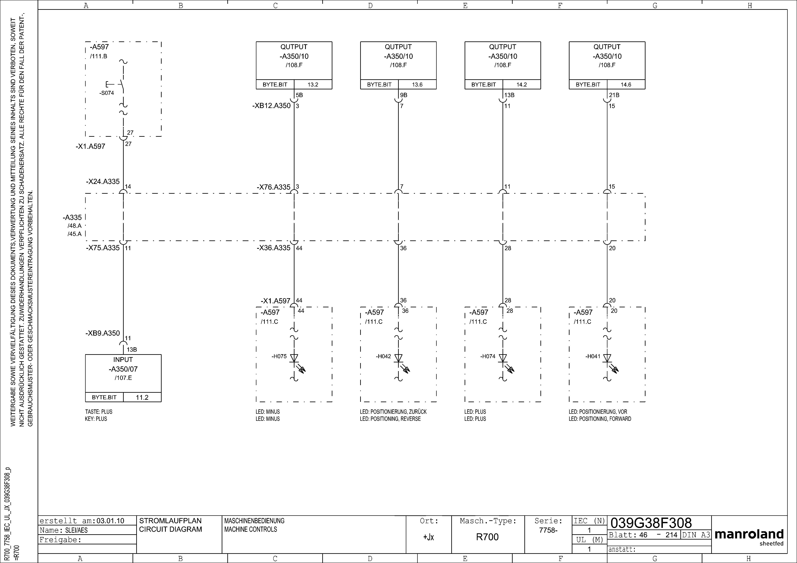

# +Jx — Sheet 46 of 214 — MASCHINENBEDIENUNG

**MACHINE CONTROLS**

> Part of the manroland **R700** printing press IEC/UL circuit diagrams.
> Drawing class: **Stromlaufplan / Circuit diagram** (DIN A3).
> Document `+Jx` covers the **1st printing module + feed register** machine section.

## At a glance

| Field | Value |
|---|---|
| Document | `+Jx`  (039G38F308) |
| Sheet | **46** of 214 |
| Section (DE) | MASCHINENBEDIENUNG |
| Section (EN) | MACHINE CONTROLS |
| Section type | CIRCUIT — Circuit diagram |
| Machine type | `R700` |
| Series | `7758` |
| Created | 03.01.10 |
| Replaces | — |
| Columns used | A, B, C, D, E, F, G |
| Path numbers | — |
| Labels on sheet | 91 |
| Cross-refs out | 12 |
| Cross-refs in | 32 |

**Previous:** [+Jx sheet 45](SHEET_0045.md) · **Next:** [+Jx sheet 47](SHEET_0047.md) · **Document TOC:** [_TOC.md](_TOC.md)  (+Jx) · **Master TOC:** [all sheets](../_MASTER_TOC.md)

## Sheet image (300 DPI, exact vector render)



_Rendered directly from the PDF vector layer at 300 DPI (1-bit), no OCR and no resampling. Use it to confirm anything ambiguous in the text below._

## Cross-references on this sheet

Each entry is a wire leaving this sheet. The printed token is `/sheet.column`; the link resolves to that sheet inside the same document.

| Ref | Target sheet | Col | Path | Destination on target | Target section | From col |
|---|---|---|---|---|---|---|
| `/111.B` | [+Jx sheet 111](SHEET_0111.md) | B | — | — | REFERENZMODUL | A |
| `/108.F` | [+Jx sheet 108](SHEET_0108.md) | F | — | — | REFERENZMODUL | C |
| `/108.F` | [+Jx sheet 108](SHEET_0108.md) | F | — | — | REFERENZMODUL | D |
| `/108.F` | [+Jx sheet 108](SHEET_0108.md) | F | — | — | REFERENZMODUL | E |
| `/108.F` | [+Jx sheet 108](SHEET_0108.md) | F | — | — | REFERENZMODUL | G |
| `/48.A` | [+Jx sheet 48](SHEET_0048.md) | A | — | — | 7 SEGMENTANZEIGE | A |
| `/45.A` | [+Jx sheet 45](SHEET_0045.md) | A | — | — | MASCHINENBEDIENUNG | A |
| `/111.C` | [+Jx sheet 111](SHEET_0111.md) | C | — | — | REFERENZMODUL | C |
| `/111.C` | [+Jx sheet 111](SHEET_0111.md) | C | — | — | REFERENZMODUL | D |
| `/111.C` | [+Jx sheet 111](SHEET_0111.md) | C | — | — | REFERENZMODUL | E |
| `/111.C` | [+Jx sheet 111](SHEET_0111.md) | C | — | — | REFERENZMODUL | F |
| `/107.E` | [+Jx sheet 107](SHEET_0107.md) | E | — | — | REFERENZMODUL | A |

### Incoming references (sheets that point here)

Every other sheet that sends a wire to this one. `Back-ref` is the token printed on *that* sheet; `Path` is its line number.

| From sheet | Cols | Back-ref | Path | Refs | What continues there |
|---|---|---|---|---|---|
| [+Jx#45](SHEET_0045.md) | A | `/45.A` | — | 1 | — |
| [+Jx#48](SHEET_0048.md) | A | `/48.A` | — | 1 | — |
| [+Jx#107](SHEET_0107.md) | E | `/107.E` | — | 1 | — |
| [+Jx#108](SHEET_0108.md) | F | `/108.F` | — | 4 | — |
| [+Jx#111](SHEET_0111.md) | B, C | `/111.B`, `/111.C` | — | 5 | — |
| [+Jx#115](SHEET_0115.md) | E, F | `/115.E`, `/115.F` | — | 5 | — |
| [+Jx#134](SHEET_0134.md) | G | `/134.G` | — | 1 | — |
| [+Jx#137](SHEET_0137.md) | H | `/137.H` | — | 4 | — |
| [+Jx#142](SHEET_0142.md) | F | `/142.F` | — | 1 | — |
| [+Jx#149](SHEET_0149.md) | F, G | `/149.F`, `/149.G` | — | 4 | — |
| [+Jx#155](SHEET_0155.md) | A, B | `/155.A`, `/155.B` | — | 5 | — |


## Devices on this sheet

| Tag | Class | Class meaning (IEC) | Col | Sub | Terminal | Sign |
|---|---|---|---|---|---|---|
| `A335` | A | Baugruppe / assembly, module, PC board | A | — | — | — |
| `S074` | S | Schalter / switch | A | — | — | — |
| `A597` | A | Baugruppe / assembly, module, PC board | A | — | — | — |
| `A597` | A | Baugruppe / assembly, module, PC board | C | — | — | — |
| `A597` | A | Baugruppe / assembly, module, PC board | D | — | — | — |
| `A597` | A | Baugruppe / assembly, module, PC board | E | — | — | — |
| `A597` | A | Baugruppe / assembly, module, PC board | F | — | — | — |
| `A350/10` | A | Baugruppe / assembly, module, PC board | C | 10 | — | — |
| `A350/10` | A | Baugruppe / assembly, module, PC board | D | 10 | — | — |
| `A350/10` | A | Baugruppe / assembly, module, PC board | E | 10 | — | — |
| `A350/10` | A | Baugruppe / assembly, module, PC board | G | 10 | — | — |
| `A350/07` | A | Baugruppe / assembly, module, PC board | A | 07 | — | — |
| `X1.A597` | — | cross-device reference | A | — | — | — |
| `X24.A335` | — | cross-device reference | A | — | — | — |
| `X76.A335` | — | cross-device reference | C | — | — | — |
| `X36.A335` | — | cross-device reference | C | — | — | — |
| `13.2` | — | cross-device reference | C | — | — | — |
| `XB12.A350` | — | cross-device reference | C | — | — | — |
| `13.6` | — | cross-device reference | D | — | — | — |
| `14.2` | — | cross-device reference | F | — | — | — |
| `14.6` | — | cross-device reference | G | — | — | — |
| `X1.A597` | — | cross-device reference | C | — | — | — |
| `X75.A335` | — | cross-device reference | A | — | — | — |
| `11.2` | — | cross-device reference | B | — | — | — |
| `XB9.A350` | — | cross-device reference | A | — | — | — |

## Potentials / nets

| Potential | Count | Columns | Attached devices | Terminals |
|---|---|---|---|---|
| `H041` | 1 | F | — | — |
| `H042` | 1 | D | — | — |
| `H074` | 1 | E | — | — |
| `H075` | 1 | C | — | — |


A potential such as `L24+/4` or `M24+` is a named supply/return rail; every place it appears on this sheet is electrically common.

## Wire-end annotations (grouped as printed)

A wire that continues elsewhere is annotated with a small cluster: the destination description, the path/line number `#NN`, and the `/sheet.column` cross reference. Each row below is one such cluster exactly as it is grouped on the drawing.

| Col | Y | Path | Cross-ref | Text on the wire |
|---|---|---|---|---|
| A | 65.4 | — | — | `A597` |
| C | 65.8 | — | — | `QUTPUT` |
| D | 65.8 | — | — | `QUTPUT` |
| E | 65.8 | — | — | `QUTPUT` |
| F | 65.8 | — | — | `QUTPUT` |
| C | 79.6 | — | — | `A350/10` |
| D | 79.6 | — | — | `A350/10` |
| E | 79.6 | — | — | `A350/10` |
| G | 79.6 | — | — | `A350/10` |
| A | 80.3 | — | `/111.B` | — |
| C | 93.4 | — | `/108.F` | — |
| D | 93.4 | — | `/108.F` | — |
| E | 93.4 | — | `/108.F` | — |
| G | 93.4 | — | `/108.F` | — |
| C | 123.0 | — | — | `BYTE.BIT 13.2` |
| D | 123.0 | — | — | `BYTE.BIT 13.6` |
| E | 123.0 | — | — | `BYTE.BIT 14.2` |
| F | 123.0 | — | — | `BYTE.BIT 14.6` |
| A | 135.3 | — | — | `S074` |
| C | 138.4 | — | — | `5B` |
| D | 138.4 | — | — | `9B` |
| E | 138.4 | — | — | `13B` |
| G | 138.4 | — | — | `21B` |
| C | 153.3 | — | — | `XB12.A350 3` |
| D | 154.8 | — | — | `7` |
| E | 154.8 | — | — | `11` |
| G | 154.8 | — | — | `15` |
| A | 194.4 | — | — | `27` |
| A | 211.4 | — | — | `X1.A597 27` |
| A | 266.7 | — | — | `X24.A335 14` |
| C | 275.2 | — | — | `X76.A335 3` |
| D | 275.2 | — | — | `7` |
| E | 275.2 | — | — | `11` |
| G | 275.2 | — | — | `15` |
| A | 320.6 | — | — | `A335` |
| A | 333.6 | — | `/48.A`, `/45.A` | — |
| A | 365.9 | — | — | `X75.A335 11` |
| C | 365.9 | — | — | `X36.A335 44` |
| D | 367.4 | — | — | `36` |
| E | 367.4 | — | — | `28` |
| G | 367.4 | — | — | `20` |
| C | 445.3 | — | — | `X1.A597 44` |
| D | 445.3 | — | — | `36` |
| E | 445.3 | — | — | `28` |
| G | 445.3 | — | — | `20` |
| C | 460.9 | — | — | `44` |
| D | 460.9 | — | — | `36` |
| E | 460.9 | — | — | `28` |
| G | 460.9 | — | — | `20` |
| C | 462.3 | — | — | `A597` |
| D | 462.3 | — | — | `A597` |
| E | 462.3 | — | — | `A597` |
| F | 462.3 | — | — | `A597` |
| C | 477.2 | — | `/111.C` | — |
| D | 477.2 | — | `/111.C` | — |
| E | 477.2 | — | `/111.C` | — |
| F | 477.2 | — | `/111.C` | — |
| A | 493.5 | — | — | `XB9.A350 11` |
| A | 519.0 | — | — | `13B` |
| C | 529.3 | — | — | `H075` |
| D | 529.3 | — | — | `H042` |
| E | 529.3 | — | — | `H074` |
| F | 529.3 | — | — | `H041` |
| A | 533.5 | — | — | `INPUT` |
| A | 547.3 | — | — | `A350/07` |
| A | 561.1 | — | `/107.E` | — |
| A | 590.2 | — | — | `BYTE.BIT 11.2` |
| A | 612.8 | — | — | `KEY: PLUS TASTE: PLUS` |
| C | 612.9 | — | — | `LED: MINUS LED: MINUS` |
| D | 612.9 | — | — | `LED: POSITIONIERUNG, ZURÜCK LED: POSITIONING, REVERSE` |
| E | 612.9 | — | — | `LED: PLUS LED: PLUS` |
| F | 612.9 | — | — | `LED: POSITIONIERUNG, VOR LED: POSITIONING, FORWARD` |


## Reconstructed tables

This sheet carries tabular content (pin map / terminal assignment / index). The grid below was rebuilt from the drawing's own rule lines, so each row is exactly one physical row of the table.

### Table 1 — 3 data rows × 2 columns (at x=127.6, y=62.4)

| A597 /111.B S074 | 27 |
|---|---|
| `X1.A597 X24.A335 X75.A335 XB9.A350` | `27 14 11 11 13B` |
| `INPUT A350/07` | `/107.E` |
| `BYTE.BIT` | `11.2` |


### Table 2 — 3 data rows × 2 columns (at x=382.7, y=62.4)

| QUTPUT | A350/10 /108.F |
|---|---|
| `BYTE.BIT` | `13.2` |
| `XB12.A350 X76.A335 X36.A335 X1.A597` | `5B 3 3 44 44` |
| `A597 /111.C H075` | `44` |


### Table 3 — 3 data rows × 2 columns (at x=538.6, y=62.4)

| QUTPUT | A350/10 /108.F |
|---|---|
| `BYTE.BIT` | `13.6` |
|  | `9B 7 7 36 36` |
| `A597 /111.C H042` | `36` |


### Table 4 — 3 data rows × 2 columns (at x=694.5, y=62.4)

| QUTPUT | A350/10 /108.F |
|---|---|
| `BYTE.BIT` | `14.2` |
|  | `13B 11 11 28 28` |
| `A597 /111.C H074` | `28` |


### Table 5 — 3 data rows × 2 columns (at x=850.4, y=62.4)

| QUTPUT | A350/10 /108.F |
|---|---|
| `BYTE.BIT` | `14.6` |
|  | `21B 15 15 20 20` |
| `A597 /111.C H041` | `20` |


## Notes and free text on this sheet

| Text | Col | Y (pt) |
|---|---|---|
| `LED: MINUS` | C | 612.86 |
| `LED: POSITIONIERUNG, ZURÜCK` | D | 612.87 |
| `LED: POSITIONING, REVERSE` | D | 623.48 |
| `LED: PLUS` | E | 612.85 |
| `LED: POSITIONIERUNG, VOR` | F | 612.86 |
| `LED: POSITIONING, FORWARD` | F | 623.48 |
| `5B` | C | 138.4 |
| `QUTPUT` | C | 65.75 |
| `BYTE.BIT` | C | 123.03 |
| `9B` | D | 138.4 |
| `QUTPUT` | D | 65.75 |
| `BYTE.BIT` | D | 123.03 |
| `13B` | E | 138.42 |
| `QUTPUT` | E | 65.75 |
| `BYTE.BIT` | E | 123.03 |
| `21B` | G | 138.42 |
| `QUTPUT` | F | 65.75 |
| `BYTE.BIT` | F | 123.03 |
| `13B` | A | 518.97 |
| `INPUT` | A | 533.49 |
| `BYTE.BIT` | A | 590.75 |
| `TASTE: PLUS` | A | 612.84 |
| `KEY: PLUS` | A | 623.46 |

## Complete label inventory (exact text from the drawing)

Every text object inside the drawing area of this sheet, in DIN reading order (column A→H, then top→bottom). This is the authoritative list: if a string is not here it is not printed on this sheet.

| Col | Y | X | Dir | Type | Text |
|---|---|---|---|---|---|
| A | 65.4 | 134.4 | → | device tag | `A597` |
| A | 80.3 | 134.6 | → | cross-reference | `/111.B` |
| A | 135.3 | 148.5 | → | device tag | `S074` |
| A | 194.4 | 189.9 | → | number | `27` |
| A | 211.4 | 187.1 | → | number | `27` |
| A | 214.3 | 113.1 | → | device ref | `X1.A597` |
| A | 266.7 | 128.7 | → | device ref | `X24.A335` |
| A | 275.2 | 186.2 | → | number | `14` |
| A | 320.5 | 93.8 | → | device tag | `A335` |
| A | 333.6 | 101.2 | → | cross-reference | `/48.A` |
| A | 346.0 | 101.2 | → | cross-reference | `/45.A` |
| A | 365.9 | 128.7 | → | device ref | `X75.A335` |
| A | 367.4 | 186.2 | → | number | `11` |
| A | 493.5 | 127.8 | → | device ref | `XB9.A350` |
| A | 502.0 | 186.2 | → | number | `11` |
| A | 519.0 | 189.1 | → | text | `13B` |
| A | 533.5 | 169.4 | → | text | `INPUT` |
| A | 547.3 | 162.7 | → | device tag | `A350/07` |
| A | 561.1 | 171.6 | → | cross-reference | `/107.E` |
| A | 590.7 | 137.5 | → | text | `BYTE.BIT` |
| A | 612.8 | 127.6 | → | text | `TASTE: PLUS` |
| A | 623.5 | 127.0 | → | text | `KEY: PLUS` |
| B | 590.2 | 202.8 | → | device ref | `11.2` |
| C | 65.7 | 419.1 | → | text | `QUTPUT` |
| C | 79.6 | 418.0 | → | device tag | `A350/10` |
| C | 93.4 | 427.0 | → | cross-reference | `/108.F` |
| C | 123.0 | 392.6 | → | text | `BYTE.BIT` |
| C | 123.1 | 459.5 | → | device ref | `13.2` |
| C | 138.4 | 441.9 | → | text | `5B` |
| C | 153.3 | 377.0 | → | device ref | `XB12.A350` |
| C | 154.8 | 441.9 | → | number | `3` |
| C | 275.2 | 383.8 | → | device ref | `X76.A335` |
| C | 275.2 | 441.9 | → | number | `3` |
| C | 365.9 | 383.8 | → | device ref | `X36.A335` |
| C | 367.4 | 442.2 | → | number | `44` |
| C | 445.3 | 389.8 | → | device ref | `X1.A597` |
| C | 445.3 | 442.2 | → | number | `44` |
| C | 460.9 | 445.0 | → | number | `44` |
| C | 462.3 | 389.5 | → | device tag | `A597` |
| C | 477.2 | 389.8 | → | cross-reference | `/111.C` |
| C | 529.3 | 405.9 | → | potential | `H075` |
| C | 612.9 | 382.1 | → | text | `LED: MINUS` |
| C | 623.5 | 382.1 | → | text | `LED: MINUS` |
| D | 65.7 | 575.0 | → | text | `QUTPUT` |
| D | 79.6 | 573.9 | → | device tag | `A350/10` |
| D | 93.4 | 582.9 | → | cross-reference | `/108.F` |
| D | 123.0 | 548.5 | → | text | `BYTE.BIT` |
| D | 123.1 | 615.4 | → | device ref | `13.6` |
| D | 138.4 | 597.8 | → | text | `9B` |
| D | 154.8 | 597.8 | → | number | `7` |
| D | 275.2 | 597.8 | → | number | `7` |
| D | 367.4 | 597.8 | → | number | `36` |
| D | 445.3 | 597.8 | → | number | `36` |
| D | 460.9 | 600.7 | → | number | `36` |
| D | 462.3 | 545.4 | → | device tag | `A597` |
| D | 477.2 | 545.7 | → | cross-reference | `/111.C` |
| D | 529.3 | 561.8 | → | potential | `H042` |
| D | 612.9 | 538.0 | → | text | `LED: POSITIONIERUNG, ZURÜCK` |
| D | 623.5 | 538.0 | → | text | `LED: POSITIONING, REVERSE` |
| E | 65.7 | 730.9 | → | text | `QUTPUT` |
| E | 79.6 | 729.8 | → | device tag | `A350/10` |
| E | 93.4 | 738.9 | → | cross-reference | `/108.F` |
| E | 123.0 | 704.4 | → | text | `BYTE.BIT` |
| E | 138.4 | 753.2 | → | text | `13B` |
| E | 154.8 | 753.2 | → | number | `11` |
| E | 275.2 | 753.2 | → | number | `11` |
| E | 367.4 | 754.0 | → | number | `28` |
| E | 445.3 | 754.0 | → | number | `28` |
| E | 460.9 | 756.9 | → | number | `28` |
| E | 462.3 | 701.3 | → | device tag | `A597` |
| E | 477.2 | 701.6 | → | cross-reference | `/111.C` |
| E | 529.3 | 717.7 | → | potential | `H074` |
| E | 612.8 | 693.9 | → | text | `LED: PLUS` |
| E | 623.5 | 693.9 | → | text | `LED: PLUS` |
| F | 65.7 | 886.8 | → | text | `QUTPUT` |
| F | 123.0 | 860.3 | → | text | `BYTE.BIT` |
| F | 123.1 | 771.3 | → | device ref | `14.2` |
| F | 462.3 | 857.2 | → | device tag | `A597` |
| F | 477.2 | 857.5 | → | cross-reference | `/111.C` |
| F | 529.3 | 874.8 | → | potential | `H041` |
| F | 612.9 | 849.8 | → | text | `LED: POSITIONIERUNG, VOR` |
| F | 623.5 | 849.8 | → | text | `LED: POSITIONING, FORWARD` |
| G | 79.6 | 885.7 | → | device tag | `A350/10` |
| G | 93.4 | 894.8 | → | cross-reference | `/108.F` |
| G | 123.1 | 927.2 | → | device ref | `14.6` |
| G | 138.4 | 909.9 | → | text | `21B` |
| G | 154.8 | 909.1 | → | number | `15` |
| G | 275.2 | 909.1 | → | number | `15` |
| G | 367.4 | 909.9 | → | number | `20` |
| G | 445.3 | 909.9 | → | number | `20` |
| G | 460.9 | 912.8 | → | number | `20` |

## Reading-order text block

The same content as a plain block, grouped by DIN column — convenient to paste or to match against a visual description.

```text
=== Column A ===
  65.4  134.4  devtag       A597
  80.3  134.6  xref         /111.B
 135.3  148.5  devtag       S074
 194.4  189.9  numeric      27
 211.4  187.1  numeric      27
 214.3  113.1  devref       X1.A597
 266.7  128.7  devref       X24.A335
 275.2  186.2  numeric      14
 320.5   93.8  devtag       A335
 333.6  101.2  xref         /48.A
 346.0  101.2  xref         /45.A
 365.9  128.7  devref       X75.A335
 367.4  186.2  numeric      11
 493.5  127.8  devref       XB9.A350
 502.0  186.2  numeric      11
 519.0  189.1  text         13B
 533.5  169.4  text         INPUT
 547.3  162.7  devtag       A350/07
 561.1  171.6  xref         /107.E
 590.7  137.5  text         BYTE.BIT
 612.8  127.6  text         TASTE: PLUS
 623.5  127.0  text         KEY: PLUS
=== Column B ===
 590.2  202.8  devref       11.2
=== Column C ===
  65.7  419.1  text         QUTPUT
  79.6  418.0  devtag       A350/10
  93.4  427.0  xref         /108.F
 123.0  392.6  text         BYTE.BIT
 123.1  459.5  devref       13.2
 138.4  441.9  text         5B
 153.3  377.0  devref       XB12.A350
 154.8  441.9  numeric      3
 275.2  383.8  devref       X76.A335
 275.2  441.9  numeric      3
 365.9  383.8  devref       X36.A335
 367.4  442.2  numeric      44
 445.3  389.8  devref       X1.A597
 445.3  442.2  numeric      44
 460.9  445.0  numeric      44
 462.3  389.5  devtag       A597
 477.2  389.8  xref         /111.C
 529.3  405.9  net          H075
 612.9  382.1  text         LED: MINUS
 623.5  382.1  text         LED: MINUS
=== Column D ===
  65.7  575.0  text         QUTPUT
  79.6  573.9  devtag       A350/10
  93.4  582.9  xref         /108.F
 123.0  548.5  text         BYTE.BIT
 123.1  615.4  devref       13.6
 138.4  597.8  text         9B
 154.8  597.8  numeric      7
 275.2  597.8  numeric      7
 367.4  597.8  numeric      36
 445.3  597.8  numeric      36
 460.9  600.7  numeric      36
 462.3  545.4  devtag       A597
 477.2  545.7  xref         /111.C
 529.3  561.8  net          H042
 612.9  538.0  text         LED: POSITIONIERUNG, ZURÜCK
 623.5  538.0  text         LED: POSITIONING, REVERSE
=== Column E ===
  65.7  730.9  text         QUTPUT
  79.6  729.8  devtag       A350/10
  93.4  738.9  xref         /108.F
 123.0  704.4  text         BYTE.BIT
 138.4  753.2  text         13B
 154.8  753.2  numeric      11
 275.2  753.2  numeric      11
 367.4  754.0  numeric      28
 445.3  754.0  numeric      28
 460.9  756.9  numeric      28
 462.3  701.3  devtag       A597
 477.2  701.6  xref         /111.C
 529.3  717.7  net          H074
 612.8  693.9  text         LED: PLUS
 623.5  693.9  text         LED: PLUS
=== Column F ===
  65.7  886.8  text         QUTPUT
 123.0  860.3  text         BYTE.BIT
 123.1  771.3  devref       14.2
 462.3  857.2  devtag       A597
 477.2  857.5  xref         /111.C
 529.3  874.8  net          H041
 612.9  849.8  text         LED: POSITIONIERUNG, VOR
 623.5  849.8  text         LED: POSITIONING, FORWARD
=== Column G ===
  79.6  885.7  devtag       A350/10
  93.4  894.8  xref         /108.F
 123.1  927.2  devref       14.6
 138.4  909.9  text         21B
 154.8  909.1  numeric      15
 275.2  909.1  numeric      15
 367.4  909.9  numeric      20
 445.3  909.9  numeric      20
 460.9  912.8  numeric      20
```

---
_Generated from the PDF vector text layer; no OCR. Source: `R700_7758_IEC_UL_JX_039G38F308_p`, sheet 46._
