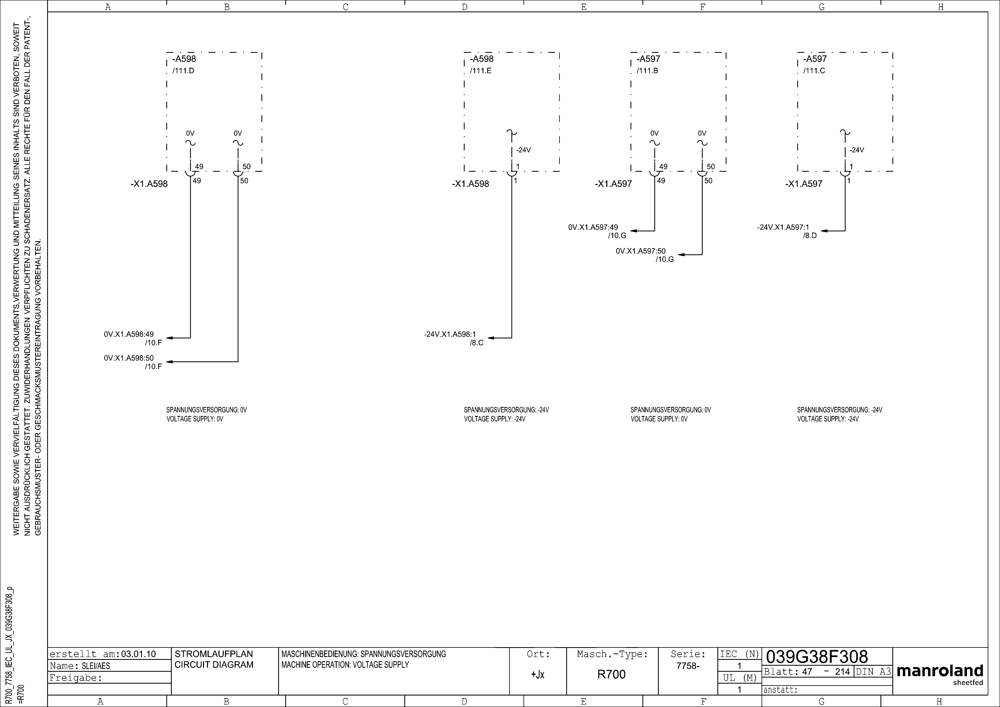

# +Jx — Sheet 47 of 214 — MASCHINENBEDIENUNG: SPANNUNGSVERSORGUNG

**MACHINE OPERATION: VOLTAGE SUPPLY**

> Part of the manroland **R700** printing press IEC/UL circuit diagrams.
> Drawing class: **Stromlaufplan / Circuit diagram** (DIN A3).
> Document `+Jx` covers the **1st printing module + feed register** machine section.

## At a glance

| Field | Value |
|---|---|
| Document | `+Jx`  (039G38F308) |
| Sheet | **47** of 214 |
| Section (DE) | MASCHINENBEDIENUNG: SPANNUNGSVERSORGUNG |
| Section (EN) | MACHINE OPERATION: VOLTAGE SUPPLY |
| Section type | POWER_SUPPLY — Voltage supply |
| Machine type | `R700` |
| Series | `7758` |
| Created | 03.01.10 |
| Replaces | — |
| Columns used | A, B, D, E, F, G |
| Path numbers | — |
| Labels on sheet | 50 |
| Cross-refs out | 10 |
| Cross-refs in | 16 |

**Previous:** [+Jx sheet 46](SHEET_0046.md) · **Next:** [+Jx sheet 48](SHEET_0048.md) · **Document TOC:** [_TOC.md](_TOC.md)  (+Jx) · **Master TOC:** [all sheets](../_MASTER_TOC.md)

## Sheet image (300 DPI, exact vector render)



_Rendered directly from the PDF vector layer at 300 DPI (1-bit), no OCR and no resampling. Use it to confirm anything ambiguous in the text below._

## Cross-references on this sheet

Each entry is a wire leaving this sheet. The printed token is `/sheet.column`; the link resolves to that sheet inside the same document.

| Ref | Target sheet | Col | Path | Destination on target | Target section | From col |
|---|---|---|---|---|---|---|
| `/111.E` | [+Jx sheet 111](SHEET_0111.md) | E | — | — | REFERENZMODUL | D |
| `/111.B` | [+Jx sheet 111](SHEET_0111.md) | B | — | — | REFERENZMODUL | F |
| `/111.D` | [+Jx sheet 111](SHEET_0111.md) | D | — | — | REFERENZMODUL | B |
| `/111.C` | [+Jx sheet 111](SHEET_0111.md) | C | — | — | REFERENZMODUL | G |
| `/10.G` | [+Jx sheet 10](SHEET_0010.md) | G | — | 0V.X1.A597:49 | SPANNUNGSVERSORGUNG, SCHALTSCHRANKBELÜFTUNG | E |
| `/8.D` | [+Jx sheet 8](SHEET_0008.md) | D | — | 24V.X1.A597:1 | SPANNUNGSVERSORGUNG, SCHALTSCHRANKBELÜFTUNG | G |
| `/10.G` | [+Jx sheet 10](SHEET_0010.md) | G | — | 0V.X1.A597:50 | SPANNUNGSVERSORGUNG, SCHALTSCHRANKBELÜFTUNG | F |
| `/10.F` | [+Jx sheet 10](SHEET_0010.md) | F | — | 0V.X1.A598:49 | SPANNUNGSVERSORGUNG, SCHALTSCHRANKBELÜFTUNG | A |
| `/8.C` | [+Jx sheet 8](SHEET_0008.md) | C | — | 24V.X1.A598:1 | SPANNUNGSVERSORGUNG, SCHALTSCHRANKBELÜFTUNG | D |
| `/10.F` | [+Jx sheet 10](SHEET_0010.md) | F | — | 0V.X1.A598:50 | SPANNUNGSVERSORGUNG, SCHALTSCHRANKBELÜFTUNG | A |

### Incoming references (sheets that point here)

Every other sheet that sends a wire to this one. `Back-ref` is the token printed on *that* sheet; `Path` is its line number.

| From sheet | Cols | Back-ref | Path | Refs | What continues there |
|---|---|---|---|---|---|
| [+Jx#8](SHEET_0008.md) | C, D | `/8.C`, `/8.D` | — | 2 | — |
| [+Jx#10](SHEET_0010.md) | F, G | `/10.F`, `/10.G` | — | 4 | 0V.X1.A597:49; 0V.X1.A597:50; 0V.X1.A598:49; 0V.X1.A598:50 |
| [+Jx#111](SHEET_0111.md) | B, E | `/111.B`, `/111.E` | — | 4 | — |
| [+Jx#115](SHEET_0115.md) | E, F, G, H | `/115.E`, `/115.F`, `/115.G`, `/115.H` | — | 6 | — |


## Devices on this sheet

| Tag | Class | Class meaning (IEC) | Col | Sub | Terminal | Sign |
|---|---|---|---|---|---|---|
| `A598` | A | Baugruppe / assembly, module, PC board | B | — | — | — |
| `A598` | A | Baugruppe / assembly, module, PC board | D | — | — | — |
| `A597` | A | Baugruppe / assembly, module, PC board | F | — | — | — |
| `A597` | A | Baugruppe / assembly, module, PC board | G | — | — | — |
| `X1.A598` | — | cross-device reference | A | — | — | — |
| `X1.A598` | — | cross-device reference | D | — | — | — |
| `X1.A597` | — | cross-device reference | E | — | — | — |
| `X1.A597` | — | cross-device reference | G | — | — | — |

## Potentials / nets

| Potential | Count | Columns | Attached devices | Terminals |
|---|---|---|---|---|
| `0V` | 8 | A, B, E, F | `A597`, `A598`, `X1` | `49`, `50` |
| `24V` | 4 | D, G | `A597`, `A598`, `X1` | `1` |


A potential such as `L24+/4` or `M24+` is a named supply/return rail; every place it appears on this sheet is electrically common.

## Wire-end annotations (grouped as printed)

A wire that continues elsewhere is annotated with a small cluster: the destination description, the path/line number `#NN`, and the `/sheet.column` cross reference. Each row below is one such cluster exactly as it is grouped on the drawing.

| Col | Y | Path | Cross-ref | Text on the wire |
|---|---|---|---|---|
| B | 65.4 | — | — | `A598` |
| D | 65.4 | — | — | `A598` |
| F | 65.4 | — | — | `A597` |
| G | 65.4 | — | — | `A597` |
| B | 80.3 | — | `/111.D` | — |
| D | 80.3 | — | `/111.E` | — |
| F | 80.3 | — | `/111.B` | — |
| G | 80.3 | — | `/111.C` | — |
| B | 155.2 | — | — | `0V 0V` |
| F | 155.2 | — | — | `0V 0V` |
| D | 175.0 | — | — | `24V` |
| G | 175.0 | — | — | `24V` |
| B | 194.4 | — | — | `49 50` |
| D | 194.4 | — | — | `1` |
| F | 194.4 | — | — | `49 50` |
| G | 194.4 | — | — | `1` |
| B | 211.4 | — | — | `X1.A598 49 50` |
| D | 211.4 | — | — | `X1.A598 1` |
| F | 211.4 | — | — | `X1.A597 49 50` |
| G | 211.4 | — | — | `X1.A597 1` |
| E | 266.7 | — | `/10.G` | `0V.X1.A597:49` |
| G | 266.7 | — | `/8.D` | `24V.X1.A597:1` |
| F | 295.0 | — | `/10.G` | `0V.X1.A597:50` |
| A | 394.2 | — | `/10.F` | `0V.X1.A598:49` |
| D | 394.2 | — | `/8.C` | `24V.X1.A598:1` |
| A | 422.6 | — | `/10.F` | `0V.X1.A598:50` |
| B | 485.3 | — | — | `SPANNUNGSVERSORGUNG: 0V VOLTAGE SUPPLY: 0V` |
| D | 485.3 | — | — | `SPANNUNGSVERSORGUNG: 24V VOLTAGE SUPPLY: 24V` |
| F | 485.3 | — | — | `SPANNUNGSVERSORGUNG: 0V VOLTAGE SUPPLY: 0V` |
| G | 485.3 | — | — | `SPANNUNGSVERSORGUNG: 24V VOLTAGE SUPPLY: 24V` |


## Reconstructed tables

This sheet carries tabular content (pin map / terminal assignment / index). The grid below was rebuilt from the drawing's own rule lines, so each row is exactly one physical row of the table.

### Table 1 — 1 data rows × 3 columns (at x=198.4, y=62.4)

| A598 /111.D 0V | 0V 49 | 50 |
|---|---|---|
|  | `49` | `50` |


## Notes and free text on this sheet

| Text | Col | Y (pt) |
|---|---|---|
| `SPANNUNGSVERSORGUNG: 0V` | B | 485.32 |
| `VOLTAGE SUPPLY: 0V` | B | 495.93 |
| `SPANNUNGSVERSORGUNG: 24V` | D | 485.32 |
| `VOLTAGE SUPPLY: 24V` | D | 495.93 |
| `SPANNUNGSVERSORGUNG: 0V` | F | 485.32 |
| `VOLTAGE SUPPLY: 0V` | F | 495.93 |
| `SPANNUNGSVERSORGUNG: 24V` | G | 485.32 |
| `VOLTAGE SUPPLY: 24V` | G | 495.93 |

## Complete label inventory (exact text from the drawing)

Every text object inside the drawing area of this sheet, in DIN reading order (column A→H, then top→bottom). This is the authoritative list: if a string is not here it is not printed on this sheet.

| Col | Y | X | Dir | Type | Text |
|---|---|---|---|---|---|
| A | 214.3 | 155.6 | → | device ref | `X1.A598` |
| A | 394.2 | 123.9 | → | potential | `0V.X1.A598:49` |
| A | 404.1 | 172.9 | → | cross-reference | `/10.F` |
| A | 422.6 | 123.9 | → | potential | `0V.X1.A598:50` |
| A | 432.5 | 172.9 | → | cross-reference | `/10.F` |
| B | 65.4 | 205.2 | → | device tag | `A598` |
| B | 80.3 | 205.5 | → | cross-reference | `/111.D` |
| B | 155.2 | 221.7 | → | potential | `0V` |
| B | 155.2 | 278.4 | → | potential | `0V` |
| B | 194.4 | 232.4 | → | number | `49` |
| B | 194.4 | 288.9 | → | number | `50` |
| B | 211.4 | 229.6 | → | number | `49` |
| B | 211.4 | 286.0 | → | number | `50` |
| B | 485.3 | 198.1 | → | text | `SPANNUNGSVERSORGUNG: 0V` |
| B | 495.9 | 198.4 | → | text | `VOLTAGE SUPPLY: 0V` |
| D | 65.4 | 559.6 | → | device tag | `A598` |
| D | 80.3 | 559.8 | → | cross-reference | `/111.E` |
| D | 175.0 | 614.8 | → | potential | `24V` |
| D | 194.4 | 614.3 | → | number | `1` |
| D | 211.4 | 611.4 | → | number | `1` |
| D | 214.3 | 538.3 | → | device ref | `X1.A598` |
| D | 394.2 | 504.9 | → | potential | `24V.X1.A598:1` |
| D | 404.1 | 559.6 | → | cross-reference | `/8.C` |
| D | 485.3 | 552.5 | → | text | `SPANNUNGSVERSORGUNG: 24V` |
| D | 495.9 | 552.8 | → | text | `VOLTAGE SUPPLY: 24V` |
| E | 214.3 | 708.4 | → | device ref | `X1.A597` |
| E | 266.7 | 676.6 | → | potential | `0V.X1.A597:49` |
| E | 276.6 | 724.3 | → | cross-reference | `/10.G` |
| E | 295.0 | 733.3 | → | potential | `0V.X1.A597:50` |
| F | 65.4 | 758.0 | → | device tag | `A597` |
| F | 80.3 | 758.3 | → | cross-reference | `/111.B` |
| F | 155.2 | 774.4 | → | potential | `0V` |
| F | 155.2 | 831.1 | → | potential | `0V` |
| F | 194.4 | 785.2 | → | number | `49` |
| F | 194.4 | 841.6 | → | number | `50` |
| F | 211.4 | 782.4 | → | number | `49` |
| F | 211.4 | 838.8 | → | number | `50` |
| F | 304.9 | 780.9 | → | cross-reference | `/10.G` |
| F | 485.3 | 750.9 | → | text | `SPANNUNGSVERSORGUNG: 0V` |
| F | 495.9 | 751.2 | → | text | `VOLTAGE SUPPLY: 0V` |
| G | 65.4 | 956.4 | → | device tag | `A597` |
| G | 80.3 | 956.7 | → | cross-reference | `/111.C` |
| G | 175.0 | 1011.7 | → | potential | `24V` |
| G | 194.4 | 1011.1 | → | number | `1` |
| G | 211.4 | 1008.3 | → | number | `1` |
| G | 214.3 | 935.1 | → | device ref | `X1.A597` |
| G | 266.7 | 901.7 | → | potential | `24V.X1.A597:1` |
| G | 276.6 | 956.4 | → | cross-reference | `/8.D` |
| G | 485.3 | 949.3 | → | text | `SPANNUNGSVERSORGUNG: 24V` |
| G | 495.9 | 949.6 | → | text | `VOLTAGE SUPPLY: 24V` |

## Reading-order text block

The same content as a plain block, grouped by DIN column — convenient to paste or to match against a visual description.

```text
=== Column A ===
 214.3  155.6  devref       X1.A598
 394.2  123.9  net          0V.X1.A598:49
 404.1  172.9  xref         /10.F
 422.6  123.9  net          0V.X1.A598:50
 432.5  172.9  xref         /10.F
=== Column B ===
  65.4  205.2  devtag       A598
  80.3  205.5  xref         /111.D
 155.2  221.7  net          0V
 155.2  278.4  net          0V
 194.4  232.4  numeric      49
 194.4  288.9  numeric      50
 211.4  229.6  numeric      49
 211.4  286.0  numeric      50
 485.3  198.1  text         SPANNUNGSVERSORGUNG: 0V
 495.9  198.4  text         VOLTAGE SUPPLY: 0V
=== Column D ===
  65.4  559.6  devtag       A598
  80.3  559.8  xref         /111.E
 175.0  614.8  net          24V
 194.4  614.3  numeric      1
 211.4  611.4  numeric      1
 214.3  538.3  devref       X1.A598
 394.2  504.9  net          24V.X1.A598:1
 404.1  559.6  xref         /8.C
 485.3  552.5  text         SPANNUNGSVERSORGUNG: 24V
 495.9  552.8  text         VOLTAGE SUPPLY: 24V
=== Column E ===
 214.3  708.4  devref       X1.A597
 266.7  676.6  net          0V.X1.A597:49
 276.6  724.3  xref         /10.G
 295.0  733.3  net          0V.X1.A597:50
=== Column F ===
  65.4  758.0  devtag       A597
  80.3  758.3  xref         /111.B
 155.2  774.4  net          0V
 155.2  831.1  net          0V
 194.4  785.2  numeric      49
 194.4  841.6  numeric      50
 211.4  782.4  numeric      49
 211.4  838.8  numeric      50
 304.9  780.9  xref         /10.G
 485.3  750.9  text         SPANNUNGSVERSORGUNG: 0V
 495.9  751.2  text         VOLTAGE SUPPLY: 0V
=== Column G ===
  65.4  956.4  devtag       A597
  80.3  956.7  xref         /111.C
 175.0 1011.7  net          24V
 194.4 1011.1  numeric      1
 211.4 1008.3  numeric      1
 214.3  935.1  devref       X1.A597
 266.7  901.7  net          24V.X1.A597:1
 276.6  956.4  xref         /8.D
 485.3  949.3  text         SPANNUNGSVERSORGUNG: 24V
 495.9  949.6  text         VOLTAGE SUPPLY: 24V
```

---
_Generated from the PDF vector text layer; no OCR. Source: `R700_7758_IEC_UL_JX_039G38F308_p`, sheet 47._
