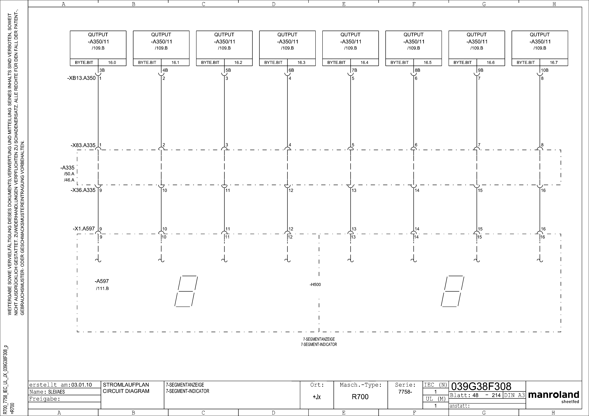

# +Jx — Sheet 48 of 214 — 7 SEGMENTANZEIGE

**7 SEGMENT INDICATOR**

> Part of the manroland **R700** printing press IEC/UL circuit diagrams.
> Drawing class: **Stromlaufplan / Circuit diagram** (DIN A3).
> Document `+Jx` covers the **1st printing module + feed register** machine section.

## At a glance

| Field | Value |
|---|---|
| Document | `+Jx`  (039G38F308) |
| Sheet | **48** of 214 |
| Section (DE) | 7 SEGMENTANZEIGE |
| Section (EN) | 7 SEGMENT INDICATOR |
| Section type | CIRCUIT — Circuit diagram |
| Machine type | `R700` |
| Series | `7758` |
| Created | 03.01.10 |
| Replaces | — |
| Columns used | A, B, C, D, E, F, G, H |
| Path numbers | — |
| Labels on sheet | 100 |
| Cross-refs out | 11 |
| Cross-refs in | 43 |

**Previous:** [+Jx sheet 47](SHEET_0047.md) · **Next:** [+Jx sheet 49](SHEET_0049.md) · **Document TOC:** [_TOC.md](_TOC.md)  (+Jx) · **Master TOC:** [all sheets](../_MASTER_TOC.md)

## Sheet image (300 DPI, exact vector render)



_Rendered directly from the PDF vector layer at 300 DPI (1-bit), no OCR and no resampling. Use it to confirm anything ambiguous in the text below._

## Cross-references on this sheet

Each entry is a wire leaving this sheet. The printed token is `/sheet.column`; the link resolves to that sheet inside the same document.

| Ref | Target sheet | Col | Path | Destination on target | Target section | From col |
|---|---|---|---|---|---|---|
| `/109.B` | [+Jx sheet 109](SHEET_0109.md) | B | — | — | REFERENZMODUL | A |
| `/109.B` | [+Jx sheet 109](SHEET_0109.md) | B | — | — | REFERENZMODUL | B |
| `/109.B` | [+Jx sheet 109](SHEET_0109.md) | B | — | — | REFERENZMODUL | C |
| `/109.B` | [+Jx sheet 109](SHEET_0109.md) | B | — | — | REFERENZMODUL | D |
| `/109.B` | [+Jx sheet 109](SHEET_0109.md) | B | — | — | REFERENZMODUL | E |
| `/109.B` | [+Jx sheet 109](SHEET_0109.md) | B | — | — | REFERENZMODUL | F |
| `/109.B` | [+Jx sheet 109](SHEET_0109.md) | B | — | — | REFERENZMODUL | G |
| `/109.B` | [+Jx sheet 109](SHEET_0109.md) | B | — | — | REFERENZMODUL | H |
| `/50.A` | [+Jx sheet 50](SHEET_0050.md) | A | — | — | SIGNALGEBER: AKUSTISCHE WARNSIGNALE | A |
| `/46.A` | [+Jx sheet 46](SHEET_0046.md) | A | — | — | MASCHINENBEDIENUNG | A |
| `/111.B` | [+Jx sheet 111](SHEET_0111.md) | B | — | — | REFERENZMODUL | B |

### Incoming references (sheets that point here)

Every other sheet that sends a wire to this one. `Back-ref` is the token printed on *that* sheet; `Path` is its line number.

| From sheet | Cols | Back-ref | Path | Refs | What continues there |
|---|---|---|---|---|---|
| [+Jx#46](SHEET_0046.md) | A | `/46.A` | — | 1 | — |
| [+Jx#50](SHEET_0050.md) | A | `/50.A` | — | 1 | — |
| [+Jx#109](SHEET_0109.md) | B | `/109.B` | — | 8 | — |
| [+Jx#111](SHEET_0111.md) | B | `/111.B` | — | 1 | — |
| [+Jx#115](SHEET_0115.md) | E | `/115.E` | — | 8 | — |
| [+Jx#138](SHEET_0138.md) | B | `/138.B` | — | 8 | — |
| [+Jx#149](SHEET_0149.md) | F | `/149.F` | — | 8 | — |
| [+Jx#156](SHEET_0156.md) | F | `/156.F` | — | 8 | — |


## Devices on this sheet

| Tag | Class | Class meaning (IEC) | Col | Sub | Terminal | Sign |
|---|---|---|---|---|---|---|
| `A335` | A | Baugruppe / assembly, module, PC board | A | — | — | — |
| `A597` | A | Baugruppe / assembly, module, PC board | B | — | — | — |
| `A350/11` | A | Baugruppe / assembly, module, PC board | B | 11 | — | — |
| `A350/11` | A | Baugruppe / assembly, module, PC board | B | 11 | — | — |
| `A350/11` | A | Baugruppe / assembly, module, PC board | C | 11 | — | — |
| `A350/11` | A | Baugruppe / assembly, module, PC board | D | 11 | — | — |
| `A350/11` | A | Baugruppe / assembly, module, PC board | F | 11 | — | — |
| `A350/11` | A | Baugruppe / assembly, module, PC board | G | 11 | — | — |
| `A350/11` | A | Baugruppe / assembly, module, PC board | H | 11 | — | — |
| `A350/11` | A | Baugruppe / assembly, module, PC board | E | 11 | — | — |
| `X36.A335` | — | cross-device reference | A | — | — | — |
| `X1.A597` | — | cross-device reference | A | — | — | — |
| `16.0` | — | cross-device reference | B | — | — | — |
| `16.1` | — | cross-device reference | C | — | — | — |
| `16.2` | — | cross-device reference | C | — | — | — |
| `16.3` | — | cross-device reference | D | — | — | — |
| `16.5` | — | cross-device reference | F | — | — | — |
| `16.6` | — | cross-device reference | G | — | — | — |
| `16.7` | — | cross-device reference | H | — | — | — |
| `XB13.A350` | — | cross-device reference | A | — | — | — |
| `16.4` | — | cross-device reference | E | — | — | — |
| `X83.A335` | — | cross-device reference | A | — | — | — |

## Potentials / nets

| Potential | Count | Columns | Attached devices | Terminals |
|---|---|---|---|---|
| `H500` | 1 | E | — | — |


A potential such as `L24+/4` or `M24+` is a named supply/return rail; every place it appears on this sheet is electrically common.

## Wire-end annotations (grouped as printed)

A wire that continues elsewhere is annotated with a small cluster: the destination description, the path/line number `#NN`, and the `/sheet.column` cross reference. Each row below is one such cluster exactly as it is grouped on the drawing.

| Col | Y | Path | Cross-ref | Text on the wire |
|---|---|---|---|---|
| A | 65.8 | — | — | `QUTPUT` |
| B | 65.8 | — | — | `QUTPUT` |
| C | 65.8 | — | — | `QUTPUT` |
| D | 65.8 | — | — | `QUTPUT` |
| E | 65.8 | — | — | `QUTPUT` |
| F | 65.8 | — | — | `QUTPUT` |
| G | 65.8 | — | — | `QUTPUT` |
| H | 65.8 | — | — | `QUTPUT` |
| B | 79.6 | — | — | `A350/11` |
| B | 79.6 | — | — | `A350/11` |
| C | 79.6 | — | — | `A350/11` |
| D | 79.6 | — | — | `A350/11` |
| E | 79.6 | — | — | `A350/11` |
| F | 79.6 | — | — | `A350/11` |
| G | 79.6 | — | — | `A350/11` |
| H | 79.6 | — | — | `A350/11` |
| A | 93.4 | — | `/109.B` | — |
| B | 93.4 | — | `/109.B` | — |
| C | 93.4 | — | `/109.B` | — |
| D | 93.4 | — | `/109.B` | — |
| E | 93.4 | — | `/109.B` | — |
| F | 93.4 | — | `/109.B` | — |
| G | 93.4 | — | `/109.B` | — |
| H | 93.4 | — | `/109.B` | — |
| A | 123.0 | — | — | `BYTE.BIT 16.0` |
| B | 123.0 | — | — | `BYTE.BIT 16.1` |
| C | 123.0 | — | — | `BYTE.BIT 16.2` |
| D | 123.0 | — | — | `BYTE.BIT 16.3` |
| E | 123.0 | — | — | `BYTE.BIT 16.4` |
| F | 123.0 | — | — | `BYTE.BIT 16.5` |
| G | 123.0 | — | — | `BYTE.BIT 16.6` |
| H | 123.0 | — | — | `BYTE.BIT 16.7` |
| B | 138.4 | — | — | `3B` |
| B | 138.4 | — | — | `4B` |
| C | 138.4 | — | — | `5B` |
| D | 138.4 | — | — | `6B` |
| E | 138.4 | — | — | `7B` |
| F | 138.4 | — | — | `8B` |
| G | 138.4 | — | — | `9B` |
| H | 138.4 | — | — | `10B` |
| C | 153.3 | — | — | `XB13.A350 1 2 3 4` |
| F | 154.8 | — | — | `5 6 7 8` |
| A | 289.4 | — | — | `X83.A335 1` |
| E | 289.4 | — | — | `2 3 4 5 6 7 8` |
| A | 334.7 | — | — | `A335` |
| A | 347.8 | — | `/50.A`, `/46.A` | — |
| D | 380.1 | — | — | `X36.A335 9 10 11 12 13 14 15 16` |
| E | 458.0 | — | — | `X1.A597 9 10 11 12 13 14 15 16` |
| E | 475.8 | — | — | `9 10 11 12 13 14 15 16` |
| B | 564.3 | — | — | `A597` |
| E | 572.3 | — | — | `H500` |
| B | 579.9 | — | `/111.B` | — |
| E | 683.7 | — | — | `7 SEGMENT INDICATOR 7 SEGMENTANZEIGE` |


## Reconstructed tables

This sheet carries tabular content (pin map / terminal assignment / index). The grid below was rebuilt from the drawing's own rule lines, so each row is exactly one physical row of the table.

### Table 1 — 1 data rows × 2 columns (at x=141.7, y=62.4)

| QUTPUT | A350/11 /109.B |
|---|---|
| `BYTE.BIT` | `16.0` |


### Table 2 — 1 data rows × 2 columns (at x=269.3, y=62.4)

| QUTPUT | A350/11 /109.B |
|---|---|
| `BYTE.BIT` | `16.1` |


### Table 3 — 1 data rows × 2 columns (at x=396.9, y=62.4)

| QUTPUT | A350/11 /109.B |
|---|---|
| `BYTE.BIT` | `16.2` |


### Table 4 — 1 data rows × 2 columns (at x=524.4, y=62.4)

| QUTPUT | A350/11 /109.B |
|---|---|
| `BYTE.BIT` | `16.3` |


### Table 5 — 1 data rows × 2 columns (at x=652.0, y=62.4)

| QUTPUT | A350/11 /109.B |
|---|---|
| `BYTE.BIT` | `16.4` |


### Table 6 — 1 data rows × 2 columns (at x=779.5, y=62.4)

| QUTPUT | A350/11 /109.B |
|---|---|
| `BYTE.BIT` | `16.5` |


### Table 7 — 1 data rows × 2 columns (at x=907.1, y=62.4)

| QUTPUT | A350/11 /109.B |
|---|---|
| `BYTE.BIT` | `16.6` |


### Table 8 — 1 data rows × 2 columns (at x=1034.6, y=62.4)

| QUTPUT | A350/11 /109.B |
|---|---|
| `BYTE.BIT` | `16.7` |


## Notes and free text on this sheet

| Text | Col | Y (pt) |
|---|---|---|
| `7 SEGMENTANZEIGE` | E | 683.73 |
| `7 SEGMENT INDICATOR` | E | 694.39 |
| `3B` | B | 138.4 |
| `QUTPUT` | A | 65.75 |
| `BYTE.BIT` | A | 123.03 |
| `4B` | B | 138.4 |
| `QUTPUT` | B | 65.75 |
| `BYTE.BIT` | B | 123.03 |
| `5B` | C | 138.4 |
| `QUTPUT` | C | 65.75 |
| `BYTE.BIT` | C | 123.03 |
| `6B` | D | 138.4 |
| `QUTPUT` | D | 65.75 |
| `BYTE.BIT` | D | 123.03 |
| `8B` | F | 138.4 |
| `QUTPUT` | F | 65.75 |
| `BYTE.BIT` | F | 123.03 |
| `9B` | G | 138.4 |
| `QUTPUT` | G | 65.75 |
| `BYTE.BIT` | G | 123.03 |
| `10B` | H | 138.42 |
| `QUTPUT` | H | 65.75 |
| `BYTE.BIT` | H | 123.03 |
| `7B` | E | 138.4 |
| `QUTPUT` | E | 65.75 |
| `BYTE.BIT` | E | 123.03 |

## Complete label inventory (exact text from the drawing)

Every text object inside the drawing area of this sheet, in DIN reading order (column A→H, then top→bottom). This is the authoritative list: if a string is not here it is not printed on this sheet.

| Col | Y | X | Dir | Type | Text |
|---|---|---|---|---|---|
| A | 65.7 | 178.2 | → | text | `QUTPUT` |
| A | 93.4 | 185.8 | → | cross-reference | `/109.B` |
| A | 123.0 | 151.7 | → | text | `BYTE.BIT` |
| A | 153.3 | 136.1 | → | device ref | `XB13.A350` |
| A | 289.4 | 142.9 | → | device ref | `X83.A335` |
| A | 334.7 | 122.2 | → | device tag | `A335` |
| A | 347.8 | 129.5 | → | cross-reference | `/50.A` |
| A | 360.2 | 129.5 | → | cross-reference | `/46.A` |
| A | 380.1 | 142.9 | → | device ref | `X36.A335` |
| A | 458.0 | 147.4 | → | device ref | `X1.A597` |
| B | 65.7 | 305.7 | → | text | `QUTPUT` |
| B | 79.6 | 177.7 | → | device tag | `A350/11` |
| B | 79.6 | 305.3 | → | device tag | `A350/11` |
| B | 93.4 | 313.4 | → | cross-reference | `/109.B` |
| B | 123.0 | 279.2 | → | text | `BYTE.BIT` |
| B | 123.1 | 218.6 | → | device ref | `16.0` |
| B | 138.4 | 201.0 | → | text | `3B` |
| B | 138.4 | 328.8 | → | text | `4B` |
| B | 154.8 | 200.4 | → | number | `1` |
| B | 154.8 | 328.8 | → | number | `2` |
| B | 289.4 | 200.4 | → | number | `1` |
| B | 289.4 | 328.8 | → | number | `2` |
| B | 381.5 | 201.0 | → | number | `9` |
| B | 381.5 | 328.0 | → | number | `10` |
| B | 459.5 | 201.0 | → | number | `9` |
| B | 459.5 | 328.0 | → | number | `10` |
| B | 475.8 | 201.7 | → | number | `9` |
| B | 475.8 | 326.6 | → | number | `10` |
| B | 564.3 | 191.6 | → | device tag | `A597` |
| B | 579.9 | 194.5 | → | cross-reference | `/111.B` |
| C | 65.7 | 433.3 | → | text | `QUTPUT` |
| C | 79.6 | 432.9 | → | device tag | `A350/11` |
| C | 93.4 | 440.9 | → | cross-reference | `/109.B` |
| C | 123.0 | 406.8 | → | text | `BYTE.BIT` |
| C | 123.1 | 346.7 | → | device ref | `16.1` |
| C | 123.1 | 473.7 | → | device ref | `16.2` |
| C | 138.4 | 456.1 | → | text | `5B` |
| C | 154.8 | 456.1 | → | number | `3` |
| C | 289.4 | 456.1 | → | number | `3` |
| C | 381.5 | 455.5 | → | number | `11` |
| C | 459.5 | 455.5 | → | number | `11` |
| C | 475.8 | 454.7 | → | number | `11` |
| D | 65.7 | 560.8 | → | text | `QUTPUT` |
| D | 79.6 | 560.4 | → | device tag | `A350/11` |
| D | 93.4 | 568.5 | → | cross-reference | `/109.B` |
| D | 123.0 | 534.3 | → | text | `BYTE.BIT` |
| D | 123.1 | 601.2 | → | device ref | `16.3` |
| D | 138.4 | 583.7 | → | text | `6B` |
| D | 154.8 | 583.9 | → | number | `4` |
| D | 289.4 | 583.9 | → | number | `4` |
| D | 381.5 | 583.1 | → | number | `12` |
| D | 459.5 | 583.1 | → | number | `12` |
| D | 475.8 | 581.7 | → | number | `12` |
| E | 65.7 | 688.4 | → | text | `QUTPUT` |
| E | 79.6 | 688.0 | → | device tag | `A350/11` |
| E | 93.4 | 696.0 | → | cross-reference | `/109.B` |
| E | 123.0 | 661.9 | → | text | `BYTE.BIT` |
| E | 123.1 | 728.8 | → | device ref | `16.4` |
| E | 138.4 | 711.2 | → | text | `7B` |
| E | 154.8 | 711.2 | → | number | `5` |
| E | 289.4 | 711.2 | → | number | `5` |
| E | 381.5 | 710.6 | → | number | `13` |
| E | 459.5 | 710.6 | → | number | `13` |
| E | 475.8 | 709.2 | → | number | `13` |
| E | 572.3 | 626.2 | → | potential | `H500` |
| E | 683.7 | 612.9 | → | text | `7 SEGMENTANZEIGE` |
| E | 694.4 | 608.5 | → | text | `7 SEGMENT INDICATOR` |
| F | 65.7 | 816.0 | → | text | `QUTPUT` |
| F | 79.6 | 815.5 | → | device tag | `A350/11` |
| F | 93.4 | 823.6 | → | cross-reference | `/109.B` |
| F | 123.0 | 789.4 | → | text | `BYTE.BIT` |
| F | 123.1 | 856.3 | → | device ref | `16.5` |
| F | 138.4 | 838.8 | → | text | `8B` |
| F | 154.8 | 838.8 | → | number | `6` |
| F | 289.4 | 838.8 | → | number | `6` |
| F | 381.5 | 838.2 | → | number | `14` |
| F | 459.5 | 838.2 | → | number | `14` |
| F | 475.8 | 836.8 | → | number | `14` |
| G | 65.7 | 943.5 | → | text | `QUTPUT` |
| G | 79.6 | 943.1 | → | device tag | `A350/11` |
| G | 93.4 | 951.2 | → | cross-reference | `/109.B` |
| G | 123.0 | 917.0 | → | text | `BYTE.BIT` |
| G | 123.1 | 983.9 | → | device ref | `16.6` |
| G | 138.4 | 966.3 | → | text | `9B` |
| G | 154.8 | 966.3 | → | number | `7` |
| G | 289.4 | 966.3 | → | number | `7` |
| G | 381.5 | 965.8 | → | number | `15` |
| G | 459.5 | 965.8 | → | number | `15` |
| G | 475.8 | 964.3 | → | number | `15` |
| H | 65.7 | 1071.1 | → | text | `QUTPUT` |
| H | 79.6 | 1070.6 | → | device tag | `A350/11` |
| H | 93.4 | 1078.7 | → | cross-reference | `/109.B` |
| H | 123.0 | 1044.6 | → | text | `BYTE.BIT` |
| H | 123.1 | 1111.5 | → | device ref | `16.7` |
| H | 138.4 | 1093.3 | → | text | `10B` |
| H | 154.8 | 1093.9 | → | number | `8` |
| H | 289.4 | 1093.9 | → | number | `8` |
| H | 381.5 | 1093.3 | → | number | `16` |
| H | 459.5 | 1093.3 | → | number | `16` |
| H | 475.8 | 1091.9 | → | number | `16` |

## Reading-order text block

The same content as a plain block, grouped by DIN column — convenient to paste or to match against a visual description.

```text
=== Column A ===
  65.7  178.2  text         QUTPUT
  93.4  185.8  xref         /109.B
 123.0  151.7  text         BYTE.BIT
 153.3  136.1  devref       XB13.A350
 289.4  142.9  devref       X83.A335
 334.7  122.2  devtag       A335
 347.8  129.5  xref         /50.A
 360.2  129.5  xref         /46.A
 380.1  142.9  devref       X36.A335
 458.0  147.4  devref       X1.A597
=== Column B ===
  65.7  305.7  text         QUTPUT
  79.6  177.7  devtag       A350/11
  79.6  305.3  devtag       A350/11
  93.4  313.4  xref         /109.B
 123.0  279.2  text         BYTE.BIT
 123.1  218.6  devref       16.0
 138.4  201.0  text         3B
 138.4  328.8  text         4B
 154.8  200.4  numeric      1
 154.8  328.8  numeric      2
 289.4  200.4  numeric      1
 289.4  328.8  numeric      2
 381.5  201.0  numeric      9
 381.5  328.0  numeric      10
 459.5  201.0  numeric      9
 459.5  328.0  numeric      10
 475.8  201.7  numeric      9
 475.8  326.6  numeric      10
 564.3  191.6  devtag       A597
 579.9  194.5  xref         /111.B
=== Column C ===
  65.7  433.3  text         QUTPUT
  79.6  432.9  devtag       A350/11
  93.4  440.9  xref         /109.B
 123.0  406.8  text         BYTE.BIT
 123.1  346.7  devref       16.1
 123.1  473.7  devref       16.2
 138.4  456.1  text         5B
 154.8  456.1  numeric      3
 289.4  456.1  numeric      3
 381.5  455.5  numeric      11
 459.5  455.5  numeric      11
 475.8  454.7  numeric      11
=== Column D ===
  65.7  560.8  text         QUTPUT
  79.6  560.4  devtag       A350/11
  93.4  568.5  xref         /109.B
 123.0  534.3  text         BYTE.BIT
 123.1  601.2  devref       16.3
 138.4  583.7  text         6B
 154.8  583.9  numeric      4
 289.4  583.9  numeric      4
 381.5  583.1  numeric      12
 459.5  583.1  numeric      12
 475.8  581.7  numeric      12
=== Column E ===
  65.7  688.4  text         QUTPUT
  79.6  688.0  devtag       A350/11
  93.4  696.0  xref         /109.B
 123.0  661.9  text         BYTE.BIT
 123.1  728.8  devref       16.4
 138.4  711.2  text         7B
 154.8  711.2  numeric      5
 289.4  711.2  numeric      5
 381.5  710.6  numeric      13
 459.5  710.6  numeric      13
 475.8  709.2  numeric      13
 572.3  626.2  net          H500
 683.7  612.9  text         7 SEGMENTANZEIGE
 694.4  608.5  text         7 SEGMENT INDICATOR
=== Column F ===
  65.7  816.0  text         QUTPUT
  79.6  815.5  devtag       A350/11
  93.4  823.6  xref         /109.B
 123.0  789.4  text         BYTE.BIT
 123.1  856.3  devref       16.5
 138.4  838.8  text         8B
 154.8  838.8  numeric      6
 289.4  838.8  numeric      6
 381.5  838.2  numeric      14
 459.5  838.2  numeric      14
 475.8  836.8  numeric      14
=== Column G ===
  65.7  943.5  text         QUTPUT
  79.6  943.1  devtag       A350/11
  93.4  951.2  xref         /109.B
 123.0  917.0  text         BYTE.BIT
 123.1  983.9  devref       16.6
 138.4  966.3  text         9B
 154.8  966.3  numeric      7
 289.4  966.3  numeric      7
 381.5  965.8  numeric      15
 459.5  965.8  numeric      15
 475.8  964.3  numeric      15
=== Column H ===
  65.7 1071.1  text         QUTPUT
  79.6 1070.6  devtag       A350/11
  93.4 1078.7  xref         /109.B
 123.0 1044.6  text         BYTE.BIT
 123.1 1111.5  devref       16.7
 138.4 1093.3  text         10B
 154.8 1093.9  numeric      8
 289.4 1093.9  numeric      8
 381.5 1093.3  numeric      16
 459.5 1093.3  numeric      16
 475.8 1091.9  numeric      16
```

---
_Generated from the PDF vector text layer; no OCR. Source: `R700_7758_IEC_UL_JX_039G38F308_p`, sheet 48._
