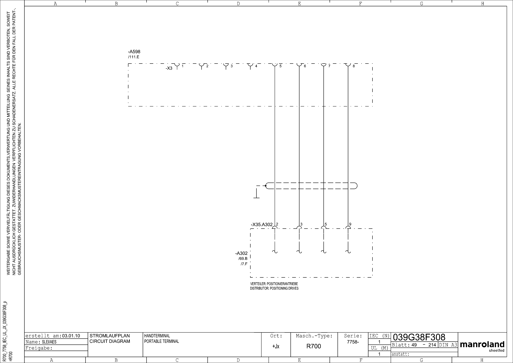

# +Jx — Sheet 49 of 214 — HANDTERMINAL

**PORTABLE TERMINAL**

> Part of the manroland **R700** printing press IEC/UL circuit diagrams.
> Drawing class: **Stromlaufplan / Circuit diagram** (DIN A3).
> Document `+Jx` covers the **1st printing module + feed register** machine section.

## At a glance

| Field | Value |
|---|---|
| Document | `+Jx`  (039G38F308) |
| Sheet | **49** of 214 |
| Section (DE) | HANDTERMINAL |
| Section (EN) | PORTABLE TERMINAL |
| Section type | CIRCUIT — Circuit diagram |
| Machine type | `R700` |
| Series | `7758` |
| Created | 03.01.10 |
| Replaces | — |
| Columns used | B, C, D, E, F |
| Path numbers | — |
| Labels on sheet | 21 |
| Cross-refs out | 3 |
| Cross-refs in | 7 |

**Previous:** [+Jx sheet 48](SHEET_0048.md) · **Next:** [+Jx sheet 50](SHEET_0050.md) · **Document TOC:** [_TOC.md](_TOC.md)  (+Jx) · **Master TOC:** [all sheets](../_MASTER_TOC.md)

## Sheet image (300 DPI, exact vector render)



_Rendered directly from the PDF vector layer at 300 DPI (1-bit), no OCR and no resampling. Use it to confirm anything ambiguous in the text below._

## Cross-references on this sheet

Each entry is a wire leaving this sheet. The printed token is `/sheet.column`; the link resolves to that sheet inside the same document.

| Ref | Target sheet | Col | Path | Destination on target | Target section | From col |
|---|---|---|---|---|---|---|
| `/111.E` | [+Jx sheet 111](SHEET_0111.md) | E | — | A598 | REFERENZMODUL | B |
| `/69.B` | [+Jx sheet 69](SHEET_0069.md) | B | — | — | SCHNITTSTELLE: POSITIONIERANTRIEBE | D |
| `/7.F` | [+Jx sheet 7](SHEET_0007.md) | F | — | — | SPANNUNGSVERSORGUNG, SCHALTSCHRANKBELÜFTUNG | D |

### Incoming references (sheets that point here)

Every other sheet that sends a wire to this one. `Back-ref` is the token printed on *that* sheet; `Path` is its line number.

| From sheet | Cols | Back-ref | Path | Refs | What continues there |
|---|---|---|---|---|---|
| [+Jx#7](SHEET_0007.md) | E | `/7.E` | — | 1 | — |
| [+Jx#69](SHEET_0069.md) | B | `/69.B` | — | 1 | — |
| [+Jx#111](SHEET_0111.md) | E | `/111.E` | — | 1 | — |
| [+Jx#149](SHEET_0149.md) | E | `/149.E` | — | 4 | — |


## Devices on this sheet

| Tag | Class | Class meaning (IEC) | Col | Sub | Terminal | Sign |
|---|---|---|---|---|---|---|
| `X3` | X | Klemme / terminal, plug connector | C | — | — | — |
| `A598` | A | Baugruppe / assembly, module, PC board | B | — | — | — |
| `A302` | A | Baugruppe / assembly, module, PC board | D | — | — | — |
| `X35.A302` | — | cross-device reference | D | — | — | — |

## Potentials / nets

_No named potentials on this sheet._

## Wire-end annotations (grouped as printed)

A wire that continues elsewhere is annotated with a small cluster: the destination description, the path/line number `#NN`, and the `/sheet.column` cross reference. Each row below is one such cluster exactly as it is grouped on the drawing.

| Col | Y | Path | Cross-ref | Text on the wire |
|---|---|---|---|---|
| B | 115.0 | — | `/111.E` | `A598` |
| D | 149.5 | — | — | `X3 1 2 3 4 5 6 7 8` |
| E | 516.1 | — | — | `X35.A302 2 3 5 9` |
| D | 582.8 | — | — | `A302` |
| D | 595.8 | — | `/69.B` | — |
| D | 608.2 | — | `/7.F` | — |
| E | 655.4 | — | — | `DISTRIBUTOR: POSITIONING DRIVES VERTEILER: POSITIONIERANTRIEBE` |


## Notes and free text on this sheet

| Text | Col | Y (pt) |
|---|---|---|
| `VERTEILER: POSITIONIERANTRIEBE` | E | 655.37 |
| `DISTRIBUTOR: POSITIONING DRIVES` | E | 666.01 |

## Complete label inventory (exact text from the drawing)

Every text object inside the drawing area of this sheet, in DIN reading order (column A→H, then top→bottom). This is the authoritative list: if a string is not here it is not printed on this sheet.

| Col | Y | X | Dir | Type | Text |
|---|---|---|---|---|---|
| B | 115.0 | 297.4 | → | device tag | `A598` |
| B | 128.1 | 297.6 | → | cross-reference | `/111.E` |
| C | 149.5 | 421.5 | → | number | `1` |
| C | 149.5 | 479.1 | → | number | `2` |
| C | 153.9 | 384.7 | → | device tag | `X3` |
| D | 149.5 | 535.5 | → | number | `3` |
| D | 149.5 | 592.4 | → | number | `4` |
| D | 516.1 | 582.5 | → | device ref | `X35.A302` |
| D | 582.8 | 546.2 | → | device tag | `A302` |
| D | 595.8 | 553.6 | → | cross-reference | `/69.B` |
| D | 608.2 | 559.0 | → | cross-reference | `/7.F` |
| E | 149.5 | 648.9 | → | number | `5` |
| E | 149.5 | 705.5 | → | number | `6` |
| E | 149.5 | 762.2 | → | number | `7` |
| E | 516.2 | 640.6 | → | number | `2` |
| E | 516.2 | 697.0 | → | number | `3` |
| E | 516.2 | 753.7 | → | number | `5` |
| E | 655.4 | 581.1 | → | text | `VERTEILER: POSITIONIERANTRIEBE` |
| E | 666.0 | 580.5 | → | text | `DISTRIBUTOR: POSITIONING DRIVES` |
| F | 149.5 | 818.9 | → | number | `8` |
| F | 516.2 | 810.4 | → | number | `9` |

## Reading-order text block

The same content as a plain block, grouped by DIN column — convenient to paste or to match against a visual description.

```text
=== Column B ===
 115.0  297.4  devtag       A598
 128.1  297.6  xref         /111.E
=== Column C ===
 149.5  421.5  numeric      1
 149.5  479.1  numeric      2
 153.9  384.7  devtag       X3
=== Column D ===
 149.5  535.5  numeric      3
 149.5  592.4  numeric      4
 516.1  582.5  devref       X35.A302
 582.8  546.2  devtag       A302
 595.8  553.6  xref         /69.B
 608.2  559.0  xref         /7.F
=== Column E ===
 149.5  648.9  numeric      5
 149.5  705.5  numeric      6
 149.5  762.2  numeric      7
 516.2  640.6  numeric      2
 516.2  697.0  numeric      3
 516.2  753.7  numeric      5
 655.4  581.1  text         VERTEILER: POSITIONIERANTRIEBE
 666.0  580.5  text         DISTRIBUTOR: POSITIONING DRIVES
=== Column F ===
 149.5  818.9  numeric      8
 516.2  810.4  numeric      9
```

---
_Generated from the PDF vector text layer; no OCR. Source: `R700_7758_IEC_UL_JX_039G38F308_p`, sheet 49._
