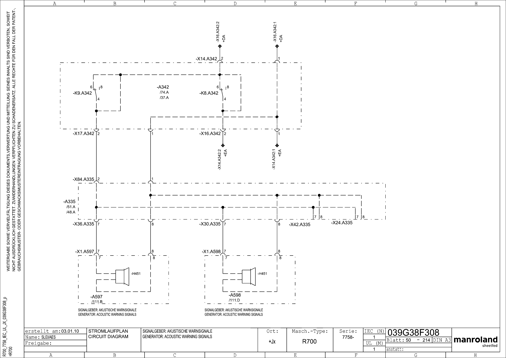

# +Jx — Sheet 50 of 214 — SIGNALGEBER: AKUSTISCHE WARNSIGNALE

**GENERATOR: ACOUSTIC WARNING SIGNALS**

> Part of the manroland **R700** printing press IEC/UL circuit diagrams.
> Drawing class: **Stromlaufplan / Circuit diagram** (DIN A3).
> Document `+Jx` covers the **1st printing module + feed register** machine section.

## At a glance

| Field | Value |
|---|---|
| Document | `+Jx`  (039G38F308) |
| Sheet | **50** of 214 |
| Section (DE) | SIGNALGEBER: AKUSTISCHE WARNSIGNALE |
| Section (EN) | GENERATOR: ACOUSTIC WARNING SIGNALS |
| Section type | CIRCUIT — Circuit diagram |
| Machine type | `R700` |
| Series | `7758` |
| Created | 03.01.10 |
| Replaces | — |
| Columns used | A, B, C, D, E, F |
| Path numbers | — |
| Labels on sheet | 66 |
| Cross-refs out | 6 |
| Cross-refs in | 26 |

**Previous:** [+Jx sheet 49](SHEET_0049.md) · **Next:** [+Jx sheet 51](SHEET_0051.md) · **Document TOC:** [_TOC.md](_TOC.md)  (+Jx) · **Master TOC:** [all sheets](../_MASTER_TOC.md)

## Sheet image (300 DPI, exact vector render)



_Rendered directly from the PDF vector layer at 300 DPI (1-bit), no OCR and no resampling. Use it to confirm anything ambiguous in the text below._

## Cross-references on this sheet

Each entry is a wire leaving this sheet. The printed token is `/sheet.column`; the link resolves to that sheet inside the same document.

| Ref | Target sheet | Col | Path | Destination on target | Target section | From col |
|---|---|---|---|---|---|---|
| `/74.A` | [+Jx sheet 74](SHEET_0074.md) | A | — | — | REDUNDANZ: ANTRIEBE | C |
| `/37.A` | [+Jx sheet 37](SHEET_0037.md) | A | — | — | STOP SICHERN | C |
| `/51.A` | [+Jx sheet 51](SHEET_0051.md) | A | — | — | SIGNALGEBER: AKUSTISCHE WARNSIGNALE | A |
| `/48.A` | [+Jx sheet 48](SHEET_0048.md) | A | — | — | 7 SEGMENTANZEIGE | A |
| `/111.D` | [+Jx sheet 111](SHEET_0111.md) | D | — | A598 | REFERENZMODUL | D |
| `/111.B` | [+Jx sheet 111](SHEET_0111.md) | B | — | — | REFERENZMODUL | B |

### Incoming references (sheets that point here)

Every other sheet that sends a wire to this one. `Back-ref` is the token printed on *that* sheet; `Path` is its line number.

| From sheet | Cols | Back-ref | Path | Refs | What continues there |
|---|---|---|---|---|---|
| [+Jx#37](SHEET_0037.md) | A | `/37.A` | — | 1 | — |
| [+Jx#48](SHEET_0048.md) | A | `/48.A` | — | 1 | — |
| [+Jx#51](SHEET_0051.md) | A | `/51.A` | — | 1 | — |
| [+Jx#74](SHEET_0074.md) | A | `/74.A` | — | 1 | — |
| [+Jx#111](SHEET_0111.md) | B, D | `/111.B`, `/111.D` | — | 2 | — |
| [+Jx#115](SHEET_0115.md) | E, G | `/115.E`, `/115.G` | — | 4 | — |
| [+Jx#138](SHEET_0138.md) | C | `/138.C` | — | 2 | — |
| [+Jx#139](SHEET_0139.md) | F | `/139.F` | — | 2 | — |
| [+Jx#140](SHEET_0140.md) | C | `/140.C` | — | 2 | — |
| [+Jx#142](SHEET_0142.md) | F | `/142.F` | — | 2 | — |
| [+Jx#148](SHEET_0148.md) | A | `/148.A` | — | 2 | — |
| [+Jx#149](SHEET_0149.md) | F | `/149.F` | — | 2 | — |
| [+Jx#150](SHEET_0150.md) | C | `/150.C` | — | 2 | — |
| [+Jx#156](SHEET_0156.md) | G | `/156.G` | — | 2 | — |


## Devices on this sheet

| Tag | Class | Class meaning (IEC) | Col | Sub | Terminal | Sign |
|---|---|---|---|---|---|---|
| `A342` | A | Baugruppe / assembly, module, PC board | C | — | — | — |
| `A335` | A | Baugruppe / assembly, module, PC board | A | — | — | — |
| `A597` | A | Baugruppe / assembly, module, PC board | B | — | — | — |
| `A598` | A | Baugruppe / assembly, module, PC board | D | — | — | — |
| `X17.A342` | — | cross-device reference | A | — | — | — |
| `K9.A342` | — | cross-device reference | A | — | — | — |
| `X36.A335` | — | cross-device reference | A | — | — | — |
| `X84.A335` | — | cross-device reference | A | — | — | — |
| `X1.A597` | — | cross-device reference | B | — | — | — |
| `X16.A342:1` | — | cross-device reference | E | — | 1 | — |
| `X14.A342` | — | cross-device reference | D | — | — | — |
| `X16.A342:2` | — | cross-device reference | D | — | 2 | — |
| `X16.A342` | — | cross-device reference | D | — | — | — |
| `X14.A342:2` | — | cross-device reference | D | — | 2 | — |
| `X14.A342:1` | — | cross-device reference | E | — | 1 | — |
| `K8.A342` | — | cross-device reference | D | — | — | — |
| `X30.A335` | — | cross-device reference | D | — | — | — |
| `X1.A598` | — | cross-device reference | D | — | — | — |
| `X24.A335` | — | cross-device reference | F | — | — | — |
| `X42.A335` | — | cross-device reference | E | — | — | — |

## Potentials / nets

| Potential | Count | Columns | Attached devices | Terminals |
|---|---|---|---|---|
| `H451` | 2 | B, D | — | — |


A potential such as `L24+/4` or `M24+` is a named supply/return rail; every place it appears on this sheet is electrically common.

## Wire-end annotations (grouped as printed)

A wire that continues elsewhere is annotated with a small cluster: the destination description, the path/line number `#NN`, and the `/sheet.column` cross reference. Each row below is one such cluster exactly as it is grouped on the drawing.

| Col | Y | Path | Cross-ref | Text on the wire |
|---|---|---|---|---|
| D | 50.7 | — | — | `X16.A342:2` |
| E | 50.7 | — | — | `X16.A342:1` |
| D | 82.2 | — | — | `+DA` |
| E | 82.2 | — | — | `+DA` |
| D | 133.5 | — | — | `X14.A342 2` |
| E | 133.5 | — | — | `1` |
| C | 200.1 | — | — | `A342` |
| B | 200.8 | — | — | `K9.A342 8` |
| B | 200.8 | — | — | `6` |
| D | 200.8 | — | — | `K8.A342 8` |
| D | 200.8 | — | — | `6` |
| C | 213.1 | — | `/74.A`, `/37.A` | — |
| B | 229.2 | — | — | `4` |
| D | 229.2 | — | — | `4` |
| B | 309.2 | — | — | `X17.A342 2 1` |
| D | 309.2 | — | — | `X16.A342 2 1` |
| E | 350.1 | — | — | `X14.A342:1` |
| D | 351.2 | — | — | `X14.A342:2` |
| D | 351.5 | — | — | `+EA` |
| E | 351.5 | — | — | `+EA` |
| B | 416.9 | — | — | `X84.A335 2 1` |
| A | 469.4 | — | — | `A335` |
| A | 482.4 | — | `/51.A`, `/48.A` | — |
| F | 506.2 | — | — | `X42.A335 7 8 X24.A335 7 8` |
| B | 521.8 | — | — | `X36.A335 7 8` |
| D | 521.8 | — | — | `X30.A335 7 8` |
| B | 587.0 | — | — | `X1.A597 7 8` |
| D | 587.0 | — | — | `X1.A598 7 8` |
| B | 602.6 | — | — | `7 8` |
| D | 602.6 | — | — | `7 8` |
| B | 639.9 | — | — | `H451` |
| D | 639.9 | — | — | `H451` |
| D | 689.0 | — | `/111.D` | `A598` |
| B | 693.3 | — | — | `A597` |
| B | 705.7 | — | `/111.B` | — |
| B | 726.2 | — | — | `SIGNALGEBER: AKUSTISCHE WARNSIGNALE GENERATOR: ACOUSTIC WARNING SIGNALS` |
| D | 726.2 | — | — | `SIGNALGEBER: AKUSTISCHE WARNSIGNALE GENERATOR: ACOUSTIC WARNING SIGNALS` |


## Reconstructed tables

This sheet carries tabular content (pin map / terminal assignment / index). The grid below was rebuilt from the drawing's own rule lines, so each row is exactly one physical row of the table.

### Table 1 — 3 data rows × 1 columns (at x=226.8, y=175.7)

| C1 |
|---|
| `8 4` |
| `2 2` |
| `7 7 7` |


### Table 2 — 3 data rows × 1 columns (at x=524.4, y=175.7)

| C1 |
|---|
| `8 4` |
| `2 +EA` |
| `7 7 7` |


### Table 3 — 1 data rows × 3 columns (at x=600.9, y=175.7)

| X14.A342:1 | 1 +EA |  |
|---|---|---|
| `H451` | `7 X42.A335 8 8 8` | `8 7 X24.A335` |


## Notes and free text on this sheet

| Text | Col | Y (pt) |
|---|---|---|
| `SIGNALGEBER: AKUSTISCHE WARNSIGNALE` | B | 726.23 |
| `GENERATOR: ACOUSTIC WARNING SIGNALS` | B | 736.88 |
| `+DA` | E | 82.21 |
| `+DA` | D | 82.21 |
| `+EA` | D | 351.5 |
| `+EA` | E | 351.5 |
| `SIGNALGEBER: AKUSTISCHE WARNSIGNALE` | D | 726.23 |
| `GENERATOR: ACOUSTIC WARNING SIGNALS` | D | 736.88 |

## Complete label inventory (exact text from the drawing)

Every text object inside the drawing area of this sheet, in DIN reading order (column A→H, then top→bottom). This is the authoritative list: if a string is not here it is not printed on this sheet.

| Col | Y | X | Dir | Type | Text |
|---|---|---|---|---|---|
| A | 214.3 | 171.8 | → | device ref | `K9.A342` |
| A | 309.2 | 171.5 | → | device ref | `X17.A342` |
| A | 416.9 | 171.2 | → | device ref | `X84.A335` |
| A | 469.4 | 149.1 | → | device tag | `A335` |
| A | 482.4 | 156.5 | → | cross-reference | `/51.A` |
| A | 494.8 | 156.5 | → | cross-reference | `/48.A` |
| A | 521.8 | 171.2 | → | device ref | `X36.A335` |
| B | 200.8 | 212.3 | → | number | `6` |
| B | 200.8 | 236.4 | → | number | `8` |
| B | 229.2 | 229.6 | → | number | `4` |
| B | 310.7 | 229.6 | → | number | `2` |
| B | 417.0 | 229.6 | → | number | `2` |
| B | 523.3 | 229.3 | → | number | `7` |
| B | 587.0 | 177.2 | → | device ref | `X1.A597` |
| B | 587.0 | 229.3 | → | number | `7` |
| B | 602.6 | 232.2 | → | number | `7` |
| B | 639.9 | 308.7 | → | potential | `H451` |
| B | 693.3 | 212.9 | → | device tag | `A597` |
| B | 705.7 | 215.7 | → | cross-reference | `/111.B` |
| B | 726.2 | 184.0 | → | text | `SIGNALGEBER: AKUSTISCHE WARNSIGNALE` |
| B | 736.9 | 184.0 | → | text | `GENERATOR: ACOUSTIC WARNING SIGNALS` |
| C | 200.1 | 369.1 | → | device tag | `A342` |
| C | 213.1 | 376.2 | → | cross-reference | `/74.A` |
| C | 225.5 | 376.2 | → | cross-reference | `/37.A` |
| C | 310.7 | 356.3 | → | number | `1` |
| C | 417.0 | 356.3 | → | number | `1` |
| C | 523.3 | 356.9 | → | number | `8` |
| C | 587.0 | 356.9 | → | number | `8` |
| C | 602.6 | 359.7 | → | number | `8` |
| D | 50.7 | 508.3 | ↕ | device ref | `X16.A342:2` |
| D | 82.2 | 522.5 | ↕ | text | `+DA` |
| D | 133.5 | 460.6 | → | device ref | `X14.A342` |
| D | 133.5 | 520.2 | → | number | `2` |
| D | 200.8 | 510.0 | → | number | `6` |
| D | 200.8 | 534.0 | → | number | `8` |
| D | 214.3 | 469.4 | → | device ref | `K8.A342` |
| D | 229.2 | 527.2 | → | number | `4` |
| D | 309.2 | 469.1 | → | device ref | `X16.A342` |
| D | 310.7 | 527.2 | → | number | `2` |
| D | 351.2 | 512.6 | ↕ | device ref | `X14.A342:2` |
| D | 351.5 | 526.7 | ↕ | text | `+EA` |
| D | 521.8 | 468.9 | → | device ref | `X30.A335` |
| D | 523.3 | 527.0 | → | number | `7` |
| D | 587.0 | 475.1 | → | device ref | `X1.A598` |
| D | 587.0 | 527.0 | → | number | `7` |
| D | 602.6 | 529.8 | → | number | `7` |
| D | 639.9 | 606.3 | → | potential | `H451` |
| D | 689.1 | 538.3 | → | device tag | `A598` |
| D | 702.2 | 538.6 | → | cross-reference | `/111.D` |
| D | 726.2 | 481.6 | → | text | `SIGNALGEBER: AKUSTISCHE WARNSIGNALE` |
| D | 736.9 | 481.6 | → | text | `GENERATOR: ACOUSTIC WARNING SIGNALS` |
| E | 50.7 | 643.0 | ↕ | device ref | `X16.A342:1` |
| E | 82.2 | 657.2 | ↕ | text | `+DA` |
| E | 133.5 | 654.0 | → | number | `1` |
| E | 310.7 | 654.0 | → | number | `1` |
| E | 350.1 | 640.1 | ↕ | device ref | `X14.A342:1` |
| E | 351.5 | 654.3 | ↕ | text | `+EA` |
| E | 506.3 | 739.6 | → | number | `7` |
| E | 506.3 | 753.7 | → | number | `8` |
| E | 523.2 | 680.0 | → | device ref | `X42.A335` |
| E | 523.3 | 654.5 | → | number | `8` |
| E | 587.0 | 654.5 | → | number | `8` |
| E | 602.6 | 657.4 | → | number | `8` |
| F | 506.3 | 838.8 | → | number | `7` |
| F | 506.3 | 852.9 | → | number | `8` |
| F | 519.0 | 779.2 | → | device ref | `X24.A335` |

## Reading-order text block

The same content as a plain block, grouped by DIN column — convenient to paste or to match against a visual description.

```text
=== Column A ===
 214.3  171.8  devref       K9.A342
 309.2  171.5  devref       X17.A342
 416.9  171.2  devref       X84.A335
 469.4  149.1  devtag       A335
 482.4  156.5  xref         /51.A
 494.8  156.5  xref         /48.A
 521.8  171.2  devref       X36.A335
=== Column B ===
 200.8  212.3  numeric      6
 200.8  236.4  numeric      8
 229.2  229.6  numeric      4
 310.7  229.6  numeric      2
 417.0  229.6  numeric      2
 523.3  229.3  numeric      7
 587.0  177.2  devref       X1.A597
 587.0  229.3  numeric      7
 602.6  232.2  numeric      7
 639.9  308.7  net          H451
 693.3  212.9  devtag       A597
 705.7  215.7  xref         /111.B
 726.2  184.0  text         SIGNALGEBER: AKUSTISCHE WARNSIGNALE
 736.9  184.0  text         GENERATOR: ACOUSTIC WARNING SIGNALS
=== Column C ===
 200.1  369.1  devtag       A342
 213.1  376.2  xref         /74.A
 225.5  376.2  xref         /37.A
 310.7  356.3  numeric      1
 417.0  356.3  numeric      1
 523.3  356.9  numeric      8
 587.0  356.9  numeric      8
 602.6  359.7  numeric      8
=== Column D ===
  50.7  508.3  devref       X16.A342:2
  82.2  522.5  text         +DA
 133.5  460.6  devref       X14.A342
 133.5  520.2  numeric      2
 200.8  510.0  numeric      6
 200.8  534.0  numeric      8
 214.3  469.4  devref       K8.A342
 229.2  527.2  numeric      4
 309.2  469.1  devref       X16.A342
 310.7  527.2  numeric      2
 351.2  512.6  devref       X14.A342:2
 351.5  526.7  text         +EA
 521.8  468.9  devref       X30.A335
 523.3  527.0  numeric      7
 587.0  475.1  devref       X1.A598
 587.0  527.0  numeric      7
 602.6  529.8  numeric      7
 639.9  606.3  net          H451
 689.1  538.3  devtag       A598
 702.2  538.6  xref         /111.D
 726.2  481.6  text         SIGNALGEBER: AKUSTISCHE WARNSIGNALE
 736.9  481.6  text         GENERATOR: ACOUSTIC WARNING SIGNALS
=== Column E ===
  50.7  643.0  devref       X16.A342:1
  82.2  657.2  text         +DA
 133.5  654.0  numeric      1
 310.7  654.0  numeric      1
 350.1  640.1  devref       X14.A342:1
 351.5  654.3  text         +EA
 506.3  739.6  numeric      7
 506.3  753.7  numeric      8
 523.2  680.0  devref       X42.A335
 523.3  654.5  numeric      8
 587.0  654.5  numeric      8
 602.6  657.4  numeric      8
=== Column F ===
 506.3  838.8  numeric      7
 506.3  852.9  numeric      8
 519.0  779.2  devref       X24.A335
```

---
_Generated from the PDF vector text layer; no OCR. Source: `R700_7758_IEC_UL_JX_039G38F308_p`, sheet 50._
