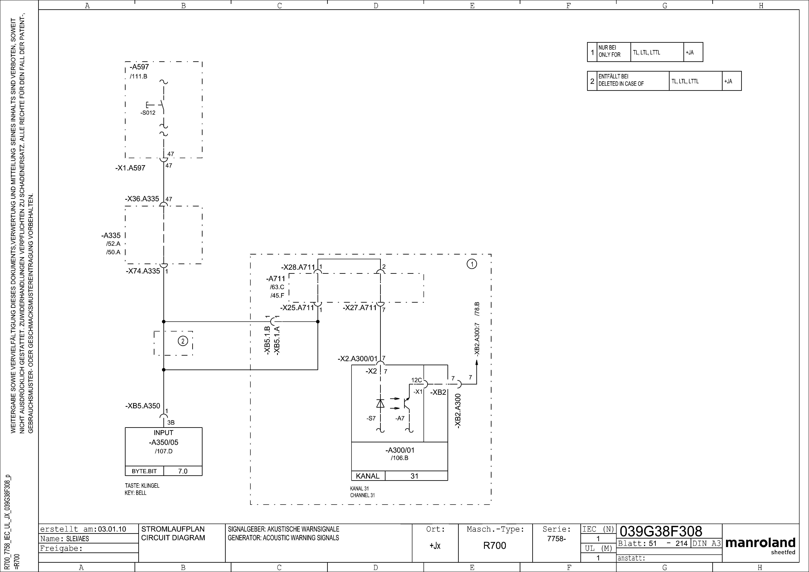

# +Jx — Sheet 51 of 214 — SIGNALGEBER: AKUSTISCHE WARNSIGNALE

**GENERATOR: ACOUSTIC WARNING SIGNALS**

> Part of the manroland **R700** printing press IEC/UL circuit diagrams.
> Drawing class: **Stromlaufplan / Circuit diagram** (DIN A3).
> Document `+Jx` covers the **1st printing module + feed register** machine section.

## At a glance

| Field | Value |
|---|---|
| Document | `+Jx`  (039G38F308) |
| Sheet | **51** of 214 |
| Section (DE) | SIGNALGEBER: AKUSTISCHE WARNSIGNALE |
| Section (EN) | GENERATOR: ACOUSTIC WARNING SIGNALS |
| Section type | CIRCUIT — Circuit diagram |
| Machine type | `R700` |
| Series | `7758` |
| Created | 03.01.10 |
| Replaces | — |
| Columns used | A, B, C, D, E, F, G, H |
| Path numbers | — |
| Labels on sheet | 69 |
| Cross-refs out | 8 |
| Cross-refs in | 20 |

**Previous:** [+Jx sheet 50](SHEET_0050.md) · **Next:** [+Jx sheet 52](SHEET_0052.md) · **Document TOC:** [_TOC.md](_TOC.md)  (+Jx) · **Master TOC:** [all sheets](../_MASTER_TOC.md)

## Sheet image (300 DPI, exact vector render)



_Rendered directly from the PDF vector layer at 300 DPI (1-bit), no OCR and no resampling. Use it to confirm anything ambiguous in the text below._

## Cross-references on this sheet

Each entry is a wire leaving this sheet. The printed token is `/sheet.column`; the link resolves to that sheet inside the same document.

| Ref | Target sheet | Col | Path | Destination on target | Target section | From col |
|---|---|---|---|---|---|---|
| `/111.B` | [+Jx sheet 111](SHEET_0111.md) | B | — | — | REFERENZMODUL | B |
| `/52.A` | [+Jx sheet 52](SHEET_0052.md) | A | — | — | SCHUTZEINRICHTUNGEN | A |
| `/50.A` | [+Jx sheet 50](SHEET_0050.md) | A | — | — | SIGNALGEBER: AKUSTISCHE WARNSIGNALE | A |
| `/63.C` | [+Jx sheet 63](SHEET_0063.md) | C | — | — | LACKAUFTRAGSWALZE | C |
| `/45.F` | [+Jx sheet 45](SHEET_0045.md) | F | — | — | MASCHINENBEDIENUNG | C |
| `/78.B` | [+Jx sheet 78](SHEET_0078.md) | B | — | XB2.A300:7 | BUSVERBINDUNGEN: SICHERHEITSKREIS | E |
| `/107.D` | [+Jx sheet 107](SHEET_0107.md) | D | — | — | REFERENZMODUL | B |
| `/106.B` | [+Jx sheet 106](SHEET_0106.md) | B | — | — | REFERENZMODUL | D |

### Incoming references (sheets that point here)

Every other sheet that sends a wire to this one. `Back-ref` is the token printed on *that* sheet; `Path` is its line number.

| From sheet | Cols | Back-ref | Path | Refs | What continues there |
|---|---|---|---|---|---|
| [+Jx#45](SHEET_0045.md) | F | `/45.F` | — | 1 | — |
| [+Jx#50](SHEET_0050.md) | A | `/50.A` | — | 1 | — |
| [+Jx#52](SHEET_0052.md) | A | `/52.A` | — | 1 | — |
| [+Jx#63](SHEET_0063.md) | B | `/63.B` | — | 1 | — |
| [+Jx#78](SHEET_0078.md) | B | `/78.B` | — | 1 | XB2.A300:7 |
| [+Jx#106](SHEET_0106.md) | B | `/106.B` | — | 1 | — |
| [+Jx#107](SHEET_0107.md) | D | `/107.D` | — | 1 | — |
| [+Jx#111](SHEET_0111.md) | B | `/111.B` | — | 1 | — |
| [+Jx#115](SHEET_0115.md) | F | `/115.F` | — | 1 | — |
| [+Jx#124](SHEET_0124.md) | E, G | `/124.E`, `/124.G` | — | 2 | — |
| [+Jx#131](SHEET_0131.md) | A, B | `/131.A`, `/131.B` | — | 2 | — |
| [+Jx#132](SHEET_0132.md) | C | `/132.C` | — | 1 | — |
| [+Jx#143](SHEET_0143.md) | B | `/143.B` | — | 1 | — |
| [+Jx#144](SHEET_0144.md) | F | `/144.F` | — | 1 | — |
| [+Jx#146](SHEET_0146.md) | C | `/146.C` | — | 2 | — |
| [+Jx#149](SHEET_0149.md) | G | `/149.G` | — | 1 | — |
| [+Jx#154](SHEET_0154.md) | A | `/154.A` | — | 1 | — |


## Devices on this sheet

| Tag | Class | Class meaning (IEC) | Col | Sub | Terminal | Sign |
|---|---|---|---|---|---|---|
| `S012` | S | Schalter / switch | B | — | — | — |
| `A597` | A | Baugruppe / assembly, module, PC board | B | — | — | — |
| `A350/05` | A | Baugruppe / assembly, module, PC board | B | 05 | — | — |
| `A335` | A | Baugruppe / assembly, module, PC board | A | — | — | — |
| `A711` | A | Baugruppe / assembly, module, PC board | C | — | — | — |
| `S7` | S | Schalter / switch | D | — | — | — |
| `A7` | A | Baugruppe / assembly, module, PC board | D | — | — | — |
| `X1` | X | Klemme / terminal, plug connector | D | — | — | — |
| `X2` | X | Klemme / terminal, plug connector | D | — | — | — |
| `XB2` | XB |  | E | — | — | — |
| `A300/01` | A | Baugruppe / assembly, module, PC board | D | 01 | — | — |
| `X1.A597` | — | cross-device reference | A | — | — | — |
| `X36.A335` | — | cross-device reference | B | — | — | — |
| `X74.A335` | — | cross-device reference | B | — | — | — |
| `7.0` | — | cross-device reference | B | — | — | — |
| `XB5.A350` | — | cross-device reference | B | — | — | — |
| `X28.A711` | — | cross-device reference | C | — | — | — |
| `X25.A711` | — | cross-device reference | C | — | — | — |
| `XB5.1.A` | — | cross-device reference | C | — | — | — |
| `XB5.1.B` | — | cross-device reference | C | — | — | — |
| `XB2.A300` | — | cross-device reference | E | — | — | — |
| `X27.A711` | — | cross-device reference | D | — | — | — |
| `XB2.A300:7` | — | cross-device reference | E | — | 7 | — |

## Potentials / nets

_No named potentials on this sheet._

## Wire-end annotations (grouped as printed)

A wire that continues elsewhere is annotated with a small cluster: the destination description, the path/line number `#NN`, and the `/sheet.column` cross reference. Each row below is one such cluster exactly as it is grouped on the drawing.

| Col | Y | Path | Cross-ref | Text on the wire |
|---|---|---|---|---|
| G | 67.2 | — | — | `1 NUR BEI ONLY FOR TL, LTL, LTTL` |
| G | 74.2 | — | — | `+JA` |
| B | 93.8 | — | — | `A597` |
| B | 108.6 | — | `/111.B` | — |
| G | 109.7 | — | — | `2 ENTFÄLLT BEI DELETED IN CASE OF TL, LTL, LTTL +JA` |
| B | 162.3 | — | — | `S012` |
| B | 222.8 | — | — | `47` |
| B | 239.8 | — | — | `X1.A597 47` |
| B | 287.9 | — | — | `X36.A335 47` |
| A | 341.8 | — | — | `A335` |
| A | 354.9 | — | `/52.A`, `/50.A` | — |
| E | 385.3 | — | — | `1` |
| C | 388.6 | — | — | `X28.A711 1` |
| D | 388.6 | — | — | `2` |
| B | 394.2 | — | — | `X74.A335 1` |
| C | 405.6 | — | — | `A711` |
| C | 418.7 | — | `/63.C` | — |
| C | 431.1 | — | `/45.F` | — |
| E | 444.2 | — | `/78.B` | `XB2.A300:7` |
| C | 448.1 | — | — | `X25.A711 1` |
| D | 448.1 | — | — | `X27.A711 7` |
| C | 463.6 | — | — | `XB5.1.B 1` |
| C | 463.6 | — | — | `XB5.1.A 1` |
| B | 499.1 | — | — | `2` |
| D | 523.2 | — | — | `X2.A300/01 7` |
| D | 541.7 | — | — | `X2` |
| D | 543.1 | — | — | `7 7` |
| E | 551.6 | — | — | `7` |
| D | 555.9 | — | — | `12C` |
| D | 572.8 | — | — | `X1` |
| E | 572.9 | — | — | `XB2` |
| E | 579.1 | — | — | `XB2.A300` |
| B | 592.7 | — | — | `XB5.A350 1` |
| D | 611.8 | — | — | `S7 A7` |
| B | 618.2 | — | — | `3B` |
| B | 632.7 | — | — | `INPUT` |
| B | 646.5 | — | — | `A350/05` |
| D | 657.9 | — | — | `A300/01` |
| B | 660.4 | — | `/107.D` | — |
| D | 670.2 | — | `/106.B` | — |
| B | 689.4 | — | — | `BYTE.BIT 7.0` |
| D | 696.1 | — | — | `KANAL 31` |
| B | 712.1 | — | — | `KEY: BELL TASTE: KLINGEL` |
| D | 716.5 | — | — | `KANAL 31 CHANNEL 31` |


## Reconstructed tables

This sheet carries tabular content (pin map / terminal assignment / index). The grid below was rebuilt from the drawing's own rule lines, so each row is exactly one physical row of the table.

### Table 1 — 5 data rows × 2 columns (at x=184.3, y=90.7)

| A597 /111.B S012 | 47 |
|---|---|
| `X1.A597 X36.A335 X74.A335` | `47 47 1` |
|  | `2` |
| `XB5.A350` | `1 3B` |
| `INPUT` | `A350/05 /107.D` |
| `BYTE.BIT` | `7.0` |


### Table 2 — 4 data rows × 6 columns (at x=467.7, y=381.3)

| 1 1 | X27.A711 | 2 7 |  |  | 1 |
|---|---|---|---|---|---|
|  | `X2.A300/01` | `7` |  |  |  |
|  | `X2 S7` | `7 A7` | `12C X1` | `XB2` | `7 7 XB2.A300` |
|  |  | `A300/01 /106.B` |  |  |  |
|  | `KANAL` |  | `31` |  |  |


## Notes and free text on this sheet

| Text | Col | Y (pt) |
|---|---|---|
| `3B` | B | 618.17 |
| `INPUT` | B | 632.7 |
| `BYTE.BIT` | B | 689.96 |
| `TASTE: KLINGEL` | B | 712.06 |
| `KEY: BELL` | B | 722.66 |
| `KANAL 31` | D | 716.46 |
| `CHANNEL 31` | D | 726.41 |
| `12C` | D | 555.86 |
| `KANAL` | D | 696.14 |
| `X2.A300/01` | D | 523.23 |
| `NUR BEI` | F | 67.15 |
| `ONLY FOR` | F | 77.84 |
| `TL, LTL, LTTL` | G | 74.28 |
| `ENTFÄLLT BEI` | F | 109.68 |
| `DELETED IN CASE OF` | G | 120.33 |
| `+JA` | H | 116.75 |
| `+JA` | G | 74.23 |

## Complete label inventory (exact text from the drawing)

Every text object inside the drawing area of this sheet, in DIN reading order (column A→H, then top→bottom). This is the authoritative list: if a string is not here it is not printed on this sheet.

| Col | Y | X | Dir | Type | Text |
|---|---|---|---|---|---|
| A | 242.6 | 169.8 | → | device ref | `X1.A597` |
| A | 341.8 | 149.1 | → | device tag | `A335` |
| A | 354.9 | 156.5 | → | cross-reference | `/52.A` |
| A | 367.3 | 156.5 | → | cross-reference | `/50.A` |
| B | 93.8 | 191.1 | → | device tag | `A597` |
| B | 108.6 | 191.3 | → | cross-reference | `/111.B` |
| B | 162.3 | 206.9 | → | device tag | `S012` |
| B | 222.8 | 246.6 | → | number | `47` |
| B | 239.8 | 243.8 | → | number | `47` |
| B | 288.0 | 184.0 | → | device ref | `X36.A335` |
| B | 289.4 | 243.8 | → | number | `47` |
| B | 394.3 | 185.4 | → | device ref | `X74.A335` |
| B | 395.7 | 242.9 | → | number | `1` |
| B | 499.1 | 267.3 | → | number | `2` |
| B | 592.7 | 184.5 | → | device ref | `XB5.A350` |
| B | 601.2 | 242.9 | → | number | `1` |
| B | 618.2 | 246.3 | → | text | `3B` |
| B | 632.7 | 226.1 | → | text | `INPUT` |
| B | 646.5 | 219.4 | → | device tag | `A350/05` |
| B | 660.4 | 228.2 | → | cross-reference | `/107.D` |
| B | 689.4 | 262.5 | → | device ref | `7.0` |
| B | 690.0 | 194.2 | → | text | `BYTE.BIT` |
| B | 712.1 | 184.3 | → | text | `TASTE: KLINGEL` |
| B | 722.7 | 183.7 | → | text | `KEY: BELL` |
| C | 388.6 | 413.9 | → | device ref | `X28.A711` |
| C | 388.6 | 469.7 | → | number | `1` |
| C | 405.6 | 391.7 | → | device tag | `A711` |
| C | 418.7 | 397.4 | → | cross-reference | `/63.C` |
| C | 431.1 | 398.3 | → | cross-reference | `/45.F` |
| C | 448.1 | 412.4 | → | device ref | `X25.A711` |
| C | 452.4 | 469.7 | → | number | `1` |
| C | 463.6 | 390.0 | ↕ | number | `1` |
| C | 463.6 | 404.2 | ↕ | number | `1` |
| C | 479.9 | 388.6 | ↕ | device ref | `XB5.1.B` |
| C | 480.5 | 402.8 | ↕ | device ref | `XB5.1.A` |
| D | 388.6 | 562.7 | → | number | `2` |
| D | 448.1 | 504.6 | → | device ref | `X27.A711` |
| D | 452.4 | 562.4 | → | number | `7` |
| D | 523.2 | 497.2 | → | text | `X2.A300/01` |
| D | 523.3 | 562.4 | → | number | `7` |
| D | 541.7 | 538.3 | → | device tag | `X2` |
| D | 543.1 | 565.2 | → | number | `7` |
| D | 555.9 | 605.2 | → | text | `12C` |
| D | 572.8 | 608.6 | → | device tag | `X1` |
| D | 611.8 | 539.4 | → | device tag | `S7` |
| D | 611.8 | 582.0 | → | device tag | `A7` |
| D | 657.9 | 567.5 | → | device tag | `A300/01` |
| D | 670.2 | 575.6 | → | cross-reference | `/106.B` |
| D | 696.1 | 523.8 | → | text | `KANAL` |
| D | 696.1 | 604.3 | → | number | `31` |
| D | 716.5 | 515.3 | → | text | `KANAL 31` |
| D | 726.4 | 515.6 | → | text | `CHANNEL 31` |
| E | 385.3 | 692.6 | → | number | `1` |
| E | 444.2 | 698.2 | ↕ | cross-reference | `/78.B` |
| E | 474.8 | 698.2 | ↕ | device ref | `XB2.A300:7` |
| E | 551.6 | 690.0 | → | number | `7` |
| E | 553.0 | 664.4 | → | number | `7` |
| E | 572.8 | 633.3 | → | device tag | `XB2` |
| E | 579.1 | 669.2 | ↕ | device ref | `XB2.A300` |
| F | 67.2 | 881.0 | → | text | `NUR BEI` |
| F | 72.5 | 869.1 | → | number | `1` |
| F | 77.8 | 881.3 | → | text | `ONLY FOR` |
| F | 109.7 | 881.0 | → | text | `ENTFÄLLT BEI` |
| F | 115.0 | 868.8 | → | number | `2` |
| G | 74.2 | 1009.6 | → | text | `+JA` |
| G | 74.3 | 931.9 | → | text | `TL, LTL, LTTL` |
| G | 116.8 | 988.6 | → | text | `TL, LTL, LTTL` |
| G | 120.3 | 881.0 | → | text | `DELETED IN CASE OF` |
| H | 116.8 | 1066.3 | → | text | `+JA` |

## Reading-order text block

The same content as a plain block, grouped by DIN column — convenient to paste or to match against a visual description.

```text
=== Column A ===
 242.6  169.8  devref       X1.A597
 341.8  149.1  devtag       A335
 354.9  156.5  xref         /52.A
 367.3  156.5  xref         /50.A
=== Column B ===
  93.8  191.1  devtag       A597
 108.6  191.3  xref         /111.B
 162.3  206.9  devtag       S012
 222.8  246.6  numeric      47
 239.8  243.8  numeric      47
 288.0  184.0  devref       X36.A335
 289.4  243.8  numeric      47
 394.3  185.4  devref       X74.A335
 395.7  242.9  numeric      1
 499.1  267.3  numeric      2
 592.7  184.5  devref       XB5.A350
 601.2  242.9  numeric      1
 618.2  246.3  text         3B
 632.7  226.1  text         INPUT
 646.5  219.4  devtag       A350/05
 660.4  228.2  xref         /107.D
 689.4  262.5  devref       7.0
 690.0  194.2  text         BYTE.BIT
 712.1  184.3  text         TASTE: KLINGEL
 722.7  183.7  text         KEY: BELL
=== Column C ===
 388.6  413.9  devref       X28.A711
 388.6  469.7  numeric      1
 405.6  391.7  devtag       A711
 418.7  397.4  xref         /63.C
 431.1  398.3  xref         /45.F
 448.1  412.4  devref       X25.A711
 452.4  469.7  numeric      1
 463.6  390.0  numeric      1
 463.6  404.2  numeric      1
 479.9  388.6  devref       XB5.1.B
 480.5  402.8  devref       XB5.1.A
=== Column D ===
 388.6  562.7  numeric      2
 448.1  504.6  devref       X27.A711
 452.4  562.4  numeric      7
 523.2  497.2  text         X2.A300/01
 523.3  562.4  numeric      7
 541.7  538.3  devtag       X2
 543.1  565.2  numeric      7
 555.9  605.2  text         12C
 572.8  608.6  devtag       X1
 611.8  539.4  devtag       S7
 611.8  582.0  devtag       A7
 657.9  567.5  devtag       A300/01
 670.2  575.6  xref         /106.B
 696.1  523.8  text         KANAL
 696.1  604.3  numeric      31
 716.5  515.3  text         KANAL 31
 726.4  515.6  text         CHANNEL 31
=== Column E ===
 385.3  692.6  numeric      1
 444.2  698.2  xref         /78.B
 474.8  698.2  devref       XB2.A300:7
 551.6  690.0  numeric      7
 553.0  664.4  numeric      7
 572.8  633.3  devtag       XB2
 579.1  669.2  devref       XB2.A300
=== Column F ===
  67.2  881.0  text         NUR BEI
  72.5  869.1  numeric      1
  77.8  881.3  text         ONLY FOR
 109.7  881.0  text         ENTFÄLLT BEI
 115.0  868.8  numeric      2
=== Column G ===
  74.2 1009.6  text         +JA
  74.3  931.9  text         TL, LTL, LTTL
 116.8  988.6  text         TL, LTL, LTTL
 120.3  881.0  text         DELETED IN CASE OF
=== Column H ===
 116.8 1066.3  text         +JA
```

---
_Generated from the PDF vector text layer; no OCR. Source: `R700_7758_IEC_UL_JX_039G38F308_p`, sheet 51._
