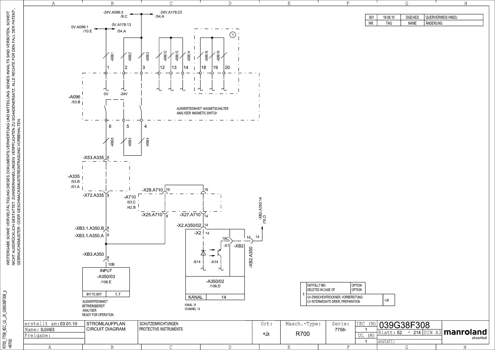

# +Jx — Sheet 52 of 214 — SCHUTZEINRICHTUNGEN

**PROTECTIVE INSTRUMENTS**

> Part of the manroland **R700** printing press IEC/UL circuit diagrams.
> Drawing class: **Stromlaufplan / Circuit diagram** (DIN A3).
> Document `+Jx` covers the **1st printing module + feed register** machine section.

## At a glance

| Field | Value |
|---|---|
| Document | `+Jx`  (039G38F308) |
| Sheet | **52** of 214 |
| Section (DE) | SCHUTZEINRICHTUNGEN |
| Section (EN) | PROTECTIVE INSTRUMENTS |
| Section type | CIRCUIT — Circuit diagram |
| Machine type | `R700` |
| Series | `7758` |
| Created | 03.01.10 |
| Replaces | — |
| Columns used | A, B, C, D, E, F, G, H |
| Path numbers | — |
| Labels on sheet | 107 |
| Cross-refs out | 12 |
| Cross-refs in | 23 |

**Previous:** [+Jx sheet 51](SHEET_0051.md) · **Next:** [+Jx sheet 53](SHEET_0053.md) · **Document TOC:** [_TOC.md](_TOC.md)  (+Jx) · **Master TOC:** [all sheets](../_MASTER_TOC.md)

## Sheet image (300 DPI, exact vector render)



_Rendered directly from the PDF vector layer at 300 DPI (1-bit), no OCR and no resampling. Use it to confirm anything ambiguous in the text below._

## Cross-references on this sheet

Each entry is a wire leaving this sheet. The printed token is `/sheet.column`; the link resolves to that sheet inside the same document.

| Ref | Target sheet | Col | Path | Destination on target | Target section | From col |
|---|---|---|---|---|---|---|
| `/9.C` | [+Jx sheet 9](SHEET_0009.md) | C | — | 24V.A096:3 24V.A178:23 | SPANNUNGSVERSORGUNG, SCHALTSCHRANKBELÜFTUNG | C |
| `/54.A` | [+Jx sheet 54](SHEET_0054.md) | A | — | — | SCHUTZEINRICHTUNGEN | C |
| `/10.E` | [+Jx sheet 10](SHEET_0010.md) | E | — | 0V.A096:1 | SPANNUNGSVERSORGUNG, SCHALTSCHRANKBELÜFTUNG | A |
| `/54.A` | [+Jx sheet 54](SHEET_0054.md) | A | — | — | SCHUTZEINRICHTUNGEN | B |
| `/53.B` | [+Jx sheet 53](SHEET_0053.md) | B | — | — | SCHUTZEINRICHTUNGEN | A |
| `/53.B` | [+Jx sheet 53](SHEET_0053.md) | B | — | — | SCHUTZEINRICHTUNGEN | A |
| `/51.A` | [+Jx sheet 51](SHEET_0051.md) | A | — | — | SIGNALGEBER: AKUSTISCHE WARNSIGNALE | A |
| `/76.D` | [+Jx sheet 76](SHEET_0076.md) | D | — | XB2.A350:14 | BUSVERBINDUNGEN: SICHERHEITSKREIS | E |
| `/53.C` | [+Jx sheet 53](SHEET_0053.md) | C | — | — | SCHUTZEINRICHTUNGEN | B |
| `/42.B` | [+Jx sheet 42](SHEET_0042.md) | B | — | — | LAUFKOMMANDOS | B |
| `/106.E` | [+Jx sheet 106](SHEET_0106.md) | E | — | — | REFERENZMODUL | B |
| `/106.D` | [+Jx sheet 106](SHEET_0106.md) | D | — | — | REFERENZMODUL | D |

### Incoming references (sheets that point here)

Every other sheet that sends a wire to this one. `Back-ref` is the token printed on *that* sheet; `Path` is its line number.

| From sheet | Cols | Back-ref | Path | Refs | What continues there |
|---|---|---|---|---|---|
| [+Jx#9](SHEET_0009.md) | C | `/9.C` | — | 1 | 24V.A096:3 |
| [+Jx#10](SHEET_0010.md) | E | `/10.E` | — | 1 | — |
| [+Jx#42](SHEET_0042.md) | B | `/42.B` | — | 1 | — |
| [+Jx#51](SHEET_0051.md) | A | `/51.A` | — | 1 | — |
| [+Jx#53](SHEET_0053.md) | B, C | `/53.B`, `/53.C` | — | 3 | — |
| [+Jx#54](SHEET_0054.md) | A | `/54.A` | — | 2 | 0V.A178:13; 24V.A178:23 |
| [+Jx#76](SHEET_0076.md) | D | `/76.D` | — | 1 | XB2.A350:14 |
| [+Jx#106](SHEET_0106.md) | D, E | `/106.D`, `/106.E` | — | 2 | — |
| [+Jx#126](SHEET_0126.md) | E | `/126.E` | — | 2 | — |
| [+Jx#128](SHEET_0128.md) | C, D, F | `/128.C`, `/128.D`, `/128.F` | — | 3 | — |
| [+Jx#143](SHEET_0143.md) | A | `/143.A` | — | 1 | — |
| [+Jx#144](SHEET_0144.md) | C | `/144.C` | — | 1 | — |
| [+Jx#146](SHEET_0146.md) | A | `/146.A` | — | 2 | — |
| [+Jx#151](SHEET_0151.md) | C | `/151.C` | — | 1 | — |
| [+Jx#153](SHEET_0153.md) | C | `/153.C` | — | 1 | — |


## Devices on this sheet

| Tag | Class | Class meaning (IEC) | Col | Sub | Terminal | Sign |
|---|---|---|---|---|---|---|
| `A350/03` | A | Baugruppe / assembly, module, PC board | B | 03 | — | — |
| `A710` | A | Baugruppe / assembly, module, PC board | B | — | — | — |
| `S14` | S | Schalter / switch | C | — | — | — |
| `A14` | A | Baugruppe / assembly, module, PC board | D | — | — | — |
| `X1` | X | Klemme / terminal, plug connector | D | — | — | — |
| `X2` | X | Klemme / terminal, plug connector | C | — | — | — |
| `XB2` | XB |  | D | — | — | — |
| `A350/02` | A | Baugruppe / assembly, module, PC board | D | 02 | — | — |
| `A096` | A | Baugruppe / assembly, module, PC board | A | — | — | — |
| `A335` | A | Baugruppe / assembly, module, PC board | A | — | — | — |
| `A096:6` | A | Baugruppe / assembly, module, PC board | B | — | 6 | — |
| `A096:1` | A | Baugruppe / assembly, module, PC board | B | — | 1 | — |
| `A096:4` | A | Baugruppe / assembly, module, PC board | C | — | 4 | — |
| `A096:3` | A | Baugruppe / assembly, module, PC board | C | — | 3 | — |
| `A096:5` | A | Baugruppe / assembly, module, PC board | B | — | 5 | — |
| `A096:2` | A | Baugruppe / assembly, module, PC board | B | — | 2 | — |
| `A096:12` | A | Baugruppe / assembly, module, PC board | C | — | 12 | — |
| `A096:13` | A | Baugruppe / assembly, module, PC board | C | — | 13 | — |
| `A096:14` | A | Baugruppe / assembly, module, PC board | C | — | 14 | — |
| `A096:18` | A | Baugruppe / assembly, module, PC board | D | — | 18 | — |
| `A096:19` | A | Baugruppe / assembly, module, PC board | D | — | 19 | — |
| `1.7` | — | cross-device reference | B | — | — | — |
| `XB3.A350` | — | cross-device reference | B | — | — | — |
| `X27.A710` | — | cross-device reference | C | — | — | — |
| `X28.A710` | — | cross-device reference | C | — | — | — |
| `X25.A710` | — | cross-device reference | C | — | — | — |
| `XB2.A350` | — | cross-device reference | D | — | — | — |
| `XB3.1.A350.B` | — | cross-device reference | B | — | — | — |
| `XB3.1.A350.A` | — | cross-device reference | B | — | — | — |
| `X53.A335` | — | cross-device reference | B | — | — | — |
| `X72.A335` | — | cross-device reference | B | — | — | — |
| `NR.` | — | cross-device reference | F | — | — | — |
| `19.08.10` | — | cross-device reference | G | — | — | — |
| `XB2.A350:14` | — | cross-device reference | E | — | 14 | — |

## Potentials / nets

| Potential | Count | Columns | Attached devices | Terminals |
|---|---|---|---|---|
| `0V` | 3 | A, B | `A096`, `A178` | `1`, `13` |
| `24V` | 3 | B, C | `A096`, `A178` | `23`, `3` |


A potential such as `L24+/4` or `M24+` is a named supply/return rail; every place it appears on this sheet is electrically common.

## Wire-end annotations (grouped as printed)

A wire that continues elsewhere is annotated with a small cluster: the destination description, the path/line number `#NN`, and the `/sheet.column` cross reference. Each row below is one such cluster exactly as it is grouped on the drawing.

| Col | Y | Path | Cross-ref | Text on the wire |
|---|---|---|---|---|
| C | 25.7 | — | `/9.C` | `24V.A096:3 24V.A178:23` |
| C | 35.6 | — | `/54.A` | — |
| G | 38.5 | — | — | `001 19.08.10 DGE/AES QUERVERWEIS HINZU` |
| G | 52.6 | — | — | `NR. TAG NAME ÄNDERUNG` |
| B | 55.5 | — | — | `0V.A178:13` |
| A | 61.2 | — | `/10.E` | `0V.A096:1` |
| B | 71.1 | — | `/54.A` | — |
| D | 80.6 | — | — | `1` |
| C | 122.4 | — | — | `A096:12` |
| C | 122.4 | — | — | `A096:13` |
| C | 122.4 | — | — | `A096:14` |
| D | 122.4 | — | — | `A096:18` |
| D | 122.4 | — | — | `A096:19` |
| B | 125.5 | — | — | `A096:1` |
| B | 125.8 | — | — | `A096:2` |
| C | 125.8 | — | — | `A096:3 A096:4` |
| B | 157.5 | — | — | `1` |
| C | 157.5 | — | — | `2 12 13 14 18 19 20` |
| C | 157.5 | — | — | `3` |
| B | 222.0 | — | — | `0V` |
| B | 222.1 | — | — | `24V` |
| A | 228.4 | — | — | `A096` |
| A | 241.5 | — | `/53.B` | — |
| D | 258.5 | — | — | `AUSWERTEEINHEIT: MAGNETSCHALTER ANALYSER: MAGNETIC SWITCH` |
| B | 299.3 | — | — | `6` |
| B | 299.3 | — | — | `5` |
| C | 299.3 | — | — | `4` |
| B | 331.3 | — | — | `A096:6` |
| B | 331.3 | — | — | `A096:5` |
| B | 374.4 | — | — | `X53.A335 6` |
| A | 419.8 | — | — | `A335` |
| A | 432.8 | — | `/53.B`, `/51.A` | — |
| C | 452.4 | — | — | `X28.A710 15` |
| D | 452.4 | — | — | `16` |
| B | 465.1 | — | — | `X72.A335 8` |
| B | 469.4 | — | — | `A710` |
| E | 474.2 | — | `/76.D` | `XB2.A350:14` |
| B | 482.5 | — | `/53.C`, `/42.B` | — |
| C | 511.9 | — | — | `X25.A710 8` |
| C | 511.9 | — | — | `X27.A710 14` |
| C | 537.4 | — | — | `X2.A350/02 14` |
| B | 544.5 | — | — | `XB3.1.A350.B 8` |
| C | 555.9 | — | — | `X2` |
| D | 557.3 | — | — | `14 14` |
| B | 561.5 | — | — | `XB3.1.A350.A 8` |
| D | 565.8 | — | — | `14` |
| D | 570.0 | — | — | `18C` |
| D | 587.0 | — | — | `X1` |
| D | 587.0 | — | — | `XB2` |
| D | 593.3 | — | — | `XB2.A350` |
| B | 606.9 | — | — | `XB3.A350 8` |
| D | 626.0 | — | — | `S14 A14` |
| B | 632.4 | — | — | `10B` |
| B | 646.9 | — | — | `INPUT` |
| B | 660.7 | — | — | `A350/03` |
| D | 672.0 | — | — | `A350/02` |
| B | 674.5 | — | `/106.E` | — |
| F | 683.7 | — | — | `ENTFÄLLT BEI DELETED IN CASE OF` |
| F | 683.7 | — | — | `OPTION OPTION` |
| D | 684.5 | — | `/106.D` | — |
| E | 703.2 | — | — | `1` |
| B | 703.5 | — | — | `BYTE.BIT 1.7` |
| D | 710.3 | — | — | `KANAL 14` |
| F | 712.1 | — | — | `UV ZWISCHENTROCKNER, VORBEREITUNG UV INTERMEDIATE DRIER, PREPARATION` |
| G | 719.1 | — | — | `+JA` |
| B | 722.7 | — | — | `BETRIEBSBEREIT AUSWERTEEINHEIT` |
| C | 730.7 | — | — | `KANAL 14 CHANNEL 14` |
| B | 744.0 | — | — | `READY FOR OPERATION ANALYSER` |


## Reconstructed tables

This sheet carries tabular content (pin map / terminal assignment / index). The grid below was rebuilt from the drawing's own rule lines, so each row is exactly one physical row of the table.

### Table 1 — 9 data rows × 10 columns (at x=198.4, y=90.7)

| 0V | A096:1 1 24V | 2 | A096:2 | A096:3 3 | 12 | A096:12 | A096:13 13 |  | A096:14 14 |
|---|---|---|---|---|---|---|---|---|---|
|  | `6 A096:6` | `5` | `A096:5` | `4 A096:4` |  |  |  | `ANALYSER:` | `AUSWERTEEINHEIT: MAGNETIC` |
| `X53.A335` | `6` |  |  |  |  |  |  |  |  |
| `X72.A335 XB3.1.A350.B` | `8 8` |  | `A710 /53.C /42.B` | `X28.A710 X25.A710` |  | `15 8` |  |  | `X27.A710 X2.A350/02` |
| `XB3.1.A350.A` | `8` |  |  |  |  |  |  |  | `X2` |
| `XB3.A350` | `8 10B` |  |  |  |  |  |  |  | `S14` |
| `INPUT` |  |  |  |  |  |  |  |  |  |
|  | `A350/03 /106.E` |  |  |  |  |  |  |  |  |
| `BYTE.BIT` | `1.7` |  |  |  |  |  |  |  |  |
|  |  |  |  |  |  |  |  |  | `KANAL` |


### Table 2 — 6 data rows × 6 columns (at x=489.0, y=90.7)

| A096:18 18 | A096:19 19 |  | 20 |  |  |
|---|---|---|---|---|---|
| `SWITCH` | `MAGNETSCHALTER` |  |  |  |  |
| `16 14 14` |  |  |  |  | `XB2.A350:14` |
| `14` |  |  | `18C` |  | `14 14` |
|  | `A14` |  | `X1` | `XB2` | `XB2.A350` |
|  | `A350/02 /106.D` |  |  |  |  |
|  |  | `14` |  |  |  |


## Notes and free text on this sheet

| Text | Col | Y (pt) |
|---|---|---|
| `10B` | B | 632.36 |
| `INPUT` | B | 646.87 |
| `BYTE.BIT` | B | 704.13 |
| `AUSWERTEEINHEIT` | B | 722.68 |
| `BETRIEBSBEREIT` | B | 733.31 |
| `ANALYSER` | B | 743.97 |
| `READY FOR OPERATION` | B | 754.6 |
| `KANAL 14` | C | 730.66 |
| `CHANNEL 14` | C | 740.6 |
| `18C` | D | 570.04 |
| `KANAL` | C | 710.31 |
| `X2.A350/02` | C | 537.41 |
| `AUSWERTEEINHEIT: MAGNETSCHALTER` | D | 258.53 |
| `ANALYSER: MAGNETIC SWITCH` | C | 269.15 |
| `TAG` | G | 52.75 |
| `NAME` | G | 52.73 |
| `ÄNDERUNG` | G | 52.76 |
| `DGE/AES` | G | 38.57 |
| `QUERVERWEIS HINZU` | H | 38.57 |
| `ENTFÄLLT BEI` | E | 683.7 |
| `DELETED IN CASE OF` | F | 694.35 |
| `OPTION` | F | 683.71 |
| `UV ZWISCHENTROCKNER, VORBEREITUNG` | F | 712.07 |
| `UV INTERMEDIATE DRIER, PREPARATION` | F | 722.7 |
| `+JA` | G | 719.12 |

## Complete label inventory (exact text from the drawing)

Every text object inside the drawing area of this sheet, in DIN reading order (column A→H, then top→bottom). This is the authoritative list: if a string is not here it is not printed on this sheet.

| Col | Y | X | Dir | Type | Text |
|---|---|---|---|---|---|
| A | 61.2 | 171.5 | → | potential | `0V.A096:1` |
| A | 228.4 | 164.7 | → | device tag | `A096` |
| A | 241.5 | 172.3 | → | cross-reference | `/53.B` |
| A | 419.8 | 163.3 | → | device tag | `A335` |
| A | 432.8 | 170.9 | → | cross-reference | `/53.B` |
| A | 445.2 | 170.6 | → | cross-reference | `/51.A` |
| B | 25.7 | 247.7 | → | potential | `24V.A096:3` |
| B | 35.6 | 290.3 | → | cross-reference | `/9.C` |
| B | 55.5 | 269.0 | → | potential | `0V.A178:13` |
| B | 71.1 | 200.7 | → | cross-reference | `/10.E` |
| B | 71.1 | 282.0 | → | cross-reference | `/54.A` |
| B | 125.5 | 267.0 | ↕ | device tag | `A096:1` |
| B | 125.8 | 309.6 | ↕ | device tag | `A096:2` |
| B | 157.5 | 256.8 | → | number | `1` |
| B | 157.5 | 300.2 | → | number | `2` |
| B | 222.0 | 249.6 | → | potential | `0V` |
| B | 222.1 | 288.3 | → | potential | `24V` |
| B | 299.3 | 261.9 | → | number | `6` |
| B | 299.3 | 304.4 | → | number | `5` |
| B | 331.3 | 267.0 | ↕ | device tag | `A096:6` |
| B | 331.3 | 309.6 | ↕ | device tag | `A096:5` |
| B | 374.4 | 199.6 | → | device ref | `X53.A335` |
| B | 374.4 | 257.7 | → | number | `6` |
| B | 465.1 | 199.6 | → | device ref | `X72.A335` |
| B | 466.6 | 257.7 | → | number | `8` |
| B | 469.4 | 298.2 | → | device tag | `A710` |
| B | 482.5 | 305.3 | → | cross-reference | `/53.C` |
| B | 494.8 | 305.6 | → | cross-reference | `/42.B` |
| B | 544.5 | 180.0 | → | device ref | `XB3.1.A350.B` |
| B | 544.5 | 257.7 | → | number | `8` |
| B | 561.5 | 257.7 | → | number | `8` |
| B | 562.2 | 179.4 | → | device ref | `XB3.1.A350.A` |
| B | 606.9 | 198.7 | → | device ref | `XB3.A350` |
| B | 615.4 | 257.7 | → | number | `8` |
| B | 632.4 | 259.9 | → | text | `10B` |
| B | 646.9 | 240.2 | → | text | `INPUT` |
| B | 660.7 | 233.6 | → | device tag | `A350/03` |
| B | 674.5 | 242.5 | → | cross-reference | `/106.E` |
| B | 703.5 | 276.4 | → | device ref | `1.7` |
| B | 704.1 | 208.3 | → | text | `BYTE.BIT` |
| B | 722.7 | 198.4 | → | text | `AUSWERTEEINHEIT` |
| B | 733.3 | 197.9 | → | text | `BETRIEBSBEREIT` |
| B | 744.0 | 198.4 | → | text | `ANALYSER` |
| B | 754.6 | 197.9 | → | text | `READY FOR OPERATION` |
| C | 25.7 | 383.8 | → | potential | `24V.A178:23` |
| C | 35.6 | 374.2 | → | cross-reference | `/54.A` |
| C | 122.4 | 394.6 | ↕ | device tag | `A096:12` |
| C | 122.4 | 423.0 | ↕ | device tag | `A096:13` |
| C | 122.4 | 451.3 | ↕ | device tag | `A096:14` |
| C | 125.8 | 352.1 | ↕ | device tag | `A096:3` |
| C | 157.5 | 342.7 | → | number | `3` |
| C | 157.5 | 384.4 | → | number | `12` |
| C | 157.5 | 412.7 | → | number | `13` |
| C | 157.5 | 441.1 | → | number | `14` |
| C | 269.1 | 425.2 | → | text | `ANALYSER: MAGNETIC SWITCH` |
| C | 299.3 | 347.2 | → | number | `4` |
| C | 331.3 | 352.1 | ↕ | device tag | `A096:4` |
| C | 452.4 | 341.6 | → | device ref | `X28.A710` |
| C | 452.4 | 398.8 | → | number | `15` |
| C | 511.9 | 340.2 | → | device ref | `X25.A710` |
| C | 511.9 | 432.3 | → | device ref | `X27.A710` |
| C | 516.2 | 399.4 | → | number | `8` |
| C | 537.4 | 424.9 | → | text | `X2.A350/02` |
| C | 555.8 | 467.4 | → | device tag | `X2` |
| C | 626.0 | 463.7 | → | device tag | `S14` |
| C | 710.3 | 453.0 | → | text | `KANAL` |
| C | 730.7 | 444.5 | → | text | `KANAL 14` |
| C | 740.6 | 444.8 | → | text | `CHANNEL 14` |
| D | 80.6 | 558.0 | → | number | `1` |
| D | 122.4 | 493.8 | ↕ | device tag | `A096:18` |
| D | 122.4 | 522.2 | ↕ | device tag | `A096:19` |
| D | 157.5 | 483.6 | → | number | `18` |
| D | 157.5 | 511.9 | → | number | `19` |
| D | 157.5 | 541.1 | → | number | `20` |
| D | 258.5 | 425.2 | → | text | `AUSWERTEEINHEIT: MAGNETSCHALTER` |
| D | 452.4 | 491.0 | → | number | `16` |
| D | 516.2 | 491.0 | → | number | `14` |
| D | 537.4 | 491.0 | → | number | `14` |
| D | 557.3 | 493.8 | → | number | `14` |
| D | 565.8 | 614.3 | → | number | `14` |
| D | 567.2 | 593.0 | → | number | `14` |
| D | 570.0 | 534.3 | → | text | `18C` |
| D | 587.0 | 537.7 | → | device tag | `X1` |
| D | 587.0 | 562.4 | → | device tag | `XB2` |
| D | 593.3 | 598.3 | ↕ | device ref | `XB2.A350` |
| D | 626.0 | 506.3 | → | device tag | `A14` |
| D | 672.0 | 495.9 | → | device tag | `A350/02` |
| D | 684.4 | 504.6 | → | cross-reference | `/106.D` |
| D | 710.3 | 532.2 | → | number | `14` |
| E | 474.2 | 622.4 | ↕ | device ref | `XB2.A350:14` |
| E | 517.6 | 632.4 | ↕ | cross-reference | `/76.D` |
| E | 683.7 | 739.3 | → | text | `ENTFÄLLT BEI` |
| E | 703.2 | 727.4 | → | number | `1` |
| F | 38.5 | 887.6 | → | number | `001` |
| F | 52.6 | 886.8 | → | device ref | `NR.` |
| F | 683.7 | 845.9 | → | text | `OPTION` |
| F | 694.3 | 739.3 | → | text | `DELETED IN CASE OF` |
| F | 694.3 | 845.9 | → | text | `OPTION` |
| F | 712.1 | 739.3 | → | text | `UV ZWISCHENTROCKNER, VORBEREITUNG` |
| F | 722.7 | 739.3 | → | text | `UV INTERMEDIATE DRIER, PREPARATION` |
| G | 38.6 | 921.5 | → | device ref | `19.08.10` |
| G | 38.6 | 976.4 | → | text | `DGE/AES` |
| G | 52.7 | 928.5 | → | text | `TAG` |
| G | 52.7 | 981.8 | → | text | `NAME` |
| G | 52.8 | 1024.0 | → | text | `ÄNDERUNG` |
| G | 719.1 | 924.5 | → | text | `+JA` |
| H | 38.6 | 1023.7 | → | text | `QUERVERWEIS HINZU` |

## Reading-order text block

The same content as a plain block, grouped by DIN column — convenient to paste or to match against a visual description.

```text
=== Column A ===
  61.2  171.5  net          0V.A096:1
 228.4  164.7  devtag       A096
 241.5  172.3  xref         /53.B
 419.8  163.3  devtag       A335
 432.8  170.9  xref         /53.B
 445.2  170.6  xref         /51.A
=== Column B ===
  25.7  247.7  net          24V.A096:3
  35.6  290.3  xref         /9.C
  55.5  269.0  net          0V.A178:13
  71.1  200.7  xref         /10.E
  71.1  282.0  xref         /54.A
 125.5  267.0  devtag       A096:1
 125.8  309.6  devtag       A096:2
 157.5  256.8  numeric      1
 157.5  300.2  numeric      2
 222.0  249.6  net          0V
 222.1  288.3  net          24V
 299.3  261.9  numeric      6
 299.3  304.4  numeric      5
 331.3  267.0  devtag       A096:6
 331.3  309.6  devtag       A096:5
 374.4  199.6  devref       X53.A335
 374.4  257.7  numeric      6
 465.1  199.6  devref       X72.A335
 466.6  257.7  numeric      8
 469.4  298.2  devtag       A710
 482.5  305.3  xref         /53.C
 494.8  305.6  xref         /42.B
 544.5  180.0  devref       XB3.1.A350.B
 544.5  257.7  numeric      8
 561.5  257.7  numeric      8
 562.2  179.4  devref       XB3.1.A350.A
 606.9  198.7  devref       XB3.A350
 615.4  257.7  numeric      8
 632.4  259.9  text         10B
 646.9  240.2  text         INPUT
 660.7  233.6  devtag       A350/03
 674.5  242.5  xref         /106.E
 703.5  276.4  devref       1.7
 704.1  208.3  text         BYTE.BIT
 722.7  198.4  text         AUSWERTEEINHEIT
 733.3  197.9  text         BETRIEBSBEREIT
 744.0  198.4  text         ANALYSER
 754.6  197.9  text         READY FOR OPERATION
=== Column C ===
  25.7  383.8  net          24V.A178:23
  35.6  374.2  xref         /54.A
 122.4  394.6  devtag       A096:12
 122.4  423.0  devtag       A096:13
 122.4  451.3  devtag       A096:14
 125.8  352.1  devtag       A096:3
 157.5  342.7  numeric      3
 157.5  384.4  numeric      12
 157.5  412.7  numeric      13
 157.5  441.1  numeric      14
 269.1  425.2  text         ANALYSER: MAGNETIC SWITCH
 299.3  347.2  numeric      4
 331.3  352.1  devtag       A096:4
 452.4  341.6  devref       X28.A710
 452.4  398.8  numeric      15
 511.9  340.2  devref       X25.A710
 511.9  432.3  devref       X27.A710
 516.2  399.4  numeric      8
 537.4  424.9  text         X2.A350/02
 555.8  467.4  devtag       X2
 626.0  463.7  devtag       S14
 710.3  453.0  text         KANAL
 730.7  444.5  text         KANAL 14
 740.6  444.8  text         CHANNEL 14
=== Column D ===
  80.6  558.0  numeric      1
 122.4  493.8  devtag       A096:18
 122.4  522.2  devtag       A096:19
 157.5  483.6  numeric      18
 157.5  511.9  numeric      19
 157.5  541.1  numeric      20
 258.5  425.2  text         AUSWERTEEINHEIT: MAGNETSCHALTER
 452.4  491.0  numeric      16
 516.2  491.0  numeric      14
 537.4  491.0  numeric      14
 557.3  493.8  numeric      14
 565.8  614.3  numeric      14
 567.2  593.0  numeric      14
 570.0  534.3  text         18C
 587.0  537.7  devtag       X1
 587.0  562.4  devtag       XB2
 593.3  598.3  devref       XB2.A350
 626.0  506.3  devtag       A14
 672.0  495.9  devtag       A350/02
 684.4  504.6  xref         /106.D
 710.3  532.2  numeric      14
=== Column E ===
 474.2  622.4  devref       XB2.A350:14
 517.6  632.4  xref         /76.D
 683.7  739.3  text         ENTFÄLLT BEI
 703.2  727.4  numeric      1
=== Column F ===
  38.5  887.6  numeric      001
  52.6  886.8  devref       NR.
 683.7  845.9  text         OPTION
 694.3  739.3  text         DELETED IN CASE OF
 694.3  845.9  text         OPTION
 712.1  739.3  text         UV ZWISCHENTROCKNER, VORBEREITUNG
 722.7  739.3  text         UV INTERMEDIATE DRIER, PREPARATION
=== Column G ===
  38.6  921.5  devref       19.08.10
  38.6  976.4  text         DGE/AES
  52.7  928.5  text         TAG
  52.7  981.8  text         NAME
  52.8 1024.0  text         ÄNDERUNG
 719.1  924.5  text         +JA
=== Column H ===
  38.6 1023.7  text         QUERVERWEIS HINZU
```

---
_Generated from the PDF vector text layer; no OCR. Source: `R700_7758_IEC_UL_JX_039G38F308_p`, sheet 52._
