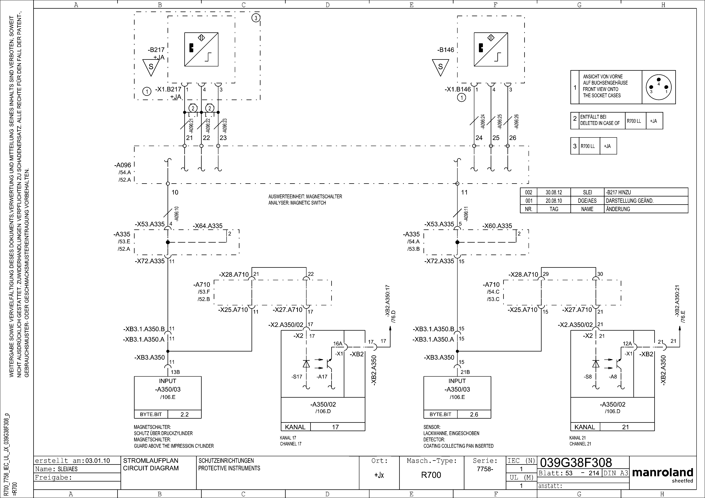

# +Jx — Sheet 53 of 214 — SCHUTZEINRICHTUNGEN

**PROTECTIVE INSTRUMENTS**

> Part of the manroland **R700** printing press IEC/UL circuit diagrams.
> Drawing class: **Stromlaufplan / Circuit diagram** (DIN A3).
> Document `+Jx` covers the **1st printing module + feed register** machine section.

## At a glance

| Field | Value |
|---|---|
| Document | `+Jx`  (039G38F308) |
| Sheet | **53** of 214 |
| Section (DE) | SCHUTZEINRICHTUNGEN |
| Section (EN) | PROTECTIVE INSTRUMENTS |
| Section type | CIRCUIT — Circuit diagram |
| Machine type | `R700` |
| Series | `7758` |
| Created | 03.01.10 |
| Replaces | — |
| Columns used | B, C, D, E, F, G, H |
| Path numbers | — |
| Labels on sheet | 178 |
| Cross-refs out | 16 |
| Cross-refs in | 46 |

**Previous:** [+Jx sheet 52](SHEET_0052.md) · **Next:** [+Jx sheet 54](SHEET_0054.md) · **Document TOC:** [_TOC.md](_TOC.md)  (+Jx) · **Master TOC:** [all sheets](../_MASTER_TOC.md)

## Sheet image (300 DPI, exact vector render)



_Rendered directly from the PDF vector layer at 300 DPI (1-bit), no OCR and no resampling. Use it to confirm anything ambiguous in the text below._

## Cross-references on this sheet

Each entry is a wire leaving this sheet. The printed token is `/sheet.column`; the link resolves to that sheet inside the same document.

| Ref | Target sheet | Col | Path | Destination on target | Target section | From col |
|---|---|---|---|---|---|---|
| `/54.A` | [+Jx sheet 54](SHEET_0054.md) | A | — | — | SCHUTZEINRICHTUNGEN | B |
| `/52.A` | [+Jx sheet 52](SHEET_0052.md) | A | — | — | SCHUTZEINRICHTUNGEN | B |
| `/53.E` | [+Jx sheet 53](SHEET_0053.md) | E | — | — | SCHUTZEINRICHTUNGEN | B |
| `/52.A` | [+Jx sheet 52](SHEET_0052.md) | A | — | — | SCHUTZEINRICHTUNGEN | B |
| `/54.A` | [+Jx sheet 54](SHEET_0054.md) | A | — | — | SCHUTZEINRICHTUNGEN | E |
| `/53.B` | [+Jx sheet 53](SHEET_0053.md) | B | — | — | SCHUTZEINRICHTUNGEN | E |
| `/76.D` | [+Jx sheet 76](SHEET_0076.md) | D | — | XB2.A350:17 | BUSVERBINDUNGEN: SICHERHEITSKREIS | E |
| `/76.E` | [+Jx sheet 76](SHEET_0076.md) | E | — | XB2.A350:21 | BUSVERBINDUNGEN: SICHERHEITSKREIS | H |
| `/53.F` | [+Jx sheet 53](SHEET_0053.md) | F | — | — | SCHUTZEINRICHTUNGEN | C |
| `/52.B` | [+Jx sheet 52](SHEET_0052.md) | B | — | — | SCHUTZEINRICHTUNGEN | C |
| `/54.C` | [+Jx sheet 54](SHEET_0054.md) | C | — | — | SCHUTZEINRICHTUNGEN | F |
| `/53.C` | [+Jx sheet 53](SHEET_0053.md) | C | — | — | SCHUTZEINRICHTUNGEN | F |
| `/106.E` | [+Jx sheet 106](SHEET_0106.md) | E | — | — | REFERENZMODUL | B |
| `/106.E` | [+Jx sheet 106](SHEET_0106.md) | E | — | — | REFERENZMODUL | F |
| `/106.D` | [+Jx sheet 106](SHEET_0106.md) | D | — | — | REFERENZMODUL | D |
| `/106.D` | [+Jx sheet 106](SHEET_0106.md) | D | — | — | REFERENZMODUL | G |

### Incoming references (sheets that point here)

Every other sheet that sends a wire to this one. `Back-ref` is the token printed on *that* sheet; `Path` is its line number.

| From sheet | Cols | Back-ref | Path | Refs | What continues there |
|---|---|---|---|---|---|
| [+Jx#52](SHEET_0052.md) | A, B | `/52.A`, `/52.B` | — | 3 | — |
| [+Jx#53](SHEET_0053.md) | B, C, E, F | `/53.B`, `/53.C`, `/53.E`, `/53.F` | — | 4 | — |
| [+Jx#54](SHEET_0054.md) | A, C | `/54.A`, `/54.C` | — | 3 | — |
| [+Jx#76](SHEET_0076.md) | D, E | `/76.D`, `/76.E` | — | 2 | XB2.A350:17; XB2.A350:21 |
| [+Jx#106](SHEET_0106.md) | D, E | `/106.D`, `/106.E` | — | 4 | — |
| [+Jx#117](SHEET_0117.md) | A | `/117.A` | — | 6 | — |
| [+Jx#126](SHEET_0126.md) | E, F | `/126.E`, `/126.F` | — | 4 | — |
| [+Jx#128](SHEET_0128.md) | C, D, F | `/128.C`, `/128.D`, `/128.F` | — | 6 | — |
| [+Jx#143](SHEET_0143.md) | A | `/143.A` | — | 2 | — |
| [+Jx#144](SHEET_0144.md) | C, D | `/144.C`, `/144.D` | — | 2 | — |
| [+Jx#146](SHEET_0146.md) | A, B | `/146.A`, `/146.B` | — | 4 | — |
| [+Jx#151](SHEET_0151.md) | C, G, H | `/151.C`, `/151.G`, `/151.H` | — | 4 | — |
| [+Jx#153](SHEET_0153.md) | C | `/153.C` | — | 2 | — |


## Devices on this sheet

| Tag | Class | Class meaning (IEC) | Col | Sub | Terminal | Sign |
|---|---|---|---|---|---|---|
| `A350/03` | A | Baugruppe / assembly, module, PC board | F | 03 | — | — |
| `A710` | A | Baugruppe / assembly, module, PC board | F | — | — | — |
| `S8` | S | Schalter / switch | G | — | — | — |
| `A8` | A | Baugruppe / assembly, module, PC board | G | — | — | — |
| `X1` | X | Klemme / terminal, plug connector | H | — | — | — |
| `X2` | X | Klemme / terminal, plug connector | G | — | — | — |
| `XB2` | XB |  | H | — | — | — |
| `A350/02` | A | Baugruppe / assembly, module, PC board | G | 02 | — | — |
| `B146` | B | Umformer / transducer, sensor | E | — | — | — |
| `A335` | A | Baugruppe / assembly, module, PC board | E | — | — | — |
| `A350/03` | A | Baugruppe / assembly, module, PC board | B | 03 | — | — |
| `A710` | A | Baugruppe / assembly, module, PC board | C | — | — | — |
| `S17` | S | Schalter / switch | D | — | — | — |
| `A17` | A | Baugruppe / assembly, module, PC board | D | — | — | — |
| `X1` | X | Klemme / terminal, plug connector | D | — | — | — |
| `X2` | X | Klemme / terminal, plug connector | D | — | — | — |
| `XB2` | XB |  | D | — | — | — |
| `A350/02` | A | Baugruppe / assembly, module, PC board | D | 02 | — | — |
| `A096` | A | Baugruppe / assembly, module, PC board | B | — | — | — |
| `A335` | A | Baugruppe / assembly, module, PC board | B | — | — | — |
| `B217` | B | Umformer / transducer, sensor | B | — | — | — |
| `A096:24` | A | Baugruppe / assembly, module, PC board | F | — | 24 | — |
| `A096:25` | A | Baugruppe / assembly, module, PC board | F | — | 25 | — |
| `A096:26` | A | Baugruppe / assembly, module, PC board | F | — | 26 | — |
| `A096:11` | A | Baugruppe / assembly, module, PC board | F | — | 11 | — |
| `A096:10` | A | Baugruppe / assembly, module, PC board | B | — | 10 | — |
| `A096:21` | A | Baugruppe / assembly, module, PC board | B | — | 21 | — |
| `A096:22` | A | Baugruppe / assembly, module, PC board | C | — | 22 | — |
| `A096:23` | A | Baugruppe / assembly, module, PC board | C | — | 23 | — |
| `2.6` | — | cross-device reference | F | — | — | — |
| `XB3.A350` | — | cross-device reference | E | — | — | — |
| `X27.A710` | — | cross-device reference | G | — | — | — |
| `X28.A710` | — | cross-device reference | F | — | — | — |
| `X25.A710` | — | cross-device reference | F | — | — | — |
| `XB2.A350` | — | cross-device reference | H | — | — | — |
| `XB3.1.A350.B` | — | cross-device reference | E | — | — | — |
| `XB3.1.A350.A` | — | cross-device reference | E | — | — | — |
| `X1.B146` | — | cross-device reference | F | — | — | — |
| `X53.A335` | — | cross-device reference | E | — | — | — |
| `X72.A335` | — | cross-device reference | E | — | — | — |
| `2.2` | — | cross-device reference | B | — | — | — |
| `XB3.A350` | — | cross-device reference | B | — | — | — |
| `X27.A710` | — | cross-device reference | D | — | — | — |
| `X28.A710` | — | cross-device reference | C | — | — | — |
| `X25.A710` | — | cross-device reference | C | — | — | — |
| `XB2.A350` | — | cross-device reference | E | — | — | — |
| `XB3.1.A350.B` | — | cross-device reference | B | — | — | — |
| `XB3.1.A350.A` | — | cross-device reference | B | — | — | — |
| `X53.A335` | — | cross-device reference | B | — | — | — |
| `X72.A335` | — | cross-device reference | B | — | — | — |
| `NR.` | — | cross-device reference | F | — | — | — |
| `20.08.10` | — | cross-device reference | G | — | — | — |
| `XB2.A350:17` | — | cross-device reference | E | — | 17 | — |
| `XB2.A350:21` | — | cross-device reference | H | — | 21 | — |
| `X1.B217` | — | cross-device reference | B | — | — | — |
| `30.08.12` | — | cross-device reference | G | — | — | — |
| `X60.A335` | — | cross-device reference | F | — | — | — |
| `X64.A335` | — | cross-device reference | C | — | — | — |

## Potentials / nets

_No named potentials on this sheet._

## Wire-end annotations (grouped as printed)

A wire that continues elsewhere is annotated with a small cluster: the destination description, the path/line number `#NN`, and the `/sheet.column` cross reference. Each row below is one such cluster exactly as it is grouped on the drawing.

| Col | Y | Path | Cross-ref | Text on the wire |
|---|---|---|---|---|
| C | 27.4 | — | — | `3` |
| B | 79.6 | — | — | `B217` |
| E | 79.6 | — | — | `B146` |
| B | 92.3 | — | — | `+JA` |
| B | 107.3 | — | — | `S` |
| E | 107.3 | — | — | `S` |
| G | 126.7 | — | — | `FRONT VIEW ONTO ANSICHT VON VORNE AUF BUCHSENGEHÄUSE` |
| G | 139.0 | — | — | `1 THE SOCKET CASES 4` |
| B | 146.2 | — | — | `X1.B217 1` |
| F | 146.2 | — | — | `X1.B146 1 4 3` |
| C | 147.7 | — | — | `4 3` |
| B | 151.4 | — | — | `1` |
| H | 151.8 | — | — | `3 1` |
| B | 158.9 | — | — | `+JA` |
| F | 161.6 | — | — | `1` |
| B | 180.2 | — | — | `2 2` |
| F | 193.2 | — | — | `A096:24` |
| F | 193.2 | — | — | `A096:25` |
| F | 193.2 | — | — | `A096:26` |
| G | 194.7 | — | — | `2 ENTFÄLLT BEI DELETED IN CASE OF R700 LL +JA` |
| B | 200.0 | — | — | `A096:21` |
| C | 200.3 | — | — | `A096:22` |
| C | 200.3 | — | — | `A096:23` |
| C | 228.4 | — | — | `21 22 23` |
| F | 228.4 | — | — | `24 25 26` |
| G | 242.6 | — | — | `3 R700 LL +JA` |
| B | 274.5 | — | — | `A096` |
| B | 287.6 | — | `/54.A`, `/52.A` | — |
| B | 320.5 | — | — | `10` |
| F | 320.5 | — | — | `11` |
| G | 322.0 | — | — | `002 30.08.12 SLEI B217 HINZU` |
| D | 329.4 | — | — | `AUSWERTEEINHEIT: MAGNETSCHALTER ANALYSER: MAGNETIC SWITCH` |
| G | 336.1 | — | — | `001 20.08.10 DGE/AES DARSTELLUNG GEÄND.` |
| F | 348.8 | — | — | `A096:11` |
| B | 349.1 | — | — | `A096:10` |
| G | 350.3 | — | — | `NR. TAG NAME ÄNDERUNG` |
| B | 374.4 | — | — | `X53.A335 4` |
| E | 374.4 | — | — | `X53.A335 5` |
| C | 377.2 | — | — | `X64.A335` |
| F | 377.2 | — | — | `X60.A335` |
| B | 391.4 | — | — | `A335 2` |
| F | 391.4 | — | — | `A335 2` |
| B | 404.5 | — | `/53.E`, `/52.A` | — |
| E | 404.5 | — | `/54.A`, `/53.B` | — |
| B | 436.8 | — | — | `X72.A335 11` |
| E | 436.8 | — | — | `X72.A335 15` |
| C | 459.4 | — | — | `X28.A710 21` |
| F | 459.4 | — | — | `X28.A710 29` |
| D | 459.5 | — | — | `22` |
| G | 459.5 | — | — | `30` |
| C | 476.4 | — | — | `A710` |
| F | 476.4 | — | — | `A710` |
| E | 481.3 | — | `/76.D` | `XB2.A350:17` |
| H | 481.3 | — | `/76.E` | `XB2.A350:21` |
| C | 489.5 | — | `/53.F`, `/52.B` | — |
| F | 489.6 | — | `/54.C`, `/53.C` | — |
| C | 519.0 | — | — | `X25.A710 11` |
| D | 519.0 | — | — | `X27.A710 17` |
| F | 519.0 | — | — | `X25.A710 15` |
| G | 519.0 | — | — | `X27.A710 21` |
| D | 544.5 | — | — | `X2.A350/02 17` |
| G | 544.5 | — | — | `X2.A350/02 21` |
| B | 551.6 | — | — | `XB3.1.A350.B 11` |
| E | 551.6 | — | — | `XB3.1.A350.B 15` |
| D | 562.9 | — | — | `X2` |
| G | 562.9 | — | — | `X2` |
| D | 564.4 | — | — | `17 17` |
| H | 564.4 | — | — | `21 21` |
| B | 568.6 | — | — | `XB3.1.A350.A 11` |
| E | 568.6 | — | — | `XB3.1.A350.A 15` |
| E | 572.9 | — | — | `17` |
| H | 572.9 | — | — | `21` |
| D | 577.1 | — | — | `16A` |
| H | 577.1 | — | — | `12A` |
| D | 594.1 | — | — | `X1` |
| D | 594.1 | — | — | `XB2` |
| H | 594.1 | — | — | `X1` |
| H | 594.1 | — | — | `XB2` |
| B | 599.8 | — | — | `XB3.A350 11` |
| E | 599.8 | — | — | `XB3.A350 15` |
| E | 600.4 | — | — | `XB2.A350` |
| H | 600.4 | — | — | `XB2.A350` |
| B | 625.3 | — | — | `13B` |
| F | 625.3 | — | — | `21B` |
| D | 633.1 | — | — | `S17 A17` |
| G | 633.1 | — | — | `S8 A8` |
| B | 639.8 | — | — | `INPUT` |
| F | 639.8 | — | — | `INPUT` |
| B | 653.6 | — | — | `A350/03` |
| F | 653.6 | — | — | `A350/03` |
| B | 667.4 | — | `/106.E` | — |
| F | 667.4 | — | `/106.E` | — |
| D | 679.1 | — | — | `A350/02` |
| G | 679.1 | — | — | `A350/02` |
| D | 691.5 | — | `/106.D` | — |
| G | 691.5 | — | `/106.D` | — |
| B | 696.5 | — | — | `BYTE.BIT 2.2` |
| F | 696.5 | — | — | `BYTE.BIT 2.6` |
| D | 717.4 | — | — | `KANAL 17` |
| G | 717.4 | — | — | `KANAL 21` |
| B | 719.1 | — | — | `MAGNETSCHALTER: MAGNETSCHALTER: SCHUTZ ÜBER DRUCKZYLINDER GUARD ABOVE THE IMPRESSION CYLINDER` |
| F | 719.1 | — | — | `LACKWANNE, EINGESCHOBEN DETECTOR: SENSOR: COATING COLLECTING PAN INSERTED` |
| G | 737.7 | — | — | `KANAL 21 CHANNEL 21` |
| D | 737.8 | — | — | `KANAL 17 CHANNEL 17` |


## Reconstructed tables

This sheet carries tabular content (pin map / terminal assignment / index). The grid below was rebuilt from the drawing's own rule lines, so each row is exactly one physical row of the table.

### Table 1 — 8 data rows × 23 columns (at x=226.8, y=55.3) — **B217 +JA B146**

| S 1 X53.A335 | X1.B217 +JA 10 A096:10 4 | 1 2 A096:21 21 | 4 2 A096:22 22 X64.A335 | 3 A096:23 23 2 | ANALYSER: | AUSWERTEEINHEIT: MAGNETIC | MAGNETSCHALTER SWITCH |  |  |  | A335 /54.A | S X53.A335 | X1.B146 1 11 A096:11 5 | 1 A096:24 24 | 4 A096:25 25 X60.A335 | 3 A096:26 26 002 001 NR. 2 | 30.08.12 20.08.10 TAG | ANSICHT AUF 1 FRONT THE ENTFÄLLT 2 DELETED 3 R700 LL SLEI DGE/AES NAME | VON VORNE BUCHSENGEHÄUSE VIEW ONTO SOCKET CASES BEI IN CASE OF +JA B217 ÄNDERUNG | R700 HINZU DARSTELLUNG | 3 +JA LL GEÄND. | 4 1 |
|---|---|---|---|---|---|---|---|---|---|---|---|---|---|---|---|---|---|---|---|---|---|---|
| `X72.A335` | `11` |  |  |  |  |  |  |  |  |  | `/53.B` | `X72.A335` | `15` |  |  |  |  |  |  |  |  |  |
| `XB3.1.A350.B` | `11` |  | `A710 /53.F /52.B` | `X28.A710 X25.A710` | `21 11` | `X27.A710 X2.A350/02` | `22 17 17` |  |  | `XB2.A350:17` | `/76.D` | `XB3.1.A350.B` | `15` |  | `A710 /54.C /53.C` | `X28.A710 X25.A710` | `29 15` | `X27.A710 X2.A350/02` | `30 21 21` |  |  | `XB2.A350:21` |
| `XB3.1.A350.A` | `11` |  |  |  |  | `X2` | `17` | `16A` |  | `17 17` |  | `XB3.1.A350.A` | `15` |  |  |  |  | `X2` | `21` | `12A` |  | `21 21` |
| `XB3.A350` | `11 13B` |  |  |  |  |  |  | `X1` | `XB2` | `XB2.A350` |  | `XB3.A350` | `15 21B` |  |  |  |  |  |  | `X1` | `XB2` | `XB2.A350` |
| `INPUT A350/03` |  |  |  |  |  | `S17` | `A17` |  |  |  |  | `INPUT` | `A350/03` |  |  |  |  | `S8` | `A8` |  |  |  |
|  | `/106.E` |  |  |  |  |  | `A350/02` |  |  |  |  |  | `/106.E` |  |  |  |  |  | `A350/02` |  |  |  |
| `BYTE.BIT` |  | `2.2` |  |  |  |  | `/106.D` |  |  |  |  | `BYTE.BIT` | `2.6` |  |  |  |  |  | `/106.D` |  |  |  |
| `MAGNETSCHALTER:` |  |  |  |  |  | `KANAL` |  | `17` |  |  |  | `SENSOR:` |  |  |  |  |  | `KANAL` |  | `21` |  |  |


## Notes and free text on this sheet

| Text | Col | Y (pt) |
|---|---|---|
| `21B` | F | 625.27 |
| `INPUT` | F | 639.79 |
| `BYTE.BIT` | E | 697.05 |
| `SENSOR:` | E | 719.13 |
| `LACKWANNE, EINGESCHOBEN` | E | 729.78 |
| `DETECTOR:` | E | 740.41 |
| `COATING COLLECTING PAN INSERTED` | F | 751.07 |
| `KANAL 21` | G | 737.71 |
| `CHANNEL 21` | G | 747.67 |
| `12A` | H | 577.08 |
| `KANAL` | G | 717.4 |
| `X2.A350/02` | G | 544.49 |
| `13B` | B | 625.27 |
| `INPUT` | B | 639.79 |
| `BYTE.BIT` | B | 697.05 |
| `MAGNETSCHALTER:` | B | 719.14 |
| `SCHUTZ ÜBER DRUCKZYLINDER` | B | 729.81 |
| `GUARD ABOVE THE IMPRESSION CYLINDER` | B | 751.07 |
| `KANAL 17` | D | 737.75 |
| `CHANNEL 17` | D | 747.69 |
| `16A` | D | 577.08 |
| `KANAL` | D | 717.4 |
| `X2.A350/02` | D | 544.49 |
| `AUSWERTEEINHEIT: MAGNETSCHALTER` | D | 329.39 |
| `ANALYSER: MAGNETIC SWITCH` | D | 340.02 |
| `TAG` | G | 350.38 |
| `NAME` | G | 350.37 |
| `ÄNDERUNG` | G | 350.4 |
| `DGE/AES` | G | 336.21 |
| `DARSTELLUNG GEÄND.` | H | 336.22 |
| `+JA` | B | 158.88 |
| `SLEI` | G | 322.04 |
| `B217 HINZU` | G | 322.06 |
| `S` | E | 107.31 |
| `ANSICHT VON VORNE` | G | 126.73 |
| `AUF BUCHSENGEHÄUSE` | G | 137.36 |
| `FRONT VIEW ONTO` | G | 147.96 |
| `THE SOCKET CASES` | G | 158.61 |
| `S` | B | 107.31 |
| `R700 LL` | G | 244.37 |
| `+JA` | G | 244.31 |
| `ENTFÄLLT BEI` | G | 194.72 |
| `DELETED IN CASE OF` | G | 205.37 |
| `R700 LL` | H | 201.85 |
| `+JA` | H | 201.79 |

## Complete label inventory (exact text from the drawing)

Every text object inside the drawing area of this sheet, in DIN reading order (column A→H, then top→bottom). This is the authoritative list: if a string is not here it is not printed on this sheet.

| Col | Y | X | Dir | Type | Text |
|---|---|---|---|---|---|
| B | 79.6 | 249.7 | → | device tag | `B217` |
| B | 92.3 | 259.1 | → | text | `+JA` |
| B | 107.3 | 251.0 | → | text | `S` |
| B | 146.2 | 262.2 | → | device ref | `X1.B217` |
| B | 147.7 | 313.8 | → | number | `1` |
| B | 151.4 | 246.2 | → | number | `1` |
| B | 158.9 | 287.4 | → | text | `+JA` |
| B | 180.2 | 324.0 | → | number | `2` |
| B | 200.0 | 320.2 | ↕ | device tag | `A096:21` |
| B | 228.4 | 314.4 | → | number | `21` |
| B | 274.5 | 193.0 | → | device tag | `A096` |
| B | 287.6 | 200.4 | → | cross-reference | `/54.A` |
| B | 300.0 | 200.4 | → | cross-reference | `/52.A` |
| B | 320.5 | 289.4 | → | number | `10` |
| B | 349.1 | 295.4 | ↕ | device tag | `A096:10` |
| B | 374.4 | 227.9 | → | device ref | `X53.A335` |
| B | 374.4 | 286.3 | → | number | `4` |
| B | 391.4 | 191.6 | → | device tag | `A335` |
| B | 404.5 | 199.3 | → | cross-reference | `/53.E` |
| B | 416.9 | 199.0 | → | cross-reference | `/52.A` |
| B | 436.8 | 227.9 | → | device ref | `X72.A335` |
| B | 438.2 | 285.4 | → | number | `11` |
| B | 551.6 | 208.3 | → | device ref | `XB3.1.A350.B` |
| B | 551.6 | 285.4 | → | number | `11` |
| B | 568.6 | 285.4 | → | number | `11` |
| B | 569.3 | 207.8 | → | device ref | `XB3.1.A350.A` |
| B | 599.8 | 227.1 | → | device ref | `XB3.A350` |
| B | 608.3 | 285.4 | → | number | `11` |
| B | 625.3 | 288.3 | → | text | `13B` |
| B | 639.8 | 268.6 | → | text | `INPUT` |
| B | 653.6 | 261.9 | → | device tag | `A350/03` |
| B | 667.4 | 270.9 | → | cross-reference | `/106.E` |
| B | 696.5 | 305.0 | → | device ref | `2.2` |
| B | 697.0 | 236.7 | → | text | `BYTE.BIT` |
| B | 719.1 | 226.2 | → | text | `MAGNETSCHALTER:` |
| B | 729.8 | 226.5 | → | text | `SCHUTZ ÜBER DRUCKZYLINDER` |
| B | 740.4 | 226.2 | → | text | `MAGNETSCHALTER:` |
| B | 751.1 | 226.5 | → | text | `GUARD ABOVE THE IMPRESSION CYLINDER` |
| C | 27.5 | 430.3 | → | number | `3` |
| C | 147.7 | 343.0 | → | number | `4` |
| C | 147.7 | 371.1 | → | number | `3` |
| C | 180.2 | 352.3 | → | number | `2` |
| C | 200.3 | 348.5 | ↕ | device tag | `A096:22` |
| C | 200.3 | 376.9 | ↕ | device tag | `A096:23` |
| C | 228.4 | 342.7 | → | number | `22` |
| C | 228.4 | 371.1 | → | number | `23` |
| C | 377.2 | 325.7 | → | device ref | `X64.A335` |
| C | 391.4 | 385.5 | → | number | `2` |
| C | 459.4 | 369.9 | → | device ref | `X28.A710` |
| C | 459.5 | 428.0 | → | number | `21` |
| C | 476.5 | 326.6 | → | device tag | `A710` |
| C | 489.5 | 334.5 | → | cross-reference | `/53.F` |
| C | 501.9 | 333.9 | → | cross-reference | `/52.B` |
| C | 519.0 | 368.5 | → | device ref | `X25.A710` |
| C | 523.3 | 427.2 | → | number | `11` |
| D | 329.4 | 453.5 | → | text | `AUSWERTEEINHEIT: MAGNETSCHALTER` |
| D | 340.0 | 453.5 | → | text | `ANALYSER: MAGNETIC SWITCH` |
| D | 459.5 | 520.2 | → | number | `22` |
| D | 519.0 | 460.6 | → | device ref | `X27.A710` |
| D | 523.3 | 519.3 | → | number | `17` |
| D | 544.5 | 453.3 | → | text | `X2.A350/02` |
| D | 544.5 | 519.3 | → | number | `17` |
| D | 562.9 | 495.8 | → | device tag | `X2` |
| D | 564.4 | 522.1 | → | number | `17` |
| D | 577.1 | 562.7 | → | text | `16A` |
| D | 594.1 | 566.1 | → | device tag | `X1` |
| D | 594.1 | 590.7 | → | device tag | `XB2` |
| D | 633.1 | 492.1 | → | device tag | `S17` |
| D | 633.1 | 534.6 | → | device tag | `A17` |
| D | 679.1 | 524.3 | → | device tag | `A350/02` |
| D | 691.5 | 532.9 | → | cross-reference | `/106.D` |
| D | 717.4 | 481.3 | → | text | `KANAL` |
| D | 717.4 | 560.6 | → | number | `17` |
| D | 737.7 | 472.8 | → | text | `KANAL 17` |
| D | 747.7 | 473.1 | → | text | `CHANNEL 17` |
| E | 79.6 | 738.7 | → | device tag | `B146` |
| E | 107.3 | 740.0 | → | text | `S` |
| E | 374.4 | 716.9 | → | device ref | `X53.A335` |
| E | 391.4 | 680.6 | → | device tag | `A335` |
| E | 404.5 | 688.0 | → | cross-reference | `/54.A` |
| E | 416.9 | 688.3 | → | cross-reference | `/53.B` |
| E | 436.8 | 716.9 | → | device ref | `X72.A335` |
| E | 481.3 | 650.8 | ↕ | device ref | `XB2.A350:17` |
| E | 524.7 | 660.7 | ↕ | cross-reference | `/76.D` |
| E | 551.6 | 697.3 | → | device ref | `XB3.1.A350.B` |
| E | 569.3 | 696.8 | → | device ref | `XB3.1.A350.A` |
| E | 572.9 | 642.6 | → | number | `17` |
| E | 574.3 | 621.4 | → | number | `17` |
| E | 599.8 | 716.0 | → | device ref | `XB3.A350` |
| E | 600.4 | 626.7 | ↕ | device ref | `XB2.A350` |
| E | 697.0 | 725.7 | → | text | `BYTE.BIT` |
| E | 719.1 | 715.5 | → | text | `SENSOR:` |
| E | 729.8 | 715.2 | → | text | `LACKWANNE, EINGESCHOBEN` |
| E | 740.4 | 715.2 | → | text | `DETECTOR:` |
| F | 146.2 | 751.2 | → | device ref | `X1.B146` |
| F | 147.7 | 802.8 | → | number | `1` |
| F | 147.7 | 832.0 | → | number | `4` |
| F | 147.7 | 860.0 | → | number | `3` |
| F | 161.6 | 777.7 | → | number | `1` |
| F | 193.2 | 812.7 | ↕ | device tag | `A096:24` |
| F | 193.2 | 841.1 | ↕ | device tag | `A096:25` |
| F | 193.2 | 869.4 | ↕ | device tag | `A096:26` |
| F | 228.4 | 803.3 | → | number | `24` |
| F | 228.4 | 831.7 | → | number | `25` |
| F | 228.4 | 860.0 | → | number | `26` |
| F | 320.5 | 778.4 | → | number | `11` |
| F | 322.1 | 887.1 | → | number | `002` |
| F | 336.1 | 887.6 | → | number | `001` |
| F | 348.8 | 784.3 | ↕ | device tag | `A096:11` |
| F | 350.3 | 886.8 | → | device ref | `NR.` |
| F | 374.4 | 775.0 | → | number | `5` |
| F | 377.2 | 814.7 | → | device ref | `X60.A335` |
| F | 391.4 | 874.5 | → | number | `2` |
| F | 438.2 | 774.4 | → | number | `15` |
| F | 459.4 | 858.9 | → | device ref | `X28.A710` |
| F | 476.5 | 815.5 | → | device tag | `A710` |
| F | 489.6 | 822.6 | → | cross-reference | `/54.C` |
| F | 502.0 | 822.6 | → | cross-reference | `/53.C` |
| F | 519.0 | 857.5 | → | device ref | `X25.A710` |
| F | 551.6 | 774.4 | → | number | `15` |
| F | 568.6 | 774.4 | → | number | `15` |
| F | 608.3 | 774.4 | → | number | `15` |
| F | 625.3 | 778.1 | → | text | `21B` |
| F | 639.8 | 757.6 | → | text | `INPUT` |
| F | 653.6 | 750.9 | → | device tag | `A350/03` |
| F | 667.4 | 759.8 | → | cross-reference | `/106.E` |
| F | 696.5 | 794.0 | → | device ref | `2.6` |
| F | 751.1 | 715.5 | → | text | `COATING COLLECTING PAN INSERTED` |
| G | 126.7 | 985.0 | → | text | `ANSICHT VON VORNE` |
| G | 137.4 | 985.0 | → | text | `AUF BUCHSENGEHÄUSE` |
| G | 143.4 | 968.3 | → | number | `1` |
| G | 148.0 | 984.5 | → | text | `FRONT VIEW ONTO` |
| G | 158.6 | 985.0 | → | text | `THE SOCKET CASES` |
| G | 194.7 | 980.2 | → | text | `ENTFÄLLT BEI` |
| G | 195.8 | 968.0 | → | number | `2` |
| G | 205.4 | 980.2 | → | text | `DELETED IN CASE OF` |
| G | 242.6 | 967.9 | → | number | `3` |
| G | 244.3 | 1020.2 | → | text | `+JA` |
| G | 244.4 | 980.9 | → | text | `R700 LL` |
| G | 322.0 | 984.8 | → | text | `SLEI` |
| G | 322.1 | 921.9 | → | device ref | `30.08.12` |
| G | 322.1 | 1023.7 | → | text | `B217 HINZU` |
| G | 336.2 | 921.9 | → | device ref | `20.08.10` |
| G | 336.2 | 976.4 | → | text | `DGE/AES` |
| G | 350.4 | 928.5 | → | text | `TAG` |
| G | 350.4 | 981.8 | → | text | `NAME` |
| G | 350.4 | 1024.0 | → | text | `ÄNDERUNG` |
| G | 459.5 | 917.0 | → | number | `29` |
| G | 459.5 | 1008.9 | → | number | `30` |
| G | 519.0 | 949.6 | → | device ref | `X27.A710` |
| G | 523.3 | 916.2 | → | number | `15` |
| G | 523.3 | 1009.1 | → | number | `21` |
| G | 544.5 | 942.2 | → | text | `X2.A350/02` |
| G | 544.5 | 1009.1 | → | number | `21` |
| G | 562.9 | 984.8 | → | device tag | `X2` |
| G | 564.4 | 1012.0 | → | number | `21` |
| G | 633.1 | 985.9 | → | device tag | `S8` |
| G | 633.1 | 1028.4 | → | device tag | `A8` |
| G | 679.1 | 1013.2 | → | device tag | `A350/02` |
| G | 691.5 | 1021.9 | → | cross-reference | `/106.D` |
| G | 717.4 | 970.3 | → | text | `KANAL` |
| G | 737.7 | 961.8 | → | text | `KANAL 21` |
| G | 747.7 | 962.1 | → | text | `CHANNEL 21` |
| H | 139.0 | 1110.8 | → | number | `4` |
| H | 151.8 | 1097.9 | → | number | `3` |
| H | 151.8 | 1123.7 | → | number | `1` |
| H | 201.8 | 1098.1 | → | text | `+JA` |
| H | 201.9 | 1058.9 | → | text | `R700 LL` |
| H | 336.2 | 1023.4 | → | text | `DARSTELLUNG GEÄND.` |
| H | 481.3 | 1139.7 | ↕ | device ref | `XB2.A350:21` |
| H | 525.0 | 1149.6 | ↕ | cross-reference | `/76.E` |
| H | 572.9 | 1132.7 | → | number | `21` |
| H | 574.3 | 1111.2 | → | number | `21` |
| H | 577.1 | 1051.7 | → | text | `12A` |
| H | 594.1 | 1055.1 | → | device tag | `X1` |
| H | 594.1 | 1079.7 | → | device tag | `XB2` |
| H | 600.4 | 1115.7 | ↕ | device ref | `XB2.A350` |
| H | 717.4 | 1050.8 | → | number | `21` |

## Reading-order text block

The same content as a plain block, grouped by DIN column — convenient to paste or to match against a visual description.

```text
=== Column B ===
  79.6  249.7  devtag       B217
  92.3  259.1  text         +JA
 107.3  251.0  text         S
 146.2  262.2  devref       X1.B217
 147.7  313.8  numeric      1
 151.4  246.2  numeric      1
 158.9  287.4  text         +JA
 180.2  324.0  numeric      2
 200.0  320.2  devtag       A096:21
 228.4  314.4  numeric      21
 274.5  193.0  devtag       A096
 287.6  200.4  xref         /54.A
 300.0  200.4  xref         /52.A
 320.5  289.4  numeric      10
 349.1  295.4  devtag       A096:10
 374.4  227.9  devref       X53.A335
 374.4  286.3  numeric      4
 391.4  191.6  devtag       A335
 404.5  199.3  xref         /53.E
 416.9  199.0  xref         /52.A
 436.8  227.9  devref       X72.A335
 438.2  285.4  numeric      11
 551.6  208.3  devref       XB3.1.A350.B
 551.6  285.4  numeric      11
 568.6  285.4  numeric      11
 569.3  207.8  devref       XB3.1.A350.A
 599.8  227.1  devref       XB3.A350
 608.3  285.4  numeric      11
 625.3  288.3  text         13B
 639.8  268.6  text         INPUT
 653.6  261.9  devtag       A350/03
 667.4  270.9  xref         /106.E
 696.5  305.0  devref       2.2
 697.0  236.7  text         BYTE.BIT
 719.1  226.2  text         MAGNETSCHALTER:
 729.8  226.5  text         SCHUTZ ÜBER DRUCKZYLINDER
 740.4  226.2  text         MAGNETSCHALTER:
 751.1  226.5  text         GUARD ABOVE THE IMPRESSION CYLINDER
=== Column C ===
  27.5  430.3  numeric      3
 147.7  343.0  numeric      4
 147.7  371.1  numeric      3
 180.2  352.3  numeric      2
 200.3  348.5  devtag       A096:22
 200.3  376.9  devtag       A096:23
 228.4  342.7  numeric      22
 228.4  371.1  numeric      23
 377.2  325.7  devref       X64.A335
 391.4  385.5  numeric      2
 459.4  369.9  devref       X28.A710
 459.5  428.0  numeric      21
 476.5  326.6  devtag       A710
 489.5  334.5  xref         /53.F
 501.9  333.9  xref         /52.B
 519.0  368.5  devref       X25.A710
 523.3  427.2  numeric      11
=== Column D ===
 329.4  453.5  text         AUSWERTEEINHEIT: MAGNETSCHALTER
 340.0  453.5  text         ANALYSER: MAGNETIC SWITCH
 459.5  520.2  numeric      22
 519.0  460.6  devref       X27.A710
 523.3  519.3  numeric      17
 544.5  453.3  text         X2.A350/02
 544.5  519.3  numeric      17
 562.9  495.8  devtag       X2
 564.4  522.1  numeric      17
 577.1  562.7  text         16A
 594.1  566.1  devtag       X1
 594.1  590.7  devtag       XB2
 633.1  492.1  devtag       S17
 633.1  534.6  devtag       A17
 679.1  524.3  devtag       A350/02
 691.5  532.9  xref         /106.D
 717.4  481.3  text         KANAL
 717.4  560.6  numeric      17
 737.7  472.8  text         KANAL 17
 747.7  473.1  text         CHANNEL 17
=== Column E ===
  79.6  738.7  devtag       B146
 107.3  740.0  text         S
 374.4  716.9  devref       X53.A335
 391.4  680.6  devtag       A335
 404.5  688.0  xref         /54.A
 416.9  688.3  xref         /53.B
 436.8  716.9  devref       X72.A335
 481.3  650.8  devref       XB2.A350:17
 524.7  660.7  xref         /76.D
 551.6  697.3  devref       XB3.1.A350.B
 569.3  696.8  devref       XB3.1.A350.A
 572.9  642.6  numeric      17
 574.3  621.4  numeric      17
 599.8  716.0  devref       XB3.A350
 600.4  626.7  devref       XB2.A350
 697.0  725.7  text         BYTE.BIT
 719.1  715.5  text         SENSOR:
 729.8  715.2  text         LACKWANNE, EINGESCHOBEN
 740.4  715.2  text         DETECTOR:
=== Column F ===
 146.2  751.2  devref       X1.B146
 147.7  802.8  numeric      1
 147.7  832.0  numeric      4
 147.7  860.0  numeric      3
 161.6  777.7  numeric      1
 193.2  812.7  devtag       A096:24
 193.2  841.1  devtag       A096:25
 193.2  869.4  devtag       A096:26
 228.4  803.3  numeric      24
 228.4  831.7  numeric      25
 228.4  860.0  numeric      26
 320.5  778.4  numeric      11
 322.1  887.1  numeric      002
 336.1  887.6  numeric      001
 348.8  784.3  devtag       A096:11
 350.3  886.8  devref       NR.
 374.4  775.0  numeric      5
 377.2  814.7  devref       X60.A335
 391.4  874.5  numeric      2
 438.2  774.4  numeric      15
 459.4  858.9  devref       X28.A710
 476.5  815.5  devtag       A710
 489.6  822.6  xref         /54.C
 502.0  822.6  xref         /53.C
 519.0  857.5  devref       X25.A710
 551.6  774.4  numeric      15
 568.6  774.4  numeric      15
 608.3  774.4  numeric      15
 625.3  778.1  text         21B
 639.8  757.6  text         INPUT
 653.6  750.9  devtag       A350/03
 667.4  759.8  xref         /106.E
 696.5  794.0  devref       2.6
 751.1  715.5  text         COATING COLLECTING PAN INSERTED
=== Column G ===
 126.7  985.0  text         ANSICHT VON VORNE
 137.4  985.0  text         AUF BUCHSENGEHÄUSE
 143.4  968.3  numeric      1
 148.0  984.5  text         FRONT VIEW ONTO
 158.6  985.0  text         THE SOCKET CASES
 194.7  980.2  text         ENTFÄLLT BEI
 195.8  968.0  numeric      2
 205.4  980.2  text         DELETED IN CASE OF
 242.6  967.9  numeric      3
 244.3 1020.2  text         +JA
 244.4  980.9  text         R700 LL
 322.0  984.8  text         SLEI
 322.1  921.9  devref       30.08.12
 322.1 1023.7  text         B217 HINZU
 336.2  921.9  devref       20.08.10
 336.2  976.4  text         DGE/AES
 350.4  928.5  text         TAG
 350.4  981.8  text         NAME
 350.4 1024.0  text         ÄNDERUNG
 459.5  917.0  numeric      29
 459.5 1008.9  numeric      30
 519.0  949.6  devref       X27.A710
 523.3  916.2  numeric      15
 523.3 1009.1  numeric      21
 544.5  942.2  text         X2.A350/02
 544.5 1009.1  numeric      21
 562.9  984.8  devtag       X2
 564.4 1012.0  numeric      21
 633.1  985.9  devtag       S8
 633.1 1028.4  devtag       A8
 679.1 1013.2  devtag       A350/02
 691.5 1021.9  xref         /106.D
 717.4  970.3  text         KANAL
 737.7  961.8  text         KANAL 21
 747.7  962.1  text         CHANNEL 21
=== Column H ===
 139.0 1110.8  numeric      4
 151.8 1097.9  numeric      3
 151.8 1123.7  numeric      1
 201.8 1098.1  text         +JA
 201.9 1058.9  text         R700 LL
 336.2 1023.4  text         DARSTELLUNG GEÄND.
 481.3 1139.7  devref       XB2.A350:21
 525.0 1149.6  xref         /76.E
 572.9 1132.7  numeric      21
 574.3 1111.2  numeric      21
 577.1 1051.7  text         12A
 594.1 1055.1  devtag       X1
 594.1 1079.7  devtag       XB2
 600.4 1115.7  devref       XB2.A350
 717.4 1050.8  numeric      21
```

---
_Generated from the PDF vector text layer; no OCR. Source: `R700_7758_IEC_UL_JX_039G38F308_p`, sheet 53._
