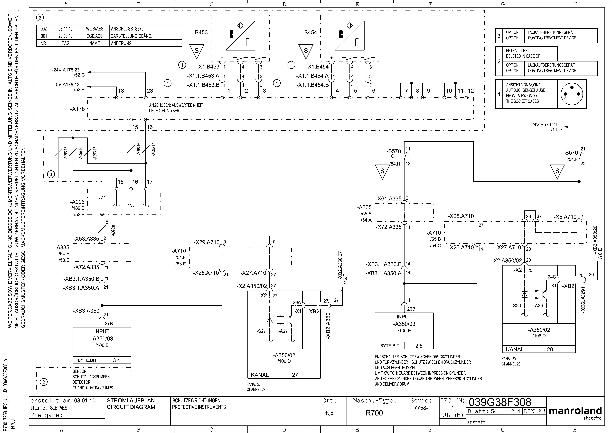

# +Jx — Sheet 54 of 214 — SCHUTZEINRICHTUNGEN

**PROTECTIVE INSTRUMENTS**

> Part of the manroland **R700** printing press IEC/UL circuit diagrams.
> Drawing class: **Stromlaufplan / Circuit diagram** (DIN A3).
> Document `+Jx` covers the **1st printing module + feed register** machine section.

## At a glance

| Field | Value |
|---|---|
| Document | `+Jx`  (039G38F308) |
| Sheet | **54** of 214 |
| Section (DE) | SCHUTZEINRICHTUNGEN |
| Section (EN) | PROTECTIVE INSTRUMENTS |
| Section type | CIRCUIT — Circuit diagram |
| Machine type | `R700` |
| Series | `7758` |
| Created | 03.01.10 |
| Replaces | — |
| Columns used | A, B, C, D, E, F, G, H |
| Path numbers | — |
| Labels on sheet | 227 |
| Cross-refs out | 21 |
| Cross-refs in | 63 |

**Previous:** [+Jx sheet 53](SHEET_0053.md) · **Next:** [+Jx sheet 55](SHEET_0055.md) · **Document TOC:** [_TOC.md](_TOC.md)  (+Jx) · **Master TOC:** [all sheets](../_MASTER_TOC.md)

## Sheet image (300 DPI, exact vector render)



_Rendered directly from the PDF vector layer at 300 DPI (1-bit), no OCR and no resampling. Use it to confirm anything ambiguous in the text below._

## Cross-references on this sheet

Each entry is a wire leaving this sheet. The printed token is `/sheet.column`; the link resolves to that sheet inside the same document.

| Ref | Target sheet | Col | Path | Destination on target | Target section | From col |
|---|---|---|---|---|---|---|
| `/52.C` | [+Jx sheet 52](SHEET_0052.md) | C | — | 24V.A178:23 | SCHUTZEINRICHTUNGEN | A |
| `/52.B` | [+Jx sheet 52](SHEET_0052.md) | B | — | 0V.A178:13 | SCHUTZEINRICHTUNGEN | A |
| `/11.D` | [+Jx sheet 11](SHEET_0011.md) | D | — | 24V.S570:21 | SPANNUNGSVERSORGUNG, SCHALTSCHRANKBELÜFTUNG | H |
| `/54.F` | [+Jx sheet 54](SHEET_0054.md) | F | — | — | SCHUTZEINRICHTUNGEN | H |
| `/54.H` | [+Jx sheet 54](SHEET_0054.md) | H | — | — | SCHUTZEINRICHTUNGEN | F |
| `/189.B` | [+Jx sheet 189](SHEET_0189.md) | B | — | — | OPTION: ZWISCHENTROCKNER, VORBEREITUNG | A |
| `/55.A` | [+Jx sheet 55](SHEET_0055.md) | A | — | — | SCHUTZEINRICHTUNGEN | E |
| `/54.A` | [+Jx sheet 54](SHEET_0054.md) | A | — | — | SCHUTZEINRICHTUNGEN | E |
| `/53.B` | [+Jx sheet 53](SHEET_0053.md) | B | — | — | SCHUTZEINRICHTUNGEN | A |
| `/76.E` | [+Jx sheet 76](SHEET_0076.md) | E | — | XB2.A350:20 | BUSVERBINDUNGEN: SICHERHEITSKREIS | H |
| `/55.B` | [+Jx sheet 55](SHEET_0055.md) | B | — | — | SCHUTZEINRICHTUNGEN | F |
| `/54.C` | [+Jx sheet 54](SHEET_0054.md) | C | — | — | SCHUTZEINRICHTUNGEN | F |
| `/76.F` | [+Jx sheet 76](SHEET_0076.md) | F | — | XB2.A350:27 | BUSVERBINDUNGEN: SICHERHEITSKREIS | E |
| `/54.E` | [+Jx sheet 54](SHEET_0054.md) | E | — | — | SCHUTZEINRICHTUNGEN | A |
| `/53.E` | [+Jx sheet 53](SHEET_0053.md) | E | — | — | SCHUTZEINRICHTUNGEN | A |
| `/54.F` | [+Jx sheet 54](SHEET_0054.md) | F | — | — | SCHUTZEINRICHTUNGEN | C |
| `/53.F` | [+Jx sheet 53](SHEET_0053.md) | F | — | — | SCHUTZEINRICHTUNGEN | C |
| `/106.E` | [+Jx sheet 106](SHEET_0106.md) | E | — | — | REFERENZMODUL | F |
| `/106.D` | [+Jx sheet 106](SHEET_0106.md) | D | — | — | REFERENZMODUL | G |
| `/106.E` | [+Jx sheet 106](SHEET_0106.md) | E | — | — | REFERENZMODUL | A |
| `/106.D` | [+Jx sheet 106](SHEET_0106.md) | D | — | — | REFERENZMODUL | D |

### Incoming references (sheets that point here)

Every other sheet that sends a wire to this one. `Back-ref` is the token printed on *that* sheet; `Path` is its line number.

| From sheet | Cols | Back-ref | Path | Refs | What continues there |
|---|---|---|---|---|---|
| [+Jx#11](SHEET_0011.md) | D | `/11.D` | — | 1 | 24V.S570:21 |
| [+Jx#52](SHEET_0052.md) | B, C | `/52.B`, `/52.C` | — | 2 | — |
| [+Jx#53](SHEET_0053.md) | B, E, F | `/53.B`, `/53.E`, `/53.F` | — | 3 | — |
| [+Jx#54](SHEET_0054.md) | A, C, E, F, H | `/54.A`, `/54.C`, `/54.E`, `/54.F`, `/54.H` | — | 6 | — |
| [+Jx#55](SHEET_0055.md) | A, B | `/55.A`, `/55.B` | — | 2 | — |
| [+Jx#76](SHEET_0076.md) | E, F | `/76.E`, `/76.F` | — | 2 | XB2.A350:20; XB2.A350:27 |
| [+Jx#106](SHEET_0106.md) | D, E | `/106.D`, `/106.E` | — | 4 | — |
| [+Jx#117](SHEET_0117.md) | F, G | `/117.F`, `/117.G` | — | 18 | — |
| [+Jx#126](SHEET_0126.md) | F | `/126.F` | — | 4 | — |
| [+Jx#128](SHEET_0128.md) | C, D, F | `/128.C`, `/128.D`, `/128.F` | — | 6 | — |
| [+Jx#132](SHEET_0132.md) | D | `/132.D` | — | 1 | — |
| [+Jx#143](SHEET_0143.md) | A | `/143.A` | — | 2 | — |
| [+Jx#144](SHEET_0144.md) | D | `/144.D` | — | 2 | — |
| [+Jx#146](SHEET_0146.md) | B | `/146.B` | — | 3 | — |
| [+Jx#147](SHEET_0147.md) | B | `/147.B` | — | 2 | — |
| [+Jx#151](SHEET_0151.md) | C, G | `/151.C`, `/151.G` | — | 2 | — |
| [+Jx#153](SHEET_0153.md) | C | `/153.C` | — | 2 | — |
| [+Jx#189](SHEET_0189.md) | B | `/189.B` | — | 1 | — |


## Devices on this sheet

| Tag | Class | Class meaning (IEC) | Col | Sub | Terminal | Sign |
|---|---|---|---|---|---|---|
| `A350/03` | A | Baugruppe / assembly, module, PC board | A | 03 | — | — |
| `A350/03` | A | Baugruppe / assembly, module, PC board | F | 03 | — | — |
| `A335` | A | Baugruppe / assembly, module, PC board | E | — | — | — |
| `A710` | A | Baugruppe / assembly, module, PC board | F | — | — | — |
| `S20` | S | Schalter / switch | G | — | — | — |
| `A20` | A | Baugruppe / assembly, module, PC board | G | — | — | — |
| `X1` | X | Klemme / terminal, plug connector | H | — | — | — |
| `X2` | X | Klemme / terminal, plug connector | G | — | — | — |
| `XB2` | XB |  | H | — | — | — |
| `A350/02` | A | Baugruppe / assembly, module, PC board | G | 02 | — | — |
| `S570` | S | Schalter / switch | F | — | — | — |
| `S570` | S | Schalter / switch | H | — | — | — |
| `A710` | A | Baugruppe / assembly, module, PC board | C | — | — | — |
| `S27` | S | Schalter / switch | D | — | — | — |
| `A27` | A | Baugruppe / assembly, module, PC board | D | — | — | — |
| `X1` | X | Klemme / terminal, plug connector | D | — | — | — |
| `X2` | X | Klemme / terminal, plug connector | D | — | — | — |
| `XB2` | XB |  | D | — | — | — |
| `A350/02` | A | Baugruppe / assembly, module, PC board | D | 02 | — | — |
| `A335` | A | Baugruppe / assembly, module, PC board | A | — | — | — |
| `A096` | A | Baugruppe / assembly, module, PC board | A | — | — | — |
| `A178` | A | Baugruppe / assembly, module, PC board | A | — | — | — |
| `B453` | B | Umformer / transducer, sensor | C | — | — | — |
| `B454` | B | Umformer / transducer, sensor | D | — | — | — |
| `A096:8` | A | Baugruppe / assembly, module, PC board | B | — | 8 | — |
| `A096:16` | A | Baugruppe / assembly, module, PC board | B | — | 16 | — |
| `A096:17` | A | Baugruppe / assembly, module, PC board | B | — | 17 | — |
| `A096:15` | A | Baugruppe / assembly, module, PC board | A | — | 15 | — |
| `A096:16` | A | Baugruppe / assembly, module, PC board | A | — | 16 | — |
| `A096:17` | A | Baugruppe / assembly, module, PC board | A | — | 17 | — |
| `3.4` | — | cross-device reference | B | — | — | — |
| `XB3.A350` | — | cross-device reference | A | — | — | — |
| `XB3.1.A350.B` | — | cross-device reference | A | — | — | — |
| `XB3.1.A350.A` | — | cross-device reference | A | — | — | — |
| `2.5` | — | cross-device reference | F | — | — | — |
| `X61.A335` | — | cross-device reference | E | — | — | — |
| `X72.A335` | — | cross-device reference | E | — | — | — |
| `X27.A710` | — | cross-device reference | G | — | — | — |
| `X25.A710` | — | cross-device reference | F | — | — | — |
| `XB2.A350` | — | cross-device reference | H | — | — | — |
| `XB3.1.A350.B` | — | cross-device reference | E | — | — | — |
| `XB3.1.A350.A` | — | cross-device reference | E | — | — | — |
| `X5.A710` | — | cross-device reference | H | — | — | — |
| `X27.A710` | — | cross-device reference | D | — | — | — |
| `X29.A710` | — | cross-device reference | C | — | — | — |
| `X25.A710` | — | cross-device reference | C | — | — | — |
| `XB2.A350` | — | cross-device reference | E | — | — | — |
| `X53.A335` | — | cross-device reference | A | — | — | — |
| `X72.A335` | — | cross-device reference | A | — | — | — |
| `X1.B453` | — | cross-device reference | C | — | — | — |
| `X1.1.B453.B` | — | cross-device reference | C | — | — | — |
| `X1.1.B453.A` | — | cross-device reference | C | — | — | — |
| `X1.B454` | — | cross-device reference | D | — | — | — |
| `X1.1.B454.B` | — | cross-device reference | D | — | — | — |
| `X1.1.B454.A` | — | cross-device reference | D | — | — | — |
| `NR.` | — | cross-device reference | A | — | — | — |
| `20.08.10` | — | cross-device reference | A | — | — | — |
| `03.11.10` | — | cross-device reference | A | — | — | — |
| `XB2.A350:27` | — | cross-device reference | E | — | 27 | — |
| `XB2.A350:20` | — | cross-device reference | H | — | 20 | — |
| `X28.A710` | — | cross-device reference | F | — | — | — |

## Potentials / nets

| Potential | Count | Columns | Attached devices | Terminals |
|---|---|---|---|---|
| `0V` | 1 | A | `A178` | `13` |
| `24V` | 2 | A, H | `A178`, `S570` | `21`, `23` |


A potential such as `L24+/4` or `M24+` is a named supply/return rail; every place it appears on this sheet is electrically common.

## Wire-end annotations (grouped as printed)

A wire that continues elsewhere is annotated with a small cluster: the destination description, the path/line number `#NN`, and the `/sheet.column` cross reference. Each row below is one such cluster exactly as it is grouped on the drawing.

| Col | Y | Path | Cross-ref | Text on the wire |
|---|---|---|---|---|
| A | 31.4 | — | — | `2` |
| A | 52.7 | — | — | `002 03.11.10 WLIS/AES ANSCHLUSS S570` |
| D | 58.3 | — | — | `B453 B454` |
| G | 60.1 | — | — | `3 LACKAUFBEREITUNGSGERÄT COATING TREATMENT DEVICE` |
| G | 60.1 | — | — | `OPTION OPTION` |
| A | 66.8 | — | — | `001 20.08.10 DGE/AES DARSTELLUNG GEÄND.` |
| A | 81.0 | — | — | `NR. TAG NAME ÄNDERUNG` |
| C | 93.1 | — | — | `S` |
| D | 93.1 | — | — | `S` |
| G | 95.5 | — | — | `ENTFÄLLT BEI DELETED IN CASE OF` |
| C | 107.9 | — | — | `+` |
| E | 107.9 | — | — | `+` |
| G | 115.0 | — | — | `2` |
| C | 123.1 | — | — | `1` |
| D | 123.1 | — | — | `1` |
| G | 123.9 | — | — | `OPTION OPTION` |
| H | 123.9 | — | — | `LACKAUFBEREITUNGSGERÄT COATING TREATMENT DEVICE` |
| C | 125.0 | — | — | `X1.B453 1 4` |
| E | 125.0 | — | — | `X1.B454 1 4` |
| D | 126.4 | — | — | `3` |
| E | 126.4 | — | — | `3` |
| A | 132.0 | — | `/52.C` | `24V.A178:23` |
| C | 142.7 | — | — | `X1.1.B453.A 1` |
| D | 142.7 | — | — | `X1.1.B454.A 1` |
| C | 144.8 | — | — | `4` |
| D | 144.8 | — | — | `3` |
| E | 144.8 | — | — | `4` |
| E | 144.8 | — | — | `3` |
| B | 158.5 | — | — | `1` |
| D | 158.5 | — | — | `1` |
| A | 160.4 | — | `/52.B` | `0V.A178:13` |
| C | 160.4 | — | — | `X1.1.B453.B 1` |
| D | 160.4 | — | — | `X1.1.B454.B 1` |
| C | 161.8 | — | — | `4` |
| D | 161.8 | — | — | `2 3` |
| E | 161.8 | — | — | `4` |
| E | 161.8 | — | — | `5 3` |
| G | 162.2 | — | — | `FRONT VIEW ONTO ANSICHT VON VORNE AUF BUCHSENGEHÄUSE` |
| B | 171.7 | — | — | `13 23` |
| C | 171.7 | — | — | `1` |
| D | 171.7 | — | — | `3` |
| E | 171.7 | — | — | `4` |
| F | 171.7 | — | — | `6 7 8 9 10 11 12` |
| G | 174.5 | — | — | `1 THE SOCKET CASES 4` |
| H | 187.2 | — | — | `3 1` |
| C | 201.8 | — | — | `LIFTED: ANALYSER ANGEHOBEN: AUSWERTEEINHEIT` |
| A | 207.2 | — | — | `A178` |
| H | 238.3 | — | `/11.D` | `24V.S570:21` |
| B | 242.6 | — | — | `15 16` |
| B | 277.7 | — | — | `A096:16` |
| B | 277.7 | — | — | `A096:17` |
| A | 285.4 | — | — | `A096:15` |
| A | 285.4 | — | — | `A096:16` |
| A | 285.4 | — | — | `A096:17` |
| F | 285.9 | — | — | `11` |
| H | 285.9 | — | — | `21` |
| F | 289.4 | — | — | `S570` |
| H | 292.2 | — | — | `S570` |
| H | 306.0 | — | `/54.F` | — |
| F | 314.2 | — | — | `12` |
| H | 314.2 | — | — | `22` |
| F | 314.9 | — | `/54.H` | — |
| E | 327.0 | — | — | `S` |
| H | 327.0 | — | — | `S` |
| A | 336.1 | — | — | `3` |
| B | 348.9 | — | — | `15 16 17` |
| E | 381.5 | — | — | `X61.A335 2` |
| A | 387.9 | — | — | `A096` |
| E | 398.5 | — | — | `A335` |
| A | 400.9 | — | `/189.B` | — |
| E | 411.6 | — | `/55.A`, `/54.A` | — |
| A | 413.3 | — | `/53.B` | — |
| F | 415.5 | — | — | `X28.A710` |
| H | 416.9 | — | — | `X5.A710 2` |
| G | 417.0 | — | — | `28` |
| H | 417.0 | — | — | `37` |
| B | 426.8 | — | — | `8` |
| G | 434.0 | — | — | `27` |
| E | 436.8 | — | — | `X72.A335 14` |
| B | 437.6 | — | — | `A096:8` |
| H | 438.8 | — | `/76.E` | `XB2.A350:20` |
| F | 448.1 | — | — | `A710` |
| A | 459.4 | — | — | `X53.A335 2` |
| F | 461.2 | — | `/55.B`, `/54.C` | — |
| C | 466.5 | — | — | `X29.A710 9` |
| D | 466.6 | — | — | `10` |
| A | 476.4 | — | — | `A335` |
| G | 476.5 | — | — | `X25.A710 14 X27.A710 20` |
| C | 483.5 | — | — | `A710` |
| E | 488.4 | — | `/76.F` | `XB2.A350:27` |
| A | 489.5 | — | `/54.E`, `/53.E` | — |
| C | 496.6 | — | `/54.F`, `/53.F` | — |
| G | 502.0 | — | — | `X2.A350/02 20` |
| E | 509.1 | — | — | `XB3.1.A350.B 14` |
| A | 514.7 | — | — | `X72.A335 21` |
| G | 520.4 | — | — | `X2` |
| H | 521.8 | — | — | `20 20` |
| C | 526.1 | — | — | `X25.A710 21` |
| D | 526.1 | — | — | `X27.A710 27` |
| E | 526.1 | — | — | `XB3.1.A350.A 14` |
| H | 530.4 | — | — | `20` |
| H | 534.6 | — | — | `24C` |
| A | 537.4 | — | — | `XB3.1.A350.B 21` |
| D | 551.6 | — | — | `X2.A350/02 27` |
| H | 551.6 | — | — | `X1` |
| H | 551.6 | — | — | `XB2` |
| A | 554.4 | — | — | `XB3.1.A350.A 21` |
| H | 557.9 | — | — | `XB2.A350` |
| D | 570.0 | — | — | `X2` |
| D | 571.5 | — | — | `27 27` |
| E | 580.0 | — | — | `27` |
| F | 580.0 | — | — | `14` |
| D | 584.2 | — | — | `29A` |
| G | 590.6 | — | — | `S20 A20` |
| F | 596.9 | — | — | `20B` |
| A | 599.8 | — | — | `XB3.A350 21` |
| D | 601.2 | — | — | `X1` |
| D | 601.2 | — | — | `XB2` |
| E | 607.5 | — | — | `XB2.A350` |
| F | 611.4 | — | — | `INPUT` |
| B | 625.3 | — | — | `27B` |
| F | 625.3 | — | — | `A350/03` |
| G | 636.6 | — | — | `A350/02` |
| F | 639.1 | — | `/106.E` | — |
| A | 639.8 | — | — | `INPUT` |
| D | 640.2 | — | — | `S27 A27` |
| G | 649.0 | — | `/106.D` | — |
| A | 653.6 | — | — | `A350/03` |
| A | 667.4 | — | `/106.E` | — |
| F | 668.1 | — | — | `BYTE.BIT 2.5` |
| G | 674.9 | — | — | `KANAL 20` |
| D | 686.2 | — | — | `A350/02` |
| F | 690.8 | — | — | `ENDSCHALTER: SCHUTZ ZWISCHEN DRUCKZYLINDER UND FORMZYLINDER + SCHUTZ ZWISCHEN DRUCKZYLINDER UND AUSLEGERTROMMEL LIMIT SWITCH: GUARD BETWEEN IMPRESSION CYLINDER` |
| G | 695.2 | — | — | `KANAL 20 CHANNEL 20` |
| A | 696.5 | — | — | `BYTE.BIT 3.4` |
| D | 698.6 | — | `/106.D` | — |
| A | 719.1 | — | — | `DETECTOR: SENSOR: SCHUTZ, LACKPUMPEN GUARD, COATING PUMPS` |
| D | 724.5 | — | — | `KANAL 27` |
| F | 733.4 | — | — | `AND FORME CYLINDER + GUARD BETWEEN IMPRESSION CYLINDER AND DELIVERY DRUM` |
| A | 740.1 | — | — | `2` |
| D | 744.8 | — | — | `KANAL 27 CHANNEL 27` |


## Reconstructed tables

This sheet carries tabular content (pin map / terminal assignment / index). The grid below was rebuilt from the drawing's own rule lines, so each row is exactly one physical row of the table.

### Table 1 — 5 data rows × 5 columns (at x=113.4, y=140.3)

| 0V.A178:13 | /52.C |  |  |  |
|---|---|---|---|---|
| `A096:15` | `/52.B A178 A096:16` | `A096:17` | `13` | `15 A096:16` |
| `A335 /54.E /53.E` | `A096 /189.B /53.B X53.A335 X72.A335 XB3.1.A350.B XB3.1.A350.A` |  | `15 8 A096:8 2 21 21 21` | `16` |
|  | `XB3.A350` |  | `21 27B` |  |
|  |  | `INPUT` | `A350/03 /106.E` |  |
|  | `BYTE.BIT` |  | `3.4` |  |


### Table 2 — 13 data rows × 14 columns (at x=432.3, y=41.1) — **B454**

| 1 1 1 | 4 4 4 1 2 |  | 3 3 3 3 | 1 | 1 | S X1.B454 X1.1.B454.A X1.1.B454.B | + 1 1 1 | 4 | 4 4 4 5 | 3 3 3 6 |  | 7 8 9 | 10 11 12 |
|---|---|---|---|---|---|---|---|---|---|---|---|---|---|
|  |  |  |  |  |  |  |  |  |  |  | `S570 /54.H S` | `11 12` |  |
|  |  |  |  |  |  |  |  |  |  | `A335 /55.A /54.A` | `X61.A335 X72.A335` | `2 14` | `X28.A710` |
|  |  |  |  |  |  |  |  |  |  |  |  |  | `A710` |
| `9` |  |  |  | `10` |  |  |  | `XB2.A350:27` |  |  | `XB3.1.A350.B` | `14` | `/55.B /54.C X25.A710` |
|  | `21` | `X27.A710` |  | `27` |  |  |  |  | `/76.F` |  | `XB3.1.A350.A` | `14` |  |
|  |  | `X2.A350/02` |  | `27` |  |  |  |  |  |  |  |  |  |
|  |  |  | `X2` | `27` | `29A` |  | `27` | `27` |  |  |  | `14` |  |
|  |  |  |  |  | `X1` | `XB2` |  |  |  |  |  | `20B` |  |
|  |  |  |  |  |  |  |  |  |  |  | `INPUT` |  |  |
|  |  |  | `S27` | `A27` |  |  | `XB2.A350` |  |  |  |  | `A350/03 /106.E` |  |
|  |  |  |  |  |  |  |  |  |  |  | `BYTE.BIT` | `2.5` |  |
|  |  |  |  | `A350/02 /106.D` |  |  |  |  |  |  | `ENDSCHALTER: UND FORMZYLINDER UND AUSLEGERTROMMEL` | `SCHUTZ ZWISCHEN + SCHUTZ` | `DRUCKZYLINDER ZWISCHEN DRUCKZYLINDER` |
|  |  |  | `KANAL` |  | `27` |  |  |  |  |  | `LIMIT SWITCH:` | `GUARD BETWEEN` | `IMPRESSION CYLINDER` |


### Table 3 — 11 data rows × 7 columns (at x=928.3, y=41.1)

| 3 | OPTION OPTION | COATING | LACKAUFBEREITUNGSGERÄT TREATMENT | DEVICE |  |  |
|---|---|---|---|---|---|---|
| `2 1` | `ENTFÄLLT DELETED IN OPTION OPTION ANSICHT AUF FRONT VIEW THE SOCKET` | `BEI CASE OF COATING VON VORNE BUCHSENGEHÄUSE ONTO CASES 24V.S570:21` | `LACKAUFBEREITUNGSGERÄT TREATMENT /11.D` | `DEVICE 4 3` | `1` |  |
|  |  |  | `S` | `S570 /54.F` |  | `21 22` |
| `27` |  | `28 37` |  | `X5.A710` |  | `2` |
| `14` | `X27.A710 X2.A350/02` | `20 20` |  |  |  | `XB2.A350:20` |
|  | `X2` | `20` | `24C` |  |  | `20 20` |
|  |  |  | `X1` | `XB2` |  |  |
|  |  |  |  |  |  | `XB2.A350` |
|  | `S20` | `A20` |  |  |  |  |
|  |  | `A350/02 /106.D` |  |  |  |  |
|  | `KANAL` |  | `20` |  |  |  |
|  | `KANAL 20 CHANNEL 20` |  |  |  |  |  |


## Notes and free text on this sheet

| Text | Col | Y (pt) |
|---|---|---|
| `27B` | B | 625.27 |
| `INPUT` | A | 639.79 |
| `BYTE.BIT` | A | 697.05 |
| `SENSOR:` | A | 719.13 |
| `SCHUTZ, LACKPUMPEN` | A | 729.8 |
| `DETECTOR:` | A | 740.41 |
| `GUARD, COATING PUMPS` | A | 751.07 |
| `20B` | F | 596.92 |
| `INPUT` | F | 611.44 |
| `BYTE.BIT` | E | 668.7 |
| `ENDSCHALTER: SCHUTZ ZWISCHEN DRUCKZYLINDER` | F | 690.82 |
| `UND FORMZYLINDER + SCHUTZ ZWISCHEN DRUCKZYLINDER` | F | 701.46 |
| `UND AUSLEGERTROMMEL` | F | 712.1 |
| `LIMIT SWITCH: GUARD BETWEEN IMPRESSION CYLINDER` | F | 722.7 |
| `AND FORME CYLINDER + GUARD BETWEEN IMPRESSION CYLINDER` | F | 733.35 |
| `AND DELIVERY DRUM` | E | 743.99 |
| `KANAL 20` | G | 695.23 |
| `CHANNEL 20` | G | 705.17 |
| `24C` | H | 534.6 |
| `KANAL` | G | 674.88 |
| `X2.A350/02` | G | 501.97 |
| `KANAL 27` | D | 744.83 |
| `CHANNEL 27` | D | 754.78 |
| `29A` | D | 584.17 |
| `KANAL` | D | 724.48 |
| `X2.A350/02` | D | 551.58 |
| `ANGEHOBEN: AUSWERTEEINHEIT` | C | 201.83 |
| `LIFTED: ANALYSER` | B | 212.46 |
| `TAG` | A | 81.09 |
| `NAME` | A | 81.08 |
| `ÄNDERUNG` | B | 81.11 |
| `DGE/AES` | A | 66.92 |
| `DARSTELLUNG GEÄND.` | B | 66.93 |
| `WLIS/AES` | A | 52.72 |
| `ANSCHLUSS S570` | B | 52.78 |
| `S` | E | 326.99 |
| `S` | H | 326.99 |
| `S` | C | 93.13 |
| `S` | D | 93.13 |
| `ANSICHT VON VORNE` | G | 162.16 |
| `AUF BUCHSENGEHÄUSE` | G | 172.8 |
| `FRONT VIEW ONTO` | G | 183.39 |
| `THE SOCKET CASES` | G | 194.04 |
| `ENTFÄLLT BEI` | G | 95.51 |
| `DELETED IN CASE OF` | G | 106.16 |
| `OPTION` | G | 123.87 |
| `LACKAUFBEREITUNGSGERÄT` | H | 123.89 |
| `COATING TREATMENT DEVICE` | H | 134.52 |

## Complete label inventory (exact text from the drawing)

Every text object inside the drawing area of this sheet, in DIN reading order (column A→H, then top→bottom). This is the authoritative list: if a string is not here it is not printed on this sheet.

| Col | Y | X | Dir | Type | Text |
|---|---|---|---|---|---|
| A | 31.4 | 76.0 | → | number | `2` |
| A | 52.7 | 167.6 | → | text | `WLIS/AES` |
| A | 52.8 | 79.2 | → | number | `002` |
| A | 52.8 | 114.0 | → | device ref | `03.11.10` |
| A | 66.8 | 79.7 | → | number | `001` |
| A | 66.9 | 114.0 | → | device ref | `20.08.10` |
| A | 66.9 | 168.5 | → | text | `DGE/AES` |
| A | 81.0 | 78.9 | → | device ref | `NR.` |
| A | 81.1 | 120.6 | → | text | `TAG` |
| A | 81.1 | 173.9 | → | text | `NAME` |
| A | 132.0 | 101.2 | → | potential | `24V.A178:23` |
| A | 142.0 | 143.7 | → | cross-reference | `/52.C` |
| A | 160.4 | 108.9 | → | potential | `0V.A178:13` |
| A | 170.3 | 144.0 | → | cross-reference | `/52.B` |
| A | 207.2 | 136.6 | → | device tag | `A178` |
| A | 285.4 | 125.3 | ↕ | device tag | `A096:15` |
| A | 285.4 | 153.7 | ↕ | device tag | `A096:16` |
| A | 285.4 | 182.0 | ↕ | device tag | `A096:17` |
| A | 336.1 | 97.2 | → | number | `3` |
| A | 387.9 | 136.3 | → | device tag | `A096` |
| A | 401.0 | 139.2 | → | cross-reference | `/189.B` |
| A | 413.3 | 144.0 | → | cross-reference | `/53.B` |
| A | 459.4 | 142.9 | → | device ref | `X53.A335` |
| A | 476.5 | 106.6 | → | device tag | `A335` |
| A | 489.5 | 114.2 | → | cross-reference | `/54.E` |
| A | 501.9 | 114.2 | → | cross-reference | `/53.E` |
| A | 514.7 | 142.9 | → | device ref | `X72.A335` |
| A | 537.4 | 123.3 | → | device ref | `XB3.1.A350.B` |
| A | 555.1 | 122.7 | → | device ref | `XB3.1.A350.A` |
| A | 599.8 | 142.0 | → | device ref | `XB3.A350` |
| A | 639.8 | 183.5 | → | text | `INPUT` |
| A | 653.6 | 176.9 | → | device tag | `A350/03` |
| A | 667.4 | 185.8 | → | cross-reference | `/106.E` |
| A | 697.0 | 151.7 | → | text | `BYTE.BIT` |
| A | 719.1 | 141.4 | → | text | `SENSOR:` |
| A | 729.8 | 141.4 | → | text | `SCHUTZ, LACKPUMPEN` |
| A | 740.1 | 83.0 | → | number | `2` |
| A | 740.4 | 141.2 | → | text | `DETECTOR:` |
| A | 751.1 | 141.4 | → | text | `GUARD, COATING PUMPS` |
| B | 52.8 | 216.1 | → | text | `ANSCHLUSS S570` |
| B | 66.9 | 215.6 | → | text | `DARSTELLUNG GEÄND.` |
| B | 81.1 | 216.1 | → | text | `ÄNDERUNG` |
| B | 158.5 | 324.1 | → | number | `1` |
| B | 171.7 | 229.3 | → | number | `13` |
| B | 171.7 | 286.0 | → | number | `23` |
| B | 212.5 | 290.0 | → | text | `LIFTED: ANALYSER` |
| B | 242.6 | 256.8 | → | number | `15` |
| B | 242.6 | 285.2 | → | number | `16` |
| B | 277.7 | 267.0 | ↕ | device tag | `A096:16` |
| B | 277.7 | 295.4 | ↕ | device tag | `A096:17` |
| B | 348.9 | 228.5 | → | number | `15` |
| B | 348.9 | 256.8 | → | number | `16` |
| B | 348.9 | 285.2 | → | number | `17` |
| B | 426.8 | 205.2 | → | number | `8` |
| B | 437.6 | 217.4 | ↕ | device tag | `A096:8` |
| B | 459.5 | 201.3 | → | number | `2` |
| B | 516.2 | 201.3 | → | number | `21` |
| B | 537.4 | 201.3 | → | number | `21` |
| B | 554.4 | 201.3 | → | number | `21` |
| B | 608.3 | 201.3 | → | number | `21` |
| B | 625.3 | 204.1 | → | text | `27B` |
| B | 696.5 | 220.0 | → | device ref | `3.4` |
| C | 58.3 | 375.9 | → | device tag | `B453` |
| C | 93.1 | 378.6 | → | text | `S` |
| C | 107.9 | 429.2 | → | number | `+` |
| C | 123.1 | 352.5 | → | number | `1` |
| C | 125.0 | 382.7 | → | device ref | `X1.B453` |
| C | 126.4 | 434.3 | → | number | `1` |
| C | 126.4 | 470.6 | → | number | `4` |
| C | 142.7 | 363.7 | → | device ref | `X1.1.B453.A` |
| C | 144.8 | 434.3 | → | number | `1` |
| C | 144.8 | 470.6 | → | number | `4` |
| C | 160.4 | 364.3 | → | device ref | `X1.1.B453.B` |
| C | 161.8 | 434.3 | → | number | `1` |
| C | 161.8 | 470.6 | → | number | `4` |
| C | 171.7 | 442.5 | → | number | `1` |
| C | 171.7 | 476.5 | → | number | `2` |
| C | 201.8 | 290.6 | → | text | `ANGEHOBEN: AUSWERTEEINHEIT` |
| C | 466.5 | 377.0 | → | device ref | `X29.A710` |
| C | 466.6 | 434.8 | → | number | `9` |
| C | 483.5 | 333.6 | → | device tag | `A710` |
| C | 496.6 | 341.6 | → | cross-reference | `/54.F` |
| C | 509.0 | 341.6 | → | cross-reference | `/53.F` |
| C | 526.1 | 375.6 | → | device ref | `X25.A710` |
| C | 530.3 | 435.1 | → | number | `21` |
| D | 58.3 | 588.5 | → | device tag | `B454` |
| D | 93.1 | 591.2 | → | text | `S` |
| D | 123.1 | 565.1 | → | number | `1` |
| D | 125.0 | 595.3 | → | device ref | `X1.B454` |
| D | 126.4 | 505.7 | → | number | `3` |
| D | 142.7 | 576.3 | → | device ref | `X1.1.B454.A` |
| D | 144.8 | 505.7 | → | number | `3` |
| D | 158.5 | 536.7 | → | number | `1` |
| D | 160.4 | 576.9 | → | device ref | `X1.1.B454.B` |
| D | 161.8 | 505.7 | → | number | `3` |
| D | 171.7 | 511.7 | → | number | `3` |
| D | 466.6 | 526.4 | → | number | `10` |
| D | 526.1 | 467.7 | → | device ref | `X27.A710` |
| D | 530.3 | 527.2 | → | number | `27` |
| D | 551.6 | 460.3 | → | text | `X2.A350/02` |
| D | 551.6 | 527.2 | → | number | `27` |
| D | 570.0 | 502.9 | → | device tag | `X2` |
| D | 571.4 | 530.1 | → | number | `27` |
| D | 584.2 | 569.8 | → | text | `29A` |
| D | 601.2 | 573.2 | → | device tag | `X1` |
| D | 601.2 | 597.8 | → | device tag | `XB2` |
| D | 640.2 | 499.2 | → | device tag | `S27` |
| D | 640.2 | 541.7 | → | device tag | `A27` |
| D | 686.2 | 531.4 | → | device tag | `A350/02` |
| D | 698.6 | 540.0 | → | cross-reference | `/106.D` |
| D | 724.5 | 488.4 | → | text | `KANAL` |
| D | 724.5 | 568.1 | → | number | `27` |
| D | 744.8 | 479.9 | → | text | `KANAL 27` |
| D | 754.8 | 480.2 | → | text | `CHANNEL 27` |
| E | 107.9 | 641.8 | → | number | `+` |
| E | 126.4 | 646.9 | → | number | `1` |
| E | 126.4 | 683.1 | → | number | `4` |
| E | 126.4 | 718.3 | → | number | `3` |
| E | 144.8 | 646.9 | → | number | `1` |
| E | 144.8 | 683.1 | → | number | `4` |
| E | 144.8 | 718.3 | → | number | `3` |
| E | 161.8 | 646.9 | → | number | `1` |
| E | 161.8 | 683.1 | → | number | `4` |
| E | 161.8 | 718.3 | → | number | `3` |
| E | 171.7 | 653.4 | → | number | `4` |
| E | 171.7 | 688.8 | → | number | `5` |
| E | 171.7 | 724.3 | → | number | `6` |
| E | 327.0 | 740.0 | → | text | `S` |
| E | 381.5 | 731.1 | → | device ref | `X61.A335` |
| E | 398.5 | 694.8 | → | device tag | `A335` |
| E | 411.6 | 702.1 | → | cross-reference | `/55.A` |
| E | 424.0 | 702.1 | → | cross-reference | `/54.A` |
| E | 436.8 | 731.1 | → | device ref | `X72.A335` |
| E | 488.4 | 657.9 | ↕ | device ref | `XB2.A350:27` |
| E | 509.1 | 711.5 | → | device ref | `XB3.1.A350.B` |
| E | 526.8 | 710.9 | → | device ref | `XB3.1.A350.A` |
| E | 532.6 | 667.8 | ↕ | cross-reference | `/76.F` |
| E | 580.0 | 649.7 | → | number | `27` |
| E | 581.4 | 629.3 | → | number | `27` |
| E | 607.5 | 633.8 | ↕ | device ref | `XB2.A350` |
| E | 668.7 | 739.8 | → | text | `BYTE.BIT` |
| E | 744.0 | 729.9 | → | text | `AND DELIVERY DRUM` |
| F | 171.7 | 788.0 | → | number | `7` |
| F | 171.7 | 809.6 | → | number | `8` |
| F | 171.7 | 830.6 | → | number | `9` |
| F | 171.7 | 867.4 | → | number | `10` |
| F | 171.7 | 890.1 | → | number | `11` |
| F | 285.9 | 788.6 | → | number | `11` |
| F | 289.4 | 751.7 | → | device tag | `S570` |
| F | 314.2 | 788.6 | → | number | `12` |
| F | 314.9 | 757.7 | → | cross-reference | `/54.H` |
| F | 381.5 | 789.4 | → | number | `2` |
| F | 415.5 | 871.7 | → | device ref | `X28.A710` |
| F | 438.2 | 788.6 | → | number | `14` |
| F | 448.1 | 829.7 | → | device tag | `A710` |
| F | 461.2 | 837.1 | → | cross-reference | `/55.B` |
| F | 473.6 | 836.8 | → | cross-reference | `/54.C` |
| F | 476.5 | 871.7 | → | device ref | `X25.A710` |
| F | 509.1 | 788.6 | → | number | `14` |
| F | 526.1 | 788.6 | → | number | `14` |
| F | 580.0 | 788.6 | → | number | `14` |
| F | 596.9 | 792.3 | → | text | `20B` |
| F | 611.4 | 771.7 | → | text | `INPUT` |
| F | 625.3 | 765.1 | → | device tag | `A350/03` |
| F | 639.1 | 774.0 | → | cross-reference | `/106.E` |
| F | 668.1 | 808.2 | → | device ref | `2.5` |
| F | 690.8 | 729.4 | → | text | `ENDSCHALTER: SCHUTZ ZWISCHEN DRUCKZYLINDER` |
| F | 701.5 | 729.4 | → | text | `UND FORMZYLINDER + SCHUTZ ZWISCHEN DRUCKZYLINDER` |
| F | 712.1 | 729.4 | → | text | `UND AUSLEGERTROMMEL` |
| F | 722.7 | 729.4 | → | text | `LIMIT SWITCH: GUARD BETWEEN IMPRESSION CYLINDER` |
| F | 733.4 | 729.9 | → | text | `AND FORME CYLINDER + GUARD BETWEEN IMPRESSION CYLINDER` |
| G | 60.1 | 984.8 | → | text | `OPTION` |
| G | 65.4 | 967.9 | → | number | `3` |
| G | 70.7 | 984.8 | → | text | `OPTION` |
| G | 95.5 | 984.5 | → | text | `ENTFÄLLT BEI` |
| G | 106.2 | 984.5 | → | text | `DELETED IN CASE OF` |
| G | 115.0 | 968.0 | → | number | `2` |
| G | 123.9 | 984.8 | → | text | `OPTION` |
| G | 134.5 | 984.8 | → | text | `OPTION` |
| G | 162.2 | 985.0 | → | text | `ANSICHT VON VORNE` |
| G | 171.7 | 909.9 | → | number | `12` |
| G | 172.8 | 985.0 | → | text | `AUF BUCHSENGEHÄUSE` |
| G | 178.8 | 968.3 | → | number | `1` |
| G | 183.4 | 984.5 | → | text | `FRONT VIEW ONTO` |
| G | 194.0 | 985.0 | → | text | `THE SOCKET CASES` |
| G | 417.0 | 1023.3 | → | number | `28` |
| G | 434.0 | 931.2 | → | number | `27` |
| G | 476.5 | 963.8 | → | device ref | `X27.A710` |
| G | 480.7 | 930.3 | → | number | `14` |
| G | 480.7 | 1023.3 | → | number | `20` |
| G | 502.0 | 956.4 | → | text | `X2.A350/02` |
| G | 502.0 | 1023.3 | → | number | `20` |
| G | 520.4 | 998.9 | → | device tag | `X2` |
| G | 521.8 | 1026.1 | → | number | `20` |
| G | 590.6 | 995.2 | → | device tag | `S20` |
| G | 590.6 | 1037.8 | → | device tag | `A20` |
| G | 636.6 | 1027.4 | → | device tag | `A350/02` |
| G | 649.0 | 1036.1 | → | cross-reference | `/106.D` |
| G | 674.9 | 984.5 | → | text | `KANAL` |
| G | 695.2 | 976.0 | → | text | `KANAL 20` |
| G | 705.2 | 976.3 | → | text | `CHANNEL 20` |
| H | 60.1 | 1027.0 | → | text | `LACKAUFBEREITUNGSGERÄT` |
| H | 70.7 | 1027.3 | → | text | `COATING TREATMENT DEVICE` |
| H | 123.9 | 1027.0 | → | text | `LACKAUFBEREITUNGSGERÄT` |
| H | 134.5 | 1027.3 | → | text | `COATING TREATMENT DEVICE` |
| H | 174.5 | 1110.8 | → | number | `4` |
| H | 187.2 | 1097.9 | → | number | `3` |
| H | 187.2 | 1123.7 | → | number | `1` |
| H | 238.3 | 1030.7 | → | potential | `24V.S570:21` |
| H | 248.3 | 1072.1 | → | cross-reference | `/11.D` |
| H | 285.9 | 1129.6 | → | number | `21` |
| H | 292.2 | 1096.2 | → | device tag | `S570` |
| H | 306.0 | 1104.1 | → | cross-reference | `/54.F` |
| H | 314.2 | 1129.6 | → | number | `22` |
| H | 327.0 | 1080.1 | → | text | `S` |
| H | 416.9 | 1077.4 | → | device ref | `X5.A710` |
| H | 417.0 | 1044.3 | → | number | `37` |
| H | 417.0 | 1129.6 | → | number | `2` |
| H | 438.8 | 1153.9 | ↕ | device ref | `XB2.A350:20` |
| H | 482.5 | 1163.8 | ↕ | cross-reference | `/76.E` |
| H | 530.3 | 1145.8 | → | number | `20` |
| H | 531.8 | 1125.4 | → | number | `20` |
| H | 534.6 | 1065.8 | → | text | `24C` |
| H | 551.6 | 1069.2 | → | device tag | `X1` |
| H | 551.6 | 1093.9 | → | device tag | `XB2` |
| H | 557.9 | 1129.8 | ↕ | device ref | `XB2.A350` |
| H | 674.8 | 1064.3 | → | number | `20` |

## Reading-order text block

The same content as a plain block, grouped by DIN column — convenient to paste or to match against a visual description.

```text
=== Column A ===
  31.4   76.0  numeric      2
  52.7  167.6  text         WLIS/AES
  52.8   79.2  numeric      002
  52.8  114.0  devref       03.11.10
  66.8   79.7  numeric      001
  66.9  114.0  devref       20.08.10
  66.9  168.5  text         DGE/AES
  81.0   78.9  devref       NR.
  81.1  120.6  text         TAG
  81.1  173.9  text         NAME
 132.0  101.2  net          24V.A178:23
 142.0  143.7  xref         /52.C
 160.4  108.9  net          0V.A178:13
 170.3  144.0  xref         /52.B
 207.2  136.6  devtag       A178
 285.4  125.3  devtag       A096:15
 285.4  153.7  devtag       A096:16
 285.4  182.0  devtag       A096:17
 336.1   97.2  numeric      3
 387.9  136.3  devtag       A096
 401.0  139.2  xref         /189.B
 413.3  144.0  xref         /53.B
 459.4  142.9  devref       X53.A335
 476.5  106.6  devtag       A335
 489.5  114.2  xref         /54.E
 501.9  114.2  xref         /53.E
 514.7  142.9  devref       X72.A335
 537.4  123.3  devref       XB3.1.A350.B
 555.1  122.7  devref       XB3.1.A350.A
 599.8  142.0  devref       XB3.A350
 639.8  183.5  text         INPUT
 653.6  176.9  devtag       A350/03
 667.4  185.8  xref         /106.E
 697.0  151.7  text         BYTE.BIT
 719.1  141.4  text         SENSOR:
 729.8  141.4  text         SCHUTZ, LACKPUMPEN
 740.1   83.0  numeric      2
 740.4  141.2  text         DETECTOR:
 751.1  141.4  text         GUARD, COATING PUMPS
=== Column B ===
  52.8  216.1  text         ANSCHLUSS S570
  66.9  215.6  text         DARSTELLUNG GEÄND.
  81.1  216.1  text         ÄNDERUNG
 158.5  324.1  numeric      1
 171.7  229.3  numeric      13
 171.7  286.0  numeric      23
 212.5  290.0  text         LIFTED: ANALYSER
 242.6  256.8  numeric      15
 242.6  285.2  numeric      16
 277.7  267.0  devtag       A096:16
 277.7  295.4  devtag       A096:17
 348.9  228.5  numeric      15
 348.9  256.8  numeric      16
 348.9  285.2  numeric      17
 426.8  205.2  numeric      8
 437.6  217.4  devtag       A096:8
 459.5  201.3  numeric      2
 516.2  201.3  numeric      21
 537.4  201.3  numeric      21
 554.4  201.3  numeric      21
 608.3  201.3  numeric      21
 625.3  204.1  text         27B
 696.5  220.0  devref       3.4
=== Column C ===
  58.3  375.9  devtag       B453
  93.1  378.6  text         S
 107.9  429.2  numeric      +
 123.1  352.5  numeric      1
 125.0  382.7  devref       X1.B453
 126.4  434.3  numeric      1
 126.4  470.6  numeric      4
 142.7  363.7  devref       X1.1.B453.A
 144.8  434.3  numeric      1
 144.8  470.6  numeric      4
 160.4  364.3  devref       X1.1.B453.B
 161.8  434.3  numeric      1
 161.8  470.6  numeric      4
 171.7  442.5  numeric      1
 171.7  476.5  numeric      2
 201.8  290.6  text         ANGEHOBEN: AUSWERTEEINHEIT
 466.5  377.0  devref       X29.A710
 466.6  434.8  numeric      9
 483.5  333.6  devtag       A710
 496.6  341.6  xref         /54.F
 509.0  341.6  xref         /53.F
 526.1  375.6  devref       X25.A710
 530.3  435.1  numeric      21
=== Column D ===
  58.3  588.5  devtag       B454
  93.1  591.2  text         S
 123.1  565.1  numeric      1
 125.0  595.3  devref       X1.B454
 126.4  505.7  numeric      3
 142.7  576.3  devref       X1.1.B454.A
 144.8  505.7  numeric      3
 158.5  536.7  numeric      1
 160.4  576.9  devref       X1.1.B454.B
 161.8  505.7  numeric      3
 171.7  511.7  numeric      3
 466.6  526.4  numeric      10
 526.1  467.7  devref       X27.A710
 530.3  527.2  numeric      27
 551.6  460.3  text         X2.A350/02
 551.6  527.2  numeric      27
 570.0  502.9  devtag       X2
 571.4  530.1  numeric      27
 584.2  569.8  text         29A
 601.2  573.2  devtag       X1
 601.2  597.8  devtag       XB2
 640.2  499.2  devtag       S27
 640.2  541.7  devtag       A27
 686.2  531.4  devtag       A350/02
 698.6  540.0  xref         /106.D
 724.5  488.4  text         KANAL
 724.5  568.1  numeric      27
 744.8  479.9  text         KANAL 27
 754.8  480.2  text         CHANNEL 27
=== Column E ===
 107.9  641.8  numeric      +
 126.4  646.9  numeric      1
 126.4  683.1  numeric      4
 126.4  718.3  numeric      3
 144.8  646.9  numeric      1
 144.8  683.1  numeric      4
 144.8  718.3  numeric      3
 161.8  646.9  numeric      1
 161.8  683.1  numeric      4
 161.8  718.3  numeric      3
 171.7  653.4  numeric      4
 171.7  688.8  numeric      5
 171.7  724.3  numeric      6
 327.0  740.0  text         S
 381.5  731.1  devref       X61.A335
 398.5  694.8  devtag       A335
 411.6  702.1  xref         /55.A
 424.0  702.1  xref         /54.A
 436.8  731.1  devref       X72.A335
 488.4  657.9  devref       XB2.A350:27
 509.1  711.5  devref       XB3.1.A350.B
 526.8  710.9  devref       XB3.1.A350.A
 532.6  667.8  xref         /76.F
 580.0  649.7  numeric      27
 581.4  629.3  numeric      27
 607.5  633.8  devref       XB2.A350
 668.7  739.8  text         BYTE.BIT
 744.0  729.9  text         AND DELIVERY DRUM
=== Column F ===
 171.7  788.0  numeric      7
 171.7  809.6  numeric      8
 171.7  830.6  numeric      9
 171.7  867.4  numeric      10
 171.7  890.1  numeric      11
 285.9  788.6  numeric      11
 289.4  751.7  devtag       S570
 314.2  788.6  numeric      12
 314.9  757.7  xref         /54.H
 381.5  789.4  numeric      2
 415.5  871.7  devref       X28.A710
 438.2  788.6  numeric      14
 448.1  829.7  devtag       A710
 461.2  837.1  xref         /55.B
 473.6  836.8  xref         /54.C
 476.5  871.7  devref       X25.A710
 509.1  788.6  numeric      14
 526.1  788.6  numeric      14
 580.0  788.6  numeric      14
 596.9  792.3  text         20B
 611.4  771.7  text         INPUT
 625.3  765.1  devtag       A350/03
 639.1  774.0  xref         /106.E
 668.1  808.2  devref       2.5
 690.8  729.4  text         ENDSCHALTER: SCHUTZ ZWISCHEN DRUCKZYLINDER
 701.5  729.4  text         UND FORMZYLINDER + SCHUTZ ZWISCHEN DRUCKZYLINDER
 712.1  729.4  text         UND AUSLEGERTROMMEL
 722.7  729.4  text         LIMIT SWITCH: GUARD BETWEEN IMPRESSION CYLINDER
 733.4  729.9  text         AND FORME CYLINDER + GUARD BETWEEN IMPRESSION CYLINDER
=== Column G ===
  60.1  984.8  text         OPTION
  65.4  967.9  numeric      3
  70.7  984.8  text         OPTION
  95.5  984.5  text         ENTFÄLLT BEI
 106.2  984.5  text         DELETED IN CASE OF
 115.0  968.0  numeric      2
 123.9  984.8  text         OPTION
 134.5  984.8  text         OPTION
 162.2  985.0  text         ANSICHT VON VORNE
 171.7  909.9  numeric      12
 172.8  985.0  text         AUF BUCHSENGEHÄUSE
 178.8  968.3  numeric      1
 183.4  984.5  text         FRONT VIEW ONTO
 194.0  985.0  text         THE SOCKET CASES
 417.0 1023.3  numeric      28
 434.0  931.2  numeric      27
 476.5  963.8  devref       X27.A710
 480.7  930.3  numeric      14
 480.7 1023.3  numeric      20
 502.0  956.4  text         X2.A350/02
 502.0 1023.3  numeric      20
 520.4  998.9  devtag       X2
 521.8 1026.1  numeric      20
 590.6  995.2  devtag       S20
 590.6 1037.8  devtag       A20
 636.6 1027.4  devtag       A350/02
 649.0 1036.1  xref         /106.D
 674.9  984.5  text         KANAL
 695.2  976.0  text         KANAL 20
 705.2  976.3  text         CHANNEL 20
=== Column H ===
  60.1 1027.0  text         LACKAUFBEREITUNGSGERÄT
  70.7 1027.3  text         COATING TREATMENT DEVICE
 123.9 1027.0  text         LACKAUFBEREITUNGSGERÄT
 134.5 1027.3  text         COATING TREATMENT DEVICE
 174.5 1110.8  numeric      4
 187.2 1097.9  numeric      3
 187.2 1123.7  numeric      1
 238.3 1030.7  net          24V.S570:21
 248.3 1072.1  xref         /11.D
 285.9 1129.6  numeric      21
 292.2 1096.2  devtag       S570
 306.0 1104.1  xref         /54.F
 314.2 1129.6  numeric      22
 327.0 1080.1  text         S
 416.9 1077.4  devref       X5.A710
 417.0 1044.3  numeric      37
 417.0 1129.6  numeric      2
 438.8 1153.9  devref       XB2.A350:20
 482.5 1163.8  xref         /76.E
 530.3 1145.8  numeric      20
 531.8 1125.4  numeric      20
 534.6 1065.8  text         24C
 551.6 1069.2  devtag       X1
 551.6 1093.9  devtag       XB2
 557.9 1129.8  devref       XB2.A350
 674.8 1064.3  numeric      20
```

---
_Generated from the PDF vector text layer; no OCR. Source: `R700_7758_IEC_UL_JX_039G38F308_p`, sheet 54._
