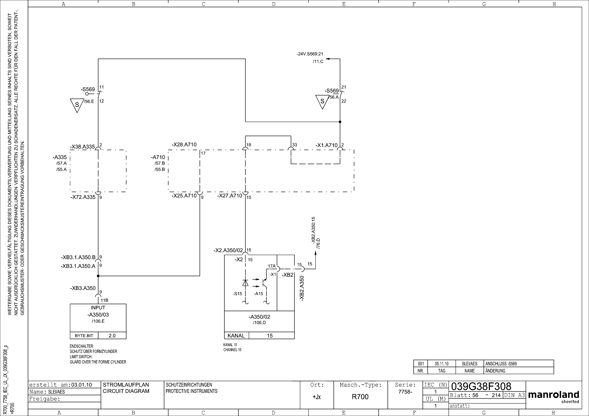

# +Jx — Sheet 56 of 214 — SCHUTZEINRICHTUNGEN

**PROTECTIVE INSTRUMENTS**

> Part of the manroland **R700** printing press IEC/UL circuit diagrams.
> Drawing class: **Stromlaufplan / Circuit diagram** (DIN A3).
> Document `+Jx` covers the **1st printing module + feed register** machine section.

## At a glance

| Field | Value |
|---|---|
| Document | `+Jx`  (039G38F308) |
| Sheet | **56** of 214 |
| Section (DE) | SCHUTZEINRICHTUNGEN |
| Section (EN) | PROTECTIVE INSTRUMENTS |
| Section type | CIRCUIT — Circuit diagram |
| Machine type | `R700` |
| Series | `7758` |
| Created | 03.01.10 |
| Replaces | — |
| Columns used | A, B, C, D, E, F, G |
| Path numbers | — |
| Labels on sheet | 76 |
| Cross-refs out | 10 |
| Cross-refs in | 23 |

**Previous:** [+Jx sheet 55](SHEET_0055.md) · **Next:** [+Jx sheet 57](SHEET_0057.md) · **Document TOC:** [_TOC.md](_TOC.md)  (+Jx) · **Master TOC:** [all sheets](../_MASTER_TOC.md)

## Sheet image (300 DPI, exact vector render)



_Rendered directly from the PDF vector layer at 300 DPI (1-bit), no OCR and no resampling. Use it to confirm anything ambiguous in the text below._

## Cross-references on this sheet

Each entry is a wire leaving this sheet. The printed token is `/sheet.column`; the link resolves to that sheet inside the same document.

| Ref | Target sheet | Col | Path | Destination on target | Target section | From col |
|---|---|---|---|---|---|---|
| `/11.C` | [+Jx sheet 11](SHEET_0011.md) | C | — | — | SPANNUNGSVERSORGUNG, SCHALTSCHRANKBELÜFTUNG | E |
| `/56.A` | [+Jx sheet 56](SHEET_0056.md) | A | — | — | SCHUTZEINRICHTUNGEN | E |
| `/56.E` | [+Jx sheet 56](SHEET_0056.md) | E | — | — | SCHUTZEINRICHTUNGEN | A |
| `/57.A` | [+Jx sheet 57](SHEET_0057.md) | A | — | — | SCHUTZEINRICHTUNGEN | A |
| `/55.A` | [+Jx sheet 55](SHEET_0055.md) | A | — | — | SCHUTZEINRICHTUNGEN | A |
| `/57.B` | [+Jx sheet 57](SHEET_0057.md) | B | — | — | SCHUTZEINRICHTUNGEN | B |
| `/55.B` | [+Jx sheet 55](SHEET_0055.md) | B | — | — | SCHUTZEINRICHTUNGEN | B |
| `/76.D` | [+Jx sheet 76](SHEET_0076.md) | D | — | XB2.A350:15 | BUSVERBINDUNGEN: SICHERHEITSKREIS | E |
| `/106.E` | [+Jx sheet 106](SHEET_0106.md) | E | — | — | REFERENZMODUL | A |
| `/106.D` | [+Jx sheet 106](SHEET_0106.md) | D | — | — | REFERENZMODUL | D |

### Incoming references (sheets that point here)

Every other sheet that sends a wire to this one. `Back-ref` is the token printed on *that* sheet; `Path` is its line number.

| From sheet | Cols | Back-ref | Path | Refs | What continues there |
|---|---|---|---|---|---|
| [+Jx#11](SHEET_0011.md) | C | `/11.C` | — | 1 | 24V.S569:21 24V.S558:21 |
| [+Jx#55](SHEET_0055.md) | A, B | `/55.A`, `/55.B` | — | 2 | — |
| [+Jx#56](SHEET_0056.md) | A, E | `/56.A`, `/56.E` | — | 2 | — |
| [+Jx#57](SHEET_0057.md) | A, B | `/57.A`, `/57.B` | — | 2 | — |
| [+Jx#76](SHEET_0076.md) | D | `/76.D` | — | 1 | XB2.A350:15 |
| [+Jx#106](SHEET_0106.md) | D, E | `/106.D`, `/106.E` | — | 2 | — |
| [+Jx#116](SHEET_0116.md) | A | `/116.A` | — | 1 | — |
| [+Jx#126](SHEET_0126.md) | E | `/126.E` | — | 2 | — |
| [+Jx#128](SHEET_0128.md) | C, D, F | `/128.C`, `/128.D`, `/128.F` | — | 3 | — |
| [+Jx#143](SHEET_0143.md) | A | `/143.A` | — | 1 | — |
| [+Jx#144](SHEET_0144.md) | C | `/144.C` | — | 1 | — |
| [+Jx#146](SHEET_0146.md) | A, B | `/146.A`, `/146.B` | — | 3 | — |
| [+Jx#150](SHEET_0150.md) | A | `/150.A` | — | 1 | — |
| [+Jx#153](SHEET_0153.md) | C | `/153.C` | — | 1 | — |


## Devices on this sheet

| Tag | Class | Class meaning (IEC) | Col | Sub | Terminal | Sign |
|---|---|---|---|---|---|---|
| `A350/03` | A | Baugruppe / assembly, module, PC board | A | 03 | — | — |
| `A335` | A | Baugruppe / assembly, module, PC board | A | — | — | — |
| `A710` | A | Baugruppe / assembly, module, PC board | B | — | — | — |
| `S15` | S | Schalter / switch | C | — | — | — |
| `A15` | A | Baugruppe / assembly, module, PC board | D | — | — | — |
| `X1` | X | Klemme / terminal, plug connector | D | — | — | — |
| `X2` | X | Klemme / terminal, plug connector | D | — | — | — |
| `XB2` | XB |  | D | — | — | — |
| `A350/02` | A | Baugruppe / assembly, module, PC board | D | 02 | — | — |
| `S569` | S | Schalter / switch | A | — | — | — |
| `S569` | S | Schalter / switch | E | — | — | — |
| `2.0` | — | cross-device reference | B | — | — | — |
| `XB3.A350` | — | cross-device reference | A | — | — | — |
| `X72.A335` | — | cross-device reference | A | — | — | — |
| `X38.A335` | — | cross-device reference | A | — | — | — |
| `XB3.1.A350.B` | — | cross-device reference | A | — | — | — |
| `XB3.1.A350.A` | — | cross-device reference | A | — | — | — |
| `X27.A710` | — | cross-device reference | C | — | — | — |
| `X25.A710` | — | cross-device reference | C | — | — | — |
| `XB2.A350` | — | cross-device reference | D | — | — | — |
| `X1.A710` | — | cross-device reference | E | — | — | — |
| `NR.` | — | cross-device reference | F | — | — | — |
| `05.11.10` | — | cross-device reference | F | — | — | — |
| `XB2.A350:15` | — | cross-device reference | E | — | 15 | — |
| `X28.A710` | — | cross-device reference | C | — | — | — |

## Potentials / nets

| Potential | Count | Columns | Attached devices | Terminals |
|---|---|---|---|---|
| `24V` | 1 | E | `S569` | `21` |


A potential such as `L24+/4` or `M24+` is a named supply/return rail; every place it appears on this sheet is electrically common.

## Wire-end annotations (grouped as printed)

A wire that continues elsewhere is annotated with a small cluster: the destination description, the path/line number `#NN`, and the `/sheet.column` cross reference. Each row below is one such cluster exactly as it is grouped on the drawing.

| Col | Y | Path | Cross-ref | Text on the wire |
|---|---|---|---|---|
| E | 105.1 | — | — | `24V.S569:21` |
| E | 120.7 | — | `/11.C` | — |
| C | 172.5 | — | — | `S569 21` |
| B | 172.5 | — | — | `11` |
| E | 178.8 | — | — | `S569` |
| E | 192.6 | — | `/56.A` | — |
| C | 199.4 | — | — | `S S` |
| B | 200.8 | — | — | `12` |
| E | 200.8 | — | — | `22` |
| A | 201.4 | — | `/56.E` | — |
| C | 287.9 | — | — | `X28.A710` |
| A | 289.4 | — | — | `X38.A335 2` |
| D | 289.4 | — | — | `18` |
| E | 289.4 | — | — | `33 X1.A710 2` |
| C | 306.4 | — | — | `A710 17` |
| A | 313.5 | — | — | `A335` |
| A | 326.5 | — | `/57.A`, `/55.A` | — |
| B | 326.5 | — | `/57.B`, `/55.B` | — |
| C | 391.4 | — | — | `X25.A710 9 X27.A710 15` |
| A | 394.2 | — | — | `X72.A335 9` |
| E | 438.8 | — | `/76.D` | `XB2.A350:15` |
| C | 502.0 | — | — | `X2.A350/02 15` |
| A | 516.1 | — | — | `XB3.1.A350.B 9` |
| D | 520.4 | — | — | `X2` |
| D | 521.8 | — | — | `15 15` |
| E | 530.4 | — | — | `15` |
| A | 533.2 | — | — | `XB3.1.A350.A 9` |
| D | 534.6 | — | — | `17A` |
| D | 551.6 | — | — | `X1` |
| D | 551.6 | — | — | `XB2` |
| D | 557.9 | — | — | `XB2.A350` |
| A | 578.5 | — | — | `XB3.A350 9` |
| D | 590.6 | — | — | `S15 A15` |
| B | 604.0 | — | — | `11B` |
| A | 618.5 | — | — | `INPUT` |
| A | 632.4 | — | — | `A350/03` |
| D | 636.6 | — | — | `A350/02` |
| A | 646.1 | — | `/106.E` | — |
| D | 649.0 | — | `/106.D` | — |
| D | 674.9 | — | — | `KANAL 15` |
| A | 675.2 | — | — | `BYTE.BIT 2.0` |
| C | 695.2 | — | — | `KANAL 15 CHANNEL 15` |
| A | 697.9 | — | — | `ENDSCHALTER: LIMIT SWITCH: SCHUTZ ÜBER FORMZYLINDER GUARD OVER THE FORME CYLINDER` |
| G | 733.0 | — | — | `001 05.11.10 SLEI/AES ANSCHLUSS S569` |
| G | 747.1 | — | — | `NR. TAG NAME ÄNDERUNG` |


## Reconstructed tables

This sheet carries tabular content (pin map / terminal assignment / index). The grid below was rebuilt from the drawing's own rule lines, so each row is exactly one physical row of the table.

### Table 1 — 3 data rows × 2 columns (at x=141.7, y=119.1)

| S569 /56.E S X38.A335 X72.A335 XB3.1.A350.B XB3.1.A350.A | 11 12 2 9 9 9 |
|---|---|
| `XB3.A350` | `9 11B` |
| `INPUT` | `A350/03 /106.E` |
| `BYTE.BIT` | `2.0` |


### Table 2 — 5 data rows × 7 columns (at x=403.9, y=119.1) — **/11.C S569 /56.A S**

| 17 |  | 18 |  |  | 33 | X1.A710 |
|---|---|---|---|---|---|---|
| `9` | `X27.A710 X2.A350/02` | `15 15` |  |  | `XB2.A350:15` | `/76.D` |
|  | `X2` | `15` | `17A X1` | `XB2` | `15 15` |  |
|  | `S15` | `A15` |  |  | `XB2.A350` |  |
|  |  | `A350/02 /106.D` |  |  |  |  |
|  | `KANAL` |  | `15` |  |  |  |


## Notes and free text on this sheet

| Text | Col | Y (pt) |
|---|---|---|
| `11B` | B | 604.01 |
| `INPUT` | A | 618.53 |
| `BYTE.BIT` | A | 675.79 |
| `ENDSCHALTER:` | A | 697.9 |
| `SCHUTZ ÜBER FORMZYLINDER` | A | 708.56 |
| `LIMIT SWITCH:` | A | 719.11 |
| `GUARD OVER THE FORME CYLINDER` | A | 729.82 |
| `KANAL 15` | C | 695.23 |
| `CHANNEL 15` | C | 705.17 |
| `17A` | D | 534.56 |
| `KANAL` | C | 674.88 |
| `X2.A350/02` | C | 501.97 |
| `TAG` | F | 747.23 |
| `NAME` | G | 747.22 |
| `ÄNDERUNG` | G | 747.25 |
| `SLEI/AES` | G | 733.09 |
| `ANSCHLUSS S569` | G | 733.09 |
| `S` | A | 206.52 |
| `S` | E | 199.43 |

## Complete label inventory (exact text from the drawing)

Every text object inside the drawing area of this sheet, in DIN reading order (column A→H, then top→bottom). This is the authoritative list: if a string is not here it is not printed on this sheet.

| Col | Y | X | Dir | Type | Text |
|---|---|---|---|---|---|
| A | 176.0 | 163.3 | → | device tag | `S569` |
| A | 201.5 | 169.5 | → | cross-reference | `/56.E` |
| A | 206.5 | 151.8 | → | text | `S` |
| A | 292.2 | 141.4 | → | device ref | `X38.A335` |
| A | 313.5 | 106.6 | → | device tag | `A335` |
| A | 326.5 | 114.0 | → | cross-reference | `/57.A` |
| A | 338.9 | 114.0 | → | cross-reference | `/55.A` |
| A | 394.3 | 142.9 | → | device ref | `X72.A335` |
| A | 516.2 | 123.3 | → | device ref | `XB3.1.A350.B` |
| A | 533.9 | 122.7 | → | device ref | `XB3.1.A350.A` |
| A | 578.5 | 142.0 | → | device ref | `XB3.A350` |
| A | 618.5 | 183.5 | → | text | `INPUT` |
| A | 632.4 | 176.9 | → | device tag | `A350/03` |
| A | 646.2 | 185.8 | → | cross-reference | `/106.E` |
| A | 675.8 | 151.7 | → | text | `BYTE.BIT` |
| A | 697.9 | 141.2 | → | text | `ENDSCHALTER:` |
| A | 708.6 | 141.4 | → | text | `SCHUTZ ÜBER FORMZYLINDER` |
| A | 719.1 | 141.2 | → | text | `LIMIT SWITCH:` |
| A | 729.8 | 141.4 | → | text | `GUARD OVER THE FORME CYLINDER` |
| B | 172.5 | 200.4 | → | number | `11` |
| B | 200.8 | 200.4 | → | number | `12` |
| B | 289.4 | 201.3 | → | number | `2` |
| B | 313.5 | 305.3 | → | device tag | `A710` |
| B | 326.5 | 312.7 | → | cross-reference | `/57.B` |
| B | 338.9 | 312.7 | → | cross-reference | `/55.B` |
| B | 395.7 | 201.0 | → | number | `9` |
| B | 516.2 | 201.0 | → | number | `9` |
| B | 533.2 | 201.0 | → | number | `9` |
| B | 587.0 | 201.0 | → | number | `9` |
| B | 604.0 | 203.2 | → | text | `11B` |
| B | 675.2 | 220.0 | → | device ref | `2.0` |
| C | 288.0 | 347.2 | → | device ref | `X28.A710` |
| C | 306.4 | 405.9 | → | number | `17` |
| C | 391.4 | 347.2 | → | device ref | `X25.A710` |
| C | 391.4 | 439.4 | → | device ref | `X27.A710` |
| C | 395.7 | 406.5 | → | number | `9` |
| C | 502.0 | 432.0 | → | text | `X2.A350/02` |
| C | 590.6 | 470.8 | → | device tag | `S15` |
| C | 674.9 | 460.1 | → | text | `KANAL` |
| C | 695.2 | 451.6 | → | text | `KANAL 15` |
| C | 705.2 | 451.8 | → | text | `CHANNEL 15` |
| D | 289.4 | 498.0 | → | number | `18` |
| D | 289.4 | 590.7 | → | number | `33` |
| D | 395.7 | 498.0 | → | number | `15` |
| D | 502.0 | 498.0 | → | number | `15` |
| D | 520.4 | 474.5 | → | device tag | `X2` |
| D | 521.8 | 500.9 | → | number | `15` |
| D | 531.8 | 600.1 | → | number | `15` |
| D | 534.6 | 541.4 | → | text | `17A` |
| D | 551.6 | 544.8 | → | device tag | `X1` |
| D | 551.6 | 569.5 | → | device tag | `XB2` |
| D | 557.9 | 605.4 | ↕ | device ref | `XB2.A350` |
| D | 590.6 | 513.4 | → | device tag | `A15` |
| D | 636.6 | 503.0 | → | device tag | `A350/02` |
| D | 649.0 | 511.7 | → | cross-reference | `/106.D` |
| D | 674.8 | 539.3 | → | number | `15` |
| E | 105.1 | 599.8 | → | potential | `24V.S569:21` |
| E | 120.7 | 632.7 | → | cross-reference | `/11.C` |
| E | 172.5 | 690.2 | → | number | `21` |
| E | 178.8 | 656.5 | → | device tag | `S569` |
| E | 192.6 | 663.9 | → | cross-reference | `/56.A` |
| E | 199.4 | 647.9 | → | text | `S` |
| E | 200.8 | 690.2 | → | number | `22` |
| E | 289.4 | 638.1 | → | device ref | `X1.A710` |
| E | 289.4 | 690.2 | → | number | `2` |
| E | 438.8 | 629.5 | ↕ | device ref | `XB2.A350:15` |
| E | 482.2 | 639.4 | ↕ | cross-reference | `/76.D` |
| E | 530.3 | 621.4 | → | number | `15` |
| F | 733.0 | 845.1 | → | number | `001` |
| F | 733.1 | 879.3 | → | device ref | `05.11.10` |
| F | 747.1 | 844.3 | → | device ref | `NR.` |
| F | 747.2 | 886.0 | → | text | `TAG` |
| G | 733.1 | 934.1 | → | text | `SLEI/AES` |
| G | 733.1 | 981.5 | → | text | `ANSCHLUSS S569` |
| G | 747.2 | 939.3 | → | text | `NAME` |
| G | 747.3 | 981.5 | → | text | `ÄNDERUNG` |

## Reading-order text block

The same content as a plain block, grouped by DIN column — convenient to paste or to match against a visual description.

```text
=== Column A ===
 176.0  163.3  devtag       S569
 201.5  169.5  xref         /56.E
 206.5  151.8  text         S
 292.2  141.4  devref       X38.A335
 313.5  106.6  devtag       A335
 326.5  114.0  xref         /57.A
 338.9  114.0  xref         /55.A
 394.3  142.9  devref       X72.A335
 516.2  123.3  devref       XB3.1.A350.B
 533.9  122.7  devref       XB3.1.A350.A
 578.5  142.0  devref       XB3.A350
 618.5  183.5  text         INPUT
 632.4  176.9  devtag       A350/03
 646.2  185.8  xref         /106.E
 675.8  151.7  text         BYTE.BIT
 697.9  141.2  text         ENDSCHALTER:
 708.6  141.4  text         SCHUTZ ÜBER FORMZYLINDER
 719.1  141.2  text         LIMIT SWITCH:
 729.8  141.4  text         GUARD OVER THE FORME CYLINDER
=== Column B ===
 172.5  200.4  numeric      11
 200.8  200.4  numeric      12
 289.4  201.3  numeric      2
 313.5  305.3  devtag       A710
 326.5  312.7  xref         /57.B
 338.9  312.7  xref         /55.B
 395.7  201.0  numeric      9
 516.2  201.0  numeric      9
 533.2  201.0  numeric      9
 587.0  201.0  numeric      9
 604.0  203.2  text         11B
 675.2  220.0  devref       2.0
=== Column C ===
 288.0  347.2  devref       X28.A710
 306.4  405.9  numeric      17
 391.4  347.2  devref       X25.A710
 391.4  439.4  devref       X27.A710
 395.7  406.5  numeric      9
 502.0  432.0  text         X2.A350/02
 590.6  470.8  devtag       S15
 674.9  460.1  text         KANAL
 695.2  451.6  text         KANAL 15
 705.2  451.8  text         CHANNEL 15
=== Column D ===
 289.4  498.0  numeric      18
 289.4  590.7  numeric      33
 395.7  498.0  numeric      15
 502.0  498.0  numeric      15
 520.4  474.5  devtag       X2
 521.8  500.9  numeric      15
 531.8  600.1  numeric      15
 534.6  541.4  text         17A
 551.6  544.8  devtag       X1
 551.6  569.5  devtag       XB2
 557.9  605.4  devref       XB2.A350
 590.6  513.4  devtag       A15
 636.6  503.0  devtag       A350/02
 649.0  511.7  xref         /106.D
 674.8  539.3  numeric      15
=== Column E ===
 105.1  599.8  net          24V.S569:21
 120.7  632.7  xref         /11.C
 172.5  690.2  numeric      21
 178.8  656.5  devtag       S569
 192.6  663.9  xref         /56.A
 199.4  647.9  text         S
 200.8  690.2  numeric      22
 289.4  638.1  devref       X1.A710
 289.4  690.2  numeric      2
 438.8  629.5  devref       XB2.A350:15
 482.2  639.4  xref         /76.D
 530.3  621.4  numeric      15
=== Column F ===
 733.0  845.1  numeric      001
 733.1  879.3  devref       05.11.10
 747.1  844.3  devref       NR.
 747.2  886.0  text         TAG
=== Column G ===
 733.1  934.1  text         SLEI/AES
 733.1  981.5  text         ANSCHLUSS S569
 747.2  939.3  text         NAME
 747.3  981.5  text         ÄNDERUNG
```

---
_Generated from the PDF vector text layer; no OCR. Source: `R700_7758_IEC_UL_JX_039G38F308_p`, sheet 56._
