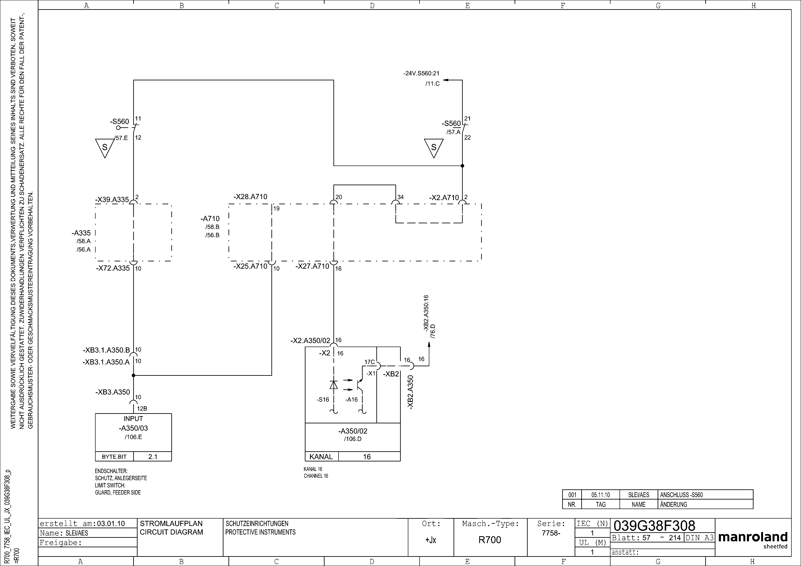

# +Jx — Sheet 57 of 214 — SCHUTZEINRICHTUNGEN

**PROTECTIVE INSTRUMENTS**

> Part of the manroland **R700** printing press IEC/UL circuit diagrams.
> Drawing class: **Stromlaufplan / Circuit diagram** (DIN A3).
> Document `+Jx` covers the **1st printing module + feed register** machine section.

## At a glance

| Field | Value |
|---|---|
| Document | `+Jx`  (039G38F308) |
| Sheet | **57** of 214 |
| Section (DE) | SCHUTZEINRICHTUNGEN |
| Section (EN) | PROTECTIVE INSTRUMENTS |
| Section type | CIRCUIT — Circuit diagram |
| Machine type | `R700` |
| Series | `7758` |
| Created | 03.01.10 |
| Replaces | — |
| Columns used | A, B, C, D, E, F, G |
| Path numbers | — |
| Labels on sheet | 76 |
| Cross-refs out | 10 |
| Cross-refs in | 23 |

**Previous:** [+Jx sheet 56](SHEET_0056.md) · **Next:** [+Jx sheet 58](SHEET_0058.md) · **Document TOC:** [_TOC.md](_TOC.md)  (+Jx) · **Master TOC:** [all sheets](../_MASTER_TOC.md)

## Sheet image (300 DPI, exact vector render)



_Rendered directly from the PDF vector layer at 300 DPI (1-bit), no OCR and no resampling. Use it to confirm anything ambiguous in the text below._

## Cross-references on this sheet

Each entry is a wire leaving this sheet. The printed token is `/sheet.column`; the link resolves to that sheet inside the same document.

| Ref | Target sheet | Col | Path | Destination on target | Target section | From col |
|---|---|---|---|---|---|---|
| `/11.C` | [+Jx sheet 11](SHEET_0011.md) | C | — | — | SPANNUNGSVERSORGUNG, SCHALTSCHRANKBELÜFTUNG | E |
| `/57.A` | [+Jx sheet 57](SHEET_0057.md) | A | — | — | SCHUTZEINRICHTUNGEN | E |
| `/57.E` | [+Jx sheet 57](SHEET_0057.md) | E | — | — | SCHUTZEINRICHTUNGEN | A |
| `/58.B` | [+Jx sheet 58](SHEET_0058.md) | B | — | — | SCHUTZEINRICHTUNGEN | B |
| `/56.B` | [+Jx sheet 56](SHEET_0056.md) | B | — | — | SCHUTZEINRICHTUNGEN | B |
| `/58.A` | [+Jx sheet 58](SHEET_0058.md) | A | — | — | SCHUTZEINRICHTUNGEN | A |
| `/56.A` | [+Jx sheet 56](SHEET_0056.md) | A | — | — | SCHUTZEINRICHTUNGEN | A |
| `/76.D` | [+Jx sheet 76](SHEET_0076.md) | D | — | XB2.A350:16 | BUSVERBINDUNGEN: SICHERHEITSKREIS | E |
| `/106.E` | [+Jx sheet 106](SHEET_0106.md) | E | — | — | REFERENZMODUL | A |
| `/106.D` | [+Jx sheet 106](SHEET_0106.md) | D | — | — | REFERENZMODUL | D |

### Incoming references (sheets that point here)

Every other sheet that sends a wire to this one. `Back-ref` is the token printed on *that* sheet; `Path` is its line number.

| From sheet | Cols | Back-ref | Path | Refs | What continues there |
|---|---|---|---|---|---|
| [+Jx#11](SHEET_0011.md) | C | `/11.C` | — | 1 | 24V.S560:21 |
| [+Jx#56](SHEET_0056.md) | A, B | `/56.A`, `/56.B` | — | 2 | — |
| [+Jx#57](SHEET_0057.md) | A, E | `/57.A`, `/57.E` | — | 2 | — |
| [+Jx#58](SHEET_0058.md) | A, B | `/58.A`, `/58.B` | — | 2 | — |
| [+Jx#76](SHEET_0076.md) | D | `/76.D` | — | 1 | XB2.A350:16 |
| [+Jx#106](SHEET_0106.md) | D, E | `/106.D`, `/106.E` | — | 2 | — |
| [+Jx#126](SHEET_0126.md) | E | `/126.E` | — | 2 | — |
| [+Jx#127](SHEET_0127.md) | B | `/127.B` | — | 1 | — |
| [+Jx#128](SHEET_0128.md) | C, D, F | `/128.C`, `/128.D`, `/128.F` | — | 3 | — |
| [+Jx#143](SHEET_0143.md) | A | `/143.A` | — | 1 | — |
| [+Jx#144](SHEET_0144.md) | C | `/144.C` | — | 1 | — |
| [+Jx#146](SHEET_0146.md) | A, B | `/146.A`, `/146.B` | — | 3 | — |
| [+Jx#150](SHEET_0150.md) | B | `/150.B` | — | 1 | — |
| [+Jx#153](SHEET_0153.md) | C | `/153.C` | — | 1 | — |


## Devices on this sheet

| Tag | Class | Class meaning (IEC) | Col | Sub | Terminal | Sign |
|---|---|---|---|---|---|---|
| `A350/03` | A | Baugruppe / assembly, module, PC board | A | 03 | — | — |
| `A335` | A | Baugruppe / assembly, module, PC board | A | — | — | — |
| `A710` | A | Baugruppe / assembly, module, PC board | B | — | — | — |
| `S16` | S | Schalter / switch | C | — | — | — |
| `A16` | A | Baugruppe / assembly, module, PC board | D | — | — | — |
| `X1` | X | Klemme / terminal, plug connector | D | — | — | — |
| `X2` | X | Klemme / terminal, plug connector | D | — | — | — |
| `XB2` | XB |  | D | — | — | — |
| `A350/02` | A | Baugruppe / assembly, module, PC board | D | 02 | — | — |
| `S560` | S | Schalter / switch | A | — | — | — |
| `S560` | S | Schalter / switch | E | — | — | — |
| `2.1` | — | cross-device reference | B | — | — | — |
| `XB3.A350` | — | cross-device reference | A | — | — | — |
| `X72.A335` | — | cross-device reference | A | — | — | — |
| `X39.A335` | — | cross-device reference | A | — | — | — |
| `X27.A710` | — | cross-device reference | C | — | — | — |
| `X25.A710` | — | cross-device reference | C | — | — | — |
| `XB2.A350` | — | cross-device reference | D | — | — | — |
| `X2.A710` | — | cross-device reference | E | — | — | — |
| `XB3.1.A350.B` | — | cross-device reference | A | — | — | — |
| `XB3.1.A350.A` | — | cross-device reference | A | — | — | — |
| `NR.` | — | cross-device reference | F | — | — | — |
| `05.11.10` | — | cross-device reference | F | — | — | — |
| `XB2.A350:16` | — | cross-device reference | E | — | 16 | — |
| `X28.A710` | — | cross-device reference | C | — | — | — |

## Potentials / nets

| Potential | Count | Columns | Attached devices | Terminals |
|---|---|---|---|---|
| `24V` | 1 | E | `S560` | `21` |


A potential such as `L24+/4` or `M24+` is a named supply/return rail; every place it appears on this sheet is electrically common.

## Wire-end annotations (grouped as printed)

A wire that continues elsewhere is annotated with a small cluster: the destination description, the path/line number `#NN`, and the `/sheet.column` cross reference. Each row below is one such cluster exactly as it is grouped on the drawing.

| Col | Y | Path | Cross-ref | Text on the wire |
|---|---|---|---|---|
| E | 105.1 | — | — | `24V.S560:21` |
| E | 120.7 | — | `/11.C` | — |
| C | 172.5 | — | — | `S560 21` |
| B | 172.5 | — | — | `11` |
| E | 178.8 | — | — | `S560` |
| E | 192.6 | — | `/57.A` | — |
| B | 200.8 | — | — | `12` |
| E | 200.8 | — | — | `22` |
| A | 201.4 | — | `/57.E` | — |
| C | 213.6 | — | — | `S S` |
| C | 287.9 | — | — | `X28.A710` |
| A | 289.4 | — | — | `X39.A335 2` |
| D | 289.4 | — | — | `20` |
| E | 289.4 | — | — | `34 X2.A710 2` |
| C | 306.4 | — | — | `A710 19` |
| B | 333.6 | — | `/58.B`, `/56.B` | — |
| A | 341.8 | — | — | `A335` |
| A | 354.9 | — | `/58.A`, `/56.A` | — |
| C | 391.4 | — | — | `X25.A710 10 X27.A710 16` |
| A | 394.2 | — | — | `X72.A335 10` |
| E | 438.8 | — | `/76.D` | `XB2.A350:16` |
| C | 502.0 | — | — | `X2.A350/02 16` |
| A | 516.1 | — | — | `XB3.1.A350.B 10` |
| D | 520.4 | — | — | `X2` |
| D | 521.8 | — | — | `16 16` |
| E | 530.4 | — | — | `16` |
| A | 533.2 | — | — | `XB3.1.A350.A 10` |
| D | 534.6 | — | — | `17C` |
| D | 551.6 | — | — | `X1` |
| D | 551.6 | — | — | `XB2` |
| D | 557.9 | — | — | `XB2.A350` |
| A | 578.5 | — | — | `XB3.A350 10` |
| D | 590.6 | — | — | `S16 A16` |
| B | 604.0 | — | — | `12B` |
| A | 618.5 | — | — | `INPUT` |
| A | 632.4 | — | — | `A350/03` |
| D | 636.6 | — | — | `A350/02` |
| A | 646.1 | — | `/106.E` | — |
| D | 649.0 | — | `/106.D` | — |
| D | 674.9 | — | — | `KANAL 16` |
| A | 675.2 | — | — | `BYTE.BIT 2.1` |
| C | 695.2 | — | — | `KANAL 16 CHANNEL 16` |
| A | 697.9 | — | — | `ENDSCHALTER: LIMIT SWITCH: SCHUTZ, ANLEGERSEITE GUARD, FEEDER SIDE` |
| G | 733.0 | — | — | `001 05.11.10 SLEI/AES ANSCHLUSS S560` |
| G | 747.1 | — | — | `NR. TAG NAME ÄNDERUNG` |


## Reconstructed tables

This sheet carries tabular content (pin map / terminal assignment / index). The grid below was rebuilt from the drawing's own rule lines, so each row is exactly one physical row of the table.

### Table 1 — 3 data rows × 2 columns (at x=141.7, y=119.1)

| S560 /57.E S X39.A335 X72.A335 XB3.1.A350.B XB3.1.A350.A | 11 12 2 10 10 10 |
|---|---|
| `XB3.A350` | `10 12B` |
| `INPUT` | `A350/03 /106.E` |
| `BYTE.BIT` | `2.1` |


### Table 2 — 5 data rows × 7 columns (at x=403.9, y=119.1) — **/11.C S560 /57.A S**

| 19 |  | 20 |  |  | 34 | X2.A710 |
|---|---|---|---|---|---|---|
| `10` | `X27.A710 X2.A350/02` | `16 16` |  |  | `XB2.A350:16` | `/76.D` |
|  | `X2` | `16` | `17C X1` | `XB2` | `16 16` |  |
|  | `S16` | `A16` |  |  | `XB2.A350` |  |
|  |  | `A350/02 /106.D` |  |  |  |  |
|  | `KANAL` |  | `16` |  |  |  |


## Notes and free text on this sheet

| Text | Col | Y (pt) |
|---|---|---|
| `12B` | B | 604.01 |
| `INPUT` | A | 618.53 |
| `BYTE.BIT` | A | 675.79 |
| `ENDSCHALTER:` | A | 697.9 |
| `SCHUTZ, ANLEGERSEITE` | A | 708.53 |
| `LIMIT SWITCH:` | A | 719.11 |
| `GUARD, FEEDER SIDE` | A | 729.8 |
| `KANAL 16` | C | 695.23 |
| `CHANNEL 16` | C | 705.17 |
| `17C` | D | 534.6 |
| `KANAL` | C | 674.88 |
| `X2.A350/02` | C | 501.97 |
| `TAG` | F | 747.23 |
| `NAME` | G | 747.22 |
| `ÄNDERUNG` | G | 747.25 |
| `SLEI/AES` | G | 733.09 |
| `ANSCHLUSS S560` | G | 733.09 |
| `S` | A | 213.61 |
| `S` | E | 213.61 |

## Complete label inventory (exact text from the drawing)

Every text object inside the drawing area of this sheet, in DIN reading order (column A→H, then top→bottom). This is the authoritative list: if a string is not here it is not printed on this sheet.

| Col | Y | X | Dir | Type | Text |
|---|---|---|---|---|---|
| A | 176.0 | 163.6 | → | device tag | `S560` |
| A | 201.5 | 169.5 | → | cross-reference | `/57.E` |
| A | 213.6 | 151.8 | → | text | `S` |
| A | 292.2 | 141.4 | → | device ref | `X39.A335` |
| A | 341.8 | 106.6 | → | device tag | `A335` |
| A | 354.9 | 114.0 | → | cross-reference | `/58.A` |
| A | 367.3 | 114.0 | → | cross-reference | `/56.A` |
| A | 394.3 | 142.9 | → | device ref | `X72.A335` |
| A | 516.2 | 123.3 | → | device ref | `XB3.1.A350.B` |
| A | 533.9 | 122.7 | → | device ref | `XB3.1.A350.A` |
| A | 578.5 | 142.0 | → | device ref | `XB3.A350` |
| A | 618.5 | 183.5 | → | text | `INPUT` |
| A | 632.4 | 176.9 | → | device tag | `A350/03` |
| A | 646.2 | 185.8 | → | cross-reference | `/106.E` |
| A | 675.8 | 151.7 | → | text | `BYTE.BIT` |
| A | 697.9 | 141.2 | → | text | `ENDSCHALTER:` |
| A | 708.5 | 141.4 | → | text | `SCHUTZ, ANLEGERSEITE` |
| A | 719.1 | 141.2 | → | text | `LIMIT SWITCH:` |
| A | 729.8 | 141.4 | → | text | `GUARD, FEEDER SIDE` |
| B | 172.5 | 200.4 | → | number | `11` |
| B | 200.8 | 200.4 | → | number | `12` |
| B | 289.4 | 201.3 | → | number | `2` |
| B | 320.5 | 298.2 | → | device tag | `A710` |
| B | 333.6 | 305.6 | → | cross-reference | `/58.B` |
| B | 346.0 | 305.6 | → | cross-reference | `/56.B` |
| B | 395.7 | 200.4 | → | number | `10` |
| B | 516.2 | 200.4 | → | number | `10` |
| B | 533.2 | 200.4 | → | number | `10` |
| B | 587.0 | 200.4 | → | number | `10` |
| B | 604.0 | 203.2 | → | text | `12B` |
| B | 675.2 | 220.7 | → | device ref | `2.1` |
| C | 288.0 | 347.2 | → | device ref | `X28.A710` |
| C | 306.4 | 405.9 | → | number | `19` |
| C | 391.4 | 347.2 | → | device ref | `X25.A710` |
| C | 391.4 | 439.4 | → | device ref | `X27.A710` |
| C | 395.7 | 405.9 | → | number | `10` |
| C | 502.0 | 432.0 | → | text | `X2.A350/02` |
| C | 590.6 | 470.8 | → | device tag | `S16` |
| C | 674.9 | 460.1 | → | text | `KANAL` |
| C | 695.2 | 451.6 | → | text | `KANAL 16` |
| C | 705.2 | 451.8 | → | text | `CHANNEL 16` |
| D | 289.4 | 498.9 | → | number | `20` |
| D | 289.4 | 590.7 | → | number | `34` |
| D | 395.7 | 498.0 | → | number | `16` |
| D | 502.0 | 498.0 | → | number | `16` |
| D | 520.4 | 474.5 | → | device tag | `X2` |
| D | 521.8 | 500.9 | → | number | `16` |
| D | 531.8 | 600.1 | → | number | `16` |
| D | 534.6 | 541.4 | → | text | `17C` |
| D | 551.6 | 544.8 | → | device tag | `X1` |
| D | 551.6 | 569.5 | → | device tag | `XB2` |
| D | 557.9 | 605.4 | ↕ | device ref | `XB2.A350` |
| D | 590.6 | 513.4 | → | device tag | `A16` |
| D | 636.6 | 503.0 | → | device tag | `A350/02` |
| D | 649.0 | 511.7 | → | cross-reference | `/106.D` |
| D | 674.8 | 539.3 | → | number | `16` |
| E | 105.1 | 599.8 | → | potential | `24V.S560:21` |
| E | 120.7 | 632.7 | → | cross-reference | `/11.C` |
| E | 172.5 | 690.2 | → | number | `21` |
| E | 178.8 | 656.8 | → | device tag | `S560` |
| E | 192.6 | 663.9 | → | cross-reference | `/57.A` |
| E | 200.8 | 690.2 | → | number | `22` |
| E | 213.6 | 640.8 | → | text | `S` |
| E | 289.4 | 638.1 | → | device ref | `X2.A710` |
| E | 289.4 | 690.2 | → | number | `2` |
| E | 438.8 | 629.5 | ↕ | device ref | `XB2.A350:16` |
| E | 482.2 | 639.4 | ↕ | cross-reference | `/76.D` |
| E | 530.3 | 621.4 | → | number | `16` |
| F | 733.0 | 845.1 | → | number | `001` |
| F | 733.1 | 879.3 | → | device ref | `05.11.10` |
| F | 747.1 | 844.3 | → | device ref | `NR.` |
| F | 747.2 | 886.0 | → | text | `TAG` |
| G | 733.1 | 934.1 | → | text | `SLEI/AES` |
| G | 733.1 | 981.5 | → | text | `ANSCHLUSS S560` |
| G | 747.2 | 939.3 | → | text | `NAME` |
| G | 747.3 | 981.5 | → | text | `ÄNDERUNG` |

## Reading-order text block

The same content as a plain block, grouped by DIN column — convenient to paste or to match against a visual description.

```text
=== Column A ===
 176.0  163.6  devtag       S560
 201.5  169.5  xref         /57.E
 213.6  151.8  text         S
 292.2  141.4  devref       X39.A335
 341.8  106.6  devtag       A335
 354.9  114.0  xref         /58.A
 367.3  114.0  xref         /56.A
 394.3  142.9  devref       X72.A335
 516.2  123.3  devref       XB3.1.A350.B
 533.9  122.7  devref       XB3.1.A350.A
 578.5  142.0  devref       XB3.A350
 618.5  183.5  text         INPUT
 632.4  176.9  devtag       A350/03
 646.2  185.8  xref         /106.E
 675.8  151.7  text         BYTE.BIT
 697.9  141.2  text         ENDSCHALTER:
 708.5  141.4  text         SCHUTZ, ANLEGERSEITE
 719.1  141.2  text         LIMIT SWITCH:
 729.8  141.4  text         GUARD, FEEDER SIDE
=== Column B ===
 172.5  200.4  numeric      11
 200.8  200.4  numeric      12
 289.4  201.3  numeric      2
 320.5  298.2  devtag       A710
 333.6  305.6  xref         /58.B
 346.0  305.6  xref         /56.B
 395.7  200.4  numeric      10
 516.2  200.4  numeric      10
 533.2  200.4  numeric      10
 587.0  200.4  numeric      10
 604.0  203.2  text         12B
 675.2  220.7  devref       2.1
=== Column C ===
 288.0  347.2  devref       X28.A710
 306.4  405.9  numeric      19
 391.4  347.2  devref       X25.A710
 391.4  439.4  devref       X27.A710
 395.7  405.9  numeric      10
 502.0  432.0  text         X2.A350/02
 590.6  470.8  devtag       S16
 674.9  460.1  text         KANAL
 695.2  451.6  text         KANAL 16
 705.2  451.8  text         CHANNEL 16
=== Column D ===
 289.4  498.9  numeric      20
 289.4  590.7  numeric      34
 395.7  498.0  numeric      16
 502.0  498.0  numeric      16
 520.4  474.5  devtag       X2
 521.8  500.9  numeric      16
 531.8  600.1  numeric      16
 534.6  541.4  text         17C
 551.6  544.8  devtag       X1
 551.6  569.5  devtag       XB2
 557.9  605.4  devref       XB2.A350
 590.6  513.4  devtag       A16
 636.6  503.0  devtag       A350/02
 649.0  511.7  xref         /106.D
 674.8  539.3  numeric      16
=== Column E ===
 105.1  599.8  net          24V.S560:21
 120.7  632.7  xref         /11.C
 172.5  690.2  numeric      21
 178.8  656.8  devtag       S560
 192.6  663.9  xref         /57.A
 200.8  690.2  numeric      22
 213.6  640.8  text         S
 289.4  638.1  devref       X2.A710
 289.4  690.2  numeric      2
 438.8  629.5  devref       XB2.A350:16
 482.2  639.4  xref         /76.D
 530.3  621.4  numeric      16
=== Column F ===
 733.0  845.1  numeric      001
 733.1  879.3  devref       05.11.10
 747.1  844.3  devref       NR.
 747.2  886.0  text         TAG
=== Column G ===
 733.1  934.1  text         SLEI/AES
 733.1  981.5  text         ANSCHLUSS S560
 747.2  939.3  text         NAME
 747.3  981.5  text         ÄNDERUNG
```

---
_Generated from the PDF vector text layer; no OCR. Source: `R700_7758_IEC_UL_JX_039G38F308_p`, sheet 57._
