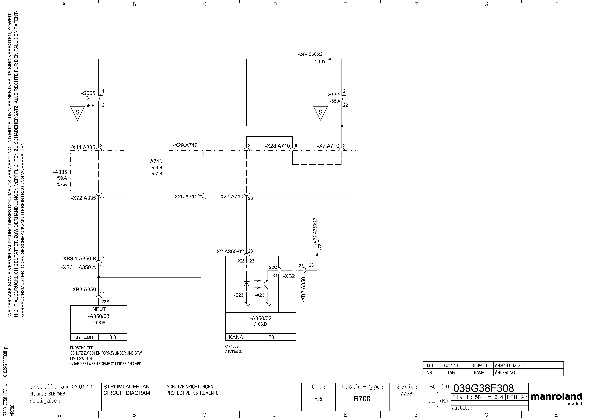

# +Jx — Sheet 58 of 214 — SCHUTZEINRICHTUNGEN

**PROTECTIVE INSTRUMENTS**

> Part of the manroland **R700** printing press IEC/UL circuit diagrams.
> Drawing class: **Stromlaufplan / Circuit diagram** (DIN A3).
> Document `+Jx` covers the **1st printing module + feed register** machine section.

## At a glance

| Field | Value |
|---|---|
| Document | `+Jx`  (039G38F308) |
| Sheet | **58** of 214 |
| Section (DE) | SCHUTZEINRICHTUNGEN |
| Section (EN) | PROTECTIVE INSTRUMENTS |
| Section type | CIRCUIT — Circuit diagram |
| Machine type | `R700` |
| Series | `7758` |
| Created | 03.01.10 |
| Replaces | — |
| Columns used | A, B, C, D, E, F, G |
| Path numbers | — |
| Labels on sheet | 77 |
| Cross-refs out | 10 |
| Cross-refs in | 23 |

**Previous:** [+Jx sheet 57](SHEET_0057.md) · **Next:** [+Jx sheet 59](SHEET_0059.md) · **Document TOC:** [_TOC.md](_TOC.md)  (+Jx) · **Master TOC:** [all sheets](../_MASTER_TOC.md)

## Sheet image (300 DPI, exact vector render)



_Rendered directly from the PDF vector layer at 300 DPI (1-bit), no OCR and no resampling. Use it to confirm anything ambiguous in the text below._

## Cross-references on this sheet

Each entry is a wire leaving this sheet. The printed token is `/sheet.column`; the link resolves to that sheet inside the same document.

| Ref | Target sheet | Col | Path | Destination on target | Target section | From col |
|---|---|---|---|---|---|---|
| `/11.D` | [+Jx sheet 11](SHEET_0011.md) | D | — | — | SPANNUNGSVERSORGUNG, SCHALTSCHRANKBELÜFTUNG | E |
| `/58.A` | [+Jx sheet 58](SHEET_0058.md) | A | — | — | SCHUTZEINRICHTUNGEN | E |
| `/58.E` | [+Jx sheet 58](SHEET_0058.md) | E | — | — | SCHUTZEINRICHTUNGEN | A |
| `/59.B` | [+Jx sheet 59](SHEET_0059.md) | B | — | — | SCHUTZEINRICHTUNGEN | B |
| `/57.B` | [+Jx sheet 57](SHEET_0057.md) | B | — | — | SCHUTZEINRICHTUNGEN | B |
| `/59.A` | [+Jx sheet 59](SHEET_0059.md) | A | — | — | SCHUTZEINRICHTUNGEN | A |
| `/57.A` | [+Jx sheet 57](SHEET_0057.md) | A | — | — | SCHUTZEINRICHTUNGEN | A |
| `/76.E` | [+Jx sheet 76](SHEET_0076.md) | E | — | XB2.A350:23 | BUSVERBINDUNGEN: SICHERHEITSKREIS | E |
| `/106.E` | [+Jx sheet 106](SHEET_0106.md) | E | — | — | REFERENZMODUL | A |
| `/106.D` | [+Jx sheet 106](SHEET_0106.md) | D | — | — | REFERENZMODUL | D |

### Incoming references (sheets that point here)

Every other sheet that sends a wire to this one. `Back-ref` is the token printed on *that* sheet; `Path` is its line number.

| From sheet | Cols | Back-ref | Path | Refs | What continues there |
|---|---|---|---|---|---|
| [+Jx#11](SHEET_0011.md) | D | `/11.D` | — | 1 | 24V.S565:21 |
| [+Jx#57](SHEET_0057.md) | A, B | `/57.A`, `/57.B` | — | 2 | — |
| [+Jx#58](SHEET_0058.md) | A, E | `/58.A`, `/58.E` | — | 2 | — |
| [+Jx#59](SHEET_0059.md) | A, B | `/59.A`, `/59.B` | — | 2 | — |
| [+Jx#76](SHEET_0076.md) | E | `/76.E` | — | 1 | XB2.A350:23 |
| [+Jx#106](SHEET_0106.md) | D, E | `/106.D`, `/106.E` | — | 2 | — |
| [+Jx#126](SHEET_0126.md) | F | `/126.F` | — | 2 | — |
| [+Jx#128](SHEET_0128.md) | C, D, F | `/128.C`, `/128.D`, `/128.F` | — | 3 | — |
| [+Jx#133](SHEET_0133.md) | E | `/133.E` | — | 1 | — |
| [+Jx#143](SHEET_0143.md) | A | `/143.A` | — | 1 | — |
| [+Jx#144](SHEET_0144.md) | D | `/144.D` | — | 1 | — |
| [+Jx#146](SHEET_0146.md) | B | `/146.B` | — | 1 | — |
| [+Jx#147](SHEET_0147.md) | B | `/147.B` | — | 2 | — |
| [+Jx#150](SHEET_0150.md) | F | `/150.F` | — | 1 | — |
| [+Jx#153](SHEET_0153.md) | C | `/153.C` | — | 1 | — |


## Devices on this sheet

| Tag | Class | Class meaning (IEC) | Col | Sub | Terminal | Sign |
|---|---|---|---|---|---|---|
| `A350/03` | A | Baugruppe / assembly, module, PC board | A | 03 | — | — |
| `A335` | A | Baugruppe / assembly, module, PC board | A | — | — | — |
| `A710` | A | Baugruppe / assembly, module, PC board | B | — | — | — |
| `S23` | S | Schalter / switch | C | — | — | — |
| `A23` | A | Baugruppe / assembly, module, PC board | D | — | — | — |
| `X1` | X | Klemme / terminal, plug connector | D | — | — | — |
| `X2` | X | Klemme / terminal, plug connector | D | — | — | — |
| `XB2` | XB |  | D | — | — | — |
| `A350/02` | A | Baugruppe / assembly, module, PC board | D | 02 | — | — |
| `S565` | S | Schalter / switch | A | — | — | — |
| `S565` | S | Schalter / switch | E | — | — | — |
| `3.0` | — | cross-device reference | B | — | — | — |
| `XB3.A350` | — | cross-device reference | A | — | — | — |
| `X72.A335` | — | cross-device reference | A | — | — | — |
| `X44.A335` | — | cross-device reference | A | — | — | — |
| `X27.A710` | — | cross-device reference | C | — | — | — |
| `X25.A710` | — | cross-device reference | C | — | — | — |
| `XB2.A350` | — | cross-device reference | D | — | — | — |
| `X28.A710` | — | cross-device reference | D | — | — | — |
| `X7.A710` | — | cross-device reference | E | — | — | — |
| `XB3.1.A350.B` | — | cross-device reference | A | — | — | — |
| `XB3.1.A350.A` | — | cross-device reference | A | — | — | — |
| `NR.` | — | cross-device reference | F | — | — | — |
| `05.11.10` | — | cross-device reference | F | — | — | — |
| `XB2.A350:23` | — | cross-device reference | E | — | 23 | — |
| `X29.A710` | — | cross-device reference | C | — | — | — |

## Potentials / nets

| Potential | Count | Columns | Attached devices | Terminals |
|---|---|---|---|---|
| `24V` | 1 | E | `S565` | `21` |


A potential such as `L24+/4` or `M24+` is a named supply/return rail; every place it appears on this sheet is electrically common.

## Wire-end annotations (grouped as printed)

A wire that continues elsewhere is annotated with a small cluster: the destination description, the path/line number `#NN`, and the `/sheet.column` cross reference. Each row below is one such cluster exactly as it is grouped on the drawing.

| Col | Y | Path | Cross-ref | Text on the wire |
|---|---|---|---|---|
| E | 105.1 | — | — | `24V.S565:21` |
| E | 120.7 | — | `/11.D` | — |
| C | 179.6 | — | — | `S565 21` |
| B | 179.6 | — | — | `11` |
| E | 185.9 | — | — | `S565` |
| E | 199.7 | — | `/58.A` | — |
| B | 207.9 | — | — | `12` |
| E | 207.9 | — | — | `22` |
| A | 208.5 | — | `/58.E` | — |
| C | 220.7 | — | — | `S S` |
| C | 287.9 | — | — | `X29.A710` |
| A | 289.4 | — | — | `X44.A335 2` |
| D | 289.4 | — | — | `2` |
| D | 289.4 | — | — | `X28.A710 39 X7.A710 2` |
| C | 306.4 | — | — | `A710 1` |
| B | 333.6 | — | `/59.B`, `/57.B` | — |
| A | 341.8 | — | — | `A335` |
| A | 354.9 | — | `/59.A`, `/57.A` | — |
| C | 391.4 | — | — | `X25.A710 17 X27.A710 23` |
| A | 394.2 | — | — | `X72.A335 17` |
| E | 438.8 | — | `/76.E` | `XB2.A350:23` |
| C | 502.0 | — | — | `X2.A350/02 23` |
| A | 516.1 | — | — | `XB3.1.A350.B 17` |
| D | 520.4 | — | — | `X2` |
| D | 521.8 | — | — | `23 23` |
| E | 530.4 | — | — | `23` |
| A | 533.2 | — | — | `XB3.1.A350.A 17` |
| D | 534.6 | — | — | `22C` |
| D | 551.6 | — | — | `X1` |
| D | 551.6 | — | — | `XB2` |
| D | 557.9 | — | — | `XB2.A350` |
| A | 578.5 | — | — | `XB3.A350 17` |
| D | 590.6 | — | — | `S23 A23` |
| B | 604.0 | — | — | `23B` |
| A | 618.5 | — | — | `INPUT` |
| A | 632.4 | — | — | `A350/03` |
| D | 636.6 | — | — | `A350/02` |
| A | 646.1 | — | `/106.E` | — |
| D | 649.0 | — | `/106.D` | — |
| D | 674.9 | — | — | `KANAL 23` |
| A | 675.2 | — | — | `BYTE.BIT 3.0` |
| C | 695.2 | — | — | `KANAL 23 CHANNEL 23` |
| B | 697.9 | — | — | `ENDSCHALTER: LIMIT SWITCH: SCHUTZ ZWISCHEN FORMZYLINDER UND GTW GUARD BETWEEN FORME CYLINDER AND ABD` |
| G | 733.0 | — | — | `001 05.11.10 SLEI/AES ANSCHLUSS S565` |
| G | 747.1 | — | — | `NR. TAG NAME ÄNDERUNG` |


## Reconstructed tables

This sheet carries tabular content (pin map / terminal assignment / index). The grid below was rebuilt from the drawing's own rule lines, so each row is exactly one physical row of the table.

### Table 1 — 3 data rows × 2 columns (at x=141.7, y=119.1)

| S565 /58.E S X44.A335 X72.A335 XB3.1.A350.B XB3.1.A350.A | 11 12 2 17 17 17 |
|---|---|
| `XB3.A350` | `17 23B` |
| `INPUT` | `A350/03 /106.E` |
| `BYTE.BIT` | `3.0` |


### Table 2 — 5 data rows × 7 columns (at x=403.9, y=119.1) — **/11.D S565 /58.A S**

| 1 |  | 2 | X28.A710 |  | 39 | X7.A710 |
|---|---|---|---|---|---|---|
| `17` | `X27.A710 X2.A350/02` | `23 23` |  |  | `XB2.A350:23` | `/76.E` |
|  | `X2` | `23` | `22C X1` | `XB2` | `23 23` |  |
|  | `S23` | `A23` |  |  | `XB2.A350` |  |
|  |  | `A350/02 /106.D` |  |  |  |  |
|  | `KANAL` |  | `23` |  |  |  |


## Notes and free text on this sheet

| Text | Col | Y (pt) |
|---|---|---|
| `23B` | B | 604.01 |
| `INPUT` | A | 618.53 |
| `BYTE.BIT` | A | 675.79 |
| `ENDSCHALTER:` | A | 697.9 |
| `SCHUTZ ZWISCHEN FORMZYLINDER UND GTW` | B | 708.53 |
| `LIMIT SWITCH:` | A | 719.11 |
| `GUARD BETWEEN FORME CYLINDER AND ABD` | B | 729.8 |
| `KANAL 23` | C | 695.23 |
| `CHANNEL 23` | C | 705.17 |
| `22C` | D | 534.6 |
| `KANAL` | C | 674.88 |
| `X2.A350/02` | C | 501.97 |
| `TAG` | G | 747.23 |
| `NAME` | G | 747.22 |
| `ÄNDERUNG` | G | 747.25 |
| `SLEI/AES` | G | 733.09 |
| `ANSCHLUSS S565` | G | 733.09 |
| `S` | A | 220.69 |
| `S` | E | 220.69 |

## Complete label inventory (exact text from the drawing)

Every text object inside the drawing area of this sheet, in DIN reading order (column A→H, then top→bottom). This is the authoritative list: if a string is not here it is not printed on this sheet.

| Col | Y | X | Dir | Type | Text |
|---|---|---|---|---|---|
| A | 183.1 | 163.3 | → | device tag | `S565` |
| A | 208.5 | 169.5 | → | cross-reference | `/58.E` |
| A | 220.7 | 151.8 | → | text | `S` |
| A | 292.2 | 141.4 | → | device ref | `X44.A335` |
| A | 341.8 | 106.6 | → | device tag | `A335` |
| A | 354.9 | 114.0 | → | cross-reference | `/59.A` |
| A | 367.3 | 114.0 | → | cross-reference | `/57.A` |
| A | 394.3 | 142.9 | → | device ref | `X72.A335` |
| A | 516.2 | 123.3 | → | device ref | `XB3.1.A350.B` |
| A | 533.9 | 122.7 | → | device ref | `XB3.1.A350.A` |
| A | 578.5 | 142.0 | → | device ref | `XB3.A350` |
| A | 618.5 | 183.5 | → | text | `INPUT` |
| A | 632.4 | 176.9 | → | device tag | `A350/03` |
| A | 646.2 | 185.8 | → | cross-reference | `/106.E` |
| A | 675.8 | 151.7 | → | text | `BYTE.BIT` |
| A | 697.9 | 141.2 | → | text | `ENDSCHALTER:` |
| A | 719.1 | 141.2 | → | text | `LIMIT SWITCH:` |
| B | 179.6 | 200.4 | → | number | `11` |
| B | 207.9 | 200.4 | → | number | `12` |
| B | 289.4 | 201.3 | → | number | `2` |
| B | 320.5 | 298.2 | → | device tag | `A710` |
| B | 333.6 | 305.6 | → | cross-reference | `/59.B` |
| B | 346.0 | 305.6 | → | cross-reference | `/57.B` |
| B | 395.7 | 200.4 | → | number | `17` |
| B | 516.2 | 200.4 | → | number | `17` |
| B | 533.2 | 200.4 | → | number | `17` |
| B | 587.0 | 200.4 | → | number | `17` |
| B | 604.0 | 204.1 | → | text | `23B` |
| B | 675.2 | 220.0 | → | device ref | `3.0` |
| B | 708.5 | 141.4 | → | text | `SCHUTZ ZWISCHEN FORMZYLINDER UND GTW` |
| B | 729.8 | 141.4 | → | text | `GUARD BETWEEN FORME CYLINDER AND ABD` |
| C | 288.0 | 347.2 | → | device ref | `X29.A710` |
| C | 306.4 | 405.9 | → | number | `1` |
| C | 391.4 | 347.2 | → | device ref | `X25.A710` |
| C | 391.4 | 439.4 | → | device ref | `X27.A710` |
| C | 395.7 | 405.9 | → | number | `17` |
| C | 502.0 | 432.0 | → | text | `X2.A350/02` |
| C | 590.6 | 470.8 | → | device tag | `S23` |
| C | 674.9 | 460.1 | → | text | `KANAL` |
| C | 695.2 | 451.6 | → | text | `KANAL 23` |
| C | 705.2 | 451.8 | → | text | `CHANNEL 23` |
| D | 289.4 | 498.9 | → | number | `2` |
| D | 289.4 | 532.9 | → | device ref | `X28.A710` |
| D | 289.4 | 590.7 | → | number | `39` |
| D | 395.7 | 498.9 | → | number | `23` |
| D | 502.0 | 498.9 | → | number | `23` |
| D | 520.4 | 474.5 | → | device tag | `X2` |
| D | 521.8 | 501.7 | → | number | `23` |
| D | 531.8 | 600.9 | → | number | `23` |
| D | 534.6 | 541.4 | → | text | `22C` |
| D | 551.6 | 544.8 | → | device tag | `X1` |
| D | 551.6 | 569.5 | → | device tag | `XB2` |
| D | 557.9 | 605.4 | ↕ | device ref | `XB2.A350` |
| D | 590.6 | 513.4 | → | device tag | `A23` |
| D | 636.6 | 503.0 | → | device tag | `A350/02` |
| D | 649.0 | 511.7 | → | cross-reference | `/106.D` |
| D | 674.8 | 539.7 | → | number | `23` |
| E | 105.1 | 599.8 | → | potential | `24V.S565:21` |
| E | 120.7 | 632.7 | → | cross-reference | `/11.D` |
| E | 179.6 | 690.2 | → | number | `21` |
| E | 185.9 | 656.5 | → | device tag | `S565` |
| E | 199.7 | 663.9 | → | cross-reference | `/58.A` |
| E | 207.9 | 690.2 | → | number | `22` |
| E | 220.7 | 640.8 | → | text | `S` |
| E | 289.4 | 638.1 | → | device ref | `X7.A710` |
| E | 289.4 | 690.2 | → | number | `2` |
| E | 438.8 | 629.5 | ↕ | device ref | `XB2.A350:23` |
| E | 482.5 | 639.4 | ↕ | cross-reference | `/76.E` |
| E | 530.3 | 621.4 | → | number | `23` |
| F | 733.0 | 859.3 | → | number | `001` |
| F | 733.1 | 893.5 | → | device ref | `05.11.10` |
| F | 747.1 | 858.5 | → | device ref | `NR.` |
| G | 733.1 | 948.3 | → | text | `SLEI/AES` |
| G | 733.1 | 995.7 | → | text | `ANSCHLUSS S565` |
| G | 747.2 | 900.1 | → | text | `TAG` |
| G | 747.2 | 953.5 | → | text | `NAME` |
| G | 747.3 | 995.7 | → | text | `ÄNDERUNG` |

## Reading-order text block

The same content as a plain block, grouped by DIN column — convenient to paste or to match against a visual description.

```text
=== Column A ===
 183.1  163.3  devtag       S565
 208.5  169.5  xref         /58.E
 220.7  151.8  text         S
 292.2  141.4  devref       X44.A335
 341.8  106.6  devtag       A335
 354.9  114.0  xref         /59.A
 367.3  114.0  xref         /57.A
 394.3  142.9  devref       X72.A335
 516.2  123.3  devref       XB3.1.A350.B
 533.9  122.7  devref       XB3.1.A350.A
 578.5  142.0  devref       XB3.A350
 618.5  183.5  text         INPUT
 632.4  176.9  devtag       A350/03
 646.2  185.8  xref         /106.E
 675.8  151.7  text         BYTE.BIT
 697.9  141.2  text         ENDSCHALTER:
 719.1  141.2  text         LIMIT SWITCH:
=== Column B ===
 179.6  200.4  numeric      11
 207.9  200.4  numeric      12
 289.4  201.3  numeric      2
 320.5  298.2  devtag       A710
 333.6  305.6  xref         /59.B
 346.0  305.6  xref         /57.B
 395.7  200.4  numeric      17
 516.2  200.4  numeric      17
 533.2  200.4  numeric      17
 587.0  200.4  numeric      17
 604.0  204.1  text         23B
 675.2  220.0  devref       3.0
 708.5  141.4  text         SCHUTZ ZWISCHEN FORMZYLINDER UND GTW
 729.8  141.4  text         GUARD BETWEEN FORME CYLINDER AND ABD
=== Column C ===
 288.0  347.2  devref       X29.A710
 306.4  405.9  numeric      1
 391.4  347.2  devref       X25.A710
 391.4  439.4  devref       X27.A710
 395.7  405.9  numeric      17
 502.0  432.0  text         X2.A350/02
 590.6  470.8  devtag       S23
 674.9  460.1  text         KANAL
 695.2  451.6  text         KANAL 23
 705.2  451.8  text         CHANNEL 23
=== Column D ===
 289.4  498.9  numeric      2
 289.4  532.9  devref       X28.A710
 289.4  590.7  numeric      39
 395.7  498.9  numeric      23
 502.0  498.9  numeric      23
 520.4  474.5  devtag       X2
 521.8  501.7  numeric      23
 531.8  600.9  numeric      23
 534.6  541.4  text         22C
 551.6  544.8  devtag       X1
 551.6  569.5  devtag       XB2
 557.9  605.4  devref       XB2.A350
 590.6  513.4  devtag       A23
 636.6  503.0  devtag       A350/02
 649.0  511.7  xref         /106.D
 674.8  539.7  numeric      23
=== Column E ===
 105.1  599.8  net          24V.S565:21
 120.7  632.7  xref         /11.D
 179.6  690.2  numeric      21
 185.9  656.5  devtag       S565
 199.7  663.9  xref         /58.A
 207.9  690.2  numeric      22
 220.7  640.8  text         S
 289.4  638.1  devref       X7.A710
 289.4  690.2  numeric      2
 438.8  629.5  devref       XB2.A350:23
 482.5  639.4  xref         /76.E
 530.3  621.4  numeric      23
=== Column F ===
 733.0  859.3  numeric      001
 733.1  893.5  devref       05.11.10
 747.1  858.5  devref       NR.
=== Column G ===
 733.1  948.3  text         SLEI/AES
 733.1  995.7  text         ANSCHLUSS S565
 747.2  900.1  text         TAG
 747.2  953.5  text         NAME
 747.3  995.7  text         ÄNDERUNG
```

---
_Generated from the PDF vector text layer; no OCR. Source: `R700_7758_IEC_UL_JX_039G38F308_p`, sheet 58._
