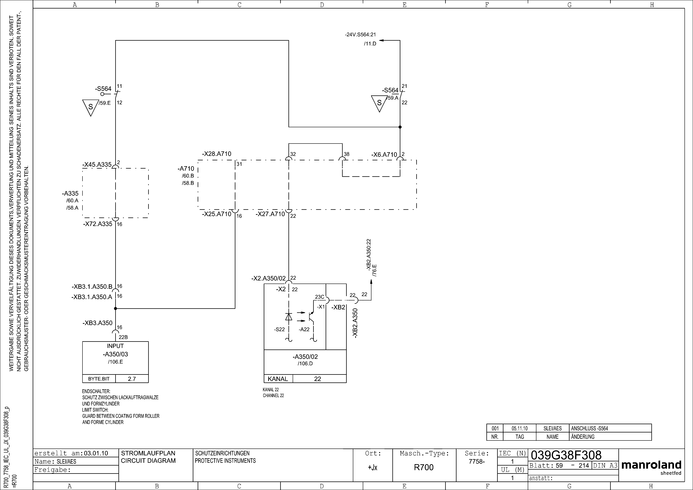

# +Jx — Sheet 59 of 214 — SCHUTZEINRICHTUNGEN

**PROTECTIVE INSTRUMENTS**

> Part of the manroland **R700** printing press IEC/UL circuit diagrams.
> Drawing class: **Stromlaufplan / Circuit diagram** (DIN A3).
> Document `+Jx` covers the **1st printing module + feed register** machine section.

## At a glance

| Field | Value |
|---|---|
| Document | `+Jx`  (039G38F308) |
| Sheet | **59** of 214 |
| Section (DE) | SCHUTZEINRICHTUNGEN |
| Section (EN) | PROTECTIVE INSTRUMENTS |
| Section type | CIRCUIT — Circuit diagram |
| Machine type | `R700` |
| Series | `7758` |
| Created | 03.01.10 |
| Replaces | — |
| Columns used | A, B, C, D, E, F, G |
| Path numbers | — |
| Labels on sheet | 78 |
| Cross-refs out | 10 |
| Cross-refs in | 23 |

**Previous:** [+Jx sheet 58](SHEET_0058.md) · **Next:** [+Jx sheet 60](SHEET_0060.md) · **Document TOC:** [_TOC.md](_TOC.md)  (+Jx) · **Master TOC:** [all sheets](../_MASTER_TOC.md)

## Sheet image (300 DPI, exact vector render)



_Rendered directly from the PDF vector layer at 300 DPI (1-bit), no OCR and no resampling. Use it to confirm anything ambiguous in the text below._

## Cross-references on this sheet

Each entry is a wire leaving this sheet. The printed token is `/sheet.column`; the link resolves to that sheet inside the same document.

| Ref | Target sheet | Col | Path | Destination on target | Target section | From col |
|---|---|---|---|---|---|---|
| `/11.D` | [+Jx sheet 11](SHEET_0011.md) | D | — | — | SPANNUNGSVERSORGUNG, SCHALTSCHRANKBELÜFTUNG | E |
| `/59.A` | [+Jx sheet 59](SHEET_0059.md) | A | — | — | SCHUTZEINRICHTUNGEN | E |
| `/59.E` | [+Jx sheet 59](SHEET_0059.md) | E | — | — | SCHUTZEINRICHTUNGEN | A |
| `/60.B` | [+Jx sheet 60](SHEET_0060.md) | B | — | — | SCHUTZEINRICHTUNGEN | B |
| `/58.B` | [+Jx sheet 58](SHEET_0058.md) | B | — | — | SCHUTZEINRICHTUNGEN | B |
| `/60.A` | [+Jx sheet 60](SHEET_0060.md) | A | — | — | SCHUTZEINRICHTUNGEN | A |
| `/58.A` | [+Jx sheet 58](SHEET_0058.md) | A | — | — | SCHUTZEINRICHTUNGEN | A |
| `/76.E` | [+Jx sheet 76](SHEET_0076.md) | E | — | XB2.A350:22 | BUSVERBINDUNGEN: SICHERHEITSKREIS | E |
| `/106.E` | [+Jx sheet 106](SHEET_0106.md) | E | — | — | REFERENZMODUL | A |
| `/106.D` | [+Jx sheet 106](SHEET_0106.md) | D | — | — | REFERENZMODUL | D |

### Incoming references (sheets that point here)

Every other sheet that sends a wire to this one. `Back-ref` is the token printed on *that* sheet; `Path` is its line number.

| From sheet | Cols | Back-ref | Path | Refs | What continues there |
|---|---|---|---|---|---|
| [+Jx#11](SHEET_0011.md) | D | `/11.D` | — | 1 | 24V.S564:21 |
| [+Jx#58](SHEET_0058.md) | A, B | `/58.A`, `/58.B` | — | 2 | — |
| [+Jx#59](SHEET_0059.md) | A, E | `/59.A`, `/59.E` | — | 2 | — |
| [+Jx#60](SHEET_0060.md) | A, B | `/60.A`, `/60.B` | — | 2 | — |
| [+Jx#76](SHEET_0076.md) | E | `/76.E` | — | 1 | XB2.A350:22 |
| [+Jx#106](SHEET_0106.md) | D, E | `/106.D`, `/106.E` | — | 2 | — |
| [+Jx#126](SHEET_0126.md) | F | `/126.F` | — | 2 | — |
| [+Jx#128](SHEET_0128.md) | C, D, F | `/128.C`, `/128.D`, `/128.F` | — | 3 | — |
| [+Jx#132](SHEET_0132.md) | H | `/132.H` | — | 1 | — |
| [+Jx#143](SHEET_0143.md) | A | `/143.A` | — | 1 | — |
| [+Jx#144](SHEET_0144.md) | D | `/144.D` | — | 1 | — |
| [+Jx#146](SHEET_0146.md) | B | `/146.B` | — | 3 | — |
| [+Jx#150](SHEET_0150.md) | F | `/150.F` | — | 1 | — |
| [+Jx#153](SHEET_0153.md) | C | `/153.C` | — | 1 | — |


## Devices on this sheet

| Tag | Class | Class meaning (IEC) | Col | Sub | Terminal | Sign |
|---|---|---|---|---|---|---|
| `A335` | A | Baugruppe / assembly, module, PC board | A | — | — | — |
| `A350/03` | A | Baugruppe / assembly, module, PC board | A | 03 | — | — |
| `A710` | A | Baugruppe / assembly, module, PC board | B | — | — | — |
| `S22` | S | Schalter / switch | C | — | — | — |
| `A22` | A | Baugruppe / assembly, module, PC board | D | — | — | — |
| `X1` | X | Klemme / terminal, plug connector | D | — | — | — |
| `X2` | X | Klemme / terminal, plug connector | D | — | — | — |
| `XB2` | XB |  | D | — | — | — |
| `A350/02` | A | Baugruppe / assembly, module, PC board | D | 02 | — | — |
| `S564` | S | Schalter / switch | A | — | — | — |
| `S564` | S | Schalter / switch | E | — | — | — |
| `X72.A335` | — | cross-device reference | A | — | — | — |
| `X45.A335` | — | cross-device reference | A | — | — | — |
| `2.7` | — | cross-device reference | B | — | — | — |
| `XB3.A350` | — | cross-device reference | A | — | — | — |
| `X27.A710` | — | cross-device reference | C | — | — | — |
| `X25.A710` | — | cross-device reference | C | — | — | — |
| `XB2.A350` | — | cross-device reference | D | — | — | — |
| `X6.A710` | — | cross-device reference | E | — | — | — |
| `XB3.1.A350.B` | — | cross-device reference | A | — | — | — |
| `XB3.1.A350.A` | — | cross-device reference | A | — | — | — |
| `NR.` | — | cross-device reference | F | — | — | — |
| `05.11.10` | — | cross-device reference | F | — | — | — |
| `XB2.A350:22` | — | cross-device reference | E | — | 22 | — |
| `X28.A710` | — | cross-device reference | C | — | — | — |

## Potentials / nets

| Potential | Count | Columns | Attached devices | Terminals |
|---|---|---|---|---|
| `24V` | 1 | D | `S564` | `21` |


A potential such as `L24+/4` or `M24+` is a named supply/return rail; every place it appears on this sheet is electrically common.

## Wire-end annotations (grouped as printed)

A wire that continues elsewhere is annotated with a small cluster: the destination description, the path/line number `#NN`, and the `/sheet.column` cross reference. Each row below is one such cluster exactly as it is grouped on the drawing.

| Col | Y | Path | Cross-ref | Text on the wire |
|---|---|---|---|---|
| D | 55.5 | — | — | `24V.S564:21` |
| E | 71.1 | — | `/11.D` | — |
| C | 144.1 | — | — | `S564 21` |
| B | 144.1 | — | — | `11` |
| E | 150.5 | — | — | `S564` |
| E | 164.2 | — | `/59.A` | — |
| C | 171.1 | — | — | `S S` |
| B | 172.5 | — | — | `12` |
| E | 172.5 | — | — | `22` |
| A | 173.1 | — | `/59.E` | — |
| C | 259.6 | — | — | `X28.A710` |
| E | 261.0 | — | — | `38 X6.A710 2` |
| D | 261.1 | — | — | `32` |
| A | 275.2 | — | — | `X45.A335 2` |
| C | 278.1 | — | — | `A710 31` |
| B | 298.2 | — | `/60.B`, `/58.B` | — |
| A | 327.6 | — | — | `A335` |
| A | 340.7 | — | `/60.A`, `/58.A` | — |
| C | 363.1 | — | — | `X25.A710 16 X27.A710 22` |
| A | 380.1 | — | — | `X72.A335 16` |
| E | 410.5 | — | `/76.E` | `XB2.A350:22` |
| C | 473.6 | — | — | `X2.A350/02 22` |
| A | 487.8 | — | — | `XB3.1.A350.B 16` |
| D | 492.1 | — | — | `X2` |
| D | 493.5 | — | — | `22 22` |
| E | 502.0 | — | — | `22` |
| A | 504.8 | — | — | `XB3.1.A350.A 16` |
| D | 506.3 | — | — | `23C` |
| D | 523.2 | — | — | `X1` |
| D | 523.2 | — | — | `XB2` |
| D | 529.5 | — | — | `XB2.A350` |
| A | 550.2 | — | — | `XB3.A350 16` |
| D | 562.2 | — | — | `S22 A22` |
| B | 575.7 | — | — | `22B` |
| A | 590.2 | — | — | `INPUT` |
| A | 604.0 | — | — | `A350/03` |
| D | 608.3 | — | — | `A350/02` |
| A | 617.8 | — | `/106.E` | — |
| D | 620.7 | — | `/106.D` | — |
| D | 646.5 | — | — | `KANAL 22` |
| A | 646.9 | — | — | `BYTE.BIT 2.7` |
| C | 666.9 | — | — | `KANAL 22 CHANNEL 22` |
| B | 669.5 | — | — | `ENDSCHALTER: UND FORMZYLINDER LIMIT SWITCH: SCHUTZ ZWISCHEN LACKAUFTRAGWALZE GUARD BETWEEN COATING FORM ROLLER AND FORME CYLINDER` |
| G | 733.0 | — | — | `001 05.11.10 SLEI/AES ANSCHLUSS S564` |
| G | 747.1 | — | — | `NR. TAG NAME ÄNDERUNG` |


## Reconstructed tables

This sheet carries tabular content (pin map / terminal assignment / index). The grid below was rebuilt from the drawing's own rule lines, so each row is exactly one physical row of the table.

### Table 1 — 3 data rows × 2 columns (at x=141.7, y=69.4)

| S564 /59.E S X45.A335 X72.A335 XB3.1.A350.B XB3.1.A350.A | 11 12 2 16 16 16 |
|---|---|
| `XB3.A350` | `16 22B` |
| `INPUT` | `A350/03 /106.E` |
| `BYTE.BIT` | `2.7` |


### Table 2 — 6 data rows × 7 columns (at x=403.9, y=69.4)

|  |  |  |  |  | /11.D | S564 /59.A S |
|---|---|---|---|---|---|---|
| `31` |  | `32` |  |  | `38` | `X6.A710` |
| `16` | `X27.A710 X2.A350/02` | `22 22` |  |  | `XB2.A350:22` | `/76.E` |
|  | `X2` | `22` | `23C X1` | `XB2` | `22 22` |  |
|  | `S22` | `A22` |  |  | `XB2.A350` |  |
|  |  | `A350/02 /106.D` |  |  |  |  |
|  | `KANAL` |  | `22` |  |  |  |


## Notes and free text on this sheet

| Text | Col | Y (pt) |
|---|---|---|
| `22B` | B | 575.66 |
| `INPUT` | A | 590.18 |
| `BYTE.BIT` | A | 647.44 |
| `ENDSCHALTER:` | A | 669.55 |
| `SCHUTZ ZWISCHEN LACKAUFTRAGWALZE` | B | 680.17 |
| `UND FORMZYLINDER` | A | 690.85 |
| `LIMIT SWITCH:` | A | 701.4 |
| `GUARD BETWEEN COATING FORM ROLLER` | B | 712.09 |
| `AND FORME CYLINDER` | A | 722.74 |
| `KANAL 22` | C | 666.88 |
| `CHANNEL 22` | C | 676.83 |
| `23C` | D | 506.26 |
| `KANAL` | C | 646.53 |
| `X2.A350/02` | C | 473.63 |
| `TAG` | F | 747.23 |
| `NAME` | G | 747.22 |
| `ÄNDERUNG` | G | 747.25 |
| `SLEI/AES` | G | 733.09 |
| `ANSCHLUSS S564` | G | 733.09 |
| `S` | A | 178.17 |
| `S` | E | 171.09 |

## Complete label inventory (exact text from the drawing)

Every text object inside the drawing area of this sheet, in DIN reading order (column A→H, then top→bottom). This is the authoritative list: if a string is not here it is not printed on this sheet.

| Col | Y | X | Dir | Type | Text |
|---|---|---|---|---|---|
| A | 147.6 | 163.3 | → | device tag | `S564` |
| A | 173.1 | 169.5 | → | cross-reference | `/59.E` |
| A | 178.2 | 151.8 | → | text | `S` |
| A | 278.0 | 141.4 | → | device ref | `X45.A335` |
| A | 327.6 | 106.6 | → | device tag | `A335` |
| A | 340.7 | 114.0 | → | cross-reference | `/60.A` |
| A | 353.1 | 114.0 | → | cross-reference | `/58.A` |
| A | 380.1 | 142.9 | → | device ref | `X72.A335` |
| A | 487.8 | 123.3 | → | device ref | `XB3.1.A350.B` |
| A | 505.5 | 122.7 | → | device ref | `XB3.1.A350.A` |
| A | 550.2 | 142.0 | → | device ref | `XB3.A350` |
| A | 590.2 | 183.5 | → | text | `INPUT` |
| A | 604.0 | 176.9 | → | device tag | `A350/03` |
| A | 617.8 | 185.8 | → | cross-reference | `/106.E` |
| A | 647.4 | 151.7 | → | text | `BYTE.BIT` |
| A | 669.5 | 141.2 | → | text | `ENDSCHALTER:` |
| A | 690.8 | 141.2 | → | text | `UND FORMZYLINDER` |
| A | 701.4 | 141.2 | → | text | `LIMIT SWITCH:` |
| A | 722.7 | 141.7 | → | text | `AND FORME CYLINDER` |
| B | 144.1 | 200.4 | → | number | `11` |
| B | 172.5 | 200.4 | → | number | `12` |
| B | 275.2 | 201.3 | → | number | `2` |
| B | 285.1 | 305.3 | → | device tag | `A710` |
| B | 298.2 | 312.7 | → | cross-reference | `/60.B` |
| B | 310.6 | 312.7 | → | cross-reference | `/58.B` |
| B | 381.5 | 200.4 | → | number | `16` |
| B | 487.8 | 200.4 | → | number | `16` |
| B | 504.8 | 200.4 | → | number | `16` |
| B | 558.7 | 200.4 | → | number | `16` |
| B | 575.7 | 204.1 | → | text | `22B` |
| B | 646.9 | 220.0 | → | device ref | `2.7` |
| B | 680.2 | 141.4 | → | text | `SCHUTZ ZWISCHEN LACKAUFTRAGWALZE` |
| B | 712.1 | 141.4 | → | text | `GUARD BETWEEN COATING FORM ROLLER` |
| C | 259.6 | 347.2 | → | device ref | `X28.A710` |
| C | 278.1 | 406.5 | → | number | `31` |
| C | 363.1 | 347.2 | → | device ref | `X25.A710` |
| C | 363.1 | 439.4 | → | device ref | `X27.A710` |
| C | 367.4 | 405.9 | → | number | `16` |
| C | 473.6 | 432.0 | → | text | `X2.A350/02` |
| C | 562.2 | 470.8 | → | device tag | `S22` |
| C | 646.5 | 460.1 | → | text | `KANAL` |
| C | 666.9 | 451.6 | → | text | `KANAL 22` |
| C | 676.8 | 451.8 | → | text | `CHANNEL 22` |
| D | 55.5 | 592.7 | → | potential | `24V.S564:21` |
| D | 261.1 | 498.6 | → | number | `32` |
| D | 261.1 | 590.7 | → | number | `38` |
| D | 367.4 | 498.9 | → | number | `22` |
| D | 473.7 | 498.9 | → | number | `22` |
| D | 492.1 | 474.5 | → | device tag | `X2` |
| D | 493.5 | 501.7 | → | number | `22` |
| D | 503.4 | 600.9 | → | number | `22` |
| D | 506.3 | 541.4 | → | text | `23C` |
| D | 523.2 | 544.8 | → | device tag | `X1` |
| D | 523.2 | 569.5 | → | device tag | `XB2` |
| D | 529.5 | 605.4 | ↕ | device ref | `XB2.A350` |
| D | 562.2 | 513.4 | → | device tag | `A22` |
| D | 608.3 | 503.0 | → | device tag | `A350/02` |
| D | 620.7 | 511.7 | → | cross-reference | `/106.D` |
| D | 646.5 | 539.9 | → | number | `22` |
| E | 71.1 | 625.6 | → | cross-reference | `/11.D` |
| E | 144.1 | 690.2 | → | number | `21` |
| E | 150.5 | 656.5 | → | device tag | `S564` |
| E | 164.2 | 663.9 | → | cross-reference | `/59.A` |
| E | 171.1 | 647.9 | → | text | `S` |
| E | 172.5 | 690.2 | → | number | `22` |
| E | 261.0 | 638.1 | → | device ref | `X6.A710` |
| E | 261.1 | 690.2 | → | number | `2` |
| E | 410.5 | 629.5 | ↕ | device ref | `XB2.A350:22` |
| E | 454.1 | 639.4 | ↕ | cross-reference | `/76.E` |
| E | 502.0 | 621.4 | → | number | `22` |
| F | 733.0 | 845.1 | → | number | `001` |
| F | 733.1 | 879.3 | → | device ref | `05.11.10` |
| F | 747.1 | 844.3 | → | device ref | `NR.` |
| F | 747.2 | 886.0 | → | text | `TAG` |
| G | 733.1 | 934.1 | → | text | `SLEI/AES` |
| G | 733.1 | 981.5 | → | text | `ANSCHLUSS S564` |
| G | 747.2 | 939.3 | → | text | `NAME` |
| G | 747.3 | 981.5 | → | text | `ÄNDERUNG` |

## Reading-order text block

The same content as a plain block, grouped by DIN column — convenient to paste or to match against a visual description.

```text
=== Column A ===
 147.6  163.3  devtag       S564
 173.1  169.5  xref         /59.E
 178.2  151.8  text         S
 278.0  141.4  devref       X45.A335
 327.6  106.6  devtag       A335
 340.7  114.0  xref         /60.A
 353.1  114.0  xref         /58.A
 380.1  142.9  devref       X72.A335
 487.8  123.3  devref       XB3.1.A350.B
 505.5  122.7  devref       XB3.1.A350.A
 550.2  142.0  devref       XB3.A350
 590.2  183.5  text         INPUT
 604.0  176.9  devtag       A350/03
 617.8  185.8  xref         /106.E
 647.4  151.7  text         BYTE.BIT
 669.5  141.2  text         ENDSCHALTER:
 690.8  141.2  text         UND FORMZYLINDER
 701.4  141.2  text         LIMIT SWITCH:
 722.7  141.7  text         AND FORME CYLINDER
=== Column B ===
 144.1  200.4  numeric      11
 172.5  200.4  numeric      12
 275.2  201.3  numeric      2
 285.1  305.3  devtag       A710
 298.2  312.7  xref         /60.B
 310.6  312.7  xref         /58.B
 381.5  200.4  numeric      16
 487.8  200.4  numeric      16
 504.8  200.4  numeric      16
 558.7  200.4  numeric      16
 575.7  204.1  text         22B
 646.9  220.0  devref       2.7
 680.2  141.4  text         SCHUTZ ZWISCHEN LACKAUFTRAGWALZE
 712.1  141.4  text         GUARD BETWEEN COATING FORM ROLLER
=== Column C ===
 259.6  347.2  devref       X28.A710
 278.1  406.5  numeric      31
 363.1  347.2  devref       X25.A710
 363.1  439.4  devref       X27.A710
 367.4  405.9  numeric      16
 473.6  432.0  text         X2.A350/02
 562.2  470.8  devtag       S22
 646.5  460.1  text         KANAL
 666.9  451.6  text         KANAL 22
 676.8  451.8  text         CHANNEL 22
=== Column D ===
  55.5  592.7  net          24V.S564:21
 261.1  498.6  numeric      32
 261.1  590.7  numeric      38
 367.4  498.9  numeric      22
 473.7  498.9  numeric      22
 492.1  474.5  devtag       X2
 493.5  501.7  numeric      22
 503.4  600.9  numeric      22
 506.3  541.4  text         23C
 523.2  544.8  devtag       X1
 523.2  569.5  devtag       XB2
 529.5  605.4  devref       XB2.A350
 562.2  513.4  devtag       A22
 608.3  503.0  devtag       A350/02
 620.7  511.7  xref         /106.D
 646.5  539.9  numeric      22
=== Column E ===
  71.1  625.6  xref         /11.D
 144.1  690.2  numeric      21
 150.5  656.5  devtag       S564
 164.2  663.9  xref         /59.A
 171.1  647.9  text         S
 172.5  690.2  numeric      22
 261.0  638.1  devref       X6.A710
 261.1  690.2  numeric      2
 410.5  629.5  devref       XB2.A350:22
 454.1  639.4  xref         /76.E
 502.0  621.4  numeric      22
=== Column F ===
 733.0  845.1  numeric      001
 733.1  879.3  devref       05.11.10
 747.1  844.3  devref       NR.
 747.2  886.0  text         TAG
=== Column G ===
 733.1  934.1  text         SLEI/AES
 733.1  981.5  text         ANSCHLUSS S564
 747.2  939.3  text         NAME
 747.3  981.5  text         ÄNDERUNG
```

---
_Generated from the PDF vector text layer; no OCR. Source: `R700_7758_IEC_UL_JX_039G38F308_p`, sheet 59._
