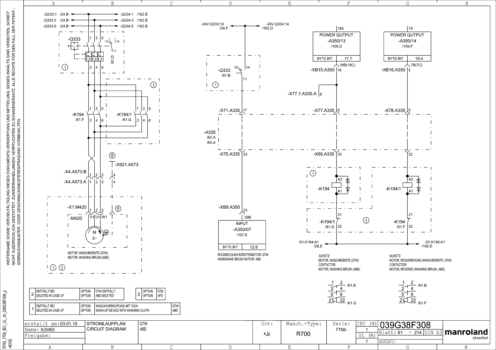

# +Jx — Sheet 61 of 214 — GTW

**ABD**

> Part of the manroland **R700** printing press IEC/UL circuit diagrams.
> Drawing class: **Stromlaufplan / Circuit diagram** (DIN A3).
> Document `+Jx` covers the **1st printing module + feed register** machine section.

## At a glance

| Field | Value |
|---|---|
| Document | `+Jx`  (039G38F308) |
| Sheet | **61** of 214 |
| Section (DE) | GTW |
| Section (EN) | ABD |
| Section type | CIRCUIT — Circuit diagram |
| Machine type | `R700` |
| Series | `7758` |
| Created | 03.01.10 |
| Replaces | — |
| Columns used | A, B, C, D, E, F, G |
| Path numbers | — |
| Labels on sheet | 187 |
| Cross-refs out | 25 |
| Cross-refs in | 47 |

**Previous:** [+Jx sheet 60](SHEET_0060.md) · **Next:** [+Jx sheet 62](SHEET_0062.md) · **Document TOC:** [_TOC.md](_TOC.md)  (+Jx) · **Master TOC:** [all sheets](../_MASTER_TOC.md)

## Sheet image (300 DPI, exact vector render)



_Rendered directly from the PDF vector layer at 300 DPI (1-bit), no OCR and no resampling. Use it to confirm anything ambiguous in the text below._

## Cross-references on this sheet

Each entry is a wire leaving this sheet. The printed token is `/sheet.column`; the link resolves to that sheet inside the same document.

| Ref | Target sheet | Col | Path | Destination on target | Target section | From col |
|---|---|---|---|---|---|---|
| `/24.B` | [+Jx sheet 24](SHEET_0024.md) | B | — | Q333:1 | HILFSANTRIEB, LACKDOSIER /AUFTRAGSWALZEN | A |
| `/162.B` | [+Jx sheet 162](SHEET_0162.md) | B | — | Q334:1 | OPTION: | B |
| `/24.B` | [+Jx sheet 24](SHEET_0024.md) | B | — | Q333:3 | HILFSANTRIEB, LACKDOSIER /AUFTRAGSWALZEN | A |
| `/162.B` | [+Jx sheet 162](SHEET_0162.md) | B | — | Q334:3 | OPTION: | B |
| `/24.F` | [+Jx sheet 24](SHEET_0024.md) | F | — | 24V.Q333:14 | HILFSANTRIEB, LACKDOSIER /AUFTRAGSWALZEN | D |
| `/24.B` | [+Jx sheet 24](SHEET_0024.md) | B | — | Q333:5 | HILFSANTRIEB, LACKDOSIER /AUFTRAGSWALZEN | A |
| `/162.B` | [+Jx sheet 162](SHEET_0162.md) | B | — | Q334:5 | OPTION: | B |
| `/162.D` | [+Jx sheet 162](SHEET_0162.md) | D | — | — | OPTION: | E |
| `/109.F` | [+Jx sheet 109](SHEET_0109.md) | F | — | — | REFERENZMODUL | G |
| `/109.D` | [+Jx sheet 109](SHEET_0109.md) | D | — | — | REFERENZMODUL | F |
| `/61.D` | [+Jx sheet 61](SHEET_0061.md) | D | — | — | GTW | B |
| `/61.B` | [+Jx sheet 61](SHEET_0061.md) | B | — | — | GTW | D |
| `/61.F` | [+Jx sheet 61](SHEET_0061.md) | F | — | — | GTW | A |
| `/61.G` | [+Jx sheet 61](SHEET_0061.md) | G | — | — | GTW | B |
| `/62.A` | [+Jx sheet 62](SHEET_0062.md) | A | — | — | GTW | D |
| `/60.A` | [+Jx sheet 60](SHEET_0060.md) | A | — | — | SCHUTZEINRICHTUNGEN | D |
| `/61.G` | [+Jx sheet 61](SHEET_0061.md) | G | — | — | GTW | F |
| `/61.F` | [+Jx sheet 61](SHEET_0061.md) | F | — | — | GTW | G |
| `/107.E` | [+Jx sheet 107](SHEET_0107.md) | E | — | — | REFERENZMODUL | D |
| `/26.E` | [+Jx sheet 26](SHEET_0026.md) | E | — | 0V.K194:A1 | HILFSANTRIEB, LACKDOSIER /AUFTRAGSWALZEN | E |
| `/165.D` | [+Jx sheet 165](SHEET_0165.md) | D | — | — | OPTION: | G |
| `/61.B` | [+Jx sheet 61](SHEET_0061.md) | B | — | — | GTW | F |
| `/61.B` | [+Jx sheet 61](SHEET_0061.md) | B | — | — | GTW | G |
| `/61.F` | [+Jx sheet 61](SHEET_0061.md) | F | — | — | GTW | G |
| `/61.G` | [+Jx sheet 61](SHEET_0061.md) | G | — | — | GTW | F |

### Incoming references (sheets that point here)

Every other sheet that sends a wire to this one. `Back-ref` is the token printed on *that* sheet; `Path` is its line number.

| From sheet | Cols | Back-ref | Path | Refs | What continues there |
|---|---|---|---|---|---|
| [+Jx#24](SHEET_0024.md) | B, F | `/24.B`, `/24.F` | — | 4 | — |
| [+Jx#26](SHEET_0026.md) | E | `/26.E` | — | 1 | 0V.K190:A1 0V.K194:A1 |
| [+Jx#60](SHEET_0060.md) | A | `/60.A` | — | 1 | — |
| [+Jx#61](SHEET_0061.md) | A, B, D, F, G | `/61.A`, `/61.B`, `/61.D`, `/61.F`, `/61.G` | — | 10 | — |
| [+Jx#62](SHEET_0062.md) | A | `/62.A` | — | 1 | — |
| [+Jx#107](SHEET_0107.md) | E | `/107.E` | — | 1 | — |
| [+Jx#109](SHEET_0109.md) | D, F | `/109.D`, `/109.F` | — | 2 | — |
| [+Jx#119](SHEET_0119.md) | A | `/119.A` | — | 4 | — |
| [+Jx#130](SHEET_0130.md) | E | `/130.E` | — | 8 | — |
| [+Jx#134](SHEET_0134.md) | G | `/134.G` | — | 1 | — |
| [+Jx#139](SHEET_0139.md) | B, G | `/139.B`, `/139.G` | — | 2 | — |
| [+Jx#152](SHEET_0152.md) | G | `/152.G` | — | 2 | — |
| [+Jx#153](SHEET_0153.md) | B | `/153.B` | — | 1 | — |
| [+Jx#155](SHEET_0155.md) | A, D | `/155.A`, `/155.D` | — | 2 | — |
| [+Jx#156](SHEET_0156.md) | A, C | `/156.A`, `/156.C` | — | 2 | — |
| [+Jx#162](SHEET_0162.md) | A, C | `/162.A`, `/162.C` | — | 4 | 24V.Q334:14 Q342:5; Q334:1; Q334:3; Q334:5 |
| [+Jx#165](SHEET_0165.md) | D | `/165.D` | — | 1 | 0V.K195:A1 |


## Devices on this sheet

| Tag | Class | Class meaning (IEC) | Col | Sub | Terminal | Sign |
|---|---|---|---|---|---|---|
| `A350/13` | A | Baugruppe / assembly, module, PC board | F | 13 | — | — |
| `Q333` | Q | Leistungsschalter / power switching device | D | — | — | — |
| `A335` | A | Baugruppe / assembly, module, PC board | D | — | — | — |
| `A350/07` | A | Baugruppe / assembly, module, PC board | D | 07 | — | — |
| `A350/14` | A | Baugruppe / assembly, module, PC board | G | 14 | — | — |
| `A1` | A | Baugruppe / assembly, module, PC board | F | — | — | — |
| `A2` | A | Baugruppe / assembly, module, PC board | F | — | — | — |
| `K194` | K | Relais / relay, contactor | F | — | — | — |
| `A1` | A | Baugruppe / assembly, module, PC board | G | — | — | — |
| `A2` | A | Baugruppe / assembly, module, PC board | G | — | — | — |
| `K194/1` | K | Relais / relay, contactor | G | 1 | — | — |
| `K194/1` | K | Relais / relay, contactor | F | 1 | — | — |
| `K194` | K | Relais / relay, contactor | G | — | — | — |
| `K194` | K | Relais / relay, contactor | A | — | — | — |
| `K194/1` | K | Relais / relay, contactor | B | 1 | — | — |
| `Q333` | Q | Leistungsschalter / power switching device | A | — | — | — |
| `Q334:5` | Q | Leistungsschalter / power switching device | B | — | 5 | — |
| `Q334:3` | Q | Leistungsschalter / power switching device | B | — | 3 | — |
| `Q334:1` | Q | Leistungsschalter / power switching device | B | — | 1 | — |
| `Q333:5` | Q | Leistungsschalter / power switching device | A | — | 5 | — |
| `Q333:3` | Q | Leistungsschalter / power switching device | A | — | 3 | — |
| `Q333:1` | Q | Leistungsschalter / power switching device | A | — | 1 | — |
| `17.7` | — | cross-device reference | F | — | — | — |
| `XB15.A350` | — | cross-device reference | F | — | — | — |
| `X71.A335` | — | cross-device reference | D | — | — | — |
| `X77.A335` | — | cross-device reference | F | — | — | — |
| `X77.1.A335.A` | — | cross-device reference | E | — | — | — |
| `X4.A573.B` | — | cross-device reference | A | — | — | — |
| `X4.A573.A` | — | cross-device reference | A | — | — | — |
| `X1.M420` | — | cross-device reference | A | — | — | — |
| `XB9.A350` | — | cross-device reference | D | — | — | — |
| `12.6` | — | cross-device reference | D | — | — | — |
| `XB16.A350` | — | cross-device reference | G | — | — | — |
| `19.4` | — | cross-device reference | G | — | — | — |
| `X78.A335` | — | cross-device reference | G | — | — | — |
| `X75.A335` | — | cross-device reference | D | — | — | — |
| `X69.A335` | — | cross-device reference | F | — | — | — |
| `X921.A573` | — | cross-device reference | B | — | — | — |

## Potentials / nets

| Potential | Count | Columns | Attached devices | Terminals |
|---|---|---|---|---|
| `0V` | 2 | E, G | `K194`, `K195` | `A1` |
| `24V` | 2 | D, E | `Q333`, `Q334` | `14` |
| `M420` | 1 | A | — | — |


A potential such as `L24+/4` or `M24+` is a named supply/return rail; every place it appears on this sheet is electrically common.

## Wire-end annotations (grouped as printed)

A wire that continues elsewhere is annotated with a small cluster: the destination description, the path/line number `#NN`, and the `/sheet.column` cross reference. Each row below is one such cluster exactly as it is grouped on the drawing.

| Col | Y | Path | Cross-ref | Text on the wire |
|---|---|---|---|---|
| A | 30.7 | — | `/24.B` | `Q333:1` |
| B | 30.7 | — | `/162.B` | `Q334:1` |
| A | 44.8 | — | `/24.B` | `Q333:3` |
| B | 44.9 | — | `/162.B` | `Q334:3` |
| D | 54.1 | — | `/24.F` | `24V.Q333:14` |
| E | 54.1 | — | — | `24V.Q334:14` |
| A | 59.0 | — | `/24.B` | `Q333:5` |
| B | 59.0 | — | `/162.B` | `Q334:5` |
| E | 64.0 | — | `/162.D` | — |
| F | 64.7 | — | — | `18A` |
| G | 64.7 | — | — | `7A` |
| F | 79.9 | — | — | `POWER QUTPUT` |
| G | 79.9 | — | — | `POWER QUTPUT` |
| B | 87.4 | — | — | `1` |
| B | 87.4 | — | — | `3` |
| B | 87.4 | — | — | `5` |
| A | 89.5 | — | — | `Q333` |
| F | 93.8 | — | — | `A350/13` |
| G | 93.8 | — | — | `A350/14` |
| B | 96.5 | — | — | `12 14` |
| F | 107.6 | — | `/109.D` | — |
| G | 107.6 | — | `/109.F` | — |
| B | 119.2 | — | — | `11` |
| B | 132.9 | — | `/61.D` | — |
| F | 136.6 | — | — | `BYTE.BIT 17.7` |
| G | 136.6 | — | — | `BYTE.BIT 19.4` |
| F | 152.6 | — | — | `18B(18C)` |
| G | 152.6 | — | — | `7B(7C)` |
| B | 158.3 | — | — | `2` |
| B | 158.3 | — | — | `4` |
| B | 158.3 | — | — | `6` |
| D | 158.3 | — | — | `Q333 14` |
| E | 158.3 | — | — | `12 XB15.A350 16` |
| A | 158.5 | — | — | `1` |
| G | 163.2 | — | — | `XB16.A350 5` |
| D | 177.7 | — | `/61.B` | — |
| D | 186.7 | — | — | `11` |
| D | 201.0 | — | — | `1` |
| C | 201.5 | — | — | `3` |
| E | 220.6 | — | — | `X77.1.A335.A 6` |
| B | 257.5 | — | — | `1` |
| B | 257.5 | — | — | `3` |
| B | 257.5 | — | — | `5` |
| B | 257.5 | — | — | `1` |
| C | 257.5 | — | — | `3` |
| C | 257.5 | — | — | `5` |
| E | 261.0 | — | — | `X71.A335 17 X77.A335 6` |
| G | 261.0 | — | — | `X78.A335 9` |
| B | 270.9 | — | — | `K194 6` |
| B | 270.9 | — | — | `K194/1 6` |
| A | 284.0 | — | `/61.F` | — |
| B | 284.0 | — | `/61.G` | — |
| B | 285.9 | — | — | `2` |
| B | 285.9 | — | — | `4` |
| B | 285.9 | — | — | `2` |
| C | 285.9 | — | — | `4` |
| D | 313.5 | — | — | `A335` |
| D | 326.5 | — | `/62.A`, `/60.A` | — |
| E | 365.9 | — | — | `X75.A335 23 X69.A335 20 22` |
| B | 391.4 | — | — | `X921.A573` |
| A | 408.4 | — | — | `X4.A573.B 1` |
| E | 413.6 | — | — | `1` |
| B | 417.0 | — | — | `2 3` |
| B | 417.0 | — | — | `4` |
| F | 427.5 | — | — | `A2` |
| G | 427.5 | — | — | `A2` |
| B | 432.5 | — | — | `X4.A573.A 1 2 3` |
| B | 434.0 | — | — | `4` |
| F | 449.5 | — | — | `K194` |
| G | 449.5 | — | — | `K194/1` |
| F | 455.9 | — | — | `A1` |
| G | 455.9 | — | — | `A1` |
| A | 493.5 | — | — | `X1.M420 1` |
| D | 493.5 | — | — | `XB9.A350 23` |
| B | 502.0 | — | — | `2 3` |
| F | 512.6 | — | — | `21` |
| G | 512.6 | — | — | `21` |
| B | 518.1 | — | — | `V1 U1 W1` |
| D | 519.0 | — | — | `29B` |
| A | 520.4 | — | — | `M420` |
| F | 527.5 | — | — | `3` |
| F | 528.9 | — | — | `K194/1 22` |
| G | 528.9 | — | — | `K194 22` |
| D | 533.5 | — | — | `INPUT` |
| F | 542.0 | — | `/61.G` | — |
| G | 542.0 | — | `/61.F` | — |
| D | 547.3 | — | — | `A350/07` |
| B | 554.7 | — | — | `3~ M` |
| D | 561.1 | — | `/107.E` | — |
| E | 578.5 | — | `/26.E` | `0V.K194:A1` |
| G | 578.5 | — | — | `0V.K195:A1` |
| G | 588.4 | — | `/165.D` | — |
| D | 590.2 | — | — | `BYTE.BIT 12.6` |
| B | 605.8 | — | — | `MOTOR: WASCHBÜRSTE (GTW) MOTOR: WASHING BRUSH (ABD)` |
| D | 610.0 | — | — | `RÜCKMELDUNG BÜRSTENMOTOR: GTW HANDSHAKE BRUSH MOTOR: ABD` |
| F | 612.9 | — | — | `MOTOR, WASCHBÜRSTE (GTW) MOTOR, WASHING BRUSH (ABD) SCHÜTZ: CONTACTOR:` |
| G | 612.9 | — | — | `MOTOR, RÜCKDREHUNG (WASCHBÜRSTE, GTW) MOTOR, REVERSE (WASHING BRUSH, ABD) SCHÜTZ: CONTACTOR:` |
| A | 640.4 | — | — | `1 2` |
| F | 674.9 | — | — | `21 3 5 1` |
| F | 674.9 | — | — | `2 6 22 4` |
| G | 674.9 | — | — | `21 3 5 1` |
| G | 674.9 | — | — | `2 6 22 4` |
| F | 682.6 | — | `/61.B` | — |
| G | 682.6 | — | `/61.B` | — |
| C | 697.8 | — | — | `FZW` |
| A | 697.9 | — | — | `2 ENTFÄLLT BEI DELETED IN CASE OF OPTION OPTION` |
| B | 697.9 | — | — | `GTW ENTFÄLLT ABD DELETED 3 OPTION OPTION` |
| C | 708.5 | — | — | `AFD` |
| F | 725.2 | — | `/61.G` | — |
| G | 725.2 | — | `/61.F` | — |
| C | 733.2 | — | — | `GTW ABD` |
| A | 733.3 | — | — | `1 ENTFÄLLT BEI DELETED IN CASE OF` |
| B | 733.3 | — | — | `OPTION OPTION` |
| B | 733.3 | — | — | `WASCHVORRICHTUNG MIT TUCH WASH UP DEVICE WITH WASHING CLOTH` |


## Reconstructed tables

This sheet carries tabular content (pin map / terminal assignment / index). The grid below was rebuilt from the drawing's own rule lines, so each row is exactly one physical row of the table.

### Table 1 — 4 data rows × 3 columns (at x=170.1, y=34.0)

| C1 | C2 | C3 |
|---|---|---|
| `Q333` |  |  |
|  |  | `K194 /61.F` |
|  | `X4.A573.B X4.A573.A X1.M420` |  |
|  | `M420` |  |


### Table 2 — 6 data rows × 7 columns (at x=212.6, y=34.0) — **Q334:1 Q334:3**

| 1 |  | 3 |  | 5 | 12 | Q334:5 14 |
|---|---|---|---|---|---|---|
|  |  |  |  |  |  | `11` |
|  |  |  |  |  |  | `/61.D` |
| `2` |  | `4` |  | `6` |  |  |
| `1 2` |  | `3 4` |  | `5 6` |  | `K194/1 /61.G` |
| `1 1 1` |  | `2 2 2` |  | `3 3 3` |  | `X921.A573 4 4` |
|  | `V1 M 3~` |  | `U1` |  | `W1` |  |


### Table 3 — 0 data rows × 2 columns (at x=326.0, y=34.0) — **/162.B**

_none_


### Table 4 — 8 data rows × 9 columns (at x=524.4, y=76.5)

|  |  |  |  |  | POWER A350/13 | QUTPUT /109.D |  |  |
|---|---|---|---|---|---|---|---|---|
|  |  |  |  |  | `BYTE.BIT` |  | `17.7` |  |
| `12 Q333 /61.B` | `11` | `14` |  |  | `XB15.A350` | `18B(18C) 16` |  |  |
| `X71.A335 X75.A335` | `17` | `23` | `X77.1.A335.A` |  | `6 X77.A335 X69.A335` | `6 20` |  |  |
| `XB9.A350` |  |  |  |  | `1 K194` | `A2 A1` |  |  |
|  |  | `23 29B` |  |  |  | `21` |  |  |
| `INPUT` | `A350/07` |  |  |  | `K194/1 /61.G` | `22` |  | `3` |
|  | `/107.E` |  |  | `0V.K194:A1` |  |  |  |  |
| `BYTE.BIT` |  | `12.6` |  |  | `/26.E` |  |  |  |


### Table 5 — 7 data rows × 3 columns (at x=921.3, y=76.5)

| POWER A350/14 | QUTPUT /109.F |  |
|---|---|---|
| `BYTE.BIT` |  | `19.4` |
| `XB16.A350` | `7B(7C) 5` |  |
| `X78.A335` | `9 22` |  |
| `K194/1` | `A2 A1` |  |
|  | `21` |  |
| `K194 /61.F` | `22` |  |
|  |  | `/165.D` |


## Notes and free text on this sheet

| Text | Col | Y (pt) |
|---|---|---|
| `18A` | F | 64.72 |
| `18B(18C)` | F | 152.63 |
| `POWER QUTPUT` | F | 79.87 |
| `BYTE.BIT` | F | 137.21 |
| `V1 U1 W1` | B | 518.07 |
| `M` | B | 554.69 |
| `MOTOR: WASCHBÜRSTE (GTW)` | B | 605.75 |
| `MOTOR: WASHING BRUSH (ABD)` | B | 616.4 |
| `29B` | D | 518.97 |
| `INPUT` | D | 533.49 |
| `BYTE.BIT` | D | 590.75 |
| `RÜCKMELDUNG BÜRSTENMOTOR: GTW` | D | 610.04 |
| `HANDSHAKE BRUSH MOTOR: ABD` | D | 620.67 |
| `7A` | G | 64.7 |
| `7B(7C)` | G | 152.62 |
| `POWER QUTPUT` | G | 79.87 |
| `BYTE.BIT` | G | 137.21 |
| `SCHÜTZ:` | F | 612.85 |
| `MOTOR, WASCHBÜRSTE (GTW)` | F | 623.47 |
| `CONTACTOR:` | F | 634.13 |
| `MOTOR, WASHING BRUSH (ABD)` | F | 644.75 |
| `SCHÜTZ:` | G | 612.85 |
| `MOTOR, RÜCKDREHUNG (WASCHBÜRSTE, GTW)` | G | 623.49 |
| `CONTACTOR:` | G | 634.13 |
| `MOTOR, REVERSE (WASHING BRUSH, ABD)` | G | 644.75 |
| `ENTFÄLLT BEI` | A | 733.3 |
| `DELETED IN CASE OF` | A | 743.96 |
| `OPTION` | B | 733.32 |
| `WASCHVORRICHTUNG MIT TUCH` | B | 733.34 |
| `WASH UP DEVICE WITH WASHING CLOTH` | B | 743.93 |
| `GTW` | C | 733.23 |
| `ABD` | C | 743.95 |
| `GTW ENTFÄLLT` | B | 697.87 |
| `ABD DELETED` | B | 708.53 |
| `OPTION` | C | 697.88 |
| `FZW` | C | 697.76 |
| `AFD` | C | 708.53 |

## Complete label inventory (exact text from the drawing)

Every text object inside the drawing area of this sheet, in DIN reading order (column A→H, then top→bottom). This is the authoritative list: if a string is not here it is not printed on this sheet.

| Col | Y | X | Dir | Type | Text |
|---|---|---|---|---|---|
| A | 30.7 | 104.6 | → | device tag | `Q333:1` |
| A | 30.7 | 144.0 | → | cross-reference | `/24.B` |
| A | 44.8 | 144.0 | → | cross-reference | `/24.B` |
| A | 44.9 | 103.5 | → | device tag | `Q333:3` |
| A | 59.0 | 144.0 | → | cross-reference | `/24.B` |
| A | 59.1 | 103.5 | → | device tag | `Q333:5` |
| A | 89.5 | 163.6 | → | device tag | `Q333` |
| A | 158.5 | 154.0 | → | number | `1` |
| A | 270.9 | 173.2 | → | device tag | `K194` |
| A | 284.0 | 181.4 | → | cross-reference | `/61.F` |
| A | 408.4 | 153.4 | → | device ref | `X4.A573.B` |
| A | 432.5 | 152.8 | → | device ref | `X4.A573.A` |
| A | 493.5 | 161.6 | → | device ref | `X1.M420` |
| A | 520.4 | 167.0 | → | potential | `M420` |
| A | 640.4 | 125.7 | → | number | `1` |
| A | 640.9 | 146.8 | → | number | `2` |
| A | 697.9 | 87.3 | → | text | `ENTFÄLLT BEI` |
| A | 703.2 | 75.1 | → | number | `2` |
| A | 708.5 | 87.3 | → | text | `DELETED IN CASE OF` |
| A | 733.3 | 87.3 | → | text | `ENTFÄLLT BEI` |
| A | 738.6 | 75.4 | → | number | `1` |
| A | 744.0 | 87.3 | → | text | `DELETED IN CASE OF` |
| B | 30.7 | 288.9 | → | device tag | `Q334:1` |
| B | 44.9 | 288.9 | → | device tag | `Q334:3` |
| B | 59.1 | 288.9 | → | device tag | `Q334:5` |
| B | 87.4 | 214.6 | → | number | `1` |
| B | 87.4 | 229.3 | → | number | `3` |
| B | 87.4 | 243.5 | → | number | `5` |
| B | 96.5 | 251.7 | → | number | `12` |
| B | 96.5 | 278.6 | → | number | `14` |
| B | 119.2 | 271.6 | → | number | `11` |
| B | 132.9 | 266.0 | ↕ | cross-reference | `/61.D` |
| B | 158.3 | 215.4 | → | number | `2` |
| B | 158.3 | 229.6 | → | number | `4` |
| B | 158.3 | 243.5 | → | number | `6` |
| B | 257.5 | 214.6 | → | number | `1` |
| B | 257.5 | 229.3 | → | number | `3` |
| B | 257.5 | 243.5 | → | number | `5` |
| B | 257.5 | 328.0 | → | number | `1` |
| B | 271.0 | 279.5 | → | device tag | `K194/1` |
| B | 284.0 | 293.4 | → | cross-reference | `/61.G` |
| B | 285.9 | 215.4 | → | number | `2` |
| B | 285.9 | 229.6 | → | number | `4` |
| B | 285.9 | 243.5 | → | number | `6` |
| B | 285.9 | 328.8 | → | number | `2` |
| B | 391.4 | 276.1 | → | device ref | `X921.A573` |
| B | 417.0 | 214.6 | → | number | `1` |
| B | 417.0 | 229.6 | → | number | `2` |
| B | 417.0 | 243.5 | → | number | `3` |
| B | 417.0 | 272.1 | → | number | `4` |
| B | 434.0 | 214.6 | → | number | `1` |
| B | 434.0 | 229.6 | → | number | `2` |
| B | 434.0 | 243.5 | → | number | `3` |
| B | 434.0 | 272.1 | → | number | `4` |
| B | 502.0 | 214.6 | → | number | `1` |
| B | 502.0 | 229.6 | → | number | `2` |
| B | 502.0 | 243.5 | → | number | `3` |
| B | 518.1 | 215.4 | → | text | `V1 U1 W1` |
| B | 554.7 | 222.7 | → | text | `M` |
| B | 568.9 | 221.2 | → | other | `3~` |
| B | 605.8 | 162.4 | → | text | `MOTOR: WASCHBÜRSTE (GTW)` |
| B | 616.4 | 162.4 | → | text | `MOTOR: WASHING BRUSH (ABD)` |
| B | 697.9 | 193.9 | → | text | `OPTION` |
| B | 697.9 | 229.3 | → | text | `GTW ENTFÄLLT` |
| B | 703.2 | 330.1 | → | number | `3` |
| B | 708.5 | 193.9 | → | text | `OPTION` |
| B | 708.5 | 229.6 | → | text | `ABD DELETED` |
| B | 733.3 | 193.9 | → | text | `OPTION` |
| B | 733.3 | 229.6 | → | text | `WASCHVORRICHTUNG MIT TUCH` |
| B | 743.9 | 193.9 | → | text | `OPTION` |
| B | 743.9 | 229.6 | → | text | `WASH UP DEVICE WITH WASHING CLOTH` |
| C | 30.7 | 328.8 | → | cross-reference | `/162.B` |
| C | 44.9 | 328.8 | → | cross-reference | `/162.B` |
| C | 59.0 | 328.8 | → | cross-reference | `/162.B` |
| C | 201.5 | 366.5 | → | number | `3` |
| C | 257.5 | 342.7 | → | number | `3` |
| C | 257.5 | 356.9 | → | number | `5` |
| C | 285.9 | 343.0 | → | number | `4` |
| C | 285.9 | 356.9 | → | number | `6` |
| C | 697.8 | 377.9 | → | text | `FZW` |
| C | 697.9 | 342.7 | → | text | `OPTION` |
| C | 708.5 | 342.7 | → | text | `OPTION` |
| C | 708.5 | 378.4 | → | text | `AFD` |
| C | 733.2 | 413.6 | → | text | `GTW` |
| C | 744.0 | 413.9 | → | text | `ABD` |
| D | 54.1 | 483.0 | → | potential | `24V.Q333:14` |
| D | 64.0 | 527.2 | → | cross-reference | `/24.F` |
| D | 158.3 | 561.8 | → | number | `12` |
| D | 158.3 | 590.2 | → | number | `14` |
| D | 164.6 | 523.6 | → | device tag | `Q333` |
| D | 177.7 | 532.3 | → | cross-reference | `/61.B` |
| D | 186.6 | 583.1 | → | number | `11` |
| D | 201.0 | 515.5 | → | number | `1` |
| D | 261.0 | 525.5 | → | device ref | `X71.A335` |
| D | 261.1 | 583.1 | → | number | `17` |
| D | 313.5 | 489.3 | → | device tag | `A335` |
| D | 326.5 | 496.6 | → | cross-reference | `/62.A` |
| D | 338.9 | 496.6 | → | cross-reference | `/60.A` |
| D | 365.9 | 525.5 | → | device ref | `X75.A335` |
| D | 367.4 | 583.9 | → | number | `23` |
| D | 493.5 | 524.7 | → | device ref | `XB9.A350` |
| D | 502.0 | 583.9 | → | number | `23` |
| D | 519.0 | 586.8 | → | text | `29B` |
| D | 533.5 | 566.2 | → | text | `INPUT` |
| D | 547.3 | 559.6 | → | device tag | `A350/07` |
| D | 561.1 | 568.5 | → | cross-reference | `/107.E` |
| D | 590.2 | 599.7 | → | device ref | `12.6` |
| D | 590.7 | 534.3 | → | text | `BYTE.BIT` |
| D | 610.0 | 522.4 | → | text | `RÜCKMELDUNG BÜRSTENMOTOR: GTW` |
| D | 620.7 | 522.4 | → | text | `HANDSHAKE BRUSH MOTOR: ABD` |
| E | 54.1 | 638.9 | → | potential | `24V.Q334:14` |
| E | 64.0 | 629.3 | → | cross-reference | `/162.D` |
| E | 220.6 | 690.8 | → | device ref | `X77.1.A335.A` |
| E | 413.6 | 749.3 | → | number | `1` |
| E | 578.5 | 718.3 | → | potential | `0V.K194:A1` |
| E | 588.4 | 753.4 | → | cross-reference | `/26.E` |
| F | 64.7 | 809.9 | → | text | `18A` |
| F | 79.9 | 767.1 | → | text | `POWER QUTPUT` |
| F | 93.8 | 786.3 | → | device tag | `A350/13` |
| F | 107.6 | 795.1 | → | cross-reference | `/109.D` |
| F | 136.6 | 826.4 | → | device ref | `17.7` |
| F | 137.2 | 761.1 | → | text | `BYTE.BIT` |
| F | 152.6 | 815.5 | → | text | `18B(18C)` |
| F | 163.2 | 745.5 | → | device ref | `XB15.A350` |
| F | 164.7 | 809.9 | → | number | `16` |
| F | 222.8 | 767.9 | → | number | `6` |
| F | 261.0 | 752.3 | → | device ref | `X77.A335` |
| F | 261.1 | 810.4 | → | number | `6` |
| F | 365.9 | 752.3 | → | device ref | `X69.A335` |
| F | 367.4 | 810.7 | → | number | `20` |
| F | 427.5 | 810.7 | → | device tag | `A2` |
| F | 449.5 | 762.8 | → | device tag | `K194` |
| F | 455.9 | 810.7 | → | device tag | `A1` |
| F | 512.6 | 810.7 | → | number | `21` |
| F | 527.5 | 876.7 | → | number | `3` |
| F | 528.9 | 767.1 | → | device tag | `K194/1` |
| F | 541.0 | 810.7 | → | number | `22` |
| F | 542.0 | 780.9 | → | cross-reference | `/61.G` |
| F | 612.8 | 765.1 | → | text | `SCHÜTZ:` |
| F | 623.5 | 764.8 | → | text | `MOTOR, WASCHBÜRSTE (GTW)` |
| F | 634.1 | 765.1 | → | text | `CONTACTOR:` |
| F | 644.8 | 764.8 | → | text | `MOTOR, WASHING BRUSH (ABD)` |
| F | 674.8 | 795.4 | → | number | `1` |
| F | 674.8 | 816.1 | → | number | `2` |
| F | 682.6 | 833.4 | → | cross-reference | `/61.B` |
| F | 689.0 | 793.7 | → | number | `3` |
| F | 689.0 | 816.4 | → | number | `4` |
| F | 703.2 | 793.7 | → | number | `5` |
| F | 703.2 | 816.1 | → | number | `6` |
| F | 717.4 | 789.4 | → | number | `21` |
| F | 717.4 | 816.1 | → | number | `22` |
| F | 725.2 | 833.4 | → | cross-reference | `/61.G` |
| G | 64.7 | 980.5 | → | text | `7A` |
| G | 79.9 | 937.1 | → | text | `POWER QUTPUT` |
| G | 93.8 | 956.4 | → | device tag | `A350/14` |
| G | 107.6 | 965.6 | → | cross-reference | `/109.F` |
| G | 136.6 | 996.5 | → | device ref | `19.4` |
| G | 137.2 | 931.2 | → | text | `BYTE.BIT` |
| G | 152.6 | 986.2 | → | text | `7B(7C)` |
| G | 163.2 | 915.6 | → | device ref | `XB16.A350` |
| G | 164.7 | 980.5 | → | number | `5` |
| G | 261.0 | 922.4 | → | device ref | `X78.A335` |
| G | 261.1 | 980.5 | → | number | `9` |
| G | 367.4 | 980.8 | → | number | `22` |
| G | 427.5 | 980.8 | → | device tag | `A2` |
| G | 449.5 | 925.8 | → | device tag | `K194/1` |
| G | 455.9 | 980.8 | → | device tag | `A1` |
| G | 512.6 | 980.8 | → | number | `21` |
| G | 528.9 | 944.2 | → | device tag | `K194` |
| G | 541.0 | 980.8 | → | number | `22` |
| G | 542.0 | 952.4 | → | cross-reference | `/61.F` |
| G | 578.5 | 1021.6 | → | potential | `0V.K195:A1` |
| G | 588.4 | 1012.0 | → | cross-reference | `/165.D` |
| G | 612.8 | 935.1 | → | text | `SCHÜTZ:` |
| G | 623.5 | 934.9 | → | text | `MOTOR, RÜCKDREHUNG (WASCHBÜRSTE, GTW)` |
| G | 634.1 | 935.1 | → | text | `CONTACTOR:` |
| G | 644.8 | 934.9 | → | text | `MOTOR, REVERSE (WASHING BRUSH, ABD)` |
| G | 674.8 | 965.5 | → | number | `1` |
| G | 674.8 | 986.2 | → | number | `2` |
| G | 682.6 | 1003.5 | → | cross-reference | `/61.B` |
| G | 689.0 | 963.8 | → | number | `3` |
| G | 689.0 | 986.5 | → | number | `4` |
| G | 703.2 | 963.8 | → | number | `5` |
| G | 703.2 | 986.2 | → | number | `6` |
| G | 717.4 | 959.5 | → | number | `21` |
| G | 717.4 | 986.2 | → | number | `22` |
| G | 725.2 | 1003.5 | → | cross-reference | `/61.F` |

## Reading-order text block

The same content as a plain block, grouped by DIN column — convenient to paste or to match against a visual description.

```text
=== Column A ===
  30.7  104.6  devtag       Q333:1
  30.7  144.0  xref         /24.B
  44.8  144.0  xref         /24.B
  44.9  103.5  devtag       Q333:3
  59.0  144.0  xref         /24.B
  59.1  103.5  devtag       Q333:5
  89.5  163.6  devtag       Q333
 158.5  154.0  numeric      1
 270.9  173.2  devtag       K194
 284.0  181.4  xref         /61.F
 408.4  153.4  devref       X4.A573.B
 432.5  152.8  devref       X4.A573.A
 493.5  161.6  devref       X1.M420
 520.4  167.0  net          M420
 640.4  125.7  numeric      1
 640.9  146.8  numeric      2
 697.9   87.3  text         ENTFÄLLT BEI
 703.2   75.1  numeric      2
 708.5   87.3  text         DELETED IN CASE OF
 733.3   87.3  text         ENTFÄLLT BEI
 738.6   75.4  numeric      1
 744.0   87.3  text         DELETED IN CASE OF
=== Column B ===
  30.7  288.9  devtag       Q334:1
  44.9  288.9  devtag       Q334:3
  59.1  288.9  devtag       Q334:5
  87.4  214.6  numeric      1
  87.4  229.3  numeric      3
  87.4  243.5  numeric      5
  96.5  251.7  numeric      12
  96.5  278.6  numeric      14
 119.2  271.6  numeric      11
 132.9  266.0  xref         /61.D
 158.3  215.4  numeric      2
 158.3  229.6  numeric      4
 158.3  243.5  numeric      6
 257.5  214.6  numeric      1
 257.5  229.3  numeric      3
 257.5  243.5  numeric      5
 257.5  328.0  numeric      1
 271.0  279.5  devtag       K194/1
 284.0  293.4  xref         /61.G
 285.9  215.4  numeric      2
 285.9  229.6  numeric      4
 285.9  243.5  numeric      6
 285.9  328.8  numeric      2
 391.4  276.1  devref       X921.A573
 417.0  214.6  numeric      1
 417.0  229.6  numeric      2
 417.0  243.5  numeric      3
 417.0  272.1  numeric      4
 434.0  214.6  numeric      1
 434.0  229.6  numeric      2
 434.0  243.5  numeric      3
 434.0  272.1  numeric      4
 502.0  214.6  numeric      1
 502.0  229.6  numeric      2
 502.0  243.5  numeric      3
 518.1  215.4  text         V1 U1 W1
 554.7  222.7  text         M
 568.9  221.2  other        3~
 605.8  162.4  text         MOTOR: WASCHBÜRSTE (GTW)
 616.4  162.4  text         MOTOR: WASHING BRUSH (ABD)
 697.9  193.9  text         OPTION
 697.9  229.3  text         GTW ENTFÄLLT
 703.2  330.1  numeric      3
 708.5  193.9  text         OPTION
 708.5  229.6  text         ABD DELETED
 733.3  193.9  text         OPTION
 733.3  229.6  text         WASCHVORRICHTUNG MIT TUCH
 743.9  193.9  text         OPTION
 743.9  229.6  text         WASH UP DEVICE WITH WASHING CLOTH
=== Column C ===
  30.7  328.8  xref         /162.B
  44.9  328.8  xref         /162.B
  59.0  328.8  xref         /162.B
 201.5  366.5  numeric      3
 257.5  342.7  numeric      3
 257.5  356.9  numeric      5
 285.9  343.0  numeric      4
 285.9  356.9  numeric      6
 697.8  377.9  text         FZW
 697.9  342.7  text         OPTION
 708.5  342.7  text         OPTION
 708.5  378.4  text         AFD
 733.2  413.6  text         GTW
 744.0  413.9  text         ABD
=== Column D ===
  54.1  483.0  net          24V.Q333:14
  64.0  527.2  xref         /24.F
 158.3  561.8  numeric      12
 158.3  590.2  numeric      14
 164.6  523.6  devtag       Q333
 177.7  532.3  xref         /61.B
 186.6  583.1  numeric      11
 201.0  515.5  numeric      1
 261.0  525.5  devref       X71.A335
 261.1  583.1  numeric      17
 313.5  489.3  devtag       A335
 326.5  496.6  xref         /62.A
 338.9  496.6  xref         /60.A
 365.9  525.5  devref       X75.A335
 367.4  583.9  numeric      23
 493.5  524.7  devref       XB9.A350
 502.0  583.9  numeric      23
 519.0  586.8  text         29B
 533.5  566.2  text         INPUT
 547.3  559.6  devtag       A350/07
 561.1  568.5  xref         /107.E
 590.2  599.7  devref       12.6
 590.7  534.3  text         BYTE.BIT
 610.0  522.4  text         RÜCKMELDUNG BÜRSTENMOTOR: GTW
 620.7  522.4  text         HANDSHAKE BRUSH MOTOR: ABD
=== Column E ===
  54.1  638.9  net          24V.Q334:14
  64.0  629.3  xref         /162.D
 220.6  690.8  devref       X77.1.A335.A
 413.6  749.3  numeric      1
 578.5  718.3  net          0V.K194:A1
 588.4  753.4  xref         /26.E
=== Column F ===
  64.7  809.9  text         18A
  79.9  767.1  text         POWER QUTPUT
  93.8  786.3  devtag       A350/13
 107.6  795.1  xref         /109.D
 136.6  826.4  devref       17.7
 137.2  761.1  text         BYTE.BIT
 152.6  815.5  text         18B(18C)
 163.2  745.5  devref       XB15.A350
 164.7  809.9  numeric      16
 222.8  767.9  numeric      6
 261.0  752.3  devref       X77.A335
 261.1  810.4  numeric      6
 365.9  752.3  devref       X69.A335
 367.4  810.7  numeric      20
 427.5  810.7  devtag       A2
 449.5  762.8  devtag       K194
 455.9  810.7  devtag       A1
 512.6  810.7  numeric      21
 527.5  876.7  numeric      3
 528.9  767.1  devtag       K194/1
 541.0  810.7  numeric      22
 542.0  780.9  xref         /61.G
 612.8  765.1  text         SCHÜTZ:
 623.5  764.8  text         MOTOR, WASCHBÜRSTE (GTW)
 634.1  765.1  text         CONTACTOR:
 644.8  764.8  text         MOTOR, WASHING BRUSH (ABD)
 674.8  795.4  numeric      1
 674.8  816.1  numeric      2
 682.6  833.4  xref         /61.B
 689.0  793.7  numeric      3
 689.0  816.4  numeric      4
 703.2  793.7  numeric      5
 703.2  816.1  numeric      6
 717.4  789.4  numeric      21
 717.4  816.1  numeric      22
 725.2  833.4  xref         /61.G
=== Column G ===
  64.7  980.5  text         7A
  79.9  937.1  text         POWER QUTPUT
  93.8  956.4  devtag       A350/14
 107.6  965.6  xref         /109.F
 136.6  996.5  devref       19.4
 137.2  931.2  text         BYTE.BIT
 152.6  986.2  text         7B(7C)
 163.2  915.6  devref       XB16.A350
 164.7  980.5  numeric      5
 261.0  922.4  devref       X78.A335
 261.1  980.5  numeric      9
 367.4  980.8  numeric      22
 427.5  980.8  devtag       A2
 449.5  925.8  devtag       K194/1
 455.9  980.8  devtag       A1
 512.6  980.8  numeric      21
 528.9  944.2  devtag       K194
 541.0  980.8  numeric      22
 542.0  952.4  xref         /61.F
 578.5 1021.6  net          0V.K195:A1
 588.4 1012.0  xref         /165.D
 612.8  935.1  text         SCHÜTZ:
 623.5  934.9  text         MOTOR, RÜCKDREHUNG (WASCHBÜRSTE, GTW)
 634.1  935.1  text         CONTACTOR:
 644.8  934.9  text         MOTOR, REVERSE (WASHING BRUSH, ABD)
 674.8  965.5  numeric      1
 674.8  986.2  numeric      2
 682.6 1003.5  xref         /61.B
 689.0  963.8  numeric      3
 689.0  986.5  numeric      4
 703.2  963.8  numeric      5
 703.2  986.2  numeric      6
 717.4  959.5  numeric      21
 717.4  986.2  numeric      22
 725.2 1003.5  xref         /61.F
```

---
_Generated from the PDF vector text layer; no OCR. Source: `R700_7758_IEC_UL_JX_039G38F308_p`, sheet 61._
