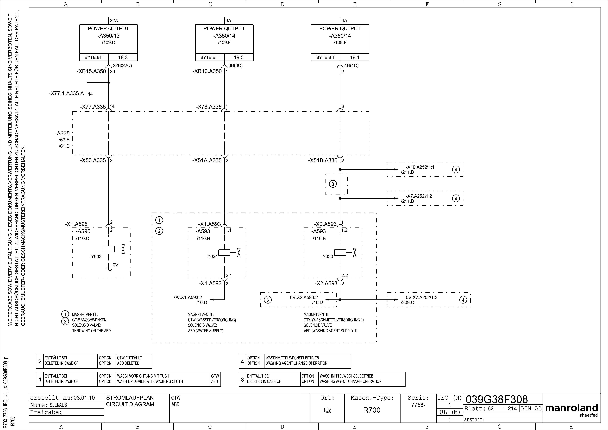

# +Jx — Sheet 62 of 214 — GTW

**ABD**

> Part of the manroland **R700** printing press IEC/UL circuit diagrams.
> Drawing class: **Stromlaufplan / Circuit diagram** (DIN A3).
> Document `+Jx` covers the **1st printing module + feed register** machine section.

## At a glance

| Field | Value |
|---|---|
| Document | `+Jx`  (039G38F308) |
| Sheet | **62** of 214 |
| Section (DE) | GTW |
| Section (EN) | ABD |
| Section type | CIRCUIT — Circuit diagram |
| Machine type | `R700` |
| Series | `7758` |
| Created | 03.01.10 |
| Replaces | — |
| Columns used | A, B, C, D, E, F, G |
| Path numbers | — |
| Labels on sheet | 126 |
| Cross-refs out | 13 |
| Cross-refs in | 28 |

**Previous:** [+Jx sheet 61](SHEET_0061.md) · **Next:** [+Jx sheet 63](SHEET_0063.md) · **Document TOC:** [_TOC.md](_TOC.md)  (+Jx) · **Master TOC:** [all sheets](../_MASTER_TOC.md)

## Sheet image (300 DPI, exact vector render)



_Rendered directly from the PDF vector layer at 300 DPI (1-bit), no OCR and no resampling. Use it to confirm anything ambiguous in the text below._

## Cross-references on this sheet

Each entry is a wire leaving this sheet. The printed token is `/sheet.column`; the link resolves to that sheet inside the same document.

| Ref | Target sheet | Col | Path | Destination on target | Target section | From col |
|---|---|---|---|---|---|---|
| `/109.F` | [+Jx sheet 109](SHEET_0109.md) | F | — | — | REFERENZMODUL | C |
| `/109.F` | [+Jx sheet 109](SHEET_0109.md) | F | — | — | REFERENZMODUL | E |
| `/109.D` | [+Jx sheet 109](SHEET_0109.md) | D | — | — | REFERENZMODUL | B |
| `/63.A` | [+Jx sheet 63](SHEET_0063.md) | A | — | — | LACKAUFTRAGSWALZE | A |
| `/61.D` | [+Jx sheet 61](SHEET_0061.md) | D | — | — | GTW | A |
| `/211.B` | [+Jx sheet 211](SHEET_0211.md) | B | — | — | OPTION: WASCHMITTELWECHSELBETRIEB | F |
| `/211.B` | [+Jx sheet 211](SHEET_0211.md) | B | — | — | OPTION: WASCHMITTELWECHSELBETRIEB | F |
| `/110.B` | [+Jx sheet 110](SHEET_0110.md) | B | — | — | REFERENZMODUL | C |
| `/110.B` | [+Jx sheet 110](SHEET_0110.md) | B | — | — | REFERENZMODUL | E |
| `/110.C` | [+Jx sheet 110](SHEET_0110.md) | C | — | — | REFERENZMODUL | A |
| `/10.D` | [+Jx sheet 10](SHEET_0010.md) | D | — | 0V.X1.A593:2 | SPANNUNGSVERSORGUNG, SCHALTSCHRANKBELÜFTUNG | D |
| `/209.C` | [+Jx sheet 209](SHEET_0209.md) | C | — | 0V.X1.A593:2 | OPTION: WASCHMITTELWECHSELBETRIEB | D |
| `/10.D` | [+Jx sheet 10](SHEET_0010.md) | D | — | 0V.X2.A593:2 | SPANNUNGSVERSORGUNG, SCHALTSCHRANKBELÜFTUNG | D |

### Incoming references (sheets that point here)

Every other sheet that sends a wire to this one. `Back-ref` is the token printed on *that* sheet; `Path` is its line number.

| From sheet | Cols | Back-ref | Path | Refs | What continues there |
|---|---|---|---|---|---|
| [+Jx#10](SHEET_0010.md) | D | `/10.D` | — | 2 | — |
| [+Jx#61](SHEET_0061.md) | D | `/61.D` | — | 1 | — |
| [+Jx#63](SHEET_0063.md) | A | `/63.A` | — | 1 | — |
| [+Jx#109](SHEET_0109.md) | D, F | `/109.D`, `/109.F` | — | 3 | — |
| [+Jx#110](SHEET_0110.md) | B, C | `/110.B`, `/110.C` | — | 3 | — |
| [+Jx#115](SHEET_0115.md) | B, C | `/115.B`, `/115.C` | — | 3 | — |
| [+Jx#127](SHEET_0127.md) | A | `/127.A` | — | 2 | — |
| [+Jx#139](SHEET_0139.md) | B, G | `/139.B`, `/139.G` | — | 3 | — |
| [+Jx#150](SHEET_0150.md) | H | `/150.H` | — | 1 | — |
| [+Jx#151](SHEET_0151.md) | A | `/151.A` | — | 2 | — |
| [+Jx#155](SHEET_0155.md) | D | `/155.D` | — | 1 | — |
| [+Jx#156](SHEET_0156.md) | A, C | `/156.A`, `/156.C` | — | 3 | — |
| [+Jx#209](SHEET_0209.md) | C | `/209.C` | — | 1 | — |
| [+Jx#211](SHEET_0211.md) | A, C | `/211.A`, `/211.C` | — | 2 | X10.A252\1:1 X10.A252\1:2; X7.A252\1:2 |


## Devices on this sheet

| Tag | Class | Class meaning (IEC) | Col | Sub | Terminal | Sign |
|---|---|---|---|---|---|---|
| `Y033` | Y | Magnetventil / solenoid valve, actuator | A | — | — | — |
| `A595` | A | Baugruppe / assembly, module, PC board | A | — | — | — |
| `Y031` | Y | Magnetventil / solenoid valve, actuator | C | — | — | — |
| `A593` | A | Baugruppe / assembly, module, PC board | C | — | — | — |
| `Y030` | Y | Magnetventil / solenoid valve, actuator | E | — | — | — |
| `A593` | A | Baugruppe / assembly, module, PC board | E | — | — | — |
| `A335` | A | Baugruppe / assembly, module, PC board | A | — | — | — |
| `A350/13` | A | Baugruppe / assembly, module, PC board | B | 13 | — | — |
| `A350/14` | A | Baugruppe / assembly, module, PC board | C | 14 | — | — |
| `A350/14` | A | Baugruppe / assembly, module, PC board | E | 14 | — | — |
| `X1.A595` | — | cross-device reference | A | — | — | — |
| `1.1` | — | cross-device reference | C | — | — | — |
| `2.1` | — | cross-device reference | C | — | — | — |
| `X1.A593` | — | cross-device reference | C | — | — | — |
| `X1.A593` | — | cross-device reference | C | — | — | — |
| `1.2` | — | cross-device reference | E | — | — | — |
| `2.2` | — | cross-device reference | E | — | — | — |
| `X2.A593` | — | cross-device reference | E | — | — | — |
| `X2.A593` | — | cross-device reference | E | — | — | — |
| `X50.A335` | — | cross-device reference | A | — | — | — |
| `X51A.A335` | — | cross-device reference | C | — | — | — |
| `X51B.A335` | — | cross-device reference | E | — | — | — |
| `X77.A335` | — | cross-device reference | A | — | — | — |
| `X78.A335` | — | cross-device reference | C | — | — | — |
| `18.3` | — | cross-device reference | B | — | — | — |
| `XB15.A350` | — | cross-device reference | A | — | — | — |
| `19.0` | — | cross-device reference | C | — | — | — |
| `XB16.A350` | — | cross-device reference | C | — | — | — |
| `19.1` | — | cross-device reference | E | — | — | — |
| `X77.1.A335.A` | — | cross-device reference | A | — | — | — |
| `X7.A252\1:2` | — | cross-device reference | F | — | 2 | — |
| `X10.A252\1:1` | — | cross-device reference | F | — | 1 | — |

## Potentials / nets

| Potential | Count | Columns | Attached devices | Terminals |
|---|---|---|---|---|
| `0V` | 4 | B, C, D, F | `A252\1`, `A593`, `X1`, `X2`, `X7` | `2`, `3` |


A potential such as `L24+/4` or `M24+` is a named supply/return rail; every place it appears on this sheet is electrically common.

## Wire-end annotations (grouped as printed)

A wire that continues elsewhere is annotated with a small cluster: the destination description, the path/line number `#NN`, and the `/sheet.column` cross reference. Each row below is one such cluster exactly as it is grouped on the drawing.

| Col | Y | Path | Cross-ref | Text on the wire |
|---|---|---|---|---|
| B | 36.4 | — | — | `22A` |
| C | 36.4 | — | — | `3A` |
| E | 36.4 | — | — | `4A` |
| B | 51.5 | — | — | `POWER QUTPUT` |
| C | 51.5 | — | — | `POWER QUTPUT` |
| E | 51.5 | — | — | `POWER QUTPUT` |
| B | 65.4 | — | — | `A350/13` |
| C | 65.4 | — | — | `A350/14` |
| E | 65.4 | — | — | `A350/14` |
| B | 79.2 | — | `/109.D` | — |
| C | 79.2 | — | `/109.F` | — |
| E | 79.2 | — | `/109.F` | — |
| B | 108.3 | — | — | `BYTE.BIT 18.3` |
| C | 108.3 | — | — | `BYTE.BIT 19.0` |
| E | 108.3 | — | — | `BYTE.BIT 19.1` |
| B | 124.3 | — | — | `22B(22C)` |
| C | 124.3 | — | — | `3B(3C)` |
| E | 124.3 | — | — | `4B(4C)` |
| A | 134.9 | — | — | `XB15.A350 20` |
| C | 134.9 | — | — | `XB16.A350 1` |
| E | 136.3 | — | — | `2` |
| A | 178.1 | — | — | `X77.1.A335.A 14` |
| C | 204.3 | — | — | `X77.A335 14 X78.A335 1 3` |
| A | 256.8 | — | — | `A335` |
| A | 269.8 | — | `/63.A`, `/61.D` | — |
| C | 309.2 | — | — | `X50.A335 2 X51A.A335 2 X51B.A335 2` |
| F | 323.4 | — | — | `X10.A252\1:1` |
| F | 329.1 | — | — | `4` |
| F | 333.3 | — | `/211.B` | — |
| E | 357.4 | — | — | `3` |
| F | 380.1 | — | — | `X7.A252\1:2` |
| F | 385.8 | — | — | `4` |
| F | 390.0 | — | `/211.B` | — |
| B | 427.8 | — | — | `1` |
| A | 431.1 | — | — | `X1.A595 2` |
| C | 431.1 | — | — | `X1.A593 1` |
| E | 431.1 | — | — | `X2.A593 1` |
| B | 446.7 | — | — | `2` |
| C | 446.7 | — | — | `1.1` |
| E | 446.7 | — | — | `1.2` |
| A | 448.1 | — | — | `A595` |
| C | 448.1 | — | — | `A593` |
| E | 448.1 | — | — | `A593` |
| B | 449.5 | — | — | `2` |
| A | 463.0 | — | `/110.C` | — |
| C | 463.0 | — | `/110.B` | — |
| E | 463.0 | — | `/110.B` | — |
| A | 498.4 | — | — | `Y033` |
| C | 498.4 | — | — | `Y031` |
| E | 498.4 | — | — | `Y030` |
| B | 514.7 | — | — | `0V` |
| C | 535.3 | — | — | `2.1` |
| E | 535.3 | — | — | `2.2` |
| C | 550.2 | — | — | `X1.A593 2` |
| E | 550.2 | — | — | `X2.A593 2` |
| D | 578.5 | — | `/10.D`, `/209.C` | `0V.X1.A593:2` |
| D | 578.5 | — | `/10.D` | `0V.X2.A593:2` |
| F | 578.5 | — | — | `0V.X7.A252\1:3` |
| E | 584.2 | — | — | `3 4` |
| A | 612.1 | — | — | `1` |
| A | 612.9 | — | — | `MAGNETVENTIL: GTW ANSCHWENKEN SOLENOID VALVE: THROWING ON THE ABD` |
| C | 612.9 | — | — | `MAGNETVENTIL: GTW (WASSERVERSORGUNG) SOLENOID VALVE: ABD (WATER SUPPLY)` |
| E | 612.9 | — | — | `MAGNETVENTIL: GTW (WASCHMITTELVERSORGUNG 1) SOLENOID VALVE: ABD (WASHING AGENT SUPPLY 1)` |
| A | 626.7 | — | — | `2` |
| A | 697.9 | — | — | `2 ENTFÄLLT BEI DELETED IN CASE OF OPTION OPTION` |
| B | 697.9 | — | — | `GTW ENTFÄLLT ABD DELETED` |
| D | 697.9 | — | — | `4 OPTION OPTION` |
| D | 697.9 | — | — | `WASCHMITTELWECHSELBETRIEB WASHING AGENT CHANGE OPERATION` |
| C | 733.2 | — | — | `GTW ABD` |
| A | 733.3 | — | — | `1 ENTFÄLLT BEI DELETED IN CASE OF` |
| B | 733.3 | — | — | `OPTION OPTION` |
| B | 733.3 | — | — | `WASCHVORRICHTUNG MIT TUCH WASH UP DEVICE WITH WASHING CLOTH` |
| D | 733.3 | — | — | `3 ENTFÄLLT BEI DELETED IN CASE OF` |
| D | 733.3 | — | — | `OPTION OPTION` |
| E | 733.3 | — | — | `WASCHMITTELWECHSELBETRIEB WASHING AGENT CHANGE OPERATION` |


## Reconstructed tables

This sheet carries tabular content (pin map / terminal assignment / index). The grid below was rebuilt from the drawing's own rule lines, so each row is exactly one physical row of the table.

### Table 1 — 2 data rows × 2 columns (at x=155.9, y=48.2)

| POWER A350/13 | QUTPUT /109.D |
|---|---|
| `BYTE.BIT` | `18.3` |
| `XB15.A350` | `22B(22C) 20` |


### Table 2 — 1 data rows × 2 columns (at x=382.7, y=48.2)

| POWER A350/14 | QUTPUT /109.F |
|---|---|
| `BYTE.BIT` | `19.0` |


### Table 3 — 4 data rows × 2 columns (at x=609.4, y=48.2)

| POWER | QUTPUT A350/14 /109.F |
|---|---|
| `BYTE.BIT` | `19.1` |
| `X51B.A335` | `4B(4C) 2 3 2` |
| `3` |  |
| `X2.A593 A593 /110.B Y030 X2.A593` | `1 1.2 2.2 2` |


## Notes and free text on this sheet

| Text | Col | Y (pt) |
|---|---|---|
| `MAGNETVENTIL:` | A | 612.85 |
| `GTW ANSCHWENKEN` | A | 623.45 |
| `SOLENOID VALVE:` | A | 634.11 |
| `THROWING ON THE ABD` | A | 644.75 |
| `MAGNETVENTIL:` | C | 612.85 |
| `GTW (WASSERVERSORGUNG)` | C | 623.47 |
| `SOLENOID VALVE:` | C | 634.11 |
| `ABD (WATER SUPPLY)` | C | 644.74 |
| `MAGNETVENTIL:` | D | 612.85 |
| `GTW (WASCHMITTELVERSORGUNG 1)` | E | 623.48 |
| `SOLENOID VALVE:` | D | 634.11 |
| `ABD (WASHING AGENT SUPPLY 1)` | E | 644.75 |
| `22A` | B | 36.37 |
| `22B(22C)` | B | 124.28 |
| `POWER QUTPUT` | B | 51.52 |
| `BYTE.BIT` | A | 108.86 |
| `3A` | C | 36.35 |
| `3B(3C)` | C | 124.28 |
| `POWER QUTPUT` | C | 51.52 |
| `BYTE.BIT` | C | 108.86 |
| `4A` | E | 36.35 |
| `4B(4C)` | E | 124.28 |
| `POWER QUTPUT` | E | 51.52 |
| `BYTE.BIT` | E | 108.86 |
| `ENTFÄLLT BEI` | A | 697.87 |
| `DELETED IN CASE OF` | A | 708.52 |
| `OPTION` | B | 697.88 |
| `GTW ENTFÄLLT` | B | 697.87 |
| `ABD DELETED` | B | 708.53 |
| `WASCHVORRICHTUNG MIT TUCH` | B | 733.34 |
| `WASH UP DEVICE WITH WASHING CLOTH` | B | 743.93 |
| `GTW` | C | 733.23 |
| `ABD` | C | 743.95 |
| `OPTION` | D | 697.88 |
| `WASCHMITTELWECHSELBETRIEB` | D | 697.88 |
| `WASHING AGENT CHANGE OPERATION` | D | 708.52 |
| `ENTFÄLLT BEI` | D | 733.3 |
| `DELETED IN CASE OF` | D | 743.96 |
| `WASCHMITTELWECHSELBETRIEB` | E | 733.31 |
| `WASHING AGENT CHANGE OPERATION` | E | 743.96 |

## Complete label inventory (exact text from the drawing)

Every text object inside the drawing area of this sheet, in DIN reading order (column A→H, then top→bottom). This is the authoritative list: if a string is not here it is not printed on this sheet.

| Col | Y | X | Dir | Type | Text |
|---|---|---|---|---|---|
| A | 108.9 | 165.8 | → | text | `BYTE.BIT` |
| A | 134.9 | 150.2 | → | device ref | `XB15.A350` |
| A | 178.1 | 95.5 | → | device ref | `X77.1.A335.A` |
| A | 180.3 | 172.1 | → | number | `14` |
| A | 204.3 | 157.0 | → | device ref | `X77.A335` |
| A | 256.8 | 108.0 | → | device tag | `A335` |
| A | 269.8 | 115.4 | → | cross-reference | `/63.A` |
| A | 282.3 | 115.4 | → | cross-reference | `/61.D` |
| A | 309.2 | 157.0 | → | device ref | `X50.A335` |
| A | 433.9 | 127.3 | → | device ref | `X1.A595` |
| A | 448.1 | 148.5 | → | device tag | `A595` |
| A | 463.0 | 148.8 | → | cross-reference | `/110.C` |
| A | 498.4 | 175.5 | → | device tag | `Y033` |
| A | 612.1 | 125.7 | → | number | `1` |
| A | 612.8 | 141.2 | → | text | `MAGNETVENTIL:` |
| A | 623.4 | 141.4 | → | text | `GTW ANSCHWENKEN` |
| A | 626.7 | 125.6 | → | number | `2` |
| A | 634.1 | 141.4 | → | text | `SOLENOID VALVE:` |
| A | 644.8 | 141.7 | → | text | `THROWING ON THE ABD` |
| A | 697.9 | 87.3 | → | text | `ENTFÄLLT BEI` |
| A | 703.2 | 75.1 | → | number | `2` |
| A | 708.5 | 87.3 | → | text | `DELETED IN CASE OF` |
| A | 733.3 | 87.3 | → | text | `ENTFÄLLT BEI` |
| A | 738.6 | 75.4 | → | number | `1` |
| A | 744.0 | 87.3 | → | text | `DELETED IN CASE OF` |
| B | 36.4 | 215.4 | → | text | `22A` |
| B | 51.5 | 171.8 | → | text | `POWER QUTPUT` |
| B | 65.4 | 191.1 | → | device tag | `A350/13` |
| B | 79.2 | 199.8 | → | cross-reference | `/109.D` |
| B | 108.3 | 231.2 | → | device ref | `18.3` |
| B | 124.3 | 221.1 | → | text | `22B(22C)` |
| B | 136.3 | 215.4 | → | number | `20` |
| B | 204.4 | 214.6 | → | number | `14` |
| B | 310.7 | 215.4 | → | number | `2` |
| B | 427.8 | 310.0 | → | number | `1` |
| B | 431.1 | 215.4 | → | number | `2` |
| B | 446.7 | 215.4 | → | number | `2` |
| B | 449.5 | 309.8 | → | number | `2` |
| B | 514.7 | 220.8 | → | potential | `0V` |
| B | 697.9 | 193.9 | → | text | `OPTION` |
| B | 697.9 | 229.3 | → | text | `GTW ENTFÄLLT` |
| B | 708.5 | 193.9 | → | text | `OPTION` |
| B | 708.5 | 229.6 | → | text | `ABD DELETED` |
| B | 733.3 | 193.9 | → | text | `OPTION` |
| B | 733.3 | 229.6 | → | text | `WASCHVORRICHTUNG MIT TUCH` |
| B | 743.9 | 193.9 | → | text | `OPTION` |
| B | 743.9 | 229.6 | → | text | `WASH UP DEVICE WITH WASHING CLOTH` |
| C | 36.4 | 441.9 | → | text | `3A` |
| C | 51.5 | 398.6 | → | text | `POWER QUTPUT` |
| C | 65.4 | 417.8 | → | device tag | `A350/14` |
| C | 79.2 | 427.0 | → | cross-reference | `/109.F` |
| C | 108.3 | 457.9 | → | device ref | `19.0` |
| C | 108.9 | 392.6 | → | text | `BYTE.BIT` |
| C | 124.3 | 447.6 | → | text | `3B(3C)` |
| C | 134.9 | 377.0 | → | device ref | `XB16.A350` |
| C | 136.3 | 441.4 | → | number | `1` |
| C | 204.3 | 383.8 | → | device ref | `X78.A335` |
| C | 204.4 | 441.4 | → | number | `1` |
| C | 309.2 | 376.7 | → | device ref | `X51A.A335` |
| C | 310.7 | 442.2 | → | number | `2` |
| C | 431.1 | 441.4 | → | number | `1` |
| C | 433.9 | 388.3 | → | device ref | `X1.A593` |
| C | 446.7 | 441.4 | → | device ref | `1.1` |
| C | 448.1 | 383.0 | → | device tag | `A593` |
| C | 463.0 | 385.8 | → | cross-reference | `/110.B` |
| C | 498.4 | 403.4 | → | device tag | `Y031` |
| C | 535.3 | 442.2 | → | device ref | `2.1` |
| C | 550.2 | 389.8 | → | device ref | `X1.A593` |
| C | 551.6 | 442.2 | → | number | `2` |
| C | 578.5 | 341.3 | → | potential | `0V.X1.A593:2` |
| C | 588.4 | 384.7 | → | cross-reference | `/10.D` |
| C | 612.8 | 367.9 | → | text | `MAGNETVENTIL:` |
| C | 623.5 | 368.2 | → | text | `GTW (WASSERVERSORGUNG)` |
| C | 634.1 | 368.2 | → | text | `SOLENOID VALVE:` |
| C | 644.7 | 368.5 | → | text | `ABD (WATER SUPPLY)` |
| C | 703.2 | 472.0 | → | number | `4` |
| C | 733.2 | 413.6 | → | text | `GTW` |
| C | 738.6 | 471.8 | → | number | `3` |
| C | 744.0 | 413.9 | → | text | `ABD` |
| D | 578.5 | 568.1 | → | potential | `0V.X2.A593:2` |
| D | 584.2 | 522.4 | → | number | `3` |
| D | 588.4 | 611.4 | → | cross-reference | `/10.D` |
| D | 612.8 | 594.7 | → | text | `MAGNETVENTIL:` |
| D | 634.1 | 595.0 | → | text | `SOLENOID VALVE:` |
| D | 697.9 | 484.4 | → | text | `OPTION` |
| D | 697.9 | 520.2 | → | text | `WASCHMITTELWECHSELBETRIEB` |
| D | 708.5 | 484.4 | → | text | `OPTION` |
| D | 708.5 | 520.2 | → | text | `WASHING AGENT CHANGE OPERATION` |
| D | 733.3 | 484.2 | → | text | `ENTFÄLLT BEI` |
| D | 733.3 | 590.7 | → | text | `OPTION` |
| D | 743.9 | 590.7 | → | text | `OPTION` |
| D | 744.0 | 484.2 | → | text | `DELETED IN CASE OF` |
| E | 36.4 | 669.0 | → | text | `4A` |
| E | 51.5 | 625.3 | → | text | `POWER QUTPUT` |
| E | 65.4 | 644.6 | → | device tag | `A350/14` |
| E | 79.2 | 653.8 | → | cross-reference | `/109.F` |
| E | 108.3 | 685.4 | → | device ref | `19.1` |
| E | 108.9 | 619.4 | → | text | `BYTE.BIT` |
| E | 124.3 | 674.6 | → | text | `4B(4C)` |
| E | 136.3 | 669.0 | → | number | `2` |
| E | 204.4 | 668.7 | → | number | `3` |
| E | 309.2 | 603.5 | → | device ref | `X51B.A335` |
| E | 310.7 | 669.0 | → | number | `2` |
| E | 357.4 | 650.0 | → | number | `3` |
| E | 431.1 | 668.1 | → | number | `1` |
| E | 433.9 | 615.1 | → | device ref | `X2.A593` |
| E | 446.7 | 668.1 | → | device ref | `1.2` |
| E | 448.1 | 609.7 | → | device tag | `A593` |
| E | 463.0 | 612.6 | → | cross-reference | `/110.B` |
| E | 498.4 | 629.0 | → | device tag | `Y030` |
| E | 535.3 | 669.0 | → | device ref | `2.2` |
| E | 550.2 | 616.5 | → | device ref | `X2.A593` |
| E | 551.6 | 669.0 | → | number | `2` |
| E | 623.5 | 595.0 | → | text | `GTW (WASCHMITTELVERSORGUNG 1)` |
| E | 644.7 | 595.3 | → | text | `ABD (WASHING AGENT SUPPLY 1)` |
| E | 733.3 | 626.5 | → | text | `WASCHMITTELWECHSELBETRIEB` |
| E | 744.0 | 626.5 | → | text | `WASHING AGENT CHANGE OPERATION` |
| F | 323.4 | 794.8 | → | device ref | `X10.A252\1:1` |
| F | 329.1 | 891.1 | → | number | `4` |
| F | 333.3 | 785.2 | → | cross-reference | `/211.B` |
| F | 380.1 | 794.8 | → | device ref | `X7.A252\1:2` |
| F | 385.8 | 891.1 | → | number | `4` |
| F | 390.0 | 785.2 | → | cross-reference | `/211.B` |
| F | 578.5 | 794.8 | → | potential | `0V.X7.A252\1:3` |
| F | 588.4 | 785.2 | → | cross-reference | `/209.C` |
| G | 584.2 | 905.3 | → | number | `4` |

## Reading-order text block

The same content as a plain block, grouped by DIN column — convenient to paste or to match against a visual description.

```text
=== Column A ===
 108.9  165.8  text         BYTE.BIT
 134.9  150.2  devref       XB15.A350
 178.1   95.5  devref       X77.1.A335.A
 180.3  172.1  numeric      14
 204.3  157.0  devref       X77.A335
 256.8  108.0  devtag       A335
 269.8  115.4  xref         /63.A
 282.3  115.4  xref         /61.D
 309.2  157.0  devref       X50.A335
 433.9  127.3  devref       X1.A595
 448.1  148.5  devtag       A595
 463.0  148.8  xref         /110.C
 498.4  175.5  devtag       Y033
 612.1  125.7  numeric      1
 612.8  141.2  text         MAGNETVENTIL:
 623.4  141.4  text         GTW ANSCHWENKEN
 626.7  125.6  numeric      2
 634.1  141.4  text         SOLENOID VALVE:
 644.8  141.7  text         THROWING ON THE ABD
 697.9   87.3  text         ENTFÄLLT BEI
 703.2   75.1  numeric      2
 708.5   87.3  text         DELETED IN CASE OF
 733.3   87.3  text         ENTFÄLLT BEI
 738.6   75.4  numeric      1
 744.0   87.3  text         DELETED IN CASE OF
=== Column B ===
  36.4  215.4  text         22A
  51.5  171.8  text         POWER QUTPUT
  65.4  191.1  devtag       A350/13
  79.2  199.8  xref         /109.D
 108.3  231.2  devref       18.3
 124.3  221.1  text         22B(22C)
 136.3  215.4  numeric      20
 204.4  214.6  numeric      14
 310.7  215.4  numeric      2
 427.8  310.0  numeric      1
 431.1  215.4  numeric      2
 446.7  215.4  numeric      2
 449.5  309.8  numeric      2
 514.7  220.8  net          0V
 697.9  193.9  text         OPTION
 697.9  229.3  text         GTW ENTFÄLLT
 708.5  193.9  text         OPTION
 708.5  229.6  text         ABD DELETED
 733.3  193.9  text         OPTION
 733.3  229.6  text         WASCHVORRICHTUNG MIT TUCH
 743.9  193.9  text         OPTION
 743.9  229.6  text         WASH UP DEVICE WITH WASHING CLOTH
=== Column C ===
  36.4  441.9  text         3A
  51.5  398.6  text         POWER QUTPUT
  65.4  417.8  devtag       A350/14
  79.2  427.0  xref         /109.F
 108.3  457.9  devref       19.0
 108.9  392.6  text         BYTE.BIT
 124.3  447.6  text         3B(3C)
 134.9  377.0  devref       XB16.A350
 136.3  441.4  numeric      1
 204.3  383.8  devref       X78.A335
 204.4  441.4  numeric      1
 309.2  376.7  devref       X51A.A335
 310.7  442.2  numeric      2
 431.1  441.4  numeric      1
 433.9  388.3  devref       X1.A593
 446.7  441.4  devref       1.1
 448.1  383.0  devtag       A593
 463.0  385.8  xref         /110.B
 498.4  403.4  devtag       Y031
 535.3  442.2  devref       2.1
 550.2  389.8  devref       X1.A593
 551.6  442.2  numeric      2
 578.5  341.3  net          0V.X1.A593:2
 588.4  384.7  xref         /10.D
 612.8  367.9  text         MAGNETVENTIL:
 623.5  368.2  text         GTW (WASSERVERSORGUNG)
 634.1  368.2  text         SOLENOID VALVE:
 644.7  368.5  text         ABD (WATER SUPPLY)
 703.2  472.0  numeric      4
 733.2  413.6  text         GTW
 738.6  471.8  numeric      3
 744.0  413.9  text         ABD
=== Column D ===
 578.5  568.1  net          0V.X2.A593:2
 584.2  522.4  numeric      3
 588.4  611.4  xref         /10.D
 612.8  594.7  text         MAGNETVENTIL:
 634.1  595.0  text         SOLENOID VALVE:
 697.9  484.4  text         OPTION
 697.9  520.2  text         WASCHMITTELWECHSELBETRIEB
 708.5  484.4  text         OPTION
 708.5  520.2  text         WASHING AGENT CHANGE OPERATION
 733.3  484.2  text         ENTFÄLLT BEI
 733.3  590.7  text         OPTION
 743.9  590.7  text         OPTION
 744.0  484.2  text         DELETED IN CASE OF
=== Column E ===
  36.4  669.0  text         4A
  51.5  625.3  text         POWER QUTPUT
  65.4  644.6  devtag       A350/14
  79.2  653.8  xref         /109.F
 108.3  685.4  devref       19.1
 108.9  619.4  text         BYTE.BIT
 124.3  674.6  text         4B(4C)
 136.3  669.0  numeric      2
 204.4  668.7  numeric      3
 309.2  603.5  devref       X51B.A335
 310.7  669.0  numeric      2
 357.4  650.0  numeric      3
 431.1  668.1  numeric      1
 433.9  615.1  devref       X2.A593
 446.7  668.1  devref       1.2
 448.1  609.7  devtag       A593
 463.0  612.6  xref         /110.B
 498.4  629.0  devtag       Y030
 535.3  669.0  devref       2.2
 550.2  616.5  devref       X2.A593
 551.6  669.0  numeric      2
 623.5  595.0  text         GTW (WASCHMITTELVERSORGUNG 1)
 644.7  595.3  text         ABD (WASHING AGENT SUPPLY 1)
 733.3  626.5  text         WASCHMITTELWECHSELBETRIEB
 744.0  626.5  text         WASHING AGENT CHANGE OPERATION
=== Column F ===
 323.4  794.8  devref       X10.A252\1:1
 329.1  891.1  numeric      4
 333.3  785.2  xref         /211.B
 380.1  794.8  devref       X7.A252\1:2
 385.8  891.1  numeric      4
 390.0  785.2  xref         /211.B
 578.5  794.8  net          0V.X7.A252\1:3
 588.4  785.2  xref         /209.C
=== Column G ===
 584.2  905.3  numeric      4
```

---
_Generated from the PDF vector text layer; no OCR. Source: `R700_7758_IEC_UL_JX_039G38F308_p`, sheet 62._
