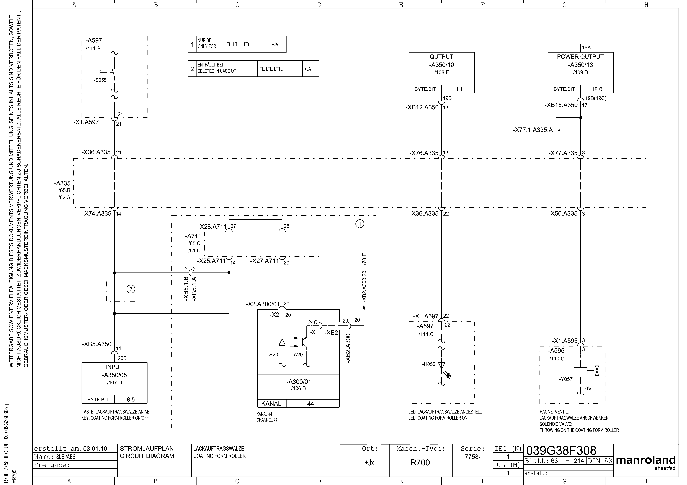

# +Jx — Sheet 63 of 214 — LACKAUFTRAGSWALZE

**COATING FORM ROLLER**

> Part of the manroland **R700** printing press IEC/UL circuit diagrams.
> Drawing class: **Stromlaufplan / Circuit diagram** (DIN A3).
> Document `+Jx` covers the **1st printing module + feed register** machine section.

## At a glance

| Field | Value |
|---|---|
| Document | `+Jx`  (039G38F308) |
| Sheet | **63** of 214 |
| Section (DE) | LACKAUFTRAGSWALZE |
| Section (EN) | COATING FORM ROLLER |
| Section type | CIRCUIT — Circuit diagram |
| Machine type | `R700` |
| Series | `7758` |
| Created | 03.01.10 |
| Replaces | — |
| Columns used | A, B, C, D, E, F, G |
| Path numbers | — |
| Labels on sheet | 115 |
| Cross-refs out | 12 |
| Cross-refs in | 33 |

**Previous:** [+Jx sheet 62](SHEET_0062.md) · **Next:** [+Jx sheet 64](SHEET_0064.md) · **Document TOC:** [_TOC.md](_TOC.md)  (+Jx) · **Master TOC:** [all sheets](../_MASTER_TOC.md)

## Sheet image (300 DPI, exact vector render)



_Rendered directly from the PDF vector layer at 300 DPI (1-bit), no OCR and no resampling. Use it to confirm anything ambiguous in the text below._

## Cross-references on this sheet

Each entry is a wire leaving this sheet. The printed token is `/sheet.column`; the link resolves to that sheet inside the same document.

| Ref | Target sheet | Col | Path | Destination on target | Target section | From col |
|---|---|---|---|---|---|---|
| `/111.B` | [+Jx sheet 111](SHEET_0111.md) | B | — | — | REFERENZMODUL | A |
| `/108.F` | [+Jx sheet 108](SHEET_0108.md) | F | — | — | REFERENZMODUL | F |
| `/109.D` | [+Jx sheet 109](SHEET_0109.md) | D | — | — | REFERENZMODUL | G |
| `/65.B` | [+Jx sheet 65](SHEET_0065.md) | B | — | — | TROPFEINRICHTUNG | A |
| `/62.A` | [+Jx sheet 62](SHEET_0062.md) | A | — | — | GTW | A |
| `/65.C` | [+Jx sheet 65](SHEET_0065.md) | C | — | — | TROPFEINRICHTUNG | B |
| `/51.C` | [+Jx sheet 51](SHEET_0051.md) | C | — | — | SIGNALGEBER: AKUSTISCHE WARNSIGNALE | B |
| `/78.E` | [+Jx sheet 78](SHEET_0078.md) | E | — | XB2.A300:20 | BUSVERBINDUNGEN: SICHERHEITSKREIS | E |
| `/111.C` | [+Jx sheet 111](SHEET_0111.md) | C | — | — | REFERENZMODUL | E |
| `/110.C` | [+Jx sheet 110](SHEET_0110.md) | C | — | — | REFERENZMODUL | G |
| `/107.D` | [+Jx sheet 107](SHEET_0107.md) | D | — | — | REFERENZMODUL | A |
| `/106.B` | [+Jx sheet 106](SHEET_0106.md) | B | — | — | REFERENZMODUL | D |

### Incoming references (sheets that point here)

Every other sheet that sends a wire to this one. `Back-ref` is the token printed on *that* sheet; `Path` is its line number.

| From sheet | Cols | Back-ref | Path | Refs | What continues there |
|---|---|---|---|---|---|
| [+Jx#51](SHEET_0051.md) | C | `/51.C` | — | 1 | — |
| [+Jx#62](SHEET_0062.md) | A | `/62.A` | — | 1 | — |
| [+Jx#65](SHEET_0065.md) | B, C | `/65.B`, `/65.C` | — | 2 | — |
| [+Jx#78](SHEET_0078.md) | E | `/78.E` | — | 1 | XB2.A300:20 |
| [+Jx#106](SHEET_0106.md) | B | `/106.B` | — | 1 | — |
| [+Jx#107](SHEET_0107.md) | D | `/107.D` | — | 1 | — |
| [+Jx#108](SHEET_0108.md) | F | `/108.F` | — | 1 | — |
| [+Jx#109](SHEET_0109.md) | D | `/109.D` | — | 1 | — |
| [+Jx#110](SHEET_0110.md) | C | `/110.C` | — | 1 | — |
| [+Jx#111](SHEET_0111.md) | B, C | `/111.B`, `/111.C` | — | 2 | — |
| [+Jx#115](SHEET_0115.md) | C, E | `/115.C`, `/115.E` | — | 3 | — |
| [+Jx#124](SHEET_0124.md) | F, H | `/124.F`, `/124.H` | — | 2 | — |
| [+Jx#131](SHEET_0131.md) | A, B | `/131.A`, `/131.B` | — | 2 | — |
| [+Jx#132](SHEET_0132.md) | C | `/132.C` | — | 1 | — |
| [+Jx#137](SHEET_0137.md) | H | `/137.H` | — | 1 | — |
| [+Jx#139](SHEET_0139.md) | B | `/139.B` | — | 1 | — |
| [+Jx#143](SHEET_0143.md) | B | `/143.B` | — | 1 | — |
| [+Jx#144](SHEET_0144.md) | G | `/144.G` | — | 1 | — |
| [+Jx#146](SHEET_0146.md) | D | `/146.D` | — | 2 | — |
| [+Jx#149](SHEET_0149.md) | F | `/149.F` | — | 2 | — |
| [+Jx#150](SHEET_0150.md) | H | `/150.H` | — | 1 | — |
| [+Jx#154](SHEET_0154.md) | A | `/154.A` | — | 1 | — |
| [+Jx#155](SHEET_0155.md) | B, D | `/155.B`, `/155.D` | — | 2 | — |
| [+Jx#156](SHEET_0156.md) | A | `/156.A` | — | 1 | — |


## Devices on this sheet

| Tag | Class | Class meaning (IEC) | Col | Sub | Terminal | Sign |
|---|---|---|---|---|---|---|
| `S055` | S | Schalter / switch | A | — | — | — |
| `A597` | A | Baugruppe / assembly, module, PC board | A | — | — | — |
| `A350/05` | A | Baugruppe / assembly, module, PC board | A | 05 | — | — |
| `A335` | A | Baugruppe / assembly, module, PC board | A | — | — | — |
| `Y057` | Y | Magnetventil / solenoid valve, actuator | G | — | — | — |
| `A595` | A | Baugruppe / assembly, module, PC board | G | — | — | — |
| `A597` | A | Baugruppe / assembly, module, PC board | E | — | — | — |
| `A350/10` | A | Baugruppe / assembly, module, PC board | F | 10 | — | — |
| `A350/13` | A | Baugruppe / assembly, module, PC board | G | 13 | — | — |
| `A711` | A | Baugruppe / assembly, module, PC board | B | — | — | — |
| `S20` | S | Schalter / switch | C | — | — | — |
| `A20` | A | Baugruppe / assembly, module, PC board | D | — | — | — |
| `X1` | X | Klemme / terminal, plug connector | D | — | — | — |
| `X2` | X | Klemme / terminal, plug connector | C | — | — | — |
| `XB2` | XB |  | D | — | — | — |
| `A300/01` | A | Baugruppe / assembly, module, PC board | D | 01 | — | — |
| `X1.A597` | — | cross-device reference | A | — | — | — |
| `8.5` | — | cross-device reference | B | — | — | — |
| `XB5.A350` | — | cross-device reference | A | — | — | — |
| `X74.A335` | — | cross-device reference | A | — | — | — |
| `X36.A335` | — | cross-device reference | A | — | — | — |
| `X1.A595` | — | cross-device reference | G | — | — | — |
| `X1.A597` | — | cross-device reference | E | — | — | — |
| `X36.A335` | — | cross-device reference | E | — | — | — |
| `X76.A335` | — | cross-device reference | E | — | — | — |
| `X77.A335` | — | cross-device reference | G | — | — | — |
| `X50.A335` | — | cross-device reference | G | — | — | — |
| `X77.1.A335.A` | — | cross-device reference | G | — | — | — |
| `14.4` | — | cross-device reference | F | — | — | — |
| `XB12.A350` | — | cross-device reference | E | — | — | — |
| `18.0` | — | cross-device reference | G | — | — | — |
| `XB15.A350` | — | cross-device reference | G | — | — | — |
| `X28.A711` | — | cross-device reference | C | — | — | — |
| `X25.A711` | — | cross-device reference | C | — | — | — |
| `XB5.1.A` | — | cross-device reference | B | — | — | — |
| `XB5.1.B` | — | cross-device reference | B | — | — | — |
| `XB2.A300` | — | cross-device reference | D | — | — | — |
| `X27.A711` | — | cross-device reference | C | — | — | — |
| `XB2.A300:20` | — | cross-device reference | E | — | 20 | — |

## Potentials / nets

| Potential | Count | Columns | Attached devices | Terminals |
|---|---|---|---|---|
| `0V` | 1 | G | — | — |
| `H055` | 1 | E | — | — |


A potential such as `L24+/4` or `M24+` is a named supply/return rail; every place it appears on this sheet is electrically common.

## Wire-end annotations (grouped as printed)

A wire that continues elsewhere is annotated with a small cluster: the destination description, the path/line number `#NN`, and the `/sheet.column` cross reference. Each row below is one such cluster exactly as it is grouped on the drawing.

| Col | Y | Path | Cross-ref | Text on the wire |
|---|---|---|---|---|
| A | 65.4 | — | — | `A597` |
| C | 67.2 | — | — | `1 NUR BEI ONLY FOR TL, LTL, LTTL` |
| C | 74.2 | — | — | `+JA` |
| G | 78.9 | — | — | `19A` |
| A | 80.3 | — | `/111.B` | — |
| G | 94.0 | — | — | `POWER QUTPUT` |
| E | 94.1 | — | — | `QUTPUT` |
| F | 108.0 | — | — | `A350/10` |
| G | 108.0 | — | — | `A350/13` |
| C | 109.7 | — | — | `2 ENTFÄLLT BEI DELETED IN CASE OF TL, LTL, LTTL` |
| D | 116.8 | — | — | `+JA` |
| F | 121.8 | — | `/108.F` | — |
| G | 121.8 | — | `/109.D` | — |
| A | 135.3 | — | — | `S055` |
| G | 150.8 | — | — | `BYTE.BIT 18.0` |
| E | 151.4 | — | — | `BYTE.BIT 14.4` |
| F | 166.8 | — | — | `19B` |
| G | 166.8 | — | — | `19B(19C)` |
| G | 177.4 | — | — | `XB15.A350 17` |
| E | 181.7 | — | — | `XB12.A350 13` |
| B | 194.4 | — | — | `21` |
| A | 207.2 | — | — | `X1.A597 21` |
| G | 220.6 | — | — | `X77.1.A335.A 8` |
| A | 259.6 | — | — | `X36.A335 21` |
| F | 261.0 | — | — | `X76.A335 13 X77.A335 8` |
| A | 313.5 | — | — | `A335` |
| A | 326.5 | — | `/65.B`, `/62.A` | — |
| A | 365.9 | — | — | `X74.A335 14` |
| E | 365.9 | — | — | `X36.A335 22` |
| G | 365.9 | — | — | `X50.A335 3` |
| E | 385.3 | — | — | `1` |
| C | 388.6 | — | — | `X28.A711 27` |
| D | 388.6 | — | — | `28` |
| B | 405.6 | — | — | `A711` |
| B | 418.7 | — | `/65.C`, `/51.C` | — |
| E | 439.2 | — | `/78.E` | `XB2.A300:20` |
| C | 448.1 | — | — | `X25.A711 14` |
| C | 448.1 | — | — | `X27.A711 20` |
| B | 461.8 | — | — | `XB5.1.B 14` |
| B | 461.8 | — | — | `XB5.1.A 14` |
| B | 499.1 | — | — | `2` |
| C | 523.2 | — | — | `X2.A300/01 20` |
| C | 541.7 | — | — | `X2` |
| D | 543.1 | — | — | `20 20` |
| E | 544.5 | — | — | `X1.A597 22` |
| D | 551.6 | — | — | `20` |
| D | 555.9 | — | — | `24C` |
| F | 560.1 | — | — | `22` |
| E | 561.5 | — | — | `A597` |
| D | 572.8 | — | — | `X1` |
| D | 572.9 | — | — | `XB2` |
| E | 576.4 | — | `/111.C` | — |
| D | 579.1 | — | — | `XB2.A300` |
| G | 587.0 | — | — | `X1.A595 3` |
| A | 592.7 | — | — | `XB5.A350 14` |
| G | 602.6 | — | — | `3` |
| G | 604.0 | — | — | `A595` |
| D | 611.8 | — | — | `S20 A20` |
| B | 618.2 | — | — | `20B` |
| G | 618.9 | — | `/110.C` | — |
| E | 628.5 | — | — | `H055` |
| A | 632.7 | — | — | `INPUT` |
| A | 646.5 | — | — | `A350/05` |
| G | 654.3 | — | — | `Y057` |
| D | 657.9 | — | — | `A300/01` |
| A | 660.4 | — | `/107.D` | — |
| D | 670.2 | — | `/106.B` | — |
| G | 670.6 | — | — | `0V` |
| A | 689.4 | — | — | `BYTE.BIT 8.5` |
| D | 696.1 | — | — | `KANAL 44` |
| B | 712.0 | — | — | `KEY: COATING FORM ROLLER ON/OFF TASTE: LACKAUFTRAGSWALZE AN/AB` |
| F | 712.1 | — | — | `LED: LACKAUFTRAGSWALZE ANGESTELLT LED: COATING FORM ROLLER ON` |
| G | 712.1 | — | — | `MAGNETVENTIL: LACKAUFTRAGWALZE ANSCHWENKEN SOLENOID VALVE: THROWING ON THE COATING FORM ROLLER` |
| C | 716.5 | — | — | `KANAL 44 CHANNEL 44` |


## Reconstructed tables

This sheet carries tabular content (pin map / terminal assignment / index). The grid below was rebuilt from the drawing's own rule lines, so each row is exactly one physical row of the table.

### Table 1 — 5 data rows × 2 columns (at x=141.7, y=62.4)

| A597 /111.B S055 | 21 |
|---|---|
| `X1.A597 X36.A335 X74.A335` | `21 21 14` |
|  | `2` |
| `XB5.A350` | `14 20B` |
| `INPUT` | `A350/05 /107.D` |
| `BYTE.BIT` | `8.5` |


### Table 2 — 8 data rows × 9 columns (at x=396.9, y=90.7)

| OF | TL, LTL, LTTL |  | +JA |  |  |  | QUTPUT | A350/10 /108.F |
|---|---|---|---|---|---|---|---|---|
|  |  |  |  |  |  |  | `BYTE.BIT` | `14.4` |
|  |  |  |  |  |  |  | `XB12.A350 X76.A335 X36.A335` | `19B 13 13 22` |
| `27 14` | `X27.A711` | `28 20` |  |  | `1` | `/78.E` |  |  |
|  | `X2.A300/01` | `20` |  |  |  | `XB2.A300:20` |  |  |
|  | `X2` | `20` |  |  | `20 20` |  | `X1.A597` | `22` |
|  | `S20` | `A20` | `24C X1` | `XB2` | `XB2.A300` |  | `A597 /111.C H055` | `22` |
|  |  | `A300/01 /106.B` |  |  |  |  |  |  |
|  | `KANAL` |  | `44` |  |  |  |  |  |


### Table 3 — 2 data rows × 2 columns (at x=949.6, y=90.7)

| POWER A350/13 | QUTPUT /109.D |
|---|---|
| `BYTE.BIT` | `18.0` |
| `XB15.A350` | `19B(19C) 17` |


## Notes and free text on this sheet

| Text | Col | Y (pt) |
|---|---|---|
| `20B` | B | 618.18 |
| `INPUT` | A | 632.7 |
| `BYTE.BIT` | A | 689.96 |
| `TASTE: LACKAUFTRAGSWALZE AN/AB` | B | 712.05 |
| `KEY: COATING FORM ROLLER ON/OFF` | B | 722.71 |
| `MAGNETVENTIL:` | G | 712.06 |
| `LACKAUFTRAGWALZE ANSCHWENKEN` | G | 722.68 |
| `SOLENOID VALVE:` | G | 733.32 |
| `THROWING ON THE COATING FORM ROLLER` | G | 743.98 |
| `LED: LACKAUFTRAGSWALZE ANGESTELLT` | F | 712.06 |
| `LED: COATING FORM ROLLER ON` | E | 722.72 |
| `19B` | F | 166.77 |
| `QUTPUT` | E | 94.09 |
| `BYTE.BIT` | E | 151.38 |
| `19A` | G | 78.89 |
| `19B(19C)` | G | 166.8 |
| `POWER QUTPUT` | G | 94.04 |
| `BYTE.BIT` | G | 151.38 |
| `KANAL 44` | C | 716.49 |
| `CHANNEL 44` | C | 726.43 |
| `24C` | D | 555.86 |
| `KANAL` | C | 696.14 |
| `X2.A300/01` | C | 523.23 |
| `NUR BEI` | C | 67.15 |
| `ONLY FOR` | C | 77.84 |
| `TL, LTL, LTTL` | C | 74.28 |
| `ENTFÄLLT BEI` | C | 109.68 |
| `DELETED IN CASE OF` | C | 120.33 |
| `+JA` | C | 74.23 |
| `+JA` | D | 116.75 |

## Complete label inventory (exact text from the drawing)

Every text object inside the drawing area of this sheet, in DIN reading order (column A→H, then top→bottom). This is the authoritative list: if a string is not here it is not printed on this sheet.

| Col | Y | X | Dir | Type | Text |
|---|---|---|---|---|---|
| A | 65.4 | 148.5 | → | device tag | `A597` |
| A | 80.3 | 148.8 | → | cross-reference | `/111.B` |
| A | 135.3 | 162.7 | → | device tag | `S055` |
| A | 207.2 | 127.3 | → | device ref | `X1.A597` |
| A | 259.6 | 141.4 | → | device ref | `X36.A335` |
| A | 313.5 | 93.8 | → | device tag | `A335` |
| A | 326.5 | 101.5 | → | cross-reference | `/65.B` |
| A | 338.9 | 101.2 | → | cross-reference | `/62.A` |
| A | 365.9 | 142.9 | → | device ref | `X74.A335` |
| A | 592.7 | 142.0 | → | device ref | `XB5.A350` |
| A | 632.7 | 183.5 | → | text | `INPUT` |
| A | 646.5 | 176.9 | → | device tag | `A350/05` |
| A | 660.4 | 185.7 | → | cross-reference | `/107.D` |
| A | 690.0 | 151.7 | → | text | `BYTE.BIT` |
| B | 72.5 | 330.5 | → | number | `1` |
| B | 115.0 | 330.2 | → | number | `2` |
| B | 194.4 | 204.1 | → | number | `21` |
| B | 211.4 | 201.3 | → | number | `21` |
| B | 261.1 | 201.3 | → | number | `21` |
| B | 367.4 | 200.4 | → | number | `14` |
| B | 405.6 | 320.9 | → | device tag | `A711` |
| B | 418.7 | 326.6 | → | cross-reference | `/65.C` |
| B | 431.1 | 326.6 | → | cross-reference | `/51.C` |
| B | 461.8 | 319.2 | ↕ | number | `14` |
| B | 461.8 | 333.3 | ↕ | number | `14` |
| B | 479.9 | 317.7 | ↕ | device ref | `XB5.1.B` |
| B | 480.5 | 331.9 | ↕ | device ref | `XB5.1.A` |
| B | 499.1 | 224.8 | → | number | `2` |
| B | 601.2 | 200.4 | → | number | `14` |
| B | 618.2 | 204.1 | → | text | `20B` |
| B | 689.4 | 220.0 | → | device ref | `8.5` |
| B | 712.1 | 141.7 | → | text | `TASTE: LACKAUFTRAGSWALZE AN/AB` |
| B | 722.7 | 141.2 | → | text | `KEY: COATING FORM ROLLER ON/OFF` |
| C | 67.2 | 342.4 | → | text | `NUR BEI` |
| C | 74.2 | 471.0 | → | text | `+JA` |
| C | 74.3 | 393.3 | → | text | `TL, LTL, LTTL` |
| C | 77.8 | 342.7 | → | text | `ONLY FOR` |
| C | 109.7 | 342.4 | → | text | `ENTFÄLLT BEI` |
| C | 116.8 | 450.0 | → | text | `TL, LTL, LTTL` |
| C | 120.3 | 342.4 | → | text | `DELETED IN CASE OF` |
| C | 388.6 | 343.0 | → | device ref | `X28.A711` |
| C | 388.6 | 399.7 | → | number | `27` |
| C | 448.1 | 341.6 | → | device ref | `X25.A711` |
| C | 448.1 | 433.7 | → | device ref | `X27.A711` |
| C | 452.4 | 398.8 | → | number | `14` |
| C | 523.2 | 426.3 | → | text | `X2.A300/01` |
| C | 541.7 | 467.4 | → | device tag | `X2` |
| C | 611.8 | 463.7 | → | device tag | `S20` |
| C | 696.1 | 453.0 | → | text | `KANAL` |
| C | 716.5 | 444.5 | → | text | `KANAL 44` |
| C | 726.4 | 444.8 | → | text | `CHANNEL 44` |
| D | 116.8 | 527.7 | → | text | `+JA` |
| D | 388.6 | 491.8 | → | number | `28` |
| D | 452.4 | 491.8 | → | number | `20` |
| D | 523.3 | 491.8 | → | number | `20` |
| D | 543.1 | 494.6 | → | number | `20` |
| D | 551.6 | 614.3 | → | number | `20` |
| D | 553.0 | 593.9 | → | number | `20` |
| D | 555.9 | 534.3 | → | text | `24C` |
| D | 572.8 | 537.7 | → | device tag | `X1` |
| D | 572.8 | 562.4 | → | device tag | `XB2` |
| D | 579.1 | 598.3 | ↕ | device ref | `XB2.A300` |
| D | 611.8 | 506.3 | → | device tag | `A20` |
| D | 657.9 | 496.6 | → | device tag | `A300/01` |
| D | 670.2 | 504.7 | → | cross-reference | `/106.B` |
| D | 696.1 | 532.8 | → | number | `44` |
| E | 94.1 | 745.1 | → | text | `QUTPUT` |
| E | 151.4 | 718.6 | → | text | `BYTE.BIT` |
| E | 181.7 | 703.0 | → | device ref | `XB12.A350` |
| E | 261.0 | 709.8 | → | device ref | `X76.A335` |
| E | 365.9 | 709.8 | → | device ref | `X36.A335` |
| E | 385.3 | 621.8 | → | number | `1` |
| E | 439.2 | 627.4 | ↕ | cross-reference | `/78.E` |
| E | 470.0 | 627.4 | ↕ | device ref | `XB2.A300:20` |
| E | 544.5 | 715.7 | → | device ref | `X1.A597` |
| E | 561.5 | 723.1 | → | device tag | `A597` |
| E | 576.4 | 725.7 | → | cross-reference | `/111.C` |
| E | 628.5 | 731.9 | → | potential | `H055` |
| E | 722.7 | 708.1 | → | text | `LED: COATING FORM ROLLER ON` |
| F | 108.0 | 744.0 | → | device tag | `A350/10` |
| F | 121.8 | 753.0 | → | cross-reference | `/108.F` |
| F | 151.4 | 785.5 | → | device ref | `14.4` |
| F | 166.8 | 767.3 | → | text | `19B` |
| F | 183.1 | 767.3 | → | number | `13` |
| F | 261.1 | 767.3 | → | number | `13` |
| F | 367.4 | 768.2 | → | number | `22` |
| F | 544.5 | 768.2 | → | number | `22` |
| F | 560.1 | 771.0 | → | number | `22` |
| F | 712.1 | 708.1 | → | text | `LED: LACKAUFTRAGSWALZE ANGESTELLT` |
| G | 78.9 | 1008.3 | → | text | `19A` |
| G | 94.0 | 965.5 | → | text | `POWER QUTPUT` |
| G | 108.0 | 984.8 | → | device tag | `A350/13` |
| G | 121.8 | 993.5 | → | cross-reference | `/109.D` |
| G | 150.8 | 1024.9 | → | device ref | `18.0` |
| G | 151.4 | 959.5 | → | text | `BYTE.BIT` |
| G | 166.8 | 1014.0 | → | text | `19B(19C)` |
| G | 177.4 | 943.9 | → | device ref | `XB15.A350` |
| G | 178.9 | 1008.3 | → | number | `17` |
| G | 220.6 | 889.2 | → | device ref | `X77.1.A335.A` |
| G | 222.8 | 966.3 | → | number | `8` |
| G | 261.0 | 950.7 | → | device ref | `X77.A335` |
| G | 261.1 | 1008.9 | → | number | `8` |
| G | 365.9 | 950.7 | → | device ref | `X50.A335` |
| G | 367.4 | 1008.9 | → | number | `3` |
| G | 587.0 | 956.7 | → | device ref | `X1.A595` |
| G | 587.0 | 1008.9 | → | number | `3` |
| G | 602.6 | 1008.9 | → | number | `3` |
| G | 604.0 | 949.9 | → | device tag | `A595` |
| G | 618.9 | 952.4 | → | cross-reference | `/110.C` |
| G | 654.3 | 969.2 | → | device tag | `Y057` |
| G | 670.6 | 1014.5 | → | potential | `0V` |
| G | 712.1 | 934.9 | → | text | `MAGNETVENTIL:` |
| G | 722.7 | 934.9 | → | text | `LACKAUFTRAGWALZE ANSCHWENKEN` |
| G | 733.3 | 935.1 | → | text | `SOLENOID VALVE:` |
| G | 744.0 | 935.4 | → | text | `THROWING ON THE COATING FORM ROLLER` |

## Reading-order text block

The same content as a plain block, grouped by DIN column — convenient to paste or to match against a visual description.

```text
=== Column A ===
  65.4  148.5  devtag       A597
  80.3  148.8  xref         /111.B
 135.3  162.7  devtag       S055
 207.2  127.3  devref       X1.A597
 259.6  141.4  devref       X36.A335
 313.5   93.8  devtag       A335
 326.5  101.5  xref         /65.B
 338.9  101.2  xref         /62.A
 365.9  142.9  devref       X74.A335
 592.7  142.0  devref       XB5.A350
 632.7  183.5  text         INPUT
 646.5  176.9  devtag       A350/05
 660.4  185.7  xref         /107.D
 690.0  151.7  text         BYTE.BIT
=== Column B ===
  72.5  330.5  numeric      1
 115.0  330.2  numeric      2
 194.4  204.1  numeric      21
 211.4  201.3  numeric      21
 261.1  201.3  numeric      21
 367.4  200.4  numeric      14
 405.6  320.9  devtag       A711
 418.7  326.6  xref         /65.C
 431.1  326.6  xref         /51.C
 461.8  319.2  numeric      14
 461.8  333.3  numeric      14
 479.9  317.7  devref       XB5.1.B
 480.5  331.9  devref       XB5.1.A
 499.1  224.8  numeric      2
 601.2  200.4  numeric      14
 618.2  204.1  text         20B
 689.4  220.0  devref       8.5
 712.1  141.7  text         TASTE: LACKAUFTRAGSWALZE AN/AB
 722.7  141.2  text         KEY: COATING FORM ROLLER ON/OFF
=== Column C ===
  67.2  342.4  text         NUR BEI
  74.2  471.0  text         +JA
  74.3  393.3  text         TL, LTL, LTTL
  77.8  342.7  text         ONLY FOR
 109.7  342.4  text         ENTFÄLLT BEI
 116.8  450.0  text         TL, LTL, LTTL
 120.3  342.4  text         DELETED IN CASE OF
 388.6  343.0  devref       X28.A711
 388.6  399.7  numeric      27
 448.1  341.6  devref       X25.A711
 448.1  433.7  devref       X27.A711
 452.4  398.8  numeric      14
 523.2  426.3  text         X2.A300/01
 541.7  467.4  devtag       X2
 611.8  463.7  devtag       S20
 696.1  453.0  text         KANAL
 716.5  444.5  text         KANAL 44
 726.4  444.8  text         CHANNEL 44
=== Column D ===
 116.8  527.7  text         +JA
 388.6  491.8  numeric      28
 452.4  491.8  numeric      20
 523.3  491.8  numeric      20
 543.1  494.6  numeric      20
 551.6  614.3  numeric      20
 553.0  593.9  numeric      20
 555.9  534.3  text         24C
 572.8  537.7  devtag       X1
 572.8  562.4  devtag       XB2
 579.1  598.3  devref       XB2.A300
 611.8  506.3  devtag       A20
 657.9  496.6  devtag       A300/01
 670.2  504.7  xref         /106.B
 696.1  532.8  numeric      44
=== Column E ===
  94.1  745.1  text         QUTPUT
 151.4  718.6  text         BYTE.BIT
 181.7  703.0  devref       XB12.A350
 261.0  709.8  devref       X76.A335
 365.9  709.8  devref       X36.A335
 385.3  621.8  numeric      1
 439.2  627.4  xref         /78.E
 470.0  627.4  devref       XB2.A300:20
 544.5  715.7  devref       X1.A597
 561.5  723.1  devtag       A597
 576.4  725.7  xref         /111.C
 628.5  731.9  net          H055
 722.7  708.1  text         LED: COATING FORM ROLLER ON
=== Column F ===
 108.0  744.0  devtag       A350/10
 121.8  753.0  xref         /108.F
 151.4  785.5  devref       14.4
 166.8  767.3  text         19B
 183.1  767.3  numeric      13
 261.1  767.3  numeric      13
 367.4  768.2  numeric      22
 544.5  768.2  numeric      22
 560.1  771.0  numeric      22
 712.1  708.1  text         LED: LACKAUFTRAGSWALZE ANGESTELLT
=== Column G ===
  78.9 1008.3  text         19A
  94.0  965.5  text         POWER QUTPUT
 108.0  984.8  devtag       A350/13
 121.8  993.5  xref         /109.D
 150.8 1024.9  devref       18.0
 151.4  959.5  text         BYTE.BIT
 166.8 1014.0  text         19B(19C)
 177.4  943.9  devref       XB15.A350
 178.9 1008.3  numeric      17
 220.6  889.2  devref       X77.1.A335.A
 222.8  966.3  numeric      8
 261.0  950.7  devref       X77.A335
 261.1 1008.9  numeric      8
 365.9  950.7  devref       X50.A335
 367.4 1008.9  numeric      3
 587.0  956.7  devref       X1.A595
 587.0 1008.9  numeric      3
 602.6 1008.9  numeric      3
 604.0  949.9  devtag       A595
 618.9  952.4  xref         /110.C
 654.3  969.2  devtag       Y057
 670.6 1014.5  net          0V
 712.1  934.9  text         MAGNETVENTIL:
 722.7  934.9  text         LACKAUFTRAGWALZE ANSCHWENKEN
 733.3  935.1  text         SOLENOID VALVE:
 744.0  935.4  text         THROWING ON THE COATING FORM ROLLER
```

---
_Generated from the PDF vector text layer; no OCR. Source: `R700_7758_IEC_UL_JX_039G38F308_p`, sheet 63._
