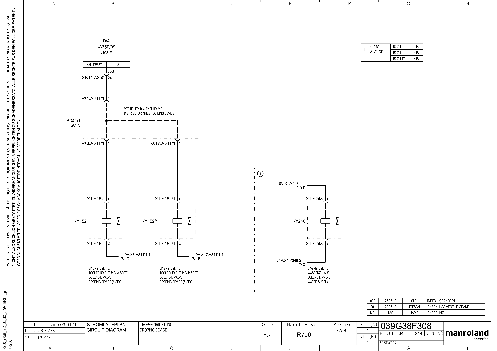

# +Jx — Sheet 64 of 214 — TROPFEINRICHTUNG

**DROPING DEVICE**

> Part of the manroland **R700** printing press IEC/UL circuit diagrams.
> Drawing class: **Stromlaufplan / Circuit diagram** (DIN A3).
> Document `+Jx` covers the **1st printing module + feed register** machine section.

## At a glance

| Field | Value |
|---|---|
| Document | `+Jx`  (039G38F308) |
| Sheet | **64** of 214 |
| Section (DE) | TROPFEINRICHTUNG |
| Section (EN) | DROPING DEVICE |
| Section type | CIRCUIT — Circuit diagram |
| Machine type | `R700` |
| Series | `7758` |
| Created | 03.01.10 |
| Replaces | — |
| Columns used | A, B, C, D, E, F, G, H |
| Path numbers | — |
| Labels on sheet | 75 |
| Cross-refs out | 6 |
| Cross-refs in | 16 |

**Previous:** [+Jx sheet 63](SHEET_0063.md) · **Next:** [+Jx sheet 65](SHEET_0065.md) · **Document TOC:** [_TOC.md](_TOC.md)  (+Jx) · **Master TOC:** [all sheets](../_MASTER_TOC.md)

## Sheet image (300 DPI, exact vector render)



_Rendered directly from the PDF vector layer at 300 DPI (1-bit), no OCR and no resampling. Use it to confirm anything ambiguous in the text below._

## Cross-references on this sheet

Each entry is a wire leaving this sheet. The printed token is `/sheet.column`; the link resolves to that sheet inside the same document.

| Ref | Target sheet | Col | Path | Destination on target | Target section | From col |
|---|---|---|---|---|---|---|
| `/108.E` | [+Jx sheet 108](SHEET_0108.md) | E | — | — | REFERENZMODUL | B |
| `/68.A` | [+Jx sheet 68](SHEET_0068.md) | A | — | — | BLAS/SAUGLUFT MIT MOTORVENTILEINSTELLUNG | A |
| `/10.E` | [+Jx sheet 10](SHEET_0010.md) | E | — | 0V.X1.Y248:1 | SPANNUNGSVERSORGUNG, SCHALTSCHRANKBELÜFTUNG | E |
| `/84.D` | [+Jx sheet 84](SHEET_0084.md) | D | — | 0V.X17.A341\1:1 | BOGENFÜHRUNG | C |
| `/84.F` | [+Jx sheet 84](SHEET_0084.md) | F | — | 24V.X1.Y248:2 | BOGENFÜHRUNG | D |
| `/9.C` | [+Jx sheet 9](SHEET_0009.md) | C | — | 24V.X1.Y248:2 | SPANNUNGSVERSORGUNG, SCHALTSCHRANKBELÜFTUNG | D |

### Incoming references (sheets that point here)

Every other sheet that sends a wire to this one. `Back-ref` is the token printed on *that* sheet; `Path` is its line number.

| From sheet | Cols | Back-ref | Path | Refs | What continues there |
|---|---|---|---|---|---|
| [+Jx#9](SHEET_0009.md) | C | `/9.C` | — | 1 | 24V.X1.Y248:2 |
| [+Jx#10](SHEET_0010.md) | E | `/10.E` | — | 1 | — |
| [+Jx#68](SHEET_0068.md) | A | `/68.A` | — | 1 | — |
| [+Jx#84](SHEET_0084.md) | D, F | `/84.D`, `/84.F` | — | 2 | 0V.X17.A341\1:1; 0V.X3.A341\1:1 |
| [+Jx#108](SHEET_0108.md) | E | `/108.E` | — | 1 | — |
| [+Jx#114](SHEET_0114.md) | A | `/114.A` | — | 1 | — |
| [+Jx#120](SHEET_0120.md) | E, G | `/120.E`, `/120.G` | — | 6 | — |
| [+Jx#127](SHEET_0127.md) | G | `/127.G` | — | 1 | — |
| [+Jx#136](SHEET_0136.md) | G | `/136.G` | — | 1 | — |
| [+Jx#140](SHEET_0140.md) | B | `/140.B` | — | 1 | — |


## Devices on this sheet

| Tag | Class | Class meaning (IEC) | Col | Sub | Terminal | Sign |
|---|---|---|---|---|---|---|
| `A350/09` | A | Baugruppe / assembly, module, PC board | B | 09 | — | — |
| `A341/1` | A | Baugruppe / assembly, module, PC board | A | 1 | — | — |
| `Y152` | Y | Magnetventil / solenoid valve, actuator | A | — | — | — |
| `Y152/1` | Y | Magnetventil / solenoid valve, actuator | C | 1 | — | — |
| `Y248` | Y | Magnetventil / solenoid valve, actuator | E | — | — | — |
| `XB11.A350` | — | cross-device reference | B | — | — | — |
| `X1.Y152` | — | cross-device reference | B | — | — | — |
| `X1.Y152` | — | cross-device reference | B | — | — | — |
| `X1.Y248` | — | cross-device reference | E | — | — | — |
| `X1.Y248` | — | cross-device reference | E | — | — | — |
| `NR.` | — | cross-device reference | F | — | — | — |
| `20.08.10` | — | cross-device reference | G | — | — | — |
| `28.06.12` | — | cross-device reference | G | — | — | — |

## Potentials / nets

| Potential | Count | Columns | Attached devices | Terminals |
|---|---|---|---|---|
| `0V` | 3 | B, D, E | `A341\1`, `X1`, `X17`, `X3`, `Y248` | `1` |
| `24V` | 1 | E | `X1`, `Y248` | `2` |


A potential such as `L24+/4` or `M24+` is a named supply/return rail; every place it appears on this sheet is electrically common.

## Wire-end annotations (grouped as printed)

A wire that continues elsewhere is annotated with a small cluster: the destination description, the path/line number `#NN`, and the `/sheet.column` cross reference. Each row below is one such cluster exactly as it is grouped on the drawing.

| Col | Y | Path | Cross-ref | Text on the wire |
|---|---|---|---|---|
| B | 94.1 | — | — | `D/A` |
| B | 108.0 | — | — | `A350/09` |
| G | 109.7 | — | — | `1 NUR BEI ONLY FOR R700 L` |
| G | 109.7 | — | — | `+JA` |
| B | 122.8 | — | `/108.E` | — |
| G | 123.8 | — | — | `+JB` |
| G | 123.9 | — | — | `R700 LL` |
| G | 138.0 | — | — | `R700 LTTL +JB` |
| B | 151.2 | — | — | `OUTPUT 8` |
| B | 167.5 | — | — | `30B` |
| B | 181.7 | — | — | `XB11.A350 24` |
| B | 231.3 | — | — | `X1.A341/1 24` |
| C | 258.6 | — | — | `DISTRIBUTOR: SHEET GUIDING DEVICE VERTEILER: BOGENFÜHRUNG` |
| A | 285.1 | — | — | `A341/1` |
| A | 298.2 | — | `/68.A` | — |
| B | 339.0 | — | — | `X3.A341/1 5` |
| C | 339.0 | — | — | `X17.A341/1 5` |
| E | 413.6 | — | — | `1` |
| E | 436.7 | — | `/10.E` | `0V.X1.Y248:1` |
| B | 472.3 | — | — | `X1.Y152 1` |
| C | 472.3 | — | — | `X1.Y152/1 1` |
| E | 472.3 | — | — | `X1.Y248 1` |
| A | 526.1 | — | — | `Y152` |
| C | 526.1 | — | — | `Y152/1` |
| E | 526.1 | — | — | `Y248` |
| B | 580.0 | — | — | `X1.Y152 2` |
| C | 580.0 | — | — | `X1.Y152/1 2` |
| E | 580.0 | — | — | `X1.Y248 2` |
| C | 606.8 | — | `/84.D` | `0V.X17.A341\1:1` |
| B | 606.8 | — | — | `0V.X3.A341\1:1` |
| D | 616.7 | — | `/84.F`, `/9.C` | `24V.X1.Y248:2` |
| B | 641.2 | — | — | `MAGNETVENTIL:` |
| C | 641.2 | — | — | `MAGNETVENTIL:` |
| E | 641.2 | — | — | `MAGNETVENTIL:` |
| E | 651.8 | — | — | `SOLENOID VALVE: WASSERZULAUF WATER SUPPLY` |
| B | 651.9 | — | — | `DROPING DEVICE (A SIDE) SOLENOID VALVE: TROPFEINRICHTUNG (A SEITE)` |
| C | 651.9 | — | — | `DROPING DEVICE (B SIDE) SOLENOID VALVE: TROPFEINRICHTUNG (B SEITE)` |
| G | 718.9 | — | — | `002 28.06.12 SLEI INDEX 1 GEÄNDERT` |
| G | 733.0 | — | — | `001 20.08.10 JDI/SCH ANSCHLUSS VENTILE GEÄND.` |
| G | 747.1 | — | — | `NR. TAG NAME ÄNDERUNG` |


## Reconstructed tables

This sheet carries tabular content (pin map / terminal assignment / index). The grid below was rebuilt from the drawing's own rule lines, so each row is exactly one physical row of the table.

### Table 1 — 2 data rows × 2 columns (at x=198.4, y=90.7)

| D/A | A350/09 /108.E |
|---|---|
| `OUTPUT` | `8` |
| `XB11.A350 X1.A341/1` | `30B 24 24` |


## Notes and free text on this sheet

| Text | Col | Y (pt) |
|---|---|---|
| `30B` | B | 167.47 |
| `D/A` | B | 94.07 |
| `OUTPUT` | B | 151.18 |
| `X3.A341/1` | B | 338.99 |
| `VERTEILER: BOGENFÜHRUNG` | C | 258.55 |
| `DISTRIBUTOR: SHEET GUIDING DEVICE` | C | 269.16 |
| `X17.A341/1` | C | 338.98 |
| `MAGNETVENTIL:` | B | 641.2 |
| `TROPFEINRICHTUNG (A SEITE)` | B | 651.85 |
| `SOLENOID VALVE:` | B | 662.45 |
| `DROPING DEVICE (A SIDE)` | B | 673.11 |
| `X1.Y152/1` | C | 579.97 |
| `MAGNETVENTIL:` | C | 641.2 |
| `TROPFEINRICHTUNG (B SEITE)` | C | 651.85 |
| `SOLENOID VALVE:` | C | 662.45 |
| `DROPING DEVICE (B SIDE)` | C | 673.11 |
| `X1.A341/1` | B | 231.27 |
| `MAGNETVENTIL:` | E | 641.2 |
| `WASSERZULAUF` | E | 651.82 |
| `SOLENOID VALVE:` | E | 662.45 |
| `WATER SUPPLY` | E | 673.07 |
| `TAG` | G | 747.23 |
| `NAME` | G | 747.22 |
| `ÄNDERUNG` | G | 747.25 |
| `JDI/SCH` | G | 733.05 |
| `ANSCHLUSS VENTILE GEÄND.` | H | 733.09 |
| `SLEI` | G | 718.89 |
| `INDEX 1 GEÄNDERT` | H | 718.91 |
| `NUR BEI` | F | 109.67 |
| `ONLY FOR` | F | 120.36 |
| `R700 L` | G | 109.72 |
| `R700 LL` | G | 123.9 |
| `+JA` | G | 109.67 |
| `+JB` | G | 123.82 |
| `R700 LTTL` | G | 138.07 |

## Complete label inventory (exact text from the drawing)

Every text object inside the drawing area of this sheet, in DIN reading order (column A→H, then top→bottom). This is the authoritative list: if a string is not here it is not printed on this sheet.

| Col | Y | X | Dir | Type | Text |
|---|---|---|---|---|---|
| A | 285.1 | 156.2 | → | device tag | `A341/1` |
| A | 298.2 | 170.6 | → | cross-reference | `/68.A` |
| A | 526.1 | 179.7 | → | device tag | `Y152` |
| B | 94.1 | 246.6 | → | text | `D/A` |
| B | 108.0 | 233.6 | → | device tag | `A350/09` |
| B | 122.8 | 242.5 | → | cross-reference | `/108.E` |
| B | 151.2 | 208.6 | → | text | `OUTPUT` |
| B | 151.2 | 281.1 | → | number | `8` |
| B | 167.5 | 257.7 | → | text | `30B` |
| B | 181.7 | 192.8 | → | device ref | `XB11.A350` |
| B | 183.1 | 258.0 | → | number | `24` |
| B | 231.3 | 197.0 | → | text | `X1.A341/1` |
| B | 232.7 | 258.0 | → | number | `24` |
| B | 339.0 | 197.0 | → | text | `X3.A341/1` |
| B | 339.0 | 257.7 | → | number | `5` |
| B | 472.3 | 204.9 | → | device ref | `X1.Y152` |
| B | 473.7 | 257.1 | → | number | `1` |
| B | 580.0 | 204.9 | → | device ref | `X1.Y152` |
| B | 580.0 | 258.0 | → | number | `2` |
| B | 606.8 | 298.8 | → | potential | `0V.X3.A341\1:1` |
| B | 616.8 | 289.1 | → | cross-reference | `/84.D` |
| B | 641.2 | 212.0 | → | text | `MAGNETVENTIL:` |
| B | 651.9 | 212.6 | → | text | `TROPFEINRICHTUNG (A SEITE)` |
| B | 662.5 | 212.3 | → | text | `SOLENOID VALVE:` |
| B | 673.1 | 212.0 | → | text | `DROPING DEVICE (A SIDE)` |
| C | 258.5 | 297.6 | → | text | `VERTEILER: BOGENFÜHRUNG` |
| C | 269.2 | 297.1 | → | text | `DISTRIBUTOR: SHEET GUIDING DEVICE` |
| C | 339.0 | 361.1 | → | text | `X17.A341/1` |
| C | 339.0 | 427.7 | → | number | `5` |
| C | 472.3 | 367.7 | → | text | `X1.Y152/1` |
| C | 473.7 | 427.2 | → | number | `1` |
| C | 526.1 | 342.4 | → | device tag | `Y152/1` |
| C | 580.0 | 367.7 | → | text | `X1.Y152/1` |
| C | 580.0 | 428.0 | → | number | `2` |
| C | 616.7 | 459.2 | → | cross-reference | `/84.F` |
| C | 641.2 | 382.1 | → | text | `MAGNETVENTIL:` |
| C | 651.9 | 382.7 | → | text | `TROPFEINRICHTUNG (B SEITE)` |
| C | 662.5 | 382.4 | → | text | `SOLENOID VALVE:` |
| C | 673.1 | 382.1 | → | text | `DROPING DEVICE (B SIDE)` |
| D | 606.8 | 468.9 | → | potential | `0V.X17.A341\1:1` |
| E | 413.6 | 621.8 | → | number | `1` |
| E | 436.7 | 668.4 | → | potential | `0V.X1.Y248:1` |
| E | 446.6 | 710.9 | → | cross-reference | `/10.E` |
| E | 472.3 | 729.4 | → | device ref | `X1.Y248` |
| E | 526.1 | 704.1 | → | device tag | `Y248` |
| E | 580.0 | 729.4 | → | device ref | `X1.Y248` |
| E | 621.0 | 659.6 | → | potential | `24V.X1.Y248:2` |
| E | 630.9 | 715.5 | → | cross-reference | `/9.C` |
| E | 641.2 | 736.4 | → | text | `MAGNETVENTIL:` |
| E | 651.8 | 737.0 | → | text | `WASSERZULAUF` |
| E | 662.5 | 736.7 | → | text | `SOLENOID VALVE:` |
| E | 673.1 | 737.0 | → | text | `WATER SUPPLY` |
| F | 109.7 | 885.3 | → | text | `NUR BEI` |
| F | 115.0 | 869.1 | → | number | `1` |
| F | 120.4 | 885.5 | → | text | `ONLY FOR` |
| F | 473.7 | 781.5 | → | number | `1` |
| F | 580.0 | 782.4 | → | number | `2` |
| F | 718.9 | 887.1 | → | number | `002` |
| F | 733.0 | 887.6 | → | number | `001` |
| F | 747.1 | 886.8 | → | device ref | `NR.` |
| G | 109.7 | 942.0 | → | text | `R700 L` |
| G | 109.7 | 991.8 | → | text | `+JA` |
| G | 123.8 | 991.8 | → | text | `+JB` |
| G | 123.9 | 942.0 | → | text | `R700 LL` |
| G | 138.0 | 991.8 | → | text | `+JB` |
| G | 138.1 | 942.0 | → | text | `R700 LTTL` |
| G | 718.9 | 921.9 | → | device ref | `28.06.12` |
| G | 718.9 | 984.8 | → | text | `SLEI` |
| G | 733.1 | 921.9 | → | device ref | `20.08.10` |
| G | 733.1 | 978.6 | → | text | `JDI/SCH` |
| G | 747.2 | 928.5 | → | text | `TAG` |
| G | 747.2 | 981.8 | → | text | `NAME` |
| G | 747.3 | 1024.0 | → | text | `ÄNDERUNG` |
| H | 718.9 | 1023.4 | → | text | `INDEX 1 GEÄNDERT` |
| H | 733.1 | 1024.0 | → | text | `ANSCHLUSS VENTILE GEÄND.` |

## Reading-order text block

The same content as a plain block, grouped by DIN column — convenient to paste or to match against a visual description.

```text
=== Column A ===
 285.1  156.2  devtag       A341/1
 298.2  170.6  xref         /68.A
 526.1  179.7  devtag       Y152
=== Column B ===
  94.1  246.6  text         D/A
 108.0  233.6  devtag       A350/09
 122.8  242.5  xref         /108.E
 151.2  208.6  text         OUTPUT
 151.2  281.1  numeric      8
 167.5  257.7  text         30B
 181.7  192.8  devref       XB11.A350
 183.1  258.0  numeric      24
 231.3  197.0  text         X1.A341/1
 232.7  258.0  numeric      24
 339.0  197.0  text         X3.A341/1
 339.0  257.7  numeric      5
 472.3  204.9  devref       X1.Y152
 473.7  257.1  numeric      1
 580.0  204.9  devref       X1.Y152
 580.0  258.0  numeric      2
 606.8  298.8  net          0V.X3.A341\1:1
 616.8  289.1  xref         /84.D
 641.2  212.0  text         MAGNETVENTIL:
 651.9  212.6  text         TROPFEINRICHTUNG (A SEITE)
 662.5  212.3  text         SOLENOID VALVE:
 673.1  212.0  text         DROPING DEVICE (A SIDE)
=== Column C ===
 258.5  297.6  text         VERTEILER: BOGENFÜHRUNG
 269.2  297.1  text         DISTRIBUTOR: SHEET GUIDING DEVICE
 339.0  361.1  text         X17.A341/1
 339.0  427.7  numeric      5
 472.3  367.7  text         X1.Y152/1
 473.7  427.2  numeric      1
 526.1  342.4  devtag       Y152/1
 580.0  367.7  text         X1.Y152/1
 580.0  428.0  numeric      2
 616.7  459.2  xref         /84.F
 641.2  382.1  text         MAGNETVENTIL:
 651.9  382.7  text         TROPFEINRICHTUNG (B SEITE)
 662.5  382.4  text         SOLENOID VALVE:
 673.1  382.1  text         DROPING DEVICE (B SIDE)
=== Column D ===
 606.8  468.9  net          0V.X17.A341\1:1
=== Column E ===
 413.6  621.8  numeric      1
 436.7  668.4  net          0V.X1.Y248:1
 446.6  710.9  xref         /10.E
 472.3  729.4  devref       X1.Y248
 526.1  704.1  devtag       Y248
 580.0  729.4  devref       X1.Y248
 621.0  659.6  net          24V.X1.Y248:2
 630.9  715.5  xref         /9.C
 641.2  736.4  text         MAGNETVENTIL:
 651.8  737.0  text         WASSERZULAUF
 662.5  736.7  text         SOLENOID VALVE:
 673.1  737.0  text         WATER SUPPLY
=== Column F ===
 109.7  885.3  text         NUR BEI
 115.0  869.1  numeric      1
 120.4  885.5  text         ONLY FOR
 473.7  781.5  numeric      1
 580.0  782.4  numeric      2
 718.9  887.1  numeric      002
 733.0  887.6  numeric      001
 747.1  886.8  devref       NR.
=== Column G ===
 109.7  942.0  text         R700 L
 109.7  991.8  text         +JA
 123.8  991.8  text         +JB
 123.9  942.0  text         R700 LL
 138.0  991.8  text         +JB
 138.1  942.0  text         R700 LTTL
 718.9  921.9  devref       28.06.12
 718.9  984.8  text         SLEI
 733.1  921.9  devref       20.08.10
 733.1  978.6  text         JDI/SCH
 747.2  928.5  text         TAG
 747.2  981.8  text         NAME
 747.3 1024.0  text         ÄNDERUNG
=== Column H ===
 718.9 1023.4  text         INDEX 1 GEÄNDERT
 733.1 1024.0  text         ANSCHLUSS VENTILE GEÄND.
```

---
_Generated from the PDF vector text layer; no OCR. Source: `R700_7758_IEC_UL_JX_039G38F308_p`, sheet 64._
