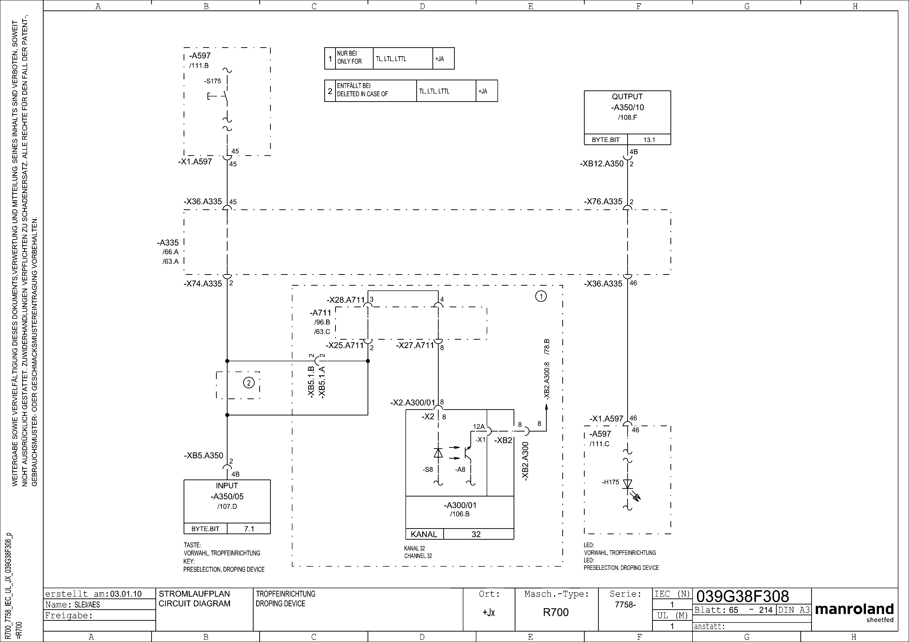

# +Jx — Sheet 65 of 214 — TROPFEINRICHTUNG

**DROPING DEVICE**

> Part of the manroland **R700** printing press IEC/UL circuit diagrams.
> Drawing class: **Stromlaufplan / Circuit diagram** (DIN A3).
> Document `+Jx` covers the **1st printing module + feed register** machine section.

## At a glance

| Field | Value |
|---|---|
| Document | `+Jx`  (039G38F308) |
| Sheet | **65** of 214 |
| Section (DE) | TROPFEINRICHTUNG |
| Section (EN) | DROPING DEVICE |
| Section type | CIRCUIT — Circuit diagram |
| Machine type | `R700` |
| Series | `7758` |
| Created | 03.01.10 |
| Replaces | — |
| Columns used | B, C, D, E, F |
| Path numbers | — |
| Labels on sheet | 93 |
| Cross-refs out | 10 |
| Cross-refs in | 26 |

**Previous:** [+Jx sheet 64](SHEET_0064.md) · **Next:** [+Jx sheet 66](SHEET_0066.md) · **Document TOC:** [_TOC.md](_TOC.md)  (+Jx) · **Master TOC:** [all sheets](../_MASTER_TOC.md)

## Sheet image (300 DPI, exact vector render)



_Rendered directly from the PDF vector layer at 300 DPI (1-bit), no OCR and no resampling. Use it to confirm anything ambiguous in the text below._

## Cross-references on this sheet

Each entry is a wire leaving this sheet. The printed token is `/sheet.column`; the link resolves to that sheet inside the same document.

| Ref | Target sheet | Col | Path | Destination on target | Target section | From col |
|---|---|---|---|---|---|---|
| `/111.B` | [+Jx sheet 111](SHEET_0111.md) | B | — | A597 | REFERENZMODUL | B |
| `/108.F` | [+Jx sheet 108](SHEET_0108.md) | F | — | — | REFERENZMODUL | F |
| `/66.A` | [+Jx sheet 66](SHEET_0066.md) | A | — | — | DRUCKANSTELLUNG | B |
| `/63.A` | [+Jx sheet 63](SHEET_0063.md) | A | — | — | LACKAUFTRAGSWALZE | B |
| `/96.B` | [+Jx sheet 96](SHEET_0096.md) | B | — | — | RESERVE | C |
| `/63.C` | [+Jx sheet 63](SHEET_0063.md) | C | — | — | LACKAUFTRAGSWALZE | C |
| `/78.B` | [+Jx sheet 78](SHEET_0078.md) | B | — | XB2.A300:8 | BUSVERBINDUNGEN: SICHERHEITSKREIS | E |
| `/111.C` | [+Jx sheet 111](SHEET_0111.md) | C | — | A597 | REFERENZMODUL | F |
| `/107.D` | [+Jx sheet 107](SHEET_0107.md) | D | — | — | REFERENZMODUL | B |
| `/106.B` | [+Jx sheet 106](SHEET_0106.md) | B | — | — | REFERENZMODUL | D |

### Incoming references (sheets that point here)

Every other sheet that sends a wire to this one. `Back-ref` is the token printed on *that* sheet; `Path` is its line number.

| From sheet | Cols | Back-ref | Path | Refs | What continues there |
|---|---|---|---|---|---|
| [+Jx#63](SHEET_0063.md) | A, B | `/63.A`, `/63.B` | — | 2 | — |
| [+Jx#66](SHEET_0066.md) | A | `/66.A` | — | 1 | — |
| [+Jx#78](SHEET_0078.md) | B | `/78.B` | — | 1 | XB2.A300:8 |
| [+Jx#96](SHEET_0096.md) | B | `/96.B` | — | 1 | — |
| [+Jx#106](SHEET_0106.md) | B | `/106.B` | — | 1 | — |
| [+Jx#107](SHEET_0107.md) | D | `/107.D` | — | 1 | — |
| [+Jx#108](SHEET_0108.md) | F | `/108.F` | — | 1 | — |
| [+Jx#111](SHEET_0111.md) | B, C | `/111.B`, `/111.C` | — | 2 | — |
| [+Jx#115](SHEET_0115.md) | F | `/115.F` | — | 2 | — |
| [+Jx#124](SHEET_0124.md) | E, G | `/124.E`, `/124.G` | — | 2 | — |
| [+Jx#131](SHEET_0131.md) | A, B | `/131.A`, `/131.B` | — | 2 | — |
| [+Jx#132](SHEET_0132.md) | C | `/132.C` | — | 1 | — |
| [+Jx#137](SHEET_0137.md) | H | `/137.H` | — | 1 | — |
| [+Jx#143](SHEET_0143.md) | B | `/143.B` | — | 1 | — |
| [+Jx#144](SHEET_0144.md) | F | `/144.F` | — | 1 | — |
| [+Jx#146](SHEET_0146.md) | C | `/146.C` | — | 2 | — |
| [+Jx#149](SHEET_0149.md) | G | `/149.G` | — | 2 | — |
| [+Jx#154](SHEET_0154.md) | A | `/154.A` | — | 1 | — |
| [+Jx#155](SHEET_0155.md) | B | `/155.B` | — | 1 | — |


## Devices on this sheet

| Tag | Class | Class meaning (IEC) | Col | Sub | Terminal | Sign |
|---|---|---|---|---|---|---|
| `S175` | S | Schalter / switch | B | — | — | — |
| `A597` | A | Baugruppe / assembly, module, PC board | B | — | — | — |
| `A350/10` | A | Baugruppe / assembly, module, PC board | F | 10 | — | — |
| `A350/05` | A | Baugruppe / assembly, module, PC board | B | 05 | — | — |
| `A335` | A | Baugruppe / assembly, module, PC board | B | — | — | — |
| `A597` | A | Baugruppe / assembly, module, PC board | F | — | — | — |
| `A711` | A | Baugruppe / assembly, module, PC board | C | — | — | — |
| `S8` | S | Schalter / switch | D | — | — | — |
| `A8` | A | Baugruppe / assembly, module, PC board | D | — | — | — |
| `X1` | X | Klemme / terminal, plug connector | E | — | — | — |
| `X2` | X | Klemme / terminal, plug connector | D | — | — | — |
| `XB2` | XB |  | E | — | — | — |
| `A300/01` | A | Baugruppe / assembly, module, PC board | D | 01 | — | — |
| `X1.A597` | — | cross-device reference | B | — | — | — |
| `X74.A335` | — | cross-device reference | B | — | — | — |
| `X36.A335` | — | cross-device reference | B | — | — | — |
| `13.1` | — | cross-device reference | F | — | — | — |
| `XB12.A350` | — | cross-device reference | F | — | — | — |
| `X36.A335` | — | cross-device reference | F | — | — | — |
| `X76.A335` | — | cross-device reference | F | — | — | — |
| `7.1` | — | cross-device reference | B | — | — | — |
| `XB5.A350` | — | cross-device reference | B | — | — | — |
| `X1.A597` | — | cross-device reference | F | — | — | — |
| `X28.A711` | — | cross-device reference | C | — | — | — |
| `X25.A711` | — | cross-device reference | C | — | — | — |
| `XB5.1.A` | — | cross-device reference | C | — | — | — |
| `XB5.1.B` | — | cross-device reference | C | — | — | — |
| `XB2.A300` | — | cross-device reference | E | — | — | — |
| `X27.A711` | — | cross-device reference | D | — | — | — |
| `XB2.A300:8` | — | cross-device reference | E | — | 8 | — |

## Potentials / nets

| Potential | Count | Columns | Attached devices | Terminals |
|---|---|---|---|---|
| `H175` | 1 | F | — | — |


A potential such as `L24+/4` or `M24+` is a named supply/return rail; every place it appears on this sheet is electrically common.

## Wire-end annotations (grouped as printed)

A wire that continues elsewhere is annotated with a small cluster: the destination description, the path/line number `#NN`, and the `/sheet.column` cross reference. Each row below is one such cluster exactly as it is grouped on the drawing.

| Col | Y | Path | Cross-ref | Text on the wire |
|---|---|---|---|---|
| C | 67.2 | — | — | `1 NUR BEI ONLY FOR TL, LTL, LTTL` |
| B | 68.3 | — | `/111.B` | `A597` |
| D | 74.2 | — | — | `+JA` |
| B | 102.7 | — | — | `S175` |
| D | 109.7 | — | — | `2 ENTFÄLLT BEI DELETED IN CASE OF TL, LTL, LTTL +JA` |
| F | 122.4 | — | — | `QUTPUT` |
| F | 136.3 | — | — | `A350/10` |
| F | 150.1 | — | `/108.F` | — |
| F | 179.7 | — | — | `BYTE.BIT 13.1` |
| B | 194.4 | — | — | `45` |
| F | 195.1 | — | — | `4B` |
| B | 207.2 | — | — | `X1.A597 45` |
| F | 210.0 | — | — | `XB12.A350 2` |
| B | 259.6 | — | — | `X36.A335 45` |
| F | 259.6 | — | — | `X76.A335 2` |
| B | 313.5 | — | — | `A335` |
| B | 326.5 | — | `/66.A`, `/63.A` | — |
| B | 367.3 | — | — | `X74.A335 2` |
| F | 367.3 | — | — | `X36.A335 46` |
| E | 385.3 | — | — | `1` |
| C | 388.6 | — | — | `X28.A711 3` |
| D | 388.6 | — | — | `4` |
| C | 405.6 | — | — | `A711` |
| C | 418.7 | — | `/96.B`, `/63.C` | — |
| E | 444.2 | — | `/78.B` | `XB2.A300:8` |
| C | 448.1 | — | — | `X25.A711 2` |
| D | 448.1 | — | — | `X27.A711 8` |
| C | 463.8 | — | — | `XB5.1.B 2` |
| C | 463.8 | — | — | `XB5.1.A 2` |
| B | 499.1 | — | — | `2` |
| D | 523.2 | — | — | `X2.A300/01 8` |
| D | 541.7 | — | — | `X2` |
| E | 543.1 | — | — | `8 8` |
| F | 544.5 | — | — | `X1.A597 46` |
| E | 551.6 | — | — | `8` |
| E | 555.8 | — | — | `12A` |
| F | 560.1 | — | — | `46` |
| F | 564.3 | — | `/111.C` | `A597` |
| E | 572.8 | — | — | `X1` |
| E | 572.9 | — | — | `XB2` |
| E | 579.1 | — | — | `XB2.A300` |
| B | 592.7 | — | — | `XB5.A350 2` |
| D | 611.8 | — | — | `S8 A8` |
| B | 618.2 | — | — | `4B` |
| F | 628.5 | — | — | `H175` |
| B | 632.7 | — | — | `INPUT` |
| B | 646.5 | — | — | `A350/05` |
| D | 657.9 | — | — | `A300/01` |
| B | 660.4 | — | `/107.D` | — |
| D | 670.2 | — | `/106.B` | — |
| B | 689.4 | — | — | `BYTE.BIT 7.1` |
| D | 696.1 | — | — | `KANAL 32` |
| B | 712.0 | — | — | `KEY: PRESELECTION, DROPING DEVICE TASTE: VORWAHL, TROPFEINRICHTUNG` |
| F | 712.2 | — | — | `LED:` |
| D | 716.5 | — | — | `KANAL 32 CHANNEL 32` |
| F | 722.2 | — | — | `LED: PRESELECTION, DROPING DEVICE VORWAHL, TROPFEINRICHTUNG` |


## Reconstructed tables

This sheet carries tabular content (pin map / terminal assignment / index). The grid below was rebuilt from the drawing's own rule lines, so each row is exactly one physical row of the table.

### Table 1 — 5 data rows × 2 columns (at x=240.9, y=62.4)

| A597 /111.B S175 | 45 |
|---|---|
| `X1.A597 X36.A335 X74.A335` | `45 45 2` |
|  | `2` |
| `XB5.A350` | `2 4B` |
| `INPUT` | `A350/05 /107.D` |
| `BYTE.BIT` | `7.1` |


### Table 2 — 8 data rows × 9 columns (at x=481.9, y=119.1)

| CASE OF | TL, LTL, | LTTL | +JA |  |  |  | QUTPUT | A350/10 /108.F |
|---|---|---|---|---|---|---|---|---|
|  |  |  |  |  |  |  | `BYTE.BIT` | `13.1` |
|  |  |  |  |  |  |  | `XB12.A350 X76.A335 X36.A335` | `4B 2 2 46` |
| `3 2` | `X27.A711` | `4 8` |  |  | `1` | `/78.B` |  |  |
|  | `X2.A300/01` | `8` |  |  |  | `XB2.A300:8` |  |  |
|  | `X2` | `8` |  |  | `8 8` |  | `X1.A597` | `46` |
|  | `S8` | `A8` | `12A X1` | `XB2` | `XB2.A300` |  | `A597 /111.C H175` | `46` |
|  |  | `A300/01 /106.B` |  |  |  |  |  |  |
|  | `KANAL` |  | `32` |  |  |  |  |  |


## Notes and free text on this sheet

| Text | Col | Y (pt) |
|---|---|---|
| `4B` | F | 195.09 |
| `QUTPUT` | F | 122.44 |
| `BYTE.BIT` | F | 179.72 |
| `4B` | B | 618.17 |
| `INPUT` | B | 632.7 |
| `BYTE.BIT` | B | 689.96 |
| `TASTE:` | B | 712.02 |
| `VORWAHL, TROPFEINRICHTUNG` | B | 722.71 |
| `KEY:` | B | 733.22 |
| `PRESELECTION, DROPING DEVICE` | B | 743.97 |
| `LED:` | F | 712.18 |
| `VORWAHL, TROPFEINRICHTUNG` | F | 722.16 |
| `PRESELECTION, DROPING DEVICE` | F | 742.08 |
| `KANAL 32` | D | 716.49 |
| `CHANNEL 32` | D | 726.43 |
| `12A` | E | 555.82 |
| `KANAL` | D | 696.14 |
| `X2.A300/01` | D | 523.23 |
| `NUR BEI` | C | 67.15 |
| `ONLY FOR` | C | 77.84 |
| `TL, LTL, LTTL` | D | 74.28 |
| `ENTFÄLLT BEI` | C | 109.68 |
| `DELETED IN CASE OF` | C | 120.33 |
| `+JA` | E | 116.75 |
| `+JA` | D | 74.23 |

## Complete label inventory (exact text from the drawing)

Every text object inside the drawing area of this sheet, in DIN reading order (column A→H, then top→bottom). This is the authoritative list: if a string is not here it is not printed on this sheet.

| Col | Y | X | Dir | Type | Text |
|---|---|---|---|---|---|
| B | 68.3 | 247.7 | → | device tag | `A597` |
| B | 82.1 | 248.0 | → | cross-reference | `/111.B` |
| B | 102.7 | 267.6 | → | device tag | `S175` |
| B | 194.4 | 303.3 | → | number | `45` |
| B | 207.2 | 233.6 | → | device ref | `X1.A597` |
| B | 211.4 | 300.5 | → | number | `45` |
| B | 259.6 | 240.7 | → | device ref | `X36.A335` |
| B | 261.1 | 300.5 | → | number | `45` |
| B | 313.5 | 205.8 | → | device tag | `A335` |
| B | 326.5 | 213.2 | → | cross-reference | `/66.A` |
| B | 338.9 | 213.2 | → | cross-reference | `/63.A` |
| B | 367.3 | 240.7 | → | device ref | `X74.A335` |
| B | 367.4 | 300.5 | → | number | `2` |
| B | 499.1 | 324.0 | → | number | `2` |
| B | 592.7 | 241.2 | → | device ref | `XB5.A350` |
| B | 601.2 | 300.5 | → | number | `2` |
| B | 618.2 | 303.3 | → | text | `4B` |
| B | 632.7 | 282.8 | → | text | `INPUT` |
| B | 646.5 | 276.1 | → | device tag | `A350/05` |
| B | 660.4 | 284.9 | → | cross-reference | `/107.D` |
| B | 689.4 | 319.9 | → | device ref | `7.1` |
| B | 690.0 | 250.9 | → | text | `BYTE.BIT` |
| B | 712.0 | 240.9 | → | text | `TASTE:` |
| B | 722.7 | 240.9 | → | text | `VORWAHL, TROPFEINRICHTUNG` |
| B | 733.2 | 240.4 | → | text | `KEY:` |
| B | 744.0 | 240.4 | → | text | `PRESELECTION, DROPING DEVICE` |
| C | 67.2 | 441.6 | → | text | `NUR BEI` |
| C | 72.5 | 429.7 | → | number | `1` |
| C | 77.8 | 441.9 | → | text | `ONLY FOR` |
| C | 109.7 | 441.6 | → | text | `ENTFÄLLT BEI` |
| C | 115.0 | 429.4 | → | number | `2` |
| C | 120.3 | 441.6 | → | text | `DELETED IN CASE OF` |
| C | 388.6 | 428.0 | → | device ref | `X28.A711` |
| C | 405.6 | 405.9 | → | device tag | `A711` |
| C | 418.7 | 411.9 | → | cross-reference | `/96.B` |
| C | 431.1 | 411.6 | → | cross-reference | `/63.C` |
| C | 448.1 | 426.6 | → | device ref | `X25.A711` |
| C | 463.7 | 404.2 | ↕ | number | `2` |
| C | 463.7 | 418.4 | ↕ | number | `2` |
| C | 479.9 | 402.8 | ↕ | device ref | `XB5.1.B` |
| C | 480.5 | 417.0 | ↕ | device ref | `XB5.1.A` |
| D | 74.2 | 570.2 | → | text | `+JA` |
| D | 74.3 | 492.5 | → | text | `TL, LTL, LTTL` |
| D | 116.8 | 549.2 | → | text | `TL, LTL, LTTL` |
| D | 388.6 | 484.4 | → | number | `3` |
| D | 388.6 | 576.9 | → | number | `4` |
| D | 448.1 | 518.7 | → | device ref | `X27.A711` |
| D | 452.4 | 484.7 | → | number | `2` |
| D | 452.4 | 576.6 | → | number | `8` |
| D | 523.2 | 511.4 | → | text | `X2.A300/01` |
| D | 523.3 | 576.6 | → | number | `8` |
| D | 541.7 | 552.5 | → | device tag | `X2` |
| D | 543.1 | 579.4 | → | number | `8` |
| D | 611.8 | 553.6 | → | device tag | `S8` |
| D | 611.8 | 596.1 | → | device tag | `A8` |
| D | 657.9 | 581.7 | → | device tag | `A300/01` |
| D | 670.2 | 589.7 | → | cross-reference | `/106.B` |
| D | 696.1 | 538.0 | → | text | `KANAL` |
| D | 716.5 | 529.5 | → | text | `KANAL 32` |
| D | 726.4 | 529.8 | → | text | `CHANNEL 32` |
| E | 116.8 | 626.9 | → | text | `+JA` |
| E | 385.3 | 706.8 | → | number | `1` |
| E | 444.2 | 712.4 | ↕ | cross-reference | `/78.B` |
| E | 474.8 | 712.4 | ↕ | device ref | `XB2.A300:8` |
| E | 551.6 | 704.1 | → | number | `8` |
| E | 553.0 | 678.6 | → | number | `8` |
| E | 555.8 | 619.4 | → | text | `12A` |
| E | 572.8 | 622.8 | → | device tag | `X1` |
| E | 572.8 | 647.4 | → | device tag | `XB2` |
| E | 579.1 | 683.4 | ↕ | device ref | `XB2.A300` |
| E | 696.1 | 617.8 | → | number | `32` |
| F | 122.4 | 801.8 | → | text | `QUTPUT` |
| F | 136.3 | 800.6 | → | device tag | `A350/10` |
| F | 150.1 | 809.7 | → | cross-reference | `/108.F` |
| F | 179.7 | 775.3 | → | text | `BYTE.BIT` |
| F | 179.8 | 842.7 | → | device ref | `13.1` |
| F | 195.1 | 824.9 | → | text | `4B` |
| F | 210.0 | 759.7 | → | device ref | `XB12.A350` |
| F | 211.4 | 824.9 | → | number | `2` |
| F | 259.6 | 765.1 | → | device ref | `X76.A335` |
| F | 261.1 | 824.9 | → | number | `2` |
| F | 367.3 | 765.1 | → | device ref | `X36.A335` |
| F | 367.4 | 824.9 | → | number | `46` |
| F | 544.5 | 772.4 | → | device ref | `X1.A597` |
| F | 544.5 | 824.9 | → | number | `46` |
| F | 560.1 | 827.7 | → | number | `46` |
| F | 564.3 | 772.2 | → | device tag | `A597` |
| F | 578.1 | 772.4 | → | cross-reference | `/111.C` |
| F | 628.5 | 788.6 | → | potential | `H175` |
| F | 712.2 | 764.8 | → | text | `LED:` |
| F | 722.2 | 765.4 | → | text | `VORWAHL, TROPFEINRICHTUNG` |
| F | 732.1 | 764.8 | → | text | `LED:` |
| F | 742.1 | 764.8 | → | text | `PRESELECTION, DROPING DEVICE` |

## Reading-order text block

The same content as a plain block, grouped by DIN column — convenient to paste or to match against a visual description.

```text
=== Column B ===
  68.3  247.7  devtag       A597
  82.1  248.0  xref         /111.B
 102.7  267.6  devtag       S175
 194.4  303.3  numeric      45
 207.2  233.6  devref       X1.A597
 211.4  300.5  numeric      45
 259.6  240.7  devref       X36.A335
 261.1  300.5  numeric      45
 313.5  205.8  devtag       A335
 326.5  213.2  xref         /66.A
 338.9  213.2  xref         /63.A
 367.3  240.7  devref       X74.A335
 367.4  300.5  numeric      2
 499.1  324.0  numeric      2
 592.7  241.2  devref       XB5.A350
 601.2  300.5  numeric      2
 618.2  303.3  text         4B
 632.7  282.8  text         INPUT
 646.5  276.1  devtag       A350/05
 660.4  284.9  xref         /107.D
 689.4  319.9  devref       7.1
 690.0  250.9  text         BYTE.BIT
 712.0  240.9  text         TASTE:
 722.7  240.9  text         VORWAHL, TROPFEINRICHTUNG
 733.2  240.4  text         KEY:
 744.0  240.4  text         PRESELECTION, DROPING DEVICE
=== Column C ===
  67.2  441.6  text         NUR BEI
  72.5  429.7  numeric      1
  77.8  441.9  text         ONLY FOR
 109.7  441.6  text         ENTFÄLLT BEI
 115.0  429.4  numeric      2
 120.3  441.6  text         DELETED IN CASE OF
 388.6  428.0  devref       X28.A711
 405.6  405.9  devtag       A711
 418.7  411.9  xref         /96.B
 431.1  411.6  xref         /63.C
 448.1  426.6  devref       X25.A711
 463.7  404.2  numeric      2
 463.7  418.4  numeric      2
 479.9  402.8  devref       XB5.1.B
 480.5  417.0  devref       XB5.1.A
=== Column D ===
  74.2  570.2  text         +JA
  74.3  492.5  text         TL, LTL, LTTL
 116.8  549.2  text         TL, LTL, LTTL
 388.6  484.4  numeric      3
 388.6  576.9  numeric      4
 448.1  518.7  devref       X27.A711
 452.4  484.7  numeric      2
 452.4  576.6  numeric      8
 523.2  511.4  text         X2.A300/01
 523.3  576.6  numeric      8
 541.7  552.5  devtag       X2
 543.1  579.4  numeric      8
 611.8  553.6  devtag       S8
 611.8  596.1  devtag       A8
 657.9  581.7  devtag       A300/01
 670.2  589.7  xref         /106.B
 696.1  538.0  text         KANAL
 716.5  529.5  text         KANAL 32
 726.4  529.8  text         CHANNEL 32
=== Column E ===
 116.8  626.9  text         +JA
 385.3  706.8  numeric      1
 444.2  712.4  xref         /78.B
 474.8  712.4  devref       XB2.A300:8
 551.6  704.1  numeric      8
 553.0  678.6  numeric      8
 555.8  619.4  text         12A
 572.8  622.8  devtag       X1
 572.8  647.4  devtag       XB2
 579.1  683.4  devref       XB2.A300
 696.1  617.8  numeric      32
=== Column F ===
 122.4  801.8  text         QUTPUT
 136.3  800.6  devtag       A350/10
 150.1  809.7  xref         /108.F
 179.7  775.3  text         BYTE.BIT
 179.8  842.7  devref       13.1
 195.1  824.9  text         4B
 210.0  759.7  devref       XB12.A350
 211.4  824.9  numeric      2
 259.6  765.1  devref       X76.A335
 261.1  824.9  numeric      2
 367.3  765.1  devref       X36.A335
 367.4  824.9  numeric      46
 544.5  772.4  devref       X1.A597
 544.5  824.9  numeric      46
 560.1  827.7  numeric      46
 564.3  772.2  devtag       A597
 578.1  772.4  xref         /111.C
 628.5  788.6  net          H175
 712.2  764.8  text         LED:
 722.2  765.4  text         VORWAHL, TROPFEINRICHTUNG
 732.1  764.8  text         LED:
 742.1  764.8  text         PRESELECTION, DROPING DEVICE
```

---
_Generated from the PDF vector text layer; no OCR. Source: `R700_7758_IEC_UL_JX_039G38F308_p`, sheet 65._
