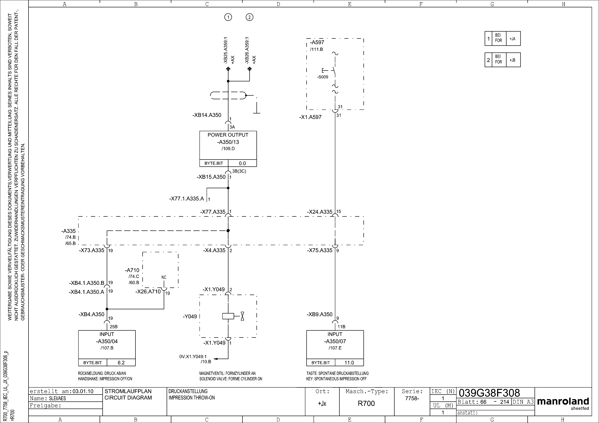

# +Jx — Sheet 66 of 214 — DRUCKANSTELLUNG

**IMPRESSION THROW ON**

> Part of the manroland **R700** printing press IEC/UL circuit diagrams.
> Drawing class: **Stromlaufplan / Circuit diagram** (DIN A3).
> Document `+Jx` covers the **1st printing module + feed register** machine section.

## At a glance

| Field | Value |
|---|---|
| Document | `+Jx`  (039G38F308) |
| Sheet | **66** of 214 |
| Section (DE) | DRUCKANSTELLUNG |
| Section (EN) | IMPRESSION THROW ON |
| Section type | CIRCUIT — Circuit diagram |
| Machine type | `R700` |
| Series | `7758` |
| Created | 03.01.10 |
| Replaces | — |
| Columns used | A, B, C, D, E, G |
| Path numbers | — |
| Labels on sheet | 85 |
| Cross-refs out | 9 |
| Cross-refs in | 25 |

**Previous:** [+Jx sheet 65](SHEET_0065.md) · **Next:** [+Jx sheet 67](SHEET_0067.md) · **Document TOC:** [_TOC.md](_TOC.md)  (+Jx) · **Master TOC:** [all sheets](../_MASTER_TOC.md)

## Sheet image (300 DPI, exact vector render)



_Rendered directly from the PDF vector layer at 300 DPI (1-bit), no OCR and no resampling. Use it to confirm anything ambiguous in the text below._

## Cross-references on this sheet

Each entry is a wire leaving this sheet. The printed token is `/sheet.column`; the link resolves to that sheet inside the same document.

| Ref | Target sheet | Col | Path | Destination on target | Target section | From col |
|---|---|---|---|---|---|---|
| `/111.B` | [+Jx sheet 111](SHEET_0111.md) | B | — | — | REFERENZMODUL | E |
| `/109.D` | [+Jx sheet 109](SHEET_0109.md) | D | — | — | REFERENZMODUL | C |
| `/74.B` | [+Jx sheet 74](SHEET_0074.md) | B | — | — | REDUNDANZ: ANTRIEBE | A |
| `/65.B` | [+Jx sheet 65](SHEET_0065.md) | B | — | — | TROPFEINRICHTUNG | A |
| `/74.C` | [+Jx sheet 74](SHEET_0074.md) | C | — | — | REDUNDANZ: ANTRIEBE | B |
| `/60.B` | [+Jx sheet 60](SHEET_0060.md) | B | — | — | SCHUTZEINRICHTUNGEN | B |
| `/107.B` | [+Jx sheet 107](SHEET_0107.md) | B | — | — | REFERENZMODUL | B |
| `/107.E` | [+Jx sheet 107](SHEET_0107.md) | E | — | — | REFERENZMODUL | E |
| `/10.B` | [+Jx sheet 10](SHEET_0010.md) | B | — | 0V.X1.Y049:1 | SPANNUNGSVERSORGUNG, SCHALTSCHRANKBELÜFTUNG | C |

### Incoming references (sheets that point here)

Every other sheet that sends a wire to this one. `Back-ref` is the token printed on *that* sheet; `Path` is its line number.

| From sheet | Cols | Back-ref | Path | Refs | What continues there |
|---|---|---|---|---|---|
| [+Jx#10](SHEET_0010.md) | B | `/10.B` | — | 1 | 0V.X1.Y049:1 |
| [+Jx#60](SHEET_0060.md) | B | `/60.B` | — | 1 | — |
| [+Jx#65](SHEET_0065.md) | B | `/65.B` | — | 1 | — |
| [+Jx#74](SHEET_0074.md) | B, C | `/74.B`, `/74.C` | — | 2 | — |
| [+Jx#107](SHEET_0107.md) | B, E | `/107.B`, `/107.E` | — | 2 | — |
| [+Jx#109](SHEET_0109.md) | D | `/109.D` | — | 1 | — |
| [+Jx#111](SHEET_0111.md) | B | `/111.B` | — | 1 | — |
| [+Jx#115](SHEET_0115.md) | F | `/115.F` | — | 1 | — |
| [+Jx#120](SHEET_0120.md) | E | `/120.E` | — | 2 | — |
| [+Jx#129](SHEET_0129.md) | E | `/129.E` | — | 1 | — |
| [+Jx#130](SHEET_0130.md) | A, B, D | `/130.A`, `/130.B`, `/130.D` | — | 3 | — |
| [+Jx#134](SHEET_0134.md) | G | `/134.G` | — | 1 | — |
| [+Jx#138](SHEET_0138.md) | E | `/138.E` | — | 1 | — |
| [+Jx#139](SHEET_0139.md) | B | `/139.B` | — | 1 | — |
| [+Jx#142](SHEET_0142.md) | F | `/142.F` | — | 1 | — |
| [+Jx#143](SHEET_0143.md) | F | `/143.F` | — | 1 | — |
| [+Jx#153](SHEET_0153.md) | E | `/153.E` | — | 1 | — |
| [+Jx#155](SHEET_0155.md) | A, D | `/155.A`, `/155.D` | — | 2 | — |
| [+Jx#156](SHEET_0156.md) | A | `/156.A` | — | 1 | — |


## Devices on this sheet

| Tag | Class | Class meaning (IEC) | Col | Sub | Terminal | Sign |
|---|---|---|---|---|---|---|
| `A350/13` | A | Baugruppe / assembly, module, PC board | C | 13 | — | — |
| `S009` | S | Schalter / switch | E | — | — | — |
| `A597` | A | Baugruppe / assembly, module, PC board | E | — | — | — |
| `A335` | A | Baugruppe / assembly, module, PC board | A | — | — | — |
| `A350/04` | A | Baugruppe / assembly, module, PC board | B | 04 | — | — |
| `A350/07` | A | Baugruppe / assembly, module, PC board | E | 07 | — | — |
| `Y049` | Y | Magnetventil / solenoid valve, actuator | C | — | — | — |
| `A710` | A | Baugruppe / assembly, module, PC board | B | — | — | — |
| `XB25.A359:1` | — | cross-device reference | C | — | 1 | — |
| `XB26.A359:1` | — | cross-device reference | D | — | 1 | — |
| `XB15.A350` | — | cross-device reference | C | — | — | — |
| `XB14.A350` | — | cross-device reference | C | — | — | — |
| `0.0` | — | cross-device reference | C | — | — | — |
| `X1.A597` | — | cross-device reference | D | — | — | — |
| `X24.A335` | — | cross-device reference | E | — | — | — |
| `X77.A335` | — | cross-device reference | C | — | — | — |
| `X77.1.A335.A` | — | cross-device reference | C | — | — | — |
| `6.2` | — | cross-device reference | B | — | — | — |
| `XB4.A350` | — | cross-device reference | A | — | — | — |
| `11.0` | — | cross-device reference | E | — | — | — |
| `XB9.A350` | — | cross-device reference | E | — | — | — |
| `X1.Y049` | — | cross-device reference | C | — | — | — |
| `X1.Y049` | — | cross-device reference | C | — | — | — |
| `X4.A335` | — | cross-device reference | C | — | — | — |
| `X73.A335` | — | cross-device reference | A | — | — | — |
| `X75.A335` | — | cross-device reference | E | — | — | — |
| `XB4.1.A350.B` | — | cross-device reference | A | — | — | — |
| `XB4.1.A350.A` | — | cross-device reference | A | — | — | — |
| `X26.A710` | — | cross-device reference | B | — | — | — |

## Potentials / nets

| Potential | Count | Columns | Attached devices | Terminals |
|---|---|---|---|---|
| `0V` | 1 | C | `X1`, `Y049` | `1` |


A potential such as `L24+/4` or `M24+` is a named supply/return rail; every place it appears on this sheet is electrically common.

## Wire-end annotations (grouped as printed)

A wire that continues elsewhere is annotated with a small cluster: the destination description, the path/line number `#NN`, and the `/sheet.column` cross reference. Each row below is one such cluster exactly as it is grouped on the drawing.

| Col | Y | Path | Cross-ref | Text on the wire |
|---|---|---|---|---|
| C | 31.0 | — | — | `1 2` |
| G | 67.0 | — | — | `1 BEI FOR +JA` |
| C | 73.1 | — | — | `XB25.A359:1` |
| D | 73.1 | — | — | `XB26.A359:1` |
| E | 79.6 | — | — | `A597` |
| E | 94.5 | — | `/111.B` | — |
| G | 109.5 | — | — | `2 BEI FOR +JB` |
| C | 110.8 | — | — | `+AX` |
| D | 110.8 | — | — | `+AX` |
| E | 149.5 | — | — | `S009` |
| E | 208.6 | — | — | `31` |
| C | 224.2 | — | — | `XB14.A350 1` |
| E | 225.6 | — | — | `X1.A597 31` |
| C | 248.9 | — | — | `3A` |
| C | 264.1 | — | — | `POWER OUTPUT` |
| C | 278.0 | — | — | `A350/13` |
| C | 291.9 | — | `/109.D` | — |
| C | 320.9 | — | — | `BYTE.BIT 0.0` |
| C | 336.9 | — | — | `3B(3C)` |
| C | 347.5 | — | — | `XB15.A350 1` |
| C | 390.7 | — | — | `X77.1.A335.A 1` |
| D | 416.9 | — | — | `X77.A335 1 X24.A335 15` |
| A | 455.2 | — | — | `A335` |
| A | 468.3 | — | `/74.B`, `/65.B` | — |
| C | 493.5 | — | — | `X73.A335 19 X4.A335 2 X75.A335 9` |
| B | 533.1 | — | — | `A710` |
| B | 546.2 | — | `/74.C`, `/60.B` | — |
| B | 549.1 | — | — | `NC` |
| A | 558.7 | — | — | `XB4.1.A350.B 19` |
| C | 571.5 | — | — | `X1.Y049 2` |
| A | 575.7 | — | — | `XB4.1.A350.A 19` |
| B | 575.7 | — | — | `X26.A710 19` |
| A | 621.0 | — | — | `XB4.A350 19` |
| E | 621.0 | — | — | `XB9.A350 9` |
| C | 625.4 | — | — | `Y049` |
| B | 646.5 | — | — | `25B` |
| E | 646.5 | — | — | `11B` |
| B | 661.0 | — | — | `INPUT` |
| E | 661.0 | — | — | `INPUT` |
| B | 674.9 | — | — | `A350/04` |
| E | 674.9 | — | — | `A350/07` |
| C | 677.8 | — | — | `X1.Y049 1` |
| B | 688.7 | — | `/107.B` | — |
| E | 688.7 | — | `/107.E` | — |
| C | 706.0 | — | `/10.B` | `0V.X1.Y049:1` |
| B | 717.7 | — | — | `BYTE.BIT 6.2` |
| E | 717.7 | — | — | `BYTE.BIT 11.0` |
| B | 740.4 | — | — | `RÜCKMELDUNG: DRUCK AB/AN HANDSHAKE: IMPRESSION OFF/ON` |
| C | 740.4 | — | — | `MAGNETVENTIL: FORMZYLINDER AN SOLENOID VALVE: FORME CYLINDER ON` |
| E | 740.4 | — | — | `KEY: SPONTANEOUS IMPRESSION OFF TASTE: SPONTANE DRUCKABSTELLUNG` |


## Reconstructed tables

This sheet carries tabular content (pin map / terminal assignment / index). The grid below was rebuilt from the drawing's own rule lines, so each row is exactly one physical row of the table.

### Table 1 — 9 data rows × 6 columns (at x=155.9, y=76.5)

|  |  |  |  | XB25.A359:1 | XB26.A359:1 +AX +AX |
|---|---|---|---|---|---|
|  |  |  |  | `XB14.A350` | `1 3A` |
|  |  |  |  | `POWER` | `OUTPUT A350/13 /109.D` |
|  |  |  |  | `BYTE.BIT` | `0.0` |
|  |  |  |  | `XB15.A350` | `3B(3C) 1` |
|  |  |  | `X77.1.A335.A` | `1 X77.A335` | `1` |
| `X73.A335 XB4.1.A350.B XB4.1.A350.A` | `19 A710 /74.C /60.B 19 19` | `NC X26.A710` | `19` | `X4.A335 X1.Y049` | `2 2` |
| `XB4.A350` | `19 25B` |  | `Y049` |  |  |
| `INPUT A350/04` | `/107.B` |  | `0V.X1.Y049:1` | `X1.Y049` | `1` |
| `BYTE.BIT` | `6.2` |  |  | `/10.B` |  |


### Table 2 — 5 data rows × 2 columns (at x=609.4, y=76.5) — **A597 /111.B S009 31**

| X1.A597 | 31 |
|---|---|
| `X24.A335` | `15` |
| `X75.A335` | `9` |
| `XB9.A350` | `9 11B` |
| `INPUT` | `A350/07 /107.E` |
| `BYTE.BIT` | `11.0` |


## Notes and free text on this sheet

| Text | Col | Y (pt) |
|---|---|---|
| `+AX` | C | 110.84 |
| `+AX` | D | 110.84 |
| `3A` | C | 248.95 |
| `3B(3C)` | C | 336.88 |
| `POWER OUTPUT` | C | 264.12 |
| `BYTE.BIT` | C | 321.46 |
| `25B` | B | 646.53 |
| `INPUT` | B | 661.05 |
| `BYTE.BIT` | A | 718.31 |
| `RÜCKMELDUNG: DRUCK AB/AN` | B | 740.44 |
| `HANDSHAKE: IMPRESSION OFF/ON` | B | 751.05 |
| `11B` | E | 646.53 |
| `INPUT` | E | 661.05 |
| `BYTE.BIT` | E | 718.31 |
| `TASTE: SPONTANE DRUCKABSTELLUNG` | E | 740.43 |
| `KEY: SPONTANEOUS IMPRESSION OFF` | E | 751.05 |
| `MAGNETVENTIL: FORMZYLINDER AN` | C | 740.43 |
| `SOLENOID VALVE: FORME CYLINDER ON` | C | 751.06 |
| `BEI` | G | 67.03 |
| `FOR` | G | 77.82 |
| `+JA` | G | 74.23 |
| `+JB` | G | 116.73 |
| `NC` | B | 549.07 |

## Complete label inventory (exact text from the drawing)

Every text object inside the drawing area of this sheet, in DIN reading order (column A→H, then top→bottom). This is the authoritative list: if a string is not here it is not printed on this sheet.

| Col | Y | X | Dir | Type | Text |
|---|---|---|---|---|---|
| A | 455.2 | 122.2 | → | device tag | `A335` |
| A | 468.3 | 129.8 | → | cross-reference | `/74.B` |
| A | 480.7 | 129.8 | → | cross-reference | `/65.B` |
| A | 493.5 | 157.0 | → | device ref | `X73.A335` |
| A | 558.7 | 137.5 | → | device ref | `XB4.1.A350.B` |
| A | 576.4 | 136.9 | → | device ref | `XB4.1.A350.A` |
| A | 621.0 | 156.2 | → | device ref | `XB4.A350` |
| A | 718.3 | 165.8 | → | text | `BYTE.BIT` |
| B | 494.9 | 214.6 | → | number | `19` |
| B | 533.1 | 248.6 | → | device tag | `A710` |
| B | 546.2 | 255.7 | → | cross-reference | `/74.C` |
| B | 549.1 | 321.3 | → | text | `NC` |
| B | 558.6 | 256.0 | → | cross-reference | `/60.B` |
| B | 558.7 | 214.6 | → | number | `19` |
| B | 575.7 | 214.6 | → | number | `19` |
| B | 575.7 | 269.3 | → | device ref | `X26.A710` |
| B | 580.0 | 328.0 | → | number | `19` |
| B | 629.6 | 214.6 | → | number | `19` |
| B | 646.5 | 218.3 | → | text | `25B` |
| B | 661.0 | 197.7 | → | text | `INPUT` |
| B | 674.9 | 191.1 | → | device tag | `A350/04` |
| B | 688.7 | 200.0 | → | cross-reference | `/107.B` |
| B | 717.7 | 234.1 | → | device ref | `6.2` |
| B | 740.4 | 155.3 | → | text | `RÜCKMELDUNG: DRUCK AB/AN` |
| B | 751.1 | 155.3 | → | text | `HANDSHAKE: IMPRESSION OFF/ON` |
| C | 31.0 | 451.7 | → | number | `1` |
| C | 73.1 | 444.6 | ↕ | device ref | `XB25.A359:1` |
| C | 110.8 | 458.7 | ↕ | text | `+AX` |
| C | 224.2 | 382.7 | → | device ref | `XB14.A350` |
| C | 232.7 | 455.5 | → | number | `1` |
| C | 249.0 | 456.1 | → | text | `3A` |
| C | 264.1 | 412.7 | → | text | `POWER OUTPUT` |
| C | 278.0 | 432.0 | → | device tag | `A350/13` |
| C | 291.8 | 440.8 | → | cross-reference | `/109.D` |
| C | 320.9 | 475.1 | → | device ref | `0.0` |
| C | 321.5 | 406.8 | → | text | `BYTE.BIT` |
| C | 336.9 | 461.8 | → | text | `3B(3C)` |
| C | 347.5 | 391.2 | → | device ref | `XB15.A350` |
| C | 348.9 | 455.5 | → | number | `1` |
| C | 390.7 | 336.5 | → | device ref | `X77.1.A335.A` |
| C | 392.9 | 413.0 | → | number | `1` |
| C | 416.9 | 398.0 | → | device ref | `X77.A335` |
| C | 417.0 | 455.5 | → | number | `1` |
| C | 493.5 | 403.9 | → | device ref | `X4.A335` |
| C | 494.9 | 456.4 | → | number | `2` |
| C | 571.5 | 403.1 | → | device ref | `X1.Y049` |
| C | 572.9 | 456.4 | → | number | `2` |
| C | 625.4 | 363.7 | → | device tag | `Y049` |
| C | 677.8 | 404.5 | → | device ref | `X1.Y049` |
| C | 679.2 | 455.5 | → | number | `1` |
| C | 706.0 | 356.6 | → | potential | `0V.X1.Y049:1` |
| C | 715.9 | 399.1 | → | cross-reference | `/10.B` |
| C | 740.4 | 396.3 | → | text | `MAGNETVENTIL: FORMZYLINDER AN` |
| C | 751.1 | 396.6 | → | text | `SOLENOID VALVE: FORME CYLINDER ON` |
| D | 31.4 | 494.1 | → | number | `2` |
| D | 73.1 | 487.1 | ↕ | device ref | `XB26.A359:1` |
| D | 110.8 | 501.2 | ↕ | text | `+AX` |
| D | 228.4 | 595.0 | → | device ref | `X1.A597` |
| E | 79.6 | 616.3 | → | device tag | `A597` |
| E | 94.5 | 616.5 | → | cross-reference | `/111.B` |
| E | 149.5 | 630.4 | → | device tag | `S009` |
| E | 208.6 | 671.5 | → | number | `31` |
| E | 225.6 | 668.7 | → | number | `31` |
| E | 416.9 | 610.6 | → | device ref | `X24.A335` |
| E | 417.0 | 668.1 | → | number | `15` |
| E | 493.5 | 610.6 | → | device ref | `X75.A335` |
| E | 494.9 | 668.7 | → | number | `9` |
| E | 621.0 | 609.7 | → | device ref | `XB9.A350` |
| E | 629.6 | 668.7 | → | number | `9` |
| E | 646.5 | 671.0 | → | text | `11B` |
| E | 661.0 | 651.3 | → | text | `INPUT` |
| E | 674.9 | 644.6 | → | device tag | `A350/07` |
| E | 688.7 | 653.5 | → | cross-reference | `/107.E` |
| E | 717.7 | 684.7 | → | device ref | `11.0` |
| E | 718.3 | 619.4 | → | text | `BYTE.BIT` |
| E | 740.4 | 609.4 | → | text | `TASTE: SPONTANE DRUCKABSTELLUNG` |
| E | 751.0 | 608.9 | → | text | `KEY: SPONTANEOUS IMPRESSION OFF` |
| G | 67.0 | 984.5 | → | text | `BEI` |
| G | 72.5 | 968.3 | → | number | `1` |
| G | 74.2 | 1013.1 | → | text | `+JA` |
| G | 77.8 | 984.5 | → | text | `FOR` |
| G | 109.6 | 984.5 | → | text | `BEI` |
| G | 115.0 | 968.0 | → | number | `2` |
| G | 116.7 | 1013.1 | → | text | `+JB` |
| G | 120.3 | 984.5 | → | text | `FOR` |

## Reading-order text block

The same content as a plain block, grouped by DIN column — convenient to paste or to match against a visual description.

```text
=== Column A ===
 455.2  122.2  devtag       A335
 468.3  129.8  xref         /74.B
 480.7  129.8  xref         /65.B
 493.5  157.0  devref       X73.A335
 558.7  137.5  devref       XB4.1.A350.B
 576.4  136.9  devref       XB4.1.A350.A
 621.0  156.2  devref       XB4.A350
 718.3  165.8  text         BYTE.BIT
=== Column B ===
 494.9  214.6  numeric      19
 533.1  248.6  devtag       A710
 546.2  255.7  xref         /74.C
 549.1  321.3  text         NC
 558.6  256.0  xref         /60.B
 558.7  214.6  numeric      19
 575.7  214.6  numeric      19
 575.7  269.3  devref       X26.A710
 580.0  328.0  numeric      19
 629.6  214.6  numeric      19
 646.5  218.3  text         25B
 661.0  197.7  text         INPUT
 674.9  191.1  devtag       A350/04
 688.7  200.0  xref         /107.B
 717.7  234.1  devref       6.2
 740.4  155.3  text         RÜCKMELDUNG: DRUCK AB/AN
 751.1  155.3  text         HANDSHAKE: IMPRESSION OFF/ON
=== Column C ===
  31.0  451.7  numeric      1
  73.1  444.6  devref       XB25.A359:1
 110.8  458.7  text         +AX
 224.2  382.7  devref       XB14.A350
 232.7  455.5  numeric      1
 249.0  456.1  text         3A
 264.1  412.7  text         POWER OUTPUT
 278.0  432.0  devtag       A350/13
 291.8  440.8  xref         /109.D
 320.9  475.1  devref       0.0
 321.5  406.8  text         BYTE.BIT
 336.9  461.8  text         3B(3C)
 347.5  391.2  devref       XB15.A350
 348.9  455.5  numeric      1
 390.7  336.5  devref       X77.1.A335.A
 392.9  413.0  numeric      1
 416.9  398.0  devref       X77.A335
 417.0  455.5  numeric      1
 493.5  403.9  devref       X4.A335
 494.9  456.4  numeric      2
 571.5  403.1  devref       X1.Y049
 572.9  456.4  numeric      2
 625.4  363.7  devtag       Y049
 677.8  404.5  devref       X1.Y049
 679.2  455.5  numeric      1
 706.0  356.6  net          0V.X1.Y049:1
 715.9  399.1  xref         /10.B
 740.4  396.3  text         MAGNETVENTIL: FORMZYLINDER AN
 751.1  396.6  text         SOLENOID VALVE: FORME CYLINDER ON
=== Column D ===
  31.4  494.1  numeric      2
  73.1  487.1  devref       XB26.A359:1
 110.8  501.2  text         +AX
 228.4  595.0  devref       X1.A597
=== Column E ===
  79.6  616.3  devtag       A597
  94.5  616.5  xref         /111.B
 149.5  630.4  devtag       S009
 208.6  671.5  numeric      31
 225.6  668.7  numeric      31
 416.9  610.6  devref       X24.A335
 417.0  668.1  numeric      15
 493.5  610.6  devref       X75.A335
 494.9  668.7  numeric      9
 621.0  609.7  devref       XB9.A350
 629.6  668.7  numeric      9
 646.5  671.0  text         11B
 661.0  651.3  text         INPUT
 674.9  644.6  devtag       A350/07
 688.7  653.5  xref         /107.E
 717.7  684.7  devref       11.0
 718.3  619.4  text         BYTE.BIT
 740.4  609.4  text         TASTE: SPONTANE DRUCKABSTELLUNG
 751.0  608.9  text         KEY: SPONTANEOUS IMPRESSION OFF
=== Column G ===
  67.0  984.5  text         BEI
  72.5  968.3  numeric      1
  74.2 1013.1  text         +JA
  77.8  984.5  text         FOR
 109.6  984.5  text         BEI
 115.0  968.0  numeric      2
 116.7 1013.1  text         +JB
 120.3  984.5  text         FOR
```

---
_Generated from the PDF vector text layer; no OCR. Source: `R700_7758_IEC_UL_JX_039G38F308_p`, sheet 66._
