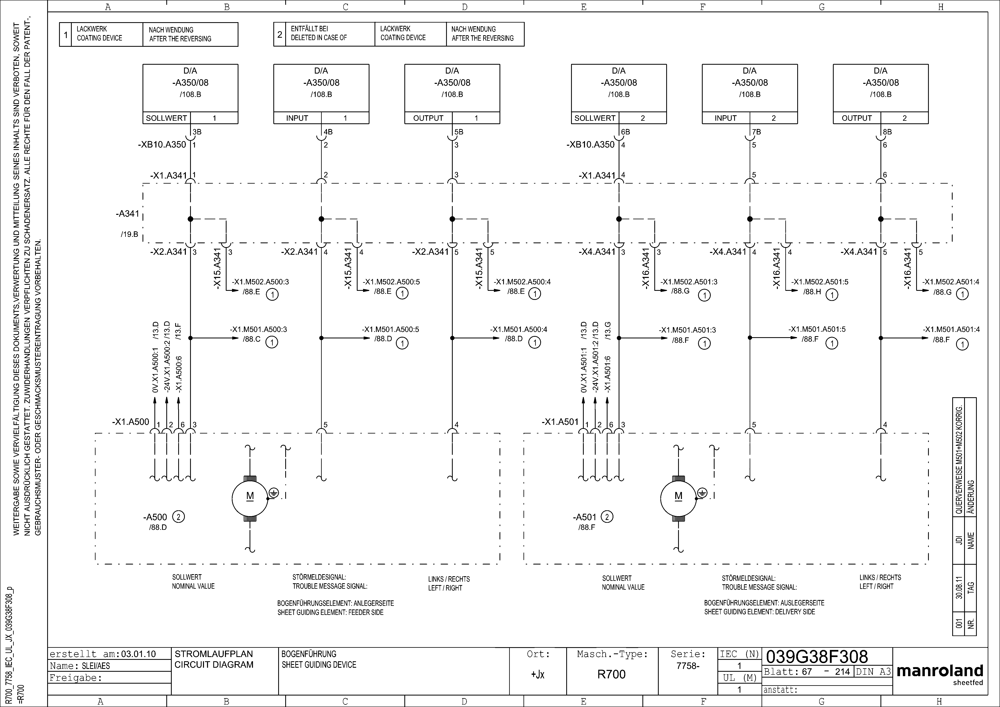

# +Jx — Sheet 67 of 214 — BOGENFÜHRUNG

**SHEET GUIDING DEVICE**

> Part of the manroland **R700** printing press IEC/UL circuit diagrams.
> Drawing class: **Stromlaufplan / Circuit diagram** (DIN A3).
> Document `+Jx` covers the **1st printing module + feed register** machine section.

## At a glance

| Field | Value |
|---|---|
| Document | `+Jx`  (039G38F308) |
| Sheet | **67** of 214 |
| Section (DE) | BOGENFÜHRUNG |
| Section (EN) | SHEET GUIDING DEVICE |
| Section type | CIRCUIT — Circuit diagram |
| Machine type | `R700` |
| Series | `7758` |
| Created | 03.01.10 |
| Replaces | — |
| Columns used | A, B, C, D, E, F, G, H |
| Path numbers | — |
| Labels on sheet | 184 |
| Cross-refs out | 27 |
| Cross-refs in | 63 |

**Previous:** [+Jx sheet 66](SHEET_0066.md) · **Next:** [+Jx sheet 68](SHEET_0068.md) · **Document TOC:** [_TOC.md](_TOC.md)  (+Jx) · **Master TOC:** [all sheets](../_MASTER_TOC.md)

## Sheet image (300 DPI, exact vector render)



_Rendered directly from the PDF vector layer at 300 DPI (1-bit), no OCR and no resampling. Use it to confirm anything ambiguous in the text below._

## Cross-references on this sheet

Each entry is a wire leaving this sheet. The printed token is `/sheet.column`; the link resolves to that sheet inside the same document.

| Ref | Target sheet | Col | Path | Destination on target | Target section | From col |
|---|---|---|---|---|---|---|
| `/108.B` | [+Jx sheet 108](SHEET_0108.md) | B | — | — | REFERENZMODUL | B |
| `/108.B` | [+Jx sheet 108](SHEET_0108.md) | B | — | — | REFERENZMODUL | C |
| `/108.B` | [+Jx sheet 108](SHEET_0108.md) | B | — | — | REFERENZMODUL | D |
| `/108.B` | [+Jx sheet 108](SHEET_0108.md) | B | — | — | REFERENZMODUL | E |
| `/108.B` | [+Jx sheet 108](SHEET_0108.md) | B | — | — | REFERENZMODUL | F |
| `/108.B` | [+Jx sheet 108](SHEET_0108.md) | B | — | — | REFERENZMODUL | G |
| `/19.B` | [+Jx sheet 19](SHEET_0019.md) | B | — | — | LACKPUMPE | A |
| `/88.G` | [+Jx sheet 88](SHEET_0088.md) | G | — | X1.M502.A500:3 X1.M502.A501:3 X1.M502.A501:4 | BOGENFÜHRUNG, NACH WENDUNG | E |
| `/88.E` | [+Jx sheet 88](SHEET_0088.md) | E | — | X1.M502.A500:3 X1.M502.A501:3 X1.M502.A501:4 | BOGENFÜHRUNG, NACH WENDUNG | E |
| `/88.G` | [+Jx sheet 88](SHEET_0088.md) | G | — | X1.M502.A500:3 X1.M502.A501:3 X1.M502.A501:4 | BOGENFÜHRUNG, NACH WENDUNG | E |
| `/88.E` | [+Jx sheet 88](SHEET_0088.md) | E | — | X1.M502.A500:5 | BOGENFÜHRUNG, NACH WENDUNG | C |
| `/88.E` | [+Jx sheet 88](SHEET_0088.md) | E | — | X1.M502.A500:4 | BOGENFÜHRUNG, NACH WENDUNG | D |
| `/88.H` | [+Jx sheet 88](SHEET_0088.md) | H | — | X1.M502.A501:5 | BOGENFÜHRUNG, NACH WENDUNG | G |
| `/13.D` | [+Jx sheet 13](SHEET_0013.md) | D | — | 24V.X1.A500:2 | SPANNUNGSVERSORGUNG, SCHALTSCHRANKBELÜFTUNG | B |
| `/13.D` | [+Jx sheet 13](SHEET_0013.md) | D | — | 0V.X1.A500:1 | SPANNUNGSVERSORGUNG, SCHALTSCHRANKBELÜFTUNG | A |
| `/13.D` | [+Jx sheet 13](SHEET_0013.md) | D | — | 0V.X1.A501:1 | SPANNUNGSVERSORGUNG, SCHALTSCHRANKBELÜFTUNG | E |
| `/13.D` | [+Jx sheet 13](SHEET_0013.md) | D | — | 24V.X1.A501:2 | SPANNUNGSVERSORGUNG, SCHALTSCHRANKBELÜFTUNG | E |
| `/13.G` | [+Jx sheet 13](SHEET_0013.md) | G | — | X1.A501:6 | SPANNUNGSVERSORGUNG, SCHALTSCHRANKBELÜFTUNG | E |
| `/13.F` | [+Jx sheet 13](SHEET_0013.md) | F | — | X1.A500:6 | SPANNUNGSVERSORGUNG, SCHALTSCHRANKBELÜFTUNG | B |
| `/88.F` | [+Jx sheet 88](SHEET_0088.md) | F | — | X1.M501.A501:5 | BOGENFÜHRUNG, NACH WENDUNG | G |
| `/88.D` | [+Jx sheet 88](SHEET_0088.md) | D | — | X1.M501.A500:3 X1.M501.A500:4 | BOGENFÜHRUNG, NACH WENDUNG | C |
| `/88.C` | [+Jx sheet 88](SHEET_0088.md) | C | — | X1.M501.A500:3 X1.M501.A500:4 | BOGENFÜHRUNG, NACH WENDUNG | C |
| `/88.D` | [+Jx sheet 88](SHEET_0088.md) | D | — | X1.M501.A500:5 X1.M501.A501:4 X1.M501.A501:3 | BOGENFÜHRUNG, NACH WENDUNG | F |
| `/88.F` | [+Jx sheet 88](SHEET_0088.md) | F | — | X1.M501.A500:5 X1.M501.A501:4 X1.M501.A501:3 | BOGENFÜHRUNG, NACH WENDUNG | F |
| `/88.F` | [+Jx sheet 88](SHEET_0088.md) | F | — | X1.M501.A500:5 X1.M501.A501:4 X1.M501.A501:3 | BOGENFÜHRUNG, NACH WENDUNG | F |
| `/88.F` | [+Jx sheet 88](SHEET_0088.md) | F | — | — | BOGENFÜHRUNG, NACH WENDUNG | E |
| `/88.D` | [+Jx sheet 88](SHEET_0088.md) | D | — | — | BOGENFÜHRUNG, NACH WENDUNG | A |

### Incoming references (sheets that point here)

Every other sheet that sends a wire to this one. `Back-ref` is the token printed on *that* sheet; `Path` is its line number.

| From sheet | Cols | Back-ref | Path | Refs | What continues there |
|---|---|---|---|---|---|
| [+Jx#13](SHEET_0013.md) | D, F, G | `/13.D`, `/13.F`, `/13.G` | — | 6 | 0V.X1.A500:1; 0V.X1.A501:1; 24V.X1.A500:2; 24V.X1.A501:2; X1.A500:6; X1.A501:6 |
| [+Jx#19](SHEET_0019.md) | B | `/19.B` | — | 1 | — |
| [+Jx#88](SHEET_0088.md) | C, D, E, F, G, H | `/88.C`, `/88.D`, `/88.E`, `/88.F`, `/88.G`, `/88.H` | — | 14 | A500; A501; X1.M501.A500:3; X1.M501.A500:4; X1.M501.A500:5; X1.M501.A501:3; X1.M501.A501:4; X1.M501.A501:5; X1.M502.A500:3; X1.M502.A500:4; X1.M502.A500:5; X1.M |
| [+Jx#108](SHEET_0108.md) | B | `/108.B` | — | 6 | — |
| [+Jx#113](SHEET_0113.md) | H | `/113.H` | — | 6 | — |
| [+Jx#114](SHEET_0114.md) | C | `/114.C` | — | 12 | — |
| [+Jx#126](SHEET_0126.md) | A | `/126.A` | — | 3 | — |
| [+Jx#129](SHEET_0129.md) | F | `/129.F` | — | 3 | — |
| [+Jx#135](SHEET_0135.md) | E | `/135.E` | — | 6 | — |
| [+Jx#138](SHEET_0138.md) | G | `/138.G` | — | 3 | — |
| [+Jx#139](SHEET_0139.md) | E | `/139.E` | — | 3 | — |


## Devices on this sheet

| Tag | Class | Class meaning (IEC) | Col | Sub | Terminal | Sign |
|---|---|---|---|---|---|---|
| `A501` | A | Baugruppe / assembly, module, PC board | E | — | — | — |
| `A500` | A | Baugruppe / assembly, module, PC board | A | — | — | — |
| `A350/08` | A | Baugruppe / assembly, module, PC board | G | 08 | — | — |
| `A350/08` | A | Baugruppe / assembly, module, PC board | F | 08 | — | — |
| `A350/08` | A | Baugruppe / assembly, module, PC board | E | 08 | — | — |
| `A350/08` | A | Baugruppe / assembly, module, PC board | D | 08 | — | — |
| `A350/08` | A | Baugruppe / assembly, module, PC board | B | 08 | — | — |
| `A350/08` | A | Baugruppe / assembly, module, PC board | C | 08 | — | — |
| `A341` | A | Baugruppe / assembly, module, PC board | A | — | — | — |
| `XB10.A350` | — | cross-device reference | E | — | — | — |
| `XB10.A350` | — | cross-device reference | A | — | — | — |
| `X4.A341` | — | cross-device reference | G | — | — | — |
| `X4.A341` | — | cross-device reference | F | — | — | — |
| `X4.A341` | — | cross-device reference | E | — | — | — |
| `X1.A341` | — | cross-device reference | E | — | — | — |
| `X2.A341` | — | cross-device reference | D | — | — | — |
| `X2.A341` | — | cross-device reference | B | — | — | — |
| `X1.A341` | — | cross-device reference | B | — | — | — |
| `X2.A341` | — | cross-device reference | C | — | — | — |
| `X15.A341` | — | cross-device reference | B | — | — | — |
| `X15.A341` | — | cross-device reference | C | — | — | — |
| `X15.A341` | — | cross-device reference | D | — | — | — |
| `X1.A500` | — | cross-device reference | A | — | — | — |
| `X1.A501` | — | cross-device reference | E | — | — | — |
| `X16.A341` | — | cross-device reference | F | — | — | — |
| `X16.A341` | — | cross-device reference | G | — | — | — |
| `X16.A341` | — | cross-device reference | H | — | — | — |
| `X1.M501.A501:4` | — | cross-device reference | H | — | 4 | — |
| `X1.M501.A501:3` | — | cross-device reference | F | — | 3 | — |
| `X1.M501.A500:5` | — | cross-device reference | C | — | 5 | — |
| `X1.M501.A500:4` | — | cross-device reference | D | — | 4 | — |
| `X1.M501.A500:3` | — | cross-device reference | B | — | 3 | — |
| `X1.M501.A501:5` | — | cross-device reference | G | — | 5 | — |
| `X1.A501:6` | — | cross-device reference | E | — | 6 | — |
| `X1.M502.A501:5` | — | cross-device reference | G | — | 5 | — |
| `X1.M502.A501:4` | — | cross-device reference | H | — | 4 | — |
| `X1.M502.A501:3` | — | cross-device reference | F | — | 3 | — |
| `X1.M502.A500:3` | — | cross-device reference | B | — | 3 | — |
| `X1.M502.A500:4` | — | cross-device reference | D | — | 4 | — |
| `X1.A500:6` | — | cross-device reference | B | — | 6 | — |
| `X1.M502.A500:5` | — | cross-device reference | C | — | 5 | — |
| `NR.` | — | cross-device reference | H | — | — | — |
| `30.08.11` | — | cross-device reference | H | — | — | — |

## Potentials / nets

| Potential | Count | Columns | Attached devices | Terminals |
|---|---|---|---|---|
| `0V` | 2 | A, E | `A500`, `A501`, `X1` | `1` |
| `24V` | 2 | B, E | `A500`, `A501`, `X1` | `2` |


A potential such as `L24+/4` or `M24+` is a named supply/return rail; every place it appears on this sheet is electrically common.

## Wire-end annotations (grouped as printed)

A wire that continues elsewhere is annotated with a small cluster: the destination description, the path/line number `#NN`, and the `/sheet.column` cross reference. Each row below is one such cluster exactly as it is grouped on the drawing.

| Col | Y | Path | Cross-ref | Text on the wire |
|---|---|---|---|---|
| B | 31.3 | — | — | `1 LACKWERK COATING DEVICE AFTER THE REVERSING 2 ENTFÄLLT BEI DELETED IN CASE OF` |
| D | 31.3 | — | — | `LACKWERK COATING DEVICE AFTER THE REVERSING` |
| D | 31.9 | — | — | `NACH WENDUNG` |
| B | 32.9 | — | — | `NACH WENDUNG` |
| B | 79.9 | — | — | `D/A` |
| C | 79.9 | — | — | `D/A` |
| D | 79.9 | — | — | `D/A` |
| E | 79.9 | — | — | `D/A` |
| F | 79.9 | — | — | `D/A` |
| G | 79.9 | — | — | `D/A` |
| B | 93.8 | — | — | `A350/08` |
| C | 93.8 | — | — | `A350/08` |
| D | 93.8 | — | — | `A350/08` |
| E | 93.8 | — | — | `A350/08` |
| F | 93.8 | — | — | `A350/08` |
| G | 93.8 | — | — | `A350/08` |
| B | 108.6 | — | `/108.B` | — |
| C | 108.6 | — | `/108.B` | — |
| D | 108.6 | — | `/108.B` | — |
| E | 108.6 | — | `/108.B` | — |
| F | 108.6 | — | `/108.B` | — |
| G | 108.6 | — | `/108.B` | — |
| B | 136.9 | — | — | `SOLLWERT 1` |
| E | 136.9 | — | — | `SOLLWERT 2` |
| C | 137.0 | — | — | `INPUT 1` |
| D | 137.0 | — | — | `OUTPUT 1` |
| F | 137.0 | — | — | `INPUT 2` |
| G | 137.0 | — | — | `OUTPUT 2` |
| B | 153.3 | — | — | `3B` |
| C | 153.3 | — | — | `4B` |
| D | 153.3 | — | — | `5B` |
| E | 153.3 | — | — | `6B` |
| F | 153.3 | — | — | `7B` |
| H | 153.3 | — | — | `8B` |
| A | 167.5 | — | — | `XB10.A350 1` |
| E | 167.5 | — | — | `XB10.A350 4` |
| C | 168.9 | — | — | `2` |
| D | 168.9 | — | — | `3` |
| F | 168.9 | — | — | `5` |
| H | 168.9 | — | — | `6` |
| B | 204.3 | — | — | `X1.A341 1 2` |
| E | 204.3 | — | — | `3 X1.A341 4` |
| F | 204.4 | — | — | `5` |
| H | 204.4 | — | — | `6` |
| A | 249.7 | — | — | `A341` |
| A | 275.1 | — | `/19.B` | — |
| B | 294.2 | — | — | `X15.A341` |
| C | 294.2 | — | — | `X15.A341` |
| D | 294.2 | — | — | `X15.A341` |
| F | 294.2 | — | — | `X16.A341` |
| G | 294.2 | — | — | `X16.A341` |
| H | 294.2 | — | — | `X16.A341` |
| C | 295.0 | — | — | `X2.A341 3 X2.A341 5` |
| B | 295.0 | — | — | `3 X2.A341 4` |
| F | 295.0 | — | — | `X4.A341 3 X4.A341 4` |
| G | 295.0 | — | — | `X4.A341 5` |
| C | 296.5 | — | — | `4` |
| D | 296.5 | — | — | `5` |
| F | 296.5 | — | — | `3` |
| G | 296.5 | — | — | `4` |
| H | 296.5 | — | — | `5` |
| E | 331.9 | — | `/88.G`, `/88.E`, `/88.G` | `X1.M502.A500:3 X1.M502.A501:3 X1.M502.A501:4` |
| C | 331.9 | — | `/88.E` | `X1.M502.A500:5` |
| D | 331.9 | — | `/88.E` | `X1.M502.A500:4` |
| G | 331.9 | — | `/88.H` | `X1.M502.A501:5` |
| C | 345.9 | — | — | `1 1 1` |
| H | 346.9 | — | — | `1` |
| G | 347.8 | — | — | `1 1` |
| B | 382.2 | — | `/13.D` | `24V.X1.A500:2` |
| A | 382.8 | — | `/13.D` | `0V.X1.A500:1` |
| E | 382.8 | — | `/13.D` | `0V.X1.A501:1` |
| E | 382.8 | — | `/13.D` | `24V.X1.A501:2` |
| E | 382.9 | — | `/13.G` | `X1.A501:6` |
| B | 384.3 | — | `/13.F` | `X1.A500:6` |
| G | 388.2 | — | `/88.F` | `X1.M501.A501:5` |
| C | 388.5 | — | `/88.D`, `/88.C` | `X1.M501.A500:3 X1.M501.A500:4` |
| F | 388.5 | — | `/88.D`, `/88.F`, `/88.F` | `X1.M501.A500:5 X1.M501.A501:3 X1.M501.A501:4` |
| C | 404.3 | — | — | `1 1 1` |
| G | 405.6 | — | — | `1 1` |
| H | 406.8 | — | — | `1` |
| H | 482.3 | — | — | `001 JDI 30.08.11 QUERVERWEISE M501+M502 KORRIG.` |
| C | 497.7 | — | — | `X1.A500 1 2 6 X1.A501 1 2 6` |
| C | 502.0 | — | — | `3 4` |
| C | 502.0 | — | — | `5` |
| F | 502.0 | — | — | `3 5 4` |
| H | 571.8 | — | — | `NR. NAME TAG ÄNDERUNG` |
| B | 585.4 | — | — | `M` |
| F | 585.4 | — | — | `M` |
| A | 611.1 | — | — | `A500` |
| E | 611.1 | — | — | `A501` |
| C | 612.5 | — | — | `2 2` |
| A | 624.2 | — | `/88.D` | — |
| E | 624.2 | — | `/88.F` | — |
| B | 684.5 | — | — | `NOMINAL VALUE SOLLWERT` |
| C | 684.5 | — | — | `STÖRMELDESIGNAL: TROUBLE MESSAGE SIGNAL:` |
| G | 684.9 | — | — | `LINKS / RECHTS LEFT / RIGHT` |
| E | 685.8 | — | — | `NOMINAL VALUE SOLLWERT` |
| F | 685.8 | — | — | `STÖRMELDESIGNAL: TROUBLE MESSAGE SIGNAL:` |
| D | 686.7 | — | — | `LINKS / RECHTS LEFT / RIGHT` |
| G | 715.1 | — | — | `BOGENFÜHRUNGSELEMENT: AUSLEGERSEITE SHEET GUIDING ELEMENT: DELIVERY SIDE` |
| C | 715.7 | — | — | `BOGENFÜHRUNGSELEMENT: ANLEGERSEITE SHEET GUIDING ELEMENT: FEEDER SIDE` |


## Reconstructed tables

This sheet carries tabular content (pin map / terminal assignment / index). The grid below was rebuilt from the drawing's own rule lines, so each row is exactly one physical row of the table.

### Table 1 — 3 data rows × 6 columns (at x=184.3, y=76.5)

|  |  | D/A | A350/08 /108.B |  |  |
|---|---|---|---|---|---|
| `SOLLWERT` |  |  | `1` |  |  |
| `XB10.A350` | `X1.A341` |  | `3B 1 1` |  |  |
| `/13.D` | `X2.A341 /13.D` | `/13.F` | `X15.A341 3` | `3` | `X1.M502.A500:3 /88.E 1 X1.M501.A500:3` |


### Table 2 — 3 data rows × 8 columns (at x=340.2, y=76.5)

| D/A | A350/08 /108.B |  |  | D/A | A350/08 /108.B |  |  |
|---|---|---|---|---|---|---|---|
| `INPUT` | `1` |  |  | `OUTPUT` | `1` |  |  |
|  | `4B 2 2` |  |  |  | `5B 3 3` |  |  |
| `X2.A341` | `X15.A341 4` | `4` | `X1.M502.A500:5 /88.E 1 X1.M501.A500:5` | `X2.A341` | `X15.A341 5` | `5` | `X1.M502.A500:4 /88.E 1 X1.M501.A500:4` |


### Table 3 — 3 data rows × 14 columns (at x=694.5, y=76.5)

|  |  | D/A | A350/08 /108.B |  |  |  | D/A | A350/08 /108.B |  |  | D/A | A350/08 /108.B |  |
|---|---|---|---|---|---|---|---|---|---|---|---|---|---|
| `SOLLWERT` |  |  | `2` |  |  |  | `INPUT` | `2` |  |  | `OUTPUT` | `2` |  |
| `XB10.A350` | `X1.A341` |  | `6B 4 4` |  |  |  |  | `7B 5 5` |  |  |  | `8B 6 6` |  |
| `/13.D` | `X4.A341 /13.D` | `/13.G` | `X16.A341 3` | `3` | `X1.M502.A501:3 /88.G X1.M501.A501:3` | `1` | `X4.A341` | `X16.A341 4` | `4` | `X1.M502.A501:5 /88.H 1 X1.M501.A501:5` | `X4.A341` | `X16.A341 5` | `5` |


## Notes and free text on this sheet

| Text | Col | Y (pt) |
|---|---|---|
| `BOGENFÜHRUNGSELEMENT: AUSLEGERSEITE` | G | 715.12 |
| `SHEET GUIDING ELEMENT: DELIVERY SIDE` | F | 725.74 |
| `M` | F | 585.36 |
| `BOGENFÜHRUNGSELEMENT: ANLEGERSEITE` | C | 715.74 |
| `SHEET GUIDING ELEMENT: FEEDER SIDE` | C | 726.36 |
| `M` | B | 585.36 |
| `8B` | H | 153.28 |
| `D/A` | G | 79.89 |
| `OUTPUT` | G | 137 |
| `LINKS / RECHTS` | G | 684.85 |
| `LEFT / RIGHT` | G | 695.48 |
| `7B` | F | 153.28 |
| `D/A` | F | 79.89 |
| `INPUT` | F | 136.99 |
| `STÖRMELDESIGNAL:` | F | 685.8 |
| `TROUBLE MESSAGE SIGNAL:` | F | 696.42 |
| `6B` | E | 153.28 |
| `D/A` | E | 79.89 |
| `SOLLWERT` | E | 136.94 |
| `NOMINAL VALUE` | E | 696.44 |
| `5B` | D | 153.28 |
| `D/A` | D | 79.89 |
| `OUTPUT` | D | 137 |
| `LINKS / RECHTS` | D | 686.72 |
| `LEFT / RIGHT` | D | 697.35 |
| `3B` | B | 153.28 |
| `D/A` | B | 79.89 |
| `SOLLWERT` | A | 136.94 |
| `SOLLWERT` | B | 684.52 |
| `NOMINAL VALUE` | B | 695.19 |
| `4B` | C | 153.28 |
| `D/A` | C | 79.89 |
| `INPUT` | C | 136.99 |
| `STÖRMELDESIGNAL:` | C | 684.55 |
| `TROUBLE MESSAGE SIGNAL:` | C | 695.18 |
| `TAG` | H | 692.88 |
| `NAME` | H | 633.65 |
| `ÄNDERUNG` | H | 571.79 |
| `JDI` | H | 638.01 |
| `QUERVERWEISE M501+M502 KORRIG.` | H | 482.32 |
| `NACH WENDUNG` | B | 32.85 |
| `AFTER THE REVERSING` | B | 43.5 |
| `LACKWERK` | A | 31.72 |
| `COATING DEVICE` | A | 42.39 |
| `ENTFÄLLT BEI` | C | 31.33 |
| `DELETED IN CASE OF` | C | 41.98 |
| `NACH WENDUNG` | D | 31.92 |
| `AFTER THE REVERSING` | D | 42.56 |
| `LACKWERK` | C | 31.32 |
| `COATING DEVICE` | C | 41.99 |

## Complete label inventory (exact text from the drawing)

Every text object inside the drawing area of this sheet, in DIN reading order (column A→H, then top→bottom). This is the authoritative list: if a string is not here it is not printed on this sheet.

| Col | Y | X | Dir | Type | Text |
|---|---|---|---|---|---|
| A | 31.7 | 91.6 | → | text | `LACKWERK` |
| A | 37.1 | 75.4 | → | number | `1` |
| A | 42.4 | 91.8 | → | text | `COATING DEVICE` |
| A | 136.9 | 173.8 | → | text | `SOLLWERT` |
| A | 167.5 | 164.4 | → | device ref | `XB10.A350` |
| A | 249.7 | 138.0 | → | device tag | `A341` |
| A | 275.2 | 144.0 | → | cross-reference | `/19.B` |
| A | 382.8 | 181.5 | ↕ | cross-reference | `/13.D` |
| A | 413.4 | 180.9 | ↕ | potential | `0V.X1.A500:1` |
| A | 497.7 | 133.5 | → | device ref | `X1.A500` |
| A | 502.0 | 186.2 | → | number | `1` |
| A | 611.1 | 170.6 | → | device tag | `A500` |
| A | 624.2 | 177.7 | → | cross-reference | `/88.D` |
| B | 32.9 | 177.5 | → | text | `NACH WENDUNG` |
| B | 36.7 | 330.3 | → | number | `2` |
| B | 43.5 | 178.0 | → | text | `AFTER THE REVERSING` |
| B | 79.9 | 218.3 | → | text | `D/A` |
| B | 93.8 | 205.4 | → | device tag | `A350/08` |
| B | 108.6 | 214.2 | → | cross-reference | `/108.B` |
| B | 137.0 | 253.0 | → | number | `1` |
| B | 153.3 | 229.3 | → | text | `3B` |
| B | 168.9 | 228.8 | → | number | `1` |
| B | 204.3 | 178.9 | → | device ref | `X1.A341` |
| B | 204.4 | 228.8 | → | number | `1` |
| B | 294.2 | 253.9 | ↕ | device ref | `X15.A341` |
| B | 295.0 | 178.9 | → | device ref | `X2.A341` |
| B | 296.5 | 229.3 | → | number | `3` |
| B | 296.5 | 271.8 | → | number | `3` |
| B | 331.9 | 276.1 | → | device ref | `X1.M502.A500:3` |
| B | 343.6 | 289.0 | → | cross-reference | `/88.E` |
| B | 347.5 | 322.3 | → | number | `1` |
| B | 382.2 | 194.9 | ↕ | cross-reference | `/13.D` |
| B | 384.3 | 208.3 | ↕ | cross-reference | `/13.F` |
| B | 388.5 | 273.8 | → | device ref | `X1.M501.A500:3` |
| B | 400.1 | 289.4 | → | cross-reference | `/88.C` |
| B | 404.3 | 321.7 | → | number | `1` |
| B | 405.6 | 195.1 | ↕ | potential | `24V.X1.A500:2` |
| B | 423.9 | 209.2 | ↕ | device ref | `X1.A500:6` |
| B | 502.0 | 201.3 | → | number | `2` |
| B | 502.0 | 215.1 | → | number | `6` |
| B | 502.0 | 229.3 | → | number | `3` |
| B | 585.4 | 293.1 | → | text | `M` |
| B | 612.5 | 210.6 | → | number | `2` |
| B | 684.5 | 205.2 | → | text | `SOLLWERT` |
| B | 695.2 | 204.9 | → | text | `NOMINAL VALUE` |
| C | 31.3 | 346.7 | → | text | `ENTFÄLLT BEI` |
| C | 31.3 | 453.0 | → | text | `LACKWERK` |
| C | 42.0 | 346.7 | → | text | `DELETED IN CASE OF` |
| C | 42.0 | 453.3 | → | text | `COATING DEVICE` |
| C | 79.9 | 374.2 | → | text | `D/A` |
| C | 93.8 | 361.3 | → | device tag | `A350/08` |
| C | 108.6 | 370.1 | → | cross-reference | `/108.B` |
| C | 137.0 | 340.7 | → | text | `INPUT` |
| C | 137.0 | 408.9 | → | number | `1` |
| C | 153.3 | 385.5 | → | text | `4B` |
| C | 168.9 | 385.5 | → | number | `2` |
| C | 204.4 | 385.5 | → | number | `2` |
| C | 294.2 | 409.8 | ↕ | device ref | `X15.A341` |
| C | 295.0 | 334.8 | → | device ref | `X2.A341` |
| C | 296.5 | 385.5 | → | number | `4` |
| C | 296.5 | 428.0 | → | number | `4` |
| C | 331.9 | 432.0 | → | device ref | `X1.M502.A500:5` |
| C | 343.0 | 445.6 | → | cross-reference | `/88.E` |
| C | 345.9 | 477.0 | → | number | `1` |
| C | 388.5 | 431.0 | → | device ref | `X1.M501.A500:5` |
| C | 399.4 | 445.9 | → | cross-reference | `/88.D` |
| C | 405.5 | 477.0 | → | number | `1` |
| C | 502.0 | 385.2 | → | number | `5` |
| C | 684.6 | 348.3 | → | text | `STÖRMELDESIGNAL:` |
| C | 695.2 | 348.6 | → | text | `TROUBLE MESSAGE SIGNAL:` |
| C | 715.7 | 330.3 | → | text | `BOGENFÜHRUNGSELEMENT: ANLEGERSEITE` |
| C | 726.4 | 330.5 | → | text | `SHEET GUIDING ELEMENT: FEEDER SIDE` |
| D | 31.9 | 537.6 | → | text | `NACH WENDUNG` |
| D | 42.6 | 538.2 | → | text | `AFTER THE REVERSING` |
| D | 79.9 | 530.1 | → | text | `D/A` |
| D | 93.8 | 517.2 | → | device tag | `A350/08` |
| D | 108.6 | 526.0 | → | cross-reference | `/108.B` |
| D | 137.0 | 492.1 | → | text | `OUTPUT` |
| D | 137.0 | 564.8 | → | number | `1` |
| D | 153.3 | 541.1 | → | text | `5B` |
| D | 168.9 | 541.1 | → | number | `3` |
| D | 204.4 | 541.1 | → | number | `3` |
| D | 294.2 | 565.7 | ↕ | device ref | `X15.A341` |
| D | 295.0 | 490.7 | → | device ref | `X2.A341` |
| D | 296.5 | 541.1 | → | number | `5` |
| D | 296.5 | 583.7 | → | number | `5` |
| D | 331.9 | 587.9 | → | device ref | `X1.M502.A500:4` |
| D | 343.0 | 604.3 | → | cross-reference | `/88.E` |
| D | 388.5 | 583.7 | → | device ref | `X1.M501.A500:4` |
| D | 399.4 | 601.5 | → | cross-reference | `/88.D` |
| D | 502.0 | 541.4 | → | number | `4` |
| D | 686.7 | 510.2 | → | text | `LINKS / RECHTS` |
| D | 697.4 | 510.2 | → | text | `LEFT / RIGHT` |
| E | 79.9 | 728.5 | → | text | `D/A` |
| E | 93.8 | 715.6 | → | device tag | `A350/08` |
| E | 108.6 | 724.4 | → | cross-reference | `/108.B` |
| E | 136.9 | 684.0 | → | text | `SOLLWERT` |
| E | 153.3 | 739.6 | → | text | `6B` |
| E | 167.5 | 674.6 | → | device ref | `XB10.A350` |
| E | 168.9 | 739.8 | → | number | `4` |
| E | 204.3 | 689.1 | → | device ref | `X1.A341` |
| E | 204.4 | 739.8 | → | number | `4` |
| E | 295.0 | 689.1 | → | device ref | `X4.A341` |
| E | 296.5 | 739.6 | → | number | `3` |
| E | 346.6 | 634.8 | → | number | `1` |
| E | 382.8 | 691.3 | ↕ | cross-reference | `/13.D` |
| E | 382.8 | 705.3 | ↕ | cross-reference | `/13.D` |
| E | 382.9 | 720.0 | ↕ | cross-reference | `/13.G` |
| E | 404.6 | 634.8 | → | number | `1` |
| E | 405.7 | 705.3 | ↕ | potential | `24V.X1.A501:2` |
| E | 413.4 | 691.2 | ↕ | potential | `0V.X1.A501:1` |
| E | 423.9 | 719.6 | ↕ | device ref | `X1.A501:6` |
| E | 497.7 | 645.2 | → | device ref | `X1.A501` |
| E | 502.0 | 696.5 | → | number | `1` |
| E | 502.0 | 711.5 | → | number | `2` |
| E | 502.0 | 725.4 | → | number | `6` |
| E | 502.0 | 739.6 | → | number | `3` |
| E | 611.1 | 682.3 | → | device tag | `A501` |
| E | 612.5 | 720.8 | → | number | `2` |
| E | 624.2 | 688.8 | → | cross-reference | `/88.F` |
| E | 685.8 | 717.2 | → | text | `SOLLWERT` |
| E | 696.4 | 716.9 | → | text | `NOMINAL VALUE` |
| F | 79.9 | 884.4 | → | text | `D/A` |
| F | 93.8 | 871.5 | → | device tag | `A350/08` |
| F | 108.6 | 880.3 | → | cross-reference | `/108.B` |
| F | 137.0 | 763.1 | → | number | `2` |
| F | 137.0 | 851.0 | → | text | `INPUT` |
| F | 153.3 | 895.5 | → | text | `7B` |
| F | 168.9 | 895.5 | → | number | `5` |
| F | 204.4 | 895.5 | → | number | `5` |
| F | 294.2 | 764.2 | ↕ | device ref | `X16.A341` |
| F | 295.0 | 845.0 | → | device ref | `X4.A341` |
| F | 296.5 | 782.1 | → | number | `3` |
| F | 296.5 | 895.7 | → | number | `4` |
| F | 331.9 | 786.3 | → | device ref | `X1.M502.A501:3` |
| F | 342.7 | 799.5 | → | cross-reference | `/88.G` |
| F | 348.4 | 836.8 | → | number | `1` |
| F | 389.2 | 784.5 | → | device ref | `X1.M501.A501:3` |
| F | 401.3 | 800.4 | → | cross-reference | `/88.F` |
| F | 405.8 | 836.8 | → | number | `1` |
| F | 502.0 | 895.5 | → | number | `5` |
| F | 585.4 | 803.3 | → | text | `M` |
| F | 685.8 | 859.7 | → | text | `STÖRMELDESIGNAL:` |
| F | 696.4 | 860.0 | → | text | `TROUBLE MESSAGE SIGNAL:` |
| F | 725.7 | 838.8 | → | text | `SHEET GUIDING ELEMENT: DELIVERY SIDE` |
| G | 79.9 | 1040.3 | → | text | `D/A` |
| G | 93.8 | 1027.4 | → | device tag | `A350/08` |
| G | 108.6 | 1036.2 | → | cross-reference | `/108.B` |
| G | 137.0 | 919.0 | → | number | `2` |
| G | 137.0 | 1002.3 | → | text | `OUTPUT` |
| G | 294.2 | 920.1 | ↕ | device ref | `X16.A341` |
| G | 295.0 | 1000.9 | → | device ref | `X4.A341` |
| G | 296.5 | 938.3 | → | number | `4` |
| G | 331.9 | 942.2 | → | device ref | `X1.M502.A501:5` |
| G | 343.6 | 956.6 | → | cross-reference | `/88.H` |
| G | 347.8 | 988.7 | → | number | `1` |
| G | 388.2 | 938.9 | → | device ref | `X1.M501.A501:5` |
| G | 400.0 | 954.8 | → | cross-reference | `/88.F` |
| G | 405.6 | 988.6 | → | number | `1` |
| G | 684.8 | 1023.7 | → | text | `LINKS / RECHTS` |
| G | 695.5 | 1023.7 | → | text | `LEFT / RIGHT` |
| G | 715.1 | 838.5 | → | text | `BOGENFÜHRUNGSELEMENT: AUSLEGERSEITE` |
| H | 137.0 | 1074.9 | → | number | `2` |
| H | 153.3 | 1051.4 | → | text | `8B` |
| H | 168.9 | 1051.4 | → | number | `6` |
| H | 204.4 | 1051.4 | → | number | `6` |
| H | 294.2 | 1076.0 | ↕ | device ref | `X16.A341` |
| H | 296.5 | 1051.4 | → | number | `5` |
| H | 296.5 | 1093.9 | → | number | `5` |
| H | 331.9 | 1098.1 | → | device ref | `X1.M502.A501:4` |
| H | 343.9 | 1111.6 | → | cross-reference | `/88.G` |
| H | 346.9 | 1144.0 | → | number | `1` |
| H | 388.5 | 1098.9 | → | device ref | `X1.M501.A501:4` |
| H | 400.7 | 1111.0 | → | cross-reference | `/88.F` |
| H | 406.8 | 1144.0 | → | number | `1` |
| H | 482.3 | 1138.8 | ↕ | text | `QUERVERWEISE M501+M502 KORRIG.` |
| H | 502.0 | 1051.7 | → | number | `4` |
| H | 571.8 | 1153.0 | ↕ | text | `ÄNDERUNG` |
| H | 633.6 | 1152.9 | ↕ | text | `NAME` |
| H | 638.0 | 1138.7 | ↕ | text | `JDI` |
| H | 685.9 | 1138.8 | ↕ | device ref | `30.08.11` |
| H | 692.9 | 1153.0 | ↕ | text | `TAG` |
| H | 736.2 | 1138.7 | ↕ | number | `001` |
| H | 736.5 | 1152.9 | ↕ | device ref | `NR.` |

## Reading-order text block

The same content as a plain block, grouped by DIN column — convenient to paste or to match against a visual description.

```text
=== Column A ===
  31.7   91.6  text         LACKWERK
  37.1   75.4  numeric      1
  42.4   91.8  text         COATING DEVICE
 136.9  173.8  text         SOLLWERT
 167.5  164.4  devref       XB10.A350
 249.7  138.0  devtag       A341
 275.2  144.0  xref         /19.B
 382.8  181.5  xref         /13.D
 413.4  180.9  net          0V.X1.A500:1
 497.7  133.5  devref       X1.A500
 502.0  186.2  numeric      1
 611.1  170.6  devtag       A500
 624.2  177.7  xref         /88.D
=== Column B ===
  32.9  177.5  text         NACH WENDUNG
  36.7  330.3  numeric      2
  43.5  178.0  text         AFTER THE REVERSING
  79.9  218.3  text         D/A
  93.8  205.4  devtag       A350/08
 108.6  214.2  xref         /108.B
 137.0  253.0  numeric      1
 153.3  229.3  text         3B
 168.9  228.8  numeric      1
 204.3  178.9  devref       X1.A341
 204.4  228.8  numeric      1
 294.2  253.9  devref       X15.A341
 295.0  178.9  devref       X2.A341
 296.5  229.3  numeric      3
 296.5  271.8  numeric      3
 331.9  276.1  devref       X1.M502.A500:3
 343.6  289.0  xref         /88.E
 347.5  322.3  numeric      1
 382.2  194.9  xref         /13.D
 384.3  208.3  xref         /13.F
 388.5  273.8  devref       X1.M501.A500:3
 400.1  289.4  xref         /88.C
 404.3  321.7  numeric      1
 405.6  195.1  net          24V.X1.A500:2
 423.9  209.2  devref       X1.A500:6
 502.0  201.3  numeric      2
 502.0  215.1  numeric      6
 502.0  229.3  numeric      3
 585.4  293.1  text         M
 612.5  210.6  numeric      2
 684.5  205.2  text         SOLLWERT
 695.2  204.9  text         NOMINAL VALUE
=== Column C ===
  31.3  346.7  text         ENTFÄLLT BEI
  31.3  453.0  text         LACKWERK
  42.0  346.7  text         DELETED IN CASE OF
  42.0  453.3  text         COATING DEVICE
  79.9  374.2  text         D/A
  93.8  361.3  devtag       A350/08
 108.6  370.1  xref         /108.B
 137.0  340.7  text         INPUT
 137.0  408.9  numeric      1
 153.3  385.5  text         4B
 168.9  385.5  numeric      2
 204.4  385.5  numeric      2
 294.2  409.8  devref       X15.A341
 295.0  334.8  devref       X2.A341
 296.5  385.5  numeric      4
 296.5  428.0  numeric      4
 331.9  432.0  devref       X1.M502.A500:5
 343.0  445.6  xref         /88.E
 345.9  477.0  numeric      1
 388.5  431.0  devref       X1.M501.A500:5
 399.4  445.9  xref         /88.D
 405.5  477.0  numeric      1
 502.0  385.2  numeric      5
 684.6  348.3  text         STÖRMELDESIGNAL:
 695.2  348.6  text         TROUBLE MESSAGE SIGNAL:
 715.7  330.3  text         BOGENFÜHRUNGSELEMENT: ANLEGERSEITE
 726.4  330.5  text         SHEET GUIDING ELEMENT: FEEDER SIDE
=== Column D ===
  31.9  537.6  text         NACH WENDUNG
  42.6  538.2  text         AFTER THE REVERSING
  79.9  530.1  text         D/A
  93.8  517.2  devtag       A350/08
 108.6  526.0  xref         /108.B
 137.0  492.1  text         OUTPUT
 137.0  564.8  numeric      1
 153.3  541.1  text         5B
 168.9  541.1  numeric      3
 204.4  541.1  numeric      3
 294.2  565.7  devref       X15.A341
 295.0  490.7  devref       X2.A341
 296.5  541.1  numeric      5
 296.5  583.7  numeric      5
 331.9  587.9  devref       X1.M502.A500:4
 343.0  604.3  xref         /88.E
 388.5  583.7  devref       X1.M501.A500:4
 399.4  601.5  xref         /88.D
 502.0  541.4  numeric      4
 686.7  510.2  text         LINKS / RECHTS
 697.4  510.2  text         LEFT / RIGHT
=== Column E ===
  79.9  728.5  text         D/A
  93.8  715.6  devtag       A350/08
 108.6  724.4  xref         /108.B
 136.9  684.0  text         SOLLWERT
 153.3  739.6  text         6B
 167.5  674.6  devref       XB10.A350
 168.9  739.8  numeric      4
 204.3  689.1  devref       X1.A341
 204.4  739.8  numeric      4
 295.0  689.1  devref       X4.A341
 296.5  739.6  numeric      3
 346.6  634.8  numeric      1
 382.8  691.3  xref         /13.D
 382.8  705.3  xref         /13.D
 382.9  720.0  xref         /13.G
 404.6  634.8  numeric      1
 405.7  705.3  net          24V.X1.A501:2
 413.4  691.2  net          0V.X1.A501:1
 423.9  719.6  devref       X1.A501:6
 497.7  645.2  devref       X1.A501
 502.0  696.5  numeric      1
 502.0  711.5  numeric      2
 502.0  725.4  numeric      6
 502.0  739.6  numeric      3
 611.1  682.3  devtag       A501
 612.5  720.8  numeric      2
 624.2  688.8  xref         /88.F
 685.8  717.2  text         SOLLWERT
 696.4  716.9  text         NOMINAL VALUE
=== Column F ===
  79.9  884.4  text         D/A
  93.8  871.5  devtag       A350/08
 108.6  880.3  xref         /108.B
 137.0  763.1  numeric      2
 137.0  851.0  text         INPUT
 153.3  895.5  text         7B
 168.9  895.5  numeric      5
 204.4  895.5  numeric      5
 294.2  764.2  devref       X16.A341
 295.0  845.0  devref       X4.A341
 296.5  782.1  numeric      3
 296.5  895.7  numeric      4
 331.9  786.3  devref       X1.M502.A501:3
 342.7  799.5  xref         /88.G
 348.4  836.8  numeric      1
 389.2  784.5  devref       X1.M501.A501:3
 401.3  800.4  xref         /88.F
 405.8  836.8  numeric      1
 502.0  895.5  numeric      5
 585.4  803.3  text         M
 685.8  859.7  text         STÖRMELDESIGNAL:
 696.4  860.0  text         TROUBLE MESSAGE SIGNAL:
 725.7  838.8  text         SHEET GUIDING ELEMENT: DELIVERY SIDE
=== Column G ===
  79.9 1040.3  text         D/A
  93.8 1027.4  devtag       A350/08
 108.6 1036.2  xref         /108.B
 137.0  919.0  numeric      2
 137.0 1002.3  text         OUTPUT
 294.2  920.1  devref       X16.A341
 295.0 1000.9  devref       X4.A341
 296.5  938.3  numeric      4
 331.9  942.2  devref       X1.M502.A501:5
 343.6  956.6  xref         /88.H
 347.8  988.7  numeric      1
 388.2  938.9  devref       X1.M501.A501:5
 400.0  954.8  xref         /88.F
 405.6  988.6  numeric      1
 684.8 1023.7  text         LINKS / RECHTS
 695.5 1023.7  text         LEFT / RIGHT
 715.1  838.5  text         BOGENFÜHRUNGSELEMENT: AUSLEGERSEITE
=== Column H ===
 137.0 1074.9  numeric      2
 153.3 1051.4  text         8B
 168.9 1051.4  numeric      6
 204.4 1051.4  numeric      6
 294.2 1076.0  devref       X16.A341
 296.5 1051.4  numeric      5
 296.5 1093.9  numeric      5
 331.9 1098.1  devref       X1.M502.A501:4
 343.9 1111.6  xref         /88.G
 346.9 1144.0  numeric      1
 388.5 1098.9  devref       X1.M501.A501:4
 400.7 1111.0  xref         /88.F
 406.8 1144.0  numeric      1
 482.3 1138.8  text         QUERVERWEISE M501+M502 KORRIG.
 502.0 1051.7  numeric      4
 571.8 1153.0  text         ÄNDERUNG
 633.6 1152.9  text         NAME
 638.0 1138.7  text         JDI
 685.9 1138.8  devref       30.08.11
 692.9 1153.0  text         TAG
 736.2 1138.7  numeric      001
 736.5 1152.9  devref       NR.
```

---
_Generated from the PDF vector text layer; no OCR. Source: `R700_7758_IEC_UL_JX_039G38F308_p`, sheet 67._
