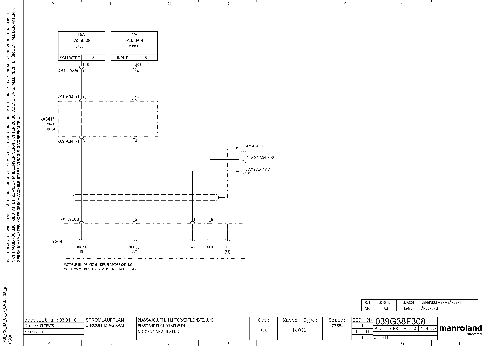

# +Jx — Sheet 68 of 214 — BLAS/SAUGLUFT MIT MOTORVENTILEINSTELLUNG

**BLAST AND SUCTION AIR WITH**

> Part of the manroland **R700** printing press IEC/UL circuit diagrams.
> Drawing class: **Stromlaufplan / Circuit diagram** (DIN A3).
> Document `+Jx` covers the **1st printing module + feed register** machine section.

## At a glance

| Field | Value |
|---|---|
| Document | `+Jx`  (039G38F308) |
| Sheet | **68** of 214 |
| Section (DE) | BLAS/SAUGLUFT MIT MOTORVENTILEINSTELLUNG |
| Section (EN) | BLAST AND SUCTION AIR WITH |
| Section type | CIRCUIT — Circuit diagram |
| Machine type | `R700` |
| Series | `7758` |
| Created | 03.01.10 |
| Replaces | — |
| Columns used | A, B, C, D, E, F, G, H |
| Path numbers | — |
| Labels on sheet | 55 |
| Cross-refs out | 7 |
| Cross-refs in | 17 |

**Previous:** [+Jx sheet 67](SHEET_0067.md) · **Next:** [+Jx sheet 69](SHEET_0069.md) · **Document TOC:** [_TOC.md](_TOC.md)  (+Jx) · **Master TOC:** [all sheets](../_MASTER_TOC.md)

## Sheet image (300 DPI, exact vector render)



_Rendered directly from the PDF vector layer at 300 DPI (1-bit), no OCR and no resampling. Use it to confirm anything ambiguous in the text below._

## Cross-references on this sheet

Each entry is a wire leaving this sheet. The printed token is `/sheet.column`; the link resolves to that sheet inside the same document.

| Ref | Target sheet | Col | Path | Destination on target | Target section | From col |
|---|---|---|---|---|---|---|
| `/108.E` | [+Jx sheet 108](SHEET_0108.md) | E | — | — | REFERENZMODUL | A |
| `/108.E` | [+Jx sheet 108](SHEET_0108.md) | E | — | — | REFERENZMODUL | B |
| `/84.C` | [+Jx sheet 84](SHEET_0084.md) | C | — | — | BOGENFÜHRUNG | A |
| `/64.A` | [+Jx sheet 64](SHEET_0064.md) | A | — | — | TROPFEINRICHTUNG | A |
| `/85.G` | [+Jx sheet 85](SHEET_0085.md) | G | — | — | BOGENFÜHRUNG | D |
| `/84.G` | [+Jx sheet 84](SHEET_0084.md) | G | — | — | BOGENFÜHRUNG | D |
| `/84.F` | [+Jx sheet 84](SHEET_0084.md) | F | — | — | BOGENFÜHRUNG | D |

### Incoming references (sheets that point here)

Every other sheet that sends a wire to this one. `Back-ref` is the token printed on *that* sheet; `Path` is its line number.

| From sheet | Cols | Back-ref | Path | Refs | What continues there |
|---|---|---|---|---|---|
| [+Jx#64](SHEET_0064.md) | A | `/64.A` | — | 1 | — |
| [+Jx#84](SHEET_0084.md) | C, F, G | `/84.C`, `/84.F`, `/84.G` | — | 3 | 0V.X9.A341\1:1; 24V.X9.A341\1:2 |
| [+Jx#85](SHEET_0085.md) | G | `/85.G` | — | 1 | X9.A341\1:6 |
| [+Jx#108](SHEET_0108.md) | E | `/108.E` | — | 2 | — |
| [+Jx#114](SHEET_0114.md) | A | `/114.A` | — | 2 | — |
| [+Jx#120](SHEET_0120.md) | G | `/120.G` | — | 4 | — |
| [+Jx#134](SHEET_0134.md) | F | `/134.F` | — | 2 | — |
| [+Jx#136](SHEET_0136.md) | G | `/136.G` | — | 2 | — |


## Devices on this sheet

| Tag | Class | Class meaning (IEC) | Col | Sub | Terminal | Sign |
|---|---|---|---|---|---|---|
| `Y268` | Y | Magnetventil / solenoid valve, actuator | A | — | — | — |
| `A350/09` | A | Baugruppe / assembly, module, PC board | A | 09 | — | — |
| `A350/09` | A | Baugruppe / assembly, module, PC board | B | 09 | — | — |
| `A341/1` | A | Baugruppe / assembly, module, PC board | A | 1 | — | — |
| `X1.Y268` | — | cross-device reference | A | — | — | — |
| `XB11.A350` | — | cross-device reference | A | — | — | — |
| `NR.` | — | cross-device reference | F | — | — | — |
| `20.08.10` | — | cross-device reference | G | — | — | — |
| `X9.A341\1:6` | — | cross-device reference | D | — | 6 | — |

## Potentials / nets

| Potential | Count | Columns | Attached devices | Terminals |
|---|---|---|---|---|
| `+24V` | 1 | C | — | — |
| `0V` | 1 | E | `A341\1`, `X9` | `1` |
| `24V` | 1 | E | `A341\1`, `X9` | `2` |


A potential such as `L24+/4` or `M24+` is a named supply/return rail; every place it appears on this sheet is electrically common.

## Wire-end annotations (grouped as printed)

A wire that continues elsewhere is annotated with a small cluster: the destination description, the path/line number `#NN`, and the `/sheet.column` cross reference. Each row below is one such cluster exactly as it is grouped on the drawing.

| Col | Y | Path | Cross-ref | Text on the wire |
|---|---|---|---|---|
| A | 79.9 | — | — | `D/A` |
| B | 79.9 | — | — | `D/A` |
| A | 93.8 | — | — | `A350/09` |
| B | 93.8 | — | — | `A350/09` |
| A | 108.6 | — | `/108.E` | — |
| B | 108.6 | — | `/108.E` | — |
| A | 136.9 | — | — | `SOLLWERT 5` |
| B | 137.0 | — | — | `INPUT 5` |
| B | 153.3 | — | — | `19B` |
| B | 153.3 | — | — | `20B` |
| A | 167.5 | — | — | `XB11.A350 13` |
| B | 168.9 | — | — | `14` |
| B | 231.3 | — | — | `X1.A341/1 13 14` |
| A | 285.1 | — | — | `A341/1` |
| A | 298.2 | — | `/84.C`, `/64.A` | — |
| A | 339.0 | — | — | `X9.A341/1 3` |
| B | 339.0 | — | — | `4` |
| D | 351.7 | — | — | `X9.A341\1:6` |
| D | 361.6 | — | `/85.G` | — |
| E | 380.1 | — | — | `24V.X9.A341\1:2` |
| D | 390.0 | — | `/84.G` | — |
| E | 408.4 | — | — | `0V.X9.A341\1:1` |
| D | 418.3 | — | `/84.F` | — |
| B | 529.0 | — | — | `X1.Y268 4 2 5` |
| C | 530.4 | — | — | `1` |
| D | 547.4 | — | — | `3` |
| A | 582.8 | — | — | `Y268` |
| C | 598.7 | — | — | `ANALOG (PE)` |
| B | 598.7 | — | — | `STATUS` |
| D | 598.7 | — | — | `+24V GND GND` |
| A | 609.1 | — | — | `IN` |
| B | 609.3 | — | — | `OUT` |
| B | 641.2 | — | — | `MOTORVENTIL: DRUCKZYLINDER BLASVORRICHTUNG MOTOR VALVE: IMPRESSION CYLINDER BLOWING DEVICE` |
| G | 733.0 | — | — | `001 20.08.10 JDI/SCH VERBINDUNGEN GEÄNDERT` |
| G | 747.1 | — | — | `NR. TAG NAME ÄNDERUNG` |


## Reconstructed tables

This sheet carries tabular content (pin map / terminal assignment / index). The grid below was rebuilt from the drawing's own rule lines, so each row is exactly one physical row of the table.

### Table 1 — 2 data rows × 2 columns (at x=141.7, y=76.5)

| D/A | A350/09 /108.E |
|---|---|
| `SOLLWERT` | `5` |
| `XB11.A350 X1.A341/1 X9.A341/1` | `19B 13 13 3` |


### Table 2 — 2 data rows × 2 columns (at x=269.3, y=76.5)

| D/A A350/09 | /108.E |
|---|---|
| `INPUT` | `5` |
|  | `20B 14 14 4` |


## Notes and free text on this sheet

| Text | Col | Y (pt) |
|---|---|---|
| `MOTORVENTIL: DRUCKZYLINDER BLASVORRICHTUNG` | B | 641.23 |
| `MOTOR VALVE: IMPRESSION CYLINDER BLOWING DEVICE` | B | 651.84 |
| `19B` | B | 153.3 |
| `D/A` | A | 79.89 |
| `SOLLWERT` | A | 136.94 |
| `20B` | B | 153.3 |
| `D/A` | B | 79.89 |
| `INPUT` | B | 136.99 |
| `X9.A341/1` | A | 338.99 |
| `X1.A341/1` | A | 231.27 |
| `TAG` | G | 747.23 |
| `NAME` | G | 747.22 |
| `ÄNDERUNG` | G | 747.25 |
| `JDI/SCH` | G | 733.05 |
| `VERBINDUNGEN GEÄNDERT` | H | 733.09 |
| `GND` | D | 598.71 |
| `(PE)` | D | 609.3 |
| `ANALOG` | A | 598.7 |
| `IN` | A | 609.15 |
| `STATUS` | B | 598.67 |
| `OUT` | B | 609.34 |

## Complete label inventory (exact text from the drawing)

Every text object inside the drawing area of this sheet, in DIN reading order (column A→H, then top→bottom). This is the authoritative list: if a string is not here it is not printed on this sheet.

| Col | Y | X | Dir | Type | Text |
|---|---|---|---|---|---|
| A | 79.9 | 189.9 | → | text | `D/A` |
| A | 93.8 | 176.9 | → | device tag | `A350/09` |
| A | 108.6 | 185.8 | → | cross-reference | `/108.E` |
| A | 136.9 | 145.4 | → | text | `SOLLWERT` |
| A | 167.5 | 136.1 | → | device ref | `XB11.A350` |
| A | 231.3 | 140.3 | → | text | `X1.A341/1` |
| A | 285.1 | 99.5 | → | device tag | `A341/1` |
| A | 298.2 | 114.0 | → | cross-reference | `/84.C` |
| A | 310.6 | 114.0 | → | cross-reference | `/64.A` |
| A | 339.0 | 140.3 | → | text | `X9.A341/1` |
| A | 529.0 | 148.3 | → | device ref | `X1.Y268` |
| A | 582.8 | 123.0 | → | device tag | `Y268` |
| A | 598.7 | 185.5 | → | text | `ANALOG` |
| A | 609.1 | 195.0 | → | text | `IN` |
| B | 79.9 | 317.5 | → | text | `D/A` |
| B | 93.8 | 304.4 | → | device tag | `A350/09` |
| B | 108.6 | 313.4 | → | cross-reference | `/108.E` |
| B | 137.0 | 224.4 | → | number | `5` |
| B | 137.0 | 284.0 | → | text | `INPUT` |
| B | 153.3 | 200.4 | → | text | `19B` |
| B | 153.3 | 328.8 | → | text | `20B` |
| B | 168.9 | 200.4 | → | number | `13` |
| B | 168.9 | 328.0 | → | number | `14` |
| B | 232.7 | 200.4 | → | number | `13` |
| B | 232.7 | 328.0 | → | number | `14` |
| B | 339.0 | 201.0 | → | number | `3` |
| B | 339.0 | 328.8 | → | number | `4` |
| B | 530.3 | 201.3 | → | number | `4` |
| B | 530.3 | 328.8 | → | number | `2` |
| B | 598.7 | 313.5 | → | text | `STATUS` |
| B | 609.3 | 319.3 | → | text | `OUT` |
| B | 641.2 | 155.3 | → | text | `MOTORVENTIL: DRUCKZYLINDER BLASVORRICHTUNG` |
| B | 651.8 | 155.3 | → | text | `MOTOR VALVE: IMPRESSION CYLINDER BLOWING DEVICE` |
| C | 137.0 | 351.9 | → | number | `5` |
| C | 530.3 | 469.7 | → | number | `1` |
| C | 598.7 | 460.2 | → | potential | `+24V` |
| D | 351.7 | 596.4 | → | device ref | `X9.A341\1:6` |
| D | 361.6 | 586.8 | → | cross-reference | `/85.G` |
| D | 390.0 | 586.8 | → | cross-reference | `/84.G` |
| D | 418.3 | 586.8 | → | cross-reference | `/84.F` |
| D | 530.3 | 512.8 | → | number | `5` |
| D | 547.4 | 555.3 | → | number | `3` |
| D | 598.7 | 503.3 | → | text | `GND` |
| D | 598.7 | 545.8 | → | text | `GND` |
| D | 609.3 | 546.4 | → | text | `(PE)` |
| E | 380.1 | 596.4 | → | potential | `24V.X9.A341\1:2` |
| E | 408.4 | 596.4 | → | potential | `0V.X9.A341\1:1` |
| F | 733.0 | 887.6 | → | number | `001` |
| F | 747.1 | 886.8 | → | device ref | `NR.` |
| G | 733.1 | 921.9 | → | device ref | `20.08.10` |
| G | 733.1 | 978.6 | → | text | `JDI/SCH` |
| G | 747.2 | 928.5 | → | text | `TAG` |
| G | 747.2 | 981.8 | → | text | `NAME` |
| G | 747.3 | 1024.0 | → | text | `ÄNDERUNG` |
| H | 733.1 | 1024.0 | → | text | `VERBINDUNGEN GEÄNDERT` |

## Reading-order text block

The same content as a plain block, grouped by DIN column — convenient to paste or to match against a visual description.

```text
=== Column A ===
  79.9  189.9  text         D/A
  93.8  176.9  devtag       A350/09
 108.6  185.8  xref         /108.E
 136.9  145.4  text         SOLLWERT
 167.5  136.1  devref       XB11.A350
 231.3  140.3  text         X1.A341/1
 285.1   99.5  devtag       A341/1
 298.2  114.0  xref         /84.C
 310.6  114.0  xref         /64.A
 339.0  140.3  text         X9.A341/1
 529.0  148.3  devref       X1.Y268
 582.8  123.0  devtag       Y268
 598.7  185.5  text         ANALOG
 609.1  195.0  text         IN
=== Column B ===
  79.9  317.5  text         D/A
  93.8  304.4  devtag       A350/09
 108.6  313.4  xref         /108.E
 137.0  224.4  numeric      5
 137.0  284.0  text         INPUT
 153.3  200.4  text         19B
 153.3  328.8  text         20B
 168.9  200.4  numeric      13
 168.9  328.0  numeric      14
 232.7  200.4  numeric      13
 232.7  328.0  numeric      14
 339.0  201.0  numeric      3
 339.0  328.8  numeric      4
 530.3  201.3  numeric      4
 530.3  328.8  numeric      2
 598.7  313.5  text         STATUS
 609.3  319.3  text         OUT
 641.2  155.3  text         MOTORVENTIL: DRUCKZYLINDER BLASVORRICHTUNG
 651.8  155.3  text         MOTOR VALVE: IMPRESSION CYLINDER BLOWING DEVICE
=== Column C ===
 137.0  351.9  numeric      5
 530.3  469.7  numeric      1
 598.7  460.2  net          +24V
=== Column D ===
 351.7  596.4  devref       X9.A341\1:6
 361.6  586.8  xref         /85.G
 390.0  586.8  xref         /84.G
 418.3  586.8  xref         /84.F
 530.3  512.8  numeric      5
 547.4  555.3  numeric      3
 598.7  503.3  text         GND
 598.7  545.8  text         GND
 609.3  546.4  text         (PE)
=== Column E ===
 380.1  596.4  net          24V.X9.A341\1:2
 408.4  596.4  net          0V.X9.A341\1:1
=== Column F ===
 733.0  887.6  numeric      001
 747.1  886.8  devref       NR.
=== Column G ===
 733.1  921.9  devref       20.08.10
 733.1  978.6  text         JDI/SCH
 747.2  928.5  text         TAG
 747.2  981.8  text         NAME
 747.3 1024.0  text         ÄNDERUNG
=== Column H ===
 733.1 1024.0  text         VERBINDUNGEN GEÄNDERT
```

---
_Generated from the PDF vector text layer; no OCR. Source: `R700_7758_IEC_UL_JX_039G38F308_p`, sheet 68._
