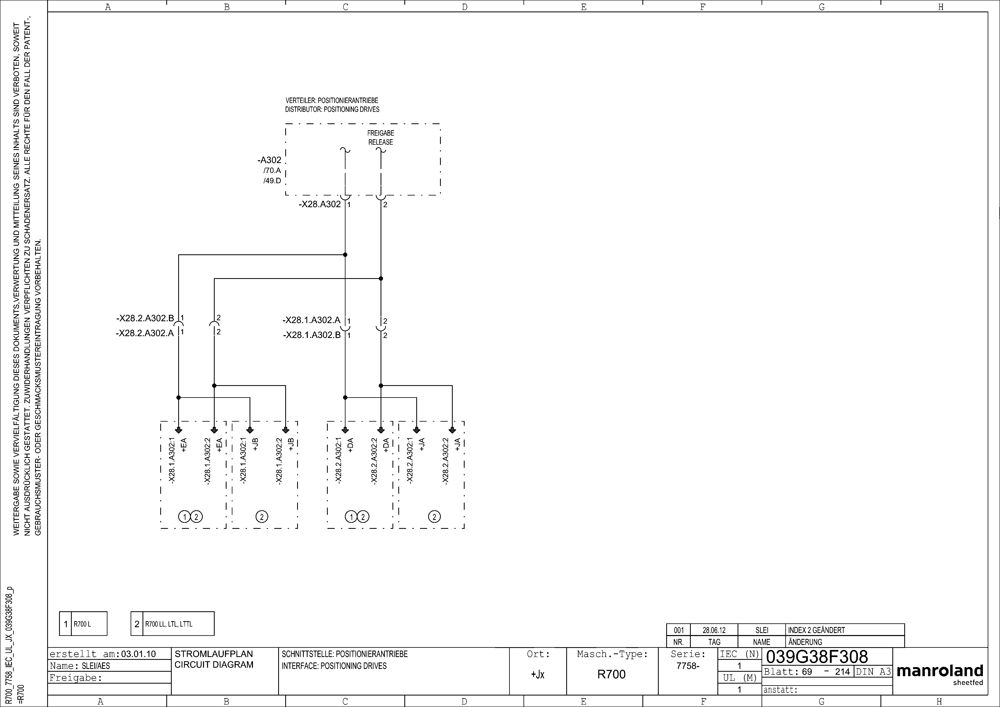

# +Jx — Sheet 69 of 214 — SCHNITTSTELLE: POSITIONIERANTRIEBE

**INTERFACE: POSITIONING DRIVES**

> Part of the manroland **R700** printing press IEC/UL circuit diagrams.
> Drawing class: **Stromlaufplan / Circuit diagram** (DIN A3).
> Document `+Jx` covers the **1st printing module + feed register** machine section.

## At a glance

| Field | Value |
|---|---|
| Document | `+Jx`  (039G38F308) |
| Sheet | **69** of 214 |
| Section (DE) | SCHNITTSTELLE: POSITIONIERANTRIEBE |
| Section (EN) | INTERFACE: POSITIONING DRIVES |
| Section type | CIRCUIT — Circuit diagram |
| Machine type | `R700` |
| Series | `7758` |
| Created | 03.01.10 |
| Replaces | — |
| Columns used | A, B, C, D, F, G |
| Path numbers | — |
| Labels on sheet | 56 |
| Cross-refs out | 2 |
| Cross-refs in | 12 |

**Previous:** [+Jx sheet 68](SHEET_0068.md) · **Next:** [+Jx sheet 70](SHEET_0070.md) · **Document TOC:** [_TOC.md](_TOC.md)  (+Jx) · **Master TOC:** [all sheets](../_MASTER_TOC.md)

## Sheet image (300 DPI, exact vector render)



_Rendered directly from the PDF vector layer at 300 DPI (1-bit), no OCR and no resampling. Use it to confirm anything ambiguous in the text below._

## Cross-references on this sheet

Each entry is a wire leaving this sheet. The printed token is `/sheet.column`; the link resolves to that sheet inside the same document.

| Ref | Target sheet | Col | Path | Destination on target | Target section | From col |
|---|---|---|---|---|---|---|
| `/70.A` | [+Jx sheet 70](SHEET_0070.md) | A | — | — | MOTOR: UMFANGSREGISTER | B |
| `/49.D` | [+Jx sheet 49](SHEET_0049.md) | D | — | — | HANDTERMINAL | B |

### Incoming references (sheets that point here)

Every other sheet that sends a wire to this one. `Back-ref` is the token printed on *that* sheet; `Path` is its line number.

| From sheet | Cols | Back-ref | Path | Refs | What continues there |
|---|---|---|---|---|---|
| [+Jx#49](SHEET_0049.md) | D | `/49.D` | — | 1 | — |
| [+Jx#70](SHEET_0070.md) | A | `/70.A` | — | 1 | — |
| [+Jx#145](SHEET_0145.md) | B, D, F | `/145.B`, `/145.D`, `/145.F` | — | 10 | — |


## Devices on this sheet

| Tag | Class | Class meaning (IEC) | Col | Sub | Terminal | Sign |
|---|---|---|---|---|---|---|
| `A302` | A | Baugruppe / assembly, module, PC board | B | — | — | — |
| `X28.A302` | — | cross-device reference | C | — | — | — |
| `X28.2.A302:1` | — | cross-device reference | C | — | 1 | — |
| `X28.2.A302:2` | — | cross-device reference | C | — | 2 | — |
| `X28.1.A302.A` | — | cross-device reference | C | — | — | — |
| `X28.1.A302.B` | — | cross-device reference | C | — | — | — |
| `X28.2.A302:1` | — | cross-device reference | D | — | 1 | — |
| `X28.2.A302:2` | — | cross-device reference | D | — | 2 | — |
| `X28.1.A302:1` | — | cross-device reference | B | — | 1 | — |
| `X28.1.A302:2` | — | cross-device reference | B | — | 2 | — |
| `X28.2.A302.B` | — | cross-device reference | A | — | — | — |
| `X28.2.A302.A` | — | cross-device reference | A | — | — | — |
| `X28.1.A302:1` | — | cross-device reference | B | — | 1 | — |
| `X28.1.A302:2` | — | cross-device reference | B | — | 2 | — |
| `NR.` | — | cross-device reference | F | — | — | — |
| `28.06.12` | — | cross-device reference | F | — | — | — |

## Potentials / nets

_No named potentials on this sheet._

## Wire-end annotations (grouped as printed)

A wire that continues elsewhere is annotated with a small cluster: the destination description, the path/line number `#NN`, and the `/sheet.column` cross reference. Each row below is one such cluster exactly as it is grouped on the drawing.

| Col | Y | Path | Cross-ref | Text on the wire |
|---|---|---|---|---|
| C | 116.8 | — | — | `DISTRIBUTOR: POSITIONING DRIVES VERTEILER: POSITIONIERANTRIEBE` |
| C | 155.7 | — | — | `FREIGABE` |
| C | 166.4 | — | — | `RELEASE` |
| B | 185.9 | — | — | `A302` |
| B | 199.0 | — | `/70.A`, `/49.D` | — |
| C | 238.3 | — | — | `X28.A302 1 2` |
| A | 374.4 | — | — | `X28.2.A302.B 1` |
| B | 374.4 | — | — | `2` |
| C | 376.6 | — | — | `X28.1.A302.A 1` |
| C | 378.7 | — | — | `2` |
| A | 391.4 | — | — | `X28.2.A302.A 1` |
| B | 391.4 | — | — | `2` |
| C | 394.3 | — | — | `X28.1.A302.B 1` |
| C | 395.7 | — | — | `2` |
| B | 520.2 | — | — | `X28.1.A302:1` |
| B | 520.2 | — | — | `X28.1.A302:1` |
| C | 520.2 | — | — | `X28.2.A302:1` |
| D | 520.2 | — | — | `X28.2.A302:1` |
| B | 521.3 | — | — | `X28.1.A302:2` |
| B | 521.3 | — | — | `+JB` |
| B | 521.3 | — | — | `X28.1.A302:2` |
| C | 521.3 | — | — | `+JB` |
| C | 521.3 | — | — | `X28.2.A302:2` |
| D | 521.3 | — | — | `X28.2.A302:2` |
| B | 521.6 | — | — | `+EA` |
| B | 521.6 | — | — | `+EA` |
| C | 521.6 | — | — | `+DA` |
| C | 521.6 | — | — | `+DA` |
| D | 521.6 | — | — | `+JA` |
| D | 521.6 | — | — | `+JA` |
| B | 612.1 | — | — | `1 2 2` |
| C | 612.1 | — | — | `1 2 2` |
| A | 738.6 | — | — | `1 R700 L 2 R700 LL, LTL, LTTL` |
| F | 747.1 | — | — | `001 28.06.12 SLEI INDEX 2 GEÄNDERT` |
| F | 761.3 | — | — | `NR. TAG NAME ÄNDERUNG` |


## Notes and free text on this sheet

| Text | Col | Y (pt) |
|---|---|---|
| `+DA` | C | 521.58 |
| `VERTEILER: POSITIONIERANTRIEBE` | C | 116.79 |
| `DISTRIBUTOR: POSITIONING DRIVES` | C | 127.43 |
| `+JA` | D | 521.58 |
| `+EA` | B | 521.58 |
| `+JB` | B | 521.29 |
| `+JB` | C | 521.29 |
| `TAG` | F | 761.41 |
| `NAME` | F | 761.4 |
| `ÄNDERUNG` | G | 761.42 |
| `SLEI` | G | 747.24 |
| `INDEX 2 GEÄNDERT` | G | 747.26 |
| `FREIGABE` | C | 155.74 |
| `RELEASE` | C | 166.38 |
| `R700 L` | A | 740.43 |
| `R700 LL, LTL, LTTL` | B | 740.43 |

## Complete label inventory (exact text from the drawing)

Every text object inside the drawing area of this sheet, in DIN reading order (column A→H, then top→bottom). This is the authoritative list: if a string is not here it is not printed on this sheet.

| Col | Y | X | Dir | Type | Text |
|---|---|---|---|---|---|
| A | 374.4 | 138.6 | → | device ref | `X28.2.A302.B` |
| A | 392.1 | 138.0 | → | device ref | `X28.2.A302.A` |
| A | 738.6 | 75.4 | → | number | `1` |
| A | 738.6 | 160.2 | → | number | `2` |
| A | 740.4 | 88.0 | → | text | `R700 L` |
| B | 185.9 | 306.7 | → | device tag | `A302` |
| B | 199.0 | 313.8 | → | cross-reference | `/70.A` |
| B | 211.4 | 313.8 | → | cross-reference | `/49.D` |
| B | 374.4 | 214.6 | → | number | `1` |
| B | 374.4 | 258.0 | → | number | `2` |
| B | 391.4 | 214.6 | → | number | `1` |
| B | 391.4 | 258.0 | → | number | `2` |
| B | 520.2 | 200.8 | ↕ | device ref | `X28.1.A302:1` |
| B | 520.2 | 285.8 | ↕ | device ref | `X28.1.A302:1` |
| B | 521.3 | 243.3 | ↕ | device ref | `X28.1.A302:2` |
| B | 521.3 | 299.9 | ↕ | text | `+JB` |
| B | 521.3 | 328.3 | ↕ | device ref | `X28.1.A302:2` |
| B | 521.6 | 214.9 | ↕ | text | `+EA` |
| B | 521.6 | 257.4 | ↕ | text | `+EA` |
| B | 612.1 | 217.8 | → | number | `1` |
| B | 612.5 | 231.9 | → | number | `2` |
| B | 612.5 | 309.8 | → | number | `2` |
| B | 740.4 | 173.1 | → | text | `R700 LL, LTL, LTTL` |
| C | 116.8 | 340.2 | → | text | `VERTEILER: POSITIONIERANTRIEBE` |
| C | 127.4 | 339.6 | → | text | `DISTRIBUTOR: POSITIONING DRIVES` |
| C | 155.7 | 437.4 | → | text | `FREIGABE` |
| C | 166.4 | 438.8 | → | text | `RELEASE` |
| C | 238.3 | 355.7 | → | device ref | `X28.A302` |
| C | 239.8 | 413.0 | → | number | `1` |
| C | 239.8 | 456.4 | → | number | `2` |
| C | 376.5 | 336.5 | → | device ref | `X28.1.A302.A` |
| C | 378.7 | 413.0 | → | number | `1` |
| C | 378.7 | 456.4 | → | number | `2` |
| C | 394.3 | 337.0 | → | device ref | `X28.1.A302.B` |
| C | 395.7 | 413.0 | → | number | `1` |
| C | 395.7 | 456.4 | → | number | `2` |
| C | 520.2 | 399.2 | ↕ | device ref | `X28.2.A302:1` |
| C | 521.3 | 342.5 | ↕ | text | `+JB` |
| C | 521.3 | 441.7 | ↕ | device ref | `X28.2.A302:2` |
| C | 521.6 | 413.4 | ↕ | text | `+DA` |
| C | 521.6 | 455.9 | ↕ | text | `+DA` |
| C | 612.1 | 416.3 | → | number | `1` |
| C | 612.5 | 430.3 | → | number | `2` |
| D | 520.2 | 484.2 | ↕ | device ref | `X28.2.A302:1` |
| D | 521.3 | 526.8 | ↕ | device ref | `X28.2.A302:2` |
| D | 521.6 | 498.4 | ↕ | text | `+JA` |
| D | 521.6 | 540.9 | ↕ | text | `+JA` |
| D | 612.5 | 515.3 | → | number | `2` |
| F | 747.1 | 802.6 | → | number | `001` |
| F | 747.3 | 836.8 | → | device ref | `28.06.12` |
| F | 761.3 | 801.8 | → | device ref | `NR.` |
| F | 761.4 | 843.5 | → | text | `TAG` |
| F | 761.4 | 896.8 | → | text | `NAME` |
| G | 747.2 | 899.8 | → | text | `SLEI` |
| G | 747.3 | 938.4 | → | text | `INDEX 2 GEÄNDERT` |
| G | 761.4 | 939.0 | → | text | `ÄNDERUNG` |

## Reading-order text block

The same content as a plain block, grouped by DIN column — convenient to paste or to match against a visual description.

```text
=== Column A ===
 374.4  138.6  devref       X28.2.A302.B
 392.1  138.0  devref       X28.2.A302.A
 738.6   75.4  numeric      1
 738.6  160.2  numeric      2
 740.4   88.0  text         R700 L
=== Column B ===
 185.9  306.7  devtag       A302
 199.0  313.8  xref         /70.A
 211.4  313.8  xref         /49.D
 374.4  214.6  numeric      1
 374.4  258.0  numeric      2
 391.4  214.6  numeric      1
 391.4  258.0  numeric      2
 520.2  200.8  devref       X28.1.A302:1
 520.2  285.8  devref       X28.1.A302:1
 521.3  243.3  devref       X28.1.A302:2
 521.3  299.9  text         +JB
 521.3  328.3  devref       X28.1.A302:2
 521.6  214.9  text         +EA
 521.6  257.4  text         +EA
 612.1  217.8  numeric      1
 612.5  231.9  numeric      2
 612.5  309.8  numeric      2
 740.4  173.1  text         R700 LL, LTL, LTTL
=== Column C ===
 116.8  340.2  text         VERTEILER: POSITIONIERANTRIEBE
 127.4  339.6  text         DISTRIBUTOR: POSITIONING DRIVES
 155.7  437.4  text         FREIGABE
 166.4  438.8  text         RELEASE
 238.3  355.7  devref       X28.A302
 239.8  413.0  numeric      1
 239.8  456.4  numeric      2
 376.5  336.5  devref       X28.1.A302.A
 378.7  413.0  numeric      1
 378.7  456.4  numeric      2
 394.3  337.0  devref       X28.1.A302.B
 395.7  413.0  numeric      1
 395.7  456.4  numeric      2
 520.2  399.2  devref       X28.2.A302:1
 521.3  342.5  text         +JB
 521.3  441.7  devref       X28.2.A302:2
 521.6  413.4  text         +DA
 521.6  455.9  text         +DA
 612.1  416.3  numeric      1
 612.5  430.3  numeric      2
=== Column D ===
 520.2  484.2  devref       X28.2.A302:1
 521.3  526.8  devref       X28.2.A302:2
 521.6  498.4  text         +JA
 521.6  540.9  text         +JA
 612.5  515.3  numeric      2
=== Column F ===
 747.1  802.6  numeric      001
 747.3  836.8  devref       28.06.12
 761.3  801.8  devref       NR.
 761.4  843.5  text         TAG
 761.4  896.8  text         NAME
=== Column G ===
 747.2  899.8  text         SLEI
 747.3  938.4  text         INDEX 2 GEÄNDERT
 761.4  939.0  text         ÄNDERUNG
```

---
_Generated from the PDF vector text layer; no OCR. Source: `R700_7758_IEC_UL_JX_039G38F308_p`, sheet 69._
