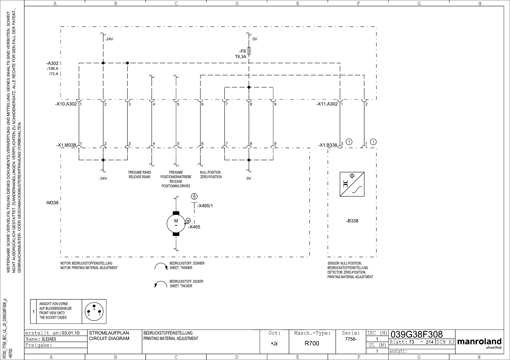

# +Jx — Sheet 73 of 214 — BEDRUCKSTOFFEINSTELLUNG

**PRINTING MATERIAL ADJUSTMENT**

> Part of the manroland **R700** printing press IEC/UL circuit diagrams.
> Drawing class: **Stromlaufplan / Circuit diagram** (DIN A3).
> Document `+Jx` covers the **1st printing module + feed register** machine section.

## At a glance

| Field | Value |
|---|---|
| Document | `+Jx`  (039G38F308) |
| Sheet | **73** of 214 |
| Section (DE) | BEDRUCKSTOFFEINSTELLUNG |
| Section (EN) | PRINTING MATERIAL ADJUSTMENT |
| Section type | CIRCUIT — Circuit diagram |
| Machine type | `R700` |
| Series | `7758` |
| Created | 03.01.10 |
| Replaces | — |
| Columns used | A, B, C, D, E, F |
| Path numbers | — |
| Labels on sheet | 68 |
| Cross-refs out | 2 |
| Cross-refs in | 24 |

**Previous:** [+Jx sheet 72](SHEET_0072.md) · **Next:** [+Jx sheet 74](SHEET_0074.md) · **Document TOC:** [_TOC.md](_TOC.md)  (+Jx) · **Master TOC:** [all sheets](../_MASTER_TOC.md)

## Sheet image (300 DPI, exact vector render)



_Rendered directly from the PDF vector layer at 300 DPI (1-bit), no OCR and no resampling. Use it to confirm anything ambiguous in the text below._

## Cross-references on this sheet

Each entry is a wire leaving this sheet. The printed token is `/sheet.column`; the link resolves to that sheet inside the same document.

| Ref | Target sheet | Col | Path | Destination on target | Target section | From col |
|---|---|---|---|---|---|---|
| `/198.A` | [+Jx sheet 198](SHEET_0198.md) | A | — | — | OPTION: | A |
| `/72.A` | [+Jx sheet 72](SHEET_0072.md) | A | — | — | MOTOR: SCHRÄGREGISTER | A |

### Incoming references (sheets that point here)

Every other sheet that sends a wire to this one. `Back-ref` is the token printed on *that* sheet; `Path` is its line number.

| From sheet | Cols | Back-ref | Path | Refs | What continues there |
|---|---|---|---|---|---|
| [+Jx#72](SHEET_0072.md) | A | `/72.A` | — | 1 | — |
| [+Jx#117](SHEET_0117.md) | C | `/117.C` | — | 2 | — |
| [+Jx#118](SHEET_0118.md) | G | `/118.G` | — | 9 | — |
| [+Jx#135](SHEET_0135.md) | B | `/135.B` | — | 9 | — |
| [+Jx#136](SHEET_0136.md) | E | `/136.E` | — | 2 | — |
| [+Jx#198](SHEET_0198.md) | A | `/198.A` | — | 1 | — |


## Devices on this sheet

| Tag | Class | Class meaning (IEC) | Col | Sub | Terminal | Sign |
|---|---|---|---|---|---|---|
| `A302` | A | Baugruppe / assembly, module, PC board | A | — | — | — |
| `B338` | B | Umformer / transducer, sensor | F | — | — | — |
| `F6` | F | Schutz / protection device (fuse, circuit breaker) | D | — | — | — |
| `X465/1` | X | Klemme / terminal, plug connector | C | 1 | — | — |
| `X465` | X | Klemme / terminal, plug connector | C | — | — | — |
| `X10.A302` | — | cross-device reference | A | — | — | — |
| `X11.A302` | — | cross-device reference | E | — | — | — |
| `X1.M338` | — | cross-device reference | A | — | — | — |
| `X1.B338` | — | cross-device reference | E | — | — | — |

## Potentials / nets

| Potential | Count | Columns | Attached devices | Terminals |
|---|---|---|---|---|
| `0V` | 2 | D | — | — |
| `24V` | 2 | B | — | — |
| `M338` | 1 | A | — | — |


A potential such as `L24+/4` or `M24+` is a named supply/return rail; every place it appears on this sheet is electrically common.

## Wire-end annotations (grouped as printed)

A wire that continues elsewhere is annotated with a small cluster: the destination description, the path/line number `#NN`, and the `/sheet.column` cross reference. Each row below is one such cluster exactly as it is grouped on the drawing.

| Col | Y | Path | Cross-ref | Text on the wire |
|---|---|---|---|---|
| B | 87.4 | — | — | `24V` |
| D | 87.4 | — | — | `0V` |
| D | 115.0 | — | — | `F6` |
| C | 128.1 | — | — | `A302 T6,3A` |
| A | 156.5 | — | `/198.A` | — |
| A | 168.8 | — | `/72.A` | — |
| C | 238.3 | — | — | `X10.A302 1 2 3 4 5 6 7 8 9` |
| F | 238.3 | — | — | `X11.A302 1 2` |
| F | 328.6 | — | — | `1 1` |
| C | 331.9 | — | — | `X1.M338 1 2 3 4 5 6 7 8 9` |
| F | 331.9 | — | — | `X1.B338 3 1` |
| B | 400.2 | — | — | `FREIGABE RS485` |
| C | 400.2 | — | — | `POSITIONIERANTRIEBE FREIGABE` |
| D | 400.3 | — | — | `NULL POSITION` |
| B | 410.9 | — | — | `RELEASE RS485` |
| D | 410.9 | — | — | `ZERO POSITION` |
| C | 413.4 | — | — | `24V 0V` |
| C | 421.5 | — | — | `POSITIONING DRIVES RELEASE` |
| A | 469.4 | — | — | `M338` |
| C | 476.5 | — | — | `X465/1` |
| C | 511.9 | — | — | `M` |
| F | 511.9 | — | — | `B338` |
| C | 526.1 | — | — | `X465` |
| B | 612.9 | — | — | `MOTOR: BEDRUCKSTOFFEINSTELLUNG MOTOR: PRINTING MATERIAL ADJUSTMENT` |
| C | 612.9 | — | — | `BEDRUCKSTOFF, DÜNNER SHEET, THINNER` |
| F | 612.9 | — | — | `BEDRUCKSTOFFEINSTELLUNG DETECTOR: ZERO POSITION, PRINTING MATERIAL ADJUSTMENT SENSOR: NULL POSITION,` |
| C | 655.4 | — | — | `BEDRUCKSTOFF, DICKER SHEET, THICKER` |
| A | 707.8 | — | — | `FRONT VIEW ONTO ANSICHT VON VORNE AUF BUCHSENGEHÄUSE` |
| A | 720.1 | — | — | `1 THE SOCKET CASES 4` |
| B | 732.9 | — | — | `3 1` |


## Reconstructed tables

This sheet carries tabular content (pin map / terminal assignment / index). The grid below was rebuilt from the drawing's own rule lines, so each row is exactly one physical row of the table.

### Table 1 — 2 data rows × 12 columns (at x=85.0, y=147.4) — **A302 /198.A /72.A**

| X10.A302 X1.M338 | 1 1 |  | 2 2 |  | 3 3 | 4 4 | 5 5 |  | 6 6 | 7 7 | 8 8 |
|---|---|---|---|---|---|---|---|---|---|---|---|
| `M338 MOTOR: MOTOR: PRINTING` |  | `24V BEDRUCKSTOFFEINSTELLUNG MATERIAL` |  | `ADJUSTMENT` | `FREIGABE RS485 RELEASE RS485` | `FREIGABE POSITIONIERANTRIEBE RELEASE POSITIONING SHEET, SHEET,` | `DRIVES M X465 BEDRUCKSTOFF, THINNER BEDRUCKSTOFF, THICKER` | `DÜNNER DICKER` | `NULL POSITION ZERO POSITION X465/1` |  |  |
| `ANSICHT VON VORNE AUF BUCHSENGEHÄUSE FRONT VIEW ONTO THE SOCKET CASES` |  | `4 3 1` |  |  |  |  |  |  |  |  |  |


## Notes and free text on this sheet

| Text | Col | Y (pt) |
|---|---|---|
| `T6,3A` | D | 128.06 |
| `MOTOR: BEDRUCKSTOFFEINSTELLUNG` | B | 612.88 |
| `MOTOR: PRINTING MATERIAL ADJUSTMENT` | B | 623.51 |
| `M` | C | 511.92 |
| `SENSOR: NULL POSITION,` | F | 612.86 |
| `BEDRUCKSTOFFEINSTELLUNG` | F | 623.5 |
| `DETECTOR: ZERO POSITION,` | F | 634.12 |
| `PRINTING MATERIAL ADJUSTMENT` | F | 644.77 |
| `ANSICHT VON VORNE` | A | 707.83 |
| `AUF BUCHSENGEHÄUSE` | A | 718.46 |
| `FRONT VIEW ONTO` | A | 729.06 |
| `THE SOCKET CASES` | A | 739.71 |
| `FREIGABE` | C | 400.23 |
| `POSITIONIERANTRIEBE` | C | 410.88 |
| `RELEASE` | C | 421.5 |
| `POSITIONING DRIVES` | C | 432.15 |
| `FREIGABE RS485` | B | 400.25 |
| `RELEASE RS485` | B | 410.89 |
| `NULL POSITION` | D | 400.27 |
| `ZERO POSITION` | D | 410.9 |
| `BEDRUCKSTOFF, DICKER` | C | 655.39 |
| `SHEET, THICKER` | C | 666.01 |
| `BEDRUCKSTOFF, DÜNNER` | C | 612.88 |
| `SHEET, THINNER` | C | 623.5 |

## Complete label inventory (exact text from the drawing)

Every text object inside the drawing area of this sheet, in DIN reading order (column A→H, then top→bottom). This is the authoritative list: if a string is not here it is not printed on this sheet.

| Col | Y | X | Dir | Type | Text |
|---|---|---|---|---|---|
| A | 143.4 | 108.3 | → | device tag | `A302` |
| A | 156.5 | 110.6 | → | cross-reference | `/198.A` |
| A | 168.9 | 115.4 | → | cross-reference | `/72.A` |
| A | 238.3 | 129.0 | → | device ref | `X10.A302` |
| A | 239.8 | 186.2 | → | number | `1` |
| A | 331.9 | 186.2 | → | number | `1` |
| A | 334.7 | 131.8 | → | device ref | `X1.M338` |
| A | 469.4 | 106.6 | → | potential | `M338` |
| A | 707.8 | 92.1 | → | text | `ANSICHT VON VORNE` |
| A | 718.5 | 92.1 | → | text | `AUF BUCHSENGEHÄUSE` |
| A | 724.5 | 75.4 | → | number | `1` |
| A | 729.1 | 91.6 | → | text | `FRONT VIEW ONTO` |
| A | 739.7 | 92.1 | → | text | `THE SOCKET CASES` |
| B | 87.4 | 245.8 | → | potential | `24V` |
| B | 239.8 | 243.8 | → | number | `2` |
| B | 239.8 | 300.2 | → | number | `3` |
| B | 331.9 | 243.8 | → | number | `2` |
| B | 331.9 | 300.2 | → | number | `3` |
| B | 400.3 | 299.5 | → | text | `FREIGABE RS485` |
| B | 410.9 | 300.9 | → | text | `RELEASE RS485` |
| B | 413.4 | 231.6 | → | potential | `24V` |
| B | 612.9 | 141.2 | → | text | `MOTOR: BEDRUCKSTOFFEINSTELLUNG` |
| B | 623.5 | 141.2 | → | text | `MOTOR: PRINTING MATERIAL ADJUSTMENT` |
| B | 720.1 | 217.8 | → | number | `4` |
| B | 732.9 | 204.9 | → | number | `3` |
| B | 732.9 | 230.7 | → | number | `1` |
| C | 239.8 | 357.2 | → | number | `4` |
| C | 239.8 | 413.6 | → | number | `5` |
| C | 239.8 | 470.3 | → | number | `6` |
| C | 331.9 | 357.2 | → | number | `4` |
| C | 331.9 | 413.6 | → | number | `5` |
| C | 331.9 | 470.3 | → | number | `6` |
| C | 400.2 | 394.9 | → | text | `FREIGABE` |
| C | 410.9 | 374.8 | → | text | `POSITIONIERANTRIEBE` |
| C | 421.5 | 396.3 | → | text | `RELEASE` |
| C | 432.2 | 377.7 | → | text | `POSITIONING DRIVES` |
| C | 476.5 | 460.3 | → | device tag | `X465/1` |
| C | 511.9 | 406.6 | → | text | `M` |
| C | 526.1 | 439.1 | → | device tag | `X465` |
| C | 612.9 | 396.3 | → | text | `BEDRUCKSTOFF, DÜNNER` |
| C | 623.5 | 396.6 | → | text | `SHEET, THINNER` |
| C | 655.4 | 396.3 | → | text | `BEDRUCKSTOFF, DICKER` |
| C | 666.0 | 396.6 | → | text | `SHEET, THICKER` |
| D | 87.4 | 589.7 | → | potential | `0V` |
| D | 115.1 | 558.4 | → | device tag | `F6` |
| D | 128.1 | 548.8 | → | text | `T6,3A` |
| D | 239.8 | 527.0 | → | number | `7` |
| D | 239.8 | 583.7 | → | number | `8` |
| D | 331.9 | 527.0 | → | number | `7` |
| D | 331.9 | 583.7 | → | number | `8` |
| D | 400.3 | 467.1 | → | text | `NULL POSITION` |
| D | 410.9 | 467.7 | → | text | `ZERO POSITION` |
| D | 413.4 | 575.6 | → | potential | `0V` |
| E | 238.3 | 738.4 | → | device ref | `X11.A302` |
| E | 239.8 | 640.3 | → | number | `9` |
| E | 331.9 | 640.3 | → | number | `9` |
| E | 334.7 | 743.0 | → | device ref | `X1.B338` |
| F | 239.8 | 795.7 | → | number | `1` |
| F | 239.8 | 853.2 | → | number | `2` |
| F | 328.6 | 813.1 | → | number | `1` |
| F | 328.6 | 869.8 | → | number | `1` |
| F | 331.9 | 796.3 | → | number | `3` |
| F | 331.9 | 852.4 | → | number | `1` |
| F | 511.9 | 808.4 | → | device tag | `B338` |
| F | 612.9 | 765.1 | → | text | `SENSOR: NULL POSITION,` |
| F | 623.5 | 764.8 | → | text | `BEDRUCKSTOFFEINSTELLUNG` |
| F | 634.1 | 764.8 | → | text | `DETECTOR: ZERO POSITION,` |
| F | 644.8 | 764.8 | → | text | `PRINTING MATERIAL ADJUSTMENT` |

## Reading-order text block

The same content as a plain block, grouped by DIN column — convenient to paste or to match against a visual description.

```text
=== Column A ===
 143.4  108.3  devtag       A302
 156.5  110.6  xref         /198.A
 168.9  115.4  xref         /72.A
 238.3  129.0  devref       X10.A302
 239.8  186.2  numeric      1
 331.9  186.2  numeric      1
 334.7  131.8  devref       X1.M338
 469.4  106.6  net          M338
 707.8   92.1  text         ANSICHT VON VORNE
 718.5   92.1  text         AUF BUCHSENGEHÄUSE
 724.5   75.4  numeric      1
 729.1   91.6  text         FRONT VIEW ONTO
 739.7   92.1  text         THE SOCKET CASES
=== Column B ===
  87.4  245.8  net          24V
 239.8  243.8  numeric      2
 239.8  300.2  numeric      3
 331.9  243.8  numeric      2
 331.9  300.2  numeric      3
 400.3  299.5  text         FREIGABE RS485
 410.9  300.9  text         RELEASE RS485
 413.4  231.6  net          24V
 612.9  141.2  text         MOTOR: BEDRUCKSTOFFEINSTELLUNG
 623.5  141.2  text         MOTOR: PRINTING MATERIAL ADJUSTMENT
 720.1  217.8  numeric      4
 732.9  204.9  numeric      3
 732.9  230.7  numeric      1
=== Column C ===
 239.8  357.2  numeric      4
 239.8  413.6  numeric      5
 239.8  470.3  numeric      6
 331.9  357.2  numeric      4
 331.9  413.6  numeric      5
 331.9  470.3  numeric      6
 400.2  394.9  text         FREIGABE
 410.9  374.8  text         POSITIONIERANTRIEBE
 421.5  396.3  text         RELEASE
 432.2  377.7  text         POSITIONING DRIVES
 476.5  460.3  devtag       X465/1
 511.9  406.6  text         M
 526.1  439.1  devtag       X465
 612.9  396.3  text         BEDRUCKSTOFF, DÜNNER
 623.5  396.6  text         SHEET, THINNER
 655.4  396.3  text         BEDRUCKSTOFF, DICKER
 666.0  396.6  text         SHEET, THICKER
=== Column D ===
  87.4  589.7  net          0V
 115.1  558.4  devtag       F6
 128.1  548.8  text         T6,3A
 239.8  527.0  numeric      7
 239.8  583.7  numeric      8
 331.9  527.0  numeric      7
 331.9  583.7  numeric      8
 400.3  467.1  text         NULL POSITION
 410.9  467.7  text         ZERO POSITION
 413.4  575.6  net          0V
=== Column E ===
 238.3  738.4  devref       X11.A302
 239.8  640.3  numeric      9
 331.9  640.3  numeric      9
 334.7  743.0  devref       X1.B338
=== Column F ===
 239.8  795.7  numeric      1
 239.8  853.2  numeric      2
 328.6  813.1  numeric      1
 328.6  869.8  numeric      1
 331.9  796.3  numeric      3
 331.9  852.4  numeric      1
 511.9  808.4  devtag       B338
 612.9  765.1  text         SENSOR: NULL POSITION,
 623.5  764.8  text         BEDRUCKSTOFFEINSTELLUNG
 634.1  764.8  text         DETECTOR: ZERO POSITION,
 644.8  764.8  text         PRINTING MATERIAL ADJUSTMENT
```

---
_Generated from the PDF vector text layer; no OCR. Source: `R700_7758_IEC_UL_JX_039G38F308_p`, sheet 73._
