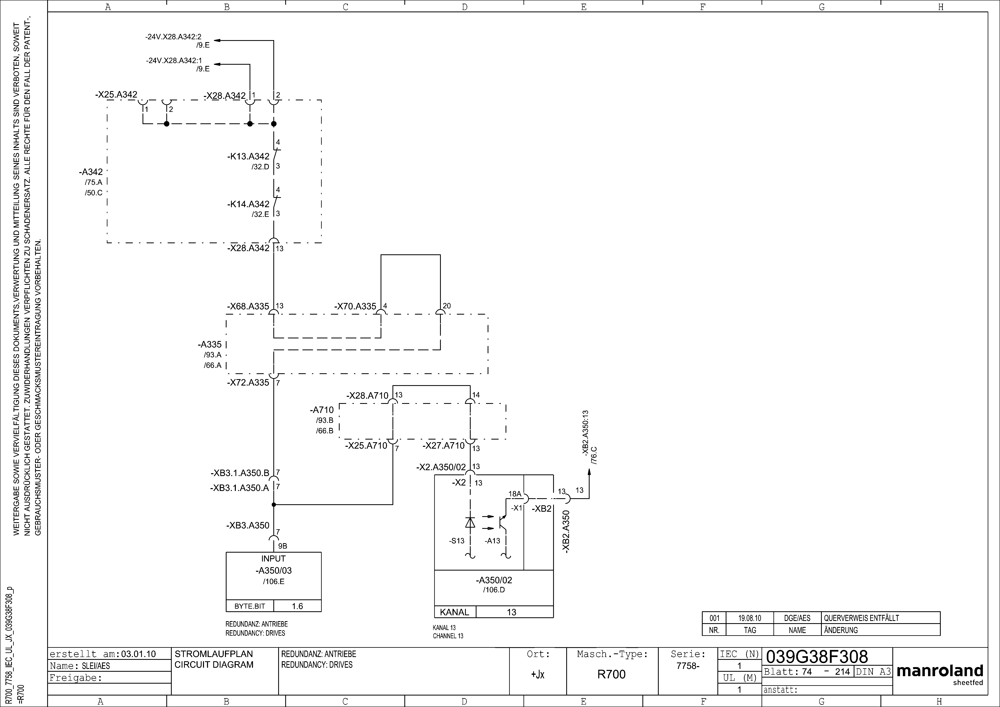

# +Jx — Sheet 74 of 214 — REDUNDANZ: ANTRIEBE

**REDUNDANCY: DRIVES**

> Part of the manroland **R700** printing press IEC/UL circuit diagrams.
> Drawing class: **Stromlaufplan / Circuit diagram** (DIN A3).
> Document `+Jx` covers the **1st printing module + feed register** machine section.

## At a glance

| Field | Value |
|---|---|
| Document | `+Jx`  (039G38F308) |
| Sheet | **74** of 214 |
| Section (DE) | REDUNDANZ: ANTRIEBE |
| Section (EN) | REDUNDANCY: DRIVES |
| Section type | CIRCUIT — Circuit diagram |
| Machine type | `R700` |
| Series | `7758` |
| Created | 03.01.10 |
| Replaces | — |
| Columns used | A, B, C, D, E, F, G |
| Path numbers | — |
| Labels on sheet | 85 |
| Cross-refs out | 13 |
| Cross-refs in | 31 |

**Previous:** [+Jx sheet 73](SHEET_0073.md) · **Next:** [+Jx sheet 75](SHEET_0075.md) · **Document TOC:** [_TOC.md](_TOC.md)  (+Jx) · **Master TOC:** [all sheets](../_MASTER_TOC.md)

## Sheet image (300 DPI, exact vector render)



_Rendered directly from the PDF vector layer at 300 DPI (1-bit), no OCR and no resampling. Use it to confirm anything ambiguous in the text below._

## Cross-references on this sheet

Each entry is a wire leaving this sheet. The printed token is `/sheet.column`; the link resolves to that sheet inside the same document.

| Ref | Target sheet | Col | Path | Destination on target | Target section | From col |
|---|---|---|---|---|---|---|
| `/9.E` | [+Jx sheet 9](SHEET_0009.md) | E | — | 24V.X28.A342:2 | SPANNUNGSVERSORGUNG, SCHALTSCHRANKBELÜFTUNG | B |
| `/9.E` | [+Jx sheet 9](SHEET_0009.md) | E | — | 24V.X28.A342:1 | SPANNUNGSVERSORGUNG, SCHALTSCHRANKBELÜFTUNG | B |
| `/32.D` | [+Jx sheet 32](SHEET_0032.md) | D | — | — | NOT AUS | B |
| `/75.A` | [+Jx sheet 75](SHEET_0075.md) | A | — | — | FEHLBOGENKONTROLLE | A |
| `/50.C` | [+Jx sheet 50](SHEET_0050.md) | C | — | — | SIGNALGEBER: AKUSTISCHE WARNSIGNALE | A |
| `/32.E` | [+Jx sheet 32](SHEET_0032.md) | E | — | — | NOT AUS | B |
| `/93.A` | [+Jx sheet 93](SHEET_0093.md) | A | — | — | RESERVE | B |
| `/66.A` | [+Jx sheet 66](SHEET_0066.md) | A | — | — | DRUCKANSTELLUNG | B |
| `/76.C` | [+Jx sheet 76](SHEET_0076.md) | C | — | XB2.A350:13 | BUSVERBINDUNGEN: SICHERHEITSKREIS | E |
| `/93.B` | [+Jx sheet 93](SHEET_0093.md) | B | — | — | RESERVE | C |
| `/66.B` | [+Jx sheet 66](SHEET_0066.md) | B | — | — | DRUCKANSTELLUNG | C |
| `/106.E` | [+Jx sheet 106](SHEET_0106.md) | E | — | — | REFERENZMODUL | B |
| `/106.D` | [+Jx sheet 106](SHEET_0106.md) | D | — | — | REFERENZMODUL | D |

### Incoming references (sheets that point here)

Every other sheet that sends a wire to this one. `Back-ref` is the token printed on *that* sheet; `Path` is its line number.

| From sheet | Cols | Back-ref | Path | Refs | What continues there |
|---|---|---|---|---|---|
| [+Jx#9](SHEET_0009.md) | E | `/9.E` | — | 2 | 24V.X28.A342:1; 24V.X28.A342:2 |
| [+Jx#32](SHEET_0032.md) | D, E | `/32.D`, `/32.E` | — | 2 | — |
| [+Jx#50](SHEET_0050.md) | C | `/50.C` | — | 1 | — |
| [+Jx#66](SHEET_0066.md) | A, B | `/66.A`, `/66.B` | — | 2 | — |
| [+Jx#75](SHEET_0075.md) | A | `/75.A` | — | 1 | — |
| [+Jx#76](SHEET_0076.md) | C | `/76.C` | — | 1 | XB2.A350:13 |
| [+Jx#93](SHEET_0093.md) | A, B | `/93.A`, `/93.B` | — | 2 | — |
| [+Jx#106](SHEET_0106.md) | D, E | `/106.D`, `/106.E` | — | 2 | — |
| [+Jx#126](SHEET_0126.md) | E | `/126.E` | — | 2 | — |
| [+Jx#128](SHEET_0128.md) | C, D, F | `/128.C`, `/128.D`, `/128.F` | — | 3 | — |
| [+Jx#142](SHEET_0142.md) | H | `/142.H` | — | 2 | — |
| [+Jx#143](SHEET_0143.md) | A | `/143.A` | — | 1 | — |
| [+Jx#144](SHEET_0144.md) | C | `/144.C` | — | 1 | — |
| [+Jx#145](SHEET_0145.md) | G | `/145.G` | — | 3 | — |
| [+Jx#146](SHEET_0146.md) | A | `/146.A` | — | 2 | — |
| [+Jx#152](SHEET_0152.md) | E | `/152.E` | — | 1 | — |
| [+Jx#153](SHEET_0153.md) | A, C | `/153.A`, `/153.C` | — | 3 | — |


## Devices on this sheet

| Tag | Class | Class meaning (IEC) | Col | Sub | Terminal | Sign |
|---|---|---|---|---|---|---|
| `A335` | A | Baugruppe / assembly, module, PC board | B | — | — | — |
| `A342` | A | Baugruppe / assembly, module, PC board | A | — | — | — |
| `A350/03` | A | Baugruppe / assembly, module, PC board | B | 03 | — | — |
| `A710` | A | Baugruppe / assembly, module, PC board | C | — | — | — |
| `S13` | S | Schalter / switch | D | — | — | — |
| `A13` | A | Baugruppe / assembly, module, PC board | D | — | — | — |
| `X1` | X | Klemme / terminal, plug connector | D | — | — | — |
| `X2` | X | Klemme / terminal, plug connector | D | — | — | — |
| `XB2` | XB |  | E | — | — | — |
| `A350/02` | A | Baugruppe / assembly, module, PC board | D | 02 | — | — |
| `X28.A342` | — | cross-device reference | B | — | — | — |
| `X28.A342` | — | cross-device reference | B | — | — | — |
| `X68.A335` | — | cross-device reference | B | — | — | — |
| `X70.A335` | — | cross-device reference | C | — | — | — |
| `K13.A342` | — | cross-device reference | B | — | — | — |
| `K14.A342` | — | cross-device reference | B | — | — | — |
| `XB3.A350` | — | cross-device reference | B | — | — | — |
| `1.6` | — | cross-device reference | C | — | — | — |
| `X72.A335` | — | cross-device reference | B | — | — | — |
| `X27.A710` | — | cross-device reference | D | — | — | — |
| `X28.A710` | — | cross-device reference | C | — | — | — |
| `X25.A710` | — | cross-device reference | C | — | — | — |
| `XB2.A350` | — | cross-device reference | E | — | — | — |
| `XB3.1.A350.B` | — | cross-device reference | B | — | — | — |
| `XB3.1.A350.A` | — | cross-device reference | B | — | — | — |
| `NR.` | — | cross-device reference | F | — | — | — |
| `19.08.10` | — | cross-device reference | F | — | — | — |
| `XB2.A350:13` | — | cross-device reference | E | — | 13 | — |
| `X25.A342` | — | cross-device reference | A | — | — | — |

## Potentials / nets

| Potential | Count | Columns | Attached devices | Terminals |
|---|---|---|---|---|
| `24V` | 2 | B | `A342`, `X28` | `1`, `2` |


A potential such as `L24+/4` or `M24+` is a named supply/return rail; every place it appears on this sheet is electrically common.

## Wire-end annotations (grouped as printed)

A wire that continues elsewhere is annotated with a small cluster: the destination description, the path/line number `#NN`, and the `/sheet.column` cross reference. Each row below is one such cluster exactly as it is grouped on the drawing.

| Col | Y | Path | Cross-ref | Text on the wire |
|---|---|---|---|---|
| B | 39.9 | — | `/9.E` | `24V.X28.A342:2` |
| B | 68.2 | — | `/9.E` | `24V.X28.A342:1` |
| A | 108.0 | — | — | `X25.A342` |
| B | 109.4 | — | — | `X28.A342 1` |
| B | 109.4 | — | — | `2` |
| A | 126.4 | — | — | `1 2` |
| B | 165.4 | — | — | `4` |
| B | 181.7 | — | — | `K13.A342 3` |
| B | 194.8 | — | `/32.D` | — |
| A | 200.1 | — | — | `A342` |
| A | 213.1 | — | `/75.A`, `/50.C` | — |
| B | 222.1 | — | — | `4` |
| B | 238.3 | — | — | `K14.A342 3` |
| B | 251.4 | — | `/32.E` | — |
| B | 290.8 | — | — | `X28.A342 13` |
| C | 360.2 | — | — | `X68.A335 13 X70.A335 4 20` |
| B | 405.6 | — | — | `A335` |
| B | 418.7 | — | `/93.A`, `/66.A` | — |
| B | 450.9 | — | — | `X72.A335 7` |
| C | 466.5 | — | — | `X28.A710 13` |
| D | 466.6 | — | — | `14` |
| C | 483.5 | — | — | `A710` |
| E | 488.4 | — | `/76.C` | `XB2.A350:13` |
| C | 496.6 | — | `/93.B`, `/66.B` | — |
| C | 526.1 | — | — | `X25.A710 7` |
| D | 526.1 | — | — | `X27.A710 13` |
| D | 551.6 | — | — | `X2.A350/02 13` |
| B | 558.7 | — | — | `XB3.1.A350.B 7` |
| D | 570.0 | — | — | `X2` |
| D | 571.5 | — | — | `13 13` |
| B | 575.7 | — | — | `XB3.1.A350.A 7` |
| E | 580.0 | — | — | `13` |
| D | 584.2 | — | — | `18A` |
| D | 601.2 | — | — | `X1` |
| E | 601.2 | — | — | `XB2` |
| E | 607.5 | — | — | `XB2.A350` |
| B | 621.0 | — | — | `XB3.A350 7` |
| D | 640.2 | — | — | `S13 A13` |
| B | 646.5 | — | — | `9B` |
| B | 661.0 | — | — | `INPUT` |
| B | 674.9 | — | — | `A350/03` |
| D | 686.2 | — | — | `A350/02` |
| B | 688.7 | — | `/106.E` | — |
| D | 698.6 | — | `/106.D` | — |
| B | 717.7 | — | — | `BYTE.BIT 1.6` |
| D | 724.5 | — | — | `KANAL 13` |
| G | 733.0 | — | — | `001 19.08.10 DGE/AES QUERVERWEIS ENTFÄLLT` |
| B | 740.4 | — | — | `REDUNDANZ: ANTRIEBE REDUNDANCY: DRIVES` |
| D | 744.8 | — | — | `KANAL 13 CHANNEL 13` |
| G | 747.1 | — | — | `NR. TAG NAME ÄNDERUNG` |


## Reconstructed tables

This sheet carries tabular content (pin map / terminal assignment / index). The grid below was rebuilt from the drawing's own rule lines, so each row is exactly one physical row of the table.

### Table 1 — 9 data rows × 6 columns (at x=269.3, y=48.2)

|  | 1 | 2 |  |  |  |
|---|---|---|---|---|---|
| `K13.A342 K14.A342 X28.A342` | `/32.D /32.E` | `4 3 4 3 13` |  |  |  |
| `X68.A335` |  | `13` | `X70.A335` | `4` |  |
| `X72.A335` |  | `7` |  |  |  |
| `XB3.1.A350.B` |  | `7` | `X28.A710 A710 /93.B /66.B X25.A710` |  | `13 7` |
| `XB3.1.A350.A` |  | `7` |  |  |  |
| `XB3.A350` |  | `7 9B` |  |  |  |
|  | `INPUT` |  |  |  |  |
|  | `A350/03` | `/106.E` |  |  |  |
| `BYTE.BIT` |  | `1.6` |  |  |  |


### Table 2 — 4 data rows × 5 columns (at x=524.4, y=48.2) — **20**

| X27.A710 X2.A350/02 | 14 13 13 |  |  | XB2.A350:13 |
|---|---|---|---|---|
| `X2` | `13` | `18A` |  | `13 13` |
| `S13` | `A13` | `X1` | `XB2` | `XB2.A350` |
|  | `A350/02 /106.D` |  |  |  |
| `KANAL` |  | `13` |  |  |


## Notes and free text on this sheet

| Text | Col | Y (pt) |
|---|---|---|
| `9B` | B | 646.51 |
| `INPUT` | B | 661.05 |
| `BYTE.BIT` | B | 718.31 |
| `REDUNDANZ: ANTRIEBE` | B | 740.42 |
| `REDUNDANCY: DRIVES` | B | 751.06 |
| `KANAL 13` | D | 744.83 |
| `CHANNEL 13` | D | 754.78 |
| `18A` | D | 584.17 |
| `KANAL` | D | 724.48 |
| `X2.A350/02` | D | 551.58 |
| `TAG` | F | 747.23 |
| `NAME` | G | 747.22 |
| `ÄNDERUNG` | G | 747.25 |
| `DGE/AES` | G | 733.06 |
| `QUERVERWEIS ENTFÄLLT` | G | 733.07 |

## Complete label inventory (exact text from the drawing)

Every text object inside the drawing area of this sheet, in DIN reading order (column A→H, then top→bottom). This is the authoritative list: if a string is not here it is not printed on this sheet.

| Col | Y | X | Dir | Type | Text |
|---|---|---|---|---|---|
| A | 108.0 | 113.4 | → | device ref | `X25.A342` |
| A | 126.4 | 172.1 | → | number | `1` |
| A | 200.1 | 94.1 | → | device tag | `A342` |
| A | 213.1 | 101.2 | → | cross-reference | `/75.A` |
| A | 225.6 | 101.2 | → | cross-reference | `/50.C` |
| B | 39.9 | 172.9 | → | potential | `24V.X28.A342:2` |
| B | 49.8 | 233.9 | → | cross-reference | `/9.E` |
| B | 68.3 | 174.0 | → | potential | `24V.X28.A342:1` |
| B | 78.1 | 233.9 | → | cross-reference | `/9.E` |
| B | 109.4 | 242.4 | → | device ref | `X28.A342` |
| B | 109.4 | 299.6 | → | number | `1` |
| B | 109.4 | 328.8 | → | number | `2` |
| B | 126.4 | 201.3 | → | number | `2` |
| B | 165.4 | 328.8 | → | number | `4` |
| B | 181.7 | 270.7 | → | device ref | `K13.A342` |
| B | 193.7 | 328.5 | → | number | `3` |
| B | 194.8 | 299.6 | → | cross-reference | `/32.D` |
| B | 222.1 | 328.8 | → | number | `4` |
| B | 238.3 | 270.7 | → | device ref | `K14.A342` |
| B | 250.4 | 328.5 | → | number | `3` |
| B | 251.4 | 299.9 | → | cross-reference | `/32.E` |
| B | 290.8 | 270.7 | → | device ref | `X28.A342` |
| B | 292.2 | 328.0 | → | number | `13` |
| B | 360.2 | 270.4 | → | device ref | `X68.A335` |
| B | 360.3 | 328.0 | → | number | `13` |
| B | 405.6 | 235.6 | → | device tag | `A335` |
| B | 418.7 | 242.9 | → | cross-reference | `/93.A` |
| B | 431.1 | 242.9 | → | cross-reference | `/66.A` |
| B | 450.9 | 270.4 | → | device ref | `X72.A335` |
| B | 452.4 | 328.5 | → | number | `7` |
| B | 558.7 | 250.9 | → | device ref | `XB3.1.A350.B` |
| B | 558.7 | 328.5 | → | number | `7` |
| B | 575.7 | 328.5 | → | number | `7` |
| B | 576.4 | 250.3 | → | device ref | `XB3.1.A350.A` |
| B | 621.0 | 269.6 | → | device ref | `XB3.A350` |
| B | 629.6 | 328.5 | → | number | `7` |
| B | 646.5 | 331.4 | → | text | `9B` |
| B | 661.0 | 311.1 | → | text | `INPUT` |
| B | 674.9 | 304.4 | → | device tag | `A350/03` |
| B | 688.7 | 313.4 | → | cross-reference | `/106.E` |
| B | 718.3 | 279.2 | → | text | `BYTE.BIT` |
| B | 740.4 | 268.7 | → | text | `REDUNDANZ: ANTRIEBE` |
| B | 751.1 | 268.7 | → | text | `REDUNDANCY: DRIVES` |
| C | 360.2 | 398.0 | → | device ref | `X70.A335` |
| C | 360.3 | 456.4 | → | number | `4` |
| C | 466.5 | 412.4 | → | device ref | `X28.A710` |
| C | 466.6 | 469.7 | → | number | `13` |
| C | 483.5 | 369.1 | → | device tag | `A710` |
| C | 496.6 | 376.4 | → | cross-reference | `/93.B` |
| C | 509.0 | 376.4 | → | cross-reference | `/66.B` |
| C | 526.1 | 411.0 | → | device ref | `X25.A710` |
| C | 530.3 | 470.3 | → | number | `7` |
| C | 717.7 | 347.2 | → | device ref | `1.6` |
| D | 360.3 | 527.2 | → | number | `20` |
| D | 466.6 | 561.8 | → | number | `14` |
| D | 526.1 | 503.1 | → | device ref | `X27.A710` |
| D | 530.3 | 561.8 | → | number | `13` |
| D | 551.6 | 495.8 | → | text | `X2.A350/02` |
| D | 551.6 | 561.8 | → | number | `13` |
| D | 570.0 | 538.3 | → | device tag | `X2` |
| D | 571.4 | 564.7 | → | number | `13` |
| D | 584.2 | 605.2 | → | text | `18A` |
| D | 601.2 | 608.6 | → | device tag | `X1` |
| D | 640.2 | 534.6 | → | device tag | `S13` |
| D | 640.2 | 577.1 | → | device tag | `A13` |
| D | 686.2 | 566.8 | → | device tag | `A350/02` |
| D | 698.6 | 575.4 | → | cross-reference | `/106.D` |
| D | 724.5 | 523.8 | → | text | `KANAL` |
| D | 724.5 | 603.1 | → | number | `13` |
| D | 744.8 | 515.3 | → | text | `KANAL 13` |
| D | 754.8 | 515.6 | → | text | `CHANNEL 13` |
| E | 488.4 | 693.3 | ↕ | device ref | `XB2.A350:13` |
| E | 531.8 | 703.2 | ↕ | cross-reference | `/76.C` |
| E | 580.0 | 685.1 | → | number | `13` |
| E | 581.4 | 663.9 | → | number | `13` |
| E | 601.2 | 633.3 | → | device tag | `XB2` |
| E | 607.5 | 669.2 | ↕ | device ref | `XB2.A350` |
| F | 733.0 | 845.1 | → | number | `001` |
| F | 733.1 | 879.0 | → | device ref | `19.08.10` |
| F | 747.1 | 844.3 | → | device ref | `NR.` |
| F | 747.2 | 886.0 | → | text | `TAG` |
| G | 733.1 | 933.8 | → | text | `DGE/AES` |
| G | 733.1 | 981.2 | → | text | `QUERVERWEIS ENTFÄLLT` |
| G | 747.2 | 939.3 | → | text | `NAME` |
| G | 747.3 | 981.5 | → | text | `ÄNDERUNG` |

## Reading-order text block

The same content as a plain block, grouped by DIN column — convenient to paste or to match against a visual description.

```text
=== Column A ===
 108.0  113.4  devref       X25.A342
 126.4  172.1  numeric      1
 200.1   94.1  devtag       A342
 213.1  101.2  xref         /75.A
 225.6  101.2  xref         /50.C
=== Column B ===
  39.9  172.9  net          24V.X28.A342:2
  49.8  233.9  xref         /9.E
  68.3  174.0  net          24V.X28.A342:1
  78.1  233.9  xref         /9.E
 109.4  242.4  devref       X28.A342
 109.4  299.6  numeric      1
 109.4  328.8  numeric      2
 126.4  201.3  numeric      2
 165.4  328.8  numeric      4
 181.7  270.7  devref       K13.A342
 193.7  328.5  numeric      3
 194.8  299.6  xref         /32.D
 222.1  328.8  numeric      4
 238.3  270.7  devref       K14.A342
 250.4  328.5  numeric      3
 251.4  299.9  xref         /32.E
 290.8  270.7  devref       X28.A342
 292.2  328.0  numeric      13
 360.2  270.4  devref       X68.A335
 360.3  328.0  numeric      13
 405.6  235.6  devtag       A335
 418.7  242.9  xref         /93.A
 431.1  242.9  xref         /66.A
 450.9  270.4  devref       X72.A335
 452.4  328.5  numeric      7
 558.7  250.9  devref       XB3.1.A350.B
 558.7  328.5  numeric      7
 575.7  328.5  numeric      7
 576.4  250.3  devref       XB3.1.A350.A
 621.0  269.6  devref       XB3.A350
 629.6  328.5  numeric      7
 646.5  331.4  text         9B
 661.0  311.1  text         INPUT
 674.9  304.4  devtag       A350/03
 688.7  313.4  xref         /106.E
 718.3  279.2  text         BYTE.BIT
 740.4  268.7  text         REDUNDANZ: ANTRIEBE
 751.1  268.7  text         REDUNDANCY: DRIVES
=== Column C ===
 360.2  398.0  devref       X70.A335
 360.3  456.4  numeric      4
 466.5  412.4  devref       X28.A710
 466.6  469.7  numeric      13
 483.5  369.1  devtag       A710
 496.6  376.4  xref         /93.B
 509.0  376.4  xref         /66.B
 526.1  411.0  devref       X25.A710
 530.3  470.3  numeric      7
 717.7  347.2  devref       1.6
=== Column D ===
 360.3  527.2  numeric      20
 466.6  561.8  numeric      14
 526.1  503.1  devref       X27.A710
 530.3  561.8  numeric      13
 551.6  495.8  text         X2.A350/02
 551.6  561.8  numeric      13
 570.0  538.3  devtag       X2
 571.4  564.7  numeric      13
 584.2  605.2  text         18A
 601.2  608.6  devtag       X1
 640.2  534.6  devtag       S13
 640.2  577.1  devtag       A13
 686.2  566.8  devtag       A350/02
 698.6  575.4  xref         /106.D
 724.5  523.8  text         KANAL
 724.5  603.1  numeric      13
 744.8  515.3  text         KANAL 13
 754.8  515.6  text         CHANNEL 13
=== Column E ===
 488.4  693.3  devref       XB2.A350:13
 531.8  703.2  xref         /76.C
 580.0  685.1  numeric      13
 581.4  663.9  numeric      13
 601.2  633.3  devtag       XB2
 607.5  669.2  devref       XB2.A350
=== Column F ===
 733.0  845.1  numeric      001
 733.1  879.0  devref       19.08.10
 747.1  844.3  devref       NR.
 747.2  886.0  text         TAG
=== Column G ===
 733.1  933.8  text         DGE/AES
 733.1  981.2  text         QUERVERWEIS ENTFÄLLT
 747.2  939.3  text         NAME
 747.3  981.5  text         ÄNDERUNG
```

---
_Generated from the PDF vector text layer; no OCR. Source: `R700_7758_IEC_UL_JX_039G38F308_p`, sheet 74._
