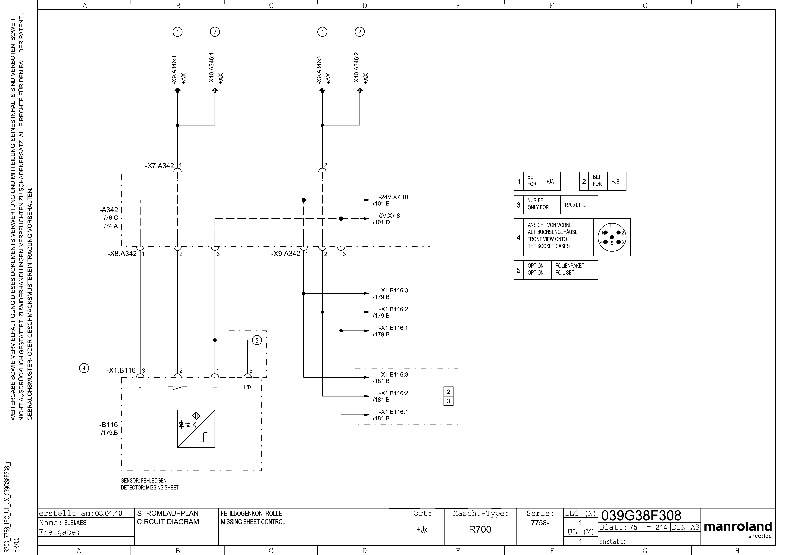

# +Jx — Sheet 75 of 214 — FEHLBOGENKONTROLLE

**MISSING SHEET CONTROL**

> Part of the manroland **R700** printing press IEC/UL circuit diagrams.
> Drawing class: **Stromlaufplan / Circuit diagram** (DIN A3).
> Document `+Jx` covers the **1st printing module + feed register** machine section.

## At a glance

| Field | Value |
|---|---|
| Document | `+Jx`  (039G38F308) |
| Sheet | **75** of 214 |
| Section (DE) | FEHLBOGENKONTROLLE |
| Section (EN) | MISSING SHEET CONTROL |
| Section type | CIRCUIT — Circuit diagram |
| Machine type | `R700` |
| Series | `7758` |
| Created | 03.01.10 |
| Replaces | — |
| Columns used | A, B, C, D, E, F, G |
| Path numbers | — |
| Labels on sheet | 84 |
| Cross-refs out | 11 |
| Cross-refs in | 24 |

**Previous:** [+Jx sheet 74](SHEET_0074.md) · **Next:** [+Jx sheet 76](SHEET_0076.md) · **Document TOC:** [_TOC.md](_TOC.md)  (+Jx) · **Master TOC:** [all sheets](../_MASTER_TOC.md)

## Sheet image (300 DPI, exact vector render)



_Rendered directly from the PDF vector layer at 300 DPI (1-bit), no OCR and no resampling. Use it to confirm anything ambiguous in the text below._

## Cross-references on this sheet

Each entry is a wire leaving this sheet. The printed token is `/sheet.column`; the link resolves to that sheet inside the same document.

| Ref | Target sheet | Col | Path | Destination on target | Target section | From col |
|---|---|---|---|---|---|---|
| `/101.B` | [+Jx sheet 101](SHEET_0101.md) | B | — | — | RESERVE | D |
| `/76.C` | [+Jx sheet 76](SHEET_0076.md) | C | — | — | BUSVERBINDUNGEN: SICHERHEITSKREIS | A |
| `/74.A` | [+Jx sheet 74](SHEET_0074.md) | A | — | — | REDUNDANZ: ANTRIEBE | A |
| `/101.D` | [+Jx sheet 101](SHEET_0101.md) | D | — | — | RESERVE | D |
| `/179.B` | [+Jx sheet 179](SHEET_0179.md) | B | — | — | OPTION: TRANSFERMODUL 1 NACH | D |
| `/179.B` | [+Jx sheet 179](SHEET_0179.md) | B | — | — | OPTION: TRANSFERMODUL 1 NACH | D |
| `/179.B` | [+Jx sheet 179](SHEET_0179.md) | B | — | — | OPTION: TRANSFERMODUL 1 NACH | D |
| `/181.B` | [+Jx sheet 181](SHEET_0181.md) | B | — | — | OPTION: TRANSFERMODUL 2 | D |
| `/181.B` | [+Jx sheet 181](SHEET_0181.md) | B | — | — | OPTION: TRANSFERMODUL 2 | D |
| `/181.B` | [+Jx sheet 181](SHEET_0181.md) | B | — | — | OPTION: TRANSFERMODUL 2 | D |
| `/179.B` | [+Jx sheet 179](SHEET_0179.md) | B | — | — | OPTION: TRANSFERMODUL 1 NACH | A |

### Incoming references (sheets that point here)

Every other sheet that sends a wire to this one. `Back-ref` is the token printed on *that* sheet; `Path` is its line number.

| From sheet | Cols | Back-ref | Path | Refs | What continues there |
|---|---|---|---|---|---|
| [+Jx#74](SHEET_0074.md) | A | `/74.A` | — | 1 | — |
| [+Jx#76](SHEET_0076.md) | B | `/76.B` | — | 1 | — |
| [+Jx#101](SHEET_0101.md) | A, D | `/101.A`, `/101.D` | — | 2 | 0V.X7:8; 24V.X7:10 |
| [+Jx#116](SHEET_0116.md) | G | `/116.G` | — | 5 | — |
| [+Jx#133](SHEET_0133.md) | C, H | `/133.C`, `/133.H` | — | 5 | — |
| [+Jx#134](SHEET_0134.md) | F | `/134.F` | — | 3 | — |
| [+Jx#179](SHEET_0179.md) | B | `/179.B` | — | 4 | X1.B116:1; X1.B116:2; X1.B116:3 |
| [+Jx#181](SHEET_0181.md) | B | `/181.B` | — | 3 | X1.B116:1.; X1.B116:2.; X1.B116:3. |


## Devices on this sheet

| Tag | Class | Class meaning (IEC) | Col | Sub | Terminal | Sign |
|---|---|---|---|---|---|---|
| `A342` | A | Baugruppe / assembly, module, PC board | A | — | — | — |
| `B116` | B | Umformer / transducer, sensor | A | — | — | — |
| `X10.A346:1` | — | cross-device reference | B | — | 1 | — |
| `X9.A346:1` | — | cross-device reference | B | — | 1 | — |
| `X7.A342` | — | cross-device reference | B | — | — | — |
| `X8.A342` | — | cross-device reference | A | — | — | — |
| `X10.A346:2` | — | cross-device reference | D | — | 2 | — |
| `X9.A346:2` | — | cross-device reference | D | — | 2 | — |
| `X9.A342` | — | cross-device reference | C | — | — | — |
| `X1.B116` | — | cross-device reference | A | — | — | — |
| `X1.B116:3` | — | cross-device reference | D | — | 3 | — |
| `X1.B116:1` | — | cross-device reference | D | — | 1 | — |
| `X1.B116:2` | — | cross-device reference | D | — | 2 | — |

## Potentials / nets

| Potential | Count | Columns | Attached devices | Terminals |
|---|---|---|---|---|
| `0V` | 1 | D | `X7` | `8` |
| `24V` | 1 | D | `X7` | `10` |


A potential such as `L24+/4` or `M24+` is a named supply/return rail; every place it appears on this sheet is electrically common.

## Wire-end annotations (grouped as printed)

A wire that continues elsewhere is annotated with a small cluster: the destination description, the path/line number `#NN`, and the `/sheet.column` cross reference. Each row below is one such cluster exactly as it is grouped on the drawing.

| Col | Y | Path | Cross-ref | Text on the wire |
|---|---|---|---|---|
| C | 45.1 | — | — | `1 2 1 2` |
| B | 79.1 | — | — | `X10.A346:1` |
| D | 79.1 | — | — | `X10.A346:2` |
| B | 83.9 | — | — | `X9.A346:1` |
| D | 83.9 | — | — | `X9.A346:2` |
| B | 110.8 | — | — | `+AX` |
| B | 110.8 | — | — | `+AX` |
| D | 110.8 | — | — | `+AX` |
| D | 110.8 | — | — | `+AX` |
| B | 246.8 | — | — | `X7.A342 1` |
| D | 246.9 | — | — | `2` |
| F | 265.5 | — | — | `1 BEI FOR +JA` |
| G | 265.5 | — | — | `2 BEI FOR +JB` |
| D | 295.0 | — | — | `24V.X7:10` |
| F | 301.0 | — | — | `3 NUR BEI ONLY FOR R700 LTTL` |
| D | 304.9 | — | `/101.B` | — |
| A | 313.5 | — | — | `A342` |
| D | 323.4 | — | — | `0V.X7:8` |
| A | 326.6 | — | `/76.C`, `/74.A` | — |
| D | 333.3 | — | `/101.D` | — |
| F | 338.6 | — | — | `FRONT VIEW ONTO ANSICHT VON VORNE AUF BUCHSENGEHÄUSE` |
| F | 350.2 | — | — | `4 1 5 2` |
| G | 364.4 | — | — | `4 3` |
| F | 370.5 | — | — | `THE SOCKET CASES` |
| B | 380.1 | — | — | `X8.A342 1 3` |
| C | 380.1 | — | — | `X9.A342 1 2 3` |
| B | 381.5 | — | — | `2` |
| F | 400.2 | — | — | `5 OPTION OPTION` |
| F | 400.2 | — | — | `FOLIENPAKET FOIL SET` |
| D | 436.8 | — | — | `X1.B116:3` |
| D | 446.7 | — | `/179.B` | — |
| D | 465.1 | — | — | `X1.B116:2` |
| D | 475.0 | — | `/179.B` | — |
| D | 493.4 | — | — | `X1.B116:1` |
| D | 503.4 | — | `/179.B` | — |
| C | 513.3 | — | — | `5` |
| A | 556.3 | — | — | `4` |
| B | 557.2 | — | — | `X1.B116 3 2 1` |
| C | 558.7 | — | — | `5` |
| D | 564.3 | — | — | `X1.B116:3.` |
| D | 574.2 | — | `/181.B` | — |
| C | 582.7 | — | — | `+ L/D` |
| E | 590.6 | — | — | `2` |
| D | 592.7 | — | — | `X1.B116:2.` |
| D | 602.6 | — | `/181.B` | — |
| E | 604.8 | — | — | `3` |
| D | 621.0 | — | — | `X1.B116:1.` |
| D | 630.9 | — | `/181.B` | — |
| A | 639.5 | — | — | `B116` |
| A | 652.5 | — | `/179.B` | — |
| B | 726.2 | — | — | `DETECTOR: MISSING SHEET SENSOR: FEHLBOGEN` |


## Reconstructed tables

This sheet carries tabular content (pin map / terminal assignment / index). The grid below was rebuilt from the drawing's own rule lines, so each row is exactly one physical row of the table.

### Table 1 — 3 data rows × 7 columns (at x=212.6, y=189.9)

| X7.A342 | 1 |  |  |  | 2 |  |
|---|---|---|---|---|---|---|
| `1` | `2` | `3` | `X9.A342` | `1` | `2` | `3` |
| `3` | `2` | `1` | `5 5` |  |  |  |
|  | `+` | `L/D` |  |  |  |  |


## Notes and free text on this sheet

| Text | Col | Y (pt) |
|---|---|---|
| `+AX` | B | 110.84 |
| `+AX` | D | 110.84 |
| `SENSOR: FEHLBOGEN` | B | 726.25 |
| `DETECTOR: MISSING SHEET` | B | 736.88 |
| `X1.B116:3.` | D | 564.31 |
| `X1.B116:1.` | D | 621 |
| `X1.B116:2.` | D | 592.66 |
| `L/D` | C | 584.47 |
| `BEI` | F | 265.46 |
| `FOR` | F | 276.25 |
| `+JA` | F | 272.66 |
| `+JB` | G | 272.64 |
| `ANSICHT VON VORNE` | F | 338.62 |
| `AUF BUCHSENGEHÄUSE` | F | 349.25 |
| `FRONT VIEW ONTO` | F | 359.85 |
| `THE SOCKET CASES` | F | 370.5 |
| `OPTION` | F | 400.24 |
| `FOLIENPAKET` | F | 400.25 |
| `FOIL SET` | F | 410.87 |
| `NUR BEI` | F | 301.01 |
| `ONLY FOR` | F | 311.7 |
| `R700 LTTL` | F | 308.15 |

## Complete label inventory (exact text from the drawing)

Every text object inside the drawing area of this sheet, in DIN reading order (column A→H, then top→bottom). This is the authoritative list: if a string is not here it is not printed on this sheet.

| Col | Y | X | Dir | Type | Text |
|---|---|---|---|---|---|
| A | 313.5 | 150.8 | → | device tag | `A342` |
| A | 326.6 | 157.9 | → | cross-reference | `/76.C` |
| A | 338.9 | 157.9 | → | cross-reference | `/74.A` |
| A | 380.1 | 163.3 | → | device ref | `X8.A342` |
| A | 556.3 | 126.0 | → | number | `4` |
| A | 557.2 | 161.6 | → | device ref | `X1.B116` |
| A | 639.4 | 150.5 | → | device tag | `B116` |
| A | 652.5 | 153.4 | → | cross-reference | `/179.B` |
| B | 45.1 | 267.4 | → | number | `1` |
| B | 45.6 | 324.0 | → | number | `2` |
| B | 79.1 | 317.0 | ↕ | device ref | `X10.A346:1` |
| B | 83.9 | 260.3 | ↕ | device ref | `X9.A346:1` |
| B | 110.8 | 274.4 | ↕ | text | `+AX` |
| B | 110.8 | 331.1 | ↕ | text | `+AX` |
| B | 246.9 | 220.0 | → | device ref | `X7.A342` |
| B | 246.9 | 271.3 | → | number | `1` |
| B | 381.5 | 214.6 | → | number | `1` |
| B | 381.5 | 272.1 | → | number | `2` |
| B | 381.5 | 328.5 | → | number | `3` |
| B | 558.7 | 215.1 | → | number | `3` |
| B | 558.7 | 272.1 | → | number | `2` |
| B | 558.7 | 328.0 | → | number | `1` |
| B | 582.7 | 322.9 | → | number | `+` |
| B | 726.2 | 184.0 | → | text | `SENSOR: FEHLBOGEN` |
| B | 736.9 | 183.7 | → | text | `DETECTOR: MISSING SHEET` |
| C | 380.1 | 411.3 | → | device ref | `X9.A342` |
| C | 381.5 | 462.6 | → | number | `1` |
| C | 513.3 | 387.8 | → | number | `5` |
| C | 558.7 | 378.1 | → | number | `5` |
| C | 584.5 | 370.5 | → | text | `L/D` |
| D | 45.1 | 487.1 | → | number | `1` |
| D | 45.6 | 543.7 | → | number | `2` |
| D | 79.1 | 536.7 | ↕ | device ref | `X10.A346:2` |
| D | 83.9 | 480.0 | ↕ | device ref | `X9.A346:2` |
| D | 110.8 | 494.1 | ↕ | text | `+AX` |
| D | 110.8 | 550.8 | ↕ | text | `+AX` |
| D | 246.9 | 491.8 | → | number | `2` |
| D | 295.0 | 575.1 | → | potential | `24V.X7:10` |
| D | 304.9 | 565.5 | → | cross-reference | `/101.B` |
| D | 323.3 | 575.1 | → | potential | `0V.X7:8` |
| D | 333.3 | 565.5 | → | cross-reference | `/101.D` |
| D | 381.5 | 491.8 | → | number | `2` |
| D | 381.5 | 519.9 | → | number | `3` |
| D | 436.8 | 575.1 | → | device ref | `X1.B116:3` |
| D | 446.7 | 565.5 | → | cross-reference | `/179.B` |
| D | 465.1 | 575.1 | → | device ref | `X1.B116:2` |
| D | 475.0 | 565.5 | → | cross-reference | `/179.B` |
| D | 493.5 | 575.1 | → | device ref | `X1.B116:1` |
| D | 503.4 | 565.5 | → | cross-reference | `/179.B` |
| D | 564.3 | 575.1 | → | text | `X1.B116:3.` |
| D | 574.2 | 565.5 | → | cross-reference | `/181.B` |
| D | 592.7 | 575.1 | → | text | `X1.B116:2.` |
| D | 602.6 | 565.5 | → | cross-reference | `/181.B` |
| D | 621.0 | 575.1 | → | text | `X1.B116:1.` |
| D | 630.9 | 565.5 | → | cross-reference | `/181.B` |
| E | 590.6 | 678.0 | → | number | `2` |
| E | 604.8 | 677.9 | → | number | `3` |
| F | 265.5 | 800.2 | → | text | `BEI` |
| F | 265.5 | 899.4 | → | text | `BEI` |
| F | 270.9 | 784.1 | → | number | `1` |
| F | 270.9 | 883.0 | → | number | `2` |
| F | 272.7 | 828.9 | → | text | `+JA` |
| F | 276.2 | 800.2 | → | text | `FOR` |
| F | 276.2 | 899.4 | → | text | `FOR` |
| F | 301.0 | 800.2 | → | text | `NUR BEI` |
| F | 306.3 | 783.6 | → | number | `3` |
| F | 308.1 | 856.9 | → | text | `R700 LTTL` |
| F | 311.7 | 800.5 | → | text | `ONLY FOR` |
| F | 338.6 | 800.8 | → | text | `ANSICHT VON VORNE` |
| F | 349.3 | 800.8 | → | text | `AUF BUCHSENGEHÄUSE` |
| F | 355.9 | 783.8 | → | number | `4` |
| F | 359.8 | 800.2 | → | text | `FRONT VIEW ONTO` |
| F | 370.5 | 800.8 | → | text | `THE SOCKET CASES` |
| F | 400.2 | 800.5 | → | text | `OPTION` |
| F | 400.2 | 842.7 | → | text | `FOLIENPAKET` |
| F | 405.6 | 783.6 | → | number | `5` |
| F | 410.9 | 800.5 | → | text | `OPTION` |
| F | 410.9 | 842.7 | → | text | `FOIL SET` |
| G | 272.6 | 928.1 | → | text | `+JB` |
| G | 350.2 | 911.3 | → | number | `1` |
| G | 350.2 | 942.5 | → | number | `2` |
| G | 364.4 | 910.5 | → | number | `4` |
| G | 364.4 | 942.2 | → | number | `3` |
| G | 365.8 | 926.4 | → | number | `5` |

## Reading-order text block

The same content as a plain block, grouped by DIN column — convenient to paste or to match against a visual description.

```text
=== Column A ===
 313.5  150.8  devtag       A342
 326.6  157.9  xref         /76.C
 338.9  157.9  xref         /74.A
 380.1  163.3  devref       X8.A342
 556.3  126.0  numeric      4
 557.2  161.6  devref       X1.B116
 639.4  150.5  devtag       B116
 652.5  153.4  xref         /179.B
=== Column B ===
  45.1  267.4  numeric      1
  45.6  324.0  numeric      2
  79.1  317.0  devref       X10.A346:1
  83.9  260.3  devref       X9.A346:1
 110.8  274.4  text         +AX
 110.8  331.1  text         +AX
 246.9  220.0  devref       X7.A342
 246.9  271.3  numeric      1
 381.5  214.6  numeric      1
 381.5  272.1  numeric      2
 381.5  328.5  numeric      3
 558.7  215.1  numeric      3
 558.7  272.1  numeric      2
 558.7  328.0  numeric      1
 582.7  322.9  numeric      +
 726.2  184.0  text         SENSOR: FEHLBOGEN
 736.9  183.7  text         DETECTOR: MISSING SHEET
=== Column C ===
 380.1  411.3  devref       X9.A342
 381.5  462.6  numeric      1
 513.3  387.8  numeric      5
 558.7  378.1  numeric      5
 584.5  370.5  text         L/D
=== Column D ===
  45.1  487.1  numeric      1
  45.6  543.7  numeric      2
  79.1  536.7  devref       X10.A346:2
  83.9  480.0  devref       X9.A346:2
 110.8  494.1  text         +AX
 110.8  550.8  text         +AX
 246.9  491.8  numeric      2
 295.0  575.1  net          24V.X7:10
 304.9  565.5  xref         /101.B
 323.3  575.1  net          0V.X7:8
 333.3  565.5  xref         /101.D
 381.5  491.8  numeric      2
 381.5  519.9  numeric      3
 436.8  575.1  devref       X1.B116:3
 446.7  565.5  xref         /179.B
 465.1  575.1  devref       X1.B116:2
 475.0  565.5  xref         /179.B
 493.5  575.1  devref       X1.B116:1
 503.4  565.5  xref         /179.B
 564.3  575.1  text         X1.B116:3.
 574.2  565.5  xref         /181.B
 592.7  575.1  text         X1.B116:2.
 602.6  565.5  xref         /181.B
 621.0  575.1  text         X1.B116:1.
 630.9  565.5  xref         /181.B
=== Column E ===
 590.6  678.0  numeric      2
 604.8  677.9  numeric      3
=== Column F ===
 265.5  800.2  text         BEI
 265.5  899.4  text         BEI
 270.9  784.1  numeric      1
 270.9  883.0  numeric      2
 272.7  828.9  text         +JA
 276.2  800.2  text         FOR
 276.2  899.4  text         FOR
 301.0  800.2  text         NUR BEI
 306.3  783.6  numeric      3
 308.1  856.9  text         R700 LTTL
 311.7  800.5  text         ONLY FOR
 338.6  800.8  text         ANSICHT VON VORNE
 349.3  800.8  text         AUF BUCHSENGEHÄUSE
 355.9  783.8  numeric      4
 359.8  800.2  text         FRONT VIEW ONTO
 370.5  800.8  text         THE SOCKET CASES
 400.2  800.5  text         OPTION
 400.2  842.7  text         FOLIENPAKET
 405.6  783.6  numeric      5
 410.9  800.5  text         OPTION
 410.9  842.7  text         FOIL SET
=== Column G ===
 272.6  928.1  text         +JB
 350.2  911.3  numeric      1
 350.2  942.5  numeric      2
 364.4  910.5  numeric      4
 364.4  942.2  numeric      3
 365.8  926.4  numeric      5
```

---
_Generated from the PDF vector text layer; no OCR. Source: `R700_7758_IEC_UL_JX_039G38F308_p`, sheet 75._
