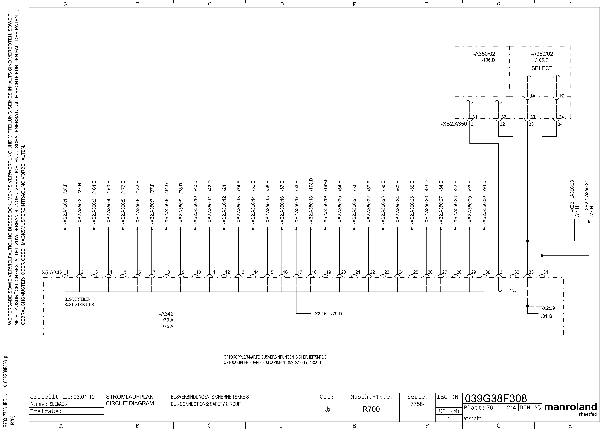

# +Jx — Sheet 76 of 214 — BUSVERBINDUNGEN: SICHERHEITSKREIS

**BUS CONNECTIONS: SAFETY**

> Part of the manroland **R700** printing press IEC/UL circuit diagrams.
> Drawing class: **Stromlaufplan / Circuit diagram** (DIN A3).
> Document `+Jx` covers the **1st printing module + feed register** machine section.

## At a glance

| Field | Value |
|---|---|
| Document | `+Jx`  (039G38F308) |
| Sheet | **76** of 214 |
| Section (DE) | BUSVERBINDUNGEN: SICHERHEITSKREIS |
| Section (EN) | BUS CONNECTIONS: SAFETY |
| Section type | CIRCUIT — Circuit diagram |
| Machine type | `R700` |
| Series | `7758` |
| Created | 03.01.10 |
| Replaces | — |
| Columns used | A, B, C, D, E, F, G, H |
| Path numbers | — |
| Labels on sheet | 126 |
| Cross-refs out | 38 |
| Cross-refs in | 76 |

**Previous:** [+Jx sheet 75](SHEET_0075.md) · **Next:** [+Jx sheet 77](SHEET_0077.md) · **Document TOC:** [_TOC.md](_TOC.md)  (+Jx) · **Master TOC:** [all sheets](../_MASTER_TOC.md)

## Sheet image (300 DPI, exact vector render)



_Rendered directly from the PDF vector layer at 300 DPI (1-bit), no OCR and no resampling. Use it to confirm anything ambiguous in the text below._

## Cross-references on this sheet

Each entry is a wire leaving this sheet. The printed token is `/sheet.column`; the link resolves to that sheet inside the same document.

| Ref | Target sheet | Col | Path | Destination on target | Target section | From col |
|---|---|---|---|---|---|---|
| `/106.D` | [+Jx sheet 106](SHEET_0106.md) | D | — | — | REFERENZMODUL | G |
| `/106.D` | [+Jx sheet 106](SHEET_0106.md) | D | — | — | REFERENZMODUL | H |
| `/178.D` | [+Jx sheet 178](SHEET_0178.md) | D | — | XB2.A350:18 | OPTION: TRANSFERMODUL 1 NACH | D |
| `/189.F` | [+Jx sheet 189](SHEET_0189.md) | F | — | XB2.A350:19 | OPTION: ZWISCHENTROCKNER, VORBEREITUNG | E |
| `/77.H` | [+Jx sheet 77](SHEET_0077.md) | H | — | XB2.1.A350:33 | BUSVERBINDUNGEN: SICHERHEITSKREIS | H |
| `/77.H` | [+Jx sheet 77](SHEET_0077.md) | H | — | XB2.1.A350:34 | BUSVERBINDUNGEN: SICHERHEITSKREIS | H |
| `/40.D` | [+Jx sheet 40](SHEET_0040.md) | D | — | XB2.A350:10 | LAUFKOMMANDOS | C |
| `/42.D` | [+Jx sheet 42](SHEET_0042.md) | D | — | XB2.A350:11 | LAUFKOMMANDOS | C |
| `/24.H` | [+Jx sheet 24](SHEET_0024.md) | H | — | XB2.A350:12 | HILFSANTRIEB, LACKDOSIER /AUFTRAGSWALZEN | C |
| `/54.H` | [+Jx sheet 54](SHEET_0054.md) | H | — | XB2.A350:20 | SCHUTZEINRICHTUNGEN | E |
| `/53.H` | [+Jx sheet 53](SHEET_0053.md) | H | — | XB2.A350:21 | SCHUTZEINRICHTUNGEN | E |
| `/93.D` | [+Jx sheet 93](SHEET_0093.md) | D | — | XB2.A350:26 | RESERVE | F |
| `/22.H` | [+Jx sheet 22](SHEET_0022.md) | H | — | XB2.A350:28 | LACKPUMPE | F |
| `/93.H` | [+Jx sheet 93](SHEET_0093.md) | H | — | XB2.A350:29 | RESERVE | G |
| `/94.D` | [+Jx sheet 94](SHEET_0094.md) | D | — | XB2.A350:30 | RESERVE | G |
| `/163.H` | [+Jx sheet 163](SHEET_0163.md) | H | — | XB2.A350:4 | OPTION: | B |
| `/74.E` | [+Jx sheet 74](SHEET_0074.md) | E | — | XB2.A350:13 | REDUNDANZ: ANTRIEBE | C |
| `/52.E` | [+Jx sheet 52](SHEET_0052.md) | E | — | XB2.A350:14 | SCHUTZEINRICHTUNGEN | D |
| `/56.E` | [+Jx sheet 56](SHEET_0056.md) | E | — | XB2.A350:15 | SCHUTZEINRICHTUNGEN | D |
| `/57.E` | [+Jx sheet 57](SHEET_0057.md) | E | — | XB2.A350:16 | SCHUTZEINRICHTUNGEN | D |
| `/53.E` | [+Jx sheet 53](SHEET_0053.md) | E | — | XB2.A350:17 | SCHUTZEINRICHTUNGEN | D |
| `/59.E` | [+Jx sheet 59](SHEET_0059.md) | E | — | XB2.A350:22 | SCHUTZEINRICHTUNGEN | E |
| `/58.E` | [+Jx sheet 58](SHEET_0058.md) | E | — | XB2.A350:23 | SCHUTZEINRICHTUNGEN | E |
| `/60.E` | [+Jx sheet 60](SHEET_0060.md) | E | — | XB2.A350:24 | SCHUTZEINRICHTUNGEN | F |
| `/55.E` | [+Jx sheet 55](SHEET_0055.md) | E | — | XB2.A350:25 | SCHUTZEINRICHTUNGEN | F |
| `/54.E` | [+Jx sheet 54](SHEET_0054.md) | E | — | XB2.A350:27 | SCHUTZEINRICHTUNGEN | F |
| `/164.E` | [+Jx sheet 164](SHEET_0164.md) | E | — | XB2.A350:3 | OPTION: | A |
| `/177.E` | [+Jx sheet 177](SHEET_0177.md) | E | — | XB2.A350:5 | SCHUTZEINRICHTUNGEN | B |
| `/182.E` | [+Jx sheet 182](SHEET_0182.md) | E | — | XB2.A350:6 | OPTION: TRANSFERMODUL 2 | B |
| `/34.G` | [+Jx sheet 34](SHEET_0034.md) | G | — | XB2.A350:8 | NOT AUS | B |
| `/27.H` | [+Jx sheet 27](SHEET_0027.md) | H | — | XB2.A350:2 | KAMMERRAKEL | A |
| `/38.D` | [+Jx sheet 38](SHEET_0038.md) | D | — | XB2.A350:9 | LAUFKOMMANDOS | C |
| `/28.F` | [+Jx sheet 28](SHEET_0028.md) | F | — | XB2.A350:1 | KAMMERRAKEL | A |
| `/37.F` | [+Jx sheet 37](SHEET_0037.md) | F | — | XB2.A350:7 | STOP SICHERN | B |
| `/79.D` | [+Jx sheet 79](SHEET_0079.md) | D | — | X3:16 | BUSVERBINDUNGEN: SICHERHEITSKREIS | E |
| `/81.G` | [+Jx sheet 81](SHEET_0081.md) | G | — | — | BUSVERBINDUNGEN: SICHERHEITSKREIS | H |
| `/79.A` | [+Jx sheet 79](SHEET_0079.md) | A | — | — | BUSVERBINDUNGEN: SICHERHEITSKREIS | B |
| `/75.A` | [+Jx sheet 75](SHEET_0075.md) | A | — | — | FEHLBOGENKONTROLLE | B |

### Incoming references (sheets that point here)

Every other sheet that sends a wire to this one. `Back-ref` is the token printed on *that* sheet; `Path` is its line number.

| From sheet | Cols | Back-ref | Path | Refs | What continues there |
|---|---|---|---|---|---|
| [+Jx#22](SHEET_0022.md) | H | `/22.H` | — | 1 | XB2.A350:28 |
| [+Jx#24](SHEET_0024.md) | H | `/24.H` | — | 1 | XB2.A350:12 |
| [+Jx#27](SHEET_0027.md) | H | `/27.H` | — | 1 | XB2.A350:2 |
| [+Jx#28](SHEET_0028.md) | F | `/28.F` | — | 1 | XB2.A350:1 |
| [+Jx#34](SHEET_0034.md) | G | `/34.G` | — | 1 | XB2.A350:8 |
| [+Jx#37](SHEET_0037.md) | E | `/37.E` | — | 1 | XB2.A350:7 |
| [+Jx#38](SHEET_0038.md) | D | `/38.D` | — | 1 | XB2.A350:9 |
| [+Jx#40](SHEET_0040.md) | D | `/40.D` | — | 1 | XB2.A350:10 |
| [+Jx#42](SHEET_0042.md) | D | `/42.D` | — | 1 | XB2.A350:11 |
| [+Jx#52](SHEET_0052.md) | E | `/52.E` | — | 1 | XB2.A350:14 |
| [+Jx#53](SHEET_0053.md) | E, H | `/53.E`, `/53.H` | — | 2 | XB2.A350:17; XB2.A350:21 |
| [+Jx#54](SHEET_0054.md) | E, H | `/54.E`, `/54.H` | — | 2 | XB2.A350:20; XB2.A350:27 |
| [+Jx#55](SHEET_0055.md) | E | `/55.E` | — | 1 | XB2.A350:25 |
| [+Jx#56](SHEET_0056.md) | E | `/56.E` | — | 1 | XB2.A350:15 |
| [+Jx#57](SHEET_0057.md) | E | `/57.E` | — | 1 | XB2.A350:16 |
| [+Jx#58](SHEET_0058.md) | E | `/58.E` | — | 1 | XB2.A350:23 |
| [+Jx#59](SHEET_0059.md) | E | `/59.E` | — | 1 | XB2.A350:22 |
| [+Jx#60](SHEET_0060.md) | E | `/60.E` | — | 1 | XB2.A350:24 |
| [+Jx#74](SHEET_0074.md) | E | `/74.E` | — | 1 | XB2.A350:13 |
| [+Jx#75](SHEET_0075.md) | A | `/75.A` | — | 1 | — |
| [+Jx#77](SHEET_0077.md) | H | `/77.H` | — | 2 | XB2.1.A350:33; XB2.1.A350:34 |
| [+Jx#79](SHEET_0079.md) | A, D | `/79.A`, `/79.D` | — | 2 | X3:16 |
| [+Jx#81](SHEET_0081.md) | G | `/81.G` | — | 1 | X2:39 |
| [+Jx#93](SHEET_0093.md) | D, H | `/93.D`, `/93.H` | — | 2 | XB2.A350:26; XB2.A350:29 |
| [+Jx#94](SHEET_0094.md) | D | `/94.D` | — | 1 | XB2.A350:30 |
| [+Jx#106](SHEET_0106.md) | D | `/106.D` | — | 2 | — |
| [+Jx#126](SHEET_0126.md) | F | `/126.F` | — | 4 | — |
| [+Jx#132](SHEET_0132.md) | A, B | `/132.A`, `/132.B` | — | 34 | — |
| [+Jx#163](SHEET_0163.md) | H | `/163.H` | — | 1 | XB2.A350:4 |
| [+Jx#164](SHEET_0164.md) | E | `/164.E` | — | 1 | XB2.A350:3 |
| [+Jx#177](SHEET_0177.md) | E | `/177.E` | — | 1 | XB2.A350:5 |
| [+Jx#178](SHEET_0178.md) | D | `/178.D` | — | 1 | XB2.A350:18 |
| [+Jx#182](SHEET_0182.md) | E | `/182.E` | — | 1 | XB2.A350:6 |
| [+Jx#189](SHEET_0189.md) | F | `/189.F` | — | 1 | XB2.A350:19 |


## Devices on this sheet

| Tag | Class | Class meaning (IEC) | Col | Sub | Terminal | Sign |
|---|---|---|---|---|---|---|
| `A342` | A | Baugruppe / assembly, module, PC board | B | — | — | — |
| `A350/02` | A | Baugruppe / assembly, module, PC board | H | 02 | — | — |
| `A350/02` | A | Baugruppe / assembly, module, PC board | G | 02 | — | — |
| `X2:39` | X | Klemme / terminal, plug connector | H | — | 39 | — |
| `X3:16` | X | Klemme / terminal, plug connector | E | — | 16 | — |
| `X5.A342` | — | cross-device reference | A | — | — | — |
| `XB2.A350` | — | cross-device reference | F | — | — | — |
| `XB2.1.A350:33` | — | cross-device reference | H | — | 33 | — |
| `XB2.A350:3` | — | cross-device reference | A | — | 3 | — |
| `XB2.A350:4` | — | cross-device reference | B | — | 4 | — |
| `XB2.A350:2` | — | cross-device reference | A | — | 2 | — |
| `XB2.A350:1` | — | cross-device reference | A | — | 1 | — |
| `XB2.A350:5` | — | cross-device reference | B | — | 5 | — |
| `XB2.A350:6` | — | cross-device reference | B | — | 6 | — |
| `XB2.A350:10` | — | cross-device reference | C | — | 10 | — |
| `XB2.A350:11` | — | cross-device reference | C | — | 11 | — |
| `XB2.A350:9` | — | cross-device reference | C | — | 9 | — |
| `XB2.A350:7` | — | cross-device reference | B | — | 7 | — |
| `XB2.A350:8` | — | cross-device reference | B | — | 8 | — |
| `XB2.A350:12` | — | cross-device reference | C | — | 12 | — |
| `XB2.A350:30` | — | cross-device reference | G | — | 30 | — |
| `XB2.A350:25` | — | cross-device reference | F | — | 25 | — |
| `XB2.A350:23` | — | cross-device reference | E | — | 23 | — |
| `XB2.A350:24` | — | cross-device reference | F | — | 24 | — |
| `XB2.A350:29` | — | cross-device reference | G | — | 29 | — |
| `XB2.A350:28` | — | cross-device reference | F | — | 28 | — |
| `XB2.A350:27` | — | cross-device reference | F | — | 27 | — |
| `XB2.A350:26` | — | cross-device reference | F | — | 26 | — |
| `XB2.A350:17` | — | cross-device reference | D | — | 17 | — |
| `XB2.A350:18` | — | cross-device reference | D | — | 18 | — |
| `XB2.A350:16` | — | cross-device reference | D | — | 16 | — |
| `XB2.A350:15` | — | cross-device reference | D | — | 15 | — |
| `XB2.A350:13` | — | cross-device reference | C | — | 13 | — |
| `XB2.A350:14` | — | cross-device reference | D | — | 14 | — |
| `XB2.A350:19` | — | cross-device reference | E | — | 19 | — |
| `XB2.A350:22` | — | cross-device reference | E | — | 22 | — |
| `XB2.A350:20` | — | cross-device reference | E | — | 20 | — |
| `XB2.A350:21` | — | cross-device reference | E | — | 21 | — |
| `XB2.1.A350:34` | — | cross-device reference | H | — | 34 | — |

## Potentials / nets

_No named potentials on this sheet._

## Wire-end annotations (grouped as printed)

A wire that continues elsewhere is annotated with a small cluster: the destination description, the path/line number `#NN`, and the `/sheet.column` cross reference. Each row below is one such cluster exactly as it is grouped on the drawing.

| Col | Y | Path | Cross-ref | Text on the wire |
|---|---|---|---|---|
| G | 100.9 | — | — | `A350/02` |
| H | 100.9 | — | — | `A350/02` |
| G | 114.0 | — | `/106.D` | — |
| H | 114.0 | — | `/106.D` | — |
| H | 129.2 | — | — | `SELECT` |
| H | 184.5 | — | — | `1A 1C` |
| G | 225.6 | — | — | `31 32` |
| H | 225.6 | — | — | `33 34` |
| G | 238.3 | — | — | `XB2.A350 31 32` |
| H | 239.8 | — | — | `33 34` |
| D | 349.1 | — | `/178.D` | `XB2.A350:18` |
| E | 349.9 | — | `/189.F` | `XB2.A350:19` |
| H | 353.5 | — | `/77.H` | `XB2.1.A350:33` |
| H | 353.5 | — | `/77.H` | `XB2.1.A350:34` |
| C | 353.9 | — | `/40.D` | `XB2.A350:10` |
| C | 353.9 | — | `/42.D` | `XB2.A350:11` |
| C | 353.9 | — | `/24.H` | `XB2.A350:12` |
| E | 353.9 | — | `/54.H` | `XB2.A350:20` |
| E | 353.9 | — | `/53.H` | `XB2.A350:21` |
| F | 353.9 | — | `/93.D` | `XB2.A350:26` |
| F | 353.9 | — | `/22.H` | `XB2.A350:28` |
| G | 353.9 | — | `/93.H` | `XB2.A350:29` |
| G | 353.9 | — | `/94.D` | `XB2.A350:30` |
| B | 354.1 | — | `/163.H` | `XB2.A350:4` |
| C | 354.2 | — | `/74.E` | `XB2.A350:13` |
| D | 354.2 | — | `/52.E` | `XB2.A350:14` |
| D | 354.2 | — | `/56.E` | `XB2.A350:15` |
| D | 354.2 | — | `/57.E` | `XB2.A350:16` |
| D | 354.2 | — | `/53.E` | `XB2.A350:17` |
| E | 354.2 | — | `/59.E` | `XB2.A350:22` |
| E | 354.2 | — | `/58.E` | `XB2.A350:23` |
| F | 354.2 | — | `/60.E` | `XB2.A350:24` |
| F | 354.2 | — | `/55.E` | `XB2.A350:25` |
| F | 354.2 | — | `/54.E` | `XB2.A350:27` |
| A | 354.3 | — | `/164.E` | `XB2.A350:3` |
| B | 354.3 | — | `/177.E` | `XB2.A350:5` |
| B | 354.3 | — | `/182.E` | `XB2.A350:6` |
| B | 358.3 | — | `/34.G` | `XB2.A350:8` |
| A | 358.9 | — | `/27.H` | `XB2.A350:2` |
| C | 358.9 | — | `/38.D` | `XB2.A350:9` |
| A | 359.7 | — | `/28.F` | `XB2.A350:1` |
| B | 359.7 | — | `/37.F` | `XB2.A350:7` |
| D | 530.3 | — | — | `X5.A342 1 2 3 4 5 6 7 8 9 10 11 12 13 14 15 16 17 18 19 20 21 22 23 24 25 26 27 28 29 30 31 32 33 34` |
| A | 584.5 | — | — | `BUS VERTEILER BUS DISTRIBUTOR` |
| H | 601.2 | — | — | `X2:39` |
| B | 611.1 | — | — | `A342` |
| E | 611.8 | — | `/79.D` | `X3:16` |
| H | 616.8 | — | `/81.G` | — |
| B | 624.2 | — | `/79.A`, `/75.A` | — |
| D | 697.9 | — | — | `OPTOKOPPLER KARTE: BUSVERBINDUNGEN: SICHERHEITSKREIS OPTOCOUPLER BOARD: BUS CONNECTIONS: SAFETY CIRCUIT` |


## Reconstructed tables

This sheet carries tabular content (pin map / terminal assignment / index). The grid below was rebuilt from the drawing's own rule lines, so each row is exactly one physical row of the table.

### Table 1 — 3 data rows × 31 columns (at x=127.6, y=90.7) — **A350/02 /106.D**

|  |  |  |  |  |  |  |  |  |  |  |  |  |  |  |  |  |  |  |  |  |  |  |  |  |  |  |  | 31 |  | 32 |
|---|---|---|---|---|---|---|---|---|---|---|---|---|---|---|---|---|---|---|---|---|---|---|---|---|---|---|---|---|---|---|
|  |  |  |  |  |  |  |  |  |  |  |  |  |  |  |  |  |  |  |  |  |  |  |  |  |  | `XB2.A350` |  | `31` |  | `32` |
| `/28.F XB2.A350:1` | `/27.H XB2.A350:2` | `/164.E XB2.A350:3` | `/163.H XB2.A350:4` | `/177.E XB2.A350:5` | `/182.E XB2.A350:6` | `/37.F XB2.A350:7` | `/34.G XB2.A350:8` | `/38.D XB2.A350:9` | `/40.D XB2.A350:10` | `/42.D XB2.A350:11` | `/24.H XB2.A350:12` | `/74.E XB2.A350:13` | `/52.E XB2.A350:14` | `/56.E XB2.A350:15` | `/57.E XB2.A350:16` | `/53.E XB2.A350:17` | `/178.D XB2.A350:18` | `/189.F XB2.A350:19` | `/54.H XB2.A350:20` | `/53.H XB2.A350:21` | `/59.E XB2.A350:22` | `/58.E XB2.A350:23` | `/60.E XB2.A350:24` | `/55.E XB2.A350:25` | `/93.D XB2.A350:26` | `/54.E XB2.A350:27` | `/22.H XB2.A350:28` | `/93.H XB2.A350:29` | `/94.D XB2.A350:30` |  |
| `1` | `2` | `3` | `4` | `5` | `6` | `7` | `8` | `9` | `10` | `11` | `12` | `13` | `14` | `15` | `16` | `17` | `18` | `19` | `20` | `21` | `22` | `23` | `24` | `25` | `26` | `27` | `28` | `29` | `30` | `31` |


### Table 2 — 4 data rows × 6 columns (at x=1006.3, y=90.7)

|  | SELECT 1A | A350/02 /106.D | 1C |  |  |
|---|---|---|---|---|---|
|  | `33` |  | `34` |  |  |
|  | `33` |  | `34` |  |  |
|  |  |  |  | `XB2.1.A350:33` | `XB2.1.A350:34 /77.H` |
| `32` | `33` | `34` |  |  |  |


## Notes and free text on this sheet

| Text | Col | Y (pt) |
|---|---|---|
| `BUS VERTEILER` | A | 584.51 |
| `BUS DISTRIBUTOR` | A | 595.15 |
| `SELECT` | H | 129.2 |
| `1A` | G | 184.46 |
| `1C` | H | 184.53 |
| `OPTOKOPPLER KARTE: BUSVERBINDUNGEN: SICHERHEITSKREIS` | D | 697.9 |
| `OPTOCOUPLER BOARD: BUS CONNECTIONS: SAFETY CIRCUIT` | D | 708.54 |

## Complete label inventory (exact text from the drawing)

Every text object inside the drawing area of this sheet, in DIN reading order (column A→H, then top→bottom). This is the authoritative list: if a string is not here it is not printed on this sheet.

| Col | Y | X | Dir | Type | Text |
|---|---|---|---|---|---|
| A | 354.3 | 180.9 | ↕ | cross-reference | `/164.E` |
| A | 358.9 | 152.6 | ↕ | cross-reference | `/27.H` |
| A | 359.7 | 124.2 | ↕ | cross-reference | `/28.F` |
| A | 389.8 | 124.2 | ↕ | device ref | `XB2.A350:1` |
| A | 389.8 | 152.6 | ↕ | device ref | `XB2.A350:2` |
| A | 389.8 | 180.9 | ↕ | device ref | `XB2.A350:3` |
| A | 530.3 | 78.2 | → | device ref | `X5.A342` |
| A | 530.3 | 129.5 | → | number | `1` |
| A | 530.3 | 158.7 | → | number | `2` |
| A | 530.3 | 186.8 | → | number | `3` |
| A | 584.5 | 127.0 | → | text | `BUS VERTEILER` |
| A | 595.1 | 127.0 | → | text | `BUS DISTRIBUTOR` |
| B | 354.0 | 209.3 | ↕ | cross-reference | `/163.H` |
| B | 354.3 | 237.6 | ↕ | cross-reference | `/177.E` |
| B | 354.3 | 266.0 | ↕ | cross-reference | `/182.E` |
| B | 358.3 | 322.7 | ↕ | cross-reference | `/34.G` |
| B | 359.7 | 294.3 | ↕ | cross-reference | `/37.F` |
| B | 389.8 | 209.3 | ↕ | device ref | `XB2.A350:4` |
| B | 389.8 | 237.6 | ↕ | device ref | `XB2.A350:5` |
| B | 389.8 | 266.0 | ↕ | device ref | `XB2.A350:6` |
| B | 389.8 | 294.3 | ↕ | device ref | `XB2.A350:7` |
| B | 389.8 | 322.7 | ↕ | device ref | `XB2.A350:8` |
| B | 530.3 | 215.4 | → | number | `4` |
| B | 530.3 | 243.5 | → | number | `5` |
| B | 530.3 | 271.8 | → | number | `6` |
| B | 530.3 | 300.2 | → | number | `7` |
| B | 530.3 | 328.5 | → | number | `8` |
| B | 611.1 | 312.4 | → | device tag | `A342` |
| B | 624.2 | 319.5 | → | cross-reference | `/79.A` |
| B | 636.6 | 319.5 | → | cross-reference | `/75.A` |
| C | 353.9 | 379.4 | ↕ | cross-reference | `/40.D` |
| C | 353.9 | 407.7 | ↕ | cross-reference | `/42.D` |
| C | 353.9 | 436.1 | ↕ | cross-reference | `/24.H` |
| C | 354.2 | 464.4 | ↕ | cross-reference | `/74.E` |
| C | 358.9 | 351.0 | ↕ | cross-reference | `/38.D` |
| C | 384.9 | 379.4 | ↕ | device ref | `XB2.A350:10` |
| C | 384.9 | 407.7 | ↕ | device ref | `XB2.A350:11` |
| C | 384.9 | 436.0 | ↕ | device ref | `XB2.A350:12` |
| C | 384.9 | 464.4 | ↕ | device ref | `XB2.A350:13` |
| C | 389.8 | 351.0 | ↕ | device ref | `XB2.A350:9` |
| C | 530.3 | 356.9 | → | number | `9` |
| C | 530.3 | 384.7 | → | number | `10` |
| C | 530.3 | 413.0 | → | number | `11` |
| C | 530.3 | 441.4 | → | number | `12` |
| C | 530.3 | 469.7 | → | number | `13` |
| D | 349.1 | 606.1 | ↕ | cross-reference | `/178.D` |
| D | 354.2 | 492.7 | ↕ | cross-reference | `/52.E` |
| D | 354.2 | 521.1 | ↕ | cross-reference | `/56.E` |
| D | 354.2 | 549.4 | ↕ | cross-reference | `/57.E` |
| D | 354.2 | 577.8 | ↕ | cross-reference | `/53.E` |
| D | 384.9 | 492.7 | ↕ | device ref | `XB2.A350:14` |
| D | 384.9 | 521.1 | ↕ | device ref | `XB2.A350:15` |
| D | 384.9 | 549.4 | ↕ | device ref | `XB2.A350:16` |
| D | 384.9 | 577.8 | ↕ | device ref | `XB2.A350:17` |
| D | 384.9 | 606.1 | ↕ | device ref | `XB2.A350:18` |
| D | 530.3 | 498.0 | → | number | `14` |
| D | 530.3 | 526.4 | → | number | `15` |
| D | 530.3 | 554.7 | → | number | `16` |
| D | 530.3 | 583.1 | → | number | `17` |
| D | 530.3 | 611.4 | → | number | `18` |
| D | 697.9 | 439.1 | → | text | `OPTOKOPPLER KARTE: BUSVERBINDUNGEN: SICHERHEITSKREIS` |
| D | 708.5 | 439.1 | → | text | `OPTOCOUPLER BOARD: BUS CONNECTIONS: SAFETY CIRCUIT` |
| E | 349.9 | 634.5 | ↕ | cross-reference | `/189.F` |
| E | 353.9 | 662.8 | ↕ | cross-reference | `/54.H` |
| E | 353.9 | 691.2 | ↕ | cross-reference | `/53.H` |
| E | 354.2 | 719.5 | ↕ | cross-reference | `/59.E` |
| E | 354.2 | 747.8 | ↕ | cross-reference | `/58.E` |
| E | 384.9 | 634.5 | ↕ | device ref | `XB2.A350:19` |
| E | 384.9 | 662.8 | ↕ | device ref | `XB2.A350:20` |
| E | 384.9 | 691.2 | ↕ | device ref | `XB2.A350:21` |
| E | 384.9 | 719.5 | ↕ | device ref | `XB2.A350:22` |
| E | 384.9 | 747.9 | ↕ | device ref | `XB2.A350:23` |
| E | 530.3 | 639.8 | → | number | `19` |
| E | 530.3 | 669.0 | → | number | `20` |
| E | 530.3 | 697.3 | → | number | `21` |
| E | 530.3 | 725.7 | → | number | `22` |
| E | 530.3 | 754.0 | → | number | `23` |
| E | 611.8 | 614.8 | → | device tag | `X3:16` |
| E | 611.8 | 649.8 | → | cross-reference | `/79.D` |
| F | 238.3 | 864.9 | → | device ref | `XB2.A350` |
| F | 353.9 | 832.9 | ↕ | cross-reference | `/93.D` |
| F | 353.9 | 889.6 | ↕ | cross-reference | `/22.H` |
| F | 354.2 | 776.2 | ↕ | cross-reference | `/60.E` |
| F | 354.2 | 804.5 | ↕ | cross-reference | `/55.E` |
| F | 354.2 | 861.2 | ↕ | cross-reference | `/54.E` |
| F | 384.9 | 776.2 | ↕ | device ref | `XB2.A350:24` |
| F | 384.9 | 804.6 | ↕ | device ref | `XB2.A350:25` |
| F | 384.9 | 832.9 | ↕ | device ref | `XB2.A350:26` |
| F | 384.9 | 861.2 | ↕ | device ref | `XB2.A350:27` |
| F | 384.9 | 889.6 | ↕ | device ref | `XB2.A350:28` |
| F | 530.3 | 782.4 | → | number | `24` |
| F | 530.3 | 810.7 | → | number | `25` |
| F | 530.3 | 839.1 | → | number | `26` |
| F | 530.3 | 867.4 | → | number | `27` |
| F | 530.3 | 895.7 | → | number | `28` |
| G | 100.9 | 928.3 | → | device tag | `A350/02` |
| G | 114.0 | 945.4 | → | cross-reference | `/106.D` |
| G | 184.5 | 1039.5 | → | text | `1A` |
| G | 225.6 | 926.6 | → | number | `31` |
| G | 225.6 | 983.3 | → | number | `32` |
| G | 225.6 | 1040.0 | → | number | `33` |
| G | 239.8 | 923.8 | → | number | `31` |
| G | 239.8 | 980.5 | → | number | `32` |
| G | 239.8 | 1037.2 | → | number | `33` |
| G | 353.9 | 917.9 | ↕ | cross-reference | `/93.H` |
| G | 353.9 | 946.3 | ↕ | cross-reference | `/94.D` |
| G | 384.9 | 917.9 | ↕ | device ref | `XB2.A350:29` |
| G | 384.9 | 946.3 | ↕ | device ref | `XB2.A350:30` |
| G | 530.3 | 924.1 | → | number | `29` |
| G | 530.3 | 952.2 | → | number | `30` |
| G | 530.3 | 980.5 | → | number | `31` |
| G | 530.3 | 1008.9 | → | number | `32` |
| G | 530.3 | 1037.2 | → | number | `33` |
| H | 100.9 | 1041.6 | → | device tag | `A350/02` |
| H | 114.0 | 1050.2 | → | cross-reference | `/106.D` |
| H | 129.2 | 1042.3 | → | text | `SELECT` |
| H | 184.5 | 1096.2 | → | text | `1C` |
| H | 225.6 | 1096.7 | → | number | `34` |
| H | 239.8 | 1093.9 | → | number | `34` |
| H | 353.5 | 1118.5 | ↕ | device ref | `XB2.1.A350:33` |
| H | 353.5 | 1146.8 | ↕ | device ref | `XB2.1.A350:34` |
| H | 404.2 | 1128.4 | ↕ | cross-reference | `/77.H` |
| H | 404.2 | 1156.8 | ↕ | cross-reference | `/77.H` |
| H | 530.3 | 1065.5 | → | number | `34` |
| H | 601.2 | 1062.7 | → | device tag | `X2:39` |
| H | 616.7 | 1061.6 | → | cross-reference | `/81.G` |

## Reading-order text block

The same content as a plain block, grouped by DIN column — convenient to paste or to match against a visual description.

```text
=== Column A ===
 354.3  180.9  xref         /164.E
 358.9  152.6  xref         /27.H
 359.7  124.2  xref         /28.F
 389.8  124.2  devref       XB2.A350:1
 389.8  152.6  devref       XB2.A350:2
 389.8  180.9  devref       XB2.A350:3
 530.3   78.2  devref       X5.A342
 530.3  129.5  numeric      1
 530.3  158.7  numeric      2
 530.3  186.8  numeric      3
 584.5  127.0  text         BUS VERTEILER
 595.1  127.0  text         BUS DISTRIBUTOR
=== Column B ===
 354.0  209.3  xref         /163.H
 354.3  237.6  xref         /177.E
 354.3  266.0  xref         /182.E
 358.3  322.7  xref         /34.G
 359.7  294.3  xref         /37.F
 389.8  209.3  devref       XB2.A350:4
 389.8  237.6  devref       XB2.A350:5
 389.8  266.0  devref       XB2.A350:6
 389.8  294.3  devref       XB2.A350:7
 389.8  322.7  devref       XB2.A350:8
 530.3  215.4  numeric      4
 530.3  243.5  numeric      5
 530.3  271.8  numeric      6
 530.3  300.2  numeric      7
 530.3  328.5  numeric      8
 611.1  312.4  devtag       A342
 624.2  319.5  xref         /79.A
 636.6  319.5  xref         /75.A
=== Column C ===
 353.9  379.4  xref         /40.D
 353.9  407.7  xref         /42.D
 353.9  436.1  xref         /24.H
 354.2  464.4  xref         /74.E
 358.9  351.0  xref         /38.D
 384.9  379.4  devref       XB2.A350:10
 384.9  407.7  devref       XB2.A350:11
 384.9  436.0  devref       XB2.A350:12
 384.9  464.4  devref       XB2.A350:13
 389.8  351.0  devref       XB2.A350:9
 530.3  356.9  numeric      9
 530.3  384.7  numeric      10
 530.3  413.0  numeric      11
 530.3  441.4  numeric      12
 530.3  469.7  numeric      13
=== Column D ===
 349.1  606.1  xref         /178.D
 354.2  492.7  xref         /52.E
 354.2  521.1  xref         /56.E
 354.2  549.4  xref         /57.E
 354.2  577.8  xref         /53.E
 384.9  492.7  devref       XB2.A350:14
 384.9  521.1  devref       XB2.A350:15
 384.9  549.4  devref       XB2.A350:16
 384.9  577.8  devref       XB2.A350:17
 384.9  606.1  devref       XB2.A350:18
 530.3  498.0  numeric      14
 530.3  526.4  numeric      15
 530.3  554.7  numeric      16
 530.3  583.1  numeric      17
 530.3  611.4  numeric      18
 697.9  439.1  text         OPTOKOPPLER KARTE: BUSVERBINDUNGEN: SICHERHEITSKREIS
 708.5  439.1  text         OPTOCOUPLER BOARD: BUS CONNECTIONS: SAFETY CIRCUIT
=== Column E ===
 349.9  634.5  xref         /189.F
 353.9  662.8  xref         /54.H
 353.9  691.2  xref         /53.H
 354.2  719.5  xref         /59.E
 354.2  747.8  xref         /58.E
 384.9  634.5  devref       XB2.A350:19
 384.9  662.8  devref       XB2.A350:20
 384.9  691.2  devref       XB2.A350:21
 384.9  719.5  devref       XB2.A350:22
 384.9  747.9  devref       XB2.A350:23
 530.3  639.8  numeric      19
 530.3  669.0  numeric      20
 530.3  697.3  numeric      21
 530.3  725.7  numeric      22
 530.3  754.0  numeric      23
 611.8  614.8  devtag       X3:16
 611.8  649.8  xref         /79.D
=== Column F ===
 238.3  864.9  devref       XB2.A350
 353.9  832.9  xref         /93.D
 353.9  889.6  xref         /22.H
 354.2  776.2  xref         /60.E
 354.2  804.5  xref         /55.E
 354.2  861.2  xref         /54.E
 384.9  776.2  devref       XB2.A350:24
 384.9  804.6  devref       XB2.A350:25
 384.9  832.9  devref       XB2.A350:26
 384.9  861.2  devref       XB2.A350:27
 384.9  889.6  devref       XB2.A350:28
 530.3  782.4  numeric      24
 530.3  810.7  numeric      25
 530.3  839.1  numeric      26
 530.3  867.4  numeric      27
 530.3  895.7  numeric      28
=== Column G ===
 100.9  928.3  devtag       A350/02
 114.0  945.4  xref         /106.D
 184.5 1039.5  text         1A
 225.6  926.6  numeric      31
 225.6  983.3  numeric      32
 225.6 1040.0  numeric      33
 239.8  923.8  numeric      31
 239.8  980.5  numeric      32
 239.8 1037.2  numeric      33
 353.9  917.9  xref         /93.H
 353.9  946.3  xref         /94.D
 384.9  917.9  devref       XB2.A350:29
 384.9  946.3  devref       XB2.A350:30
 530.3  924.1  numeric      29
 530.3  952.2  numeric      30
 530.3  980.5  numeric      31
 530.3 1008.9  numeric      32
 530.3 1037.2  numeric      33
=== Column H ===
 100.9 1041.6  devtag       A350/02
 114.0 1050.2  xref         /106.D
 129.2 1042.3  text         SELECT
 184.5 1096.2  text         1C
 225.6 1096.7  numeric      34
 239.8 1093.9  numeric      34
 353.5 1118.5  devref       XB2.1.A350:33
 353.5 1146.8  devref       XB2.1.A350:34
 404.2 1128.4  xref         /77.H
 404.2 1156.8  xref         /77.H
 530.3 1065.5  numeric      34
 601.2 1062.7  devtag       X2:39
 616.7 1061.6  xref         /81.G
```

---
_Generated from the PDF vector text layer; no OCR. Source: `R700_7758_IEC_UL_JX_039G38F308_p`, sheet 76._
