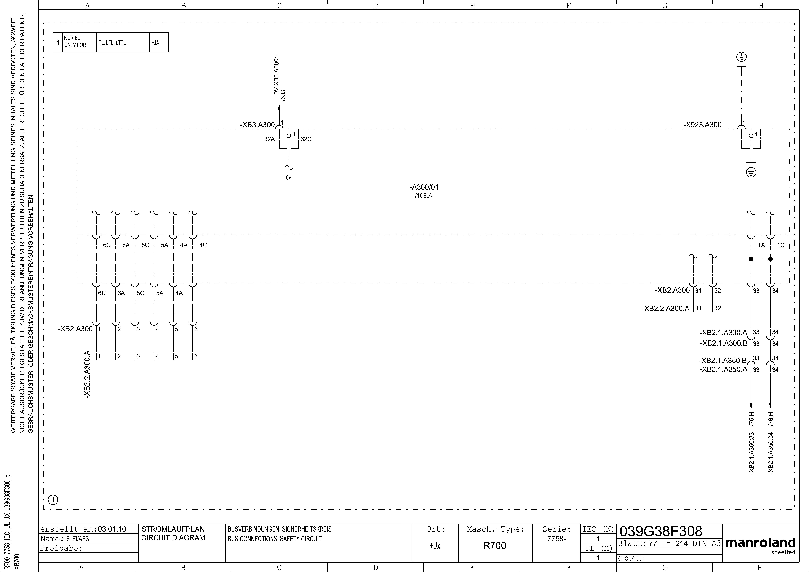

# +Jx — Sheet 77 of 214 — BUSVERBINDUNGEN: SICHERHEITSKREIS

**BUS CONNECTIONS: SAFETY**

> Part of the manroland **R700** printing press IEC/UL circuit diagrams.
> Drawing class: **Stromlaufplan / Circuit diagram** (DIN A3).
> Document `+Jx` covers the **1st printing module + feed register** machine section.

## At a glance

| Field | Value |
|---|---|
| Document | `+Jx`  (039G38F308) |
| Sheet | **77** of 214 |
| Section (DE) | BUSVERBINDUNGEN: SICHERHEITSKREIS |
| Section (EN) | BUS CONNECTIONS: SAFETY |
| Section type | CIRCUIT — Circuit diagram |
| Machine type | `R700` |
| Series | `7758` |
| Created | 03.01.10 |
| Replaces | — |
| Columns used | A, B, C, D, E, G, H |
| Path numbers | — |
| Labels on sheet | 70 |
| Cross-refs out | 4 |
| Cross-refs in | 38 |

**Previous:** [+Jx sheet 76](SHEET_0076.md) · **Next:** [+Jx sheet 78](SHEET_0078.md) · **Document TOC:** [_TOC.md](_TOC.md)  (+Jx) · **Master TOC:** [all sheets](../_MASTER_TOC.md)

## Sheet image (300 DPI, exact vector render)



_Rendered directly from the PDF vector layer at 300 DPI (1-bit), no OCR and no resampling. Use it to confirm anything ambiguous in the text below._

## Cross-references on this sheet

Each entry is a wire leaving this sheet. The printed token is `/sheet.column`; the link resolves to that sheet inside the same document.

| Ref | Target sheet | Col | Path | Destination on target | Target section | From col |
|---|---|---|---|---|---|---|
| `/6.G` | [+Jx sheet 6](SHEET_0006.md) | G | — | 0V.XB3.A300:1 | SPANNUNGSVERSORGUNG, SCHALTSCHRANKBELÜFTUNG | C |
| `/106.A` | [+Jx sheet 106](SHEET_0106.md) | A | — | — | REFERENZMODUL | D |
| `/76.H` | [+Jx sheet 76](SHEET_0076.md) | H | — | XB2.1.A350:33 | BUSVERBINDUNGEN: SICHERHEITSKREIS | H |
| `/76.H` | [+Jx sheet 76](SHEET_0076.md) | H | — | XB2.1.A350:34 | BUSVERBINDUNGEN: SICHERHEITSKREIS | H |

### Incoming references (sheets that point here)

Every other sheet that sends a wire to this one. `Back-ref` is the token printed on *that* sheet; `Path` is its line number.

| From sheet | Cols | Back-ref | Path | Refs | What continues there |
|---|---|---|---|---|---|
| [+Jx#6](SHEET_0006.md) | H | `/6.H` | — | 1 | 0V.XB3.A300:1 |
| [+Jx#76](SHEET_0076.md) | H | `/76.H` | — | 2 | XB2.1.A350:33; XB2.1.A350:34 |
| [+Jx#106](SHEET_0106.md) | A | `/106.A` | — | 1 | — |
| [+Jx#124](SHEET_0124.md) | E, F | `/124.E`, `/124.F` | — | 10 | — |
| [+Jx#125](SHEET_0125.md) | B, C, D | `/125.B`, `/125.C`, `/125.D` | — | 20 | — |
| [+Jx#126](SHEET_0126.md) | H | `/126.H` | — | 4 | — |


## Devices on this sheet

| Tag | Class | Class meaning (IEC) | Col | Sub | Terminal | Sign |
|---|---|---|---|---|---|---|
| `A300/01` | A | Baugruppe / assembly, module, PC board | E | 01 | — | — |
| `XB2.A300` | — | cross-device reference | A | — | — | — |
| `XB2.2.A300.A` | — | cross-device reference | A | — | — | — |
| `XB2.A300` | — | cross-device reference | G | — | — | — |
| `XB2.2.A300.A` | — | cross-device reference | G | — | — | — |
| `X923.A300` | — | cross-device reference | G | — | — | — |
| `XB2.1.A300.A` | — | cross-device reference | H | — | — | — |
| `XB2.1.A300.B` | — | cross-device reference | H | — | — | — |
| `XB2.1.A350.B` | — | cross-device reference | H | — | — | — |
| `XB2.1.A350.A` | — | cross-device reference | H | — | — | — |
| `XB3.A300` | — | cross-device reference | C | — | — | — |
| `XB2.1.A350:33` | — | cross-device reference | H | — | 33 | — |
| `XB2.1.A350:34` | — | cross-device reference | H | — | 34 | — |

## Potentials / nets

| Potential | Count | Columns | Attached devices | Terminals |
|---|---|---|---|---|
| `0V` | 2 | C | `A300`, `XB3` | `1` |


A potential such as `L24+/4` or `M24+` is a named supply/return rail; every place it appears on this sheet is electrically common.

## Wire-end annotations (grouped as printed)

A wire that continues elsewhere is annotated with a small cluster: the destination description, the path/line number `#NN`, and the `/sheet.column` cross reference. Each row below is one such cluster exactly as it is grouped on the drawing.

| Col | Y | Path | Cross-ref | Text on the wire |
|---|---|---|---|---|
| A | 53.0 | — | — | `1 NUR BEI ONLY FOR TL, LTL, LTTL` |
| B | 60.1 | — | — | `+JA` |
| C | 78.8 | — | `/6.G` | `0V.XB3.A300:1` |
| C | 175.9 | — | — | `XB3.A300 1` |
| H | 175.9 | — | — | `X923.A300 1` |
| C | 193.7 | — | — | `32A 1 32C` |
| H | 193.7 | — | — | `1` |
| C | 258.5 | — | — | `0V` |
| E | 270.9 | — | — | `A300/01` |
| D | 284.0 | — | `/106.A` | — |
| B | 356.7 | — | — | `6C 6A 5C 5A 4A 4C` |
| H | 356.7 | — | — | `1A 1C` |
| H | 422.6 | — | — | `XB2.A300 31 32 34` |
| H | 424.1 | — | — | `33` |
| B | 427.5 | — | — | `6C 6A 5C 5A 4A` |
| G | 449.5 | — | — | `XB2.2.A300.A 31 32` |
| A | 479.3 | — | — | `XB2.A300 1 2 3 4 5 6` |
| H | 485.0 | — | — | `XB2.1.A300.A 33` |
| H | 485.0 | — | — | `34` |
| H | 500.6 | — | — | `XB2.1.A300.B 33` |
| H | 502.0 | — | — | `34` |
| A | 515.9 | — | — | `XB2.2.A300.A` |
| A | 520.4 | — | — | `1` |
| B | 520.4 | — | — | `2 3 4 5 6` |
| H | 523.3 | — | — | `XB2.1.A350.B 33` |
| H | 523.3 | — | — | `34` |
| H | 538.8 | — | — | `XB2.1.A350.A 33` |
| H | 540.3 | — | — | `34` |
| H | 606.0 | — | `/76.H` | `XB2.1.A350:33` |
| H | 606.0 | — | `/76.H` | `XB2.1.A350:34` |
| A | 732.5 | — | — | `1` |


## Notes and free text on this sheet

| Text | Col | Y (pt) |
|---|---|---|
| `6C` | A | 356.73 |
| `6A` | A | 356.67 |
| `5C` | B | 356.73 |
| `5A` | B | 356.67 |
| `4A` | B | 356.67 |
| `4C` | B | 356.73 |
| `32C` | C | 200.82 |
| `32A` | C | 200.78 |
| `1A` | H | 356.67 |
| `1C` | H | 356.73 |
| `NUR BEI` | A | 52.98 |
| `ONLY FOR` | A | 63.67 |
| `TL, LTL, LTTL` | A | 60.11 |
| `+JA` | B | 60.06 |

## Complete label inventory (exact text from the drawing)

Every text object inside the drawing area of this sheet, in DIN reading order (column A→H, then top→bottom). This is the authoritative list: if a string is not here it is not printed on this sheet.

| Col | Y | X | Dir | Type | Text |
|---|---|---|---|---|---|
| A | 53.0 | 94.4 | → | text | `NUR BEI` |
| A | 58.3 | 82.5 | → | number | `1` |
| A | 60.1 | 145.3 | → | text | `TL, LTL, LTTL` |
| A | 63.7 | 94.7 | → | text | `ONLY FOR` |
| A | 356.7 | 151.8 | → | text | `6C` |
| A | 356.7 | 180.1 | → | text | `6A` |
| A | 427.5 | 173.1 | → | text | `6A` |
| A | 427.6 | 144.7 | → | text | `6C` |
| A | 479.3 | 85.3 | → | device ref | `XB2.A300` |
| A | 480.7 | 143.7 | → | number | `1` |
| A | 480.7 | 172.9 | → | number | `2` |
| A | 515.9 | 123.6 | ↕ | device ref | `XB2.2.A300.A` |
| A | 520.4 | 143.7 | → | number | `1` |
| A | 520.4 | 172.9 | → | number | `2` |
| A | 732.5 | 76.1 | → | number | `1` |
| B | 60.1 | 222.9 | → | text | `+JA` |
| B | 356.7 | 208.5 | → | text | `5C` |
| B | 356.7 | 236.8 | → | text | `5A` |
| B | 356.7 | 265.3 | → | text | `4A` |
| B | 356.7 | 293.7 | → | text | `4C` |
| B | 427.5 | 229.7 | → | text | `5A` |
| B | 427.5 | 258.2 | → | text | `4A` |
| B | 427.6 | 201.4 | → | text | `5C` |
| B | 480.7 | 201.0 | → | number | `3` |
| B | 480.7 | 229.6 | → | number | `4` |
| B | 480.7 | 257.7 | → | number | `5` |
| B | 480.7 | 286.0 | → | number | `6` |
| B | 520.4 | 201.0 | → | number | `3` |
| B | 520.4 | 229.6 | → | number | `4` |
| B | 520.4 | 257.7 | → | number | `5` |
| B | 520.4 | 286.0 | → | number | `6` |
| C | 78.8 | 402.7 | ↕ | potential | `0V.XB3.A300:1` |
| C | 132.1 | 412.6 | ↕ | cross-reference | `/6.G` |
| C | 175.9 | 412.7 | → | number | `1` |
| C | 178.8 | 353.2 | → | device ref | `XB3.A300` |
| C | 193.7 | 430.2 | → | number | `1` |
| C | 200.8 | 388.9 | → | text | `32A` |
| C | 200.8 | 442.8 | → | text | `32C` |
| C | 258.5 | 421.2 | → | potential | `0V` |
| D | 284.0 | 610.9 | → | cross-reference | `/106.A` |
| E | 270.9 | 602.9 | → | device tag | `A300/01` |
| G | 178.8 | 1006.0 | → | device ref | `X923.A300` |
| G | 422.6 | 964.1 | → | device ref | `XB2.A300` |
| G | 424.0 | 1023.0 | → | number | `31` |
| G | 449.5 | 944.8 | → | device ref | `XB2.2.A300.A` |
| G | 449.6 | 1023.0 | → | number | `31` |
| H | 175.9 | 1093.0 | → | number | `1` |
| H | 193.7 | 1110.5 | → | number | `1` |
| H | 356.7 | 1115.3 | → | text | `1A` |
| H | 356.7 | 1143.6 | → | text | `1C` |
| H | 424.0 | 1051.4 | → | number | `32` |
| H | 424.0 | 1108.1 | → | number | `33` |
| H | 424.0 | 1136.4 | → | number | `34` |
| H | 449.6 | 1051.4 | → | number | `32` |
| H | 485.0 | 1029.8 | → | device ref | `XB2.1.A300.A` |
| H | 485.0 | 1108.1 | → | number | `33` |
| H | 485.0 | 1136.4 | → | number | `34` |
| H | 500.6 | 1030.4 | → | device ref | `XB2.1.A300.B` |
| H | 502.0 | 1108.1 | → | number | `33` |
| H | 502.0 | 1136.4 | → | number | `34` |
| H | 523.3 | 1108.1 | → | number | `33` |
| H | 523.3 | 1136.4 | → | number | `34` |
| H | 526.1 | 1029.0 | → | device ref | `XB2.1.A350.B` |
| H | 538.8 | 1029.8 | → | device ref | `XB2.1.A350.A` |
| H | 540.3 | 1108.1 | → | number | `33` |
| H | 540.3 | 1136.4 | → | number | `34` |
| H | 606.0 | 1102.2 | ↕ | cross-reference | `/76.H` |
| H | 606.0 | 1130.5 | ↕ | cross-reference | `/76.H` |
| H | 636.1 | 1102.2 | ↕ | device ref | `XB2.1.A350:33` |
| H | 636.1 | 1130.5 | ↕ | device ref | `XB2.1.A350:34` |

## Reading-order text block

The same content as a plain block, grouped by DIN column — convenient to paste or to match against a visual description.

```text
=== Column A ===
  53.0   94.4  text         NUR BEI
  58.3   82.5  numeric      1
  60.1  145.3  text         TL, LTL, LTTL
  63.7   94.7  text         ONLY FOR
 356.7  151.8  text         6C
 356.7  180.1  text         6A
 427.5  173.1  text         6A
 427.6  144.7  text         6C
 479.3   85.3  devref       XB2.A300
 480.7  143.7  numeric      1
 480.7  172.9  numeric      2
 515.9  123.6  devref       XB2.2.A300.A
 520.4  143.7  numeric      1
 520.4  172.9  numeric      2
 732.5   76.1  numeric      1
=== Column B ===
  60.1  222.9  text         +JA
 356.7  208.5  text         5C
 356.7  236.8  text         5A
 356.7  265.3  text         4A
 356.7  293.7  text         4C
 427.5  229.7  text         5A
 427.5  258.2  text         4A
 427.6  201.4  text         5C
 480.7  201.0  numeric      3
 480.7  229.6  numeric      4
 480.7  257.7  numeric      5
 480.7  286.0  numeric      6
 520.4  201.0  numeric      3
 520.4  229.6  numeric      4
 520.4  257.7  numeric      5
 520.4  286.0  numeric      6
=== Column C ===
  78.8  402.7  net          0V.XB3.A300:1
 132.1  412.6  xref         /6.G
 175.9  412.7  numeric      1
 178.8  353.2  devref       XB3.A300
 193.7  430.2  numeric      1
 200.8  388.9  text         32A
 200.8  442.8  text         32C
 258.5  421.2  net          0V
=== Column D ===
 284.0  610.9  xref         /106.A
=== Column E ===
 270.9  602.9  devtag       A300/01
=== Column G ===
 178.8 1006.0  devref       X923.A300
 422.6  964.1  devref       XB2.A300
 424.0 1023.0  numeric      31
 449.5  944.8  devref       XB2.2.A300.A
 449.6 1023.0  numeric      31
=== Column H ===
 175.9 1093.0  numeric      1
 193.7 1110.5  numeric      1
 356.7 1115.3  text         1A
 356.7 1143.6  text         1C
 424.0 1051.4  numeric      32
 424.0 1108.1  numeric      33
 424.0 1136.4  numeric      34
 449.6 1051.4  numeric      32
 485.0 1029.8  devref       XB2.1.A300.A
 485.0 1108.1  numeric      33
 485.0 1136.4  numeric      34
 500.6 1030.4  devref       XB2.1.A300.B
 502.0 1108.1  numeric      33
 502.0 1136.4  numeric      34
 523.3 1108.1  numeric      33
 523.3 1136.4  numeric      34
 526.1 1029.0  devref       XB2.1.A350.B
 538.8 1029.8  devref       XB2.1.A350.A
 540.3 1108.1  numeric      33
 540.3 1136.4  numeric      34
 606.0 1102.2  xref         /76.H
 606.0 1130.5  xref         /76.H
 636.1 1102.2  devref       XB2.1.A350:33
 636.1 1130.5  devref       XB2.1.A350:34
```

---
_Generated from the PDF vector text layer; no OCR. Source: `R700_7758_IEC_UL_JX_039G38F308_p`, sheet 77._
