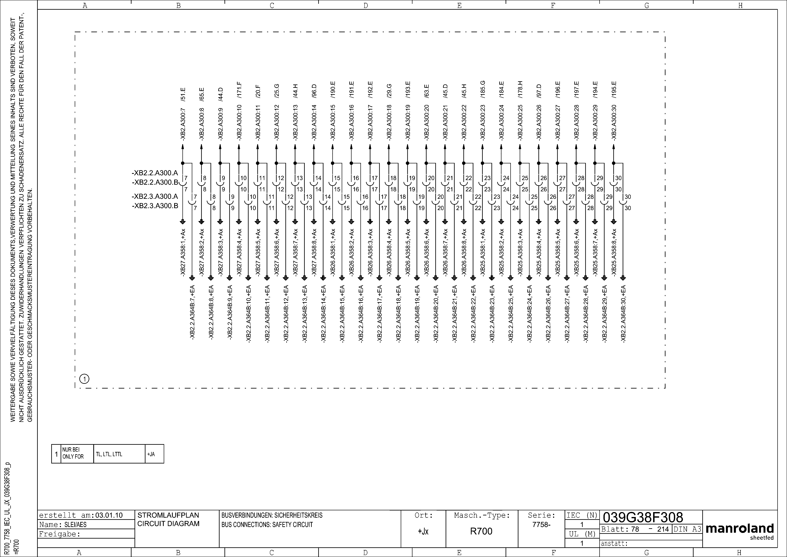

# +Jx — Sheet 78 of 214 — BUSVERBINDUNGEN: SICHERHEITSKREIS

**BUS CONNECTIONS: SAFETY**

> Part of the manroland **R700** printing press IEC/UL circuit diagrams.
> Drawing class: **Stromlaufplan / Circuit diagram** (DIN A3).
> Document `+Jx` covers the **1st printing module + feed register** machine section.

## At a glance

| Field | Value |
|---|---|
| Document | `+Jx`  (039G38F308) |
| Sheet | **78** of 214 |
| Section (DE) | BUSVERBINDUNGEN: SICHERHEITSKREIS |
| Section (EN) | BUS CONNECTIONS: SAFETY |
| Section type | CIRCUIT — Circuit diagram |
| Machine type | `R700` |
| Series | `7758` |
| Created | 03.01.10 |
| Replaces | — |
| Columns used | A, B, C, D, E, F, G |
| Path numbers | — |
| Labels on sheet | 202 |
| Cross-refs out | 24 |
| Cross-refs in | 120 |

**Previous:** [+Jx sheet 77](SHEET_0077.md) · **Next:** [+Jx sheet 79](SHEET_0079.md) · **Document TOC:** [_TOC.md](_TOC.md)  (+Jx) · **Master TOC:** [all sheets](../_MASTER_TOC.md)

## Sheet image (300 DPI, exact vector render)



_Rendered directly from the PDF vector layer at 300 DPI (1-bit), no OCR and no resampling. Use it to confirm anything ambiguous in the text below._

## Cross-references on this sheet

Each entry is a wire leaving this sheet. The printed token is `/sheet.column`; the link resolves to that sheet inside the same document.

| Ref | Target sheet | Col | Path | Destination on target | Target section | From col |
|---|---|---|---|---|---|---|
| `/185.G` | [+Jx sheet 185](SHEET_0185.md) | G | — | XB2.A300:23 | OPTION: TRANSFERMODUL 1 + 2 | E |
| `/178.H` | [+Jx sheet 178](SHEET_0178.md) | H | — | XB2.A300:25 | OPTION: TRANSFERMODUL 1 NACH | F |
| `/190.E` | [+Jx sheet 190](SHEET_0190.md) | E | — | XB2.A300:15 | OPTION: ZWISCHENTROCKNER, VORBEREITUNG | D |
| `/191.E` | [+Jx sheet 191](SHEET_0191.md) | E | — | XB2.A300:16 | OPTION: ZWISCHENTROCKNER, VORBEREITUNG | D |
| `/192.E` | [+Jx sheet 192](SHEET_0192.md) | E | — | XB2.A300:17 | OPTION: ZWISCHENTROCKNER, VORBEREITUNG | D |
| `/193.E` | [+Jx sheet 193](SHEET_0193.md) | E | — | XB2.A300:19 | OPTION: ZWISCHENTROCKNER, VORBEREITUNG | D |
| `/184.E` | [+Jx sheet 184](SHEET_0184.md) | E | — | XB2.A300:24 | OPTION: TRANSFERMODUL 1 + 2 | E |
| `/196.E` | [+Jx sheet 196](SHEET_0196.md) | E | — | XB2.A300:27 | OPTION: ZWISCHENTROCKNER, VORBEREITUNG | F |
| `/197.E` | [+Jx sheet 197](SHEET_0197.md) | E | — | XB2.A300:28 | OPTION: ZWISCHENTROCKNER, VORBEREITUNG | F |
| `/194.E` | [+Jx sheet 194](SHEET_0194.md) | E | — | XB2.A300:29 | OPTION: ZWISCHENTROCKNER, VORBEREITUNG | F |
| `/195.E` | [+Jx sheet 195](SHEET_0195.md) | E | — | XB2.A300:30 | OPTION: ZWISCHENTROCKNER, VORBEREITUNG | G |
| `/171.F` | [+Jx sheet 171](SHEET_0171.md) | F | — | XB2.A300:10 | OPTION: AUTOMATISCHEM SPÜLEN | C |
| `/25.G` | [+Jx sheet 25](SHEET_0025.md) | G | — | XB2.A300:12 | HILFSANTRIEB, LACKDOSIER /AUFTRAGSWALZEN | C |
| `/29.G` | [+Jx sheet 29](SHEET_0029.md) | G | — | XB2.A300:18 | KAMMERRAKEL | D |
| `/44.H` | [+Jx sheet 44](SHEET_0044.md) | H | — | XB2.A300:13 | MASCHINENBEDIENUNG | C |
| `/96.D` | [+Jx sheet 96](SHEET_0096.md) | D | — | XB2.A300:14 | RESERVE | C |
| `/45.D` | [+Jx sheet 45](SHEET_0045.md) | D | — | XB2.A300:21 | MASCHINENBEDIENUNG | E |
| `/45.H` | [+Jx sheet 45](SHEET_0045.md) | H | — | XB2.A300:22 | MASCHINENBEDIENUNG | E |
| `/97.D` | [+Jx sheet 97](SHEET_0097.md) | D | — | XB2.A300:26 | RESERVE | F |
| `/63.E` | [+Jx sheet 63](SHEET_0063.md) | E | — | XB2.A300:20 | LACKAUFTRAGSWALZE | E |
| `/20.F` | [+Jx sheet 20](SHEET_0020.md) | F | — | XB2.A300:11 | LACKPUMPE | C |
| `/44.D` | [+Jx sheet 44](SHEET_0044.md) | D | — | XB2.A300:9 | MASCHINENBEDIENUNG | B |
| `/51.E` | [+Jx sheet 51](SHEET_0051.md) | E | — | XB2.A300:7 | SIGNALGEBER: AKUSTISCHE WARNSIGNALE | B |
| `/65.E` | [+Jx sheet 65](SHEET_0065.md) | E | — | XB2.A300:8 | TROPFEINRICHTUNG | B |

### Incoming references (sheets that point here)

Every other sheet that sends a wire to this one. `Back-ref` is the token printed on *that* sheet; `Path` is its line number.

| From sheet | Cols | Back-ref | Path | Refs | What continues there |
|---|---|---|---|---|---|
| [+Jx#20](SHEET_0020.md) | F | `/20.F` | — | 1 | XB2.A300:11 |
| [+Jx#25](SHEET_0025.md) | G | `/25.G` | — | 1 | XB2.A300:12 |
| [+Jx#29](SHEET_0029.md) | G | `/29.G` | — | 1 | XB2.A300:18 |
| [+Jx#44](SHEET_0044.md) | D, H | `/44.D`, `/44.H` | — | 2 | XB2.A300:13; XB2.A300:9 |
| [+Jx#45](SHEET_0045.md) | D, H | `/45.D`, `/45.H` | — | 2 | XB2.A300:21; XB2.A300:22 |
| [+Jx#51](SHEET_0051.md) | E | `/51.E` | — | 1 | XB2.A300:7 |
| [+Jx#63](SHEET_0063.md) | E | `/63.E` | — | 1 | XB2.A300:20 |
| [+Jx#65](SHEET_0065.md) | E | `/65.E` | — | 1 | XB2.A300:8 |
| [+Jx#96](SHEET_0096.md) | D | `/96.D` | — | 1 | XB2.A300:14 |
| [+Jx#97](SHEET_0097.md) | D | `/97.D` | — | 1 | XB2.A300:26 |
| [+Jx#125](SHEET_0125.md) | C, D, F, G | `/125.C`, `/125.D`, `/125.F`, `/125.G` | — | 96 | — |
| [+Jx#171](SHEET_0171.md) | F | `/171.F` | — | 1 | XB2.A300:10 |
| [+Jx#178](SHEET_0178.md) | H | `/178.H` | — | 1 | XB2.A300:25 |
| [+Jx#184](SHEET_0184.md) | E | `/184.E` | — | 1 | XB2.A300:24 |
| [+Jx#185](SHEET_0185.md) | G | `/185.G` | — | 1 | XB2.A300:23 |
| [+Jx#190](SHEET_0190.md) | E | `/190.E` | — | 1 | XB2.A300:15 |
| [+Jx#191](SHEET_0191.md) | E | `/191.E` | — | 1 | XB2.A300:16 |
| [+Jx#192](SHEET_0192.md) | E | `/192.E` | — | 1 | XB2.A300:17 |
| [+Jx#193](SHEET_0193.md) | E | `/193.E` | — | 1 | XB2.A300:19 |
| [+Jx#194](SHEET_0194.md) | E | `/194.E` | — | 1 | XB2.A300:29 |
| [+Jx#195](SHEET_0195.md) | E | `/195.E` | — | 1 | XB2.A300:30 |
| [+Jx#196](SHEET_0196.md) | E | `/196.E` | — | 1 | XB2.A300:27 |
| [+Jx#197](SHEET_0197.md) | E | `/197.E` | — | 1 | XB2.A300:28 |


## Devices on this sheet

| Tag | Class | Class meaning (IEC) | Col | Sub | Terminal | Sign |
|---|---|---|---|---|---|---|
| `XB2.2.A300.A` | — | cross-device reference | B | — | — | — |
| `XB2.2.A300.B` | — | cross-device reference | B | — | — | — |
| `XB2.3.A300.B` | — | cross-device reference | B | — | — | — |
| `XB2.3.A300.A` | — | cross-device reference | B | — | — | — |
| `XB2.A300:30` | — | cross-device reference | G | — | 30 | — |
| `XB2.A300:21` | — | cross-device reference | E | — | 21 | — |
| `XB2.A300:22` | — | cross-device reference | E | — | 22 | — |
| `XB2.A300:20` | — | cross-device reference | E | — | 20 | — |
| `XB2.A300:19` | — | cross-device reference | D | — | 19 | — |
| `XB2.A300:17` | — | cross-device reference | D | — | 17 | — |
| `XB2.A300:18` | — | cross-device reference | D | — | 18 | — |
| `XB2.A300:23` | — | cross-device reference | E | — | 23 | — |
| `XB2.A300:28` | — | cross-device reference | F | — | 28 | — |
| `XB2.A300:29` | — | cross-device reference | F | — | 29 | — |
| `XB2.A300:27` | — | cross-device reference | F | — | 27 | — |
| `XB2.A300:26` | — | cross-device reference | F | — | 26 | — |
| `XB2.A300:24` | — | cross-device reference | E | — | 24 | — |
| `XB2.A300:25` | — | cross-device reference | F | — | 25 | — |
| `XB2.A300:16` | — | cross-device reference | D | — | 16 | — |
| `XB2.A300:15` | — | cross-device reference | D | — | 15 | — |
| `XB2.A300:13` | — | cross-device reference | C | — | 13 | — |
| `XB2.A300:11` | — | cross-device reference | C | — | 11 | — |
| `XB2.A300:12` | — | cross-device reference | C | — | 12 | — |
| `XB2.A300:14` | — | cross-device reference | C | — | 14 | — |
| `XB2.A300:10` | — | cross-device reference | C | — | 10 | — |
| `XB2.A300:8` | — | cross-device reference | B | — | 8 | — |
| `XB2.A300:9` | — | cross-device reference | B | — | 9 | — |
| `XB2.A300:7` | — | cross-device reference | B | — | 7 | — |

## Potentials / nets

_No named potentials on this sheet._

## Wire-end annotations (grouped as printed)

A wire that continues elsewhere is annotated with a small cluster: the destination description, the path/line number `#NN`, and the `/sheet.column` cross reference. Each row below is one such cluster exactly as it is grouped on the drawing.

| Col | Y | Path | Cross-ref | Text on the wire |
|---|---|---|---|---|
| E | 121.8 | — | `/185.G` | `XB2.A300:23` |
| F | 122.3 | — | `/178.H` | `XB2.A300:25` |
| D | 122.6 | — | `/190.E` | `XB2.A300:15` |
| D | 122.6 | — | `/191.E` | `XB2.A300:16` |
| D | 122.6 | — | `/192.E` | `XB2.A300:17` |
| D | 122.6 | — | `/193.E` | `XB2.A300:19` |
| E | 122.6 | — | `/184.E` | `XB2.A300:24` |
| F | 122.6 | — | `/196.E` | `XB2.A300:27` |
| F | 122.6 | — | `/197.E` | `XB2.A300:28` |
| F | 122.6 | — | `/194.E` | `XB2.A300:29` |
| G | 122.6 | — | `/195.E` | `XB2.A300:30` |
| C | 123.2 | — | `/171.F` | `XB2.A300:10` |
| C | 126.6 | — | `/25.G` | `XB2.A300:12` |
| D | 126.6 | — | `/29.G` | `XB2.A300:18` |
| C | 127.1 | — | `/44.H` | `XB2.A300:13` |
| C | 127.1 | — | `/96.D` | `XB2.A300:14` |
| E | 127.1 | — | `/45.D` | `XB2.A300:21` |
| E | 127.1 | — | `/45.H` | `XB2.A300:22` |
| F | 127.1 | — | `/97.D` | `XB2.A300:26` |
| E | 127.4 | — | `/63.E` | `XB2.A300:20` |
| C | 128.0 | — | `/20.F` | `XB2.A300:11` |
| B | 132.1 | — | `/44.D` | `XB2.A300:9` |
| B | 132.4 | — | `/51.E` | `XB2.A300:7` |
| B | 132.4 | — | `/65.E` | `XB2.A300:8` |
| B | 256.8 | — | — | `XB2.2.A300.A 7` |
| E | 265.3 | — | — | `8 9 10 11 12 13 14 15 16 17 18 19 20 21 22 23 24 25 26 27 28 29 30` |
| B | 271.0 | — | — | `XB2.2.A300.B 7` |
| E | 282.3 | — | — | `8 8 9 9 10 10 11 11 12 12 13 13 14 14 15 15 16 16 17 17 18 19 20 21 22 23 24 25 26 27 28 29 30` |
| B | 292.2 | — | — | `XB2.3.A300.A 7` |
| E | 293.6 | — | — | `18 19 20 21 22 23 24 25 26 27 28` |
| G | 293.6 | — | — | `29 30` |
| C | 306.4 | — | — | `XB2.3.A300.B 7 8 9 10 11 12 13 14 15 16 17` |
| E | 310.7 | — | — | `18 19 20 21 22 23 24 25 26 27 28` |
| G | 310.7 | — | — | `29 30` |
| B | 345.8 | — | — | `XB27.A358:1,+Ax` |
| B | 345.8 | — | — | `XB27.A358:2,+Ax` |
| B | 345.8 | — | — | `XB27.A358:3,+Ax` |
| C | 345.8 | — | — | `XB27.A358:4,+Ax` |
| C | 345.8 | — | — | `XB27.A358:5,+Ax` |
| C | 345.8 | — | — | `XB27.A358:6,+Ax` |
| C | 345.8 | — | — | `XB27.A358:7,+Ax` |
| C | 345.8 | — | — | `XB27.A358:8,+Ax` |
| D | 345.8 | — | — | `XB26.A358:1,+Ax` |
| D | 345.8 | — | — | `XB26.A358:2,+Ax` |
| D | 345.8 | — | — | `XB26.A358:3,+Ax` |
| D | 345.8 | — | — | `XB26.A358:4,+Ax` |
| D | 345.8 | — | — | `XB26.A358:5,+Ax` |
| E | 345.8 | — | — | `XB26.A358:6,+Ax` |
| E | 345.8 | — | — | `XB26.A358:7,+Ax` |
| E | 345.8 | — | — | `XB26.A358:8,+Ax` |
| E | 345.8 | — | — | `XB25.A358:1,+Ax` |
| E | 345.8 | — | — | `XB25.A358:2,+Ax` |
| F | 345.8 | — | — | `XB25.A358:3,+Ax` |
| F | 345.8 | — | — | `XB25.A358:4,+Ax` |
| F | 345.8 | — | — | `XB25.A358:5,+Ax` |
| F | 345.8 | — | — | `XB25.A358:6,+Ax` |
| F | 345.8 | — | — | `XB25.A358:7,+Ax` |
| G | 345.8 | — | — | `XB25.A358:8,+Ax` |
| B | 430.9 | — | — | `XB2.2.A364B:7,+EA` |
| B | 430.9 | — | — | `XB2.2.A364B:8,+EA` |
| C | 430.9 | — | — | `XB2.2.A364B:9,+EA` |
| C | 430.9 | — | — | `XB2.2.A364B:10,+EA` |
| C | 430.9 | — | — | `XB2.2.A364B:11,+EA` |
| C | 430.9 | — | — | `XB2.2.A364B:12,+EA` |
| C | 430.9 | — | — | `XB2.2.A364B:13,+EA` |
| D | 430.9 | — | — | `XB2.2.A364B:14,+EA` |
| D | 430.9 | — | — | `XB2.2.A364B:15,+EA` |
| D | 430.9 | — | — | `XB2.2.A364B:16,+EA` |
| D | 430.9 | — | — | `XB2.2.A364B:17,+EA` |
| D | 430.9 | — | — | `XB2.2.A364B:18,+EA` |
| E | 430.9 | — | — | `XB2.2.A364B:19,+EA` |
| E | 430.9 | — | — | `XB2.2.A364B:20,+EA` |
| E | 430.9 | — | — | `XB2.2.A364B:21,+EA` |
| E | 430.9 | — | — | `XB2.2.A364B:22,+EA` |
| E | 430.9 | — | — | `XB2.2.A364B:23,+EA` |
| F | 430.9 | — | — | `XB2.2.A364B:25,+EA` |
| F | 430.9 | — | — | `XB2.2.A364B:24,+EA` |
| F | 430.9 | — | — | `XB2.2.A364B:26,+EA` |
| F | 430.9 | — | — | `XB2.2.A364B:27,+EA` |
| F | 430.9 | — | — | `XB2.2.A364B:28,+EA` |
| G | 430.9 | — | — | `XB2.2.A364B:29,+EA` |
| G | 430.9 | — | — | `XB2.2.A364B:30,+EA` |
| A | 569.5 | — | — | `1` |
| A | 676.6 | — | — | `1 NUR BEI ONLY FOR TL, LTL, LTTL +JA` |


## Notes and free text on this sheet

| Text | Col | Y (pt) |
|---|---|---|
| `XB27.A358:1,+Ax` | B | 345.83 |
| `XB27.A358:2,+Ax` | B | 345.83 |
| `XB27.A358:3,+Ax` | B | 345.83 |
| `XB27.A358:4,+Ax` | C | 345.83 |
| `XB27.A358:5,+Ax` | C | 345.83 |
| `XB27.A358:6,+Ax` | C | 345.83 |
| `XB27.A358:7,+Ax` | C | 345.83 |
| `XB27.A358:8,+Ax` | C | 345.83 |
| `XB26.A358:1,+Ax` | D | 345.83 |
| `XB26.A358:2,+Ax` | D | 345.83 |
| `XB26.A358:3,+Ax` | D | 345.83 |
| `XB26.A358:4,+Ax` | D | 345.83 |
| `XB26.A358:5,+Ax` | D | 345.83 |
| `XB26.A358:6,+Ax` | E | 345.83 |
| `XB26.A358:7,+Ax` | E | 345.83 |
| `XB26.A358:8,+Ax` | E | 345.83 |
| `XB25.A358:1,+Ax` | E | 345.83 |
| `XB25.A358:2,+Ax` | E | 345.83 |
| `XB25.A358:3,+Ax` | F | 345.83 |
| `XB25.A358:4,+Ax` | F | 345.83 |
| `XB25.A358:5,+Ax` | F | 345.83 |
| `XB25.A358:6,+Ax` | F | 345.83 |
| `XB25.A358:7,+Ax` | F | 345.83 |
| `XB25.A358:8,+Ax` | G | 345.83 |
| `XB2.2.A364B:7,+EA` | B | 430.87 |
| `XB2.2.A364B:8,+EA` | B | 430.87 |
| `XB2.2.A364B:9,+EA` | C | 430.87 |
| `XB2.2.A364B:10,+EA` | C | 430.87 |
| `XB2.2.A364B:11,+EA` | C | 430.87 |
| `XB2.2.A364B:12,+EA` | C | 430.87 |
| `XB2.2.A364B:13,+EA` | C | 430.87 |
| `XB2.2.A364B:14,+EA` | D | 430.87 |
| `XB2.2.A364B:15,+EA` | D | 430.87 |
| `XB2.2.A364B:16,+EA` | D | 430.87 |
| `XB2.2.A364B:17,+EA` | D | 430.87 |
| `XB2.2.A364B:18,+EA` | D | 430.87 |
| `XB2.2.A364B:19,+EA` | E | 430.87 |
| `XB2.2.A364B:20,+EA` | E | 430.87 |
| `XB2.2.A364B:21,+EA` | E | 430.87 |
| `XB2.2.A364B:22,+EA` | E | 430.87 |
| `XB2.2.A364B:23,+EA` | E | 430.87 |
| `XB2.2.A364B:24,+EA` | F | 430.87 |
| `XB2.2.A364B:25,+EA` | F | 430.87 |
| `XB2.2.A364B:26,+EA` | F | 430.87 |
| `XB2.2.A364B:27,+EA` | F | 430.87 |
| `XB2.2.A364B:28,+EA` | F | 430.87 |
| `XB2.2.A364B:29,+EA` | G | 430.87 |
| `XB2.2.A364B:30,+EA` | G | 430.87 |
| `NUR BEI` | A | 676.6 |
| `ONLY FOR` | A | 687.29 |
| `TL, LTL, LTTL` | A | 683.73 |
| `+JA` | B | 683.68 |

## Complete label inventory (exact text from the drawing)

Every text object inside the drawing area of this sheet, in DIN reading order (column A→H, then top→bottom). This is the authoritative list: if a string is not here it is not printed on this sheet.

| Col | Y | X | Dir | Type | Text |
|---|---|---|---|---|---|
| A | 569.5 | 125.7 | → | number | `1` |
| A | 676.6 | 94.4 | → | text | `NUR BEI` |
| A | 681.9 | 82.5 | → | number | `1` |
| A | 683.7 | 145.3 | → | text | `TL, LTL, LTTL` |
| A | 687.3 | 94.7 | → | text | `ONLY FOR` |
| B | 132.1 | 329.8 | ↕ | cross-reference | `/44.D` |
| B | 132.4 | 273.0 | ↕ | cross-reference | `/51.E` |
| B | 132.4 | 301.4 | ↕ | cross-reference | `/65.E` |
| B | 163.0 | 273.1 | ↕ | device ref | `XB2.A300:7` |
| B | 163.0 | 301.4 | ↕ | device ref | `XB2.A300:8` |
| B | 163.0 | 329.7 | ↕ | device ref | `XB2.A300:9` |
| B | 256.8 | 199.3 | → | device ref | `XB2.2.A300.A` |
| B | 265.3 | 278.9 | → | number | `7` |
| B | 265.3 | 307.3 | → | number | `8` |
| B | 265.3 | 335.6 | → | number | `9` |
| B | 271.0 | 199.8 | → | device ref | `XB2.2.A300.B` |
| B | 282.3 | 278.9 | → | number | `7` |
| B | 282.3 | 307.3 | → | number | `8` |
| B | 282.3 | 335.6 | → | number | `9` |
| B | 292.2 | 199.3 | → | device ref | `XB2.3.A300.A` |
| B | 293.7 | 293.1 | → | number | `7` |
| B | 293.7 | 321.4 | → | number | `8` |
| B | 306.4 | 199.8 | → | device ref | `XB2.3.A300.B` |
| B | 310.7 | 293.1 | → | number | `7` |
| B | 310.7 | 321.4 | → | number | `8` |
| B | 345.8 | 273.1 | ↕ | text | `XB27.A358:1,+Ax` |
| B | 345.8 | 301.4 | ↕ | text | `XB27.A358:2,+Ax` |
| B | 345.8 | 329.8 | ↕ | text | `XB27.A358:3,+Ax` |
| B | 430.9 | 287.2 | ↕ | text | `XB2.2.A364B:7,+EA` |
| B | 430.9 | 315.6 | ↕ | text | `XB2.2.A364B:8,+EA` |
| B | 683.7 | 222.9 | → | text | `+JA` |
| C | 123.2 | 358.1 | ↕ | cross-reference | `/171.F` |
| C | 126.6 | 414.8 | ↕ | cross-reference | `/25.G` |
| C | 127.1 | 443.1 | ↕ | cross-reference | `/44.H` |
| C | 127.1 | 471.5 | ↕ | cross-reference | `/96.D` |
| C | 128.0 | 386.4 | ↕ | cross-reference | `/20.F` |
| C | 158.2 | 358.1 | ↕ | device ref | `XB2.A300:10` |
| C | 158.2 | 386.4 | ↕ | device ref | `XB2.A300:11` |
| C | 158.2 | 414.8 | ↕ | device ref | `XB2.A300:12` |
| C | 158.2 | 443.1 | ↕ | device ref | `XB2.A300:13` |
| C | 158.2 | 471.5 | ↕ | device ref | `XB2.A300:14` |
| C | 265.3 | 363.4 | → | number | `10` |
| C | 265.3 | 391.7 | → | number | `11` |
| C | 265.3 | 420.1 | → | number | `12` |
| C | 265.3 | 448.4 | → | number | `13` |
| C | 265.3 | 476.8 | → | number | `14` |
| C | 282.3 | 363.4 | → | number | `10` |
| C | 282.3 | 391.7 | → | number | `11` |
| C | 282.3 | 420.1 | → | number | `12` |
| C | 282.3 | 448.4 | → | number | `13` |
| C | 282.3 | 476.8 | → | number | `14` |
| C | 293.7 | 349.8 | → | number | `9` |
| C | 293.7 | 377.6 | → | number | `10` |
| C | 293.7 | 405.9 | → | number | `11` |
| C | 293.7 | 434.3 | → | number | `12` |
| C | 293.7 | 462.6 | → | number | `13` |
| C | 310.7 | 349.8 | → | number | `9` |
| C | 310.7 | 377.6 | → | number | `10` |
| C | 310.7 | 405.9 | → | number | `11` |
| C | 310.7 | 434.3 | → | number | `12` |
| C | 310.7 | 462.6 | → | number | `13` |
| C | 345.8 | 358.1 | ↕ | text | `XB27.A358:4,+Ax` |
| C | 345.8 | 386.5 | ↕ | text | `XB27.A358:5,+Ax` |
| C | 345.8 | 414.8 | ↕ | text | `XB27.A358:6,+Ax` |
| C | 345.8 | 443.1 | ↕ | text | `XB27.A358:7,+Ax` |
| C | 345.8 | 471.5 | ↕ | text | `XB27.A358:8,+Ax` |
| C | 430.9 | 343.9 | ↕ | text | `XB2.2.A364B:9,+EA` |
| C | 430.9 | 372.3 | ↕ | text | `XB2.2.A364B:10,+EA` |
| C | 430.9 | 400.6 | ↕ | text | `XB2.2.A364B:11,+EA` |
| C | 430.9 | 428.9 | ↕ | text | `XB2.2.A364B:12,+EA` |
| C | 430.9 | 457.3 | ↕ | text | `XB2.2.A364B:13,+EA` |
| D | 122.6 | 499.8 | ↕ | cross-reference | `/190.E` |
| D | 122.6 | 528.2 | ↕ | cross-reference | `/191.E` |
| D | 122.6 | 556.5 | ↕ | cross-reference | `/192.E` |
| D | 122.6 | 613.2 | ↕ | cross-reference | `/193.E` |
| D | 126.6 | 584.9 | ↕ | cross-reference | `/29.G` |
| D | 158.2 | 499.8 | ↕ | device ref | `XB2.A300:15` |
| D | 158.2 | 528.2 | ↕ | device ref | `XB2.A300:16` |
| D | 158.2 | 556.5 | ↕ | device ref | `XB2.A300:17` |
| D | 158.2 | 584.9 | ↕ | device ref | `XB2.A300:18` |
| D | 158.2 | 613.2 | ↕ | device ref | `XB2.A300:19` |
| D | 265.3 | 505.1 | → | number | `15` |
| D | 265.3 | 533.5 | → | number | `16` |
| D | 265.3 | 561.8 | → | number | `17` |
| D | 265.3 | 590.2 | → | number | `18` |
| D | 265.3 | 618.5 | → | number | `19` |
| D | 282.3 | 505.1 | → | number | `15` |
| D | 282.3 | 533.5 | → | number | `16` |
| D | 282.3 | 561.8 | → | number | `17` |
| D | 282.3 | 590.2 | → | number | `18` |
| D | 282.3 | 618.5 | → | number | `19` |
| D | 293.7 | 491.0 | → | number | `14` |
| D | 293.7 | 519.3 | → | number | `15` |
| D | 293.7 | 547.7 | → | number | `16` |
| D | 293.7 | 576.0 | → | number | `17` |
| D | 293.7 | 604.3 | → | number | `18` |
| D | 310.7 | 491.0 | → | number | `14` |
| D | 310.7 | 519.3 | → | number | `15` |
| D | 310.7 | 547.7 | → | number | `16` |
| D | 310.7 | 576.0 | → | number | `17` |
| D | 310.7 | 604.3 | → | number | `18` |
| D | 345.8 | 499.8 | ↕ | text | `XB26.A358:1,+Ax` |
| D | 345.8 | 528.2 | ↕ | text | `XB26.A358:2,+Ax` |
| D | 345.8 | 556.5 | ↕ | text | `XB26.A358:3,+Ax` |
| D | 345.8 | 584.9 | ↕ | text | `XB26.A358:4,+Ax` |
| D | 345.8 | 613.2 | ↕ | text | `XB26.A358:5,+Ax` |
| D | 430.9 | 485.6 | ↕ | text | `XB2.2.A364B:14,+EA` |
| D | 430.9 | 514.0 | ↕ | text | `XB2.2.A364B:15,+EA` |
| D | 430.9 | 542.3 | ↕ | text | `XB2.2.A364B:16,+EA` |
| D | 430.9 | 570.7 | ↕ | text | `XB2.2.A364B:17,+EA` |
| D | 430.9 | 599.0 | ↕ | text | `XB2.2.A364B:18,+EA` |
| E | 121.7 | 726.6 | ↕ | cross-reference | `/185.G` |
| E | 122.6 | 754.9 | ↕ | cross-reference | `/184.E` |
| E | 127.1 | 669.9 | ↕ | cross-reference | `/45.D` |
| E | 127.1 | 698.3 | ↕ | cross-reference | `/45.H` |
| E | 127.4 | 641.5 | ↕ | cross-reference | `/63.E` |
| E | 158.2 | 641.6 | ↕ | device ref | `XB2.A300:20` |
| E | 158.2 | 669.9 | ↕ | device ref | `XB2.A300:21` |
| E | 158.2 | 698.3 | ↕ | device ref | `XB2.A300:22` |
| E | 158.2 | 726.6 | ↕ | device ref | `XB2.A300:23` |
| E | 158.2 | 754.9 | ↕ | device ref | `XB2.A300:24` |
| E | 265.3 | 647.7 | → | number | `20` |
| E | 265.3 | 676.1 | → | number | `21` |
| E | 265.3 | 704.4 | → | number | `22` |
| E | 265.3 | 732.8 | → | number | `23` |
| E | 282.3 | 647.7 | → | number | `20` |
| E | 282.3 | 676.1 | → | number | `21` |
| E | 282.3 | 704.4 | → | number | `22` |
| E | 282.3 | 732.8 | → | number | `23` |
| E | 293.7 | 632.7 | → | number | `19` |
| E | 293.7 | 661.9 | → | number | `20` |
| E | 293.7 | 690.2 | → | number | `21` |
| E | 293.7 | 718.6 | → | number | `22` |
| E | 293.7 | 746.9 | → | number | `23` |
| E | 310.7 | 632.7 | → | number | `19` |
| E | 310.7 | 661.9 | → | number | `20` |
| E | 310.7 | 690.2 | → | number | `21` |
| E | 310.7 | 718.6 | → | number | `22` |
| E | 310.7 | 746.9 | → | number | `23` |
| E | 345.8 | 641.6 | ↕ | text | `XB26.A358:6,+Ax` |
| E | 345.8 | 669.9 | ↕ | text | `XB26.A358:7,+Ax` |
| E | 345.8 | 698.3 | ↕ | text | `XB26.A358:8,+Ax` |
| E | 345.8 | 726.6 | ↕ | text | `XB25.A358:1,+Ax` |
| E | 345.8 | 755.0 | ↕ | text | `XB25.A358:2,+Ax` |
| E | 430.9 | 627.4 | ↕ | text | `XB2.2.A364B:19,+EA` |
| E | 430.9 | 655.7 | ↕ | text | `XB2.2.A364B:20,+EA` |
| E | 430.9 | 684.1 | ↕ | text | `XB2.2.A364B:21,+EA` |
| E | 430.9 | 712.4 | ↕ | text | `XB2.2.A364B:22,+EA` |
| E | 430.9 | 740.8 | ↕ | text | `XB2.2.A364B:23,+EA` |
| F | 122.3 | 783.3 | ↕ | cross-reference | `/178.H` |
| F | 122.6 | 840.0 | ↕ | cross-reference | `/196.E` |
| F | 122.6 | 868.3 | ↕ | cross-reference | `/197.E` |
| F | 122.6 | 896.7 | ↕ | cross-reference | `/194.E` |
| F | 127.1 | 811.6 | ↕ | cross-reference | `/97.D` |
| F | 158.2 | 783.3 | ↕ | device ref | `XB2.A300:25` |
| F | 158.2 | 811.6 | ↕ | device ref | `XB2.A300:26` |
| F | 158.2 | 840.0 | ↕ | device ref | `XB2.A300:27` |
| F | 158.2 | 868.3 | ↕ | device ref | `XB2.A300:28` |
| F | 158.2 | 896.7 | ↕ | device ref | `XB2.A300:29` |
| F | 265.3 | 761.1 | → | number | `24` |
| F | 265.3 | 789.4 | → | number | `25` |
| F | 265.3 | 817.8 | → | number | `26` |
| F | 265.3 | 846.1 | → | number | `27` |
| F | 265.3 | 874.5 | → | number | `28` |
| F | 282.3 | 761.1 | → | number | `24` |
| F | 282.3 | 789.4 | → | number | `25` |
| F | 282.3 | 817.8 | → | number | `26` |
| F | 282.3 | 846.1 | → | number | `27` |
| F | 282.3 | 874.5 | → | number | `28` |
| F | 293.7 | 775.3 | → | number | `24` |
| F | 293.7 | 803.6 | → | number | `25` |
| F | 293.7 | 832.0 | → | number | `26` |
| F | 293.7 | 860.3 | → | number | `27` |
| F | 293.7 | 888.7 | → | number | `28` |
| F | 310.7 | 775.3 | → | number | `24` |
| F | 310.7 | 803.6 | → | number | `25` |
| F | 310.7 | 832.0 | → | number | `26` |
| F | 310.7 | 860.3 | → | number | `27` |
| F | 310.7 | 888.7 | → | number | `28` |
| F | 345.8 | 783.3 | ↕ | text | `XB25.A358:3,+Ax` |
| F | 345.8 | 811.7 | ↕ | text | `XB25.A358:4,+Ax` |
| F | 345.8 | 840.0 | ↕ | text | `XB25.A358:5,+Ax` |
| F | 345.8 | 868.3 | ↕ | text | `XB25.A358:6,+Ax` |
| F | 345.8 | 896.7 | ↕ | text | `XB25.A358:7,+Ax` |
| F | 430.9 | 769.1 | ↕ | text | `XB2.2.A364B:25,+EA` |
| F | 430.9 | 797.4 | ↕ | text | `XB2.2.A364B:24,+EA` |
| F | 430.9 | 825.8 | ↕ | text | `XB2.2.A364B:26,+EA` |
| F | 430.9 | 854.1 | ↕ | text | `XB2.2.A364B:27,+EA` |
| F | 430.9 | 882.5 | ↕ | text | `XB2.2.A364B:28,+EA` |
| G | 122.6 | 925.0 | ↕ | cross-reference | `/195.E` |
| G | 158.2 | 925.0 | ↕ | device ref | `XB2.A300:30` |
| G | 265.3 | 902.8 | → | number | `29` |
| G | 265.3 | 930.9 | → | number | `30` |
| G | 282.3 | 902.8 | → | number | `29` |
| G | 282.3 | 930.9 | → | number | `30` |
| G | 293.7 | 917.0 | → | number | `29` |
| G | 293.7 | 945.1 | → | number | `30` |
| G | 310.7 | 917.0 | → | number | `29` |
| G | 310.7 | 945.1 | → | number | `30` |
| G | 345.8 | 925.0 | ↕ | text | `XB25.A358:8,+Ax` |
| G | 430.9 | 910.8 | ↕ | text | `XB2.2.A364B:29,+EA` |
| G | 430.9 | 939.2 | ↕ | text | `XB2.2.A364B:30,+EA` |

## Reading-order text block

The same content as a plain block, grouped by DIN column — convenient to paste or to match against a visual description.

```text
=== Column A ===
 569.5  125.7  numeric      1
 676.6   94.4  text         NUR BEI
 681.9   82.5  numeric      1
 683.7  145.3  text         TL, LTL, LTTL
 687.3   94.7  text         ONLY FOR
=== Column B ===
 132.1  329.8  xref         /44.D
 132.4  273.0  xref         /51.E
 132.4  301.4  xref         /65.E
 163.0  273.1  devref       XB2.A300:7
 163.0  301.4  devref       XB2.A300:8
 163.0  329.7  devref       XB2.A300:9
 256.8  199.3  devref       XB2.2.A300.A
 265.3  278.9  numeric      7
 265.3  307.3  numeric      8
 265.3  335.6  numeric      9
 271.0  199.8  devref       XB2.2.A300.B
 282.3  278.9  numeric      7
 282.3  307.3  numeric      8
 282.3  335.6  numeric      9
 292.2  199.3  devref       XB2.3.A300.A
 293.7  293.1  numeric      7
 293.7  321.4  numeric      8
 306.4  199.8  devref       XB2.3.A300.B
 310.7  293.1  numeric      7
 310.7  321.4  numeric      8
 345.8  273.1  text         XB27.A358:1,+Ax
 345.8  301.4  text         XB27.A358:2,+Ax
 345.8  329.8  text         XB27.A358:3,+Ax
 430.9  287.2  text         XB2.2.A364B:7,+EA
 430.9  315.6  text         XB2.2.A364B:8,+EA
 683.7  222.9  text         +JA
=== Column C ===
 123.2  358.1  xref         /171.F
 126.6  414.8  xref         /25.G
 127.1  443.1  xref         /44.H
 127.1  471.5  xref         /96.D
 128.0  386.4  xref         /20.F
 158.2  358.1  devref       XB2.A300:10
 158.2  386.4  devref       XB2.A300:11
 158.2  414.8  devref       XB2.A300:12
 158.2  443.1  devref       XB2.A300:13
 158.2  471.5  devref       XB2.A300:14
 265.3  363.4  numeric      10
 265.3  391.7  numeric      11
 265.3  420.1  numeric      12
 265.3  448.4  numeric      13
 265.3  476.8  numeric      14
 282.3  363.4  numeric      10
 282.3  391.7  numeric      11
 282.3  420.1  numeric      12
 282.3  448.4  numeric      13
 282.3  476.8  numeric      14
 293.7  349.8  numeric      9
 293.7  377.6  numeric      10
 293.7  405.9  numeric      11
 293.7  434.3  numeric      12
 293.7  462.6  numeric      13
 310.7  349.8  numeric      9
 310.7  377.6  numeric      10
 310.7  405.9  numeric      11
 310.7  434.3  numeric      12
 310.7  462.6  numeric      13
 345.8  358.1  text         XB27.A358:4,+Ax
 345.8  386.5  text         XB27.A358:5,+Ax
 345.8  414.8  text         XB27.A358:6,+Ax
 345.8  443.1  text         XB27.A358:7,+Ax
 345.8  471.5  text         XB27.A358:8,+Ax
 430.9  343.9  text         XB2.2.A364B:9,+EA
 430.9  372.3  text         XB2.2.A364B:10,+EA
 430.9  400.6  text         XB2.2.A364B:11,+EA
 430.9  428.9  text         XB2.2.A364B:12,+EA
 430.9  457.3  text         XB2.2.A364B:13,+EA
=== Column D ===
 122.6  499.8  xref         /190.E
 122.6  528.2  xref         /191.E
 122.6  556.5  xref         /192.E
 122.6  613.2  xref         /193.E
 126.6  584.9  xref         /29.G
 158.2  499.8  devref       XB2.A300:15
 158.2  528.2  devref       XB2.A300:16
 158.2  556.5  devref       XB2.A300:17
 158.2  584.9  devref       XB2.A300:18
 158.2  613.2  devref       XB2.A300:19
 265.3  505.1  numeric      15
 265.3  533.5  numeric      16
 265.3  561.8  numeric      17
 265.3  590.2  numeric      18
 265.3  618.5  numeric      19
 282.3  505.1  numeric      15
 282.3  533.5  numeric      16
 282.3  561.8  numeric      17
 282.3  590.2  numeric      18
 282.3  618.5  numeric      19
 293.7  491.0  numeric      14
 293.7  519.3  numeric      15
 293.7  547.7  numeric      16
 293.7  576.0  numeric      17
 293.7  604.3  numeric      18
 310.7  491.0  numeric      14
 310.7  519.3  numeric      15
 310.7  547.7  numeric      16
 310.7  576.0  numeric      17
 310.7  604.3  numeric      18
 345.8  499.8  text         XB26.A358:1,+Ax
 345.8  528.2  text         XB26.A358:2,+Ax
 345.8  556.5  text         XB26.A358:3,+Ax
 345.8  584.9  text         XB26.A358:4,+Ax
 345.8  613.2  text         XB26.A358:5,+Ax
 430.9  485.6  text         XB2.2.A364B:14,+EA
 430.9  514.0  text         XB2.2.A364B:15,+EA
 430.9  542.3  text         XB2.2.A364B:16,+EA
 430.9  570.7  text         XB2.2.A364B:17,+EA
 430.9  599.0  text         XB2.2.A364B:18,+EA
=== Column E ===
 121.7  726.6  xref         /185.G
 122.6  754.9  xref         /184.E
 127.1  669.9  xref         /45.D
 127.1  698.3  xref         /45.H
 127.4  641.5  xref         /63.E
 158.2  641.6  devref       XB2.A300:20
 158.2  669.9  devref       XB2.A300:21
 158.2  698.3  devref       XB2.A300:22
 158.2  726.6  devref       XB2.A300:23
 158.2  754.9  devref       XB2.A300:24
 265.3  647.7  numeric      20
 265.3  676.1  numeric      21
 265.3  704.4  numeric      22
 265.3  732.8  numeric      23
 282.3  647.7  numeric      20
 282.3  676.1  numeric      21
 282.3  704.4  numeric      22
 282.3  732.8  numeric      23
 293.7  632.7  numeric      19
 293.7  661.9  numeric      20
 293.7  690.2  numeric      21
 293.7  718.6  numeric      22
 293.7  746.9  numeric      23
 310.7  632.7  numeric      19
 310.7  661.9  numeric      20
 310.7  690.2  numeric      21
 310.7  718.6  numeric      22
 310.7  746.9  numeric      23
 345.8  641.6  text         XB26.A358:6,+Ax
 345.8  669.9  text         XB26.A358:7,+Ax
 345.8  698.3  text         XB26.A358:8,+Ax
 345.8  726.6  text         XB25.A358:1,+Ax
 345.8  755.0  text         XB25.A358:2,+Ax
 430.9  627.4  text         XB2.2.A364B:19,+EA
 430.9  655.7  text         XB2.2.A364B:20,+EA
 430.9  684.1  text         XB2.2.A364B:21,+EA
 430.9  712.4  text         XB2.2.A364B:22,+EA
 430.9  740.8  text         XB2.2.A364B:23,+EA
=== Column F ===
 122.3  783.3  xref         /178.H
 122.6  840.0  xref         /196.E
 122.6  868.3  xref         /197.E
 122.6  896.7  xref         /194.E
 127.1  811.6  xref         /97.D
 158.2  783.3  devref       XB2.A300:25
 158.2  811.6  devref       XB2.A300:26
 158.2  840.0  devref       XB2.A300:27
 158.2  868.3  devref       XB2.A300:28
 158.2  896.7  devref       XB2.A300:29
 265.3  761.1  numeric      24
 265.3  789.4  numeric      25
 265.3  817.8  numeric      26
 265.3  846.1  numeric      27
 265.3  874.5  numeric      28
 282.3  761.1  numeric      24
 282.3  789.4  numeric      25
 282.3  817.8  numeric      26
 282.3  846.1  numeric      27
 282.3  874.5  numeric      28
 293.7  775.3  numeric      24
 293.7  803.6  numeric      25
 293.7  832.0  numeric      26
 293.7  860.3  numeric      27
 293.7  888.7  numeric      28
 310.7  775.3  numeric      24
 310.7  803.6  numeric      25
 310.7  832.0  numeric      26
 310.7  860.3  numeric      27
 310.7  888.7  numeric      28
 345.8  783.3  text         XB25.A358:3,+Ax
 345.8  811.7  text         XB25.A358:4,+Ax
 345.8  840.0  text         XB25.A358:5,+Ax
 345.8  868.3  text         XB25.A358:6,+Ax
 345.8  896.7  text         XB25.A358:7,+Ax
 430.9  769.1  text         XB2.2.A364B:25,+EA
 430.9  797.4  text         XB2.2.A364B:24,+EA
 430.9  825.8  text         XB2.2.A364B:26,+EA
 430.9  854.1  text         XB2.2.A364B:27,+EA
 430.9  882.5  text         XB2.2.A364B:28,+EA
=== Column G ===
 122.6  925.0  xref         /195.E
 158.2  925.0  devref       XB2.A300:30
 265.3  902.8  numeric      29
 265.3  930.9  numeric      30
 282.3  902.8  numeric      29
 282.3  930.9  numeric      30
 293.7  917.0  numeric      29
 293.7  945.1  numeric      30
 310.7  917.0  numeric      29
 310.7  945.1  numeric      30
 345.8  925.0  text         XB25.A358:8,+Ax
 430.9  910.8  text         XB2.2.A364B:29,+EA
 430.9  939.2  text         XB2.2.A364B:30,+EA
```

---
_Generated from the PDF vector text layer; no OCR. Source: `R700_7758_IEC_UL_JX_039G38F308_p`, sheet 78._
